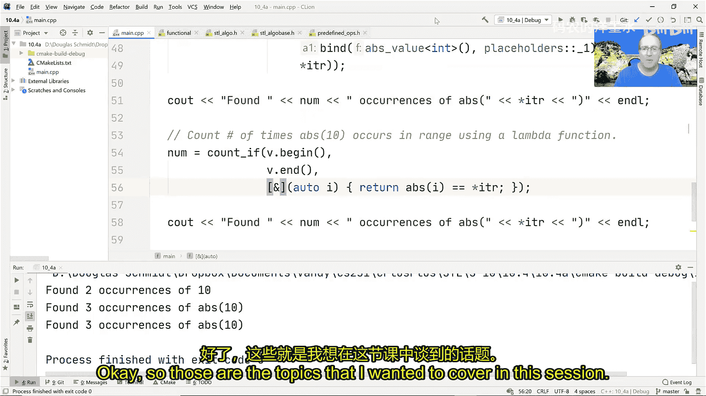

# 022：STL算法概述与初探 🔍


在本节课中，我们将要开始学习C++标准模板库中最具表现力的部分之一：通用算法。此前我们已经讨论了C++模板函数、模板类、容器、迭代器、函数对象以及各种适配器。现在，终于到了深入探讨算法的时候了。可以说，STL之所以如此受欢迎，很大程度上是因为它提供了大量现成的、功能强大的算法，这些算法可以完成许多过去需要手动实现的工作。


## STL算法概览 📚


STL算法主要包含在三个高级头文件中：`<algorithm>`、`<numeric>` 和 `<functional>`。其中，大部分算法位于 `<algorithm>` 头文件中。`<numeric>` 包含一些数值计算函数，而 `<functional>` 中的函数对象虽然不严格算作算法，但它们也参与计算。


这些头文件提供的通用函数和方法可以实现多种操作，包括遍历容器、搜索、排序、插入、删除元素等。有趣的是，这些算法的实现方式使其不仅能与STL内置的容器和迭代器类（或结构体）完美协作，也能与自定义的实现（如自定义容器和迭代器）良好配合。甚至，它们还能与原生C风格数组以及指针算术一起使用，实现了“即插即用”的灵活性。


## 算法与容器的交互方式 🔄


有一点需要注意：算法通常不直接接收容器作为参数，而是接收指向容器的迭代器。这些迭代器范围（通常由起始和结束迭代器定义）才是传递给算法的对象。虽然存在少数例外，但这基本是通用做法。


当然，算法可以与任何传递给它的迭代器类型协同工作，只要该迭代器符合算法的预期（例如，随机访问迭代器或双向迭代器）。


## STL算法的分类 📂


STL算法大致可以分为四类。本节课我们将重点介绍第一类：**非修改性算法**。这些算法对迭代器范围进行操作，但不会改变它们所访问元素的值。典型的例子包括 `find`、`count` 和 `equal` 等算法。


第二类是**修改性算法**。它们同样操作迭代器范围，但可以改变容器或底层数组中数据项的值。例如 `copy`、`remove`、`swap`、`generate` 和 `fill`。

第三类是**排序和集合操作算法**。它们本质上属于修改性算法，但我们通常将其视为一个子类别。排序算法（如 `sort`）会按升序或降序排列容器内容，集合操作则包括求交集（`set_intersection`）、并集（`set_union`）和差集（`set_difference`）等。


第四类是**数值操作算法**，提供数值计算功能，例如 `accumulate`（累加）和 `inner_product`（内积）。


## 谓词算法（_if 后缀算法）🎯

在上述主要算法类别中，还存在一个以 `_if` 为后缀的子类别，称为**谓词算法**。例如 `find_if` 或 `count_if`。它们接收谓词（通常是函数对象，或通过否定器、绑定器等适配的函数对象），并对容器中的元素进行检查，根据谓词返回 `true` 或 `false` 来决定执行相应的操作。


## 为何使用STL算法？ 💡


使用STL算法有诸多好处。首先，它们设计精良、高度优化，经过了充分的调试和算法复杂度分析，是优秀的现成工具，可以避免重复造轮子。


其次，它们与具体容器解耦，通过迭代器进行参数化，这使得算法更加灵活。例如，你无需为不同类型的容器编写大量算法，只需少量容器，然后使用指向这些容器的迭代器来调用算法，这大大减少了STL的接口复杂度。


此外，所有具有相同迭代器类型的容器都可以使用相同的算法。不同算法对迭代器类型有不同要求，例如 `sort` 算法期望一个随机访问迭代器范围。如果你传递一个双向迭代器，编译器会报错。

## 关键的非修改性算法简介 🧩


在深入代码之前，我们先概述一些关键的STL非修改性算法。以下列表虽不完整，但极具代表性：


*   **`adjacent_find`**：遍历范围，查找两个相邻且相等的元素。你可以自定义“相等”的含义，用于查找冲突或重叠等场景。
*   **`count` / `count_if`**：计算范围内特定值出现的次数，或满足谓词条件的元素个数。
*   **`equal`**：如果两个范围的值相等，则返回 `true`。
*   **`find` / `find_if` / `find_if_not` / `find_end` / `find_first_of`**：一系列查找操作，本质上是线性搜索。
*   **`for_each`**：遍历范围，对每个元素调用指定函数（或函数对象），并返回该函数所有计算的结果。
*   **`mismatch`**：查找两个范围中第一个出现差异的位置，类似于Unix工具 `diff`。
*   **`search`**：在范围内查找子序列。


使用这些算法时需要注意其前提条件。以 `equal` 算法为例，它接收第一个范围的起始和结束迭代器，以及第二个范围的起始迭代器。它期望第二个范围至少与第一个范围一样大。如果不满足，程序将产生未定义行为。因此，在使用这些算法前，最好先进行一些健全性检查，例如确认范围大小。


## 代码示例：`find_if` 算法 🚀

现在，让我们通过代码示例来具体了解。第一个示例将演示我们之前讨论过的谓词、函数对象以及一些简单算法。


我们将定义一个**有状态的函数对象** `is_greater_than`。它的构造函数接收一个值并存储起来，其函数调用运算符则检查传入的元素是否大于存储的值。


```cpp
template <typename T>
class is_greater_than {
private:
    T value;
public:
    is_greater_than(const T& v) : value(v) {}
    bool operator()(const T& element) const {
        return element > value;
    }
};
```


接着，我们使用 `find_if` 算法（非修改性算法家族的一员）进行演示。我们创建一个 `deque` 并搜索大于特定值的元素。


**示例1：使用自定义函数对象**
```cpp
std::deque<int> dq = {10, -5, 20, 30, -10, 40};
int search_val = 5;
auto it_custom = std::find_if(dq.begin(), dq.end(), is_greater_than<int>(search_val));
if (it_custom != dq.end()) {
    std::cout << "Found (custom functor): " << *it_custom << std::endl;
}
```
`find_if` 会遍历容器，对每个元素调用我们的谓词，直到找到第一个使谓词返回 `true` 的元素，然后返回指向该元素的迭代器。


**示例2：使用 `std::bind` 与预定义函数对象**
我们可以使用新的 `std::bind` 来替代自定义函数对象，结合预定义的 `std::greater` 函数对象。
```cpp
search_val = 20;
auto it_bind = std::find_if(dq.begin(), dq.end(),
                            std::bind(std::greater<int>(), std::placeholders::_1, search_val));
if (it_bind != dq.end()) {
    std::cout << "Found (with bind): " << *it_bind << std::endl;
}
```
这里，`std::bind` 将 `search_val` 绑定为 `std::greater` 的第二个参数，第一个参数 `_1` 是占位符，代表来自容器的每个元素。

**示例3：使用Lambda表达式与捕获子句**
这个例子展示了C++泛型Lambda和**捕获子句**的用法。
```cpp
search_val = 40;
auto it_lambda = std::find_if(dq.begin(), dq.end(),
                              [search_val](const auto& i) { return i >= search_val; });
if (it_lambda != dq.end()) {
    std::cout << "Found (with lambda): " << *it_lambda << std::endl;
}
```
Lambda表达式 `[search_val](const auto& i) { return i >= search_val; }` 中的 `[search_val]` 就是捕获子句。它使得局部变量 `search_val` 可以在Lambda函数体内被访问。你也可以使用 `[&]` 来通过引用捕获所有局部变量，但显式捕获通常更清晰、更安全。


运行上述代码，将成功找到符合条件的值。


## 代码示例：`count` 与 `count_if` 算法 📊


接下来，我们看看 `count` 家族的算法。我们定义一个计算绝对值的泛型函数对象 `abs_value`。


```cpp
template <typename T>
class abs_value {
public:
    T operator()(const T& x) const {
        return x < 0 ? -x : x;
    }
};
```


**示例1：基本 `count` 用法**
```cpp
std::vector<int> vec = {10, -10, 20, 30, -10, 40};
auto iter = std::find(vec.begin(), vec.end(), 10); // 找到第一个10
if (iter != vec.end()) {
    int cnt = std::count(vec.begin(), vec.end(), *iter); // 计算10出现的次数
    std::cout << "Count of " << *iter << ": " << cnt << std::endl; // 输出 2
}
```


**示例2：使用嵌套绑定器的 `count_if`**
这个例子演示了相对复杂的**嵌套绑定器**用法，用于计算绝对值等于10的元素个数。
```cpp
int cnt_if = std::count_if(vec.begin(), vec.end(),
    std::bind(std::equal_to<int>(),
              std::bind(abs_value<int>(), std::placeholders::_1),
              *iter));
std::cout << "Count (abs value) of " << *iter << ": " << cnt_if << std::endl; // 输出 3
```
解析：
1.  `std::bind(abs_value<int>(), std::placeholders::_1)`：内层绑定，对每个元素 `_1` 应用 `abs_value` 函数对象，得到其绝对值。
2.  `std::bind(std::equal_to<int>(), ..., *iter)`：外层绑定，将上一步得到的绝对值与 `*iter`（即10）进行比较。
这样就能统计出 `10`、`-10`、`10` 这三个值为10（绝对值）的元素。


**示例3：使用Lambda表达式简化**
嵌套绑定器可能难以理解和编写，使用Lambda表达式通常更直观：
```cpp
int cnt_lambda = std::count_if(vec.begin(), vec.end(),
                               [iter](const auto& x) { return abs_value<int>()(x) == *iter; });
std::cout << "Count (abs value with lambda) of " << *iter << ": " << cnt_lambda << std::endl; // 输出 3
```
这里，Lambda通过捕获子句 `[iter]` 获取了外部迭代器 `iter`，并在函数体内直接调用 `abs_value` 函数对象进行比较，代码清晰易懂。


## 总结 🎓


本节课我们一起学习了STL算法的基本概念和分类。我们了解到STL算法主要分为非修改性、修改性、排序/集合操作以及数值操作四大类，并且存在以 `_if` 结尾的谓词算法变体。


我们通过 `find_if` 和 `count`/`count_if` 的代码示例，深入探讨了如何结合自定义函数对象、`std::bind` 绑定器以及Lambda表达式来使用这些算法。特别是，我们看到了有状态函数对象、嵌套绑定器以及Lambda捕获子句的实际应用。



STL算法的强大之处在于其高度的通用性、优化性能以及与迭代器模型的紧密集成，使得我们能够以声明式、高效的方式处理数据，而无需关注底层细节。在接下来的课程中，我们将继续探索更多类型的STL算法。