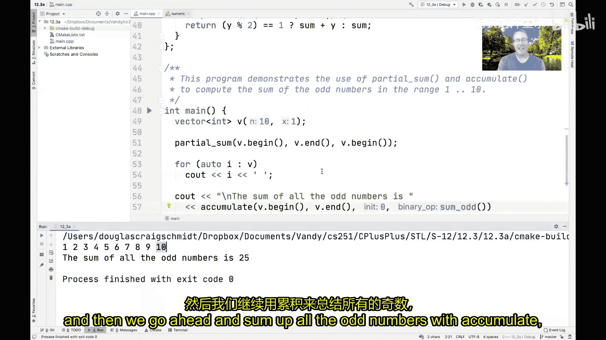

# 029：集合、堆和数值算法 🧮

在本节课中，我们将要学习C++标准模板库中最后一部分通用算法。我们将重点探讨集合算法（如并集和交集）、与堆相关的算法（用于实现堆排序），以及数值头文件中的一些方法（如累加和部分和）。通过本课的学习，你将掌握这些高级算法的基本用法和应用场景。


---


## 集合算法


上一节我们介绍了多种通用算法，本节中我们来看看专门用于处理有序集合的算法。这些算法包括集合的差集、交集、并集和对称差集，它们都要求操作的区间是已排序的。


### 集合差集

集合差集定义为：出现在第一个集合（区间）中但不出现在第二个集合中的元素。这是一个有方向的操作。此外，还有对称差集，它不考虑元素出现在哪个集合中，计算两个集合中不共有的元素。


对于所有集合算法，你可以依赖默认行为（即对数据类型使用小于操作进行比较），也可以提供一个自定义的比较函数。我们接下来的例子都将使用内置的小于操作符，并且操作的数据类型都是整数。

以下是使用内置数组计算集合差集的示例。


```cpp
int a1[] = {1, 2, 3, 4, 5, 6, 7, 8, 9, 10};
int a2[] = {2, 4, 6, 8, 10, 12, 14};
int answer[std::distance(std::begin(a1), std::end(a1))];

std::sort(std::begin(a1), std::end(a1));
std::sort(std::begin(a2), std::end(a2));
auto it = std::set_difference(std::begin(a1), std::end(a1),
                              std::begin(a2), std::end(a2),
                              std::begin(answer));
int diff_size = std::distance(std::begin(answer), it);
```


首先，我们定义了两个大小不同的数组 `a1` 和 `a2`。然后，我们创建了 `answer` 数组来存储结果，其大小被定义为 `a1` 的大小。接着，我们对两个数组进行排序，因为 `set_difference` 算法要求输入区间有序。最后，我们调用 `std::set_difference`，它返回一个指向结果末尾的迭代器，我们可以用它来计算差集的大小并输出结果。

以下是使用 `std::set` 容器计算集合差集的示例。主要区别在于，`set` 容器本身已排序，因此无需显式排序，并且输出时需要使用插入迭代器适配器。


```cpp
std::set<int> s1 = {1, 2, 3, 4, 5, 6, 7, 8, 9, 10};
std::set<int> s2 = {2, 4, 6, 8, 10, 12, 14};
std::set<int> s3;
std::set_difference(s1.begin(), s1.end(),
                    s2.begin(), s2.end(),
                    std::inserter(s3, s3.end()));

int diff_size = std::distance(s3.begin(), s3.end());
```


在这个例子中，我们使用 `std::inserter` 将结果元素插入到 `s3` 集合的末尾。由于返回的迭代器类型是插入迭代器，我们通过计算 `s3` 的 `begin()` 和 `end()` 之间的距离来获取结果大小。


运行上述代码，两种方法都会输出相同的差集结果：`{1, 3, 5, 7, 9}`，即第一个集合中不在第二个集合中的奇数。

---


### 集合交集


集合交集是另一个常见的集合操作，它返回同时出现在两个集合中的元素。与差集类似，它也要求输入区间有序。


以下是计算集合交集的示例。

```cpp
int a1[] = {10, 20, 30, 40, 50};
int a2[] = {10, 20, 60, 70, 80};
int result[std::min(std::size(a1), std::size(a2))];

std::sort(std::begin(a1), std::end(a1));
std::sort(std::begin(a2), std::end(a2));

auto it = std::set_intersection(std::begin(a1), std::end(a1),
                                std::begin(a2), std::end(a2),
                                std::begin(result));
int inter_size = std::distance(std::begin(result), it);
```


我们定义了两个数组并排序，然后调用 `std::set_intersection`。结果数组的大小不会超过两个输入数组中较小的那个。运行程序后，交集结果为 `{10, 20}`，只有这两个元素同时出现在两个数组中。


---

### 集合并集


集合并集返回出现在任一集合或同时出现在两个集合中的所有元素。同样，输入区间必须有序。

以下是计算集合并集的示例，这次我们使用 `std::vector` 和 `std::back_inserter` 来动态存储结果。

```cpp
int a1[] = {5, 10, 15, 20, 25};
int a2[] = {10, 20, 30, 40, 50};
std::vector<int> answer;

std::sort(std::begin(a1), std::end(a1));
std::sort(std::begin(a2), std::end(a2));

std::set_union(std::begin(a1), std::end(a1),
               std::begin(a2), std::end(a2),
               std::back_inserter(answer));

int union_size = answer.size();
```

我们使用 `std::back_inserter` 将结果插入到初始为空的 `vector` 中，因为它可以按需增长容器大小。运行程序后，并集结果为 `{5, 10, 15, 20, 25, 30, 40, 50}`，包含了两个数组中的所有不重复元素。

---

## 堆算法

现在让我们将注意力转向堆。堆是一种部分有序的、几乎完全的二叉树数据结构。在堆中，父节点的值总是大于（或小于，取决于排序方向）其子节点的值。这种结构使得插入新元素和提取最大/最小元素非常高效，时间复杂度为 O(log n)。

堆的一个关键特性是，它可以高效地使用 `std::vector` 等连续存储容器来实现，因为其“几乎完全”的性质意味着树的深度不超过 log n。

我们将通过实现堆排序来演示堆算法，并将其与STL内置的排序算法进行性能比较。


以下是堆排序的实现步骤。


```cpp
template <typename RandomIt, typename Compare>
void heap_sort(RandomIt first, RandomIt last, Compare comp) {
    // 1. 将区间转换为一个堆
    std::make_heap(first, last, comp);
    // 2. 将堆转换为有序序列
    std::sort_heap(first, last, comp);
}
```

`std::make_heap` 将给定的随机访问区间重新排列成一个堆结构。`std::sort_heap` 则对一个已经是堆的区间进行排序，它反复将堆顶元素（最大或最小）移动到末尾，并重新调整剩余部分以维持堆属性，最终得到一个完全有序的序列。

为了比较性能，我们创建了一个包含200,000个随机整数的向量，并分别用堆排序和STL的 `std::sort`（内省排序）进行排序。结果显示，堆排序耗时约275,000微秒，而 `std::sort` 仅耗时约62,000微秒，说明STL的排序算法经过了高度优化。


---

## 数值算法

最后，我们来看看数值头文件 `<numeric>` 中的一些算法。这些算法主要用于数学计算，例如累加、内积和部分和等。我们将重点介绍 `std::accumulate` 和 `std::partial_sum`。


首先，我们定义一个辅助函数对象 `sum_odd`，它只累加奇数值。


```cpp
struct sum_odd {
    int operator()(int sum, int value) const {
        return (value % 2 != 0) ? sum + value : sum;
    }
};
```


接下来，我们创建一个大小为10的向量，初始值全为1，然后计算其部分和。


```cpp
std::vector<int> vec(10, 1); // {1, 1, 1, 1, 1, 1, 1, 1, 1, 1}
std::partial_sum(vec.begin(), vec.end(), vec.begin());
// 现在 vec 变为 {1, 2, 3, 4, 5, 6, 7, 8, 9, 10}
```

`std::partial_sum` 计算区间内元素的部分和，并将结果存储回原容器或另一个输出迭代器。在上面的例子中，它计算了前10个自然数的部分和。


然后，我们使用 `std::accumulate` 和 `sum_odd` 函数对象，计算这个部分和向量中所有奇数的总和。


```cpp
int total_odd = std::accumulate(vec.begin(), vec.end(), 0, sum_odd());
// total_odd 的结果是 25 (1 + 3 + 5 + 7 + 9)
```


`std::accumulate` 对区间内的元素进行累积操作，从一个初始值开始，并应用一个二元操作（默认为加法）。在这里，我们使用自定义的 `sum_odd` 来只累加奇数。



运行程序，输出验证了部分和向量为 `{1, 2, 3, 4, 5, 6, 7, 8, 9, 10}`，其中奇数的累加和为25。

---

## 总结

本节课中我们一起学习了C++ STL中最后一部分重要的算法。我们探讨了用于处理有序集合的差集、交集和并集算法，了解了它们的使用前提和实现方式。接着，我们深入研究了堆数据结构及其相关算法，并通过实现堆排序来理解其工作原理和性能特点。最后，我们介绍了数值算法中的 `std::accumulate` 和 `std::partial_sum`，展示了如何利用它们进行灵活的数学计算。

至此，我们已经涵盖了STL的大部分核心内容，包括函数模板、类模板、各种容器、迭代器、函数对象以及丰富的算法库。希望本系列课程能帮助你建立起对C++标准模板库全面而深入的理解。