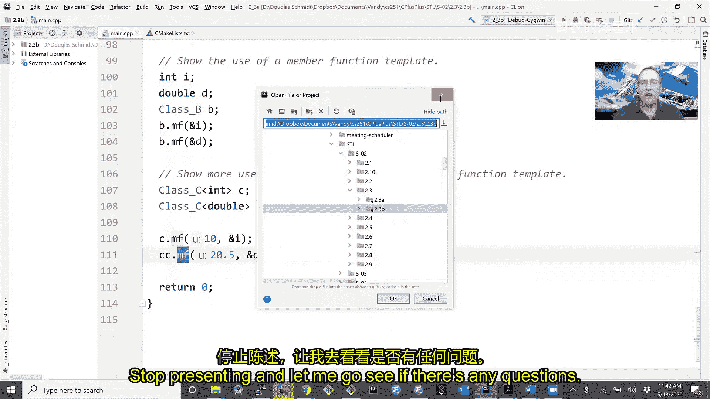

# 【全集】范德堡大学 C++标准模板库 中英字幕 1080P p02 Lecture 2 - 模板函数与模板类 part1 -BV1KWiCBWE7M_p2-

Hello and welcome to the first session on my C++ standard template library by example webinar series。

😡，What we're going to be doing over the next weeks or two。

 we'll be going through a number of examples of C++ STL code。

 and I'll be talking about the various C++ features that the standard Tlate library relies on and we'll also be looking at lots of examples of the fascinating aspects of the C++ standard template library。

😡，What I typically do in these sessions is I go ahead and start off by showing you where you can find the source code and then we'll start looking through examples there's a few assumptions built in here。

 most of which deal with the fact that I expect people have some familiarity with C+ plus so I'm not going be spending a lot of time doing very basic C+ plus features like what's a for loop or an if statement or even a class for that matter but if you have any questions please don't hesitate to ask them what I typically do is i'll present some examples and then i'll go ahead and we will walk through any questions that you have so i'll typically do the questions after I present some of the code so if you have questions don't hesitate to ask them all the lessons here will be recorded and posted to my YouTube playlist so with that let's go ahead and start I will start by sharing my screen。

Okay。So you can if you go to my GitthHub account at the Douglas Craig Schchmidt slashC+ plus。

Folder you'll find all the code we're going to be covering that there's a bunch of things here some of which we'll cover now some of which we'll cover later。

 but the main body of what we're going to be looking at will be in the STL subfolder under my C++ directory so that's where you can find all the code and all the code should build and work out of the box if you've correctly installed the C lion interactive development environment for c++。

😡，Okay， let us go ahead now and I will share sea lion。

So some of the discussions we're going to have will be conceptual， the bulk of what we'll be doing。

 of course we'll be looking at code， but there will be a few things that will be conceptual and that's where we're going to start here to begin with。

😡，So C++ as you probably know by now is what's called a strongly typed language and that means it can do type checking。

 this is helpful because it helps to resolve errors at compile time rather than run time or link time rather than run time。

 it also helps to make sure that the right amount of memory is allocated for the objects that are created and so on。

😡，But one of the downsides is what happens if you want to have operations that can work on many different types of data languages like C that came before C++ didn't have good support for this capability they didn't support overloading of methods or operators they didn't support any way of parameterizing information。

 so as a result people did kind of hacked up things like use hash defines。😡。

Another way to do this is to use basically void stars。

 which is another common technique of trying to fus around with the C style type system neither of these approaches are good for various reasons we'll talk about later。

😡，What we really want to do is we want to be able to take advantage of modern object orientage features in particular C+ pluss concept of parameterized types or templates and so what you can do is you can basically use templates to parameterize functions and classes and then you can parameterize them based on things like types or values or even other things like methods and so on functions。

😡，So that's what we're going to talk about here and we're going to talk about two different types of templates。

 one type of template is called a function template and as the name implies it works with functions which are firstclass entities and C++ and the other type of element will be classes or template classes and template classes are basically groups of member functions that work together to parameterize data types and more or less a wholesale manner。

 for example， you could have a generic template for a stack where you could parameterize the type of elements in the stack and you could have operations like push and pop and top defined on that stack。

😡，So the reason why we're going to focus on these elements first is of course they are the essence of the C+ plus standard template library and so if you understand function templates and class templates everything else is going to make a heck of a lot more sense if you don't understand these concepts then you'll be quickly lost so I'm going to cover this material today we'll see how far we get we'll pick up what we didn't cover today tomorrow and we're just going march through this material piece by piece。

😡，So let's go ahead now and talk about something that's a bit more technical。

 and we're going to start by taking a look at some examples that motivate the need for function templates。

😡，So here you can see a simple class where we've got。😡。

The way of doing this before we had template C++ has long supported the concept of function overloading or operator overloading where you can have a function with a common name like plus or add and then you can have different parameters you could have。

😡，Plus for adding ints you could have plus for adding longs， you could have plus for adding doubles。

 but the problem with this approach is it very quickly doesn't scale because you have to keep rewriting the same boilerplate logic again and again and again。

 which quickly becomes tedious and error prone。😡，So what we're going to do instead is we're going to use the C+ plus template function mechanism which I'm showing you here and as you can see instead of having to redefine these methods over and over again。

 we're going to define one method which is going to be a method called add and we're going to parameterize the types that add works with so in this particular case we're going to say template type name T type name is just a placeholder for a type and then we're going to have two parameters A and B of type T and then it's going to return an instance also of type T so I think you'll agree with me that this piece of code here is much more concise and ultimately more reusable than having to repeatedly rewrite the code over and over again as we did up there。

😡，So let's go ahead and take a look at a simple example that will illustrate how this all works。

 so this is going to compare and contrast the use of non template functions just。😡。

The plus functions be sub above。And then we're going to show how the C++ compiler and Lier work together to synthesize the template functions。

😡，Okay， so down here we're going to see we have int I J and K， we give some values to those。

 we have longs， LM and N， and we have doubles A， B and D。😡，Now。

 we're going to go ahead and just use the overloaded plus function to compute the results of adding those things。

 And if we run this program， you'll see that it。It gives the result that you would expect。

So you can see that we're going to get 11， 15 and 16， that was the non template version。

Then let's go down here and see how we can use templates so we're rather than having to rewrite those pieces of functionality each time instead we're going to use the add method and we're going to explicitly define the template types so we're going to say add I and J as ins and return K add L and M as longs and return n add A and B as doubles and return D and what happens under the hood is that the C++ compiler will go ahead and synthesize the implementations for add of int add of long and add of double and in fact in this particular case it can actually inline the code so this will be blazingly fast while still being strongly typed and obeying the other semantics that you'd expect with a function call。

 for example， evaluating the parameters at point of call so if we go over here and we take a look at what happens when we ran this code you can see we got the same results for using the template versions as well as the results for using the non-template versions。

And that's a good thing， so that's a good example of how you can use templates effectively to do replacement of having to tediously rewrite the code。

 but it is a little bit more tedious at some level we have to put the int long and double here or maybe better way to say it this we don't have to do this but we did do it that way so let's go ahead and take a look at another C++ feature called argument deduction and we'll see how it's able to avoid needing to put in those extra parameters。

😡，So if you take a look here， you can see that this is essentially the same part of the code as before。

 we've got our ad template and the Sea lion interactive development environment kind of hides unnecessary syntax so when it knows it's a template。

 it can do a little bit of cleanup on the screen but you can always just click on it it'll go ahead and show you what's there。

😡，So if you take a look here， you'll see that we have adding of ints and longs。

 we can also easily do doubles and what we've got is we've omitted the explicit type information so we no longer have to put you know int here we can leave that out altogether and the C++ compilers are smart enough to be able to deduce the arguments that are passed in this particular case。

😡，And of course， if we wanted to， we could also do something similar， we could say double。

D equal add 10。5 and 16。7。And you can see how we can just synthesize this literally on the fly and when we recompile this。

 then the compiler will go ahead and give the right result。

 so let's just add in the output operations here。😡，You can see that we're using C plus plus。

IoStams which is a way of being able to insert and extract data to and from sources of input and output and so if we go ahead and run this code let's go ahead and compile it they'll have to recompile so it takes a second to recompile everything but then once it's done we get back the results that we expect。

So this ability to do argument deduction is very valuable and very helpful。😡，Now。

 one thing to note is that with templates， especially the ones we've shown here。

 you can't mix and match types。 So templates really want to have specific types。

 So you can see here if we try to do add I and L where I is an int and L is along。

 this isn't going to work because the template up here is defined with a single parameter。

 If we wanted to make this work， we could fix it by saying type name U。😡。

And then we could come along and say， you here。And this then gives us the ability to mix and match different types there are pros and cons with doing this of course because you have to be careful that the types are going to have the right precision to hold the data that they need。

 but it's an option and we'll talk more about that later when we get a little further along but for right now let's keep it simple and just have a single parameter that we use for the template。

😡，Okay， so that illustrates how the。Type the argument deduction works with C++ templates by the way。

 if you have any questions whatsoever don't hesitate to click on the chat button and type your question in and that shows up on my screen so I can tell someone has a question and then that'll trigger me to go ahead and answer the question。

😡，Okay， so those are some very simple examples of using templates， these are function templates。

 of course， let's continue on and we'll take a look at yet another example。😡。

And this example is going to be。😡，A little bit more interesting and this is going to show how you can actually templaize not only all the parameters pass to a function。

 but also the return value so you can take full control over how the information is going to be provided so as you can see in this particular case we're going to have a method a function called max and max is going to take。

😡，An A of type T and a B of type U， and it's going to see whether a is less than B， and if so。

 it's going to return B because we're looking for the max， otherwise it returns A。😡。

And we can also control the type of the return value。

 And this gives us very fine grain control over the precision And we need to do this。

So what we're going to do here is we're actually going to demonstrate how you can use this feature and it's kind of interesting because you can either provide all the parameters as we do with this called a max here。

 where we have an inch return and two character values and we'll talk about how that works in a second。

😡，Or you can also just go ahead and provide the return type which in this case would be double for this example so in this case we're telling it hey you need to use a double return type and then it can deduce that it's passing in doubles as the parameters so you don't actually have to say something like this double double to and trouble you can just say double and it'll deduce the other ones the C++ compilers often can't deduce the return values but that's where we can provide a hint to that now you'll notice that my interactive development environment my sea lion environment highlighted this double field here。

😡，This double type and when I click on the little yellow lantern or yellow。

 I guess it's a light bulb， it tells me that I can go ahead and use an auto。😡。

And so if I put auto in here， this uses a feature that came into C plus plus about maybe 10 years ago or so came in with the C plus plus 11 version of the standard。

 and it basically allows the compiler to deduce the variable type based on the calls or some other their context information。

 So it's able to figure out that this is actually a double。 So I don't have to type double。

 Those of you who are familiar with other languages like jascript and so on。 and even Java nowadays。

 may familiar with this concept because you can use things like var and vowal and so on to do much the same thing。

 Sometimes type deduction is great。 sometimes type deduction is confusing。

 I'll use it appropriately as we go through the tutorials。

 but just keep in mind that that's there to try to save on the amount of effort you have to do to type out especially long types。

Okay， so if we go ahead and compile and run this thing。😡。

Then it should give us the results that we want。And you can see we get 5。

5 and 98 and if we look back over here， you can see that 5。5 of course。

 is the max of these parameters， but where the heck is 98 coming from and 98 is coming from the fact that C++ will promote the character literals to integers。

😡，And B， I believe， has the value of 98 in the ASI character sequence。

 We could also do some other stuff here。 We could do something like this， if we wanted to。

See if we can make this。Do something sensible。 So now when we compile and run this code。

You can see we get B instead of 98 and that again is because B is。

Higher in value than a which comes one before。 So this is just demonstrating how we can take control of these things Now this particular example we don't actually have to put in here this is kind of interesting。

 So if you do this。Then the compiler can figure out what you're actually trying to do and you don't actually have to give the return type because you can deduce it to compiler magic。

 but I'm just showing you that there's various ways of being able to take control over the parameters you pass to the functions that you're using。

😡，Okay， so that's another example hopefully that's pretty clear again this is fairly straightforward stuff and I'm showing this to you because when we get into the more advanced features with the C++ standard T library knowledge of this level of detail is going to make things a lot more straightforward to understand。

😡，So let's move on to the next example。😡，Yeah。And this should also be another function template example。

And this is a fun one。 So what this is going to show is that you can actually。😊。

Overload or what's called specialized template functions with nontemplaized versions and this is a very very useful feature C++ and the standard template library uses this very heavily to optimize certain types of data structures for example it can optimize things like copying character arrays and so on and so I'm going to show you here how the compiler will always give preference to the non-template version when given a choice between a template method or a template function with a given name and a non-template function with the same name and obviously the same number of parameters。

😡，And so let's take a look at an example。 Here's the example。 We have function F， which。

 as you can see， is a template function and。The generic version says template。 It。

 It could do something more interesting than that， but it just goes ahead and says template。

And then we're also going to have an overloaded non-template function。

Which is also known as F and this version is going to use the non tempemplized variant of this and the non tempemplized version is just going to demonstrate how we can use。

😡，Template specialization and how the compiler gives preference to that when given a choice again it's not doing anything particularly interesting or novel in this particular case。

😡，So this example is going to show how we can use template functions and non template functions and how the compiler will choose amongst them。

😡，So you can see here we're going to have the function F， and we're going to pass in one and two。

 and those look like ints。😡，Then we have a call to F with the character literals A and B。

 and we're going to see how those are characters and they are you'll be curious to see how that works in a second and then finally we also have a version where we have the value one which is a number and integer and then the character B。

😡，So that obviously raises lots of interesting questions。

 Which of these different functions are called by the compiler， Does it call this one。

 Does it call this one， How does it work， And I think the answers may surprise you。

 So let's go ahead and run this code。And you can see here the results say template sorry non template template non template so keep that in mind so it's non template template non template well this one's pretty clear because that's an int the two parameters or ints and so it uses these values to take the nont selection。

😡，The one down here indicates something very important with templates。 when you use template methods。

 they don't do any automatic type promotion In the previous example。

 we'd seen how C++ can promote types from characters to ints。 but in this particular case。

 when you use templates， no type promotion is performed。

 So this is going to choose to synthesize a version of this template with cares as its parameter。😡。

And then finally down here， you can see again， because there's no type promotion done with templates。

 this version selects the int variant of this F function。

 and it does the type promotion of the B character up to an int。😡。

So those are the values there and this can be very important because sometimes you'll get some strange warnings or strange errors from your compiler and it says such and such a call is ambiguous and often the reason is because you're forgetting that templates have to match exactly。

😡，Okay， so let's go ahead and move on to another example。😡，So now let's take a look at this one。

 and I think this might be our last template function example。😡。

So this one's going to demonstrate a bunch of interesting things。

 this is going to show how you can either explicitly give the parameters you can let the compiler figure out what to do and then also' is going to show how you can overload template parameters so if you come up here and we look in the include list we'll see that there's a file called min。

😡，And if we go ahead and go into that file， you can see we have a couple of template functions defined here。

 So here's one called min。 that takes two parameters。

P1 and p2 and it goes ahead and computes the min notice how one way to do this is by using an ifL statement that's kind of the the most overt way of doing things。

 but you could also use the so-called ternary operator and theterernary operator more concise and you can basically say。

😡，P1 less than P2 question mark， in which case it chooses P1， otherwise it chooses P2。

 so this is called the question mark colon operator or the Ternary operator。😡。

And this particular operator is different from the if operations above because the ifL operations is a statement that does not explicitly yield a value in this case we have to return from the method。

 but the F statement doesn't return a value whereas the turnernary operator is an expression and so it does return a value and your knowledge may vary I probably if I was writing production code would be more likely to use the ternary operator。

😡，But when you're first starting out， that can be a little bit daunting。

 so I didn't do it in this case。Here's another example where we're showing a three parameter version of men this is just demonstrating that you can have。

😡，Prameter overloading on generic。Templates。And in this particular case， we pass three parameters in。

 and you can see we use the two parameter version in the context of the three parameter version。

 So we check to see whether the min of P1 and P2 is less than P3。 And if it is。

 then we go ahead and we return the min of P1 and P2。 Otherwise we return P3。

 So that's just kind of demonstrating how you can mix and match between overloaded parameters that are themselves templates。

Then if you look down here， you can see that we go ahead and we use min。😡。

Of ints we do min on doubles notice that we can't do this because again the types have to match exactly and we didn't have a two parameter version of min we had a one parameter one template parameter version of min so that won't compile and then down here notice how I can basically put a little explicit cast here and say yeah I realize that that 10 is an integer but I want you to promote it to double so this will tell the compiler go ahead and promote this to a double and then the final thing we do is we show the three parameter version of all these things so we have。

😡，Men of three， six and four and of course， if we run the code here。😡。

Then it should give us the answers that we expect， which is good。Okay， so that。

 I think is the final function template example。😡，What we're going to do now。

 let me just double check this to make sure I'm not misleading you。

 Now we're going to start talking about class templates。And we'll go through some of these。

 I'm not sure how many we'll get through today， maybe we'll get through all of them， maybe we won't。

 but we'll go through some。😡，So this particular example is really interesting and this is going to show the use of class templates as opposed to simply templates that work with functions。

 and it's also going to demonstrate the difference between pass by value and pass by reference semantics for C+ plus parameters and return values。

 so we're going to spend some time on this particular example because it's pretty cool。😡。

So the first thing let's do let's go into the project and let's take a look at the files that we've got here。

 so we've got three files， we have main。cppP， which is what we're looking at here。

And then we also have pair dot H and something called type wrappper dot H。

 And we'll use type wrappper at various points throughout the course。

 And it's mostly there to show you what's going on under the hood with respect to how C plus plus handles things like passing parameters by value and so on。

So here is the。Example we're going to look at， we're going to define a class。

 which will be a template class called pair。And there already is a class called pair as part of the standard template library。

 so I created a new namespace called MyPair and I stuck this template inside of the My pair namespace namespace is kind of like a package in Java it's a way of being able to define a namespace where you can have classes or functions with the same names as classes or functions in other namespaces and they don't collide with each other it avoids what's called namespace collision。

😡，So let's take a look at the pair class， so the pair class is parameterized by one type key。

 and it's going to define two fields to what's called data members and C++ one field is called first。

 one field is called second。😡，And it also defines a little method called Max。

 and we'll come back and look at max later。Now we're also going to illustrate some interesting things here about passing by value versus passing by reference。

 this is a very important concept to understand when you deal with C++ because C++ especially C++ STL does a lot of things by value but there's pros and cons to doing things by value and one of the most obvious things is you end up with extra copies if you're not careful and you don't know how to use more advanced features in C++ like the move operation and。

😡，I think it's our value references and so on， So let's take a look first at the version that's going to have pass by value set to this。

😡，Compilile time parameters so we're going to set pass by value to zero to start out with what that means is we're going to use reference semantics so you can see the constructor for pair takes two parameters of type con t ref。

😡，And what that means is that we don't actually pass the parameters by value。

 we pass references to the parameters， we'll see how the parameters are used in the second。

 and then we go ahead and we store those parameters into the first and second data members。😡，Okay。

 so that's what that one's going to do。 Now let's go over and look at the main program。

 So you're going to see here that we're going to have this thing called a type wrappper。

 which is going to wrap int And the reason we're going to use a type wrappper is we want to be able to see very specifically what's going on under the hood with respect to the constructors and assignment operators and deors and so on that are called when we're manipulating this particular set of classes in the way that we're doing。

😡，So let's take a real quick look at type wrappper type wrappper is just a way to print out what's going on under the hood so you can see we have a type wrappper constructor that just prints out it's the type wrappper constructor we have another type wrappper constructor that takes a parameter of type T and it prints that out we have one that takes a con Ref which is called the copy constructor we have another one that's called the move constructor we have an assignment operator we have basically the move assignment operator and we've got operator less than we've got something that will basically return an element it's called an implicit conversion and then the final thing we have here is a deor and we probably should make this be explicit for reasons we'll talk about later so you can see that these things are basically doing they're doing operations to convert stuff back and forth in fact I probably should。

😡，Print something here。Just to indicate that I was in。The operator key method here。Okay。

 so this is just there to kind of get some print statements to show up。😡，All right。

 so we do is we then go ahead and make a pair but now you can see it didn't like the explicit let me get rid of that I knew that was going to get me into trouble。

 get rid of explicit for this particular example， this example is just printing stuff out we're not trying to make production code with this so we make ourselves a pair of type wrappers to int。

😡，And we're going to call this， we're going to pass in P1 and P2 so you can see P1 and P2 are type wrappers to end。

And then we go ahead and we print out the max of these values。

 and then we're going to do the same thing except we're going to use doubles instead of ints。

 so up here we had type wrappper to int down here we do doubles， but otherwise the code is identical。

😡，All right， so let's go ahead and run this and I think we'll see some really interesting results。

 so before I do that though let me also show you the pair implementation so here's the。😡。

Pair implementation of max so you can see max is going to see if first is less than second and if it does it returns second otherwise it returns first and you'll notice that we did not define max in line。

 we defined this what's called out of line and whenever you do out of line definitions of templates you have to do a little bit of extra syntactic magic here to indicate that this max method is part of the hair template and that's just some wacky syntax you'll have to remember。

😡，Okay， so let's keep that in mind let's go over here now and let's run the example。😡。

And you can see here that。This particular version， which is the one that's passing by reference。😡。

Does some things under the hood so you can see that we have a constructor called for type T。

 and then there's a copy constructor that's called when we do this inside of。Pair。

 so if you go back over here to pair。😡，You can see that the copy constructor will be called here to initialize first and second。

 you can see that the constructor was called here to initialize P1 and P2 that's what we're seeing with these arguments。

 then you can see that we're also basically using this conversion operator to get the value that we want when we need to get an int。

😡，And then we've got a bunch of destructors that are called to clean everything up that's the pass by reference semantic。

😡，Let's go over here now and change the settings to enable pass by value。😡。

So now we're going to do pass by value semantics and I'll show you what the results are。

 and I think they're going to be pretty interesting to look at when you see how they run。

 assuming I can get this thing to run。😡，Let's say。There we go。

So when we do it with pass by value semantics wow， look at how much more stuff gets generated。

 so we have lots more calls to copy constructors because whenever you pass something by value the copy constructors called whenever you return something by value unless you're clever and use the value semantic features of C++ you have the copy constructor called we use the assignment operator so that simple piece of code which we'll look at in a second had a lot more stuff going on there's more deors called there are more copy constructors called there's assignment operator called it's very very complicated and obviously not what you want to do let's go back and take a look at the code just to see what it looks like。

😡，So here's the version that was passed by reference。😡。

That's what we looked at first and that was very concise and here's the version that does pass by value so the pass by value version does not initialize first and second in the base member initialization section instead it uses the assignment portion in the body of the pair constructor and it also passes the parameters by value and you can see that that generates a lot more stuff。

So， that's。Often why we want to pass。Things by constantant ref。

There's alternative ways of dealing with this and we'll talk about this later in the course having to do with newer features added to c plus and C plus plus 11 that support support so-called move semantics and move semantics are somewhat steeped in mystery so I will spend time later demystifying them for you but right now just kind of think about this in terms of the features that you need to know and love to be able to pass things efficiently so it really does make a difference so the thing to remember from this example often you want to pass things by contf and you usually want to initialize data members in the base member initialization section which is everything from。

😡，The colon up to the opening curly brace and what happens here is this is what's called initialization semantics and if you don't do that then instead you'll have to get the default constructors called for first and second followed by doing assignment semantics which is usually way more overhead so something that you should be aware of and it's just good practice to get into in general is to always make sure that you initialize your data members in a class in the base member initialization section and if you follow that simple rule your your code will be more efficient and you'll have fewer surprises with things like uninitialized variables let's see I think those were the main things I wanted to talk about in these examples let's see I think we have time probably for one more topic。

😡，And then we'll take a break and pick it up again tomorrow。Here is。Another example。

And this particular example is going to demonstrate the use of another template class。

 this is very common thing we're going to define a class called a container。😡，And it's a template。

 it's templatetized by type name T so it can have arbitrary parameters passed to it。

And this particular container is a very mindless container。

 it's just going to have an element and it's going to take an argument which is a con Ref in this case。

 and it's going to go ahead and assign the argument to the element。

 so it's using the base member neutralization section it's passing by reference so it's got all those good properties and then it's going to have a single template member function。

 which is going to increase the element count by one。😡，A very simple class。 I think you'll agree。

So when this particular example， this is what's called a template member function so let's go ahead and take a look at another example。

 This is an interesting example， This is another example that has a。😡。

It's similar to what we had before， but we're going to do some extra things with it and show some other cool C plus plus magic。

So we have a class called Class A and Class A takes a parameter of type key star。

 so it's a pointer to T， and it's going to go ahead and stash that away in a local data member in the class。

😡，And we define this to be explicit。 That just means that it will do no type conversions on your behalf。

 it's a way of guarding against accidents that are hard to track down in the code and you'll notice that we do in this constructor as we go ahead and we print out the name of the parameter as a type so you'll get a chance to see what C plus plus supports with respect to type inspection。

 It's not as or introspection。 it's not as powerful as the reflection capabilities you find in a language like Java。

 but it's still interesting and we'll see how that works in other cases later So this is an example of a class that has a constructor and it also has another template member function。

😡，So this particular one is going to do nothing more than just print out the name of the parameter that's passed to it。

😡，Now let's go look at some different things and this is where we get into some newer features in C++ this is what's called a member function template as opposed to a template member function seems like sort of a permutation of the name and you'll notice in this case we have class B that is not a template class up here we had class A that was a template class so down here we have class B that is not a template class however we have a member function template in that class。

😡，And member function templates have certain restrictions。

 They cannot be virtual and you can't therefore override them。

 So this will also go ahead and just print out the name of the type。😡。

And then finally we have class C， which is a template class of type T that has a member function template of type U so now we've got all the different permutations up here。

 we just had a template。😡，And it used the template in one of the template member functions down here。

 we had a nontempatized class that had a template type name， member function template。

 and then finally we had class C， which is a template class that has a member function template and the two types are different。

So let's go ahead and take a look at how this works。 Here's the main program。

We're going to go ahead and define ourselves a container of int。

 and we're going to increment it by one so that should give a value of eight。😡。

We're then going to go ahead and see how we could use the template member function for class A。

 which we parameterized by long and you can see we pass in the address of a long and that we call function F and pass in the address of a long down here we showed the use of a member function template as opposed to a template member function and you can see here how what happens is the compiler actually synthesizes different versions of MF one that works for pointers to ints and one that works for pointers to doubles。

😡，And then finally， down here， we show yet another example of a template class and a member function template where we go ahead and make ourselves a class。

😡，C instance that is parameterized by int， a class， the instance that parameterized by double。

 and then we go ahead and call MF。😡，And on C and on CC passing in the address of I and the address of D So when we run this code should do some interesting things。

 it'll give you an indication of what the type information looks like so here you can see that we have the value8 and then we have a bunch of type name so pointer to L pointer to along P pointer to int P pointer to double Pd and so on and so forth and so this is just illustrating how the type information is used and in this case we had an I as opposed to a pointer in this case we have a D you know we have a double as opposed to a pointer so this is indicating how type ID and name work for C plus plus is interest type introspection mechanism。

These are rather advanced features and you're not likely to stumble upon them right away。

 but when we get further into the depths of C++ STL you'll see that these types of mechanisms are used with C++ STL in order to do various cool things like template meta programmingm。

 which are ways to actually get your compiler and Lier to do the bulk of your program computation offline before the program actually wants。

😡，Okay well as you can see we got through a bunch of elements today we still have a whole bunch more things to go most of the rest of this stuff will be different variants of class templates we'll talk about things like template templates we'll talk about things like partial template specialization we'll talk about veryatic templates and so on all of which are absolutely fascinating topics those will come later though we'll start talking about them tomorrow so this is a kind of a good place to stop presenting and let me go see if there's any questions。

😡。

Aow great questions， is there any difference in template logic？😊。

Between classes versus strs I love this question so this is one of those things where C++ when it was originally devised had this motto of being as close to C but no closer and so initially initially C++ was called C with classes and that's the way it was defined at first and what that meant was they added classes to C beyond Strstrup and his team Andy Koig and Stan Liman and Jonathan Shapiro and so on  A&T Bell Labs at the time because guess it was actually yeah it was1 A&T Bell Labs initially they were very interested in adding objectored language support to C and this took place around 1980 so it's about 40 years ago it's hard to believe it's been that long and so C of course has strucks but strs have no access control mechanisms everything's public and a struck and you can't inherit Strs in C very easily so what they did with C++ was called Cfront it was a frontend transator that took。

C+ plus code and generated the corresponding C code， they added a new feature。

 a new capability a new type constructor type creator known as a class and really the only difference between a class and a struct is that an astruct all the fields。

😡，All the data members and member functions are public by default whereas in a class all the data members and the member functions are private by default so that's really the only difference you'll see the early versions of C plus plus STL usestructs extensively which always thought was kind of a botch becausestructs tend to expose all the private parts all the things that should be hidden in a way that makes you too familiar with them with later versions of STL I think people have moved more towards using classes which is much better but really there's no real difference in terms of the methods it's just that in a class everything is private by default in instruct everything is public by default so those are the two primary differences between them。

But that's a great question。So if there are no more questions。

 then we'll go ahead and wrap up for the day just to give you a sense of what I do after this class is done。

 I will go ahead and。😡，Render the video we've been recording this video。

 so I render the video and then they go ahead and I upload it to my YouTube playlist for C++ by example and people can come back and watch it and comment on it and so on so if there are any things that I talked about here that you were not really clear on and didn't really know enough to ask the question that's okay you can go back and rewat it again and I'll be happy to to answer any questions that you post on my YouTube channel we'll continue up tomorrow with our discussions of templates。

 primarily class templates and then from there we're gonna get into the much more interesting features of STL which include things like containers。

 vectors lists decks those are all sequential containers we'll also talk about various types of associative containers they'll be ordered associative containers。

 things like sets and maps we'll talk about unordered associative containers like unordered sets and unordered maps we'll talk about iterators well talk about。

All the gazillions of adapters that STL defines like iterator adapters and container adapters and function adapters we'll talk about functors there's a lot of really really cool material that we'll be covering here and I've also going to try to weave in modern C++ 11 C++ 14 and so features where appropriate to show you things like proper use of exception handling features that are now specified in the language like no except。

We'll talk about how to write exceptionafe containers that are trivially strongly exception safe without having to do much beyond no a few little tricks with no accept and swap we'll also spend some time talking about advanced features like move operations and move constructors and assignment operators and so on and so forth so there'll be lots of interesting things to cover some of the examples will cover are very simple like the ones we looked at today others will be much more interesting really little programs and their own right and so all all in all I think you'll learn a lot and also make sure that you take a look at the Github repository where all the code resides and feel free to clone it。

 take a look at it， play with it whatever you'd like to do if you have any things that you see that are mistakes or areas that require further clarification don't hesitate to let me know and I'll be happy to fix those as well。

So with that， thanks very much， everybody for coming and I will look forward to seeing you tomorrow。

