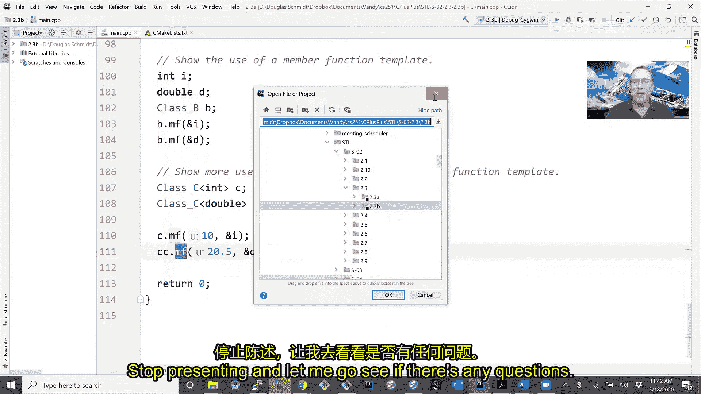

# C++标准模板库教程：第2讲：模板函数与模板类（第一部分） 🚀

在本节课中，我们将要学习C++标准模板库（STL）的基础——模板函数与模板类。我们将通过一系列示例，了解模板如何帮助编写更通用、更可复用的代码，并理解其背后的核心机制。


## 概述 📋

C++是一种强类型语言，这意味着它会在编译时进行类型检查。这有助于在早期发现错误，但也带来了一个问题：如何编写能够处理多种数据类型的通用操作？本节课将介绍C++的模板机制，它允许我们编写参数化的函数和类，从而优雅地解决这个问题。

## 模板函数 🛠️

上一节我们介绍了强类型语言带来的挑战，本节中我们来看看C++如何通过模板函数来解决代码复用问题。

### 模板函数的基本概念

在C++引入模板之前，为了实现通用操作，开发者通常需要为每种数据类型编写重载函数。这种方法不仅繁琐，而且容易出错。

以下是使用函数重载实现加法操作的示例：

```cpp
int plus(int a, int b) { return a + b; }
long plus(long a, long b) { return a + b; }
double plus(double a, double b) { return a + b; }
```

C++模板函数提供了一种更简洁的解决方案。通过定义一个参数化的函数，我们可以让编译器为不同的类型生成具体的实现。

以下是使用模板函数实现通用加法操作的示例：

```cpp
template <typename T>
T add(T a, T b) {
    return a + b;
}
```

### 模板函数的使用与参数推导

以下是使用模板函数和函数重载的对比示例：

```cpp
int i = 5, j = 6, k;
long l = 10, m = 5, n;
double a = 5.5, b = 10.5, d;

// 使用重载函数
k = plus(i, j);
n = plus(l, m);
d = plus(a, b);

// 使用模板函数（显式指定类型）
k = add<int>(i, j);
n = add<long>(l, m);
d = add<double>(a, b);
```

C++编译器支持参数推导，这意味着在调用模板函数时，我们通常可以省略类型参数，编译器会根据传入的实参自动推导出模板类型。

以下是使用参数推导的示例：

```cpp
// 编译器推导出 T 为 int
k = add(i, j);
// 编译器推导出 T 为 long
n = add(l, m);
// 编译器推导出 T 为 double
d = add(a, b);
```

### 控制返回类型与参数类型

模板函数允许我们精确控制参数和返回值的类型。这对于处理不同精度或类型的运算非常有用。

以下是一个返回两个值中较大者的模板函数示例，它展示了如何独立控制参数类型（`T`, `U`）和返回类型（`R`）：

```cpp
template <typename R, typename T, typename U>
R max(T a, U b) {
    return a < b ? b : a;
}

// 使用示例：指定返回类型为int，参数为两个char
int result = max<int>('a', 'b');
// 使用示例：指定返回类型为double，参数推导为double
double result2 = max<double>(5.5, 10.2);
```

C++11引入的 `auto` 关键字可以用于自动推导变量类型，进一步简化代码。

```cpp
// 编译器推导 result3 为 double 类型
auto result3 = max<double>(5.5, 10.2);
```

### 模板函数与非模板函数的重载

C++允许模板函数与非模板函数（或称为特化版本）重载。当两者同时存在时，编译器会优先选择非模板函数，前提是参数匹配。

以下示例展示了编译器在模板函数和非模板函数之间的选择规则：

```cpp
// 模板函数
template <typename T>
void f(T a, T b) {
    std::cout << "template\n";
}
// 非模板函数（重载）
void f(int a, int b) {
    std::cout << "non-template\n";
}

f(1, 2);      // 调用非模板函数
f('a', 'b');  // 调用模板函数（合成 char 版本）
f(1, 'b');    // 调用非模板函数（'b' 被提升为 int）
```

**重要提示**：模板函数要求参数类型精确匹配，不会进行自动类型提升（如 `char` 到 `int`）。而非模板函数会遵循C++标准的类型提升规则。

### 模板函数重载

模板函数本身也可以被重载，允许我们定义处理不同数量参数的版本。

以下是定义求两个值和三个值中最小值的模板函数示例：

```cpp
// 求两个值的最小值
template <typename T>
T min(T p1, T p2) {
    return p1 < p2 ? p1 : p2;
}
// 求三个值的最小值（重载版本）
template <typename T>
T min(T p1, T p2, T p3) {
    return min(p1, p2) < p3 ? min(p1, p2) : p3;
}
```

当调用 `min(3, 6, 4)` 时，会调用三个参数的版本，该版本内部又调用了两个参数的版本。

## 模板类 🏗️

理解了模板函数后，我们来看看功能更强大的模板类。模板类允许我们创建参数化的数据类型。

### 一个简单的模板类：Pair

我们将创建一个简单的 `Pair` 类，它可以保存任意类型的两个值。这个例子还将演示C++中**按值传递**与**按引用传递**的重要区别及其对性能的影响。

首先，我们定义一个 `Pair` 模板类：

```cpp
namespace MyPair { // 使用命名空间避免与STL的pair冲突
    template <typename Key>
    class Pair {
    private:
        Key first;
        Key second;
    public:
        // 构造函数：按常量引用传递参数（高效）
        Pair(const Key& f, const Key& s) : first(f), second(s) {}
        // 成员函数：返回两者中较大的值
        Key max() const {
            return first < second ? second : first;
        }
    };
}
```

为了观察对象构造、拷贝和析构的过程，我们使用一个包装类 `TypeWrapper`。它会在各个关键操作时打印信息。

```cpp
template <typename T>
class TypeWrapper {
    T value;
public:
    TypeWrapper(const T& v) : value(v) {
        std::cout << "TypeWrapper constructor\n";
    }
    // 拷贝构造函数
    TypeWrapper(const TypeWrapper& other) : value(other.value) {
        std::cout << "TypeWrapper copy constructor\n";
    }
    // 析构函数
    ~TypeWrapper() {
        std::cout << "TypeWrapper destructor\n";
    }
    // 隐式转换到 T，用于获取值
    operator T() const { return value; }
};
```

现在，让我们在 `main` 函数中使用它们：

```cpp
// 创建 TypeWrapper<int> 对象
TypeWrapper<int> p1(5), p2(6);
// 创建 Pair，其模板参数为 TypeWrapper<int>
MyPair::Pair<TypeWrapper<int>> myPair(p1, p2);
// 调用 max() 并输出
std::cout << myPair.max() << std::endl;
```

当运行按引用传递版本的 `Pair` 构造函数时，输出显示只有必要的构造和拷贝操作发生，效率较高。

如果将 `Pair` 的构造函数改为按值传递：

```cpp
// 低效的按值传递版本
Pair(Key f, Key s) {
    first = f; // 可能触发拷贝赋值
    second = s;
}
```

重新运行程序，输出会显示大量的拷贝构造函数和析构函数调用，这是因为按值传递会导致参数的拷贝，并且在函数体内赋值给成员变量可能再次触发拷贝操作。

**核心要点**：
1.  **尽量使用 `const T&` 传递参数**：避免不必要的拷贝，尤其是对于大型对象。
2.  **使用成员初始化列表**：在构造函数冒号后的初始化列表中初始化成员变量，这通常是直接初始化（调用拷贝构造函数），而不是先默认构造再赋值，效率更高。

### 模板成员函数与成员函数模板

这两个概念容易混淆，但它们有不同的含义：
*   **模板成员函数**：一个属于模板类的成员函数，它本身也使用了类的模板参数。
*   **成员函数模板**：一个属于某个类（可以是模板类或非模板类）的成员函数，但它自己拥有独立的模板参数。

以下是几个示例来说明区别：

**示例1：模板类中的模板成员函数**
`Container` 是一个模板类，其 `increment` 成员函数使用了类的模板参数 `T`。

```cpp
template <typename T>
class Container {
    T element;
public:
    Container(const T& arg) : element(arg) {}
    // 模板成员函数：使用了类模板参数 T
    void increment() { ++element; }
    T get() const { return element; }
};
```

**示例2：非模板类中的成员函数模板**
`ClassB` 不是一个模板类，但它的成员函数 `mf` 是一个模板函数，可以接受多种类型的参数。

```cpp
class ClassB {
public:
    // 成员函数模板：拥有自己的模板参数 U
    template <typename U>
    void mf(U* ptr) {
        std::cout << "Pointer to " << typeid(U).name() << std::endl;
    }
};
```

**示例3：模板类中的成员函数模板**
`ClassC` 是一个模板类，它还有一个成员函数模板，该函数模板的参数 `U` 与类模板参数 `T` 可以不同。



```cpp
template <typename T>
class ClassC {
    T* data;
public:
    explicit ClassC(T* d) : data(d) {}
    // 成员函数模板：拥有独立的模板参数 U
    template <typename U>
    void mf(U* ptr) {
        std::cout << "ClassC<" << typeid(T).name() << ">::mf with pointer to "
                  << typeid(U).name() << std::endl;
    }
};
```

**使用 `typeid` 和 `.name()`**：这些示例中使用了 `typeid(expression).name()` 来在运行时获取类型的名称（修饰过的名称，可读性可能不佳），这是一种简单的运行时类型查询（RTTI）机制。

## 类与结构体的区别 🤔

在C++中，`class` 和 `struct` 的唯一区别在于默认的访问控制级别：
*   在 **`struct`** 中，成员（数据成员和成员函数）默认是 **`public`** 的。
*   在 **`class`** 中，成员默认是 **`private`** 的。

除此之外，它们的功能完全相同。早期STL大量使用 `struct`，而现代C++更倾向于使用 `class` 来更好地封装实现细节。

## 总结 🎯

本节课中我们一起学习了C++模板的核心基础：
1.  **模板函数**：通过 `template <typename T>` 定义，用于创建可处理多种数据类型的通用函数。我们学习了其基本语法、参数推导、返回类型控制以及与重载函数的交互规则。
2.  **模板类**：用于创建参数化的数据类型。我们通过 `Pair` 类的例子，深入理解了模板类的定义、使用，并重点探讨了**按值传递与按引用传递**对性能产生的巨大影响，以及使用成员初始化列表的最佳实践。
3.  **高级概念**：我们区分了**模板成员函数**和**成员函数模板**，并通过示例了解了它们的用法。
4.  **语言细节**：我们简要介绍了 `class` 与 `struct` 的区别，以及 `typeid` 运算符的简单用法。

这些概念是理解和使用C++标准模板库的基石。在接下来的课程中，我们将基于这些知识，深入探索STL提供的各种容器（如`vector`, `list`, `map`）、算法、迭代器等强大组件。