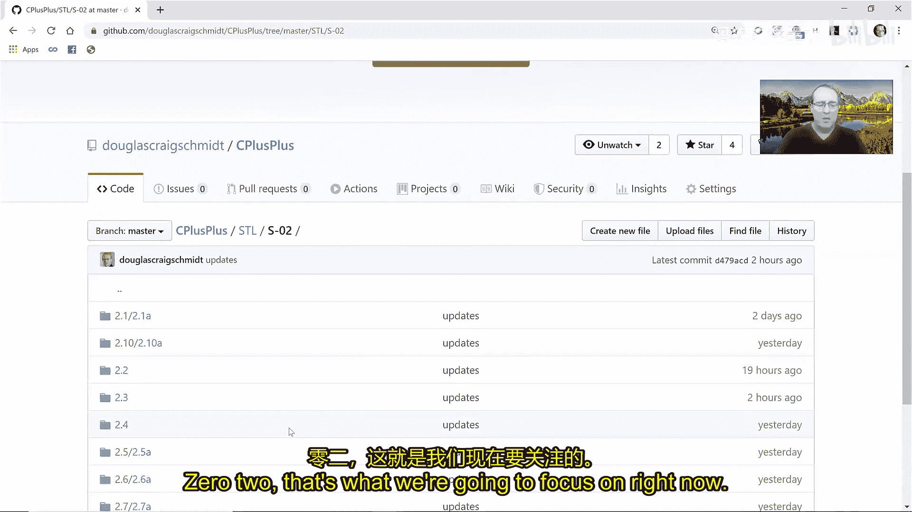
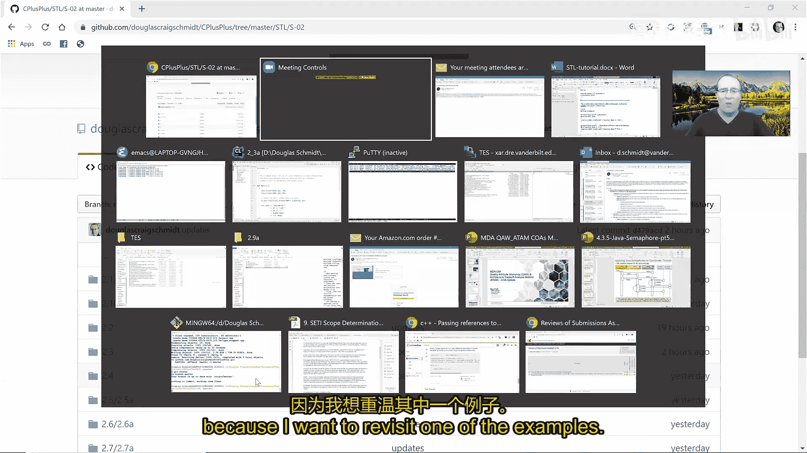
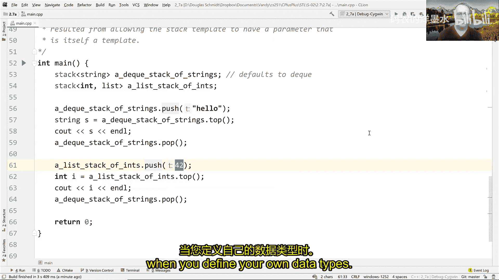

# 【全集】范德堡大学 C++标准模板库 中英字幕 1080P p03 Lecture 3 - 模板函数与模板类 part2 -BV1KWiCBWE7M_p3-

So welcome back to my next webinar on C++ standard template library by example。

 what we're going to do today is continue our walkthroughs of various function template and class template examples in C++ STL。

 and I'll also start to describe ways in which you can。😡。

Arrange your source code so it will be used most effectively when you're using templates because there's a few differences between compiling templates and writing templates than other more traditional types of code。

😡，So without any further ado， let me go ahead and share my screen and we'll get started。Okay。

 so here we go Sc is shared just a quick reminder you can find。

The source code that we're going to be covering today in my Gitthub repository and right now we're going to focusing on the。

😡，C plus plus portion STL portion and ST dash02 that's what we're going to focus on right now What I'd like to start with is where we left off yesterday because I want to revisit one of the examples so let me go ahead and share my。

Interactive development environment， this is the C lion interactive development environment and this is what we're going to use to demonstrate how to do some of the code organization So the particular example we had looked at yesterday was one that demonstrated using a pair class that we've developed that had a first and a second field that were of type type T a generic class a template class and what I'm going to do is show how you would most likely write the code and break it up into separate files so far most of my examples just to be simple have put the template code in the same file as the main program and while that works for real simple examples like we've done so far that's not how you would actually write code in practice that's certainly is not the way that C plus plus standard template library is designed and not how you would be most likely to design your own code so let's take a look at some different ways to do this first here's the main program。

And you can see that it includes the IO stream header file that's what we do to get the see out operations and so on for IO and then it also goes ahead and includes a couple of header files one called type wrappper doth and one called pair dotH both of these header files work in essentially the same way。

From the point of view of how to organize them， so let's go ahead and take a look at the pair header file。

😡，The pair header file as you can see， has something at the very top which is called inclusion guards and this is meant to prevent multiple inclusions of a header file more than one time which can cause all kinds of confusion in trouble with your compiler or not the least of which is your programs take longer to compile so a very common trick is to do something like this where you have a preprocessor macro directive that says if the underscore pair underscore each field or macro is not defined define it and so what happens is the first time this is included this will get defined and any other other attempts that try to include it will be ignored。

😡，Down here we go ahead and have the MyP namespace。

 which is just a way to keep from polluting the global namespace because there's already another pair class that's part of STL so we can have our specific pair class。

 my pair class。😡，And then down here I actually define the class itself and this is just basically the class declaration we're declaring the elements in the class we're not actually defining the constructor we're not defining the method max and so on here we're just defining the class itself and as you can see here there's。

😡，Some stuff that's omitted because I have it set so we're going to not be passing by value at the moment but leave that aside so as you can see here there's actually no implementations these methods we're just basically defining the class but not defining the class methods what we do to make that work is we actually include the para dot cP file and this is how templates differ from more conventional ways of writing c++ code where you typically have your that H file get included with the declaration of the class but all the implementation elements would reside most likely in the do cP file and you don't include that in fact that typically get separately compiled into its own object file。

😡，So in this particular case we're showing how you do things with templates and for various reasons we'll talk about a bit later the C++ compiler needs to see the source code for the templates now it still makes sense usually to decouple the header part where we have just the class methods defined and in real life they'd actually have comments in them a lot more than I have here with the simple example to decouple that from the implementations of those methods and that just that separation concern just helps to make things cleaner and more abstracted better separation of concerns as we sometimes say in the software engineering vernacular。

😡，So if we're going to define things in a dot CPP file what do we do Well what we're going to do here as you can see is we're going to have the definitions of these methods provided in the dotcppP file but this CPP file will still be included along with a header file so as a result we also have an include guard for the CPP file just like we had an include guard for the header file and this is just kind of a stylized way of doing things if C+ plus was more like Java it would have some kind of import model as opposed to an include model but that's still a bit ways off that may get standardized at some point so you can see we have the syntax here saying that this particular constructor is part of the pair class and it's parameterized by type name T。

We see down here， for example， here's the max method。

 which is also defined to be part of the pair class， which is defined by type name key and I'm also。

Writing it like this just to make a little bit more clear where the method starts versus the template and the return type so that's commonly how you structure template code and we'll see this throughout the rest of the tutorial I started off putting everything in one file just to make things easy but it's important to understand the right compilation and separation model that you need to use so key things to remember c plus plus compilers require access to the source code for the templates unlike nontemplate classes where you typically want to hide the implementations or not hide them necessarily but not make them included along with the header file。

Okay so that's just a quick recap of that example organized a bit more conventionally the way you would normally see this in practice same kind of thing I refactored the T wrappper class to have a header file with the class the declaration of its parts and then we put the actual definition of its methods in a separate file and again this is just good separation concerns but you'll see at the bottom of thetH file we include the do cppP file later in this series we're going to talk about even more advanced ways of organizing software so we can differentiate between things that we want to have that are really concise and short versus things that might be longer but we'll talk about that later。

😡，Okay。Remember， if you have any questions whatsoever， please don't hesitate to jump in and ask them。

 That's what makes these sessions so interesting as we get a chance to actually discuss what's going on。

 and you can learn not just how it works， but why it works the way it does。

So if you recall at the end of yesterday， we talked about a very simple example of a template class with a template member function and we also talked about some member template functions and the main difference was that the member template functions could not be virtual。

 although oftentimes in template member functions are not virtual either because STL shies away from using objectored features like inheritance and dynamic binding or virtual methods as much as possible。

😡，But now what we're going to do is we're going to focus on a piece of the example from yesterday。

 except we're going to use this to discuss the concept of template specialization。😡，And basically。

 what this allows you to do is it allows you to be able to customize the implementation of some。😡。

Templaize class and parameterized class to provide special implementations for certain circumstances。

 so in a way it's very similar it's kind of the class level equivalent to the concept we talked about earlier when we talked about function templates where you can have a function template and then you can have overloaded function that are not templates and the compiler will select the non-tempatized version whenever it's given a choice so same kind of idea and the idea here is to be able to specialize certain things of the class that may not be easy for the compiler to ferret out on its own so we're going to see some examples of this you can specialize all kinds of things with C++ templates you can specialize function or class templates you can specialize a given member function of a class template you can tempempize static data in a class template you can tempemptize member classes of class templates。

 member function templates member class templates it goes on and on on you can specialize pretty much everything。

And the syntax is a little bit wonky， but we'll take a look and see how it works and the way to start this off is let's go take a look at the actual header file that we're going to be specializing。

😡，This is left over from yesterday， if you recall we had a。😡。

A class called container not very interesting name it's not really even a container at some level。

 but it was just a name I picked for it and we have a constructor and we've got an increased method and we have a variable of type key which is the parameterized type that's passed to the container and if we want to see what the implementation looks like out of the box we can take a look here and you can see we have the container which staes away the parameter in the data member using the base member initialization syntax portion which ensures we do this in an optimal way using initialization semantics as opposed to to assign semantics and then we also have the increased method which as you can see here just increments the element by one and returns it so that's what it looks like out of the box that's what we have initially now let's go back over to the main file and let's take a look at a specialized template so what this does is it comes along it says I want to special。

ize the container template， and I want to specialize it for characters。😡。

So now whenever we're going to be using a container， your container means this this class。

 not STL containers， but this specific container instance。😡。

And we're doing it with characters this template specialization overrides the generic template and that's the one that will be substituted so you can see down here we're going to go ahead and have a character as the item we don't have to rely on type t and you can also see down here how we're going to。

😡，To find a whole other method altogether before if you look back here for container you see we had an increase method and now you're going to see in the specialization we've added a totally different method altogether called upper pace so that shows that when you do specializations you can actually replace methods wholesale while also customizing things that are already there。

😡，And here's the implementation of the uppercase method。

 I did this just out of line just to show you could do it。

 I didn't bother making a separate file for it， but you can see what we do here is we check to see whether or not the character is between the range of lowercase A and uppercase sorry lowercase A and lowercase Z。

 if it's it in that range in which case we go ahead and convert it to an uppercase character and then we return that uppercase character if it's if it's been modified we also return it if it hasn't been modified too。

😡，And so now let's take a look at how this actually works and you can see where the specialization applies。

 so we go ahead and make ourselves a container of int called my int， we give it a value of seven。

 we make a container of double called my double which has a value of 10。

5 and those are of course going to go ahead and specialize the container template that we defined here so it's going to go ahead and automatically synthesize the implementations for doubles and ints。

😡，And notice， by the way， that when you have。Templates that have lots of methods only the methods that are actually used are actually synthesized by the compiler so if you have a template with 200 methods in it and your instantiation only uses two of them。

 only those two methods will be instantiated and created with the specific data types the other 198 methods will not be instantiated so that can help to save some space and programs。

😡，The interesting part here， however comes when we look at my character and or my care my care is a specialization an explicit specialization we already defined what specializing。

😡，A container for characters are so this is going to use this implementation not synthesize a new generic one and in fact you can see when we go ahead and make the method calls on the instances of the different containers。

😡，We can call increase on my in， we can call increase on my double。

 but we have to call uppercase on my care。And in fact， if we try to do see out my care。Increase。

You'll see that it's disappeared altogether， it's no longer even part of that class。

 even though we specialize the other parts。😡，So let's go ahead and run this。

 you can see what it's going to output， it should basically output 8， 11。5 and J。😡。

And the reason it is going to go ahead and output J is because we gave a lowercase J as the parameter to the constructor for the specialized version of container。

So that's kind of cool now it may not be entirely obvious at this point why we'd want to specialize things and I probably need to show a better example here that demonstrates using other types where specialization makes more sense。

 but the cool part about specialization is it allows you to help to perform optimizations for generic classes that need to work in particular ways under certain circumstances and so we'll talk more later about why this is a big win and C++ standard T library implementation uses this type of explicit specialization and what we'll talk about in a minute called partial specialization all over the place for many different purposes。

😡，So this example is。Going to further our discussions。😡。

Of specialization and this is going to show the concept of partial specialization so it's probably should partially special because it's called partial specialization and this is really interesting and this again starts to show the power of C+ plus to work in ways that enable a tremendous amount of adaptation and integration so let's start off we're going to have a class here called class which is kind of a crummy name but that's the name I'm using just for this example so this particular class as you can see is parameterized by two types type T and type U and so we're going to print out that this is the constructor for the class that takes a T in a U and now we're going to do a bunch of partial specialization so what partial specializations do is they take an existing class that's a template class in this case and then they specialize it to work for particular types。

So for example， you can see here， here's a partially specialized version of the original class。

 which is also called class， except this only takes a single parameter and it intends to have both parameters be the same type。

 so if you need to specialize something where you have the same type。

 then we can use this specialization and you can see that the constructor for this is going to print out class T and comma T as opposed to T comma U。

😡，We can further specialize things so that we have a class that takes a T which is kind of an unbound type and an int so in situations where you have any old type and an int then this particular specialization will be selected and you'll see we go ahead and print the。

😡，T comma int in this example and then down here we're going to go ahead and have a template where we've got template t and u except this is going to take place when we have an instantiation that has T and U B pointers to T and U。

😡，So that the actually I take it back the types are the types and then the parameters are the pointers that we're passing in there so that'll print out this result。

😡，So that's kind of setting things up to show the example here is the actual example。😡。

It's go ahead and get rid of this you can see how we say class int double and that's going to go ahead and print class TN because that's the the generic version that we had then we're going to have another version that's class double double and in that case we're going to have it print class Tt because it's going to end up selecting this specialized version in the situation where both types are identical。

😡，Likewise， for the case where we have something followed by int。

 it's going to go ahead and select this。😡，Version， and that's going to print out class T comma in。

 And then finally， when we have pointers， it's going to go ahead and print out class T star comma U star。

So that's just showing how you can take control over specialization and the C++ compilelir will select whatever thing you've selected there now again this particular example is not the most motivating example。

 but in real life you can use this to do all kinds of clever template meta programminggramm tricks。😡。

Now what's an interesting question is what happens if we have class int int what goes on there because that means we could select between two things we could either select between the version that was class TT we' both types of the same or the version where it's class T comma int and the C++ compiler doesn't try to second guess you it simply says hey sorry you gave me something that is ambiguous and therefore I don't know what to do about this so if you want to fix that ambiguity。

😡，Then you can go ahead and define yet another class。😡，Where we would define class int int。

 so once again we're able to use this whoops better put the template up here。😡，嗯。Use this syntax。

There we go。So now you can see we fixed the problem with the ambiguity by just providing our own specialization that works for ints。

 and that is then more specific， And the compiler is no longer confused because it says aha。

 I know exactly what you want。 You want the version of the template that has int in。😡，Okay。

 so I'll just kind of keep this one commented out for now。

 but be aware that you sometimes need these features in order to be able to disambiguate the templates that are being instantiated。

😡，Okay， so that's another interesting example just for kicks let me just run it for you and you can see what it does'll it'll do hopefully what I told you it did and it'll go ahead and print out the results yes。

 and so it does it prints out the results we see here。😡，Okay， let's move on。

And now we're going to talk about some other interesting template capabilities。😡。

And this is this is a really interesting example， this is showing how you can have。😡。

Default template parameters provided to templates。😡，So let's take a look at an example。

 so here we're going to define a little helper class called stack which is actually probably not a very good idea because there's already a class called stack but i'm just showing the point here。

 so what we're doing is we're defining a stack template and we're saying I want to give this a default value default type rather of int。

😡，And so what happens here is if you don't do anything to the contrary， when you make a stack。

 you'll get a stack of ints and under the hood that's implemented as a vector， a generic vector。

 which of course then would become a vector of int。😡，And if you look down here。

 you can see that you can either say， I want a stack of doubles。😡。

In which case you give the double parameter explicitly。😡。

Or you say I just want to stack and you do the open close angle brackets in which case it'll default to using the default parameter。

 which in this case is in。 Unfortunately， and I go back and forth on this。

 you can't do that you'll see with functions when we talk about functions。

 the C plus plus compiler can deduce the parameters， the template parameters for functions。 However。

 they can't deduce template parameters or don't deduce template parameters for default templates。

 So you have to do this kind of squarely open close angle bracket syntax in order to get the default behavior。

😡，And you'll see later when we talk about things like iterator adapters。

 that there's a whole bunch of convenience functions that are built into STL that use the fact that functions can do type deduction or argument deduction in order to get around having to put the types explicitly in those angle brackets。

 but that's a little bit later。So this isn't really a runnable example that just demonstrates that you can parameterize a template using default arguments。

😡，Let's now go ahead and take another look and this will be a variation on this theme。😡。

Take a look at this example。So this particular example shows there's different types of parameters that can be used with templates。

 there's typed template parameters， which is what we've been looking at most of the time so far there's non-type template parameters and we'll talk more about what those things are in a second and then the third thing which is what we're going to demonstrate here is the concept of template template parameters。

😡，And so what this will illustrate is how you can have template template parameters。

 you could also have other things that you pass in。

 which we'll look at later like you can pass in values to templates。

 you can pass in pointers to objects or pointers to functions and other kinds of things can be passed in as parameters to templates as well。

😡，So let's take a look at an example that will kind of illustrate this stuff and here's。

The starting point for this。 So let's go ahead and take a look at this header filele called mem block。

 So mem blocklock is a cute little example that is going to have a template with a type name T and then an int end。

 So what we're doing is we're actually going to pass it instantiation time template instantiation time a value N which will serve essentially as as a constant in the context of this class。

😡，So what we're defining here is a mem block class。😡。

That has two methods set ma and get mam and the parameter key is。😡。

Provided as a type parameter parameter n is provided as an int and we'll see how that works for a second and what we do down here is we make the data member be a member block。

😡，which is going to be a an array of elements of type T where t is the parameter and the elements of type T are going to have n of them where n is the int parameter and we also use a little clever syntactic sugar to say give the value of zero to all the elements in this array no matter how big it is whether it's one element1000 elements。

 whatever n turns out to be if you don't do this，😡，Then by default。

 the memory in that ME block data member will be randomly initialized to whatever happens to be lying around。

 usually lying around on the stack as we'll see in a second， and that may not be what you want。😡。

So let's go ahead now and back up over here and you can see that we define ourselves a mem block of ints and an MB block of five ins and then we define a me block of 15 doubles so what we're doing here is we're defining specific type so mem block int5 is actually a different type from M block in8 or M block in 12 or 10 or whatever that's going to define a different type it's going to instantiate a different class and you couldn't treat them interchangeably。

😡，And then down here， we're just showing we can set and get the values at those locations。

Now the other thing we're showing here is you can do the very same trick except you can do it with function templates and just for convenience I stuck the function template in the file。

 but I could have moved it into its own file if I wanted to。😡。

So I have a function template called add that takes a constant ref。😡，Up type T called N。

And that's going to be a generic parameter。And then。

There's also an int of type v and in this case that's going to be added to whatever the parameter is so basically adding here we should probably call this something like you know add con in fact let's see if I can see if I can do that here's a。

😡，U。It's a sea lion trick for doing refactoring。And you can see that we were able to change these things。

And why it doesn't like that i'm not sure let me go back to add because it works I'll figure that out later。

 so what you can see down here is that when we do add int6 and then we pass in 10 when we run the program it should go ahead and give us back I think it should be 16 yep and that's what we get back。

So that's just illustrating how you can parameterize these things in such a way that you can actually give fixed values as template parameters and this is where some of the cool template metaprogramm tricks come in like you can write a template that will compute n factorial as a good example and all the computations will actually be done at compile time now how useful that is in practice another story but there's all kinds of clever things you can do with template metaprogramm and turn your compiler into a computational engine which is kind of interesting but it does it all offline。

Okay， let's see， I think we've got time for maybe another example here。😡。

Hopefully we'll get to the one that shows template template parameters because that's really cool。

So let's go ahead and grab that guy。Yes， this is going to be template template parameters。

 so we talked before about how you can pass various things to templates you can you can pass integers as we've shown here。

 you can define default values that you can provide and now what we're going to do is show how you can provide template parameters to templates themselves。

😡，And this is is pretty cool， so we're going to define a stack here， and we're going to。

Have the stack capable of being instantiated with a container and so let's take a look at what it looks like so here's the code so we say template type name t this means we're going to have a stack of tea like a stack of int the stack of doubles the stack of activation records whatever we want the stack to be a stack of。

😡，And then we're also going to define a second parameter。

 which is going to be a template template parameter。

 so in this particular case we're going to say I want to have a second parameter here。

 which can be a container。😡，And the container is going to actually also be parameterized by type T。😡。

And I want that container to default to a deck。😡，So we'll talk about DX later DX are one of the core sequential containers in STL and they're used in order to be able to add and remove elements efficiently from both the front and the back of the container。

 so DX stands for double ended Q。😡，Unlike a vector。

 which is also a standard template library sequential container where you can only efficiently add things to the end and remove things efficiently from the end。

So here's our stack， as you can see we have push pop and top operations and we have a container of type T that is going to be whatever is defined here。

 it's either the default which is deck or it's whatever we provide it because we can provide a template template parameter when we use it。

😡，So down here you can see how we do this stuff， we make ourselves a deck stack of strings where we're going to have a stack of strings and that's going to default to using a deck。

 and then we're also going to make ourselves a stack， a list stack of ints。😡。

And the list stack of ints is going to be parameterized by int and it's going to be also parameterized by list list is yet another sequential container and STL that you can use to do efficient random insertion and deletion anywhere in the list once you've found your way to the place you want to insert and delete。

😡，So once we've got ourselves these two stacks， we can then go ahead and push a string onto the deck stack of strings。

😡，And then we can go ahead and。Get the result back and pop the result and then likewise we can also push something onto our list stack of ints which in this case of course is' an in so let's go ahead and run this code so you can see what it's doing and of course it should do exactly what you think it does it should push the elements on and then look at them by using top and then then we go ahead and print them out and pop them off。

Okay so that's kind of illustrating the concept of template template parameters template template parameters are really super cool and theyre used extensively throughout the standard template library so lots of things take template template parameters as various parts of what's past the templates for example we'll talk a bit later probably either later this week or early next week about the container adapters。

 there's these container adapters in fact they have a stack they have a queue they have a priority queue and these are all parameterized by template template parameters to give you different types of containers that are used as the implementation artifacts for Q and stack and priority queue and so on so theyre various clever ways of being able to mix and match and reuse existing STL types to make new types and they do that in STL itself and you can do it yourself as we see here when you define your own data types。

😡。

Okay， so I think。That's kind of where I want to stop today what we will do tomorrow we've got just a couple more examples to go through relating to class templates。

 I got a really cool example I want to show you with so-called verytic templates which is really cool not only is it an interesting feature in C++ but it also is an interesting example because it shows how to basically create a semaphore using some pre-existing C++ features like newtexes and condition variables and then use that semapho to to play ping pong between a pair of threads and this will give us a chance to see what a veryatic template is and how it gets used in interesting ways that are quite common when you start programming with some of the C++ thread mechanisms that are available so at this point if you have any other questions I'm happy to take them otherwise I will upload my video later if you take a look yesterday I uploaded the video you can find it on my YouTube channel。

😡，For the standard template library by example， playlist and I'll continue to do that。

 it's great to have a place to put everything and great to have you guys come and ask questions。

So thank you all very much and I will talk to you soon。😡。

