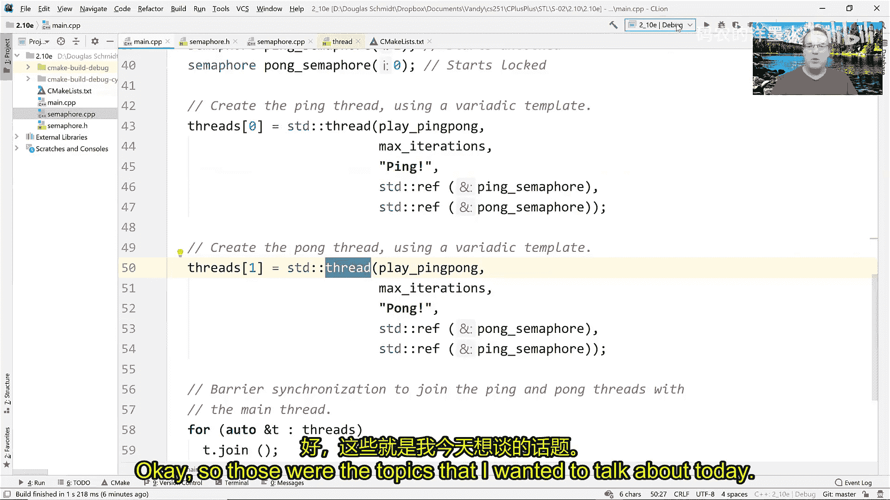
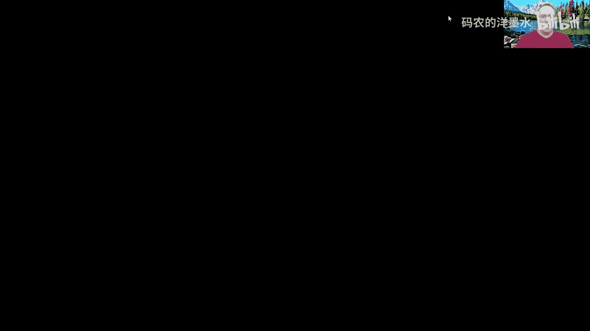
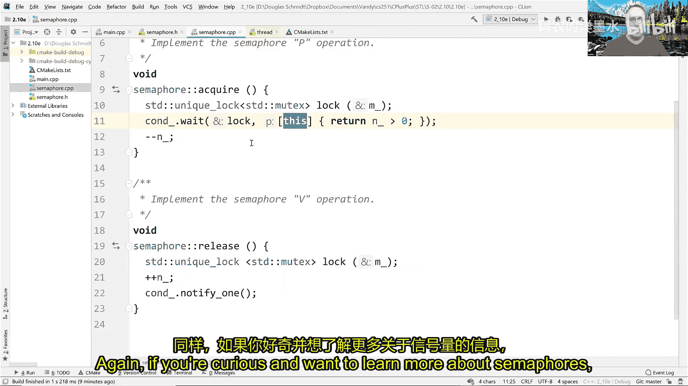
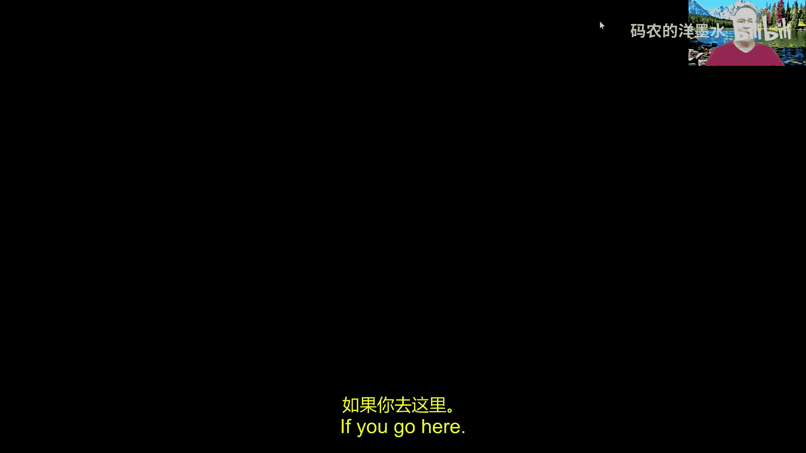
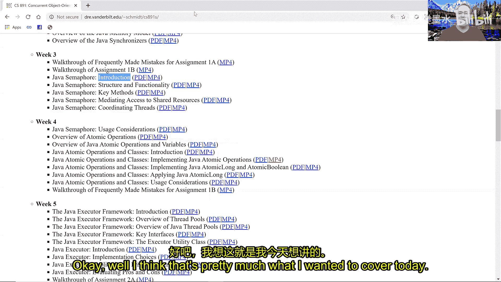

# 【全集】范德堡大学 C++标准模板库 中英字幕 1080P p04 Lecture 4 - 模板函数与模板类 part3 -BV1KWiCBWE7M_p4-

Hello and welcome back to my webinar series on the C++ Standard templateemplate library by example。

 what we're going to do today is talk about some of the other interesting aspects of C++ templates。

 particularly focusing on templates as they're applied to classes。

 although we'll also spend a little bit of time talking about some really cool features of veryatic templates and how they're applied with C++ functions。

😡，So without any further ado， let's go ahead and jump in。

 I'll show you the code first where we're going to be covering today。

 And then we'll look at the examples。 So let me share my screen。And you can see。coupleup things。对。

So this is where the code resides， we're going to be looking in my C++ STL folder in the S02 subfolder。

 and we're going to start by doing a revisit to one of the examples we looked at yesterday just to kind of clarify a few of the interesting aspects of that example。

 and then we're going to go ahead and talk about some brand new stuff。😡。

So let me go ahead and share my。My IDE as you can see here here's the example we were looking at yesterday this is example 2。

4 a and this was demonstrating template specialization so if you recall we had a particular template that we were using as the basis for specialization this is a very。

 very simple container that has a constructor and a method called increase and it has a field called element and it's parameterized by type T so a very。

 very simple example and what I was doing was I was showing how we could parameterize this with different types so the examples we looked at were parameterizing this with int we looked at parameterizing it with double and so on but those examples illustrate a couple of things that are not always the case number one as you can see int and double both have less than operators built in。

And so one interesting question is what happens if we try to parameterize this container with some user defined type that doesn't have the less that operator defined on it what's going to happen number one and number two。

 let's try to see some better examples of specialization that will do something above and beyond what the compiler could normally do if we just let it do the natural course of instantiating the template as it was defined so those are the things we're going to look at today so the first thing I want to do is show you what happens when we do an explicit specialization for a data type that would otherwise make no sense if we were to try to do it just by using the compiler's default instantiation mechanisms and what we're going to do is we're going to instantiate a special version。

😡，Of container that works on carestar。 So as you probably know in C plus plus because it's as close to C。

 but no closer， it leverages the carestar features for dealing with kind of sea level strings。

 So a carestar or con care star is kind of a sea level string type mechanism。

 And you can use that in C plus as well。 But we're we to try to do this without specialization。

 it wouldn't do what we're trying to get it to do。 So we're gonna make a specialized version of container。

 And you can see here we use the specialization syntax。

 we say template less than greater than class container。

 And then we specialize it to work with care star。 So pointer to character。

Which is an idiom in CNC++ that means typically means basically a string， a built in string。

So down here we have an explicit container that takes a carestar argument and stahees it away in our carestar element data member and then because it doesn't really make any sense to increase a carestar in the way it means to increase an indoor double we're going to replace the。

😡，Increased method with another method called uppercase。 So this particular method is completely new。

 It was not part of the original container。 You don't see uppercase there。

 So this demonstrates one thing that you can over overrdes the wrong word。

 you can define new methods in specialized classes。 So let's go ahead and take a look at uppercase。

 and you'll see this is the kind of code that would never be synthesized out of the box by the c plus plus compiler。

 if we just let it do its natural instantiation of this container template for a carestar。

 So what we're going to do is we're going to define uppercase to walk through the elements of the character array。

😡，And then we're going to look for all the characters in the character array that happen to be lowercase characters。

 And we're going to uppercase them。 So that's what the logic is here in this little loop。

 And then when we're done， we return the element， which is now been uppercased。

So if you take a look down here， when we do this， you can see that we have a lowercase。😡。

Character array called hellello world which is basically a string in sea level parlance and then me go ahead and pass that to my care string。

 which is the。Template instantiated specially instantiateated explicitly instantiated version of the container。

 and then when we say my care string uppercase， it goes ahead and uppercase it。😡，So let's go ahead。

 Let me comment out this piece of code here。 just for a moment。

 Let's go ahead and run this thing just to give you some confidence that it actually does what I'm promising it does。

 And as you can see here in the output， we get hello world instead of hello world because we've uppercase stick。

 So now it's now shouting at us。Okay， so that was one thing that's kind of showing perhaps a more useful way of doing specializations were specializing on something you wouldn't really get out of the box if you just did the carestar by itself。

😡，The second thing I want to do is I want to show what happens when we instantiate an object that initially does not have a plus plus operation defined on it。

 Because if you go back and you look at the implementation of container。

 you'll see that the increased method is expected to be able to do a pre increment on element。

So if we try to instantiate this with a class that doesn't define the plus plus operation。

 then we'd expect bad things to happen。 And that's exactly what's going to happen。

 So as you'll see here， here's our initial。Class we're going to use to instantiate the container template。

 this is foo wonderfully expressive name and what this does。

 just ignore the commented out part for the moment。

 this is going to have an explicit constructor that takes an int and stashes it away and it has an explicit conversion operator that will go ahead and convert a foo to an int。

😡，And I guess we should probably not do the plus plus operation here， let's just do this。😡。

And so now we have kind of the basic bones for something we can instantiate in our container。

 but should'll notice that at the moment there's no plus plus operation defined find and in fact when we try to say。

😡，Myfoo， we give it a foo of with 10， we try to call the increase operation。

 it's going to yell at us， the compile yell at us and it'll say can't increment the value of tight food because there's no foo that's defined to allow incrementation。

😡，So one solution to this is to go ahead and define operator++。

 and this is the syntax for the pre increment version of operator++ there's also a post increment version we'll talk about at some other point。

😡，So as you can see here， just to make it clear what's going on。

 we're going to print out what the method is it's being called it's Fs operator plus+。

 and then it goes ahead and it makes a newFO that contains the pre incremented version or value of the data member I。

😡，So now with that uncommented， now you can see the code is happy and when we compile it and run it。

 it should go ahead and take the 10 that was passed in and increment it so you can see we get 11 out of here and we call F operator plus plus。

😡，Okay， so far， so good。 So that's one way to solve this problem。

 But there are other ways to solve this problem as well。 So here's another alternative。

 What we're going to do here is we're going to define a。

Specialized version of the container that explicitly is designed to work with aFO and so what we're going to do here is we're going to have a container that takes a foO argument stashes it away specialized and then we're going to define the increased method which is going to return aFO and what we're going to do here is we're going to print container foo colon colon increase we're going to let you know that this is the one that's being called and then we're going to go ahead and call the plus plus operator the plus plus operator of course is going to call the plus plus operator up here。

😡，And and that's going to go ahead and increment the contents of fo and so let's go ahead and run this and then we'll see what happens so now you can see the code compiles again。

😡，But now we're using this specialized version。 Let's hope we use a specialized version。

 And so if you take a look at that， you can see that it called container fo increase。

Which is this specialized method here。That then called plus plus on F， which again。

 calls this operator。And then you'll see it the very last thing we do is we go ahead and we。

Output the incremented fo and that required us to define an extraction operator that's going to go ahead and get the value and write it to the stream and that's what this thing is and you can see that we define it to take an O stream reference and a fo and we probably should have been a little smarter and said cons。

😡，F， that's probably a better way to do it。U and so then what we're doing here is we're going ahead and we' are explicitly casting the food to be an int and that under the hood will trigger the call to this particular method here。

😡，So that'll go ahead and do that and I probably should say this is a con method and if we do that then I can probably come back here and make this。

A constant fo well， I'll go ahead and mess with that a little bit。

So we'll play around with this and get that right， but the bottom line here is that we can pass fos here and that's how the output gets dealt with。

😡，Okay， so that kind of wraps up that example， I just wanted you to see what happens when you define your own type。

😡，And then you have to make sure that it has the operations that are expected in the template in order for the right thing to happen。

😡，Okay， so let us now go and move on to a new example。😡，And we're going to go here。

 I think we left off。At the。Example7， so the next example is example 28 a and this is going to show one of the reasons why templates are so great because they work around annoying problems with macros back in the battle days days of C and the days of C++ before templates which occurred for about five or six years in the actually more like 10 years I guess in the 80s C++ didn't have templates so if you wanted to do generic types of operations without defining a gazillion overloaded methods or overloaded operators you had to use macros and I'll show you an example of a macro and of course the point of this is macros are evil。

 they are very few things that they're good for and this is not one of them。

So here's a macro that attempts to define the min of two parameters and what it does is it says min of IJ。

 and then it goes ahead and it defines this very convoluted looking expression with lots of parentheses and the parentheses here of course are necessary to make sure things are grouped properly and are performed in the right order。

😡，And whenever the min macros used， that whole expression is just going to be substituted with the parameters I and J。

 just it's kind of like cut and paste， if you will， the preprocessor。

 which is what processes the macros does the cutting and pasting。😡，Okay。

 so there's a problem and let's take a look at why there's a problem So here we have the example we're going to have A and B and we're going to start a at 10 and b at 20 and then we're going to go ahead and call min which is the template function which we'll look at in a second with a plus plus b plus plus and then we're going to call min which is the macro also with a plus plus and b plus plus and what'll happen here is we get very different results So let's go take a look at the template version here's the template version of the min macro and you can see here how it takes a cons T ref。

😡，I and it cons T R J。 And it goes ahead and just uses the famous ternary operator to check to see which one is the min。

 Is it I is it J。 So that's pretty much the same logic as we see in this macro。

 except it's got fewer parentheses。 And that's， that's a good thing。 But more importantly。

 the semantics of men， follow the semantics of a normal function。 once it's been instantd。

 So once it's instantd with the types。 in this case， int。

 then calling the min function is just like calling any function。

 And what I mean by that is that the arguments are evaluated。Once at point of call。

 So what we'll get here is we'll get min of 10 and 20。

 and then a plus plus and B plus plus will increment A to 11 and B to 21。

But what gets passed to men is 10 and 20 because those are the values before it was increment。

 it's a post increment use of the plus+ operator。😡，Conversely the version down here， this min。

 this will actually get expanded in line to look like what I show here。

 it'll be a plus plus less than b plus plus a plus plus b plus plus。

 so the values are going to get wildly updated in fact just for kicks。

 let's go ahead and write the output here so we can say A equals and then we'll say a and we'll say B equals and then we at B and this will also show that of a lot of actually stuff happening here underneath for it。

😡，Those guys can run this code and we'll see what the results are and they're not what you might think unless you already know the semantics of macros and how bizarre bizarre they are。

😡，So you can see what we get here is we end up getting the min of 10 and 20 is 10。

 which is what you'd expect， but then when we do this min we get the value 12 when in fact it should really be 11 should by the normal function called semantics and that's because it's expanding into a plus plus less than b plus plus question mark a plus plus b plus plus so it's having all these extra side effects because macros are just mindless text expansion and then when we're all done you can see that a plus plus or sorry A and B are now 13 and 22 so this macro has ended up having side effects that are somewhat surprising if you don't understand the weird semantics of macros。

😡，So the long the short of it is there's only a handful of things that macros are still good for in modern C plus plus。

 and those things are typically include guards， things like making sure the header files aren't included more than once。

 making sure that template C plus plus body code is not included more than once。

 That's that's one thing macros are good for。 And they can also be good for setting parameters at the make level or the command line level that you want to use to set certain default values or comment out certain parts of code or selectively compile certain parts of code。

 Those are really the only things that macros are any good for at this point。

So just wanted to show you that it's important to understand why templates are often a great replacement for macros and you should really never use macros in this kind of generic function like model anymore because。

😡，Templates do a much better job。Okay， let's move on。

 let's go ahead and take a look at another example。😡。

And this particular example is going to demonstrate some things that used to be really important for C++ back when the template implementations were in their infancy back in the sort of early to mid 90s and maybe actually a little bit later because back in those days the compilers would often have bugs in and the bugs would manifest themselves as follows。

 so I think I mentioned before with with templates。😡。

The compiler is supposed to only generate code for methods that are actually used。

 So if actually used in the in the source。 So if you had a template with 200 methods in it。

 And when you instantiated it， you only called two methods， those two methods would be instantiated。

 but the other 198 wouldn't be。Well， back in the battle days， compilers would get confused。

 and sometimes they wouldn't generate the templates correctly。

 And so there was a kind of a workaround for that that can still be a bit useful。

 especially for testing where you can basically have templates that are going to be explicitly instantiated。

 And nowadays， this is much， much less needed because linkers and compilers are a lot better。

 But back in the day they were an issue。 And so let's take a look at some examples of how you can explicitly instantiate templates。

 And this is kind of cool。 It also gives us a chance to talk more about some of the introspection mechanisms are built into the C plus type system。

 So we have a little method here called print data type that takes a data object and goes ahead and prints the name of its type。

So that's just it's kind of a little quasi reflective like mechanism。

 but it's not nearly as powerful as Java reflection。😡。

So let's go ahead then and define ourselves a class so we have class called example class and。😡。

oh we can also use a default constructor this is a syntactic sugar feature that was added in more recent versions with C++ if you have sort of aOA constructor like we do here you can just say it compile or generate the default value for that so you can see we have a default constructor we have a method called result and a method called add and that's just there to kind of make everything work together and this is a template class。

😡，So now what we're going to do is we're going to come down here and we're going to tell the compiler。

😡，I want you to explicitly instantiate function templates for print data type， for ints and doubles。

 So that forces the compiler to generate that code。😡，Then we can also say。

 I want you to generate the constructor。😡，And I want this constructor to be generated but for in but don't you don't necessarily have to generate anything else unless I use it so that's forcing the constructor to be generated we can then go ahead and say I want the entire class and all of the methods explicitly instantd for double。

😡，And then down here we can do the constructor for string and the addd method for string and the result method for string and so on so you can mix and match and pick and choose what you want to generate and then down here we go ahead and basically。

😡，Do the instantiations。 Now， this is， of course， to generate the code to do the right thing。

 And but normally， it wouldn't generate the code for those methods unless we actually use them。

 but we've instantiated them using the compiler's explicit instantiation feature。

 And then just for kicks， we go ahead and print out the data type name for an example class of int and an example class of doubles。

 So let's go ahead and run it just for kicks and see what the results are。hoops。Didn't like that。

 Let's go。Fix that。Complir trying to be too clever。T it again。Yes。All right。

 so you can see what it does is it goes ahead and prints out the name of this class and the name is example underscore class and then it says it basically is I think it says 13 characters in example class that's just prefixing it to make it sort of unique among other classes with similar names and you can see it's parameterized by int。

😡，And it's parameterized by double。 So that's where the I and the D come in。

 And so this is just the way that the compiler encodes that。

 And that that's actually relevant for other things like the way in which you can do typeafe downcasts and so on and and various other more dynamic mechanisms for doing virtual method tricks。

 But that's not important for the discussion here。So that's just a silly example just to show you how you can instantiate various templates。

😡，Mercifully， most compilers will not have these problems anymore。

 so this is kind of only important if you're stuck using older versions of C++。😡，Okay。

 next topic now that we've talked about kind of the basics of templates I'm going to spend a little bit of time talking about more sophisticated uses of templates and I apologize in advance some of the topics here are quite advanced and they assume that we've talked about other things in more detail things like containers and things like iterators so。

😡，Don't worry if you don't understand all this stuff， we'll cover all this other stuff later。

 but I just think it's really fun to show these advanced template features and this is kind of a good place to show them because we're talking about templates。

😡，Okay， so here's the first example， this is demonstrating the concept of basically veryatic templates and template recursion。

 so if you're familiar with。😡，Older style C operations that were veryatic arguments。

 things like printf you would have a format string and then you could give parameters after it printf and its Ilk are extremely error prone and considered very bad practice these days so C plus+ has solved those kinds of problems in a typesafe way using something called veryatic templates which are basically just templates are going to have an arbitrary number of parameters past to them。

😡，So let's take a look at a couple of different examples。

 This is really fun so we have a method called adder and this is the base case for veryatic template recursion and all this is going to do is it's going to take the value。

😊，That's passed to it， that's a template parameter， template T， and return that value。

 so it's very simple。😡，Then we're going to define an overloaded version of adder that has a verytic template argument and verytic templates are just going to be used or described as having the dot dot dot after the type name so this says adder takes a first parameter of type T and then it takes an arbitrary number of other parameter of type T and the way it gets expressed here here is we have adder which takes T which is first and then we say args which is the veryatic template definition dot dot dot and then we just give the name of the parameter we call it aGs here。

😡，And then what we do if we want to use this thing is we say first plus adder and then we pass args dot do dot into that and as we'll see when we run the code the compiler will go ahead and basically recursively call this thing essentially chopping off one element each time it's called depending on how many elements are passed to it so it's kind of recursion and here's the base case for the recursion you'll also see that there's a really cool built in macro called pretty function and that'll actually tell you what function is being called and what the arguments are and so we'll see how they gets to be used in a second so here's how this gets used。

 we're going to start out by having a call to adder with1。

2387 I don't have to have five parameters I can have one I can have 18 I can have 42 doesn't matter and then we go ahead and say the sum of calling the adder is whatever the sum is and then just to demonstrate that this concept also works for other data types we're going to go ahead and have one that has a bunch of string parameters so we define a bunch of strings。

😡，C++ is cool and then we go ahead and。Basically called the adder method to add those things all together and all that's required here is that there's the plus operation defined on the data types that's all that we're requiring。

😡，Never going go ahead and print the the sum of the string seems kind of funny but that's what we're going do all right so let's go ahead and run this and you'll see what we get it's really cool so you can see that the sum of the parameters we pass the veryatic number of parameters is 21 and the sum of the string parameters is the string C++ is cool。

😡，Now， the pretty function macro helps us see what's going on here。

 So you can see the first time that we call， let's see if I can make the。

The run stuff be a little bit smaller， let's say there we go。

So you can see the first time that we call adder， we have。😡，The first parameter of the T is an int。

 and then we've got four more ints。😡，And then that goes ahead and recursively calls it after stripping off one of the elements so then we have a first parameter int three parameter in then it calls it with the first parameter in two parameters of in then it calls it again recursively with the parameter int and one int and then finally we just have one int and that's the base case of the recursion that's this adder up here and so what's happening is that those are all being called and then it's summing the results together because it's adding them with the plus operation and that returns the result and the same thing's happening with the string it's just that the string is a bit more of herbose a little bit harder to see literally see what's going on but that's an example of veryatic template processing with C plus+ so everything's typea it's all handled magically underneath the hood well look at some other more realistic examples of recursive templates and verytic templates in just a minute。

Okay， now let's go ahead and take a look at another example。😡。

This example shows one of the most interesting and very common uses of so-called template meta programming。

 which is the ability to be able to program things that are actually evaluated at compile time by the compiler and this is a really cool example so just for kicks we're going to compute factorial and I'm going to compute factorial up to 20 which as you can see is a pretty D on big number and in fact it's so big I have to represent it as a long long so factorial 20 it's believe me that's the factorial although you probably wouldn't have memorized that here's just the you know classic recursive way of computing。

😡，The n factorial factorial here。 So we're going to pass in Val as n。

 And if the value of v is greater than one， and we recursively call this function subtracting one from Val。

 And then taking vow and multiplying it by some and some starts out at one。 So you can see。

 we're going to basically subtract one off of vow each time。

 And then we're going to multiply sometimes Valal。 And that's going to come back as a value。

 And it' it's going to be this wonderful recursive set of calls。 And and as you might expect。

 this is going to be a pretty da on a deep recursion。

 I probably would have been well advised to to use a loop here。

 But I decided to to do it this way just to show how it works。

And to show also how it corresponds to the other examples we're about to look at。

Okay so that's just good old factorial calls and that's done at runtime now let's look at two different ways to do factorial at compile time we're going to make the compiler do this for us。

😡，One way to do it is to define something， define a function to be a so called constant expert or constant expression and there's a limitation。

 the limitations and what operations you can do in the。In con expert functions。

 you can't do anything。 for example， we can't say see out pretty function that that should be disallowed。

 And that's because this has to be completely eable at compile time。

 and you'll see it it should it should delete us。 Nocon expert function operator less than less than is being used in a con expert function。

 So let's get rid of that。 So this code will actually be evaluated by the compiler at compile time before the program runs。

And you can see that that's actually the case because we can go and generate the value for an enum and enumeration literal called compile time generated value for C factorial of 20 and then we can use a static assert to show that it's got the right value and if this was wrong。

 then it would blow up at compile time so the compiler would catch it notice that we can't do this。😡。

Because that's not a constant expert function， it's just a regular function。

 so all that code is evaluated at compiled time。😡，Here's an even wackier way of doing this this is using template meta programming and this is kind of the hello world of template meta programming what you're going to see here is we're going to define ourselves a factorialstruct that's recursively defined in terms of itself。

😡，So factorial is going to be defined in terms of a recursive call through inheritance to the factorial struct itself。

 and this is a template struct so it takes a long and a sum that defaults to one and very。

 very much like this C factorial function up here， it's going to subtract one off the long and then multiply long times L sum。

😡，Except this is all taking place at compile time。And here we have the base case for this particular T programming example。

 we have a struck called factorial for the value one that takes L sum and it goes ahead and sets the Eum to L sum so now let's see how this thing actually gets used so we are going to say factorial for 20。

😡，Is going to be。😡，That's going to go ahead and generate something we'll talk about that second and then we're going to take the value which is an ennuum and we're going to store it in a cons and then we're going to use a static assertion to make sure that that actually equals the factorial of 20 which it does ver if for some reason by the way。

 we were to change the factorial of 20 which would obviously be a very bad idea let's change this to that。

😡，U， then you would see that these static asserts will fail because those things are no longer matching mercifully we know what the factorial of 20 is that will maybe work properly。

So what happens here is when we call factorial of 20 that actually calls this function with 20 and then it goes ahead and will have L sum default to one so that's going to basically be 20 minus1 and then 20 times L sum which is 20 and then the compiler and it's magic will go ahead and generate another recursive call to the template which is not a runtime thing it's a compile time thing which will then be of course you know 19 L will be 19 and this will be 20 and that will take place at compile time and it'll come back with a value which gets stashed here in this value enum which we can then get there So the final thing we're going to do is we're going go ahead and have a main program that's going dynamic can compute the factorial of 20 make sure it equals what we think it does we're going to go ahead and print it and the nice part is because the magic of constant expressions and template meta programming everything works。

Properly our runtime stuff works our compile time stuff works and it's a very。

 very fascinating example of template meta programming Now you are very unlikely to have to write code like this。

 but it's used heavily in libraries and in fact just see some of the other features we're about to look at are more for people building libraries than for application developers per se。

Yeah。Okay let's move on to another example， this is a really cool example this is going to demonstrate a whole bunch of different things it's going to show how we're going to be able to essentially wrap arbitrary containers of all that arbitrary containers arbitrary sequential containers and then be able to pass。

😡，Variiatic parameters to them in order to instantiate them Now again， you might want to do this。

 perhaps for debugging purposes， you might want to have a way of wrapping your containers to debug them。

 you might even want to do this to wrap your containers to make them threada。

 you could make a threadsafe container wrapper here quite easily this particular example is just illustrate the point So what we have here is we have something called a container wrapper and the container wrapper has a constructor and the constructor we're going to see here is going to have veryatic parameters。

 that means it can have an arbitrary number of parameters。😡。

And what we're going to do here is we're going to take the parameters that are past to it and then we're going to forward those veryatic parameters which I believe is called a template pack and we're going to forward those to a constructor of whatever container we happen to pass in as a template template type to this particular container wrapper so earlier I think in a previous discussion we talked about template template parameters this is an example of a template template parameter we have type name T then and that's the type like int or double or whatnot and then we're going to have a template template parameter which is going to be a container that will be parameterized by type T and we're going to default this to vector we'll talk more about vector in our next class。

😡，Okay， so what you see here is we've got the container wrapper that takes a variable number of parameters。

 which we'll see how it's used then below， and it goes ahead and it forwards them to the constructor of this sequential container。

😡，All right so far so good so let's come down here and see how we actually use this thing so we're going to have a container wrapper here and it's going to default to vector so this particular example the first one here will default to vector because of course that was what was。

😡，Appp here as the default parameter for a public government。

And what we're going to do is we're going to say container wrapper。

 I want you to create a vector with three elements and I want each element to have the initial value words。

😡，And you'll see how that gets used in a second and then the second thing we're going to do is we' can say I want you to make me another container wrapper this time using a deck not a vector and I want it to be working on con care stars and i'm going to pass you the beginning of an array of built in native array to。

😡，A set of sea strings， sea like strings， conca stars called shapes， so we have shapes。

 which has three elements and then we go ahead and say pass that in and then pass the end iterator we'll talk more about iterators later shapes plus three that skips to one past the end and then we go ahead and print these results out so let's go ahead and run this code and you'll see what it does and it's very very cool so we get of course Shakespeare's famous quote from Hamlet words words words。

嗯。And then down here， you can see that we print out circle triangle square。

 and then it tells us what operation is being called。

 we're going to instrument the output operation just to see what it's doing。😡，And you can see here。

 for example， we have an O stream that's what。😡，Is being called here。

We have a way of being able to take a container wrapper。

And then we pretty print the function call on the arguments and then for every element in the container。

 you go ahead and write out the element， so we'll write out words， words。

 words for the vector of that string， and then we'll print out circle triangle and square for the one that was the con care star。

😡，And you can see if you take a look at what's being instantd， it's the Ostream extraction operation。

 which is past a string and a vector。😡，And then down here。

 the other ones past the con care star and a deck， which of course matches exactly what we've passed down there。

So really cool example， this again demonstrates the power of many things in C++ it demonstrates the power of template parameters where you can default them。

 it demonstrates the ability to have veryic arguments and to be able to forward them to the constructor。

 so when we passed in these two arguments down here three and words and shapes and shapes plus three。

 those things got passed and forwarded， unchanged uncopyied。

 unsullied to the constructor for the sequential container。😡，Pretty cool。

Now this particular example illustrated the ability to encapsulate or wrap sequential containers。

 but they're not the only game in town and when we get a little further along later this week or early next week。

 you'll get a chance to learn about other kinds of containers and there's other kinds of containers called associative containers and unlike a sequential container which typically this has elements like a vector of int or a deck of doubles。

😡，Assocciative containers have keys and values so that little raper trick we use there wouldn't have worked for associative containers。

😡，But we're going to show how you can use that with just a simple enhancement to what we're showing here。

 so let's take a look at the example we're going to define ourselves a vector of floats。😡。

A list of characters， a deck of ints， and a map of string to int。😡。

Pairs now again we haven't really talked in detail about these containers we'll cover them a lot more。

 but just I think you probably have a good intuition to a vectors like a dynamic array a list is a doubly linked list。

😡，A deck is like an array where you can add and remove things from the end or the beginning efficiently and a map is just an associative array that maps some key to some value so that's that's a quick overview we'll talk about that stuff later。

😡，And once we defined our corresponding vector list deck and map we then want to go ahead and print the contents and we're going to do it two ways the first way is kind of the old school way a little bit verbose。

 but it works for everything and this is to use。😡，Iterators。

 and we'll talk a lot more about iterators。 Every container contains factory methods that make a beginning iterator to the first element and then an end iterator to one past the last element。

 And so you can see we have begin and end here。So that's going to be very simple here's print iterator as you can see it takes an iterator as a parameter and we have a start and an end and iterators as we'll discover are intentionally meant to work just like builtin CNncC plus plus pointer arithmetic you can compare to iterators for equality or inequality you can dereference them。

 you can plus plus them some of them you can minus minus and so on and in this particular case we're just using them as input iterators we'll talk more about that distinction later so what this does is it basically walks through the range from start to end and print every item and increments the start by one okay that's classic old school C plus plus templates and c+ plus STL。

😡，This example here print container is much more powerful and it requires the use of verytic templates and so you can see in this particular case we're going to pass in the container wholesale so we pass in the vector of float so the list of characters or the the deck of of ints or the map of strings and ints I should probably give it a better name maybe actually call this。

😡，LetSee。MSI， how about that that's a more a bit more intuitive Macwell stringed in。

And so let's go take a look at how we can define that and here's how we do it。

 here's the print container。😡，Function which is going to use some very very interesting c plus plus template features including c plus plus baratic templates and other cool stuff so what we're doing here is we're saying i'm defining a container and this container is then going to have value types and as and so down here here's the。

😡，Praameter that is passed in its container that has value types and sort of optionally arcs。

 and this is going to work for the map style containers that have key value pairs。😡。

And then all we're going to do is we're just going to iterate through here from beginning to end and we're going to go ahead and print every one of the objects out and that requires us to define this little helpful extraction operator which is going to go ahead and take a pair which is what's needed for a map and we'll go ahead and print the first element followed by the second element that's only needed for the map version so let's go and run this。

😡，And you can see it chokes away a bit and then prints out the results。

And the results are kind of interesting。 So you can see here that。

We show the print iterator version and then we show the print container version。

 the print iterator version is pretty straightforward we just pass in an input iterator which is just the good old normal iterator to float and vector and it prints the values out when we print the container you can see it's much more interesting so the container is going to have vector the value type is going to be float and then the armsbs are going to be this allocator we'll talk about allocators later and that's the way it's going to be for all the sequential containers so for print container for list you can see the container is list the value type is care for the deck you can see that the container is a deck and the value type is in when we get down here to the print container for the map however things are much more interesting so for the map version the containers map the value type is string because remember it's a string to int mapping and then the arguments are going to be。

Int because it's stringed to int mapping and then there's some other parameters there as well there's the operation that's used to determine whether things are going to compare less than or equal to and so on and then there's this the allocator so there's a whole bunch of other gobbledy hook that gets passed as other parameters but we don't actually really care about that the compiler and the template instantiation mechanism cares about that but we don't actually care about that。

😡，So that is by far probably the most interesting example that we've looked at so far in terms of advanced features for C++ templates。

 this is again veryiaic templates and just showing all the powerful things you can do with bariatic templates。

😡，Okay， we have one more example to look at here and I'll try to do this quickly it's also a really cool example and then at this point will be done with everything related to classes and class templates and function templates and then we can get on with the really SDL stuff like containers and different kinds of containers and punctors and algorithms and adapters so this is a really fun example this example shows how the C++ standard template library uses verytic templates in the context of passing parameters to functions that are spawn to run in background threads now again this is a bit of an advanced topics so I won't get two wrapped up in it。

 but basically what we're going to do is we're going to define a couple of threads and threads are basically units of execution that can run in the background typically mapped to processor course and we're going to have those threads play ping pong。

So let me first run the program so you can see what I'm talking about sadly this is even less sophisticated than pong which is one of the original video games so you can see we're going to go ahead and have one thread print out ping and then the other thread will print out pong the next thread print out ping the next string thread print out pong and they alternate going back ping pg ping pg ping pg and in order to make sure that things actually alternate properly。

 we're going to end up using a couple of semaphos for this and it's a little bit beyond the scope of this discussion to talk about what semaphos are I'll show you the code briefly but basically here's what we have we have this method called play ping pg and you can see it takes four parameters it takes the number of iterations to run the string to print and then it passes into semaphos and semaphos are basically going to be used here to coordinate the order in which things execute。

And we're going to basically go for loop equal I loop to less than or equal to max iterations。

 and we're going to acquire our semaphore。😡，Which allows us to make progress only when it's available。

 we then print out the string， and then we release the other threads semapho。

 So we're going to that's we're going alternate going back and forth。

 So we're going to do this with two threads for a maximum of four durationeration。

 So here's what it looks like。 We create a an array of two threads。So we have standard thread。

 it's basically a wrapper for underlying operating system and C library support for threading。

We print ready set go， we create a pair of semaphoes and these are what are called binary semaphorees。

 they have a count they're either one， which means they're available or zero means they're locked so we call we have the ping semapho and the pong semaphore the ping semaphore starts out unlocked the pong semaphore starts out locked。

😡，And then we go ahead and red define two threads and that's really what I want to show you here is the verytic mechanisms for dealing with threads so we have thread。

 this is the first thread that's the ping thread we know it's the ping thread because we pass in the ping string and then we define another thread called the pong thread which says pong it both take the same number of iterations。

 but notice how the semaphore that's my semaphore for the ping thread is the ping semapho whereas the semapho that's the semaphore for the pg thread is the pg semaphore and the way this set is set up is that the ping thread will get to run first because it starts out it's semapho unlocked whereas the other guys semaphore starts out locked。

😡，Again that that's just kind of to show you at a high level how those things work what I want to show you though is diving into the thread implementation and you'll notice thread is not a template class。

 however， one of its methods the one down here called。😡，Thread。

 which is the constructor is a veryatic template， and you can see it takes two parameters。

 It takes a coable。And the callable is going to be the function that's passed in。 So in this case。

 that's going to be the print， the play ping pong function。

 So it takes that as one of the parameters。 And then the other parameters it takes is in veryatic template for all the parameters that need to be passed to the coable。

 So another way of saying that is all the parameters here， max iterations ping ping 74。

 pong74 and so on。 all of those things need to be passed to。

Play ping pong and you can see there are four parameters there。😡。

And so the magic here is to use C+ plus veryatic templates in order to say there's any of these things that are going to be used。

 And then if you take a little peek down here and you look at the implementation。

 you can see what it's basically doing is it's forwarding the callable parameter unchanged followed by all of the veryatic parameters unchanged by using the forward helper method in C++ and then that'll under the hood that'll go ahead and invoke the method。

 I'm not going go through the details of how that works at the low level。

 but basically what we're doing here is we're making it possible to have a typesafe way to pass an arbitrary but at any given point defined number of parameters。

😡，To the thread function that's going to run in a background thread。😡，Once those threads are。😡。

Basically constructed， they start to run and then the main thread just sits here and waits for the other threads to finish and it will join with them when they're all done。

😡，I guess just for kicks I can very quickly show you what the semaphore looks like。

 a semaphore is a classic synchronizer that's built into many languages。

 I'm defining this for C++ because they have other mechanisms that you can use to build this and the two methods on a semaphore are acquire and release also known as P and V and acquire has the semantics that says。

😡，Derement this thing by one。But only make progress if the value is greater than zero and release says increment the value by one and those things have to be done atically and a way that works is by using some C+ plus standard synchronizer classes。

 a mut text and a condition variable and again it's really beyond the scope of this talk to explain those things but in a nutshell we can do this by defining what's called the monitor object pattern where the acquire method runs in a critical section that's guarded by this lock。

😡，And we then use the weight method on the condition variable to say don't return until the value of n is greater than zero so that's how we're going to do the atomic acquire and then the release method is much easier we grab the lock we increment the count by one and then we notify any weighting thread that someone's released the value again that's really beyond the scope of tutorial on templates but it's really cool example it's an industrial strength style piece of code and it shows nicely how verytic templates are used for C++ standard template library threads in order to pass a variable number of parameters to functions in a type safefe way。

😡，Okay， so those were the topics that I wanted to talk about today。😡。

If if anybody has any questions I'll be happy to take questions， if you don't have any questions。

 I'll give you a quick overview of what we're going to do next the next thing we're going to start is getting into the real meat of the STL which is probably why most of you came here in the first place and that's going to be talking about containers and we're going start with sequential containers we're going to talk about vectors we're going to talk about decks we're going to talk about lists then we're going to go ahead and spend a little bit of time talking about some other sequential container like things like strings and bit sets and vors and so on。

😡，And after that we're going to talk about iterators。

 after that we're going to talk about associative containers and believe me there's still way more stuff to come。

 so there will be plenty of chances to learn more about these concepts for example。

 if you want to understand semaphos I have a whole pile of courses that talk about semaphos they focus primarily on Java。

 but I guess oh there is a question that let me address this question very quickly because it's a good question。

😡，Let's go back over here。

So if you take a look here at my semapho implementation。

 you'll see that when I did the weight I passed in this and this is basically a way to say the value N here。

😡，Which is the one that comes out of the class if you look back up here。

You can see that's the the data member and underscore what this is basically saying is this value can be changed so we're saying where you can change anything you want in this particular class if I get rid of this then I get an error saying this cannot be implicitly captured in this context so this is what's typically called the capture clause and right now i'm just saying you can capture anything in this object there's only one element at this point I think I can also whoops let's say。

Yeah， so I think I need to say this， there's other other stuff we'll talk about later that have more subtle semantics for what you can put into a capture clause。

 but basically that's just a way to ensure that the value can be the red and we're saying I want it from this。

See if I can do that。No so we're passing in this and that basically just says an underscores coming from the object that's invoking the wheat this is very similar to Java's concept of lambmbda expressions where you have to use you know effectively final variables and so on this is a way around the restrictions that Java has on Lambdas by being able to explicitly capture the context in certain ways。

😡，Again， if you're curious and want to learn more about semaphos， which again is， like I said。

 a bit beyond the scope of what we're covering if you go here。😡。

To my。Out saved。Let's go to digital learning and you poke around down here and you go to the first link。

 which is concurrent object directed programming with Java and you go down to ways。

 you'll see that there's a whole pile of stuff here about semaphos let's see where's that。

Start it's probably actually very early there you go week three has a whole discussion of semaphos and the first。

😡，The first step。The first video， the first lecture talks about what a semapho is in a way that's not really dependent on it being Java so so semaphos are a classic。

😡，Synchronization slash coordination mechanism that have been around for probably 50 years at this point or or longer。

 if you consider the fact that they grew out of， you know。

 train signaling or other types of signaling， signal flags， for example， since it's a very classic。

 synchronizing concept。Okay， well I think that's pretty much what I wanted to cover today。

 I will turn this into a video here shortly， thanks for coming feel free to ask other questions and I will look forward to talking to you soon。

😡。

