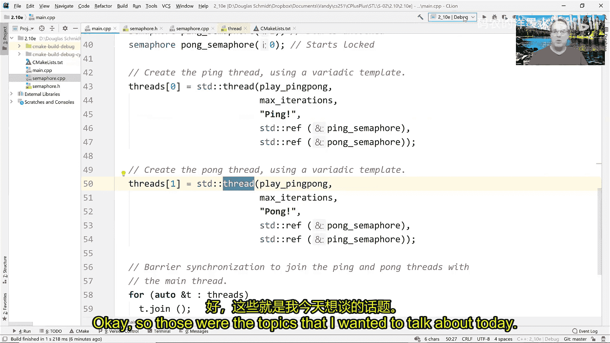
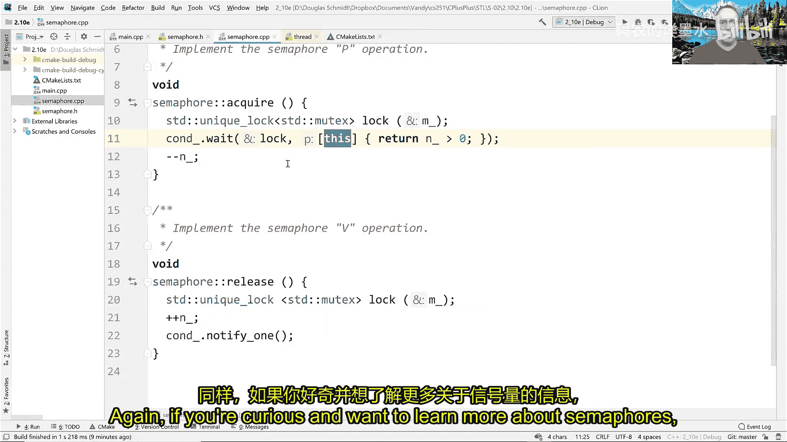
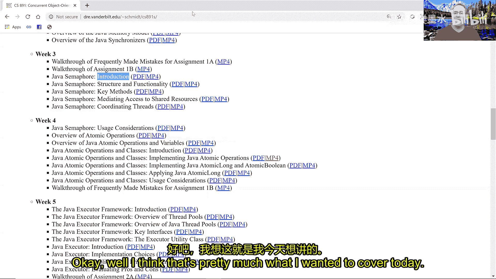

# C++标准模板库：04：模板函数与模板类 part3

在本节课中，我们将深入探讨C++模板的其他有趣方面，特别是模板在类中的应用。我们也会花一些时间讨论可变参数模板及其在C++函数中的一些非常酷的特性。

## 模板特化与自定义类型

上一节我们介绍了模板特化的基本概念，本节中我们来看看如何为那些无法通过编译器默认实例化机制工作的数据类型进行显式特化。

### 为字符指针特化容器

以下是一个简单的容器模板，它有一个 `increase` 方法，期望对元素进行前置递增操作。

```cpp
template <typename T>
class Container {
    T element;
public:
    Container(T arg) : element(arg) {}
    T increase() { return ++element; }
};
```

如果我们尝试用 `char*`（C风格字符串）来实例化这个模板，`increase` 操作将没有意义。因此，我们可以为 `char*` 创建一个特化版本，并添加一个全新的方法。

```cpp
template <>
class Container<char*> {
    char* element;
public:
    Container(char* arg) : element(arg) {}
    char* uppercase() {
        for (char* p = element; *p != '\0'; ++p) {
            if (*p >= 'a' && *p <= 'z') {
                *p = *p - ('a' - 'A');
            }
        }
        return element;
    }
};
```

在这个特化版本中，我们定义了一个 `uppercase` 方法来将字符串中的小写字母转换为大写，这展示了特化类可以定义原模板中没有的新方法。

### 处理缺少运算符的自定义类型

如果用一个没有定义 `operator++` 的自定义类型来实例化原始的 `Container` 模板，编译将会失败。

```cpp
class Foo {
    int i;
public:
    Foo(int n) : i(n) {}
    operator int() const { return i; }
    // 最初没有定义 operator++
};
```

一种解决方案是在 `Foo` 类中定义 `operator++`。

```cpp
Foo operator++() {
    std::cout << "Foo::operator++" << std::endl;
    return Foo(++i);
}
```

另一种方案是为 `Foo` 类型特化 `Container` 类，并在特化版本中定义 `increase` 方法，该方法内部调用 `Foo` 的 `operator++`。

```cpp
template <>
class Container<Foo> {
    Foo element;
public:
    Container(Foo arg) : element(arg) {}
    Foo increase() {
        std::cout << "Container<Foo>::increase" << std::endl;
        return ++element;
    }
};
```

这演示了如何通过特化来适配自定义类型，确保模板代码能够正确工作。

## 模板 vs. 宏

在C++引入模板之前，宏常被用于编写通用代码，但它们存在严重问题。本节我们来看看为什么模板是更好的选择。

考虑一个求最小值的宏：

```cpp
#define MIN(I, J) ((I) < (J) ? (I) : (J))
```

以及一个等价的模板函数：

```cpp
template <typename T>
const T& min(const T& i, const T& j) {
    return (i < j) ? i : j;
}
```

当我们这样调用时：

```cpp
int a = 10, b = 20;
int result1 = min(a++, b++); // 模板版本
int result2 = MIN(a++, b++); // 宏版本
```

模板函数遵循正常的函数语义，参数在调用点只求值一次。而宏是简单的文本替换，会导致参数被多次求值，产生意想不到的副作用。因此，在现代C++中，应避免使用宏来实现通用函数，模板是更安全、更强大的替代品。

## 显式实例化

早期C++编译器在模板代码生成上可能存在缺陷。显式实例化可以强制编译器为特定的模板参数生成代码，这在测试或解决旧编译器问题时可能有用。

我们可以显式实例化整个类、特定的成员函数或独立的函数模板。

```cpp
// 显式实例化函数模板
template void printDataType<int>(int);
template void printDataType<double>(double);

// 显式实例化类模板的构造函数
template ExampleClass<int>::ExampleClass();

// 显式实例化整个类模板的所有成员
template class ExampleClass<double>;

// 显式实例化类模板的特定成员函数
template ExampleClass<std::string>::ExampleClass();
template void ExampleClass<std::string>::add(const std::string&);
template std::string ExampleClass<std::string>::result() const;
```

虽然现代编译器很少需要这种手动干预，但了解此特性仍有其价值。

## 可变参数模板与递归

可变参数模板允许函数或类接受任意数量的模板参数，这是实现类型安全可变参数函数的关键。

### 递归求和

以下是一个使用可变参数模板递归计算参数和的例子：

```cpp
// 递归基案
template<typename T>
T adder(T v) {
    std::cout << __PRETTY_FUNCTION__ << std::endl;
    return v;
}

// 可变参数递归案例
template<typename T, typename... Args>
T adder(T first, Args... args) {
    std::cout << __PRETTY_FUNCTION__ << std::endl;
    return first + adder(args...);
}
```

调用 `adder(1, 2, 3, 8, 7)` 会递归展开，每次调用“剥离”一个参数，直到调用基案。`__PRETTY_FUNCTION__` 宏可以帮助我们查看每次实例化的具体类型。

### 编译时计算：阶乘

模板元编程允许在编译期进行计算。以下是计算阶乘的几种方法：

1.  **运行时递归函数**：
    ```cpp
    long long factorial(int val, long long sum = 1) {
        if (val > 1) {
            return factorial(val - 1, sum * val);
        }
        return sum;
    }
    ```

2.  **编译时常量表达式函数（C++11 constexpr）**：
    ```cpp
    constexpr long long constexprFactorial(int val, long long sum = 1) {
        return (val > 1) ? constexprFactorial(val - 1, sum * val) : sum;
    }
    // 可以在编译期使用
    static_assert(constexprFactorial(5) == 120, "Error");
    ```

3.  **模板元编程（类模板特化与递归）**：
    ```cpp
    template<long L, long LSum = 1>
    struct Factorial {
        enum { value = Factorial<L-1, L * LSum>::value };
    };
    template<long LSum>
    struct Factorial<1, LSum> {
        enum { value = LSum };
    };
    // 使用
    const long long fact20 = Factorial<20>::value;
    static_assert(fact20 == 2432902008176640000LL, "Error");
    ```

模板元编程版本在编译期通过模板特化和递归完成计算，结果存储在枚举值 `value` 中。

## 容器包装器与可变参数转发

我们可以创建一个通用的容器包装器，它使用可变参数模板来接受任意数量的参数，并将它们完美转发给底层容器的构造函数。

```cpp
template <typename T,
          template <typename...> class ContainerTemplate = std::vector>
class ContainerWrapper {
    ContainerTemplate<T> c;
public:
    template <typename... Args>
    ContainerWrapper(Args&&... args) : c(std::forward<Args>(args)...) {}
    // ... 其他方法，如 begin(), end()
};
```

这里，`ContainerTemplate` 是一个模板模板参数，默认值为 `std::vector`。构造函数使用可变参数包 `Args&&... args` 和 `std::forward` 将参数原封不动地转发给成员 `c` 的构造函数。

使用示例：
```cpp
// 使用默认的 vector，用3个"words"初始化
ContainerWrapper<std::string> cw1(3, "words");
// 使用 deque，用字符指针数组的范围初始化
const char* shapes[] = {"circle", "triangle", "square"};
ContainerWrapper<const char*, std::deque> cw2(std::begin(shapes), std::end(shapes));
```

这个技巧展示了如何灵活地封装和初始化不同的STL容器。

## 通用打印函数

我们可以编写通用的函数来打印任何容器的内容，这需要利用容器的类型特征和可变参数模板。

### 使用迭代器的打印函数

```cpp
template <typename InputIterator>
void printIterator(InputIterator start, InputIterator end) {
    while (start != end) {
        std::cout << *start << " ";
        ++start;
    }
    std::cout << std::endl;
}
```

### 使用可变参数模板直接接受容器

```cpp
template <typename Container>
void printContainer(const Container& c) {
    std::cout << __PRETTY_FUNCTION__ << std::endl;
    for (const auto& elem : c) {
        std::cout << elem << " ";
    }
    std::cout << std::endl;
}
```

对于 `std::map` 这类元素为 `pair` 的关联容器，我们需要为 `pair` 重载输出操作符：

```cpp
template <typename K, typename V>
std::ostream& operator<<(std::ostream& os, const std::pair<K, V>& p) {
    os << p.first << " => " << p.second;
    return os;
}
```

`printContainer` 函数利用 `__PRETTY_FUNCTION__` 展示了编译器推导出的完整容器类型，包括其模板参数（如值类型、分配器等）。

## 可变参数模板在线程中的应用

C++标准库中的 `std::thread` 构造函数是使用可变参数模板的绝佳例子。它允许我们将一个可调用对象及其所有参数安全地传递到新线程中。

以下是一个使用两个线程交替打印“ping”和“pong”的示例，使用信号量进行同步：

```cpp
void playPingPong(int max, const std::string& str,
                  Semaphore& mySem, Semaphore& otherSem) {
    for (int i = 1; i <= max; ++i) {
        mySem.acquire();
        std::cout << str << " ";
        otherSem.release();
    }
}



int main() {
    Semaphore pingSem(1); // 初始可用
    Semaphore pongSem(0); // 初始不可用
    const int iterations = 4;

    std::thread pingThread(playPingPong, iterations, "ping",
                           std::ref(pingSem), std::ref(pongSem));
    std::thread pongThread(playPingPong, iterations, "pong",
                           std::ref(pongSem), std::ref(pingSem));

    pingThread.join();
    pongThread.join();
    return 0;
}
```

`std::thread` 的构造函数大致原理如下：


```cpp
class thread {
    // ...
    template <typename Callable, typename... Args>
    explicit thread(Callable&& func, Args&&... args) {
        // 将可调用对象和参数完美转发到内部存储，以便在新线程中执行
        // 实现细节通常涉及 std::bind 或类似机制
    }
};
```

这确保了参数被正确地复制或移动到新线程的上下文中，提供了类型安全的方式来启动并发任务。




## 总结



本节课中我们一起学习了C++模板的几个高级主题。我们探讨了如何通过模板特化为特定类型（如 `char*` 或自定义类）提供定制化的实现。我们比较了模板与宏，明确了模板在类型安全和行为可预测性上的优势。我们了解了显式实例化及其历史用途。我们深入研究了可变参数模板，看到了它们在递归求和、编译时计算（阶乘）、通用容器包装器和打印函数中的强大能力。最后，我们看到了可变参数模板如何使 `std::thread` 的接口变得既灵活又类型安全。这些特性共同构成了现代C++泛型编程和元编程的基石，是有效使用STL和理解高级库设计的关键。