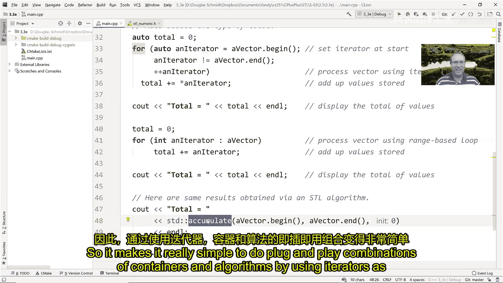

# 【全集】范德堡大学 C++标准模板库 中英字幕 1080P p05 Lecture 5 - 容器 part1 -BV1KWiCBWE7M_p5-

Hello and welcome to the next webinar in my series on C++ Standard Tt Library by example。

Today at long last， we're going to start talking about the real meat of the standard Temp library。

 beginning with its focus on containers， which are one of the key themes。

 one of the key components that's in STL， along with algorithms， iterators， and functorters。😡。

So without any further ado， let's go ahead and get started， And I will begin by sharing my screen。

 So if we take a look here， let's go ahead and start with。

Where the code is， as always， you can go to my。Repository C++ GitHub account and we go to STL。

And we're going to go ahead and now go into the S03 folder， and we'll begin with what's in 3。1。

So I'll show my。IdeE so what's what's saying in the 3。

1 is not really code it's just an overview of containers and STL and containers are an attempt to try to or not an attempt they're very successful way of being able to work around some of the limitations with native built in types things like C plus plus built in arrays which are very limited there's a number of things that containers all share in common irrespective of what kind of container they are all the containers have the ability to copy their values rather than maintaining references to the values so you'll see that this concept of value semantics is very common with STL you can of course have containers of pointers but let's ignore that for the time being。

😡，So you'll see that when you do these kinds of things。

 STL and C++ over the years have evolved other features to make value copying and value returning very efficient and we'll talk about that more later。

😡，The classic STL containers， which are basically the sequential containers。😡。

And associative containers， the ordered dissociative containers all have an order in the case of the sequential containers。

 which is what we're going to focus on today， the order is just the order that the elements were added to the container。

😡，In the case of the Associative containers， the order is basically provided by a key。

 and it's typically ordered by either the less than or greater than operation。😡。

Another thing remember about STL containers is that they assume you know what you're doing。

 So in particular， if you do something with STL containers， if you put things in that are incorrect。

 they're often not going to flag that。 So it's kind of a garbage in garbage out scenario。

 if you give them。Objects that are full of mistakes and have problems then you will get them back with the same mistakes and problems so c plus plus as a general rule expects that you know what you're doing。

😡，The containers also include some common operations so for example they all have various constructors that can be used to support default construction as well as copy construction for types of the same container type there's also destructors that will free up the resources that were allocated by the container and you can also initialize containers from ranges of values using iterators and we'll see later that that's the way the containers can be used to copy between different types of containers so a vector to a list or a list to a deck and so on and so forth There's also a number of methods that tell you how many elements are in the container there'ss basically three of them typically one is size which is the current number of elements in the container another is empty which is basically just a shorthand for size equals zero and then there's also something called max size which is the maximum number of elements that a container can contain。

😡，Also containers have comparison operations， which is something you won't find with built-in arrays so you can do things like check to see if two containers are equal if two containers are not equal。

 if one container is quote less than or less than and equal to the other or if one component one container is greater than or greater than or equal to another and so those are basically just like using relational operations that you become accustomed to for other data types like doubles and floats and ins and so on。

😡，Something else that all containers have is the ability to be assigned so you can assign one container the contents of another using the assignment operator and then there's also something called swap which is a very efficient way of swapping the contents of two containers assignment of course is used when you want to make a deep copy。

😡，Swapping is done when you want to basically exchange pointers or references internally to the containers。

 and the main reason for using swap is to be able to do things like strong exception safety guarantees。

 which turn out to be very easy to do once you know the patterns and we'll talk about the patterns of exception safety probably about the time to get done with these sequential containers。

😡，So let's just quickly go through the types of containers that exist in STL and then we'll get into the sequential container discussion so there's sequential containers there's various types of associated containers。

 Associative ordered containers and unordered associative containers and then there's also something called adapter containers or container adapters so let's take a quick tour through the space of containers I'm not going to dwell on them in any detail at this point I'm just going to give you a quick overview and show you where you can go to find the implementations which occur in these header files that we're including in this example。

😡，So there's something called a vector， that's the first thing we're going to look at today and that allows you to have linear and contiguous storage。

 much like a built- in array， but with lots of improvements that are done because it's done as a class。

 not as a built in C slash C++ array。😡，There's something called a list。

 which is a doubly linked list of nodes， so you can do certain operations very quickly like insert things at random points in the list once you've got yourself to that point。

😡，There's forward lists， which are singly linked list， you can only go forward。

 you can't go forwards and backwards and then there's something called a deck and the deck is essentially a doubleend cube so you can efficiently add elements and remove elements from the end of the deck as well as from the beginning of the deck。

 whereas vectors really can only have elements added efficiently at the end。😡。

And delete it efficiently from the end so those are the four common sequential containers and that's what we're going to talk about in just a moment in more detail then there's also a whole pile of associative containers and these mirror each other there are ordered associative containers which are implemented using essentially ordered binary trees red black trees as it turns out in this particular case and these are broken up into two categories sets and maps。

😡，And each of those categories has an alternative as well。

 so we have sets and multi sets and maps and multi mapps so how do we differentiate between these different containers so。

😡，Set only has a key and it cannot contain duplicates， a multiet is only going to contain keys。

 but you can have duplicates。😡，A map can have key value pairs or it does have key value pairs and it cannot have duplicates duplicate keys that is whereas a multimap has key value pairs and you can have duplicates so those are kind of the main way to differentiate the different types of ordered associative containers and they're ordered because they're ordered by basically the ordering that you get with either the less than operation or the greater than operation and this is all done using a binary tree。

😡，Then there's also a similarly mirrord set of so-called unordered associative containers。

 And these are all implemented using hash maps or hash tables and hash lookups and so on。

 So they're a little different in terms of the As that they provide from the point of view of what kind of operations you can instantiate these various templates with。

 But they have similar characteristics。 you have unordered map and you have unordered multimap and those have key value pairs that are either all unique keys in the case of unordered map or。

Could be duplicates in the case of unordered multimap。 And then likewise。

 we have unordered sets and unordered multis。 And as you might expect。

 the unordered sets cannot have duplicates。They're not ordered， they're just hashed。

 and the unordered multi sets may contain duplicates， and they also are hashed as well。😡。

Your mile may vary as to whether it's better to use hashing or the ordered operations and my recommendation is always always always to benchmark your code and see which one is working better for you it's pretty easy to plug and play these things in most cases so it's not too hard to switch between them。

 but it is important to determine empirically which one is going to perform the best in any given circumstance。

😡，And then finally we have so-called adapter or adapted containers and these containers are stack queue and priority queue now I think hopefully everybody at this point knows what a stack in a QR so a stack is basically going to give you a lastin first out data structure where you can push items onto the top and pop items off the top and a queue gives you a first in first out ordering approach where you can in some this case you can push items to the end of the queue and you can pop items from the front of the queue so those are all pretty familiar data structure is you probably learn about them in other classes and then the final data structure is a priority queue and a priority queue is a queue that maintains an ordering and it's ordered by the item of highest priority and you can determine what that is and what always happens is whenever you do operations on a priority queue like you remove the first item or you remove a priority queue it's always going to take the item of highest priority。

😡，And when you insert an element into a priority queue it's always going to put it in the right place relative to the priorities of the other operations in the queue so those are all the main。

😡，Containers that we have in C+ plus STL， let me now go ahead and let's take a look at the sequential containers。

And。Let's just open this up。We'll be looking at the other containers later。

 so sequential containers are just collections of data elements that are placed in some order。

 usually the order in which the elements were added to the container。😡。

The ordering of the elements in a sequest container have nothing to do with their value。

 it's the order that they were placed in there， so there's operations， for example， like pushback。

 which just puts it at the end of the other elements that are already there。😡。

You can think of them a little bit like an array， a built-in array。

 but as we'll see they have lots more cool clever semantics and lots more cool clever clever features and they're particularly they're better than simple CN plus plus built in arrays because they have size member functions that will tell you how many elements they have in them they give you iterators to the beginning and one past the end they provide copy constructors and move constructors and assignment operators you can pass containers sequential containers by value so the copies are made properly and then you can also grow and shrink them dynamically you don't have to be responsible for allocating memory and making copies of the elements and deleting the old memory and so on and so forth so they're just much more convenient。

So again， as we said before， you've got vectors lists， forward lists and decks。

 so those are the various sequential containers， so now let's start to take a look at some examples of sequential containers。

😡，And some of these things will be pretty straightforward I think which is good it's not meant to be super complicated these containers are very very useful。

 very common， especially vector， which is the one we're going to look at first so a vector is basically a built-in array a built-in dynamic array on steroids and you can define it of course to be a vector of whatever tight t you want to use so vector of in vector of double vector of character vector of employee record or whatnot and the dynamic array will grow and shrink at the end so it's always easy to add things to the end and remove things from the end but if you want to remove things from the front or the middle then it's got more cost。

😡，Internally， this is all done， of course， by dynamically allocating memory。

 and that's all hidden from you， of course， by the class implementation itself。

 And you are not responsible in any way shape or form for allocating and delocating memory。

 although there's some operations that you can use to preallocate memory if you know how big your data structures are going to be。

 So vectors are very， very efficient。 They're basically about as efficient as built in array as more flexible you can access individual items by their position index。

 like vector sub0 or vector sub N。 as long as n is inside the bounds。

 you can iterate over the elements in any order front to back， back to front， random。

 whatever you want to do， and you can efficiently add or remove elements from the end。

And there's just a little bit extra memory to keep track of all the state necessary to do this。

 but they're really just about as efficient as built in array arrays。😡。

So the other thing that you can do is when you push elements into an array。

 if the array is too small， to store the elements， then it'll go ahead and automatically grow and then reccopy the elements into the new array and then add the new one at the end。

😡，And this turns out to be something that's optimized and if you don't like the way it works out of the box。

 you can reserve the amount of memory if you know something about how big you think your data structure usage will be for the vector so the vector in STL is defined as follows it's a template of course that takes tight name T which is the element that will be used and it's got something called an allocator we're not going to talk about allocators right now we're just going to use the default allocator which under the hood uses C plus plus operator new and delete if you need to take over ownership of all you can but that's a more specialized use case that we'll talk about later。

😡，So let's go ahead and take a look at how you might use vectors and this will be kind of fun because it's going to show us first how to do things with native。

😡，C+ plus built in arrays， and then we'll talk about how you can do things more effectively with vectors and but you'll see that the way the code looks is very similar。

😡，So here's a builtin array in this particular one I allocate statically so I'm going to have an array of three elements and then you can see I go ahead and assign various values to a of zero array of one and arrayse of two and you can see how you can use the array subscript operations on both the lefthand side and the right hand side of the assignment statement and I don't have to do it like this。

 I could also do it like this， I could say equal new int and allocate it like that。😡。

So I could also have allocated it dynamically but of course， if I do that。

 I have to remember to delete it or put it in some kind of。Auto release object like a unique pointer。

 so let's just keep it like this for now， once you learn about vectors I don't think you're ever going to want to use dynamically allocated arrays in C++ anymore native arrays。

😡，So what we can do here is we can go ahead and print the elements so we're going to print out the elements。

 a sub0， a sub1， a race of  two， we're going to print them out。 I think that's all pretty intuitive。

 I'll run the code in a second so you can see what it does。

The next thing I'm going to do is I'm going to go ahead and define a vector and a vectors like a better builtin array in this case we're gonna to have an array of three elements just like we did with the array you can see that I can leverage c plus plus as overloaded subscript operator in order to basically do essentially identicalical computations that look the same as they do up here for the builtin array but this array is much more complicated and much more powerful not complicated to use which is more complicated implementation wise and it's much more effective and scalable and flexible than the native arrays However if we want to work with it much like we would use a builtin array we can go ahead and iterate through it from i equals zero to I less than the size of the array and print out each element one at the time So I think you'll agree that this code is arguably much cleaner than this crazy code up here which is how you determine the size of a native array its kind of a weird little Ctyle trick now let's have some。

And let's go ahead and resize this array， which is set it back to zero。

 and now we're going to go ahead and push a bunch of elements into it。

 So this is using a new feature we didn't talk about before。

 This is using the pushback operation and what pushback does is it goes ahead and it adds a new element at the end of the current vector。

 And if it needs to under the hood， it'll grow the vector by one element or maybe more than one element that's an implementation detail and then make sure that there's enough room to store that element into the array。

 And then the last thing we do after we put the values zero through6 into our vector。😡。

We're going show another way to print out the elements。 So this was the way we did it before， using。

The vectors size method， but now we're going to go ahead and use something called a range based for loop those of you who are familiar with Java and the concept in Java of a for each loop pretty much the same idea so what we say here is for。

😡，IntI where I is updated by all the elements of vector in the order from left to right from lowest to highest。

 go ahead and print out the value of I and I think you'll agree with me that this code here is much preferable to this code and in fact if you take a look the compiler is actually trying to tell you don't you want to change this into a range based for loop and so if you click yes。

 it'll go ahead and do that transformation for you automatically which is very cool。😡。

So let's go ahead now and see if we can run this code。😡。

And we'll see what the results are should be obvious results hopefully so it's compiling and you can see here that what we had was basically in the built in array we had71017 and that's what got printed out here then we did the equivalent code with a vector we got the same thing down below and then when we went ahead and put zero through6 into the vector we get those results so。

Pretty intuitive， pretty cool， hopefully that makes good sense。

 and that's a very straightforward example of using vector。

So let's go ahead and turn our attention now to another example of using vector and I think we're just going to focus on vectors today and see how that takes us so this example is really just showing how trivial it is in C++ to switch from a vector of ins to a vector of doubles。

😡，And we're going to use a couple other little things here。 We're showing how you can use pushback。

 We start out with an empty vector。 We push 1。2 and 4。5 into it。

 We go ahead and make some changes to its values now that we've we've given them initial values。

 we can read the values and do some changes to them。 and then you'll notice down here。

 we go ahead and we loop through the vector。 And we print the elements out one at a time。

 This example illustrates a new feature。 I could have said double here。

 because that's what I've got in my vector。 That would be one thing to do。

 But another thing you can do and see plus plus if you can use auto instead of having a specific type。

 And auto basically is just a flag to the compiler to go ahead and deduce the type that's used here。

 and it can deduce that because it's a vector of doubles that each element D must be a double。

 So hopefully， that helps to make some sense。So let's go ahead and run the code。😡。

And you can see we get the results out that we would expect。

So nothing particularly profound in this example， just demonstrating that you can easily switch from a vector of int to a vector of double and everything else pretty much stay the same。

😡，Let's now go on to another example。😡，And this particular example。Is going to。

Show a couple of interesting features of C+ plus especially newer versions of C++ first we're going to show how you can initialize a vector from a builtin array and that's what we show here so we have a builtin array with 10 elements in it and I could actually leave this out there wouldn't change the meaning is it the compiler can count and the number that there are and then we go down here and we also have a conants carestar that says hello world。

😡，And you can see that in this particular case we have a that's basically a string。

 a kind of a C styleyle string and then we're going to go ahead and initialize Vc1 with the array。

 which is the beginning of the range and then the array plus 10 which is one past the end of the range so this is basically showing how you can initialize a vector using a native builtin c and plus plus array so that's pretty cool then this here is just showing you another way to do it。

 this is just putting an initializer list directly in line and you can either surround that with pars like this so you can either say I'm passing this into the constructor that's one way to do it or with later versions of C+ you can eliminate the openPran and just simply use the initialization bracket semantics or syntax。

Once we've got V two， we can go ahead and print it out using the range based for loop and an auto。😡。

Key word to deduce that it's a vector of ints。And then down here we do more or less the same thing with strings。

 I probably should just go ahead and。😡，Move。This down here because it makes more sense there。

So now we're going to go ahead and define ourselves this ST， which is a con care star。

 and we're going to use that to initialize。😡，The Vc3 much like we had done up here except this time we're going to use Stlin as opposed to putting account so it's a little bit more abstract and then V4 shows how you can do the same thing just by getting individual characters so we're gonna have a vector of character now quite frankly if you want a vector of characters you probably really want a string but here at least we show that you could create using vector semantics if you were so inclined and once we've got that we go ahead and print out the contents of vector4 and let's go ahead and run the code and I think the result should not surprise you because it prints out the contents quite nicely。

So that's showing some other interesting aspects of using vectors in particular。

 how you can initialize them with。Native types using ranges。

 or you can use initializer lists directly。😡，The next thing we're going to look at is yet another example of vector。

😡，And this is going to show you a little bit more complicated example， this is really interesting。

 this is going to show you how to make a twodimenional vector or what passes for a two dimensionional vector by having a vector of vectors and so then we're going to do some interesting things essentially we have our vector of vectors so you can see down here we have vector of vector of int which we call my vector2D kind of a strange name and then we have a vector event we call one vector and2 vector kind of like the cat in the hat you know or you know cat one or thing one and think two or one fish two fish whatever。

😡，We're going to go ahead and add various elements to one V， we're going to give it one。

 two and three and then two V is going to get four。

 five and six and then we're going to take one V and 2V and we're going to go ahead and add them to myV 2D so my V 2D sub0 will be one V and my V。

😡，2 d sub1 will be two vector so you can think of this as basically kind of like an array of arrays or a vector of vectors almost like a two dimensional array。

 but not quite the same implementation so now that we've got ourselves this。😡。

Myve 2 d two dimensional vector， let's go ahead and do some stuff with it。

 So the first thing we're going to do is we're going to use。😡，Iterators。

 and we're going to talk a lot more about iterators。

 we're going to use iterators in order to be able to get an iterator to the first of the vectors。😡。

In our2 element 2 d vector and then while we haven't reached the end of that particular iterator。

 we're going to go through each element and then we're going to have a second nested for loop that's going to take。

😡，The vector， the first vector in the vector of vectors and get an iterator for it。

 So the top level4 loop is going to iterate through each of the vectors。

 And then the second nested for loop is going to go ahead and iterate through each element in the nested vector。

And all we're doing here is we're just kind of going from beginning to end。

 you can see here how we're able to use the vector and we can I think we can do this a couple different ways。

 but the bottom line is that what we're doing is we're iterating through these things and we're finding ourselves doing a dereference of the iterator which will print out the value at that location so you know first vector sub0 then012 then second element location012 that's what the star iterator is doing we're going to talk a lot more about iterators either this is just introducing you to the concept of iterators。

If you're perplexed by iterator syntax there's an alternative way of doing this using subscript operations and we show this down here so down here we're going to do the same thing except rather than using iterators we're going to use indices I and J to iterate through every element in our two dimensional vector and at every step along the way we're going to say my V2 d sub I subj so this looks very。

 very much like working on。😡，A multidimenal or a two dimensionional array in CRC plus plus。 In fact。

 the syntax for the part shown here is really identical。

 And that all works because of the magic of C plus plus。

Subscript operations which you can overload and that's what is going on there so that's an alternative way to go depending on your perspective it might be cleaner or not than the approach shown up here。

😡，But then I want to show you the range based way of doing this and the range based way， of course。

 is。I think head and shoulders above everything else because it's really clear what's going on。

 We're basically saying take my 2D vector。 and for each vector。

 that's the inner vector and the 2D vector， then go ahead and have a rangebased for loop that gives me each element in that inner vector and go ahead and write that out。

 And of course， these are ints， but I used auto just to let it type the deuce。

 I'm also using con auto auto Ref here。 And that's because I don't want to make a copy of the vector that I'm iterating over in the inner loop。

 I just want to reference to it to avoid the overhead of copying the contents。

 So let's go ahead and run this program you'll see itll go ahead and compile and the results that we get out of here a little hard to see with the way I formatted it。

Wops， but。Take a look。So you can see using the iterator。

 these are the results using the subscript operator we get exactly the same results and then using the range based for loop we get the same results。

 So each of the different approaches gives us exactly the same results。

AndChs are if you were to time them they'd all probably take about the same amount of time to run so it really comes down to what you're most comfortable with and for my money I kind of like the range based for loop I find that most intuitive。

 but you'll see that that's a newer feature added the C++ 11 so if you're stuck using olderder C++ compilers which hopefully you're not you may have to resort to using one of these other approaches。

😡，Okay so that's a pretty interesting example now let's go ahead and talk about the last example I think that that'll be the last thing we'll cover for today this is showing off some other things about vectors so first there's some tips for using them effectively and efficiently you can use the overloaded subscript operator which will basically be about as fast is using the native subscript operator it's just adding an index to a starting point so it's bazingly fast and the rangebased sorry the subscript operator does not do any type checking so it assumes you know what you're doing there's also another operation called at which does do range checking sorry not type checking range checking the subscript operator does no range checking whereas the at operation does range checking。

Something else about vectors， they support so called random access iterators。

 we haven't talked much about that yet， but we'll learn more about that shortly。😡。

It's often faster to insert many elements into a vector in one fell swoop using the range based copying mechanisms rather than doing them one element at the time because they can allocate the memory and slide them around more efficiently。

😡，And this is a very common data structure vector is probably the most common data structure of use in STL。

😡，And so it's very effective and and very efficient so let's take a look at a little example here。

 we're going to create a vector using an initializer list。

And then we're going to walk through this as we auto deduce the type here to be int and we're going to auto deduce the type of the iterator。

 which of course will be vector of iterator and we're going to go while we haven't reached the end and every step along the way we're going to go ahead and say。

😡，Total which is this value we auto deduced plus equal star and iterator and so what that'll do is the dereference operation goes and looks at the location where the iter is pointing finds the value and then it adds it to the running total so that's how you could do this using an iterator like mechanism in conjunction with auto deduction I could also have written this more verbosely if I'd wanted to but but why bother。

😡，Here's another example where we're going to use a rangebased for loop approach as opposed to using an iterator approach and this again came with C plus plus 11 and I prefer this approach。

 but I'm showing you alternative ways to do it and this I think is much cleaner much more clear what's going on and then of course because this is STL and there's different ways to do the same sorts of thing there's another method called accumulate and accumulate is actually a C+ plus。

😡，Template library algorithm and what it does is it's going to go ahead and start at the beginning。😡。

Go to the end， and it's going to accumulate each of the elements。

 And the initial value is going to be 0 in this case。

And we'll spend a lot more time browsing around through these methods later， but in a nutshell。

 this is what this method does， you can see what it does is it takes an input iterator as the first argument。

 which is the iterator from the vector。😡，One past the end called last。

 which is the last element in the iterator from the vector and then it takes an initial value and what it does here is it goes ahead and iterates through this little for loop from first to last and every step along the way it goes ahead and adds。

😡，The dereferenced first iterator's value to the initial value and stores it in the initial value and it keeps doing this while last is not equal to first or first is not equal to last。

😡，And then when it's all done， it goes ahead and returns in knit。

 So that's just showing you how simple a lot of the STl algorithms are。 they're very。

 very simple in many cases， but it's cool because you can write that code without having to do any looping。

 without having to think at all about， you know， I iterrating 20 times and so on。

 So each of these approaches has their pros and cons left mind on devices。

For something as simple as this， I might be tempted to go with a range based for loop。

 but as we get more interesting examples later you'll see that accumulate and other STL algorithms are a fantastic way to simplify access to。

😡，Basically containers and they always work the same way so I could do the same code for a vector I could do the same code for a deck I could do the same code for a list and so on and so forth。

 so it makes it really simple to do plug and play combinations of containers and algorithms by using iterators as the way to do that。

Okay， so that's what I wanted to cover today what we will do tomorrow is we will keep marching down through our containers and we'll talk about。

😡，Des which are doubleend cues so they're a little bit more sophisticated than vectors we're also going to talk about the list container and very briefly about forward list there's not much to say about forward list because it's just a assemblyly linked list as opposed to a doubly linked list but the operations are essentially the same except you can't go backwards and then we'll probably tomorrow also talk about some of the other container like classes in the c plus plus standard library that have some STL like properties things like string。

Bitet， vert， and so on and so forth。So if there are no other questions。

 I will look forward to talking to you soon， everything will be available as always on my YouTube channel very shortly and thanks you guys so much for coming。

 talk to you soon。😡。