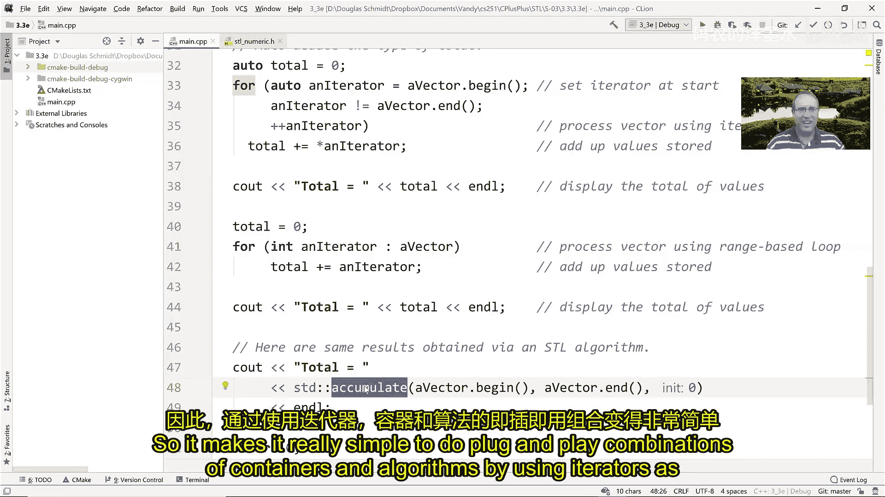

# C++标准模板库教程：第5讲：容器（第一部分）🎬


在本节课中，我们将要学习C++标准模板库（STL）的核心组成部分之一：容器。容器是STL的关键组件，与算法、迭代器和函数对象并列。我们将从容器的基础概念开始，并重点介绍顺序容器。

## 容器概述 📦

STL容器旨在克服C++内置类型（如原生数组）的局限性。所有容器，无论其类型如何，都共享一些共同特性。

所有容器都遵循**值语义**，这意味着它们复制其存储的值，而不是维护对值的引用。当然，你也可以创建指针的容器，但我们现在暂时忽略这一点。

STL和C++多年来已经发展出其他特性，使得值的复制和返回非常高效，我们将在后面详细讨论。

## 容器类型分类

STL容器主要分为几大类：顺序容器、关联容器（有序和无序）以及容器适配器。

以下是STL中主要的容器类型及其简要说明：

*   **顺序容器**：元素按照插入的顺序排列。
    *   `vector`：动态数组，提供线性、连续的存储。
    *   `list`：双向链表。
    *   `forward_list`：单向链表。
    *   `deque`：双端队列，可以在两端高效地添加或删除元素。
*   **有序关联容器**：基于键值对排序，通常使用红黑树实现。
    *   `set`：仅包含键，不允许重复。
    *   `multiset`：仅包含键，允许重复。
    *   `map`：包含键值对，键不允许重复。
    *   `multimap`：包含键值对，键允许重复。
*   **无序关联容器**：基于哈希表实现，不保持元素顺序。
    *   `unordered_set`：哈希集合，键不允许重复。
    *   `unordered_multiset`：哈希集合，键允许重复。
    *   `unordered_map`：哈希映射，键不允许重复。
    *   `unordered_multimap`：哈希映射，键允许重复。
*   **容器适配器**：基于其他容器实现的特定数据结构接口。
    *   `stack`：栈，后进先出（LIFO）。
    *   `queue`：队列，先进先出（FIFO）。
    *   `priority_queue`：优先队列，按优先级排序。

选择使用哈希容器还是有序容器，取决于你的具体需求，建议通过基准测试来确定哪种在特定场景下性能更优。

## 顺序容器详解

上一节我们概述了所有容器类型，本节中我们来看看今天的主角：**顺序容器**。

顺序容器是数据元素的集合，元素按照它们被添加到容器中的顺序排列。这个顺序与元素的值无关。你可以将它们想象成功能更强大的数组。

与简单的C++内置数组相比，顺序容器的优势在于：
*   拥有 `size()` 成员函数来获取元素数量。
*   提供迭代器来访问元素。
*   支持拷贝构造函数、移动构造函数和赋值运算符。
*   可以动态地增长和缩小，无需手动管理内存。

主要的顺序容器包括 `vector`、`list`、`forward_list` 和 `deque`。接下来，我们将重点学习 `vector`。

## Vector：动态数组 🚀

`vector` 本质上是一个功能增强的动态数组。你可以定义任何类型的 `vector`，例如 `vector<int>`、`vector<double>` 或 `vector<Employee>`。

它在末尾进行增长和收缩，因此在末尾添加或删除元素非常高效。在开头或中间进行操作则成本较高。其内部通过动态分配内存实现，但这些细节对用户是隐藏的。

`vector` 非常高效，几乎与内置数组一样快，但更加灵活。你可以通过索引（如 `vec[0]`）访问元素，可以高效地在末尾添加 (`push_back`) 或删除 (`pop_back`) 元素。

当向已满的 `vector` 添加元素时，它会自动分配更大的内存块，将现有元素复制过去，然后添加新元素。如果你能预估所需空间，可以使用 `reserve()` 方法预先分配内存以提高效率。

`vector` 在STL中的定义如下：
```cpp
template <class T, class Allocator = allocator<T>> class vector;
```
我们通常使用默认的分配器。

## Vector 使用示例

让我们通过一些代码示例来具体了解 `vector` 的用法。

### 示例1：基础使用与比较

这个例子首先展示了原生数组的用法，然后演示了如何使用 `vector` 实现相同的功能，并引入了更现代的遍历方法。

```cpp
// 原生数组
int a[3] = {7, 10, 17};
for (int i = 0; i < 3; ++i) {
    std::cout << a[i] << " ";
}

// 使用 vector
std::vector<int> v = {7, 10, 17};
for (size_t i = 0; i < v.size(); ++i) {
    std::cout << v[i] << " ";
}

// 使用 push_back 添加元素
v.clear(); // 清空vector
for (int i = 0; i < 7; ++i) {
    v.push_back(i); // 在末尾添加元素
}

// 使用范围for循环遍历 (C++11)
for (int val : v) {
    std::cout << val << " ";
}
```
可以看到，使用 `vector` 和范围for循环的代码比使用原生数组更清晰、更安全。

### 示例2：不同类型与 `auto` 关键字

这个例子展示了如何轻松地将 `vector` 从一种类型切换到另一种类型，并介绍了 `auto` 关键字用于自动类型推导。

```cpp
std::vector<double> dv;
dv.push_back(1.2);
dv.push_back(4.5);

// 修改元素
dv[0] = 3.14;

// 使用 auto 遍历
for (auto d : dv) {
    std::cout << d << " ";
}
```

### 示例3：初始化方式

以下是几种初始化 `vector` 的方法：

```cpp
// 从原生数组初始化
int arr[] = {1, 2, 3, 4, 5, 6, 7, 8, 9, 10};
std::vector<int> v1(arr, arr + 10);

// 使用初始化列表
std::vector<int> v2 = {1, 2, 3, 4, 5}; // C++11
// 或 std::vector<int> v2({1, 2, 3, 4, 5});

// 从C风格字符串初始化
const char* str = "Hello World";
std::vector<char> v3(str, str + strlen(str));
```

### 示例4：二维Vector（Vector的Vector）

你可以创建 `vector` 的 `vector` 来模拟多维数组。

```cpp
std::vector<std::vector<int>> vec2D;

std::vector<int> row1 = {1, 2, 3};
std::vector<int> row2 = {4, 5, 6};
vec2D.push_back(row1);
vec2D.push_back(row2);

// 使用下标访问
for (size_t i = 0; i < vec2D.size(); ++i) {
    for (size_t j = 0; j < vec2D[i].size(); ++j) {
        std::cout << vec2D[i][j] << " ";
    }
}

// 使用范围for循环访问 (推荐)
for (const auto& row : vec2D) {
    for (int val : row) {
        std::cout << val << " ";
    }
}
```

### 示例5：迭代器与算法

`vector` 支持迭代器，并且可以与STL算法配合使用。

```cpp
std::vector<int> nums = {1, 2, 3, 4, 5};

// 使用迭代器求和
int total1 = 0;
for (auto it = nums.begin(); it != nums.end(); ++it) {
    total1 += *it;
}

// 使用范围for循环求和
int total2 = 0;
for (int n : nums) {
    total2 += n;
}

// 使用STL算法 accumulate 求和
#include <numeric>
int total3 = std::accumulate(nums.begin(), nums.end(), 0);
```
`accumulate` 算法是STL强大功能的体现，它使得对容器元素的通用操作变得简洁。

## 使用Vector的有效建议

*   **下标操作符 `[]`**：访问速度快，但**不进行边界检查**。确保索引有效。
*   **`at()` 成员函数**：进行边界检查，如果索引无效会抛出 `std::out_of_range` 异常。比 `[]` 稍慢，但更安全。
*   **批量插入**：使用范围插入（如用迭代器初始化）通常比多次调用 `push_back` 更高效。
*   **预分配内存**：如果知道 `vector` 的大致大小，使用 `reserve()` 可以避免多次重新分配内存，提升性能。
*   **`vector` 是最常用的STL容器**，在大多数情况下都是默认的优质选择。

## 总结 🎯

本节课中我们一起学习了C++ STL容器的基本概念，并深入探讨了第一个也是最重要的顺序容器：`vector`。



我们了解到：
1.  STL容器提供了比原生数组更强大、更安全的数据管理方式。
2.  `vector` 是一个动态数组，支持快速随机访问和在末尾高效增删元素。
3.  我们学习了多种初始化和遍历 `vector` 的方法，包括使用下标、迭代器和现代化的范围for循环。
4.  通过示例，我们看到了如何创建二维 `vector` 以及如何将 `vector` 与STL算法（如 `accumulate`）结合使用。

`vector` 因其效率和高通用性，是STL中使用最广泛的容器。在下一讲中，我们将继续探索其他顺序容器，如 `deque`、`list` 和 `forward_list`。