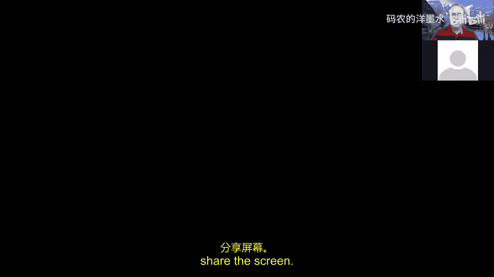
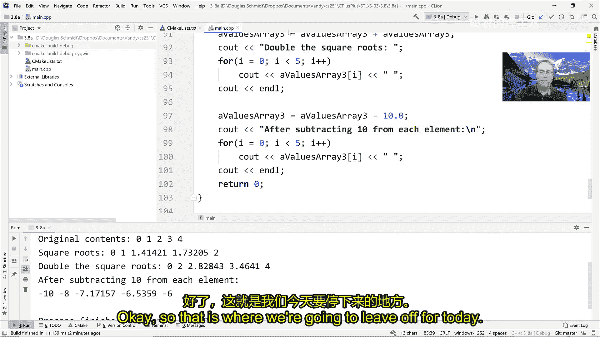

# 【全集】范德堡大学 C++标准模板库 中英字幕 1080P p06 Lecture 6 - 容器 part2 -BV1KWiCBWE7M_p6-

Hello and welcome to my next webinar on C++ STL by example today what we're going to do is continue our discussion about STL sequential containers Yes we talked about STL vectors which is one of the most common STL sequential containers and today we're going to expand our discussion to cover decks and lists as well as several other classes such as strings。

 bit sets and vor rays that while not strictly part of the STL have certain interesting characteristics that are in common with STL。

😡，So without further ado， let's go ahead and get started。

 I will start by sharing my screen and let's see， share the screen。

And you can see here that the code we're going to be looking at is available at this link。

 which is the C++ STLS03 folder and today we're going to start with the 3。

4 folder and then we'll go on from there。😡，All right， so let's go ahead and。

Share my IDE and i've got the first piece of code available ready to go this code will describe how a deck works first what's a deck a deck is a double ended queue and a double ended queue is a more sophisticated data structure than a vector which only really supports efficient adding at the end and removing at the end。

😡，Unlike the vector， the deck supports adding at the end and removing from the end。

 as well as adding at the beginning and removing from the beginning。😡。

As with vector you can also add and remove from the middle， but that's not efficient。

 but what it works under the hood is it's basically a double ended cu and so it's arranged to be a more sophisticated data structure that can grow and shrink efficiently in either direction。

😡，There' are certain characteristics that decks and vectors have in common in particular。

 the individual elements can be accessed by their position index。

 and you can also iterate over the elements in any order， backwards and forwards and so on。😡。

So the main difference between them is you can put things at the beginning and remove things from the beginning efficiently。

😡，Internally decks and vectors work quite differently though a vector is just a contiguous chunk of memory so accessing its elements using say the subscript operator is very efficient in contrast decks are not as efficient and so as a result they have extra overhead not wildly amounts of extra overhead and they're still constant time operations to insert and remove items at the beginning of the end however they're not as efficient as vector so you have to be aware of that and they're also not allocating all their memory internally in a contiguous way which is also important so what we're going to do now is take a quick overview of what actually constitutes the interface for a deck you can see here that a deck is。

😡，Templateated， so it has a type name T template， and it also has an allocator。

 So these parameters are identical to what you would find with a vector。

 the T is obviously the data type that you're using to instantiate the deck template with like in or double or employee record or whatnot and the allocator is something that's used allocate the memory by default it uses the operator new and delete that comes with C plus plus and uses the C plus plus global free store out of the box。

Most of the methods between vector and deck are the same there's a few differences you can't reserve space in a deck the way you can do in a vector and you can't check the capacity for a deck the way you can in a vector and in addition there's a couple of new functions as well there's a push front and a pop front pair of member functions and those of course are the ones that correspond to the ability to efficiently add and remove elements here。

😡，So let's go ahead and take a look at an example This is a very。

 very simple example we go ahead and make a deck that's initially empty and let's make it a deck of floats and then we're going to demonstrate how you can iterate through or iterate through the range zero to six or zero to7 but seven's not included and we're going go ahead and push something at the front and push something at the back so these are basically going to be kind of a palenrome set of values if you will it basically will be the kind of a mirror image of the values and then we go ahead and use the rangebased for loop here to print all the elements of the deck out Of course I could use iterators or other things but I'm going to use the rangebased for loop and of course I can also say auto here as we've talked about previously this goes ahead and tell us the compiler to autodduce the type so let's run that particular piece of code。

And you can see here that we end up with the following output。

 which is what we want it's kind of a mirror image or a palindrome of sorts where it's got 6。

6 at the beginning and end and then 5。5 at the next slot and 4。4 and 3。3 and 2。1 or 2。2 and 1。

1 and then 00 so this is just illustrating how you can use a deck to add elements at the beginning or the end。

😡，And to do it efficiently， of course， which is kind of the goal of all this。

So that's basically the simple example of deck。 Let's go ahead and take a look at some other examples that are perhaps a bit more interesting。

 And they will demonstrate some other features of deck。 So this is。Another example。

 when you think about deck and you compare and contrast it with vector why would you pick one versus the other so as a general rule of thumb I think as I mentioned before。

 if you just need to be able to do random access and you're just adding things at the end I recommend using vector because it's more efficient more space conserving and so on also if you want to reserve a large chunk of data because you know how big that the vector will be in the first place you can use reserve on it。

😡，Also keep in mind that when you do when you create a lot of elements with deck。

 then when the deck is destroyed， it's going to take longer to reclaim the memory and it will for vector and the reason for that is that vector always has a pointer to one contiguous chunk of memory。

 So when its destructor runs， it just has to delete that particular item so that's really fast it gives the whole the whole kitten caboole back to the free store in one fellel swoop conversely decks allocate chunks of data and so when deletions occur。

 it has to delete all the chunks not the end of the world， but it's something to keep in mind。😡。

Another couple things to keep in mind is if you're using。😡。

Data structures are using algorithms that require access to the front of the data structure to insert or remove a deck is going to be a lot more efficient than using a vector because it's built to work that way and then also keep in mind that the vector operations to get particular elements like subscript operator or the at operator at member function those will be a little faster because it's really a very fast constant lookup with very little overhead。

😡，In order to be able to get elements of a vector like vector V sub I， where I is in the range。

 whereas with the deck， it's still constant time， but it's not quite as fast as there's a few indirects that take place。

Dexs are often implemented with something called a cactus stack and that allows them to grow officially at both ends。

So here's another example this example is going to have start with an empty deck and we're going to go ahead and push a bunch of characters in there basically we're going to push A BCD。

 I believe， and then we're going to go ahead and print those out and again。😡。

Today's C++ program we' probably use the auto keyword here so we'll do the same thing。

And probably we should call this something other than I but we'll leave it as it is and now let's go ahead and do some interesting operations with iterators to our deck and you're going to see how decks support so-called random access iterators and this is this is very cool because it lets us be able to kind of move around in the deck and access different elements so what we're going to do here is we're going to say a deck begin which is going to get us an iterator to the beginning of the deck and then we're going to add two to it and this demonstrates what's known as random access iterators。

Deexs and。Vectctorors both have random access iterators most of the other STL containers have bidirectional iterators or some other form of lesser iterator random access iterators are the xenith of iterators and STL because they can be used in essence the same way you can use pointer arithmetic on pointers to arrays you can plus plus them you can plus equal them you can add to them subtract them。

 you can do all kinds of cool things。😡，This is illustrating also two different ways to use the iterator。

 the first way we're going to do it for the IT1 is to use the iterator trait so you can see here we have deck care iterator that's an iterator trait。

😡，And then we can also see how we can use the auto keyword。

Old school STL programmers probably are more familiar with using traits we'll talk more about traits when we talk about iterators basically think of traits as a name or a type def that's associated with a container that then defines something about its metadata in this case the type of iterator that it uses so kind of old school developers probably would gravitate towards using explicit iterators as I show here for IT1。

😡，But the more modern way of doing things in C plus plus and STl is to use auto。

 And as you can see here， it's less typing。 And you can also switch back and forth。

 if you take a look here， you can go between auto and the full blown the full Monti， if you will。

 for the iterator traits This one we're gonna to start at the beginning and we're gonna skip over three elements。

 And then we're going go ahead and print the contents of the elements at those locations pointed to by the iterator。

 So you can think of iterators is basically kind of you know smart pointers。

 That's one way to think about them。 not the only way， but one way to think about them。

 So in this case， we can dereference the iterator smart pointer and we'll print its values。

So far so good nowre going to do something else， we're going to go ahead and insert an element。😡。

After I1， so wherever I1 points to in our， in our deck， we're gonna insert a new letter。

 in this case， a capital X at that location。 And then we're going to go ahead and print the contents after that。

 So we printed the first contents earlier。 Now we're gonna print the second contents after we've added an element。

 And then the very last thing we're going to do is we're going to print out I 1 and I 0。

 We're gonna to dereference both of those iterators。 And this is interesting。

 Some implementations of Sttl will actually crash at this point。 And that's because out of the box。

 Stl does not support so-called robust iterators for data structures like Dx and vectors that could resize themselves。

And so that's where we have to be careful so normally we wouldn't want to write this code I think this particular implementation runs correctly or runs without crashing and gives the right results。

 but be aware that you have to be very careful for DX and vectors if you've modified the deck or vector that may invalidate iterators that are pointing into the locations and this will become a little bit more clear when we talk about iterators later so let's take a look at what the results are after we ran the program so you can see the original sequence was ABC D and that's because we went from。

Zero。To less than five。 so that's five locations。 we added the value of capital A to each one of those numbers。

 so we got letters in response。Then we went ahead and printed out the iterators that we got and you can see that we skipped over the first two so we got C for IT1 and we've skipped over the first three。

 so we got D for IT2 and then we went ahead and inserted X and we inserted X basically I guess actually it puts it before IT1 not after so you can see there's IT1 which pointed to C so now x has been inserted there and keep in mind that this insertion is not that efficient if you do it in the middle of the deck because the deck has to kind of move things apart to open up some space for the new value that we're adding here and then when we print out the results at the end you'll see we get IT1 is x and IT2 equals C and as I mentioned before you're not guaranteed that this code is going work but it looks like the implementation that comes with the G plus+ compiler that I've got here worked correctly for that。

😡，But be careful because it's not really defined to work that way， I believe。Okay。

 so that's another set of examples of decks you can see that they have some interesting properties。

 let's go ahead and take a look at yet another deck example。😡。

And this particular one is going to show some interesting characteristics， using traits。

And here's the code the code is actually pretty simple， we make it empty deck。

 we add three to the end and we put one at the front。

 so now it's got one three and then we go ahead and we insert at the position that is。😡。

Going to be between one and three so we put a two in there and now we go ahead and put a zero in the third location so let's go ahead and run that just see what the results are and you can see that the results remember we put we had one and three in the beginning then we stuck at two between those two things and then we said deck sub2 which is the last element in this current deck because everything in CNC plus plus and Java for that matter has to start with zero and so we end up with the values one to zero。

😡，And then what we go ahead and we call this method print and we're going to print the deck and let me show you how we do。

😡，Print and this is kind of interesting。 Notice what we're doing is here is we're passing in a con ref to the parameter D。

 so we're passing in a con Ref parameter and what that means under the hood is that instead of making a copy of a deck what happens is that calling by reference or con reference is going to take the address of a deck and it's going to pass it in such a way that it's treated as a con ref and that means its value can't be changed in the method that's being called。

 So this is a time0 way and c plus plus of being able to optimize passing objects by not actually having to make a copy of them the data lives at the call or location and then it gets passed in So down here what we're going to do is we're going to print out the number of items in the queue。

 which is D dot size and that works fine and that's because size is a con member function if you take a look this is the implementation of。

Size inside of the deck implementation and you can see that size is a con T all that i'm sorry it's a con what con means is that it won't make any changes。

That method called won't make any changes to the state of the object for which it's invoked。

 and therefore it can be called on a constant ref。Then what we're gonna to do is we want to iterate through every element in the deck and print the elements out and just for kicks to get started with we're going to go ahead and do this with an iterator just as you can see what it looks like。

 so in this case we say D dot begin and notice that D is a deck that's a constant ref and therefore D dot begin is going to have to return a constant iterator and that's because if it was returning an iterator which it can't do because that's illegal because it's a constant ref then you'd be able to update the value through the iterator and that would be a big problem because you'd be changing its state when it was passed as a conre。

😡，So instead of having iterator we use a different trait remember traits are just these little metadata names that are associated through typically through type defs in containers。

 we're going to say use the con version of this and the con version of an iterator for a deck does not have a dereference operation that can be used on the lefthand side you can only use it on the right hand side of an assignment statement so it only has our value references dereferences as opposed to L value dereferences that's the primary difference between con and noncont iterators so then what we're going to do is we're going to go ahead and iterate from beginning to end and print each value out。

Now， there's nothing that forces us to have to use this conerator at all， in fact， probably。

A newer practice would just have us use auto and we just let auto figure out the right type it deduces it for us And that's probably how I would write this code in production code。

 but I wanted you to get the sense of what a constant iterator is and of course auto is using a constant iterator see if I can make it redouc So auto is using a constant iterator but you don't see that as graphically or as vividly as if we're going to have to put the constant in there and by the way。

 type name when used this context simply says that this is a type name and therefore you can use a trait operation on it I think if we try to do it like this it complains and says let's see what does it say。

It says insert type knit so that's what it tells us to do and that's kind of some syntactic weirdness of C++。

😊，Okay， that's another example。 and now I think we have one more example to look at here for。😡。

Iterator， if I'm not mistaken。Let's go with or sorry with deck， if I'm not mistaken。

Let's go ahead and pull that up。So this particular example is actually a very simple example。

 but it's going to show some other features that are。😡，Good to know about。

 And we're going to talk about them quite a bit more when we start talking about exception handling and exception safety in Stl and C plus plus a little later。

So this particular example is going to have two decks of character。

 you can have my first deck and my next deck， and what it's going to do is it's going to push a bunch of letters to the first deck and it's going to push a bunch of numbers。

 digits， not numbers but digits， the digit version of numbers to the second deck。😡。

And then we're going to go ahead and print out the size。

 and then we're going to print out the contents and again probably should use auto here。😡。

That's the new ortangled way of doing things。And。So we're going to print out both the first deck and the next deck。

And then what we're going to do is we're going to do a swap and a swap is a very interesting method。

😡，All that swap does is it goes ahead and it swaps the data。😡。

And let's see if we can make the intelligent the sea lion stuff。

Do swap it's got confused at this point so we can't really follow that any further。

 but basically what it's doing is it's swapping that。😡。

References in here and so what it's doing is it's taking the state of the deck which would include things like its size and it's whatever its internal representation is。

 which is probably the data structure like a cactus stack or whatnot and it's going swap the references to those things so it doesn't actually make a deep copy it just swaps the data that corresponds to how the implementation is laid out in memory and once we've done that and when we run this code you can see that my first deck now has the contents of my second deck and my second deck now has the contents of my first deck so you can see here we start out with 26 and 10 we have 26 letters。

 uppercase letters 26 or 10 digits and then we swap them and then they've been reversed。Now。

 it may not be apparently obvious with this simple example， what the heck swap is doing for you。

 But what it's doing for you is it's setting it up to be able to do very efficient and。

Transparent or easy to program exception safety。 And we're going to talk more about exception safety and C plus plus later。

 And what's good about the swap operations。 And let's see if we can at least get this from here。

 You can see that it it uses this no except。Mechanism， let's see if we can find that there you go。

 so no accept。So you can mark methods in C++ as being no except and what that basically means is they guarantee not to throw exceptions so swapping won't throw exceptions and that turns out to be very important when we start dealing with exception safety as you might imagine。

😡，Okay， so that's the end of the discussion about the deck let me see if there's any questions at this point。

😡，It doesn't look like there's any questions yet as always， if you have any questions whatsoever。

 please don't be shy and jump in and you can ask them。😡，Okay。

 what we're going to do now is we're going to shift gears and we're going to talk about lists。😡。

So let's go ahead and look at some list examples， there's just a couple of list examples here。

A list is yet another sequential data structure。😡，Like。Vectctor like deck。

 you can have a list and it's implemented under the hood as a doubly linked list。

 hopefully everybody remembers a doubly linked list from data structure courses you've taken and that allows us to be able to traverse the list from beginning to end or end to beginning with equal ease and equal efficiency。

😡，We'll see that there's also another kind of list called a forward called a forward list。

 which only has a single pointer and therefore you can only traverse it from beginning to end。

 you can't traverse it from end to beginning， at least not efficiently and so but but a list out of the box is a doubly linked list。

😡，What Wlink list buy you kind of two things it buys you one thing advises you is it buys you the ability to add and remove elements anywhere in the list efficiently once you found the location you want to put the item in so unlike decks and unlike vectors where they have to move data around in a linked list you just have to rearrange some pointers so that's one benefit another benefit is that unlike vectors in particular。

 lists will only really allocate as much memory as actually as in use whereas vectors will often allocate more memory on the off-hand chance you're going to grow them at the end。

 so maybe lists are more space conserving although you also then have to pay the price of keeping these pointers in them so you have you know a pre pointer and a next pointer and every node in a list so that could actually end up taking more space depending on various factors。

😡，The other things you can do is you can iterate in either direction with a list， not a forward list。

 but with a list。😡，So as a general rule of thumb。😡。

Use lists if you're going to be doing a lot of arbitrary insertions in the middle somewhere or other places besides the beginning and the end。

😡，But other than that， you can't do random access operations on a list。

 and that's because the type of iterator it supports is known as a bidirectional iterator。

 And so you can you can only do things that advance efficiently by one。

 you can go either forward or backwards forward from the beginning。

 backwards from the end one element at a time。 and we'll see some examples of that here。😡，Okay。

 here's what the actual data type looks like it's not too dissimilar to deck and and vector we basically have。

😡，Class list which is tempemptized by type name T and it's also tempemptized by the allocator nothing has really changed at all and in fact that's a virtue of STL it's it's often the so-called principle of least surprise where you have common APIs and you can plug and play and this really starts to show up when we talk more about iterators and we start talking about algorithms because allows us to be able to use or reuse common algorithms with lots of different types of containers。

😡，So here's the example that uses a C+ plus STL list。

 as you can see what it does is it starts out and it makes an empty list of characters。

And then it's going to go ahead and push a bunch of characters into the list， basically ABCD。

 et cetera up to the first 10 characters。And then it prints out the size of the list。

 as you can see all the different containers have this size method that they share。

And then we do the fun part， what we're going to do is we're going to print the contents of the list out but we're going to do it in a somewhat non conventional way。

😡，While the list is not empty， we're going to go ahead and get an iterator to the beginning of the list。

😡，Which we use as auto， we then go ahead and print the dereenced value pointed to by the iterator using our iterator smart pointer。

😡，Star operation and then we go ahead and we pop the front item off the list so this is basically going to print the list out in order and it also has the side effect of emptying the list and that's important here because the way that this loop works is we're going to keep doing this while the list is not empty so let's go ahead and run the code。

😡，And you can see that here's what we got， we got a through J printed one character at a time。

 the first 10 letters that are uppercased in the alphabet。

So that's kind of demonstrating how this particular。

Example works and this doesn't really show you anything particularly profound about lists being used to allocate and put memory into the middle so let's go ahead and see if we can find an example that shows that。

😡，It's go on here and let's open up this guy。And hopefully， yes， this has the right code。

So here are some things to think about when you start using a list。

 first of all they have most of the member functions that Ds and vectors have except it doesn't have capacity reserve and it also doesn't have the random access methods the operator subscript and the at method and that's because it's not intended to be used in a random access way of course you could you can randomly access the elements in a list but you have to write the code that moves the moves yourself through the list with an iterator one at the time so it's just not meant to be efficient。

😡，It does， however， even though it doesn't support random access。

 it does support bidirectional iterators so you can start at the beginning and go to the end。

 you can start at the end， go to the beginning and given a point in the middle of the list。

 you can move it forwards and backwards efficiently。😡。

Another nice thing about a list as opposed to a deck and a vector is if you remove items。

 it doesn't invalidate existing iterators unless you happen to remove an item that's got an iterator pointing to it。

 in which case that would be invalidated。😡，So let's take a look at an example to illustrate how the list works。

 and this will also illustrate how you can add things at arbitrary positions without a lot of overhead。

😡，So we're going to make ourselves a list， we're going to put a zero at the n and a zero at the front。

 so it's a list of ints。😡，And then we're going to go ahead and get a。

 get an iterator to the beginning。 and then we're going to increment it by one。

 And then we're going to put the value2 after the first element。

 So then the value of the list would be 0，2，0。And then we're going to put some elements at the end。

5 and 6。 So I think the result should be 0，2，0，5，6。

 So let's go ahead and run this and make sure that my hunch is correct。 Sometimes it is。

 Sometimes it isn't。 In this case， it was correct。 We have 0，2，0，5，6。

And what that's basically saying here is that we were able to insert this element at some point besides the beginning and end。

 and if you were to look at how it worked under the hood。

 you'd see it was done very efficiently because it just has to rearrange the pointers in the doubly linked list representation and then the last thing we do is we just print the contents out of the list so that's pretty straightforward。

😡，Okay， so those are the examples I wanted to look at for L。

 I would say as a general rule of thumb vector is by far the most common sequential STL data structure。

 and then list is probably number two， deck not that widely used unless you really have to grow and shrink your elements at the beginning in the end and you're not so much concerned with the middle。

😡，Yeah。Okay， what I'd like to do now is talk about a couple of other data structures that come along for the ride。

😡，So let's go ahead and take a look at these guys。These are not strictly STL data structures they are。

😡，Data structures that are part of the standard library and have some characteristics in common with STL and the first one we're going to look at is very popular and it's of course the string class so string is actually not part of STL but it has some characteristics in common so you can see here that you can assign a string from a character string or a character literal so we can say string my letters or all the letters in the alphabet and then down here we can use。

😡，The range based for loop to iterate through through each element in the in that list and I don't think this will let us switch over to using a。

😡，An iterator like model， but we can easily do an iterator like model if we wanted it to。

 we can say for auto。😡，I equal my letters。嗱已经。And then we can say。I'm not equal to my letters。Go。

And we can say。Plus， plus。And then we can say see out star I。Okay。My letter， it's called I。

 I guess I said a I。Kdall。I should do something besides I。

 that's not very intuitive if I should use C or something like that。

That would help if I used the red syntax here。Just thing， all right， I think that probably。Does it。

Oh， I see what I did yeah， let's try running that。S。What we want。Yes。

 so we are ending up here with the letters printed out。

The one thing we lose is we don't have the number， but that's okay so that was just illustrating how you can use an iterator here as opposed to using the rangebased for loop for my money in this situation I would almost certainly go with rangebased for loop but be aware that under the hood what rangebased for loop is actually doing is it's using the iterator mechanisms that are built into C plus plus its just wrapping some syntactic sugar around those mechanisms so that they look a little bit more concise and a little bit more clean and in fact that's a great example of a common theme throughout programming whereby。

Programming constructs that were once patterns like the iterator pattern get baked into the next generation of language features supported by compilers。

 So it's basically about automating patterns。 Not every big pattern can be automated。

 but this is a good example of one that is Okay， so that's one example of using a string。

 very very simple example， of course， take a look at a more interesting example。😡，So here we've got。

A bunch of other features of strings， so you can see that we create a conca pointer。

The particular phrase good night Gracie， we then go ahead and create a string from that Ks care star。

 then we go ahead and we create another string passing it in directly as to the constructor and then you can see we're going to make a copy of string two into string three so that they're both going to say the same thing。

😡，Now we're going to go ahead and create a substr of。😡，Good night， Tray。

 and we're going to snip out the parts from characters。

Four to nine so I think it's going to say good night or something like that and then we can either do it this way with a constructor or we can go ahead and use the subster operation and get the same thing。

😡，Excuse me。And then we're going to go ahead and look for the string。😡。

Gracci in our string number two and that'll give us back a position and if the position equals this kind of end position or end pause position then that's an indication we didn't find it。

 but if it did find it it's going to equal something other than end pause and then we're going to go ahead and do is we're going to erase the elements at this point and then insert。

😡，This string。So that's going to illustrate a few more things and then this is going to show how you can append strings by using the plus operator。

 this is very much like Java if you're familiar with Java's use of plus for concatenation。😡。

And then we can also go ahead and find the first match of a number of characters so we can say either the capital I or E。

 find me the first match of these characters in string two。

 and it'll tell us if it found a match where it matched。😡，So let's go ahead and run all that code。

 this is a bunch of interesting C++ string operations and you can see what it prints out is Goodnight Irene。

 that's what it prints out initially。😡，When we do the print and then we go ahead and say good night。

 Irene good night， so we go ahead and print out。By putting that stir four here so this is where the first printout gets done Good night Irene we replace Grie with Irene then we go ahead and append。

String four， which says good night， which is what we got up here when we did this substr operation in the constructor。

And then the last thing we do is we go ahead and look for the character I and we find the character I at position 15 you can kind of see how this all works very cool lots of good stuff with strings。

😊，People tend to use the string class quite a bit if you're doing string processing so very much like with say Java where string class is very widely used C++ string class is also very widely used。

 the main difference with Java and C++ is that Java strings are all immutable so any operation on a string always creates a new string whereas as you can see in C++ you can actually mutate or modify an existing string with operations on it like erase or insert or so on。

Okay， we've got one more string example。😡，And let's take a quick look at that。

So this is going to show a whole bunch of string functions。

 And I think I'm just going to go ahead and run the code so you can see what the output is。

 And then we'll go and look at all the crazy things it's doing。😊。

So this particular example is going to make a bunch of strings with just character character phrases in it。

 and we're going to go ahead and you know do some things to say is the string empty or full。😡。

We're going to print the strings， the string， string C， which is the one here。

 That is indeed empty So that returns a1 because one is true in C plus plus。

And then we're going to go ahead and concatenate string A and string B。

 and then we're going to check a few different fields we're going to check the length。😡。

Versus size versus capacity。 And you can see in this particular implementation。

 length and size are the same， but capacity is larger。

 And that's because strains under the hood will often allocate。

More memory than you've requested because they're expecting the string to grow。

 so they're proactively trying to be efficient about。😡，Minimizing string reallocations。

And now string C， which is what we concatenated this thing into， this is no longer empty。

 so it's now zero。😡，Then we go ahead and do some other things。 we print the first character。😡。

In string， in string C。Wch is an A， we go ahead and indicate leading in trailing blanks。

 so we have a string with leading in trailing blanks and we can see the length of that。😡。

And then we can go ahead and append something， put it at the end。

 we can put ZZZ at the end of the string， and then the length of course goes up as you can see there。

😡，And then we can do some replace operations what replace does is it goes ahead and well take the contents at a particular location and replace it with other things。

 So we get some crazy results at that point where it's replacing the operations at those locations and the ways that we see here。

And then the final thing we do is we illustrate some of the find operations so we're going to go ahead and say。

 is the substr ABD in this string G？😡，And then we go ahead and print the results of doing that and we go ahead and look up some other stuff and print results out and then you can also find various things find first not of so this is saying find me the first element in this string that doesn't have an ABC in it or find the first not a find me the first non。

A characteract that's empty well you can see that it's the empty string and so on and so forth so these are all different ways to manipulate strings they're very powerful but somewhat complicated and people have criticized C plus plus string class as being an example of a class that was designed by a committee and that's probably fair there's an awful lot of methods in that class and if you compare and contrast the string class which was designed by committee versus a lot of the other classes you find in STL like vector or deck which were designed by a much smaller group of people maybe one or two people you'll see that the ones that are done by a smaller group typically have more coherent interfaces coherent APIs and so on and so forth。

Okay， let's see how we're doing on time we have time for a couple more things。

 let's go ahead and take a look at a few more data structures that are not strictly part of STL。

 but what are interesting to know about so I'm including them in this discussion even though they don't necessarily belong here in some way。

😡，This example we're about to look at is one called a bitet。 And as the name suggests。

 a bitet is a set of bits that's packed and implemented very efficiently to take as little space as possible。

 And you'll see there's a bunch of operations you' can do on bitets using all kinds of funny operators。

 all the the overloaded operators that you might come to know and love from CNC plus plus。

So let me run this code。😡，And then we'll go ahead and take a look at the software that generates this。

😡，You make this about roughly the same size so you can see what we got。 Okay。

 so we start out by making a bit set with 16 bits。And you can see if you were to count these there's 16 outputs in what's shown here and we're going to give it the initial value of 32 which in this case is going to end up being this binary value So if you think about what 32 is represented as a binary value as as a bit string or bitset that's what it's going to be it's going to have the one in that location in the output and let me go ahead and print out。

😡，A few bits。 And you can see it turns out to be 32 and binary。

Then we're going to go ahead and set some of the bits to true and some of the bits the false and so you see when we take a look at printing this。

 then we've turned on some bits that weren't set before。😡。

Like we turned on bit zero is true we took bit two and made it false it was already false I don't know why we're doing that probably should have been would have been more interesting to maybe gotten rid of bit one。

 two， three， four five， six， maybe two bit five because everything starts counting at zero when C+ plus so thats hopefully bit。

There we go so now we got rid of bit five that's been turned off then we go ahead and we rotate the bits so we rotate them so they are rotated by two so we're kind of shifting them over and you can see that once here was once one has now become basically the value of four。

😡，And then you can flip the bits， so all the bits that were one become zero and all the ones that become were zero become one。

😡，We can check to see if there's at least one bit set which there is。

 we can get a count of the number of bits that are set and then we can actually index into the bit set and check to see what the values are so if bit zero is one it means it's on otherwise it's not on and we can call test which is basically the same thing。

😡，And you can also actually add bits to integers so you can basically say take the value here。

 which is going to be one because we've got a value of one in there and add that to the integer 11 and we get 12 so interesting bit operations honestly however。

 that's not a lot of uses for this stuff and practice because the way the bits are actually laid out is not specified。

 so the ability to use this to actually map on things like device registers is somewhat implementation dependent。

 although I suppose if you pledge your cards right。

 you could use this for a higher level way to do bit fiddling that you could then map down to lower level hardware。

😡，The last thing we're going to talk about today is。Valet。

And a vert is a very interesting data structure which is kind of like a vector but you can do operations on it in one fell swoop。

 so what you can do is you can have a vector， a vort you can say I want you to add everything in this vector or I want you to multiply everything this vector by some value and so on so you can kind of think of it like a single instruction。

 multiple data style processing abstraction， although unlike most single instruction。

 multiple data or SD abstractions， it doesn't actually do all of its work in parallel although I suppose you can write a version that did which would be pretty cool。

😡，So let's take a look at some examples once again I'm just going to run this code and then you can see what the output is。

😡，So we're going to go ahead and make a vert of 10 elements and we're going to go ahead and assign the numbers0 through nine into that valet and then we're going to go ahead and print the contents so the content show up and there are other ways to do this we don't have to do this as an array well actually we have to do it as an array because there's no iterators defined on this as I believe I think it says that up here somewhere。

😡，U it doesn't provide iterators， so you can see why it's not really strictly part of STL。😡。

Then what we're going to do is we're going to take the current value array and we're going to shift it by three。

You can see it everything down and wrap the contents around。

And then we're going to go ahead and take a value array and make a new value array of Booleions。😡。

Where we're going to make the settings in the new value array correspond to the expression current values in the ver that are less than five so we're applying this to every element and we're going to return a new ver with zeros or one set whether the numbers were less than five or not and we're also going to go ahead and make a value array and we're going to go ahead and do some things to it。

 so we're going to put a bunch of double values in there and then we're going to go ahead and print the original contents then we're going to compute the square root of the values in the ver you can see what the square roots are for these numbers and then we're going to go ahead and add the contents of the vert to itself so we're going to end up with basically squaring the contents。

😡，Then we're going to go ahead and subtract 10 elements from that valet so every element in the vert has 10 subtracted from it again。

 interesting abstraction， I'm sure someone had a lot of fun writing the code to do that I've never really use this in practice。

 but if you ever find yourself where you need a sequential single instruction multiple data class valet is the class for you。

😡，Okay， so that is where we are going to leave off for today what we'll do next time。

 which will might be on Monday depends on how things go at the weekend and the holidays under the COVID protocol brings to bear but if in our next session what I'm hoping to do is to start talking about。

😡。

Iterators so we've talked about sequential containers you've seen little snippets of iterators here and there you've seen things like the concept of an iterator trait we've seen the concept of a constant iterator you see how you can manipulate iterators much like you would manipulate smart pointers or pointers to build an arrays and so on and what we're going to do is really break down what iterators are and you'll see that there's five different categories of iterators there's input iterators output iterators for iterators by directional iterators and last but not least certainly not least the random access iterators and we'll talk about how they build on each other and i'll show you lots of really cool examples using iterators and there's some really neat stuff there so the question is when is the next webinar going be it will probably be Monday I'm guessing I think we like most people are not doing extensive travel for memorial Day weekend so it'll probably be。

But please keep an eye out on my website， the STL by example or STLBE website that I have and I'll update everything with the dates and the times and of course also the Zoom link that you can use in order to be able to come and join。

😡，Let's say there might be another question。See， I think that was the question。Okay。

 well thank you guys as always， thanks to everybody for coming。

 I really appreciate it and I will look forward to seeing you soon。😡。

