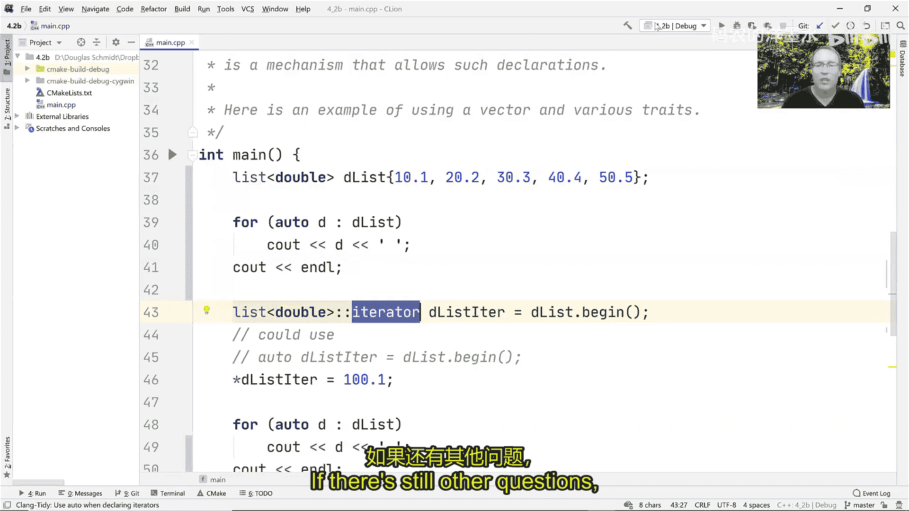

# 【全集】范德堡大学 C++标准模板库 中英字幕 1080P p07 Lecture 7 - 迭代器 part1 -BV1KWiCBWE7M_p7-

Hello and welcome to my next webinar on the C++ standard templateemplate Library by example。

Now that we've talked about sequential containers。😡。

includingncluding vector deck and list we're now going to go ahead and turn our attention to a new topic which is going to be iterators as you'll see there's lots of things to cover with iterators so today we're first going to start by talking about what iterators are generally in C++ STL and then we're probably going to have time to look over input and output iterators which will save some of the more advanced iterators for tomorrow's discussion。

😡，So without any further ado， let's go ahead and get started， let me share my screen。😡。

And you can see here。This is where the code segments we'll be covering today are located there in my C++ STL S04 folder。

 and they'll be most likely in 4。14。2， 4。3 and perhaps 4。4， we'll see how far we can get。😡，All right。

 so let me go ahead now and share my。IdeE， which of course， is sea lion。

And let's start by just giving a quick overview of what is an iterator。

 So an iterator in Stl is a very important concept。

 It's really core to the way in which containers and algorithms are connected together。

 And the iterator in Stl is based very heavily on the gang of four iterator design pattern。

 And essentially， what this allows you to do is it allows you to start by moving to the beginning of a range of elements。

Advance to the next element， return the value that's referenced by the iterator at that element and then check to see if you're done that's what the iterator patterns all about and that's implemented very faithfully in the STL。

The iterators that we'll see here give you features that are somewhat along the lines of pointer arithmetic in CNC plus plus with native built-in arrays。

 so for example， if you have an array of ints or an array of characters and array of double doubles or an array of employee records or whatever you have an array of you can get pointers to the beginning of those arrays and then you can do various operations like plus plus and plus equals and minus minus and subscript and less than and greater than and equal to and so on and so forth。

 moving the pointers around the array that they're pointing into。😡。

Now as we'll see in C++ SDL there's actually different categories of iterators so there's going to be input and output iterators which is what we're going to start by talking about today。

 and then there's also other kinds of iterators like forward iterators。

 bidirectional iterators and random access iterators that we'll talk about later。

For most of the iterators that are available in STL。

 they at very least support the operations we show here and notice these operations are all done by overloading all the various operators。

 things again like the equality or inequality operator， the assignment operator。

 the star or dereference operator plus plus minus minus and so on。

 so most of the iterators we're going to talk about support dereferencing either to read and or to write plus plusing either pre-increment or post increment assignment。

 equality and inequality， most of them support that。😡，Then for bidirectional iterators。

 which we'll talk about， those are typically associated with the so called associative containers。

They also support ability the ability to go backwards or decrement。

 either prederement or postderement and then there's also a whole slew of operators that are available for the so-called random access iterator category which are things we can use for decks or vectors and there as you can see we've got the full range of pointer arithmetic plus equal minus equal plus minus subscript and then the various relational operations every one of the c plus plus containers comes with a set of factory methods begin end or R begin R end and these factory methods are used to return the appropriate iterator that's associated with the type of container that they've got so if you've got a vector or you've got a deck then youll begin an end or R begin R end factory methods will return random access iterators if you have things like lists or sets or maps then if you use the factory methods to get the iterators you'll end up getting bidirectional iterators。

And so on and so forth。You however， are perfectly well equipped to create new iterators if you don't like the ones that come out of the box。

 although the ones out of the box are typically pretty good。

 and then you can also make your own predefined classes and define iterators for them as well and I'll show you some examples of how to define iterators later when we talk about my array class。

 which is kind of fun。😡，Iterators are very， very fundamental to generic programming which of course is the whole paradigm that STL is based on because they allow you to decouple the containers and the algorithms so typically the way it works is you get iterators from your container and then the algorithms that you use are past the iterators and they do various things based on the types of iterators that are past that so let's start off by taking a look at a simple example。

 this is going to be one of the most fundamental yet most useful iterators。

 this is going to be the input iterator and the output iterators and it's going to be the copy algorithm so this particular example I just for fun I have my own little version of copy which undoubtedly looks almost identical to the one that's in STL itself for your favorite implementation of STL and because there's already a copy algorithm I stuck this in a namespace called My copy so you can see this particular function takes an input iterator and an output iterator as template parameters。

And it's going to take a first and the last input iterator and a result output iterator。

 And then it also returns an output iterator。 And here is the very。

 very simple behavior of the copy algorithm。 It simply iterates from first to last。

And it checks to see whether the first iterator parameter is equal to the last iterator parameter if it's not it can keep going and then every time through it's going to go ahead and dereference the first iterator to get the current value we're looking at and it stores it into the。

😡，Result iterator by dereferencing that。And then you'll see that in the for loop we increment first by one any increment result by one。

 so just walking through this range basically one at a time and doing the copy and then when we're all done it returns the output iterator。

😡，Okay， so let's take a look at how we could actually use this particular iterator to do some interesting things。

 so first we're going to show how to use it on a built in array。

 so here we've got a good old built in array of ints called a1 and you can see it has the values one through 10。

😡，And then we compute the size of a1 where we take the size of a1 and divide it by the size of each element。

 so that'll tell us the number of elements and then we define ourselves a2。

 which is another builtin array of size a1 and then we go ahead and we do the copy algorithm so here's the copy algorithm from right up here and what we're going to do is we're going to start at a1。

😡，And then we're going to go through it one element at the time up to a1 plus a1 size。

 so that's really one past the end and every step along the way we're going to store the result into array A2 and if you take a look at this。

 this is just good old built- in C plus plus pointer arithmetic we're just taking essentially an int pointer as the first an in pointer is the last and an in pointer as the result and we're going through here be referencing the pointers and incrementing one at a time。

😡，So the point of this is that these built in algorithms。😡。

Work just as well for built in types or rather the predefined algorithms in STL for copy and everything else for that matter work just as well for built in types native types like in arrays as well as for containers like STL vector So once we go ahead and copy we go ahead and put the results I'll show you this in a second and then down here we do the same thing except this time we're going to define a pair of vectors so we have vector V1 and we have vector V2 and it says V1 is set1 through 10 V2 is going to be set to the same size as V1 So obviously if V1 has 10 elements its size will be 10 and then we go ahead and we perform another copy using the same copy algorithm the one that we showed up here except this time we're going to start from the beginning of。

The vector V1 using the begin factor method to get us an iterator。

 and then we use the end factor method to get us one past the end。

 and then we're going to go ahead and store this going to copy it into the beginning of vector V2。😡。

So again under the hood because of the magic of the way that iterators are defined for the vector class。

 it's going to go ahead and basically have objects first last and result and these objects are going to have their plus plus and de reference and not equal operations defined in terms of moving about through a vector and we'll come back and take a closer look at how vectors iterators work a little bit later and I'll actually show you an implementation that's very similar to what you get in vector that I wrote to illustrate the point more clearly and with more comments for that matter the SDL code is notorious for having very few comments。

When we're all done， we're going to go ahead and go through vector V2 and we're going to print each element one of the time。

 so let's go ahead and run this code。😡，Hopefully it'll compile and you can see here that we put 10 elements into our built in array and we copy a1 to A2。

 and then we print the contents of A2， works fine， do the same thing with an STL vector。

Copy10 elements from vector V1 into vector V2 using the copy algorithm and we print it out and voila we get the same result that we expect you'll notice by the way i'm using the for the rangebased for loop here just because I find it very concise and easy to write Okay so that was our first example will obviously cover much more interesting stuff and the examples to come but I wanted you to get started with something that's pretty simple and this also illustrates how the copy algorithm works and just keep in mind how copy works well we're going to look at this again multiple times as we go through this particular set of material。

All right， let us move on to。😡，For2。And this is also another interesting set of discussions。

So this particular。Example is going to show us some other features of iterators。

 particularly the concept of constant iterator， and we're going to compare and contrast constant iterators with non constant iterators and you get to see how they're used。

😡，So as you can expect， just like the Java， there's iterators that are defined on all the predefined containers。

 just like in Java， we have iterators that are defined on all the predefined collections。😡。

There's also some iterators to find on other non container style classes like C++ Str。

 which is not strictly part of the STL C++ love， the C++ Standard T Library。

 but it is part of the C++ Standard Library。Now one of the interesting things you can do with an iterator is you can kind of treat them as kind of smart pointers and that's because they can store state and we'll see。

 for example， that the iterators we use are always going to keep track of where they are in the iteration and they're going to use that state information to know where to go to next when they're plus plus or minus minus or subscripted into if they're random access iterators and so on and so forth。

😡，So the basic operations on iterators， again， the core ones are plus plus de referenceence。

 which is the star and then comparing for equality or inequality。😡。

Now we're going to show how you can use these things again in another fairly simple example。

 and the way this almost always works if you're using the iterator pattern and the iterator forms is you get yourself an iterator by using a factory method like begin or end or R begin or R end。

 which gets you reverse iterators， and then you can advance going through them by plus plusing。😡。

As a general rule of thumb， if it doesn't matter what the result of the increment is always go with a pre increment of an iterator。

 not a post increment of an iterator， and then you can always read the value by using the star operation but we're going to see depending on whether you have a con iterator or a nonconerator the behavior of star will be somewhat different in terms of the operation you're allowed to perform so we're going to define a little method called print cons and we'll show how that works in a second to kind of make the example a little bit more concise。

😡，So here we're going to go ahead and create ourselves a vector of int with。😡。

10 elements in it or actually is it not nine elements in it， and it's going to go one， two， three。

 four， five， four， three， two1， so we've got nine elements in here。😡。

And then what we're going to do is we're going to iterate through that vector from the beginning to the end and we're going to use explicit iterator syntax here so you can see that vector colon iterator is something that's known as a trait and if you go here and you look actually at the vector class here's the。

😡，Vector implementation and SDL you can see that it has this trait defined called iterator and iterator is a type def of some internal class that's part of the G plus plus implementation that's going to be this and called normal iterator。

😡，It's going to be connected to a pointer and a vector。

And that's just implementation detail but the key things I want you to notice here is we have iterator。

 we have constant iterator， we have something here called value type， we have something here called。

Reverse iterator， we have all kinds of different things that are defined that are。

That are defined as type defs and these are what are known as traits and a trait is basically metadata that's associated with a container that indicates the specific types that are used to implement these general concepts like a value type which would be whatever type you parameterize the class with or an iterator or a constant iterator or a reverse iterator or a constantverse iterator and so on and so forth and we'll take a closer look at those things later。

😡，For right now you'll see that we're doing this explicitly with iterator syntax。

 so we get the beginning of the vectors iterator and then we're going to go till we get to the end and every time through we're going to print the item that's pointed to by the iterator。

😡，And because this is just a regular iterator not a not a concierator， it's a nonconcierator。

 you could also change the value that's pointed to via the iterator。

 so what we're going to do here is we're going to say star IT minus equal1 which subtracts one from each element in this iterator。

😡，So just for kicks let me go ahead and run this you can see what the the results are so you can see that when we printed out the original contents it was one two three four5。

4321 and then after we went ahead and。😡，Deremented each element by one。 It was。

Going to be you know basically zero， one， two， three， four， three2，10。

 but then we're going to sort the results and what we're seeing here is the result of sorting things and we'll see that in a second when we look at the code。

😡，Okay， so always keep in mind you can never dereference the end of an iterator。

 you can only dereference things that are coming from beginning to one up to the end or one less than the end and that's because the end is always one past the last valid value and that's why when you see operations like sort which we're using here it always goes from beginning to one past the end and this is just done to mimic the semantics of pointer arithmetic which you can also do something very similar。

😡，What we're going to do now is we're going to take our vector that we've sorted and we're going to print it。

😡，As a const so if you come down here and you see print con cont takes a cons Ref vector so it takes a cont ref to a vector and what that means is is we can't do any operations on the vector parameter V that will change its values in fact we literally cannot do that because it's a cont vector so any attempts to try to change its contents will not even compile。

So how do we program this well if you're using kind of the old school full fledged iterator syntax with constant underscore iterator as the trait。

😡，Then your code looks like this。 So you say， if you begin。 So this is a conerator。

 keep going to work done at the end。 And at every step along the way， we can print。

The item by dereencing it through its iterator notice it's illegal because this is a constant iterator to try to do something like this。

 we can't try to assign to it， which we could do as I showed you earlier when we were showing the noncon iterator implementation so you can't assign to con iterators if you try to do that it'll blow up。

😡，Likewise， you also have to make this a conerator， you can't say。😡，Ittererate。

Notice it doesn't like that it's going to say this is a conerator you can't do this this is illegal so we have to make it count now I don't know about you but this is rather verbose syntax and obviously the compiler thinks so too so it comes along here and it tells us。

😡，You should use a range based for loop instead and so if we。

ickCl that button we go from using the con iterator trait to using a rangebased for loop and then the compiler can deduce the types and in fact。

 we could even be more clever we could say auto and it'll figure out what needs to go in there So that's probably how I would actually write this code if I wasn't try to teach something about iterators Okay so let's come back up here so you can see how we went through iterated to the vector made changes because we didn't have a constant iterator if I had change this to constant iterator then this band here won't work anymore because we're trying to modify a con so obviously that's illegal but if we just had an iterator to begin with so that all worked fine we could change the values。

We sorted it and you saw what happens when we sorted it and ended up being 001122334。

 because those were the contents there。😡，And then what we're going to do is just for kicks。

 we're going to make a vector of something else。 We're going to make a vector of strings。

 So the strings are going to say hello world。😡，And then what we're going to do， and in fact。

 I think I can even get rid of the。Priends here that works quite nicely and now once again I'm going to go ahead and go through this using my。

Vectctor of strain iterator， and since I don't make any changes I could use con iterator here and that'll work fine。

😡，And then I go ahead and I print the results out using the rangebased for loop so this way I show it by using a conerator。

 this way I show it using a rangebased for loop you can see the compiler really really wants us to not use the ugly syntax the more of reversebo syntax it wants us to use a range based for loop so it really wants us to do it like that and notice by the way dad here I use a reference to an auto so we don't make a full bone copy of the contents of each string that we'reiteerating over we're just getting basically a reference to it。

Okay， and down here you can see that we print out the size followed by the contents of the string and when we ran that that produced。

This output we said hello world hello world and the five there is just indicating that we have five the size of each of those things is five because hello has five characters and world has five characters that's illustrating how this works。

Okay， so pretty cool example demonstrates a bunch of interesting things about iterators。

 it illustrates that if you have nonconcenterators you can actually modify the contents you're iterating over。

 if you have conerators you cannot， and then illustrating how nowadays you don't have to do the full blown syntax for iterators you can use the wonderful pipe deduction features of C++ to hide you from some of those details。

Okay， let's go ahead and take a look at some other examples。Sure。

So this just illustrates the concept of traits a little bit more。 So， as I mentioned。

 in C plus plus Sl， every container carries with it。 itss traits， which basically it's metadata。

 It's information about the container。 And here are some examples。

 You can have the iterator category， which will be input iterator， output iterator， for iterator。

 bidirectal iterator or random access iterator， You have the value type。

 which is the type that you're parameterizing the container with。Difference type， which is used。😡。

Identify the distance between iterators if they point to the same container pointer。

 which is a pointer as the value type reference， which is a reference to the value type and then constant variances of these kinds of things as well。

😡，And as you'll see， generic algorithms often use these traits in order to dictate their implementation details。

 So we'll see how that gets used later。 So here's a couple of fun examples we have。

A list of doubles and again we can use the newer syntax to get rid of the additional pars and in this particular case we go ahead and get ourselves an iterator to the beginning of this list。

And we could also have used this if wed wanted to。We don't have to， we can say auto。

If we want to obviously do this then we have to kind this guy out so we't have monthly find names with the same string or same characters either way works fine and once we do this we can go ahead and assign the value there because it's a nonconerator we can then print the contents of this list and then just illustrate a few things we can get a constant iterator and we can also get a value type so conerator will then be something we can't change and value type will just be an instance of whatever this thing happens to be parameterized with which in this case happens to be double and if you don't like to use the。

These iterator syntax with the traits you can use auto and that works quite nicely notice that if you have a con iterator you can't do this because of course it's cons so when something's a con iterator it can only be used on the right hand side of an assignment statement。

😡，Not on the left hand side， and I probably should move this up here because that's the better place for it to show up。

😡，All right， well let's go ahead and countt that out because we're not actually using that。

So this is just kind of drilling down a little bit into more aspects of iterators even if you end up deciding in the long run to use the auto keyword。

I still recommend that you understand how things work under the hood with the traits because they' it's a very useful technique to know。

 even though it's been subsumed by the compiler。All right。

 let's go ahead and take a look at the next example。😡，So STL iterators have some pros and cons。

 one really cool thing about STL iterators is they allow you to treat everything all the containers in a common way because you've got iterators and concierators and everybody has iterators and concierators。

😡，You can also think about these iterators as basically kind of stateful smart pointers。

 you can dereference them， they can store state and another cool thing about iterators is they work just as well for built-in classes or sorry built in data types like interrays or double arrays as they do for user defineded classes like vectors。

 decks sets and so on and so they have mimicked the same types of operations you're already accustomed to for pointer arithmetic。

There are some downsides， however， for example， one thing which is also a problem with good old C+ plus point arithmetic。

 there's no bounds checking so out of the box crazy crazy things can happen and your program can scribble all over itself and hopefully if you run your memory checker tool you'll discover this but this can also cause you some headaches if you're not careful。

😡，Not all iterators support the same types。 So some iter types not all containers have the same types of iterators。

 so you can have things like vectors and decks， which have random access iterators。

 you have things like sets and lists that have bidirectional iterators。

 So not every algorithm can be mixed and matched with every type of container in a completely orthogonal interchangeable ways。

 and that can be a little confusing at times。 Another tricky issue is that if you're not careful。

 certain iterators， especially iterators to vectors can become invalidated if the vector changes grows。

 for example， and has to be reallocated and copied。

 So you have to be aware of which iterators support basically robust behavior and which ones don't。

So and you know long the short of it is iterators have all the pros and cons of pointers。

 they can be very powerful， but they can also be very dangerous if you're not careful so here's some examples that illustrate the pros and cons of iterators in STL and let's see let's go ahead and stretch that out a little bit so you can read it。

So we're going to go here and we're going to start out with a vector of long and we're going to call that container。

 so we have a type def called container。😡，So we can define ourselves a container and we're going to give it the size zero。

 so it's an absolutely empty container， nothing in it at all。😡。

Then we're going to go ahead and get an iterator to the beginning of the container and then we're going to do something you should never ever do。

 we use a do while loop to walk through the container printing the contents and if you take a look at this。

 what's going to happen here is it has no contents。

 but we're still going to go ahead and dereference it and try to access it anyway because it's a do while loop it will terminate but it'll already go ahead and access something that should never have been accessed。

😡，And then we're down we're going to go ahead and try to sort the container。

 So let's run this code and you'll see some interesting things here。 First， you'll see oh。

 something happened。 We got a dump， we got。Things went awry。

 so let's see if we can run this with Valalgriin turned on。😡。

And you can see that what happens here is that when we do this， let's see if I can run this again。

The bugger turned on。Okay， so what happened here is we got a segmentation fault because we were trying to access an element that had never been allocated because we started out with container window elements in it and we ran it with the bowel grindin option。

 which is the one we see up here。With Valgrind mem check you can see it came back and said at this line。

 we got an error trying to read this value because the value was not allocated properly。

 it wasn't supposed to be accessed because we had a zero size container zero size vector so as a result the code compiled and ran but it had a very serious bug in it and that bug only showed up when we ran the memory checker Now just to make this point also clear let's go ahead and change this from a type def vector of long。

😡，Just a good old type di of a list of long， and now you'll see when we try to compile this code。😡。

In addition to having the problem we did before， we're going to have another problem。😡。

And this should actually not compile。And we'll get probably get some weird air y。

 we got some weird air and basically the error is saying。No match for operator minus。

 What the heck does that mean。 Well， what that means is that we use the list instead of a vector and the。

Type of。Trade in a list is not a random access trait for the iterator instead it's a bidirectional iterator and so you can't subtract you can minus minus but you can't subtract and so as a result sort which uses a quick sort like variant internally is trying to use a minus a minus operator here and of course there is not one defined find on list because the iterators for it are bidirectional iterators not iterators that are come baked out of the box having the ability to to。

😡，Have a minus， they can do a minus minus， but they can do subtraction， for example。😡。

So that's just illus that you can't mix and match containers。

 just Willy nilly because their iterators have different categories。😡，Bide retro iterators。

Random access iterators and so on and so forth Okay。

 so those are just some illustrations of problems that we have when we're trying to use iterators。

All right， so that was the material that I wanted to cover today what we're going to do is pick up tomorrow。

😡，And let me give you a sort of a tour of what we're going to cover next。

 So the next set of things we're going to cover， if we go over here。

Are going to be what's in store for us in 4 do 3 and 4。 4。 So tomorrow。

 we're gonna to cover the input iterators and the output iterators。

 And you'll see that input iterators only let you read things and output iterators only let you write things。

 And then we're going to talk about something else called a forward iterator that allows you to read and write things。

And we'll learn about certain types and certain algorithms that expect to have。

Iterators that are at least input iterators or at least output iterators and we'll also talk about some other algorithms that expect to have things that are at least forward iterators and so on and so forth so these different types of iterators actually form a hierarchy it's not really an inheritance hierarchy but it's more of an inherty of operations that are supported using the magics of templates and so-called duck typing which is actually kind of funny let's type in duck typing+ plus。

So duct typing is， let's see if they have。Yeah， here we go。

Wikipedia that typing it's a famous phrase if it walks like a duck and it cracks like a duck。

 it must be a duck and so that's pretty much what you get with C++ and STL if it has operations that match then it must be one of those kinds of things and we'll see that's certainly true for input iterators and output iterators。

😡，When we're going to cover those topics tomorrow， let me see if there's any questions。😡，Okay。

 it doesn't look like we have any questions today， so as always thanks everybody for showing up I hope you guys have a great Memorial Day weekend and oh there's there is a question go over the implementation of conerators again sure we got plenty of time so let's go ahead and do that。

😡，I will go back over here。So there's there's actually probably a couple of questions here what are conerators and then what's the implementation of conerators som for the time being I am just going to talk about what is a conerator and then maybe we'll take a little peek if we have time at what a conerator is implemented as and we'll see if we can get the code to cooperate but i'll certainly explain what they are so a regular iterator as we had seen before gives you the ability to be able to。

😡，Store elements into the underlying container that's pointed to or reference by the iterator so here you can see we have D list which is a list of doubles we have D list iter which is an iterator to the beginning of a list of doubles and we can say star D list iter and we can give it some value so if we run this thing here let's do this so you can see what it looks like。

😡，So we're going to start off by doing this。And you can see here that oh I probably should also。

 let's be a little bit less。Vbose， if we don't mind。

Let's say there we go so we we're not going to we're going to print these things out separated by。

Space is。New lines that make a little bit easier to read。SoLet's go ahead and do this。

And running it again， I'll be able to see what's going on here。Okay。

 so you can see here that the values here in the original list were 10。1， 20。2， 30。3， 40。

4 I think you detect a pattern and then what I went down here is I got myself an iterator to the first element and I stored the value。

100。1 and then when I printed the results out you can see it had the side effect of changing that element and that worked perfectly fine because DL data is a nonconerator it's just a regular good old vanilla iterator。

😡，Down here， in contrast， I define a constant iterator。😡。

And so this Dlist con it is a con iterator and you can tell it's a con iterator because I say con iterator here。

 I use the trait that's associated with a con and therefore I can no longer use the dereference operation on the left hand side。

 I could still use the referenceence operation on the right hand side。

 I could say something like this。😡，Let's see， oops。Oh now I know I had this year before。All right。

 so let's do this。Okay， so this will work because。The list considerator is a concenterator。

 but this will work， I could say double。DD equal D list cost enter and then。

Comit that out for now so you can see that I can use the consator on the right hand side of the assignment statement so that's what's called an R value。

 but I can't use it on the left hand side of the assignment statement because it's not an L value you can't assign to it。

And let's see if we get lucky SL code can be a bit of a bear to look at at times but if you come in here we can see there's this thing called a list constant itter so let's go see if we can find list constant itter so here is list con this is the source code for it and if we were to search down through this we would find all kinds of interesting operations like the plus plus operator and the pre increment and prederement plus plus and the pre increment and prederement minus minus and the equality operation and so and so forth but try as we might when we look through this thing we're never going to find。

A non constant star operator， a de referenceence operator。 And the reason for that， of course。

 is that a constant iterator doesn't let you。Do the nonconant stars you can't use it on the left hand side of the assignment statement and so you won't find that particular operation here anywhere you go to look let's for kicks。

 let's go up here let's go back over here again and let's go see if we can find iterator。😡，And again。

 the STL source code is。Ratherther。Complicated to look through they don't have a lot of comments and it's strewn out all over the place。

 so we may or may not be able to find what we're looking for here。

 but if we were to spend time sort of you know looking around through here what we would discover would be that there was in fact the ability to dereference or put the reference symbol for the nonconcenterator which is this one because it defines it in a way where it can appear on the lefthand side so it has both con and non-cons operator star。

😡，Let's see if we get lucky， there we go。So you can see we have。That。This is the version that's the。

Const version， and then there should also be a noncon version somewhere lurking here as well。

 let's see if we can search for this thing。Yeah。So you can see we've got con versions here and then if we were to poke around with the source code line if we'd find the noncon version as well and the noncon version would only be viable for noncon iterators so that's basically how the implementation works under the hood again I will show you a complete implementation of how to write iterators later using a much better commented version of all this stuff so you don't have to get lost in the weird SL implementation portions。

 but the law the short of it is that a con iterator only has a con dereference operation whereas the noncon iterator has both con and noncon dereference operations operator star is the dereference operator in this context。

Yeah。Okay so I hope that helped with your question if there's still other questions don't hesitate to ask them please feel free to post it to my YouTube channel i'll be putting this video up here shortly and these videos are doing quite well i'm quite amazed as there's lots of hits on the C++ STL stuff recently so that's great and I look forward to having future sessions with everybody and I hope you guys have a good day。

