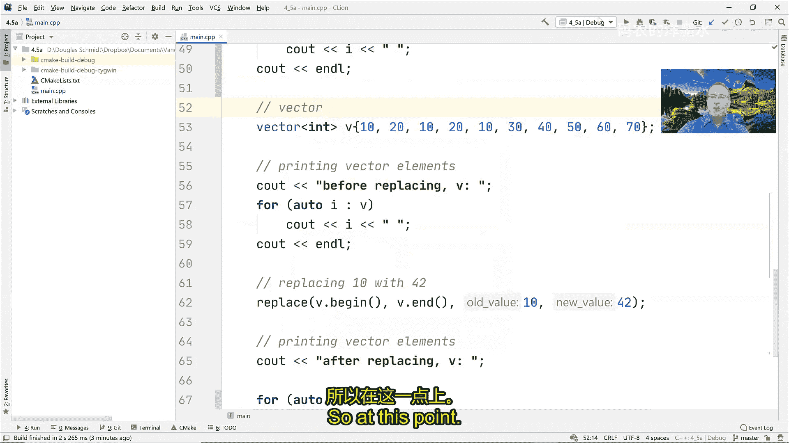

# 【全集】范德堡大学 C++标准模板库 中英字幕 1080P p08 Lecture 8 - 迭代器 part2 -BV1KWiCBWE7M_p8-

Hello and welcome to my next webinar on C++ Standard Tlate Library by example。In this session。

 we're going to be discussing additional capabilities of iterators。

 which we started discussing yesterday。😡，Today we'll be covering input iterators， output iterators。

 and forward iterators。😡，As usual， I'll be showing lots of examples of how to apply these various capabilities in the context of STL。

So without any further ado， let's go ahead and take a look at the source code where you can find all the material I'll be covering。

 and then we'll start looking at the code itself。😡。

So here of course as usual is my c plus plus repository on Github and today we're going to focus on 4。

3 a 4。4 a and 4。5 a so that's where you can find all the source code we'll be covering let's go ahead over here down to my。

😡，IdeE， and let's just talk about input iterators。 So input iterators are the simplest type of iterator because they can only read forward words in a sequence or some collection of elements。

 And the elements can only be read once。 And as soon as an element is read。

 it'll be returned and and made available through the the mechanisms that come with the iterator。

You can dereference an input iterator to obtain the value at points together which you can read from it。

 but you can't assign to it， so it's only useful on the right hand side of an assignment statement。

 not on the left hand side， so it's what's called an R value， not an L value R for right L for left。

😡，Here the operations you can do with an input iterator。

 you can construct an input iterator from another iterator using a copy constructor。

 you can assign one iterator to another using the assignment operator。

 you can check for iterator equality and inequality and that's how we're going to make sure we aren't at the end when we're iterating through a range。

😡，And then you can do the dereference operator， you can either do the star or you can use the arrow operator if you want to access a field or method or so on。

😡，So you can read but not write and then you can also do pre and post increment。

 you can do plus plus iterator or iterator plus plus and you can also combine that of course with the dereference operation as we'll see as a general rule of thumb and STL it's always better to try to do plus plus iterator than iterator plus plus if you don't need to have the result because it's going to be a lot faster we'll talk about that more when we go into detail about how to write iterators for nontrivial collections and containers things like arrays or vectors。

😡，Lots of non-modifying algorithms use input iterator， for example。

 the STL find algorithm that searches a range to see if there's a match。

 find if which searches a range to see if there's a predicate match and count which counts the number of elements within range they all just require input iterators to be used。

 you could always pass more powerful iterators to these simple functions that expect the simple iterators。

 but it won't buy you anything they're not going to use the more advanced features in the iterator。😡。

Often it's also the case that these operations like find and Find if return an input iterator pointing to the element that matches the value we were searching for and that way you can tell very quickly whether something was a match or whether it was not a match in which case you get back the end iterator。

😡，So let's take a look at a very simple example。 This is going to use an input iterator to read ints from standard input and then store them into a vector。

😡，So here's what we're going to do， we're going to start out with an initially empty vector of ints。

😡，And what we're going to then going to do is we're going to go ahead and。

Start at the beginning of the standard input。😡，Standard input of course is represented in c plus+ by CN or sin and what we're going to do is we're going to make ourselves what's called an eye cream iterator which is an iterator adapter we're going to talk more about iterator adapters later and i'll talk briefly about what it is here so we're going to pass in the CN。

😡，Object for extended input to variable I， which is of type Istream iterator。😡。

And you'll see that this is basically a way to turn Io streams into iterators， which is pretty cool。

 That's why it's called an iterator adapter because it takes something that is used for。Doing IO。

 namely the CN， which is an icestream， and we adapted to work in the context where an iterator is expected。

And then while this particular iterator doesn't equal the end of input iterator。

 which is a little bit weird， but it's just basically an eyestream iterator with no parameter past it at all that just represents end of input while we haven't reached the end of input we're going to go ahead and read so here's the read operation we're going to say star I we're going to read the contents of that iterator and we're going store it into a vector and we're going to use the pushback operation on the vector a little bit later in the class we're going see that there's other ways of putting things into vectors involving something called in placeback and for more complex types like strings or user defined types in placeback is usually a better bet than using pushback but for something simple like an doesn't really matter Okay so we're just adding the element to the end of the vector so we're using the iterator we got here and we're adding it to the end so let's just take a little look at some of the implementations。

😡，This is kind of cool。 we'll look at this again a little bit later。

 but here is an eyestream iterator。 and this is one of the cool things about using sea lion is oftentimes you can move around and go investigate the source code just by clicking the appropriate sequence of keys。

 So I type control alt。😊，B， I think it was， and I can type control alt。

left arrow and that lets me navigate back and forward between the the elements so here's an input an ice cream iterator which is an iterator that's an input iterator tags we're making ourselves an iterator that's an input iterator and we define various traits like a care trait traits type ice cream type and so on。

😡，We have some fields here。 We have the ice stream that we're ititeerating over。

 We have the value that we're looking at， and we have a flag that keeps track of whether we're okay or not。

 kind of as a sity check。And here is the constructor we use use。😡。

I stream iterator passing in an eye stream， so in this case that would be CN， of course。😡。

And so what we're going to do here is we're going to go ahead and stash that away in this field and kind of kick things off okay now。

😡，What you don't really see here。Because the way we use this。

Under the hood this is basically just going to march through this thing until it reaches the end iterator let's go take a look at what the end is so here's the end iterator and you can see it's just a constructor that sets icestream the value to zero。

😡，Gives it a default value and it says we're done and so later we'll see how it marches through doing the comparison。

To figure out if we've reached that point， so we want to check out the not equals opera。

 let's see if the compile is smart enough to do that。😡，Hey， look at that。

 It's actually smart enough to do that。 So you can see what it's doing is it's going to look at overloaded operator not equal。

 which is going to take in a con icestream iterator ref。And。

Then it's going to go ahead and check to see if these two things are equal。

 so we're basically checking to see whether we've reached the end of the input that's that's kind of what's going on here。

😡，Now in this particular case at the beginning at least it won't be reaching the end so we're going to be able to go through and add each element so let's go ahead and run this program you'll see it doesn't really do anything yet because it's only got an input iterator but we can sayops we can go down here and we can say 1020 30。

40 50 just add some values in there type control D nothing happens and that's of course expected because as you can see our program doesn't really do anything yet we don't have any way to output it we'll show output in a second。

Now this is one way to use an input iterator directly。

 so we're using this to basically read this and treat it as an input iterator however。

 no self respecting STL programmer would ever write code like this。😡。

They would much more likely write code like this。Which uses and built an STL algorithm called copy now we've looked at copy before and i'll refresh your memory about what copy does but what copy is going to do is it's going to end up getting an iterator to the beginning an input iterator to the beginning of a range。

 which in this case is standard input。😡，And we're going to keep going until we're done。

 which is the end of the range and at every step along the way。

 we're going to go ahead and use yet another iterator adapter and this is going to be used to。😡。

Back insert the element at the end of this particular sequence， so as you're going to see here。

 we'll look at back inserter in a second， but back inserter is a special adapter。

 it's another iterator adapter that's going to be a used to take a container in this case。

 a vector and then add each element at the end so it's going to treat this vector as an output iterator。

😡，So for this do makes sense， let's go ahead and take a look at copy。 Here's the copy algorithm。

And you can see here that it's got all kinds of cool optimizations under the hood and this is one of the great things about STL you can do all these these specializations and optimizations that we've talked about before。

 so this is going to。😊，Call down here。 And at that point， I think we get lost in， in dependency hell。

 But basically， if you recall what copy did， let's see if we can find just。

A sensible implementation of copy， not this super duper optimized version is bound to be a copy here somewhere that that doesn't do all the clever stuff。

 Let's see these are all copy move， copy move。嗯。Let's see here we go， this looks like。

This looks like something that's probably in the right vein。

 so remember what copy does is it starts at the beginning goes to the end and every time through it is going to dereence the first input iterator get its value that's the read part and then it's going to store it someplace that's the output part we'll talk about output iterators in a second。

😡，And every time along the way we increment the result in the first so that's kind of the loop that's being used here for copy and so what we're doing is we're basically reading from the input iterator one element at a time until we reach the end and we're sticking it somewhere now this is kind of foreshadowing the output iterator we're going to get to that in a second but for now what we're doing is we're taking the elements from the input stream and adding into the vector and this is using the magic of wonderful STL algorithms in this particular case the copy algorithm Okay so that's input iterators so we're getting the input in。

😡，Now let's switch gears and let's talk about the output side。

 and then I think this will make a bit more sense。😡，Yeah。So let's go down here to 4。4 a。

Open that guy up。So what is an input， what's an output iterator。

 if an input iterator is something that can read well an output iterator as it may stand a reason can only write to something。

 so unlike input iterator， which can only be used on the right hand side of an assignment statement。

 an output iterator can be used on it only be used on the left hand side of an assignment statement so you can only write to it。

😡，And other than that， it's very similar to input iterator in the sense that we have operations like constructor。

 we have operations like assignment operator， we have operations like dereference。

 except we could only dereference on the left hand side， not the right hand side。😡。

And we also have the ability to basically increment either pre-increment or post increment。

 Those are all the features that are supported by an output。And many， many。

 many SL algorithms take an output iterator that's used to store the results of whatever you're iterating over。

 which is typically an input iterator。😡，And so examples would be the copy algorithm we just looked at as well as the transform algorithm。

 and you can usually chain these things together because always returns the end so you can kind of chain them together。

So here's an example that basically takes up where we left off before so we're going to go ahead and have a vector and we're going to read all the input from the input iterator into the vector and then we're going to go ahead and write the results out to standard output and again we're going to use some really cool adapters to make this all works so let's take a look at some of these things and this will give us a better sense of how it all works All right so before we talked about the copy algorithm and I showed you how it takes three parameters。

 the first of which are both the first two of which are both input iterators and then the third of which is the output iterator。

😡，And you can see here how we start with the CN。😡，Object again so we're reading from center input and we're going to keep reading till we reach the end of the input which is designated like this and every time through we're going to store the results into an output iterator well how do we turn a vector into an output iterator we use this thing called a backiner and we'll talk about back inserters in their own right a little bit later but for right now let's go look at backiner because it's really interesting and what back inserter is is it's an adapter function that uses C+ plus wonderful ability to do parameter deduction。

😡，So we don't actually have to provide the type of container we let the compile deduce the type of container。

 so you can see here that a back inserter is essentially a template function that takes a container。

😡，As a parameter by reference。😡，And it goes ahead and makes an instance of something called a back insert iterator。

 so we make an instance of the back insert iterator passing in the reference to the container。😡。

And you'll also see this is pretty cool that back inserter returns a back insert iterator。

 So everything it's doing is it's doing it by creating value based objects。

 So we're going to create a value based object here， which is an anonymous value based object。

 and that's going to get returned by the。😊，Back inserter method and if we go take a look at back insert iterator。

 you'll see that it's basically。😡，A constructor。😡，For a class called back insert iterator and this class is also a template。

😡，But competitorsrs can't deduce。😡，Types when used for templates like classes or strs they can only deduce parameters that are used with functions and that's why we have the back inserter function adapter encapsulating the back insert iterator object and here's what it does you can see that it has this constructor that takes the。

😡，Container ref。And it stahees it away here as a container pointer it just does this to avoid making a copy。

 you see why we don't know to make a copy so we're making a value based object called backiner iterator that holds a pointer to the actual container。

 so we're not actually copying the container but we are making a copy of the object that holds the pointer if that makes any sense。

😡，And then if you peek around here you'll see there's a whole bunch of interesting methods defined on back insert iterator。

 for example， the assignment operator is defined on back insert iterator and lo and behold。

 what does the assignment operator do， it calls the pushback method on the container。😡。

And as we'll see what that does is every time you use this as the lefthand side remember it's an output iterator so every time you use a back inserter iterator on the lefthand side of an assignment statement。

 it's going to take the value that came in on the righthand side and it's going to go ahead and push it into the container and then it returns star this so that's how we're going to go ahead and use it in the context of the copy algorithm we'll look at that in a second。

😡，And there's a couple different versions， there's versions that take container。

 so called R value references， which are so called move semantics， we'll talk about those later。

The star operation， the dereference operation is just a know how participant returns a reference to the back insert iterator itself。

😡，The plus plus operator is also a no op that simply returns a reference to itself and both the pre increment and post increment。

😡，Operations both do that so they're really just there for syntactic sugar to glue everything together and how does it all glue together well if you come over here and you look at copy。

😡，And again， we'll have to kind of go up to the version of copy above that。😡，That。

Is just the good old fashioned copy this guy。What this guy is doing is notice that the back inserter that encapsulates the containers past as the third parameter to copy。

 and that is an output iterator type。😡，And that of course is going to be the back insert iterator object and that's going to be used here remember the star is aO op but the assignment operation as we just saw is not aO op so that's actually going to be used to take the contents on the right hand side and go ahead and copy it into the container so we have this cool little adapter and you'll see this kind of logic all over the place in STL we use。

😡，Existing algorithms like copy that knows how to work on iterators。

 input iterators and upper iterator， and then we kind of decorate these things or encapsulate these things or adapt these things using various adapters。

 so an Istream iterator adapter， a backinter adapter that turns things like the Istream CN into an iterator。

😡，And likewise， back inserter turns a vector into an iterator and then it can treat those things as input iterators or output iterators respectively。

 So how cool is that。So what we're going to do now that we've gone ahead and put everything into our vector we're going to print the contents out let me show you how this all works so let me run the program。

😡，And we're going to go ahead and say。102030， 4050ops this what help if I actually did 4050 and now it's type control D and now it spits out the results to us with a new line between each one and how does it do that it uses this super cool copy algorithm again so same algorithm。

 different parameters but same algorithm and as you can see here what we do as we say take the beginning of the vector and copy from the beginning of the vector up to but not including the end of the vector and at every step along the way。

Go ahead and write it using an O stream iterator。 So before we use an I stream iterator。

 which is an adapter that converts something like C into an iterator。

 and now we're going to use an O stream iterator， which is going to take C out。

 which is standard output and adapt that into something that works as an iterator and we're going to put a new line between every one of the items that we print out。

 So let's go ahead and take a quick look at。Ostream iterator Ostream iterator is a constructor that's going to take an O stream type like sea out and a conants carestar like the new line string and it staes these elements away in these fields you can see there's some fields defined up here an Ostream type pointer and a care type pointer and。

Take a look。 You can see these are parameterized， because the care T is is a parameterized type here。

 And then if we take a look at some methods that really matter， remember this is an output iterator。

 the the assignment operator is really the one that matters。

 And what the assignment operator does is it goes ahead and it takes the value that's passed in as a parameter just the righthand side of the operation。

 and it goes ahead and it streams it out using the O stream that we stashed away in the constructor。

And then if there's a de limiter this m string thing we go ahead and put the m string thing out as well so that's basically exactly what we're doing here and again as we saw with the ISt iterator you can see how the star operation the plus plus operations and so on they're all just really no ops that return references to Ostream iterators and there only purpose is just to make all the template syntax hanging together so we can use this generic copy algorithm that we saw here this kind of copy algorithm and that can be used generically and then we can use adapters to make everything fit together in a nice way so this would be one way to write this output you could do other ways here's some other ways of doing it you could have either。

For loop。That。Uses the auto keyword to deduce the type of iterator so you could write it like this if you want to do an iterator based way of doing it with modern auto pointer deduction。

 auto type deduction， and so on。😡，Or you could just go ahead and use a range based for loop and again I could probably be clever here and use the auto version of this。

 so this is a pretty generic way of writing things and the compiler will deduce all the parameters and make it all kind of hang together correctly。

So that's the output iterator and you see how output iterators and input iterators typically work together like peanut butter and jelly or peanut butter and chocolate。

 whatever your favorite combination of things is I'm a big fan of peanut butter and chocolate but I ran in some people recently who didn't like peanut butter and chocolate combination I was shocked I thought everybody like peanut butter and chocolate but。

😡，Be that as it may， That's just the way the world is。 everybody has their own perspective on things。

Okay， I think we have time for。😡，One more example。And we've talked now about input iterators。

 and we've talked now about。Output iterators， what we're going to do now is we're going to combine the two of them together so you could kind of think of this almost like inheritance where input iterator has a certain set of operations and output iterator has certain operations and then forward iterator comes along and kind of inherits and I'm using that word loosely because it doesn't really inherit in the C+ plus inheritance sense kind of inherit those capabilities together in order to make a new type of iterator that's the best of both worlds of input and output iterators。

😡，What does that mean that means you can both read and write to a forward iterator so how does that parlay into practice you can see here we have a constructor that takes I and J。

😡，So you can do copy construction， you can do assignment， you can do equality and inequality。

 all those things are inherited from both input and output iterators。

 and then we can use the reference operation on either side of the assignment statement so forward iterators can either be L values。

😡，And or they can be R values， whereas an input iterator can only be used as an R value and an output iterator can only be used as an L value。

 but we can use the four iterators as either one or both as we'll see。And then， of course。

 we have our normal。😡，Contingent of plus plus operations， either pre increment or post increment。

Ordinary pointers， pointers to array that you would have in C++ or C for that matter if we had all the cool things and see that we have in C++。

 but ordinary C style pointers and C++ can also be used as for iterators。

Now they could also be used for other things too， but just pointing out that you can use these things as you would do other other types of pointer operations。

Now， forwarded ratings can need to be constant， which means that you can。😡。

Read the value but not write to it or they can be mutable which you can read and write to it so let's go ahead and take a look at that and a great example of a STL algorithm that uses a forward iterator expects a forward iterator is the replace algorithm and replace does exactly what you think it does it takes an old value and range and it goes and looks for all occurrences of the old value in the range and anywhere it finds the occurrence it replaces the old value of the new value。

So let's go ahead and see what we can do here， we've got ourselves a vector with a bunch of elements in it here we've got a bunch of tens and 20s and 30s。

 40s，50s， 60s and 70s， so you go ahead and we print the contents of the vector using our good old range based for loop that's kind of my go to loop when I'm not trying to think too hard about what I'm doing because it's real easy。

And not a lot of syntax and then we're going to go ahead and use the replace operation and we'll take a look at replace in a second but what it does is it starts at the beginning of a range goes to right up to one before the end of the range and for every value that's the old value it's going to replace it with a new value so in this case anything that was a 10 now becomes a 20 that becomes a 42 and then we go ahead and we print things out again and probably should use auto here just because we're being consistent All right so let's go and run this and you'll see that。

Before our original vector had 10，20， 10， 20 10 30， 40， 50， 60， 70。

 and then after replacing 10 with 42， we got the result where head is replaced with 42。😡。

Whi of course is the answer to what is it the life universe and everything is the answer to everything in life and so let's go take a quick look at what replace does just so you can see how it uses a forward iterator so here's replace as you can see when we expand the template parameters it takes a forward iterator and it also takes a type name and as you can see it's going to have two forward iterator parameters first and last which is going to allow it to both read and write from those iterators and then it's going to take conres to the old value and con to the new value。

And so you can see here what we do as we start， as always seems to be the case with these simple STL algorithms。

 we iterate while first isn't equal to last。And we go ahead and check to see if star first equal equal old value。

 So this is a good example of using the forward iterator as。😡。

An input iterator we're reading it and if in fact it matches so we found a match when we read it。

 then we go ahead and we use first as an output iterator so we're going to take the new value and we're going to replace the old value with the new value and see how simple it is and the reason that works like that is because of course the parameters that we have to pass to replace our going to be essentially for iters're going to read and write to them。

😡，So that's basically just showing you kind of what that looks like。Now just for kicks。

 we could also come down here， let's see just for fun， how would we do this。

 I'm trying to do this quickly and easily。😡，Um。I tell it let's let's cut and paste this code i'll probably refactor this stuff at some point so that。

😡，I have one version that's the version that's going to use built in types and one version that uses vectors。

 so let's say built in array。And we're going to say。And。Aray， V， and then we just do this。

 notice how。😡，Little I had to doops。Keep getting my my Java my Java syntax confuseds my C++ syntax and so now we're going to come down here we're going to start with oh we better call this something other than B let's call it a that might be a better thing to call it。

Ca this guy， hey。And let's call this guy A and now let's go here， let's go to beginning of a。

And then let's say a plus。Size。I think it spell size of a divided by size of star A。And that。

 of course， is going to return to us the number of elements in that So what that's doing is that is。

That would go ahead and do the same operations except now we're not working on a vector。

 but we're working on built in type， so if I can see if we can make this work。😡，And lo and behold。

 I think it's going to do our bidding， let's see。Yep， so you can see that using built in arrays。

 we can get the same behavior。😡，With almost the same amount of programming。

 look at this this is so cool， this is stuff that really only became。😡。

This easy with later versions of C+ plus so we can do an array initialization built an array initialization。

 we can use an auto。Rangebased for loop with an auto to iterate through that array so it keeps track of how big it is so it kind of all works magically under the hood which is such a nice improvement over the older seast style way of doing built in arrays that were hideous and disgusting so down here we go ahead and do replace this time we're doing replace on a built in array。

😡，And then we print the results and down here we do exactly the same thing except instead of using a built and array we use a vector and oh。

 of course， you know it should also go without saying that if we wanted to change this to a short，😡。

It would be trivial to change it to sort， short， not short or we could probably even change it to care that might be a little bit wonky that'll work probably change some other things。

Do double。So this is pretty cool we're able to switch around all the different types here with just a flick of our wrist and the type deduction mechanisms and C++ take care of all the other heavy lifting。

 which is really nice。😡，So that was an illustration of forward iterators。😡。

So that's pretty much what I wanted to cover today。 I wanted to cover input iterators。

 output iterators and for iterators。 What we're going to do tomorrow is we're going to talk about the other more advanced types of iterators。

 which are going to be bidirectionalal iterators。And so-called random access iterators and bidirectional iterators are basically four iterators they can also go backwards so they're bidirectional and random access iterators are basically bidirectional iterators that can be accessed randomly so you can move all around and basically the same way you could do pointer arithmetic on a pointer to a native C slash c++ array and these are all really cool other enhancements and we'll take a look at some more examples to illustrate how all this stuff works。

😡，And I think that will probably get us through。😡，Iterators。

And then what we're going to do is we will start talking about other kinds of containers so up to this point we've talked about the simple containers。

 the sequential containers is like vector， things like deck。

 things like L and what we're going to do after we're done with with iterators tomorrow is we're going to move ahead and we're going to start talking about the more advanced containers the Associative containers and we'll start by talking about the ordered associative containers which are things like sets and multis and maps and multimaps and so on and then the following day I think we're going to talk about the unordered associative containers and these are things like unordered map unordered set unordered multimap unordered multiset and so on and so forth so that kind of giving you a little sense of where we're headed so at this point。

Let's see if there's any questions from anybody， doesn't look like anybody had any questions。

 but thank you guys as always for coming and joining and please feel free to like and subscribe if you haven't already and also feel free to follow me on Twitter if you take a look at the if you take a look at the playlist for the C++ by example stuff。

 you'll get a chance to see how to follow me on Twitter。😡，So thanks everybody。

 I will look forward to talking to you again very soon。😡。

