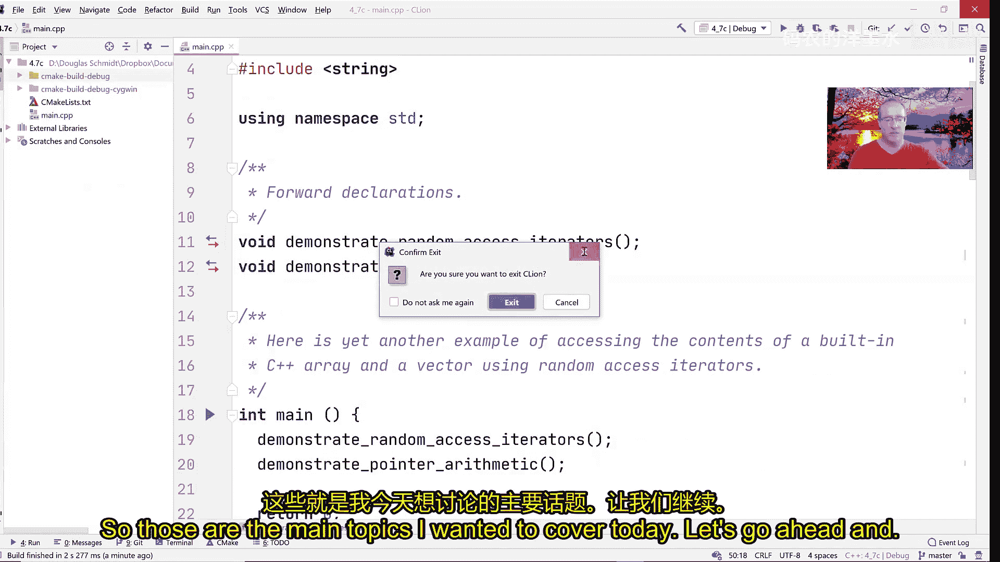

# 【全集】范德堡大学 C++标准模板库 中英字幕 1080P p09 Lecture 9 - 迭代器 part3 -BV1KWiCBWE7M_p9-

So welcome back to my next webinar on C++ standard template library by example today we're going to finish off our discussion of C++ STL iterators the last couple days we've talked about an overview of iterators then yesterday we talked about input output and forward iterators and today we're going to finish up with the other two types of iterators which are bidirectional iterators and so-called random access iterators so as always before we begin let's take a look at where you can find the source code。

😡，So you'll be able to find the source code for this particular。😡。

Discussion in my c plus plus folder in my Github repository in the 4。6 and 4。

7 subfolds so we'll start our discussion with examples of bidirectional iterators first what is a bidirectional iterator well a bidirectional iterator is essentially a forward iterator it has all the same methods and operator overloaded methods that a forward iterator has plus two other elements and that's the ability to go backwards either with pre。

😡，Derement or post decrement。 So these are the plus plus operations。

 So just to kind of recap what a bidirectional iterator can do， it can do copy construction。

 It can do assignment operation。 It can do quality and inequality。

 You can dereference it on either the left hand side or on the right hand side。

And then you can do both the plus plus operations with pre-end post increment and the decrement operations。

 pre and post decrement。 So you can do quite a number of things with a bidirectional iterator。

All of the STL containers。😡，With the one exception of forward list。

Provide bidirectional iterators or better， the better being the random access iterators we'll talk about next。

 So the vast majority of the built in Sl containers。

 the ones that come out of the box when you get Stl。

 those all come with bidirectional iterator semantics。 Keep in mind that input。

 output and for iterators only let you go forward， only let you do plus plus。

 But because we have the ability to go backwards， you can go bidirectally。

So let's take a look at how we could use bidirectional iterators and this is kind of a fun one。

 we're going to go ahead and create a list that initially has one element in it and we're going to give it the initial value of one。

😡，Then we're going to go ahead and put some elements at the end or put one element at the end and put an element at the beginning and to do that of course we're going to use the pushback operation to put the element at the end and the push front operation to put an element at the beginning and that all works very efficiently of course because the list supports efficient insertion at the beginning at the end and also once you've moved your way through the list through iterators you could also insert things very efficiently anywhere in the middle of the list because it's just about reconnecting the pointers so now that we've got ourselves this list which has basically012 in it let's go ahead and use some iterators to print the contents of the list in reverse order or print it backwards and we'll show a couple of different ways to do this first let me just go ahead and run the code so you can see exactly what it's doing so it's going to go ahead and compile and it's going to print210 which of course is the reverse of the contents which are012。

So let's see how it does this。😡，The first thing we'm gonna do is we're going to get an iterator to the beginning of the list using the explicit iterator syntax。

 We've talked about this before。 This is using the trait。

The iterator trait that's associated with every container and then just for kicks just to make things different just to show a more concise way of doing things we're going to use the auto keyword so this is going to get us the last iterator and iterator to one past the end using the end factor method and we're going to store it into a feel into a variable called last which is an auto。

😡，And then while last minus minus is not equal to first， we're going to print out the last element。😡。

And there's a whole bunch of different ways we could do this。

 so this particular approach starts at the end and notice how we decrement it with a post decrement each time through and we don't have to do it that way。

 We could also have done it like this。 We could have said。While last night。

 we go to first see out star minus minus last。😡，The key point here is that we can never access the last。

Iterator the iterator to the end we always have to decrement it by one before we can actually access its values and that's because the iterator to the end never really points at anything it's just a placeholder to be used in a comparison way so we can to do it like this or we could do it like this there's a couple different ways we could write the code so that's an example of being able to use a bidirectional iterator and demonstrate how you can go backwards in a list and put the content up Okay let's go ahead and look at another example。

😡，This example is also illustrating bidirectional iterators。

 and this is also going to show off some other interesting things with C++。😡。

Up to this point when we've been putting elements at the end of a list or putting elements at the beginning of the list or putting elements at the end of a vector we've been using the pushback operation and pushback works quite nicely and it works very optimally for builtin types things like int and double and so on when we start getting to user defined types types that have various types of constructors and conversion operators and so on it turns out that pushback is not necessarily the right thing to do and not the most efficient thing to do so in addition to demonstrating bidirectional iterators in some pretty cool ways。

 this approach is also going to illustrate the use of a variant or an addition to pushback given the strange name of in placeback and in placeback is going to use some cool fancy footwork in order to make the insertion of elements at the end of the list or the end of the vector in this case more efficient so I think I take it back we use a list in this case。

But it wouldn't matter that the vector would be the same so what we're going to do is we're going to start out with a list of so-called simple strings now what is a simple string simple string is a cool little piece of code I wrote to go of class I wrote to demonstrate a bunch of interesting aspects of C++ and we're particularly going to be using it to talk about move operations and various optimizations you can do with with C++ and it's move optimization semantics。

😡，We'll show some other things too for example here we're gonna show the use of simple string in the context of automatic conversion from one type to another so here's what simple string is it basically just implements a stripped down version of C+ plus string but it's not it's not fancy it doesn't have all the methods a string does just the ones I need to get the point across so as you can see here we have a default constructor we have a conversion operator that takes a con care star like the string literal apple or peach or banana and turn it into a simple string and you'll see why I don't actually make this explicit later because I want to do some cool stuff we also have a copy constructor which does not throw an exception we have something called the move constructor which we'll talk about later which is really cool we're going to have an assignment operator which also does not throw an exception and we have what's called the move assignment so we have copy constructor。

We have a move constructor， we have a regular assignment， a constant。😡，系。Costa Ref。

 assignment operator and a move assignment operator。😡。

And then we're going to have a couple other methods just to illustrate certain things like a swap method。

 a couple of operator subscript methods to index into the simple string， a less than operation。

 a length operation， a deor and then we also here have a conversion operator that converts an object of simple string into a constant carestar。

 and you have to explicitly make cast in order to do that， but you'll see how that works。😡。

The implementation of our simple string is pretty simple， we have a length field。

 we have a carestar that's going to hold the buffer that we're using is our simple string implementation and we have a little helper method called St new which takes a cons carestar and makes a。

😡，Carestar using the underlying C++ code to do that。

Last thing I'll show you from an interface point of view。

 we have an extraction operator that's able to take a simple string and print it or insert it。😡。

Into the。Into the I Strt。Okay， so now let's take a look at the implementation of this stuff so you can see here that how we're able to have this operation that basically takes this。

😡，Simple string and explicitly cast it to a account carestar so that's going to actually end up calling the method here。

 so it's going to go ahead and return the underlying carestar and we use that just for printing purposes。

😡，And then down here we have the different implementations now I'm not going to spend a lot of time on the implementations related to move semantics at the moment。

 we're going to cover those in more detail later， but for the starting point I just want you to see how we've instrumented all the various operations so you can tell what's going on under the hood when we run them obviously production code would not do this this is just for teaching purposes。

😡，So here's the simple strain constructor， and it's going to set the length to 0 and set the stir to a null pointer。

 which is a keyword that's been added in C plus plus 11。

And we print out the fact this is the default constructor。

 we have a conversion operator that takes a con carestar and creates a simple string and you can see it goes ahead and figures out how long the con carestar parameter is and then it makes a new instance a copy of that string and here's all it's doing it's basically doing Stland here I guess I don't really have to do that and that's probably duplicative and then we go ahead and copy the old string into a newly allocated string that's big enough to hold the length plus one。

All right， so down here， and then we pronoce the fact that that state the version operator that thinks a constant care start makes it simple start。

Next thing we have is a copy construct， as you can see what the copy construct does is it takes the right hand side and it goes ahead and initializes the left hand side。

 the side we're creating， the simple string we're creating from the contents of the right hand side and prints out it's the copy constructor。

And then down here we have something called the move construct we're going to talk about this later move constructors are very clever and they're used in situations where you want to optimize。

😡，Value semantics and c plus plus， especially in situations where you don't really need to keep around the contents of the string you're moving from by value so for right now we won't talk about this a whole lot。

 but just note that we indicate we're using the move constructor。😡。

Here's the canonical way to implement the regular good old assignment operator。

 notice how these things are all no exception。😡，They're tagged by no exception keywords。

 meaning they don't throw exceptions under any circumstances。😡。

And so here we check for self assignmentsignment， and then we go ahead and do the classic safe move operation。

 the exception safe move operation。 We make ourselves a temp copy of the right hand side。

 And then we swap that with the lefthand side。 And this is a clever technique。

 We'll talk about this more later， too。😊，Here's the move constructor。Move assignment operator rather。

 here's a swap operation that just swaps the lengths and the stirs and the values that are passed in。

😡，Subscript operator just indexes in there by the index that's passed in that's just good old sort of array indexing or vector indexing length returns land and then less than does a stir comp and checks to see if the value is less than zero。

 that's how we do less than using these kind of sea level type of strings。

Then finally we have our deor which goes ahead and deletes stir which could be null deleting a null pointer is perfectly fine。

 we have to delete it as an array because that's what it is it was allocated as an array and then if for some reason stir was a null pointer we just print out the fact it's a null pointer okay so that's a quick overview of simple strain now you might be asking what the heck does this have to do with bidirectional iterators and what the heck does this have to do with in place back versus pushback so we're going to get to that here。

😡，So what I'm going to do is I'm going to go ahead and call in place back to put peach。

 apple and bananas at the end of the list in that order。

 so peach goes first followed by Apple followed by bananas and you'll see when we run this thing。

 those are the order that they're going to show up in。😡，Then just to compare and contrast this。

 I go ahead and I push back peach， apple banana using the pushback operation instead of in place back。

So let's go ahead and run the code and we'll see the difference。

 which is really quite startling between these two things。

So here's the operations that are done on a simple string by the in placeback calls and you can see they're really concise all we're doing is we're creating a simple string from the conant carestar parameter that's passed in namely。

😡，This parameter， these character literals and those things are being directly stuck at the end。

 no muss， no fuss， just those calls。😡，That's why in placeback is so useful for these user defineded or more complex non primitive types。

In contrast， look what goes on with simple string when we do pushback instead， same outcome。

 we end up pushing those elements onto the， onto the list in the right order。

 But there's so much more work。 First， we have first。

 the pushback call creates a simple string from the con care string。 Then it goes ahead and it does。

The move operation， the move constructor。 Then it goes ahead and calls a deor。

 even though it's the null pointer， it just has to call it。

 as's part of the semantics of C plus plus。 So you can see that for every operation that was done up here for in placeback。

 we have triple the number of calls for pushback。 And you might ask， well。

 what the heck is going on into the hood。 So if you take a look at in placeback。

 you'll see why it's so much more efficient。😡，What it's doing is it's using the verytic template features that C+ plus defines。

 which we've talked about before， and so it's going to take this veryatic template of arguments and then it goes ahead and it inserts them at the end of the list and it uses the magical STD forward method and what STD forward does is it just goes ahead and kind of copies those methods without doing anything to them at all。

 it doesn't do any additional calls and it just goes ahead and inserts them in place So of course it's going to be very very efficient as you saw it just calls that one operation conversely if you go look at pushback。

😡，Pushback is not as clever and what pushback does pushback takes a an R value reference type and it goes ahead and does a move operation and as you can see that's that's pretty efficient because it does call the move。

😡，Constructor and the deor then has nothing interesting to do， but there's additional calls。

 so wherever possible when you're confronted with a choice between。

Using in placeback versus pushback， it's usually a good idea to use in placeback。

 especially when you're dealing with user defined types or standard containers that are non non-native non- built in types for the built- in types。

 it doesn't really matter。 But when we start getting into the user defined types and the standard containers。

 then it doesn't matter。All right， so that was a very long winded way of talking a bit about some cool differences between。

Methods in C++ that use veryic templates versus those that use move semantics and these veryic templates were added later it came。

 I believe with C++ 11 and you can see it helps to make things more efficient。

Now let's get back to iterators and bidirectionalal iterators。

 so what we're going to do here is we're going to make ourselves another simple string given the incredibly boring name of why and why not。

😡，So we're going to make a list of simple strings called why it's going to have the same size as a list。

 the one we just pushed elements into。😡，And then what we're going to do is we're going to go ahead and call the reverse copy algorithm and let's go take a quick look at reverse copy what reverse copy does is it goes through the iterators in reverse order so it has a first iterator and a last iterator except it's going to go。

Basically in reverse order and how it treats them so what it does is it's going to go through when while first doesn't equal the last but every time through it's going to decrement last by one and then de referenceence the。

😡，Deremented last storing that into result， so it's going to go ahead and go through the the。😡。

Input iterators in reverse order， which is why it's called your reiterator。

 So if you come back over here， you can see we're going to start at the beginning of we're going pass in the beginning iterator to the list and the end iterator。

 which is， of course， always one past the end to the list。

 and then we're going to pass in the beginning iterator to the new list we created called Y and then reverse copy will copy them from the end to the beginning。

 And then we go ahead and print the results。 Now， the print results thing here is a variant to what we looked at when we were talking about output iterators where we're going to go ahead and copy from the beginning of why to the end of why and we're going go ahead and use this Ostream iterator adapter to write each element in。

Why to standard out so this is just that adapter code we looked at before that make sure it gets written to standard out using a space as the the limiter between each element what we write out。

😡，And then just for kicks， just to show there's yet another way to do this stuff。

 we're going to go ahead and use the same copy algorithm we did for。

 we're going to copy from an input iterator to an output iterator except this time we're going to print the results backwards by starting at the end and going to the beginning so RBn sorry RBn R begin is used to return an iterator it's called a reverse iterator that goes from the end to the beginning and our end is used to return an iterator that is indicative of the beginning of the elements。

😡，So those are what are known as reverse iterators and they're actually quite cool as well we'll take a look at reverse iterators in more detail later。

 but you can see that our begin creates a reverse iterator at the end and of course our end will let's go ahead and see what ourN does we look at our end。

You can see that our end is going to return a reverse seerator to the beginning。

 so they're basically just reversing themselves。So I think I might have run this already。

 but if not let's run it again focusing this time on the output and you can see the output originally is bananas。

 apples peach， bananas， apple peach that's in reverse order because we started out with peach apple bananas and then we go ahead and print that in reverse order and now it's going to be peach apple bananas because we're doing the pushback operations here。

😡，So pretty darn interesting if you ask me this example shows off all kinds of cool stuff。

 it obviously shows off the concept of bidirectional iterators and the ability to do reverse copy and the way to do different ways of reversing things and printing things out reverse order and so on and then it also shows us the difference between in place back and pushback and you can see that the compiler is really trying to get us to convert pushback to in placeback so if we go yeah。

 tell me what you want me to do compiler it says using placeback instead of pushback now I'm choosing not to do that because I want to demonstrate the difference between the two approaches but you can see that the compiler and the interactive development environment is really trying to。

Move you in that in placed back direction， which is good because it's going to be more efficient。

Okay， so that's the end of our discussion of。Biddirectional iterators in the time that we have remaining I would like to focus now on random access iterators and these are the most powerful form of iterator you can use random access iterators with vectors you can use random access iterators with Ds those are really the key built in containers that use random access iterators and they can basically work like regular good old pointers with regular good old pointer arithmetic the difference being of course that they're implemented at the user level not the compiler level and so in addition to everything a bidirectional iterator could do all the stuff that we saw then random access iterators can also do all of these other fake so all of these other things are actually more than what a bidirectional iterator can do remember a bidirectional iterator can do assignment construction not equal equal it can do de referenceference it can do plus plus that can do minus minus but a random access iterator can do plus plus equal minus minus equal。

😡，Subscript and then all the other relational operators like less than greater than less than equal to。

 greater than equal to all that kind of good stuff。

So here is the vector class that provides random access iterators。😡，That can be used as we show here。

 so we're going to create a vector of 10 numbers zero through9。

Pretty straightforward and then we're going to go ahead and we're going to iterate through this。😡。

Vectctor， and we're going to。Skip over the odd numbers now this of course is taking advantage of the fact that I really know how my input is laid out so it goes you know012。

3 etcter so what i'm going to do is i'm going to start at zero at the first location I'm going to take that value and I'm going to add it to the zero iterator then as you see here i'm going to use the plus equal operation to skip over the odd numbers so i'm going to skip over them so i'm going to skip over the 13579 and just sum up02468。

😡，And of course， if I go ahead and run these as I'm doing here。

 you can see that I get the sum that I would expect。And what's interesting about this。

 I probably should probably should have done this before。

 let's go ahead and do two versions of this much like we had done in previous examples where this time we're going to create an array of 10 numbers。

 so let's go ahead and do in。😡，And we can't call this a， of course。

 let's call it or we can't call it V， let's call it A。And let's go ahead and assign it what it needs。

 and then we can use the same code here。Now in this case。

 we're not going to be able to use an iterator instead we're going to go ahead and。Uses I。

 and we're going to say。A。And we're going to say I not equal to a plus。😡。

And then it's basically going to be size of a divided by size of。Starting。

 which is admittedly kind of awkward and noxous， but that's just the way it works let's say。

And then what we're going to do here， whoop we've got to add this here。

And then we're going to say I plus equal to two。😡，Oops， sorry， this should be an auto。

 this is actually going to be a pointer。And so star maybe I should call this IP。

 that's a better way to call it。IP I。And let's go ahead and do a little bit of refactoring here just so the code isn't quite so ugly。

 let's call this int a size equals。And let's go ahead and get it this。Expression。

So you can see that that's the size。In terms of the number of elements。

 if I could put my parentheses correctly， and down here we say a plus a size。And there we go。

 I think I got there。So now we have the same basic code that we did before down here with vectors。

 except now we're going to use。😡，Built in types and so what this is showing is that。

Random access iterator look and feel the syntax the semantics is basically equivalent to pointer arithmetic and what we're doing here of course is pointer arithmetic to make this more clear let's just call this in star think that's a little bit more clear I could say auto but that's kind of hiding what's going on over the hood。

😡，So very cool let's run this thing unless something is very， very， very strange。

 we should get exactly the same results， which we do the sum of the even numbers using the built in array is exactly the same as the sum of the even numbers that are using a vector and the code as you can see is very。

 very， very similar and again if I use auto here and a few other little futzes it'll be even even more cool。

Okay， so that was an illustration， one illustration of several that demonstrates the use of random access iterators。

😡，So now let's go ahead and show some other uses of random access iterators and once again we're going to compare and contrast。

😡，Pointer arithmetic ways of doing things with the way in which random access iterators were。

 So let's take a look at the pointer arithmetic version First。 We're going to have an array of 4"s，1。

2，3，4。And now we're going to show first pointer arithmetic。

 we're going to create ourselves a couple of pointers， again。

 probably better to do explicit pointers here just so it's clear otherwise we kind of lose type information。

😡，So you can see here that we're creating an inpointer that points to a and then we go ahead and take that inpointer and we add two to it。

 then we're going to print out the contents， which of course should skip over to print three。😡。

We perform some pointer arithmetic we add three to I and we're going to go ahead and print that out so that'll print four then we go ahead and subtract one from I and assign that to J and print that then we do j minus equal2 this is all wonderful pointer arithmetic magic with the C style parts of c plus plus print that out and then down here we go ahead and say is J less than I remember these are pointers we're comparing if J is less than I then we go ahead and print J less than I otherwise we print out we're not less than I so we basically do that and then we do some other things to check it equality so that's how we do the pointer arithmetic version let's just run this code kind of see what it's going produce as output。

😡，And as you can see for both versions， both the pointer arithmetic version and the vector version using random access iterators。

 the results are the same。 It prints the values out after we mus around and change the contents using pointer arithmetic or iterator operations。

 And then it also does some equality and inequality and relationship comparisons。

 And if you look down here， you can see that the use of。Vectctor with iterator。

Gives you basically exactly the same code， the only difference being that you know。

 I guess I guess if I really wanted to make this stuff look alike。

 I probably should revert back to using auto here， so let's say。😡，Auto eye。Yeah。We'll say。

AutJ and then that code is going look a heck a lot more like the code you see that here where we're making getting a beginning iterator using autoi and we're then advancing that iterator by two to make autoj So if you look carefully you'll see that the code for both cases is literally identical except for creating the vector and then getting an iterator to it all the code down here is identical between the iterator version and the pointer arithmetic version and that's by design random access iterators are meant to mimic the syntax and semantics of pointer arithmetic Okay so that's yet another example。

Now let's go ahead and take a look at example4 seven。

And here you can see that we've got once again a random access iterator example and a pointer arithmetic example and for some strange reason I put the random access iterator version first that doesn't really matter so let's take a look at the random access iterator version。

 I'm going to make a vector of strings using this string。😡，Initializer syntax。

 the vector initializer syntax for basically what's effectively an array of strings。

And then I go ahead and print the results， so of course it's going to be ABC， D， E FG。

HIj those get printed with new lines separated let's let's be sympathetic to ourselves and what space here not a new line so otherwise things tend to one off the end of the screen a bit and then we start doing some other fun with。

with iterators。 So we get an iterator the beginning of the vector。 we increment the iterator by5。

 Then we subscript into the iterator at that location。 It's been moved to and add a one to it。

 So now it's going to refer to the， it's going to change the contents that's in the string。

 Let we go ahead and we zip back to the start by subtracting5 from the iterator。

And then we go ahead and we print the results starting at P， which has been。

moved all over the place from the beginning and made a change here and then we go ahead and move it back to the beginning so just demonstrating you can use kind of random access。

😡，Operations on this iterator and then down here is basically the same code except this time we're going to be using pointer arithmetic on a builtin array of constant care stars which are effectively the string like substances when you're working with the C aspects of C+ plus and as before we can copy the results and then we can go ahead and do a bunch of funny things with pointer arithmetic except this time we're truly doing pointer arithmetic we're not dealing with iterators at all and once again we print the results so let's go ahead and run this code and I think you'll see what it's able to do I think I also forgot to replace the spaces with the new lines of spaces so you can see it prints this content out and then it does some stuff notice it replaces。

It puts a Z in there， so a b c D e f Z its a G but otherwise it's the same so i'll have to go back and and fus around with the example here so I get rid of the。

New line and instead we're going to use。ASp， let's just do that real quick that won't take us very long。

Get rid of that。New line， I don't like the new lines because it came to。

Make the code to read when you're running it here in this context。

But let's this see now while you run it， it should be a lot more coherent what we're doing and you'll see that things are working the same way。

So we print out a through J， then we go ahead and modify element G using。😡。

The in the first case using the iterator and the random access features to go and make that change and then down below we do the same things at this time we're going to use the built in operations with pointer Athmetic as opposed to using the iterators that come out of the box with SDL。

But all very cool， all very interesting， showing you how comprehensive C++ random access iterators are in terms of mimicking the syntax and semantics of pointer earth with all the good and bad that implies。

😡，So those are the main topics I wanted to cover today。 let's go ahead and。

Stop screen sharing， we'll see if。If anybody has any questions if there' are no questions i'll give you a quick overview of where we're headed next。

 so at this point we have now completed our coverage of STL iterators and you should now be very familiar with all the different kinds that input output forward bidirectional and random access。

😡，And we've also talked about containers， so we've talked about sequential containers。

 things like L and vector and deck and so on， and what we're going to do starting tomorrow is where we're going to begin our discussion of so-called associative containers and associative containers are in some ways more powerful and also more complex than the sequential containers and the main reason that they're more powerful is that they give you the ability to order the results。

 at least the ordered associative containers do and we'll see that there's a couple different variants。

 their sets which have only a key， their maps that have a key and a value。

 sets and maps must have unique keys， then we also have multis and multi mapps and as the name implies those can allow duplicate keys because multi and we'll see how these different types of ordered associative containers store their contents using essentially a balanced binary tree。

Called a red black tree and then we'll also talk probably not tomorrow， but perhaps on Friday。

 we will cover how。The unordered Asciative containers work and unordered As containers have the same basic types of semantics in some ways。

 They've got sets and maps and multis and multimaps。

 all of which behave pretty much the same way as the ordered containers ordered as containers do。

 the big difference， of course， being that the unordered containers don't use red black trees as their implementation data structure。

 And instead they use hashing。 And so as a consequence， hashing doesn't order anything。

 So they're ordered， however， the hash function will order them。 So we'll talk more about that。

 and you'll get a chance to learn how the different containers are implemented。

So that's what I wanted to cover today， thank you guys again， as always for joining。

 feel free to like and subscribe and feel free to follow me on Twitter if you'd like and with that I will talk to you very soon。

😡。