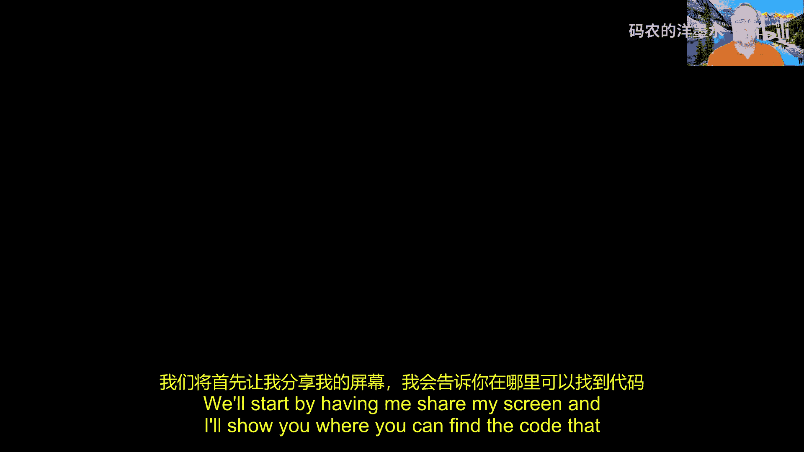
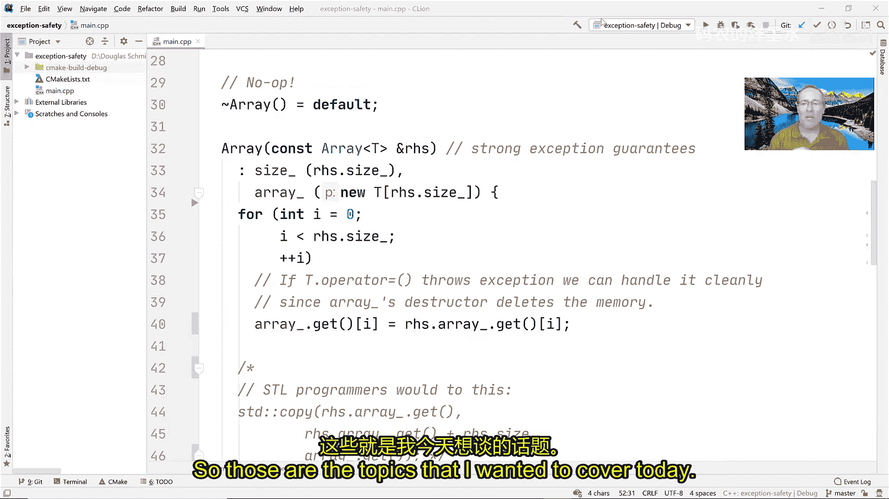

# 【全集】范德堡大学 C++标准模板库 中英字幕 1080P p10 Lecture 10 - C++容器的异常安全 -BV1KWiCBWE7M_p10-

Hello and welcome to my next webinar on C++ Standard Template Library by example。

Despite the name standard template library by example。

 today we're going to focus on the topic that's a little bit off the track of STL per se。

 but still very important to understanding how STL is implemented and how to implement your own generic containers that are similar to STL the topic we're going to focus on is proper C++ exception handling and exception safety guarantees for generic containers。

😡，So as usual， let's go ahead and start， we'll start by having me share my screen。😡。

And I'll show you where you can find the code that we'll be covering today。

So the code we're going to be covering is in my GitHub repository in the C++ folder in the exception subfold。

 and I've got three underlying subsfolds here， one called no exception safety raw。

 one called no exception safety template， and one called exception safety。

 so we're going to look at them in that order。😡，So let's go ahead and take a look now at the code。😡。

Here I am in my sea lion interactive development environment and you can see I've defined an array class it's really just a stripped down version of a vector and i'm using this for illustrating the exception handling capabilities in a fairly。

😡，Controlled way。 But what I'm showing you are very powerful techniques。 First， however。

 we're going to show you kind of a really simple minded stripped down version where we're just going to have an array of characters。

 I type def care to T。 So it would be sort of generic， but it's an array of characters。

Down here you can see that we actually have the implementation of this being a size underscore data member called that's a type size T and an array underscore data member of type T star。

 which of course， is a care star。The constructor is going to copy the size parameter into the size underscore data member。

 and it's going to go ahead and allocate a new array of characters of size size and store them in the array underscore data member。

😡，We then have a deor which goes ahead and deletes the arrayray underscore data member。

 so when the object goes out of scope， it'll clean the memory up。😡。

And that's where things get tricky。 as we'll see when we get to the next version。

Here is the copy constructor remember the copy constructor gets used whenever you are going to copy one array to another so the copy constructor gets used here。

 this is just the array constructor with a size parameter in this case we allocate an array of size of 000 we then allocate an array of size 10 and then we copy the contents of the array of 1000 into a new array of which will then also be a size of 1000 and that's what calls the copy constructor we also have some calls down here to use the assignment operator well we'll look at that in a second。

😡，So here's the copy constructor， the copy constructor looks very simple。

 we make the size underscore data member reflect the right hand size。

 the right hand size size underscore method， we make the array underscore be。😡。

A new dynamically allocated array of characters of right hand side， sized underscore。

And then we have a little loop that goes for I equals 0。

 I is less than right hand side size underscore。 And we copy the contents of each element in the right hand side array into the left hand side array。

No， mus， no fuss。 You never have to worry about an exception being thrown when you're copying one character in one array into another character in another array。

 character to character copies won't show exceptions。Let's take a look at the assignment operator。

 it does something very important it checks for self-assignment。

 you never want to assign to yourself because you'll end up deleting yourself and cause all kinds of trouble if you're not careful and it's just extra work that's unnecessary if we are assigning to our self then we're going to go ahead and just return star this immediately without doing any changes and we do a check for self- assignmentsignment by seeing if this object has the same address as the righthand side objects address。

😡，If it doesn't we're not assigning to our， so what we do in this case is we then allocate a new array of characters of rhhs do size underscore。

 we store that into a temp variable， we then run through a little loop and we copy each element in the right hand side array into the left hand side temp that we're doing。

😡，And then when we're done with all that， which will also not throw an exception because character to character copies don't throw exceptions。

 we delete the old array underscore because we're getting rid of it。

 and then we go in ahead and assign it to the new temp。😡，So that's the way the program works。

 let me go ahead and show you how to run this with Valelgrind。😡，So if we go over here and we go into。

No exception safety raw， I've already precompiled this code， I run it。

 it doesn't do anything which I don't expect it to。

 I run fallow grind which is a cool memory leak detector program and when you can see what it does is it checks to see if we bleak any memory it checks to see if there's any memory corruption。

 there's not we didn't have any exceptions， everything worked fine。😡。

So you might think to yourself at this point， hey， I got a pattern for writing。InConers。

Well actually don't， but we'll talk about that in a second so to illustrate why we've got some problems let's take that very same。

😡，Now let's replace the use of this type de of a care to something that's a template。

 so we have a template type name key array so type name T could be whatever we want it to be。

 it could be in it could be double or it could be something pernicious like our dreaded throw exception struct which we'll see in a minute throws an exception and wreaks havoc on our implementation。

 but we'll come back to that just in a moment。😡，Down here the implementation is going to look very similar。

 we have a size data member and an array data member of type T star， so it's a pointer to an array。😡。

And what we do in the constructor is we。Do exactly what we did before。

 We copy the size parameter into size underscore。 We copy a newly allocated array of size size of type T。

 the generic type into our array underscore。 so far， it looks good， but。

We're just treading on thin ice here the next thing we do is we go ahead and do the destructor the instructoror is going to delete the array as an array。

 which is correct。😡，But this is where things get murky。

 take a look at the copy constructor remember that's the one that's used when you pass by value。

 you return by value， you do an initialization。😡，The code looks identical but there's one big important difference we copy the right hand size size to the left hand side size。

😡，We make a new array that's the right size， we put that into the array underscore data member。

 we have the same loop as we did before， but the big difference is because we now have a template that templates assignment operator might throw an exception and if it throws in exception we' in big trouble because the rules and C++ are that de structuresors are never called unless。

😡，The body of a constructor finishes。 So if a constructor throws an exception before it's being finished before you hit the closed curly brace at the end of the body of the constructor。

 the destructor is not called because， of course， the compiler has no knowledge of how far you got in the initialization in that constructor。

 So it doesn't want to just willy nilly delete things that may not be initialized properly。

 So in that case， we're going to end up leaking memory because the destruct is not called we allocated this array of T here and it's not going to be released。

So that's a problem。Likewise， if we come down here and take a look at the assignment operator similar kind of problem。

 we come in here check for self assignment， let's assume we're not doing self assignmentign down here we're going to go ahead and allocate a new array of type T of the right size put into a temp。

😡，And then we're going to go ahead and run that loop again， just like we did before。😡。

Except this time again， when we copy。😡，The right hand sides array underscore subi into the temp subi。

 the assignment operator of typeypekey could throw an exception， and if that happens， well。

 we're out of luck because we allocated this memory and it's not going to be free。😡。

So that's a problem let's assume we somehow magical could get through that loop without throwing an exception same rules apply we delete the old array and assigned attempt to the array。

So let's go ahead and take a look and see what what happens in practice if we run this code。

 so let's go back over here and now let's go up to no exception safety template。😡。

And again we're going to run a dot out if I precomped and now it catches a range exception Why did it do that where did that come from Well if we go back up here and we take a look at the throw exception struck I told you that mischievous struck that's going to cause havoc in insanity on our code you can see that it's assignment operator after being called 10 times throws an exception just for testing purpose it's just to demonstrate the problem and we do that by having a static into we just incremented each time it's called So when we run this code we get an exception but more importantly when we call v grind on this code。

😡，It's going to tell us we've leaked memory and that's because when the exception was thrown that。😡。

Naked pointer was not deleted and so we leaked it and that's a bad thing you do not want to leak memory in C++ programs it causes all kinds of problems down the road especially for systems that have to run for a long time or embedded systems or realtime systems where you have to conserve the resources and any system that leaks memory long enough iss going to become a problem。

😡，So how do we fix this well there's various ways we could try to fix this we might come in here and say oh I don't know。

 I know do I'll put a try catch here so I'll say try。😡，And then down here， I'll say。Catch。

And I'll say standard。Out of range， exception。Rrap， yes。And I could say something like delete。Al。

And that won't work， but there's two problems， level one。

Litering your code with trycatch blocks just gets ugly frankly sometimes it's important don't not catch exceptions because it looks ugly but there's a better way to go and secondly whenever you put trycach blocks in your code you're going to end up in a situation where you're going to have to have the compiler generate some additional code which makes it slower and bigger in order to manage the exceptions so let's try to come up with a way to do this that does not require this exception handling explicit exception handling。

😡，And the way to do this is shown in this other。佢。Project called safety and as it may imply。

 it's exception safe。We're going to have that same bad throw exception struck as we did before。

 but this time we're going to outsmart it and keep it from causing trouble。😡。

Here's the code now at first glance the code looks the same it's an array it's temptized by type T a lot of the code looks the same at the beginning。

 but there's one really important difference to start with instead of having a T star array underscore data member we have a unique pointer that's specialized with an array of T and unique pointer is a standard STL class and if you look at the implementation it basically holds the content that it's passed in its constructor using the famous resource acquisition is initialization idiom thats C++ uses in so many different places and if you pop down here a bit and we find the deor which is the little tilde character down here you'll see that the deor will delete the pointer when it's called so that means we're always going to end up delet the allocated memory even if an exception is thrown because of course the way that exception semantics works。

That the des of data members that are properly initialized will be called。

 even if the main de for the class is not called if the copy Con doesn't fulfill its purpose。😡。

So let's take a look， here is the array。😡，Constructor that takes a size T and makes us a new array of that many dynamically allocated items。

 but array underscore now is going to be this wonderful unique pointer so it'll pin itself up up properly。

😡，We don't actually need to have a deor。 So we just give it the default to say， you know， compiler。

 you， you do your thing we don't need to have any special deor here。Here's the assignment operator。

 it looks very similar to what we had before， in fact it looks identical。

 we allocate a new array of type T of size RHS size underscore so that's the right hand side size。😡。

But that's a unique pointer now， so even if an exception is thrown in the code below that will always get deleted and lo and behold down here we have that loop like we did before。

 because we have unique pointer we have to say array underscore dot get subi as opposed to array underscore subi that's just the semantics of unique pointer。

😡，But the good thing is that even if an exception is thrown here。

 the destructor of the unique pointer will clean up that allocated array， so that's good。😡，Now。

 the second thing to remember is no self-repecting C plus plus developer these days would ever write this kind of code。

 They would more likely use。The STL algorithms like the copy algorithm where we start at the beginning of the right hand side array。

 go to the end of the right hand side array and copy it into the array underscore data member so that's kind of the that's our STL part of this lesson is just showing how we could use the algorithms here so that's kind of cool but the really cool part is the assignment operator so let's take a look at that next so here's the assignment operator。

As before， it does the self assignment check by checking to see if this is not equal to the address of the right hand side object。

😡，And let's assume for sake of argument it's not， so we can actually have to make a copy。😡。

In that particular case， we do a much shorter implementation and this is a really cool idiom。😡，Very。

 very widely used used in implementations of SL of course。

 it's just the way to do things these days and this will give us what's known as strong exception guarantees There's several different types of guarantees with exceptions you can have no guarantees which say leak memory like we did with our no exception safety template version you can have weak guarantees which is what we do up here and that just says I don't leak memory but I don't make any assurance about whether the object state is preserved in any sensible of a way it didn't matter in the copy construct because the object didn't exist yet so the fact that it state didn't get preserved doesn't matter because it didn't exist。

But for the assignment operator it does have a state。

 it does have a left-hand side and we want to make sure that if an exception is thrown that lefthand side is left unperturbed。

 we don't want it to be corrupted or modified in any way and that's what's known as strong exception guarantees and the final type of exception guarantee is called no throw and we'll talk about that in a second。

😡，So here's the idiom you can use this pretty much for every assignment operator that you write in this form that will give you trivial strong exception guarantees with no try catch blocks which is so cool and the way it works is we use the fact that we have。

😡，Weak exception guarantees for our copy constructor so that if an exception is thrown in there。

 no memory is leak， which is good。😡，And once we've got our temporary copy of the right hand side created here that's all this is we're just making a temporary copy of right hand side。

 we then call the swap method defined below and we swap the fields of the temp with this or rather star this which is the left hand side so it'll happen if you look at swap we take the right hand sides size。

😡，Size teammat value at data member and we swap it with our。😡。

Size underscore data member copying size keys never throws an exception and then we also go ahead and we swap the unique pointers pointers so swapping pointers also will not cause an exception so this is a no except。

😡，Method swap is no exception because it won't throw exception。 So it's got no throw semantics。

 that's the strongest form of exception safety semantics。 And in this case。

 it costs us really nothing。 we're just swapping the the fields。 So when we're done here。

 the original contents of this， which is the left hand side will now reside in the temp object。

 and when it gets destroyed， it'。Aray underscore data member will automatically get its pointer free so it'll it'll basically free the old left hand sides array underscore pointer and the temporaries copy of。

😡，The right hand sides。Contents， which will be its temporary array underscore pointer will get swapped to this and its unique pointer and so that will then be in the right place so we basically just swap the pointers and that won't throw an exception。

😡，So let's go ahead and take a look at what happens when we run this code we'll go over to the exception safety folder when I run the code which I've already precomplied you can see it throws an exception just like the previous version。

 but unlike the previous version if we run Val grind on it you'll see that when it runs it does not leak memory so that's the beauty of this approach we don't leak memory we don't have any you'll notice there are no tricach blocks anywhere in our implementation of this generic array so this generic array containers generic container has strong exception safety guarantees doesn't leak memory doesn't corrupt its its state。

😡，Without using tryCch， and I think that's pretty darn cool。

So those are the topics that I wanted to cover today what we'll talk about tomorrow is we'll get back to STL and its features we're gonna to be looking at the ordered associative containers tomorrow that'll be things like sets and multisets and maps and multimaps and so on which is really really cool stuff I think you'll get a great deal out of learning about that but for now you know a lot more about how to implement strong exception safety guarantees very simply with a very simple pattern and it'll allow you to write your code in a way that won't be corrupted without littering your code with Tricatch blocks so thank you all very much for watching if you like what you're seeing please like and subscribe and also please feel to follow feel free to follow me on Twitter if you go to my playlist description box it has my Twitter handle so thank you and I'll talk to you again soon。

