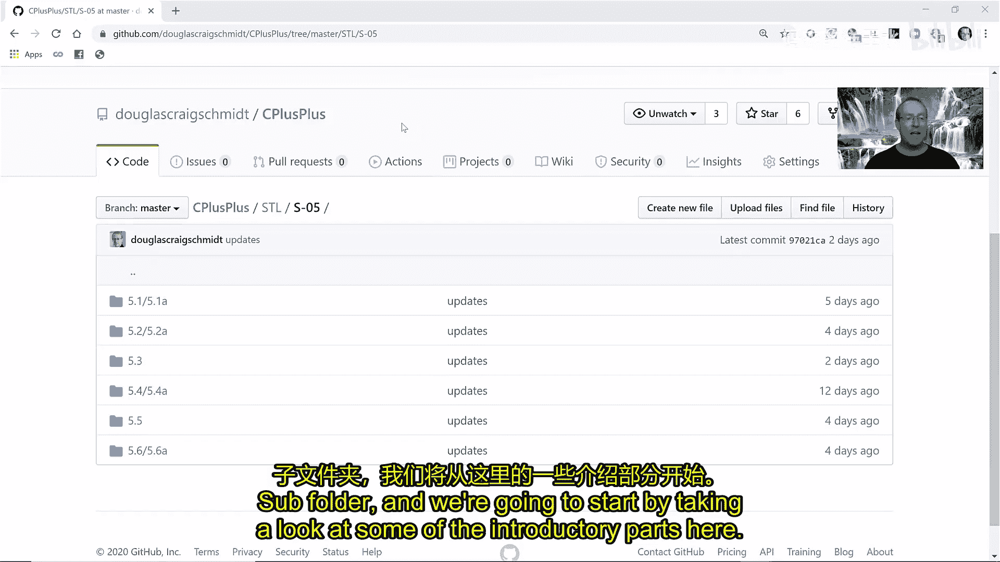
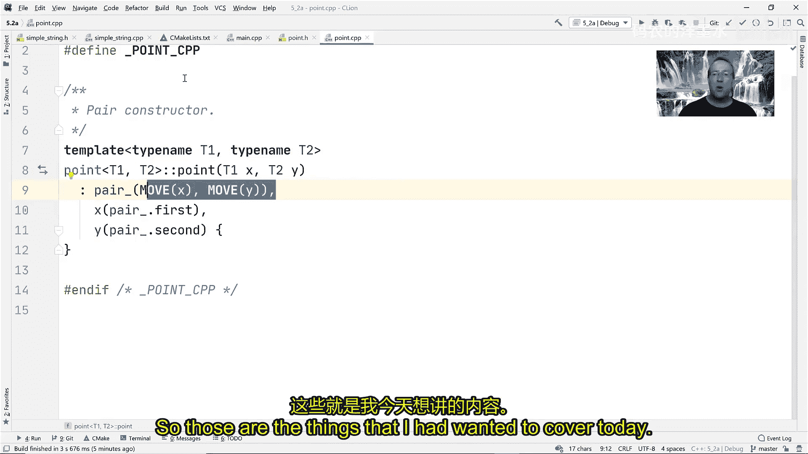

# 【全集】范德堡大学 C++标准模板库 中英字幕 1080P p11 Lecture 11 - 有序关联容器 -BV1KWiCBWE7M_p11-

Hello and welcome back to my next webinar on C++ Standard Temp Library by example。

Today we're going to return to our focus on C++ containers。

Starting with our discussion on the ordered Associative containers， including map and set。

What we'll do here is we'll begin by looking at the source code that you can find to download the examples I'll be covering。

 and then we'll begin covering the examples themselves。So without any further ado。

 let's go ahead and get started。You can find the source code we to be covering today in my C++ folder in my Gitthub repository in the STL S05。

Subfold。And we're going to start by taking a look at some of the introductory parts here。

 so ahead and look at my interactive development environment。😡。

This particular file isn't really a program it's just some documentation explaining what the concepts are behind ordered asciative containers these are containers that support efficient insertion removal and lookup or find operations of values based on various keys。

😡，These containers we're going to talk about all support the insertion and removal of elements。

 but they differ from sequential containers because they don't allow the assertion insertion of an element at a specific position or a specific location。

 instead it's based on the value that's associated with a key。😡。

After the element has been added to the container the key itself cannot be changed。

 it's effectively a constant， and the reason for that of course is pretty obvious if you could change the key that would mess up the ordering。

 of course you can remove the element and its associated key。😡。

There are four associative containers that are going to be focusing on here。

 these are the ordered associative containers。😡，They're basically divided into two categories。

 There's sets and maps。 And within each category， there's。

Individual unique versions like a set versus versions that can have multiple keys with the same value。

 which are the multi sets， so for sets and multi sets only the keys are stored。

And you have to have some kind of ordering relationship defined in terms of the less than operation。

 but there's all kinds of ways to arrange to do it with other orders besides just less than if the values are very simple things like numbers then obviously you just use the less than operation on the numbers if they're stored by alphabetic order。

 you can have them order that way lexographically or if they're user a defined containers。

 then they have to have the less than operation defined and you can take control of that and control it in the way that you see fit。

For maps and for multi mapps， there are keys and values for a map， there's a unique set of keys。

 for multimaps， there are potentially duplicate keys going along with the values associated with them。

😡，And these are basically pair associative containers and we'll see that there's a pair。😡。

Class it's used for various things in the STL ordered containers。

The keys can't be changed by iterators once they're assigned， you can of course erase them。

 but again you can't change them because that would mess up the ordering in the map under the hood these ordered associative containers are implemented as binary trees and they use a red black tree implementation and basically there's some optimizations that can be done because of the way the trees are laid out we'll talk about those as we go through some of the examples。

😡，You can have your own Asci containers you might want to build with some other abstraction。

 you might want to have some kind of a tree structure organized as a23 tree or an AVL tree or some other data structure。

 which would be a good as a way to learn more about how to implement these containers。And of course。

 if you build your As containers using the same APIs as the ones that come prebuilt with C++。

 then you can go ahead and use them with all the predefined STL iterators， algorithms。

 and various functionss。You can use containers for all kinds of things。

 you can think of ways of mapping keys to values and I'll show you some really cool examples as we walk through the various sub lessons that we're going to cover starting today we'll probably only cover a few things today and we'll pick this up and keep going next week。

😡，All right， so let's go ahead and actually look at some real code now。Let's open things up。

And see what our first example will be。So this example here。😡。

Is going to demonstrate several usages of the C++ STL pair template now I've shown you some pair templates before。

 but they were really just stripped down for my purposes to illustrate a few things about stuff like passing parameters by reference versus passing them by value and so on。

 but now we're actually going to look at the real legitimate official STL pairs。

And we're going to do a bunch of different things with these。 First of all。

 let me show you a little helper class I define called a point。 And this is kind of a fun concept。

 So a pair is very important to STL。 The associated containers typically are used to bind keys to the first elements in a pair with their associated values。

 which are the second element in the pair。And you'll see that there's various。

Ws you can manage and manipulate these pairs there's actually a class called pair as we'll see here in a second and this is used in the construction of maps and other associative data structures so i'm going to use the pair class to create a point class so here's the point class and this point class is going to be implemented using a pair and we're also going to use this to show off some other cool things as well。

So here is the constructor for the pair， which you can see it takes。X and Y。

 which are templates of type name T1 and type name T2 What that means is we can have T1 and T2 be different types if we so desire。

Now for this particular case we're going to use a pair as the implementation artifact to define a point and the point is simply going to be these two data members T1 and T2 which are references so we're going to get a chance to see how you initialize a reference so what's a reference data member well let's take a look and C so you can see x is a reference and y is a reference。

😡，The implementation of this is going to be implemented by an STL pair。

 and so you can see I have a pair object' a data member called pair_。Now because point is a template。

 we have to include the source code， so let's come up here and we'll take a look at the source code。

So here's the constructor for the pair and this particular constructor， as you'll see。

 is going to be also used to illustrate the concept of move semantics。

 which is a really cool feature added in C++ 11 that makes it possible to optimize。😡，Move semantics。

 which heretofore would have been somewhat expensive and will show how that works。

 So here's what the construct is going to do it's going to。

Initialize the pair data member in the base member initialization section。

 and I'm going to use this move macro and we'll see what the move macro does for the moment。

 For the moment， let's just pretend like the move macro is empty and does nothing So what this will do is this will take parameter X which is passed by value and parameter Y that's passed by value and we're going to go ahead and store them in our pair so that will get copied using the copy constructor。

 of course， into pair and then what we're going do is we're going initialize y and X。

 which are references and we're gonna to initialize them to pair first which is the first object in the pair and then pair second。

 which is the second object in the pair and because these are references they're initialized。

 they have to be initialized in the base member initialization section and that way we can refer to them as X and y as opposed to first and second。

 which maybe makes more sense for a point。 Okay we'll come back and talk about the move thing in a second。

It'd be really cool。Another thing we're going to do here is we're going have our simple string we've used simple string before just to have a class that's going to differentiate between pass by value using copy semantics and pass by value using move semantics in C++ this class also demonstrates the so-called rule of five which supplants the previous rule of three so if you go and look at the rule of three at the Wikipedia link here you'll see that the rule of three was the original description of what types of methods you should always define in a class you should have constructor a copy constructor rather assignment operator and a destructor with the rule of five which we're going to show here in addition to the copy constructor the assignment operator and the destructor we're also going to have a move constructor and a move assignment operator and we'll get a chance to see those things as well。

 in fact you can kind of get a glimpse of them here and here so we'll talk。That a second。

All right so armed with that as the background here is our main program and we're going to run it and do some things with it to illustrate how it works it's really fun so first thing we're going to do is we're going to make ourselves a point ofq ins called my point and we're going to give one in。

X being 100 and the other in being y equal 200 and then we're going to go ahead and print out my point x and my point y so I think you have a pretty good idea of what that's going to do。

The next thing we're going to do is we're going to define another point which is kind of a funny point。

 I'm going to call this book chapter one， it's going to be chapter one as a string and meet the C++ STL as the Y parameter。

😡，Kind of a weird point， but you get the point so what we're going to do here is we're going to print out book chapter one field X。

 which of course is a reference thatll get printed and book chapter1 Y。

 which also gets printed as a reference。The next thing we're going to do is we're going to show a point that's got two different values。

 we're going to have a string and a void star here we're going to pass in the string my nu and we're going to pass in the void star as some maybe like a pointer which is going to be assigned using the reinterpret cast so we're casting this number into a void star using the C++ reinterpret cast to make that work in a typesafe way as typesafe as you can get when you're doing casts。

And then the last example is the most interesting one， this is going to be。😡。

A point that's got a pair of simple string so this will get us a chance to see what's going on into the hood so in this case we're going to have one simple string being chapter2 and the other simple string being meet the c plus plus STL associative containers and once again you'll see this funky little move macro showing up here and we'll take a look and see what that does in a minute now the first thing I'm going to show you is initially if we go over here。

We're going to set move initially to be nothing， so no move is defined at all。😡。

So when I run this program， which I'm going to do now， you'll get a chance to see what the output is。

 and this will be very interesting， I think。All right。

 it's building it's taking a little while to compile and there is the output so you can see my point x is 100 my point y is 200 that makes perfect sense。

 you can see book chapter1 X is chapter1 book chapter1。 y is meet DC++ SDL that makes sense。

And we print out myum and the number that we put in is the next one。 That makes sense。

And now things get kind of interesting。 If you take a look here， you can see that。

This is what's used to create the point using the pair using the regular copy constructor semantics so if we just go back over here for one second。

 if you take a look at。😡，What Maine is doing。You can see that we're giving it a simple string with a con care star and that of course is what's going to trigger。

These calls here let's see if I can split this a little bit better there we go so that's going to be those calls that's going to be that the constructor that creates a simple string from a con care star and then you're going to see if we go over here to point you can see how we're going to assign X here and so this is passed by value and so we have to go ahead and basically do this valuebased copy so we're making copies here and we're copying those things in after the the object is created that gets moved in here and then there's a deor that needs to get called because we passed it by value。

And so you can see there's a fair amount of overhead。

 and if you go and look at simple string and you take a look at its copy constructor。

 you'll see what the simple string copy constructor does is it goes ahead and it makes a dynamically allocated copy of the right hand side。

 so it actually had to make a full blown copy。So you can see that that particular implementation is going to be nontrially expensive the compiler was able to optimize a few things away here that by and large we had to make a full blown copy and we had to call the instructor to free things up Now what we're going to do is we're going to go back over here。

😡，And instead， we're going to。Change the definition of the move macro to be the STD colon colon move method。

 so let's go ahead and。Save that and now what happens when we actually compile this code。

And then of course， when we run this code is that this move is going to be turned into STD move which is a really cool method that's part of standard C plus plus that will perform move semantics instead of copy semantics and likewise if we go over here these moves will be turned into STD moves so let's see what difference that makes when we run our program in terms of the operations that it performs Now as you'll see this is really not going to affect anything except the。

Coode down here。So you can see what's happened here is before we had copy constructor calls and fullblown constructor calls that had to free up memory that was part of the copy process。

 Now all of a sudden we've got different calls coming out from simple string instead of having the copy constructor call。

 we have the move constructor called and this move constructors we see is going to be a lot more lightweight than the copy constructor because what it's going to do is it's going to basically steal the values from something and just move them instead of copying them and then likewise you're going to see these constructors that are going to get called are also going to be very lightweight because they have nothing to delete。

So let's go over here and let's take a look。Simple string and we'll see how its move constructor is defined。

So remember here's the old copy construct， this copy constructor made a literal copy using new care and stir copy to actually copy the contents of the right hand side into a new fresh version of the left hand side。

 so there was actually allocations and copying taking place。In contrast， look at what the。

Move constructor does it has this funny syntax This is called an our value reference kind of a funny name and what it's going to do is rather than doing any copying at all it's simply going to。

Move the pointer， it's going to move the ownership of the right hand side pointer to the left hand side to the guy we're initializing。

😡，It's magic， no copying takes place at all， and then we go ahead and we set the right hand sides pointer to the null because we just moved it so it no longer has any ownership of this。

😡，And so as a consequence， this is blazingly fast because we're not actually doing any copying and this is actually going to take place in a couple different places and so what we're really doing here if you go back and look at the。

😡，Running of the code is we're creating this object here so we've actually made it we did a stir new there and did a copy of that from the con scare star。

 but all of these calls are just basically moving or transferring the ownership of that pointer。😡。

Down to the final place where it goes into the pair in the point class。

 So once we allocate this once， we're just moving a pointer。

 and then we're disavowing ownership of the pointer by setting it to null in the in the move constructor。

So that's way， way， way， way faster and you'll also notice in the destructor notice it says null pointer。

 so if you go over here to simple string and we look at the de structureor for simple string。

You're going to see how。What we do here is if we delete the stirR underscore。

Because if it's null that does nothing， it's just a no op。

 we could actually even avoid that altogether， but the very first thing the leap does is check to see if it's a null so it's pointless to do the comparison ourselves。

😡，But then just for diagnostic purposes if。Stir underscore was the null pointer。

 We print out the fact it was a null pointer。 so that means we didn't actually delete anything and that's the other point to notice when you look at the output from this code is that。

Even though it looks like we're creating lots of these objects。

 they're just doing a pointer assignment milling out the stir underscore field and then they're。😡。

Thestructor is doing nothing。So a key point of this is by being able to use。The move semantics。

 which we we're just conditionally doing here with a macro just to go back and forth and show you the different variants in in real production code。

 I would probably just write that with SDd move and be done with it。

 But here I want to be able to show what happens when we。

 we can enable and disable this to see what the effect is on the overhead of the program。

So by turning on the move semantics， even though we're passing these values by。

 we're passing the parameters by value to the point class。 Remember。

 we're passing them by value here， we're actually just moving。

And transferring the ownership of the pointers。 So it's much more efficient。And this is a very。

 very important tool to have in your toolbox when you start working with STL。

 you need to know how to use the move operations properly。

 and I should hasten to add that the existing containers and other classes in STL and the standard C++ library for that matter have all been revised and refactored to use move operations wherever possible in order to speed them up。

 So the reason why this was added to C++ is because obviously STL is heavily based on value semantics and some really clever compiler writers and other language designers took a careful look at how to make C++ work a lot more effectively by using move semantics as instead of having to only use copy constructor and deor semantics。

So those are the things that I had wanted to cover today， this particular example is a fun one。

 I strongly recommend you take some time to look at it and play around with it。

 feel free to modify it as you see fit to fold it to your will and in future courses we'll also take a look at our future webinars we'll also take a look at the move。

😡。

Assignment operator， which basically has the same idea as the move constructor。

 you're passing the ownership from the right hand side into the left hand side without actually having to do a full blown assignment and allocation and copy and so on。

😡，So that's what I want to cover today thanks everybody for watching the video please like and subscribe if you enjoyed it and don't forget to follow me on Twitter thanks。

