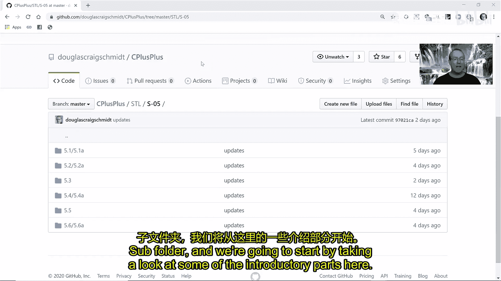
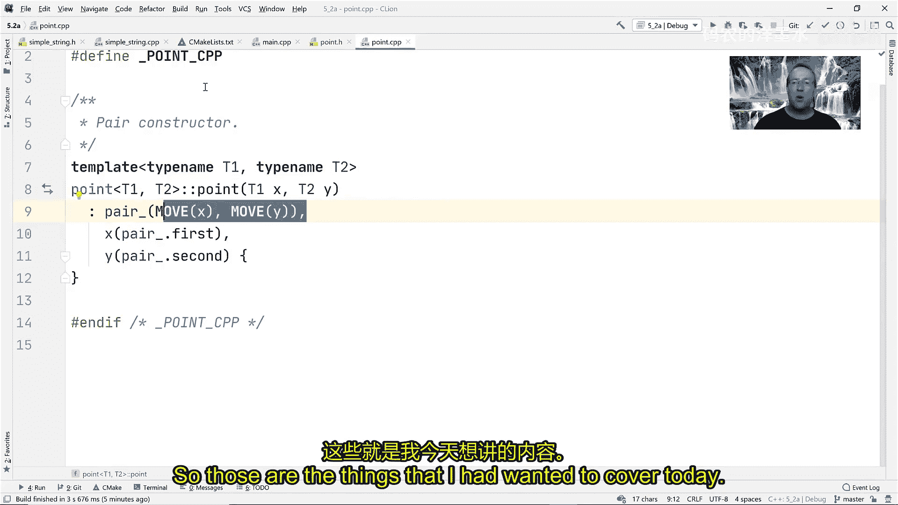

# C++标准模板库教程：11：有序关联容器 🗂️




在本节课中，我们将学习C++标准模板库中的有序关联容器，包括`map`和`set`。我们将从介绍基本概念开始，然后通过具体的代码示例来探索如何使用这些容器。课程将涵盖容器的特性、实现原理以及如何高效地使用它们。

## 有序关联容器概述 🌲

有序关联容器支持基于键的高效插入、删除和查找操作。这些容器与顺序容器不同，它们不允许在特定位置插入元素，而是根据与键关联的值来决定元素的存储位置。

元素添加到容器后，其键不能更改，因为这会破坏容器的内部排序。当然，你可以删除元素及其关联的键。

我们将重点介绍四种有序关联容器，它们主要分为两类：集合（Set）和映射（Map）。

## 集合与映射的分类 📊

以下是两类容器的细分：

*   **集合（Sets）**：仅存储键。要求为键定义某种排序关系（通常基于“小于”操作）。对于简单类型（如数字），可以直接使用内置的比较操作；对于字符串，可以按字典序排序；对于用户自定义类型，则需要定义相应的“小于”操作。
    *   `set`：键唯一。
    *   `multiset`：允许重复的键。
*   **映射（Maps）**：存储键值对。这是一种“对”关联容器，STL中有一个专门的`pair`类用于处理这种结构。
    *   `map`：键唯一。
    *   `multimap`：允许重复的键。

一旦通过迭代器分配，这些容器的键就不能被更改（但可以删除），因为更改会破坏底层数据结构的排序。

## 底层实现与自定义容器 ⚙️

在底层，这些有序关联容器通常使用**红黑树**（一种平衡二叉搜索树）实现。这种结构因其布局方式可以进行特定的优化。

你也可以构建自己的关联容器，例如使用2-3树或AVL树等其他数据结构。如果你按照C++标准库的API来构建，那么你的容器就可以与STL的迭代器、算法和各种函数无缝协作。

关联容器用途广泛，可以用于各种键到值的映射场景。接下来，我们将通过实际代码来深入了解。

## 实战：使用`pair`模板类 🔧

上一节我们介绍了有序关联容器的基本概念，本节中我们来看看一个核心组件：`pair`模板类。关联容器通常使用`pair`来将键（第一个元素）与其关联的值（第二个元素）绑定在一起。

以下示例将演示C++ STL中`pair`模板的几种用法。我们将通过一个自定义的`Point`类来展示其灵活性。

首先，我们定义一个`Point`类，它内部使用`std::pair`实现。这让我们能够以`x`和`y`的形式访问坐标，而不是`first`和`second`。

```cpp
template <typename T1, typename T2>
class Point {
private:
    std::pair<T1, T2> pair_;
public:
    T1& x;
    T2& y;

    // 构造函数
    Point(T1 X, T2 Y) : pair_(std::move(X), std::move(Y)), x(pair_.first), y(pair_.second) {}
};
```

注意构造函数中使用了`std::move`。这是C++11引入的**移动语义**，用于优化性能，避免不必要的拷贝。我们稍后会详细解释。

为了清晰地展示拷贝和移动的区别，我们还使用了一个`SimpleString`类，它遵循“五法则”（Rule of Five），即定义了拷贝构造函数、移动构造函数、拷贝赋值运算符、移动赋值运算符和析构函数。

现在，让我们看看主程序如何使用这些类：

```cpp
int main() {
    // 示例1：使用整数类型
    Point<int, int> myPoint(100, 200);
    std::cout << "myPoint.x: " << myPoint.x << ", myPoint.y: " << myPoint.y << std::endl;

    // 示例2：使用字符串类型
    Point<std::string, std::string> bookChapter1("Chapter1", "Meet the C++ STL");
    std::cout << "bookChapter1.x: " << bookChapter1.x << ", bookChapter1.y: " << bookChapter1.y << std::endl;

    // 示例3：混合不同类型
    Point<std::string, void*> myNum("MyNum", reinterpret_cast<void*>(12345));
    std::cout << "myNum.x: " << myNum.x << ", myNum.y: " << myNum.y << std::endl;

    // 示例4：使用SimpleString，重点观察移动语义
    Point<SimpleString, SimpleString> complexPoint(SimpleString("Chapter2"), SimpleString("Meet the C++ STL Associative Containers"));
    // ... 输出等操作
    return 0;
}
```

## 理解移动语义 🚀

上一节我们看到了`std::move`的使用，现在我们来深入理解它如何提升性能。

如果不使用移动语义（即`std::move`），当向`Point`构造函数传递`SimpleString`对象时，会触发**拷贝构造函数**。这意味着需要动态分配新内存并复制字符串内容，操作开销较大。

```cpp
// SimpleString 的拷贝构造函数（开销大）
SimpleString(const SimpleString& other) {
    str_ = new char[std::strlen(other.str_) + 1];
    std::strcpy(str_, other.str_);
}
```

而启用移动语义后，调用的是**移动构造函数**。它不会复制数据，而是“窃取”源对象的资源（如指针），并将源对象置于有效但可析构的状态（如将其指针设为`nullptr`）。这非常高效。

```cpp
// SimpleString 的移动构造函数（高效）
SimpleString(SimpleString&& other) noexcept : str_(other.str_) {
    other.str_ = nullptr; // “转移”所有权，源对象不再拥有资源
}
```

在输出中，你可以观察到启用移动语义后，`SimpleString`的析构函数对于被移动的对象会输出“null pointer”，表示没有实际执行删除操作，因为资源已被转移。

这种优化对于STL容器至关重要，因为STL严重依赖值语义。移动语义的引入显著提升了传递和返回大型对象时的性能。

## 总结 📝

本节课中我们一起学习了：
1.  **有序关联容器**（`set`, `multiset`, `map`, `multimap`）的特点和分类，它们基于键进行排序和高效检索。
2.  这些容器的底层通常使用**红黑树**实现。
3.  `std::pair`模板类是构建关联容器（尤其是`map`）的基础，用于存储键值对。
4.  **移动语义**（`std::move`）是C++11的关键特性，它通过转移资源所有权而非复制，极大地提升了STL操作的性能，特别是在处理包含动态资源的对象时。



理解这些概念是有效使用C++标准库中强大容器工具的基础。建议你仔细研究示例代码，并尝试修改它以加深理解。在后续课程中，我们还将探讨移动赋值运算符等其他相关主题。