# 【全集】范德堡大学 C++标准模板库 中英字幕 1080P p12 Lecture 12 - 集合和多重集合 -BV1KWiCBWE7M_p12-

Hello and welcome to the next session in my C++ STL by example webinar series。😡，Today。

 we're going to be focusing on one of the key unordered associative containers， the set。😡。

And it's sibling， the multiet。As you may recall， a set simply allows unique keys。

 whereas a multi set allows duplicate keys。😡，So without any further ado。

 let's go ahead and take a look at the source code we'll be covering and then we'll jump right into it。

😡，I'll start by sharing my screen。And you can see here if you go to my GitHub repository in the C++ STL S05 folder。

 you'll find the code recovering here in the 5。3 portion as well as in the 5。4 portion。

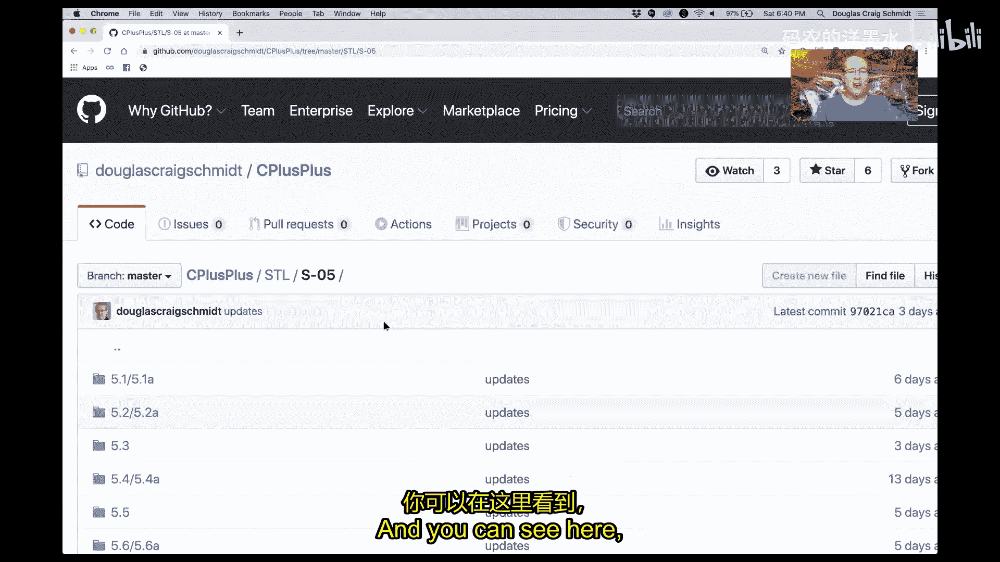

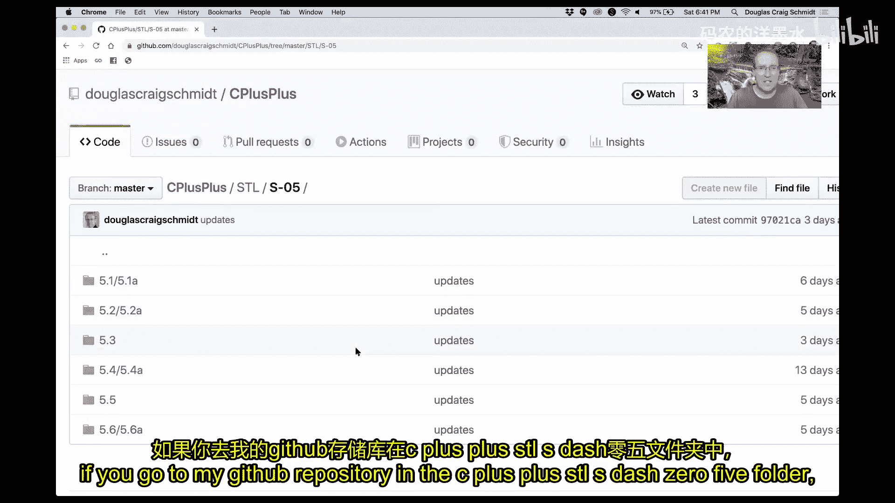

So let's go ahead now and take a look at the actual code to start things out with。

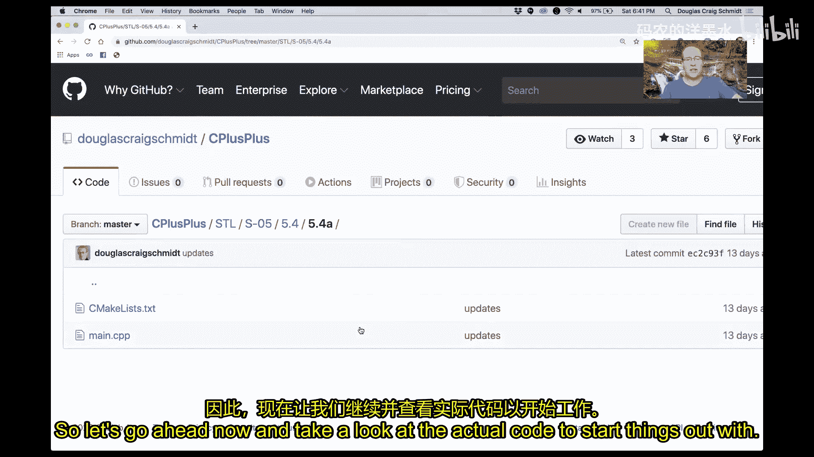

So again we've talked about this before， but just a quick recap。

 a set is a collection of ordered data that's stored in a balanced binary tree they use a red black tree under the hood。

 not that it really matters， but it's a balanced binary tree。

 and that means operations like insert and find and remove， all take at most。

 log in time where n is the number of elements in the tree。😡，You can see the actual template here。😡。

For the set we have the type name for the key， so it's a parameterized type we have a type name for a compare functer which defaults to the less functer where it's less parameterized by key you can change that as we'll see when we look at the examples and of course it's also going to be parameterized by the allocator。

 which defaults to the standard allocator that's where the memory comes from。

The key characteristics of the set are that it orders the elements that are added to it。

 they're ordered by the comparison operation in this case by default less。😡，And as we said before。

 a set can only contain one copy of any element， in other words， the key that's added to it。

The elements are generated by set iterators in sequence。

 so if you walk through the iterator you'll get them in whatever order you've defined with the compare operation be it as sendingending order using less or descending order using greater。

😡。

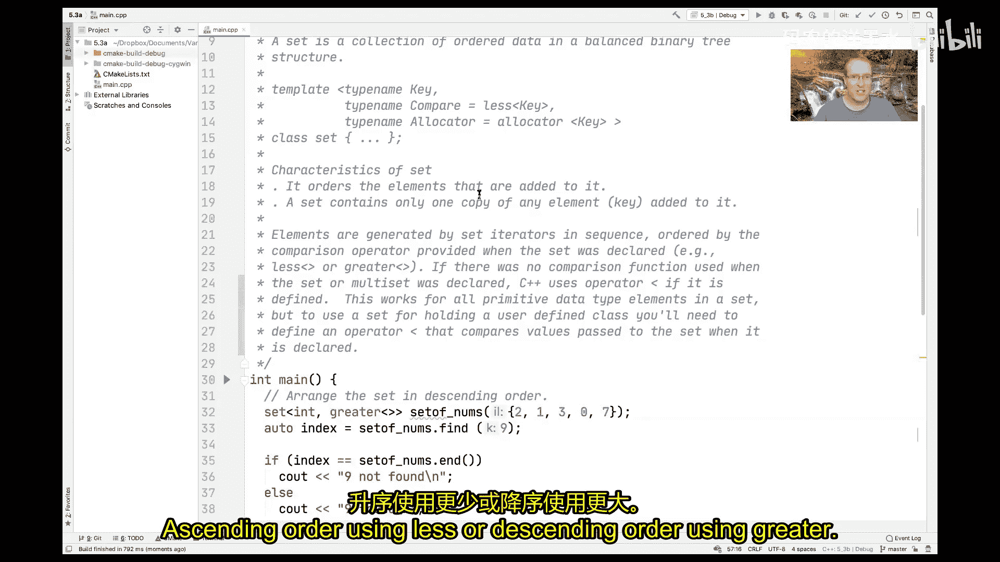

And you'll see that the way it works under the hood is it uses whatever operator less than is defined on the type that's parameterized。

 if you type it， if you parameterize it with a built-in type like int or double or long and so on。

 then it just uses the obvious operation less than that's built in， if you use a user defined type。

 then it assumes that there's a less than operator defined and so you'll need to define that if you have a user defined type that doesn't have that already。

😡，And we'll talk more about that as we get further along to this。

So let's go ahead and take a look at an example here。

 we're going to start out by defining a set of numbers which will be integers and I've just given some numbers 21307 in any order it doesn't matter and I gave it the greater funter and that means it's going to be used to sort it in descending order。

😡，And of course， it'll be stored in the set in descending order。

The next thing we do is we go ahead and we use the find method that's defined on the set to find the value nine。

😡，And of course， we don't see nine in the set， so that's going to return the end iterator indicating that we didn't get a match。

 so when this prints out you'll see it says nine not found。😡。

The next thing we do is we go ahead and we insert nine so now that we tried to find it。

 didn't find it， let's go ahead and put it in there and now when we go ahead and say how many elements are in the set。

 we should have six elements in the set because we have five to start with and we just added a new one。

😡。

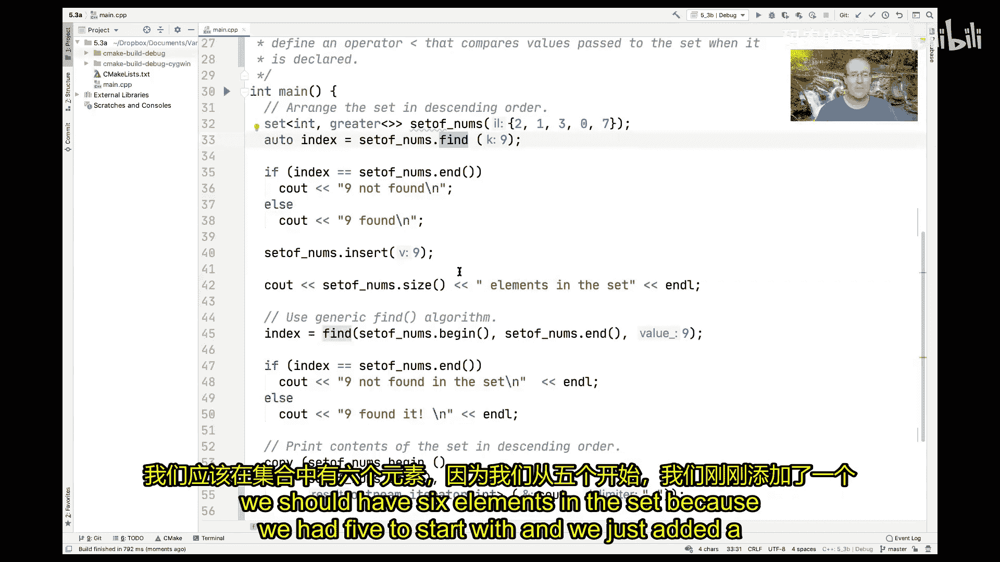

Then just for kicks， we're going to go ahead and use the C++ generic find algorithm。😡。

And generic find is。Defined over here， this is part of the algorithms header and you can see it's very。

 very simple， it just does a linear search from beginning to end looking to see if there's a match and if there is it returns that match。

 that matching iterator， otherwise it returns the end iterator。

Obviously this is a linear search so you probably don't want to do that most of the time you actually want to use the find method that's built into set which does it in login time and in fact you can see the IDE is trying to encourage us to switch over to use the find method that's defined on the set it actually does that transformation for us I just wanted to show it this way for kicks but notice how the compiler is trying to nudge you to do the right thing。

😡，Then we go ahead and see whether we found it or not of course this time we should find it because it's there and then the last thing we're going to do is we're going to go ahead and print the contents of the set out and since it's ordered in descending order when we iterate from beginning to end it'll print them out in beginning to end order so let's go ahead and run the code and see what the output looks like。

😡，And lo and behold as I said， it didn't find nine the first time there are six elements in the set。

 the next time we looked it up we found it and then we go ahead and print the contents and it's in fact in descending order so that's a very simple example of set we'll look at some other examples that are a little bit more interesting perhaps depends on your point of view。

😡，And so speaking of which， let's go ahead and open up the next version next。Sample。

This implementation is going to illustrate how the set insert method works and it has some interesting semantics to it so here we're going to define ourselves as another set of int except this time it's going to be ordered in ascending order because implicitly we use the less operation so I should probably say you know implicitly。

😡，Implicitly use less。And to order this so it'll be ordered in a sendingending order not descendending order for use greater it'll be descending order we then go ahead from i equals one to i less or equal to5 and we go ahead and multiply I by 10 and we put each element into the set so we'll end up with 10 2030 4050 we could have done this without a loop of course but just for kicks I use the loop。

😡，The next thing that we do is we go ahead and we try to reinsert 20 and remember a set can only have one element。

 it can only have one key and so if we try to insert it again。

 then we're going to get back something that indicates it didn't work and what comes back here is actually a pair although as you can see in this case i'm using an auto but in fact under the hood it's actually using a pair and it's going to be a pair of a。

😡，An iterator for the set and a bo so what does that mean well what you'll see is that the second value that comes back is going to indicate whether or not we inserted it or not whether it was successful。

 so if it's successful in inserting the second value that comes back from insert will be true because it says it inserted but in this case it didn't insert because it was already there so in that case it's actually false so if it's false which it should be we come over here and now we take the。

😡，First。Field in that pair， which is going to be the element that we were trying to insert it's pointing to 20 and again just for kicks we use auto here。

 we could have written this out in a more verse way we could have said set。😡，And。Ittter a Arabbs。

 itererate tour if I could spell and if I could put the syntax in correctly and so on。

But that's probably not the best thing to do because that's kind of rebose so let's just go ahead and keep it with good old auto and just say auto is so that you know what it is into the hood so at this point we now are pointing to the element 20。

😡，What we're going to do now is we're going to go ahead and insert 25 and 24 and we're going to use the iterator as a hint or a heuristic and it turns out if the iterator is positioned in just such a way where you can insert or the insert algorithm can quickly determine where the element goes so without how to from the top of the tree。

 then it'll be optimized as it would be in this case for 24 and 25。😡，When we do to 26， however。

 let's say for sake of argument that the underlying implementation would not be able to determine very quickly that that was in fact the right place to put the item。

 so in that case it would go ahead and start at the top of the tree and then find the location in the tree where it has to go so getting an insert call with an iterator is a way to give it a hint that may lead to optimization and may not but in any case it won't change the asymptotic time complexity it'll still be lo in。

😡，Then for kicks let's go ahead and show how you can use insert to add a range of elements in one fell swoop so here we're going to add the range 5。

 10 and 15 I guess range isn't quite the right word but we're going to put three elements into the set in one fellel swoop or we're going to try to put three elements into the set in one fell swoop in this case of course10 is already in the set so we'll only end up inserting five and 15 and that 10 will simply fail silently and then the last thing we do is we go ahead and print the contents out so let's go ahead and run the code see what we get。

😡，So as you can see what we ended up with we started out with 10 2030 4050。

 then we added 24 and 25 and 26 so you can see that those are in there and then we added five and 15 so the final result was。

5ive， 10， 15， 20， 24， 25， 26， 30， 40 50， which is in fact correct。

 what we given what we have done here。So that's illustrating some other interesting aspects of set in particular。

 looking at ways you can do insert and see what happens when you try to insert duplicates。

 see what happens when you can get hints to do inserts and seeing what happens when you want to insert a group of elements in an initializer list in one fell swoop。

 and there's other ways to do that as well you could use iterators and other types of techniques to insert groups of elements in one fell swoop。

😡，Okay， let's go ahead now and turn our attention to the next example。

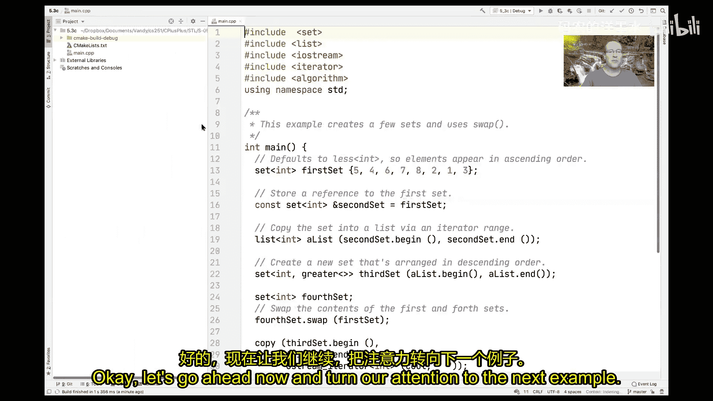

And this example is going to create a bunch of sets and then use the swap algorithm we talked about swap in a previous video when we were talking about exception safety and you may recall I talked about the fact that swap is very useful when you're trying to write。

😡，Strongly exception safe assignment operators， for example。

 it has other purposes as well and we're going to demonstrate a simple example here。

So we start out by making ourselves a first set， which just has a bunch of values。

 they appear in no particular order， but of course the set will store them in ascending order using the balanced red black tree under the hood。

We then go ahead and assign first set to a constant reference to a set。

 so this will not make a deep copy， this just basically means we now have another reference pointing to first set。

😡，In a sort of a jada Esque like way。Then what we do is we take the second set。

 which is actually just referring to the first set， its contents。

 and we copy the elements from second set into a C+ plus STL list。

 which we give the very unimaginative name a list。So you can see here we now have a list that has the same contents as。

Both the first and the second set for that matter。Then they go ahead and we make a third set。

 except this third set is going to be arranged in descending order because we use the greater。😡。

Funter here instead of using the less functer and once again you'll notice how we start with the beginning of a list and go to the end of a list so this is illustrating how you can use iterator ranges to copy arbitrary containers to other arbitrary containers and you don't actually have constructors there's no constructor for list that takes a set there's no constructor for set that takes a list instead it simply takes the iterator ranges as we're seeing here which works out very nicely。

😡，And the last thing we do is we go ahead and we make ourselves a fourth set and then we swap the contents or really the references in the internal data members of the contents between the first set and the fourth set。

 so that doesn't actually do any data copy and it just swaps the internal data members around。😡。

So what we do now is we're going to go ahead and print out the third set and print out the fourth set and let's see what we end up with when we run this code。

 and as you can see basically what we end up with is the sets contents for the third set sorted in descending order。

😡，And that's because we gave it the list。coopies up here。

 which we're in and then the one that's the fourth set which is swap with the first one that was an ascending order so you can see that the third set was used with the greater funter so it's in descending order and you can see the fourth set got the first sets contents and those were sorted in ascending order so that's what happens when we get the results out so this is illustrating a whole bunch of other very interesting set features that I think are worth understanding。

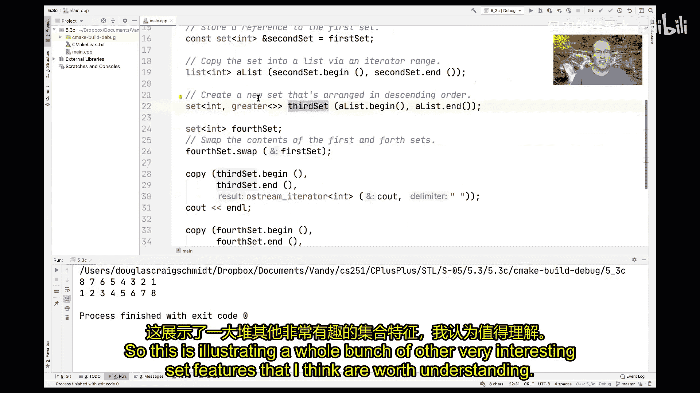

All right， let's go ahead and take a look at yet another one that was D。

 let's go ahead and take a look at E。

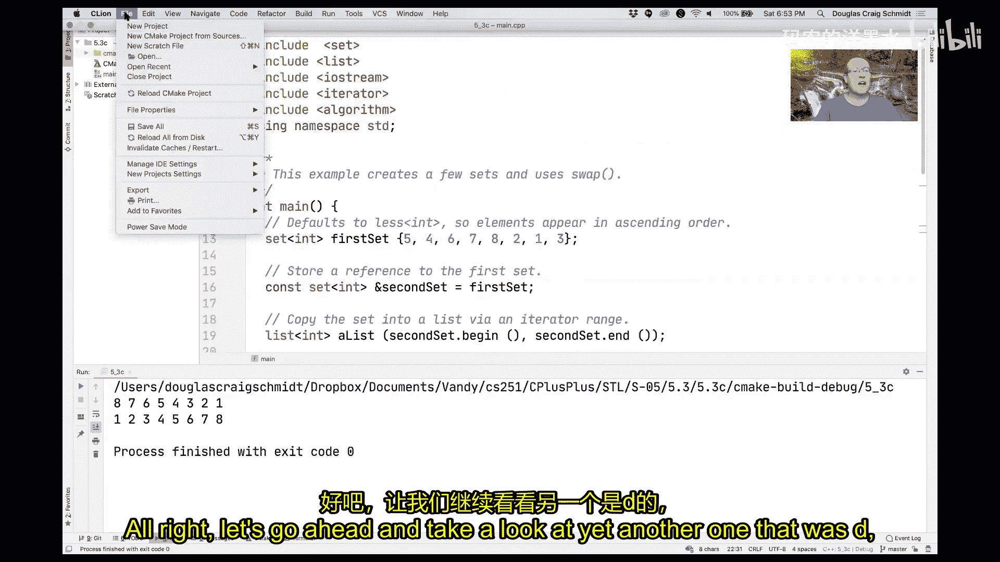

And this is illustrating a couple of interesting things about sets and multis for that matter。

 the iterators that are returned from beginning and end on a set are special。

 they're different from the ones we've seen so far for the other containers like vector or deck and list where you could actually change the contents of the underlying container as you were iterating through it。

 basically they were non-con iterators for those sequential data types， sequential containers。😡。

For cases of the ordered dissociative containers such as set multiset map and multimap。

 in that case the iterators are cont， which makes a lot of sense because you don't want to be able to change the elements as you're iterating through them because then the organization of the red black balanced binary tree would be chaotically modified and corrupted and that would cause chaos and insanity。

 as you can imagine。😡，There's also reverse iterators that you can use just like normal that give you the ability to go backwards through the set contents。

If you want to get rid of elements in a set， there's various ways to do this。

 you can erase a particular element， you can also erase things using an iterator and finally you can erase a range and we're going to talk about all these aspects in this example。

😡，So the first thing we do here is we make ourselves a first set， which as you can see。

 is just going to be。😡，A bunch of values and I guess to be more modern C+ plusy。

 I should get rid of these extraneous hos because we don't need them anymore。

So we're going to go ahead and make a set that of course will be ordered in as standing order and then we go ahead and print that out。

 then we're going to go ahead and erase the elements the element for and you can see there was a four here so we're going to get rid of four。

😡，Then we're going to go ahead and look up the element five and we're going to get an iterator back to it so this is actually an iterator to a set element because we're going to find it and then we can use that iterator which again we gave the somewhat unimaginative name five so we're going to erase it by its iterator so you can see you can erase it by the value you can also erase an element by an iterator that references it。

😡，And then we're going to go ahead and print the contents of the set。

And then the last thing we're going to do here is we're going to go ahead and find ourselves the element six and find ourselves the element8 and remember that the set is ordered in a sending order。

 so then what we're going to do is we're going to say hey。

 please go ahead and erase from six up to but not including eight。

 so that's going to go ahead and get rid of six and seven， but not eight。😡。

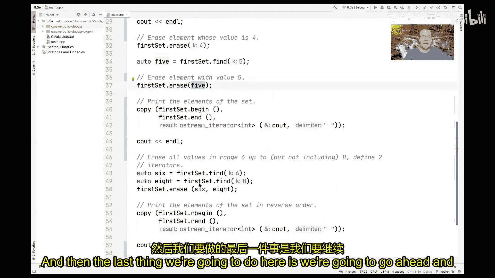

And then we're going to print the results in reverse order。

 so here we print the results in forward order， we print the results first in forward order。

 print the results in forward order， and then last we print the results in reverse order。

So let's going to run this thing and see what we get so as you can see。

 the original set contained the values basically one， two， three， four， five， six，7 eight。

And we print those out then we went ahead and removed four and five and printed that in a sending order。

 so four and five have disappeared of course and then the last thing we do is we get rid of the range six to seven and then we do a print from the end of the beginning using R begin in our end and I guess just for kicks I probably could have done something like this that have made this。

Reverse， if I could spell。啊， come on。All right， let's try it again here we go reverse copy so if I make this a reverse copy。

 then we're going to also print it backwards except we don't have to use R begin and R end we can use begin and end so let's go ahead and print that out just for kicks and see what results we get and lo and behold we get those backwards because we did a reverse copy whereas down here we did a copy but we started at the end with R begin and then going to R end so this is showing you a whole bunch of different ways to manipulate sets and combine them with various kinds of iterators and I should again hasten to point out that you can't make any changes to something when you have an iterator to it so down here for example I couldn't have said you know five。

5 equal。100 or something like that and the reason why is because you can't assign to it because it's a conerator so let's just put a comment here saying can't assign to Con iterator。

Okay。So those were the examples I wanted to show you that involve the。😡，The set。

 so remember sets have unique keys， unique elements in them。😡。

What we're going to do now is we're going to turn our attention to。😡。

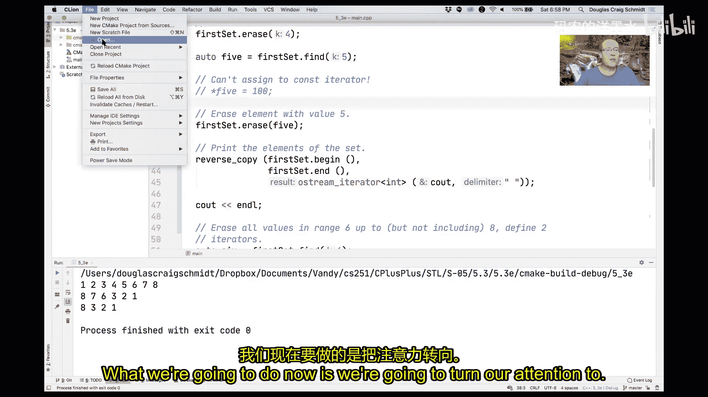

Multi sets。And as the name implies， and as I've mentioned many times before。

 a multi set is just like your regular set except that you can have multiple keys。

With the same value。And we'll see some really cool examples of how to use that in a second so youd have duplicate keys other than that。

 the signatures the same so you take a type name key。

 you can have a compare functer which defaults to less just like set。

 and you can also override the allocator if you want to。😡，So again， the characteristics of multiet。

 you can have objects of any types of keys and they're sorted。

 you can have the keys or the only value that you've got， there's no value。

 there's the key and you can have multiple copies of the same key。😡。

Now things that multis are really good for and sets are good too， but in a somewhat different way。

 you can use multis with the STL set algorithms and these include things like set union。

 set intersection， set difference， set symmetric difference and so on and one of the things that makes sets and multis work so well with the set algorithms is that the set algorithms expect the values that they're manipulating。

😡，To be sorted otherwise they don't work And so sets sort things so they work very well with that。

 Of course you could also use a vector and just sort it， but we're going to use sets here。

 We'll talk about using vectors with the set operations much later in the course。😡。

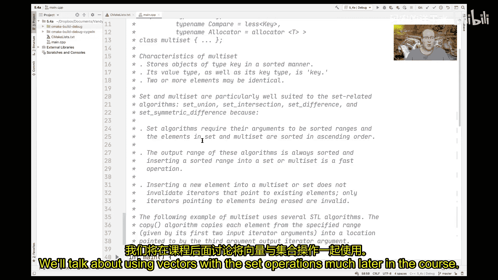

Okay， so remember some other interesting things， so when you have iterators to sets if you end up。😡。

Removing or adding new elements into a set， then iterators to existing elements are not invalidated unless you happen to remove the item that you're trying to iterate over at the moment。

 but if you don't try to remove the item you're iterating over the iterators actually kind of point into the nodes in the tree so as as long as those nodes don't go away they can be rearranged but the iterators to them will continue to work and that's a little different for things like the。

😡，The vector and the deck where they could be rearranged。

 I think vector is the biggest problematic one with respect to iterators potentially being invalidated when insertions occur because under the hood。

 there could be a reallocation of the memory and the vector and that would cause problems。

So let's go ahead and take a look here， you can see that we're going to use these set。

 the set container in conjunction with set algorithms。😡，Union intersection and set difference。

 and we're also going to demonstrate of course our typical trick of using copy to print the results out。

So let's go ahead and see what we've got so first of all here's our first set set A and I just gave it a bunch of values their integers and then set B has a bunch of other values that are also integers these are not sorted as you can see but they will be sorted by the constructor of set because it's going to put them into the red black tree in the right order and then we've got another set here actually a multiet these are all multis sets that we're going to use to store some results in when we do symmetric difference calculations。

😡，So let's start out we'll go ahead and print the copy of set a it'll print it out in of course in sorted order。

 then we're going to print the contents of set B， which will also be printed in sorted order and then let's go ahead and figure out the union of set。

😡，A and B and so of course what set union is as you may recall probably from your I don't know maybe your middle school or something like that seventh grade or whatever it's going to have the union of two sets will' contain the elements that are in set A in set B or in both sets A and B so it's the union of these things and we're going to compute the union of set A by passing in the beginning and and of set A we're going to go ahead and do the same thing for set B and then we're going to put the results to the standard out using our O stream adapter are O stream iterator so we'll see what the results are in a second。

Next thing we're going to do is we're going to go ahead and compute set intersection of sets A and B。

 and of course， as you may recall again， from your set theory class at some point。

 that's going to be the elements that are in both A and B。

 so it'll be the intersection of the two sets。😡，And then the final thing we're going to do。

Is do a set difference between A and B and that's going to end up creating a set that where the elements it's going to contain the elements in set A that are not in set B。

 so it's like sort of like a subtraction， I guess its his way to look at it。😡。

And then we print those out and you'll notice for set difference unlike set intersection and set union。

 you'll notice that we do an inserter instead of just writing the results directly to standard output using the O stream iterator and this is just to demonstrate what。

😡，Inserter is if you go ahead and take a look at Iner。

 you can see that Iner is one of these cool iterator adapters that we've talked about。

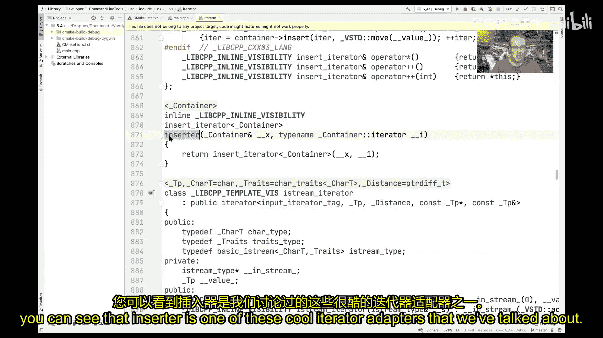

And what you can do with these and we'll talk about more of them later。

 these iterator adapters take a container in this case。

 a set and turn it into an iterator in this case， an output iterator and the way it works is it's going to make an instance of。

😡，Astruct or a class called insert iterator and it's going to pass in the container and the iterator and if we go over here and we peek down it insert iterator we have to really poke around here a bit you'll see that the way that this works under the hood is it goes ahead and will create an object that has various overloaded operations in there and this will stash away the container and the iterator and then there'll be various operations to move things around in particular you can see here the operator assignment which you see at this point and that's going to go ahead when it's called and of course it'll be called as part of the copy algorithm and the magic of the copy algorithm and it's going to go ahead and insert the value into the container using the iterator as a hint for that so it's going to basically put it at the end in other words so that's what's going that's what's going to happen underneath the hood here。

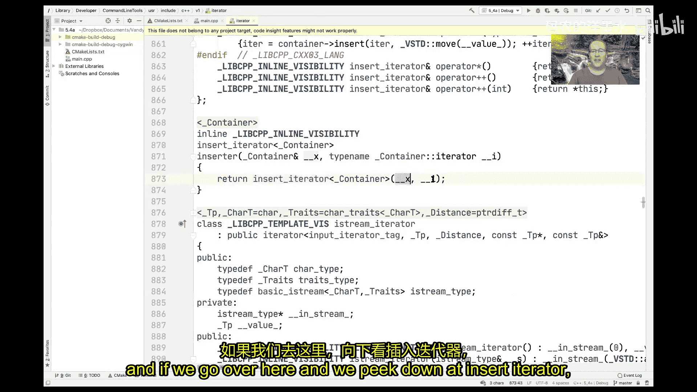

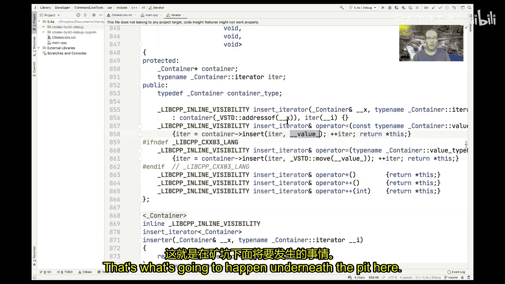

Okay， so let's scoot on back a little bit。

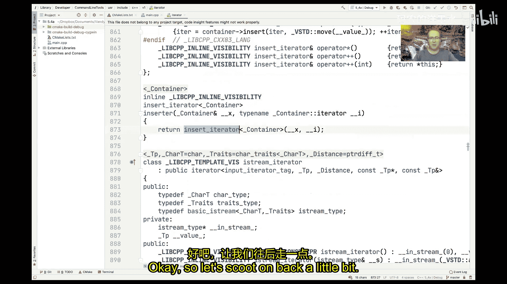

And run the program and let's see what we get as output here。

So you can see that the original sets they're printed out。

 they're sorted and we have all the values we had originally except that now they're ordered in as sending order。

 we then compute set union， so that basically includes everybody who's in everything。😡。

We then do the intersection and the only things that they have in common are zero， one。

 four and five set A does not have two in particular so that doesn't show up in the intersection and then the final computation which is set C is the set difference and you can see that that's going to be the elements that are in set A that are not in set B so you can see here that there are elements in set A that are not in set B and those include these values that are shown there。

😡，For more information about the STL set algorithms， please take a look at the documentation。

 they go into great detail explaining the underlying concepts and we'll also take a look later in the course at the implementations of these set algorithms and they're really quite interesting I think you'll get a kick out of that。

Okay， so those are the things that I had wanted to cover today。

 I wanted to give you a feeling for how you can use。😡。

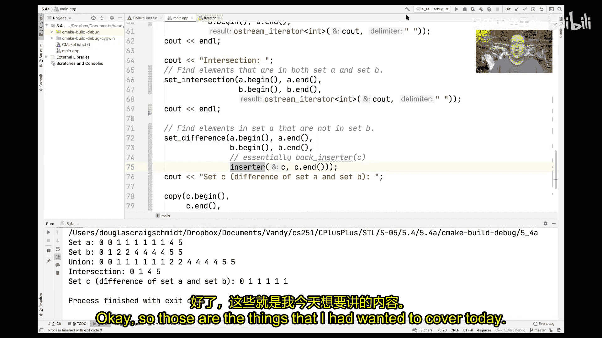

StTL sets， both regular sets that have no duplicates as well as multis that have duplicates which we just used to show how the set algorithms worked and what we'll do tomorrow is we're going to go ahead and do the same sort of a treatment except we're gonna be looking at STL maps so we'll look at map and multimap and you'll see that those are some really cool data structures and the examples we're gonna to look at for map and multimap are really quite interesting and they'll get a chance for us to show off the power of STL how easy it is to write very sophisticated code with almost no work on your part just knowing how to use the various elements that are part of the STL ordered associative containers and we'll also start looking tomorrow at some other more advanced features in C+ these are features such as lambmbda functions which are really interesting if you're familiar with the way that the Java has lambmbda expressions C++ has a similar concept called a lambda。

function and they're basically nameless pieces of code that you can declare sort of on the spot and they're often very useful in C+ plus when you have funcctors and you don't want to go to the trouble of defining a specific class or a separate class to represent the behavior of the functor they're most commonly used for for defining things like operator function call and so on in a funter so we'll take a look at that stuff tomorrow until then thanks everybody for joining please go ahead and like and subscribe and feel free to follow me on Twitter thanks。

