# 【全集】范德堡大学 C++标准模板库 中英字幕 1080P p13 Lecture 13 - 有序和无序关联容器 -BV1KWiCBWE7M_p13-

Hello and welcome to the next session of my webinar on Standard C++ Tt Library by example。

Today we'll be turning our attention to get another type of ordered associative container， the map。

 as well as its sibling， the multimap。We'll talk about how to use the maps and walk through some very interesting examples that demonstrate their structure and their functionality。

😡，So let's go ahead first and take a look at where we can find the code。

 and then we'll jump right into the analysis。😡，Stop by sharing my screen。

You can see here that the code is going to be available in my C++ STL S05 repository at my GitthHub account and we'll be focusing on the examples in 5。

5，5。6 and 5。7。

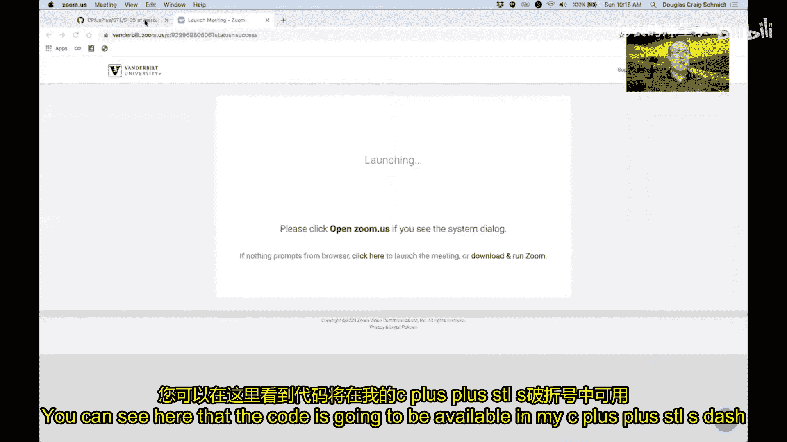

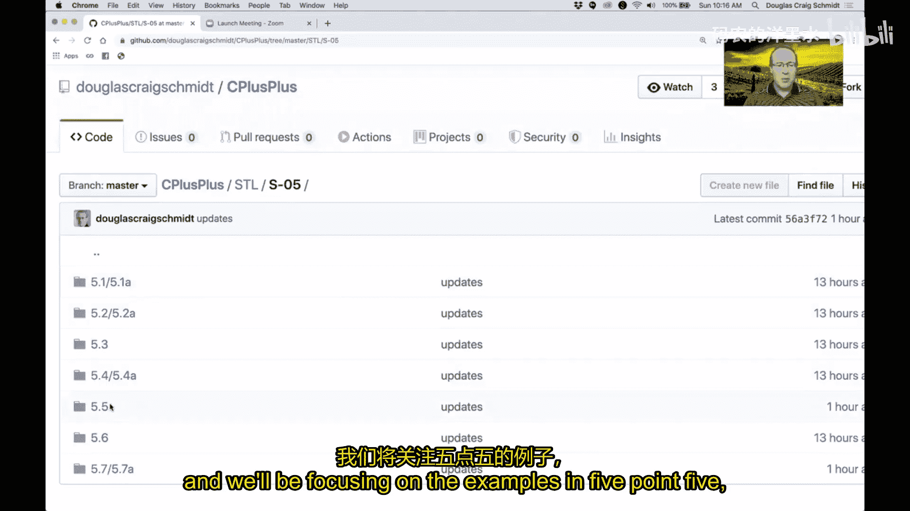

So let's pop over to my sea lion interactive development environment。

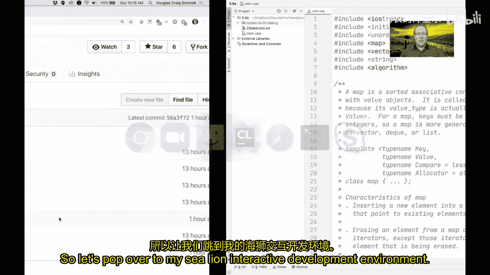

As you may recall， a map is an ordered associative container that associates key objects with value objects。

😡，And it's called a pair Associative container because its value type is actually implemented as a pair of constant key and value types。

😡。

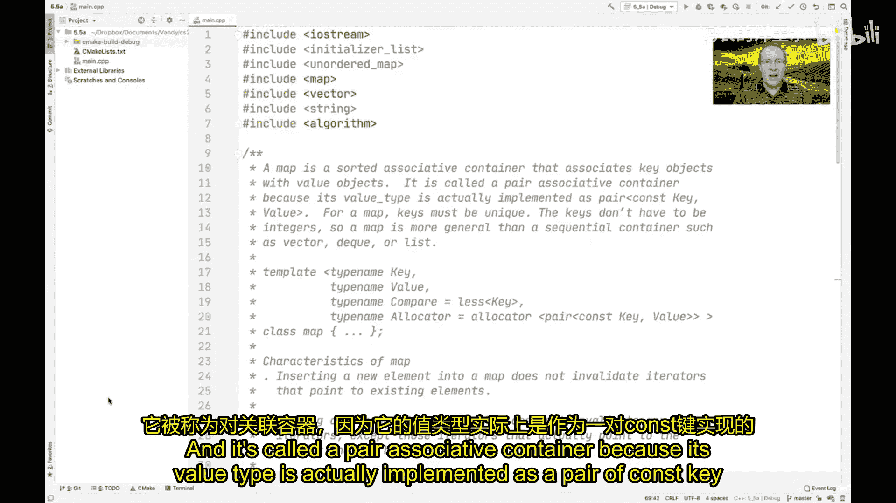

Keep in mind， of course， as with the set that the key is coned。

 we can't change it while we're iterating over it because that would cause chaos and insanity with respect to the ordering。

 which under the hood is implemented using a red black tree。

 which is an ordered binary tree that's balanced。For a map， the key must be unique。

 just like with a set。😡，The keys don't have to be integers。

 so you can basically have it be an associative array or associative data structure where the keys can be any types。

 keys can be strings， keys can be anything that has a way to be able to search using the less than operator。

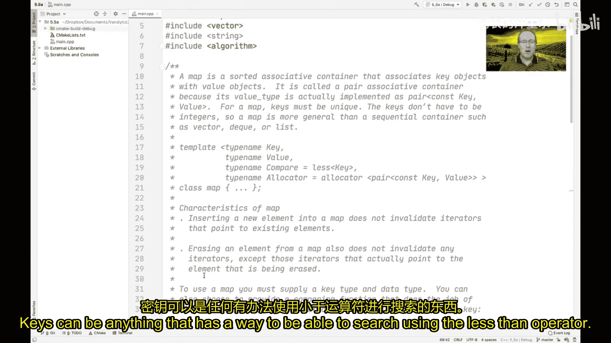

Here are the various parameters that are passed to the map template。

 of course you have to pass the key， like a set， unlike a set though。

 you can pass a value or you must pass a value， which is the type that's associated with the key。😡。

You also have to pass a comparator operation or you could just let it go and use the default。

 which is the less functer and then last but but not least you also can pass an allocator optionally。

 but by default of course it'll use the standard new and delete free store operations from the global heat。

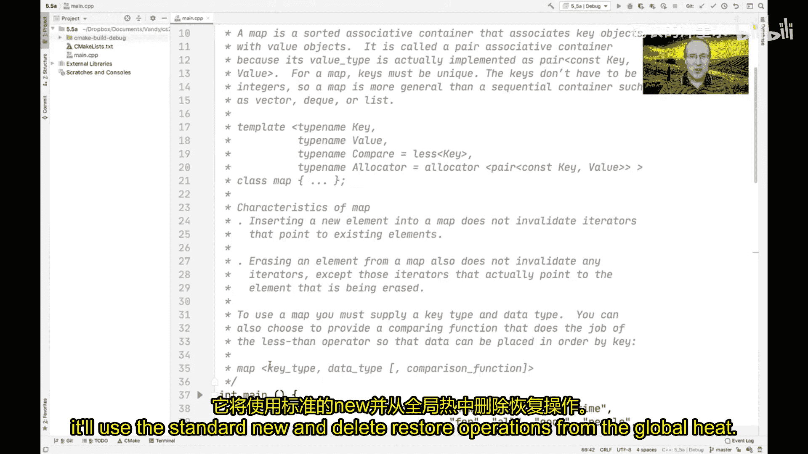

So the key characteristics of a map is if you insert a new element into a map。

 it doesn't invalidate the iterators that are already pointing to existing elements。

 that's because it's implemented as a tree just like set and erasing an element from a map also does not invalidate any iterators except for the ones that you happen to be pointing to that you're erasing。

 of course those will be affected。😡。

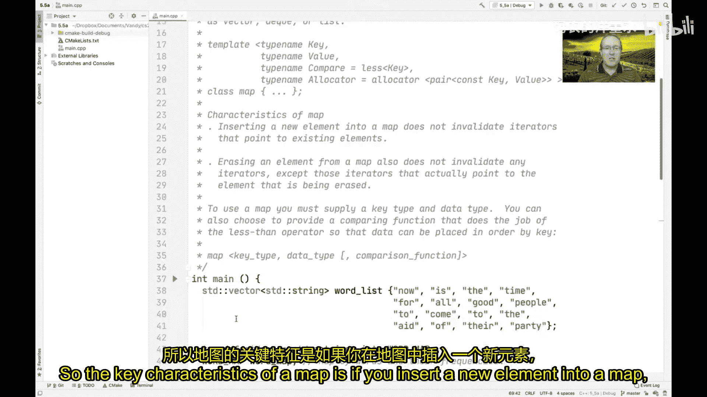

If you want to use a map， you have to supply the key type and the data type as the value。

And you can also choose to provide the comparativear function if you want and the examples that we'll be using here we'll be using the default less operation。

 but of course you can always choose to use your own operation if you want to sort it in a different order。

 much like we did with set where you could pass any greater as opposed to less。

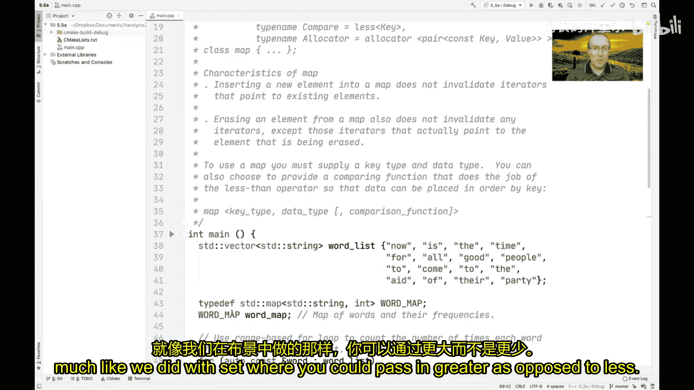

So here's our example and this is a really cool example。

 so if you take a look here you can see that we're going to give it a vector of strings that we're going to manipulate and it's going to be the famous phrase now is the time for all good people to come to the aid of their party。

😡。

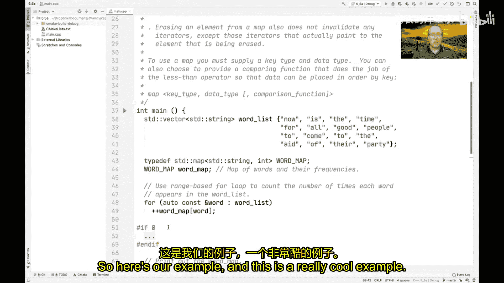

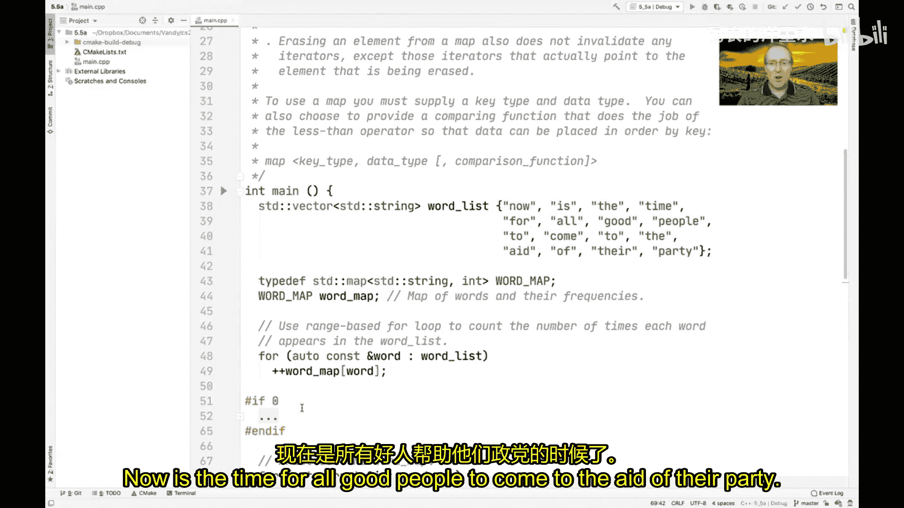

And what we're going to do here is we're going to type de a map to be a string to int mapping。

 so what we're going to do here essentially is we're going to keep track of the number of times each。

😡，Word shows up in our input。Then we go ahead and we make ourselves a word map。

 which is just this string to in mapping。

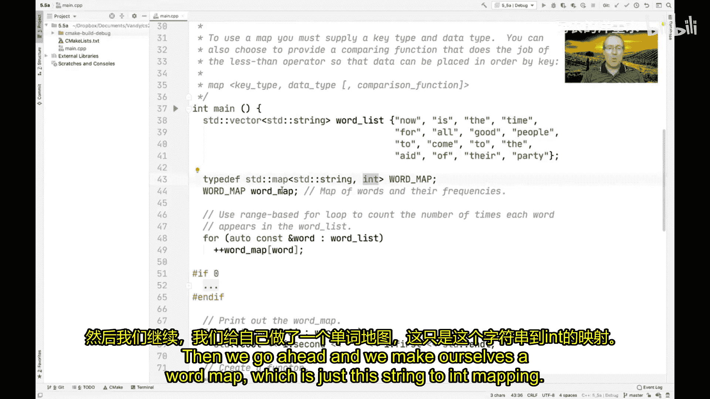

And we then go ahead and we iterate through the word list using a range based for loop I'll show you some other ways to do this in a second。

 but I want to focus on the range based for loop because it's very concise and clean so you can see here that we go through for every word in the word list。

😡，And we treat this as an auto conre， so there's no extra copying going on。

 and then we take each word and we index into the word map。

With the word is the key and then we increment the count which is the value which is the int and due to the magic of C+ plus initializers all the values in the map。

 all the ints will all start out with a value zero which is good so we don't have to initialize in ourselves so look how cool this is we're just going through there indexing into into the map almost as if it's an array it kind of looks like what's called an associative array and we're indexing by string and then we're incrementing the count by one so we're basically keeping track of the number of times each word occurs。

Just for Ks， we could use some other ways to do this。

 we could use this with an explicit iterator using the format shown here， it's a little verbose。

 we could also use an implicit iterator， do much the same kind of thing with the auto keyword。

 but I think for my money I really prefer the rangebased for loop because it's just so much more concise and it lets the compiler deduce the types for you automatically。

😡。

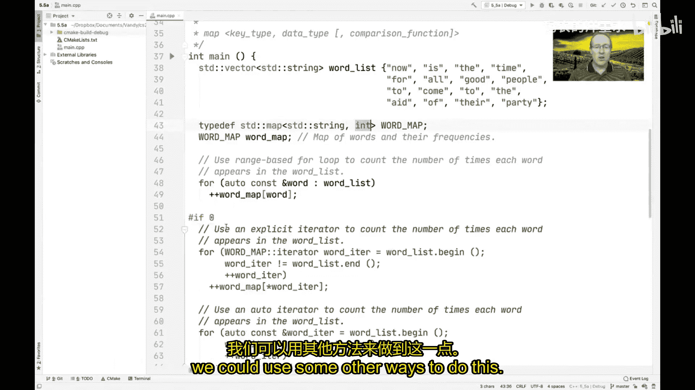

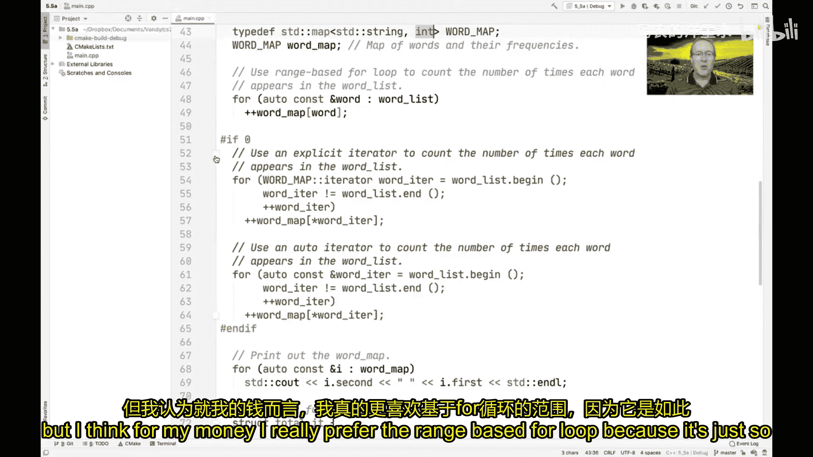

So once we got ourselves the map。What we're going to do is we're going to go ahead and print out the word maps we're going to print out the。

The count， in other words， the number of times each word appeared followed by the word。

 so that's what's going on here again we use the auto conre to avoid making any unnecessary copies and we print things out。

😡，Now we're going to have a little bit more fun with some other C+ plus features。

 we're going to show funcctors first and then we're going to show lambmbda functions second。

 so we're going to create a functer， which is called total it。😡。

And what it's going to do is it's going to keep account。😡，And as you can see here。

 this count will be initialized when we pass this in， we'll give it a zero。

 and then every time the operator function call method is called and we'll see how this gets called just a second。

 it's going to go ahead and increment the internal I_ count by the second parameter and the second parameter here and this pair。

 which is the value type for the map is going to be the count of the number of times each string was was located。

So that's going to go ahead and zip down through there and do all the count。😡。

Here is the actual code we are going to have a running total we call total， which is an auto。

 of course it's an int。😡，And then we're going to use the for each algorithm and the for each algorithm is an interesting SL algorithm。

 we'll look at it in a second， what it does as you can see here is it goes through a range from beginning to end in an iterator range。

 and it's going to go ahead and pass an anonymous copy anonymous instance of total IT given the initial value of zero。

And what for each is going to do is we're going to see is it's going to go ahead and call the operator。

Function call method for each element in this range and let's go ahead and take a look at what for each looks like you can see as as usual it's a very straightforward。

Algorithm most of the STL algorithms are very straightforward。

 but they're so cool because of the use of adapters and and other magic to make them work in all kinds of interesting ways。

 so as you can see here we have the for each。😊，Algorithm it's parameterized by an input iterator and a functer or a function。

😡，And our function object probably a better way to put it and so what we're going to do here is we're going to go ahead and take the first input iterator and then the last input iterator and the functer and we walk through the range from beginning to end and every step along the way we call the functer on the current value we're looking at with our input iterator so under the hood of course what's happening here is we're passing in the total it object by value so it gets copied and then it goes ahead and calls the functer which is the function call operation on that particular total it object and so what you can see it's doing it's just totaling things up。

When we're all done， the for each method returns。The functer that we've been manipulating so we get by value we got a copy back of that and that is used here in a clever way。

 so we go ahead and we get back an objective type total it which we call it。😡。

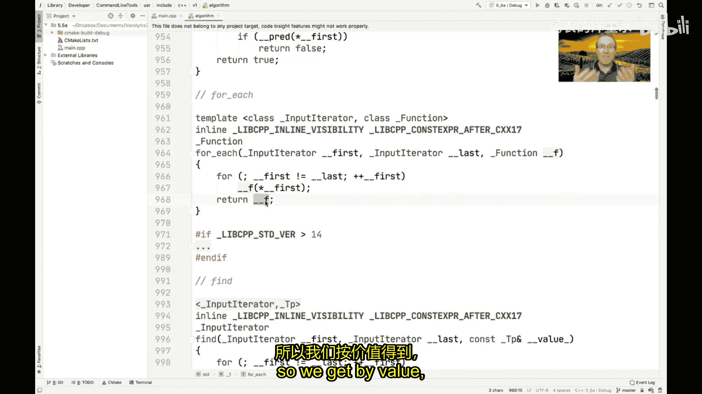

And then we go ahead and we're going to store the value here into this total。Variable。

 so now it's going to be a of the number of times or a count of the number of words that were found in the input。

So that's one way to do things now let's go ahead and take a look at another way to do things so let's face it creating this funter that really just is doing this I mean this is the secret sauce of that func wouldn't it be nice if we could just focus on the logic of the function and leave way all the other syntactic shirt to make it be a structure a class of whatnot。

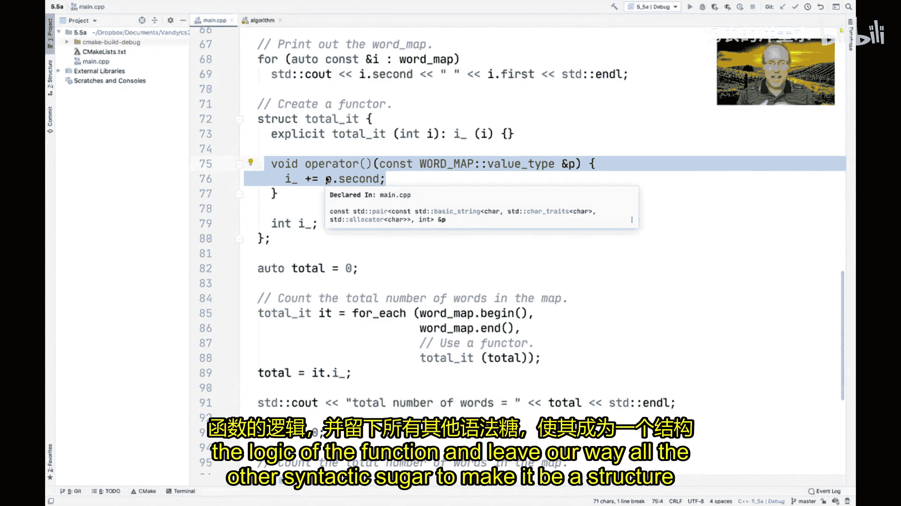

And the answer is yes， you can do that and this is the magic of C+ plus lambmbda functions。

 which are similar to Java lambmbda expressions， although the syntax is ever so different。

So what we're going to do down here is we're going to reimplement this using the for each algorithm with a Lambda function this time and you can see that we go from beginning to end in the word map and each time through we're going to write a little piece of code that's going to get called each time and what it's going to do is it's going to take in the con word mapap value type ref。

😡，Which is going to be this pair remember the value type of a map is a pair because it's a pair associative container and we take this in by reference so there's no extra copies made。

 we grab the second field and then we update the running total and you'll notice that total is passed in here with this interesting little syntax this is called a capture clause and what we're saying here is we're saying pass total by reference so that we can update its value and then when this fun is done this total here will actually have the total the running total that we compute if we get rid of the。

We get rid of this capture clause， then we can't be updating it so it becomes a read only object。

So let's go ahead and run the code here。😡，This is a neat example。

 you can see here that what we get is。

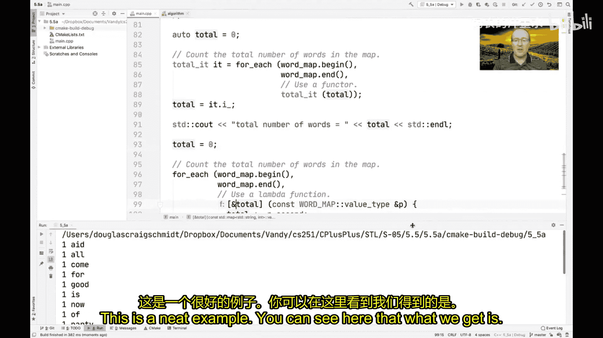

The output which is in this case ordered because it's an ordered tree that's implementing the map and so it keeps track of the number of times each of the words appear most words appear just once。

 but the and two appear twice and you can see that that's printed out here nicely and then we go ahead and total up the total number of words that we had using both the technique using the lambmbda。

😡，Function as well as using the functer and naturally we get the same results。

So I think this is a really really cool example， it demonstrates just how concise C++ STL is and the maps that they use and I just for some reason and in love with this particular piece of code it's just so to the essence of what's going on。

😡。

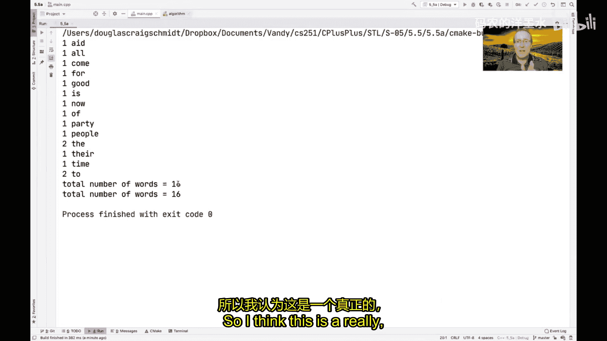

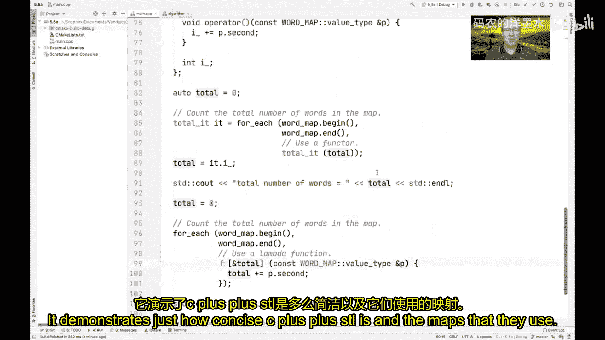

Okay， so that was the first example that I wanted to look at。

 let's go ahead and take a look at another example。😡。

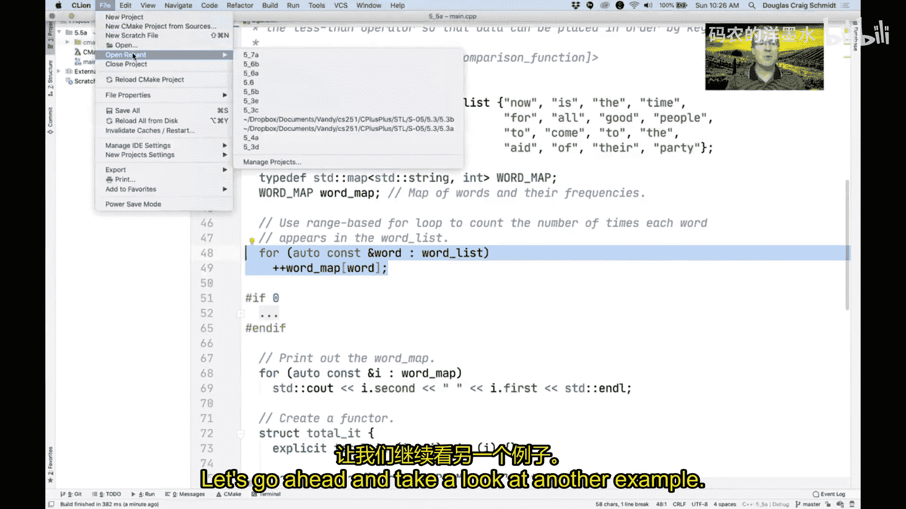

This should be55 b， so let's go open that guy up。

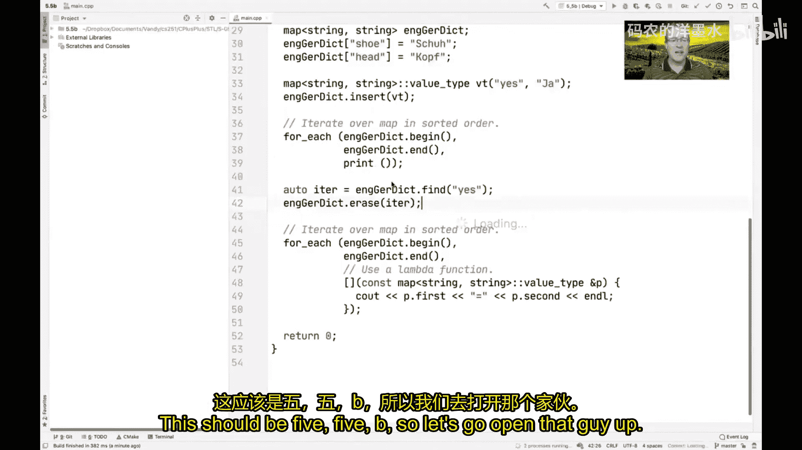

And we'll take a look at it。 So this is going to illustrate a few other features of。

StTL maps keep in mind again STL maps cannot have duplicates we'll talk about multimap shortly that can't have duplicates so here we have a print functer and again we could have used a function a lamb expression I think we actually do at one point but here's just the simple functer version and as you can see it's a struct because it's really stateless it doesn't have any state associated with it we don't want to hide anything kind of hide the fields for example and so as you can see it's going to take a value type of a map which is a string to string mapping in this particular case and it's going to print the first part of the pair for the value type and then the second part as well okay so let's just take a look at a few examples this is real simple we make a pair we call seven heaven and print those results out that's really kind of simple and mindless we then do something else kind of fun we go ahead and we create ourselves a pair that's been allocated dynamically and this is gonna to be。

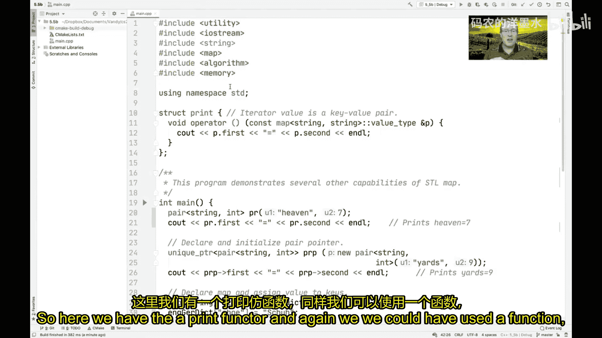

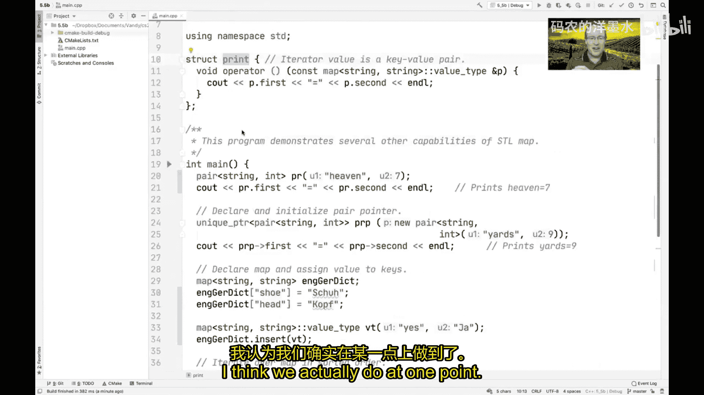

The whole nine yards and this particular pair is going to be allocated dynamically and then we stash it into a unique pointer so that it will be released automatically when the scope of the unique pointer goes away so that's just demonstrating how you can combine these pairs with pointers if you want to。

 but you're always well advised whenever you start using pointers and see+ plus to never use raw pointers or what I like to call naked pointers but instead encapsulate them in the context of the hold the holder class in this case unique point。

All right， so that's just some interesting stuff。 Now， let's go ahead and make a string to string。

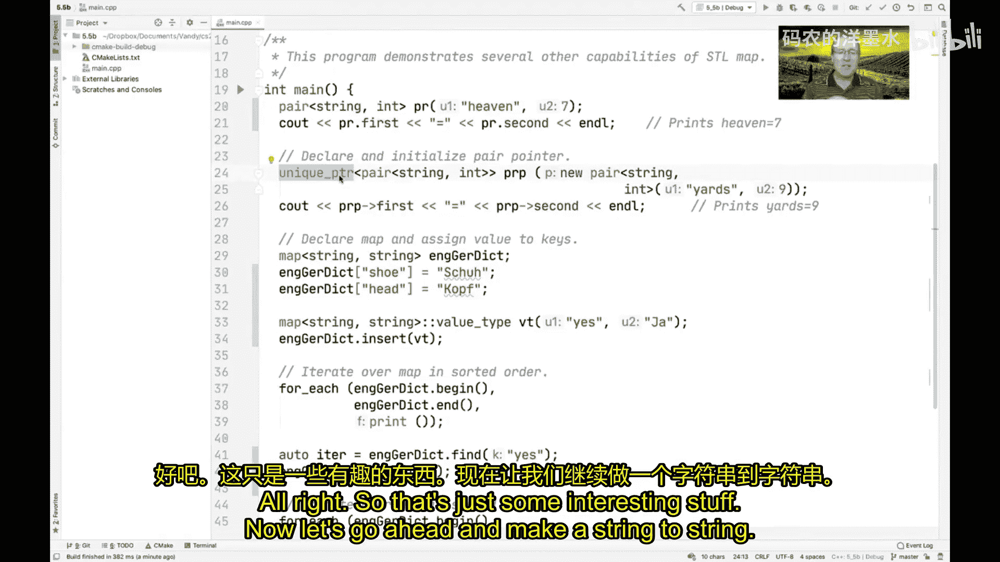

Basically English to German dictionary and I'm only going to put a few words in here just to make it interesting。

 so we're going to basically create the dictionary that starts at empty and then we're going to use the。

Subscript operator to assign the shun value to the shoe key and the cough value to the head key because cough is head in German and shun is shoe I'm probably pronouncing that wrong and then down here just for kicks just to show you yet another way you can do things we make ourselves a value type。

😡。

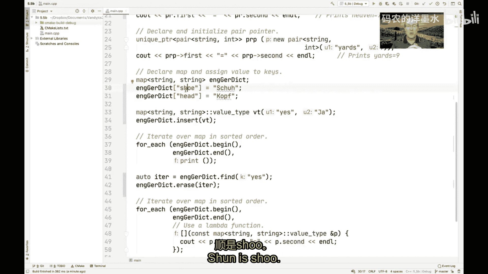

Which is of course a pair and we're going to say that the German word for yes is yah and then we insert this value type into the dictionary so this is a way we can do things where we're inserting with the subscript operator。

😡，Putting the value associated with the key and then over here we're inserting。

A value type which is a pair in one fell swoop and you'll see that for maps you can do it either way for multimaps。

 you have to go with the insert for various reasons。So now that we've got ourselves and initialized。

Map， let's go ahead and print it so we go ahead and print from beginning to end of the map using the print funter。

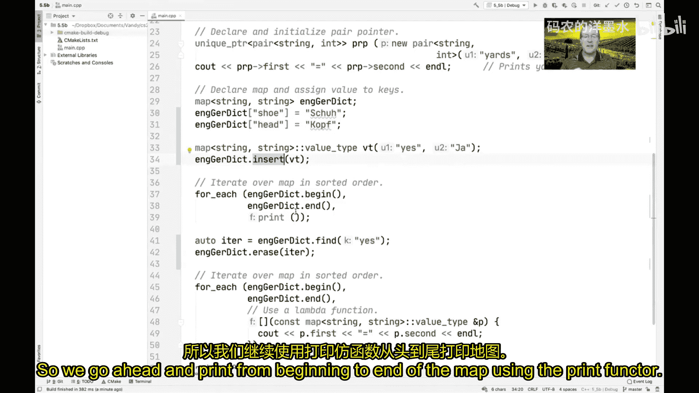

That's one way to do it and we saw the print function was defined up here。

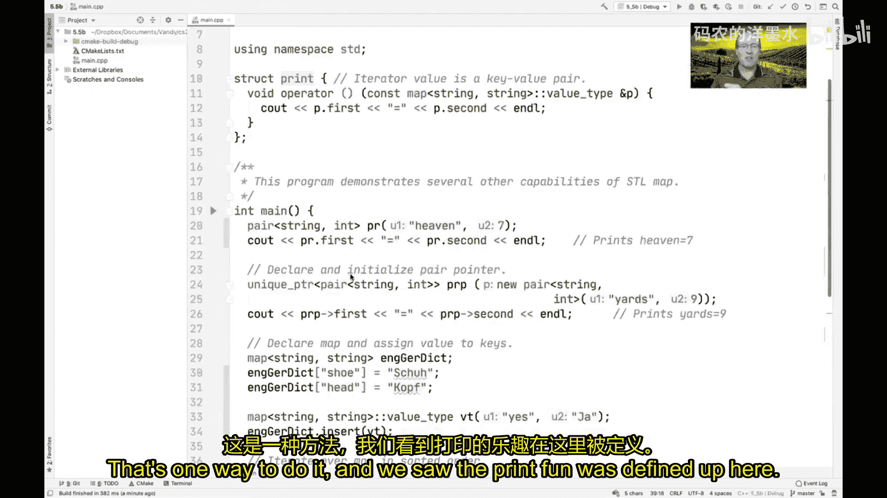

And then the next thing we're going to do is we're going to go find the word yes， which is the key。

 we're going to get back an iterator to that which we treat as an auto just to keep things nice and concise and then we can go ahead and erase that key using the iterator we also could have erasseed it just by erasing yes。

 but this way we show you can use find to find the appropriate location and then we can erase that location and I probably should have been a smarter to not try to erase it I probably should have said something like if it are equal equal end di and。

Or maybe I should say not equal， so in other words， we actually found it。

 then we can go ahead and erase it because we don't want to be erasing something if we didn't find it。

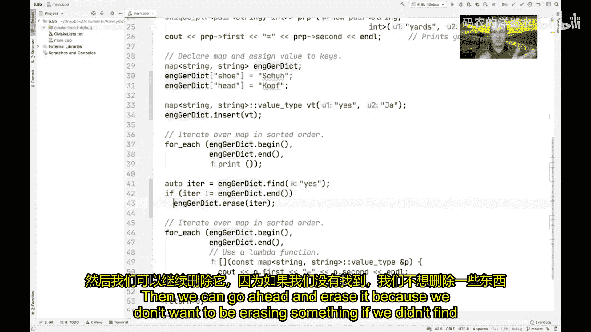

And then the last thing we do here just for kicks is we go ahead and iterate over the map that's now no longer got the yes ya value type in it and we print the results and this time we're going to use a Lambda function and this is probably a good use of Lambda function because we're just trying to have the very essence of the computation which in this case is going to be printing out the first and the second as we did up here with the print function but。

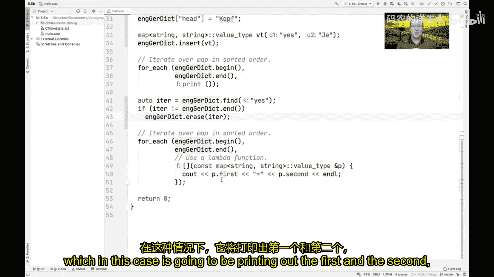

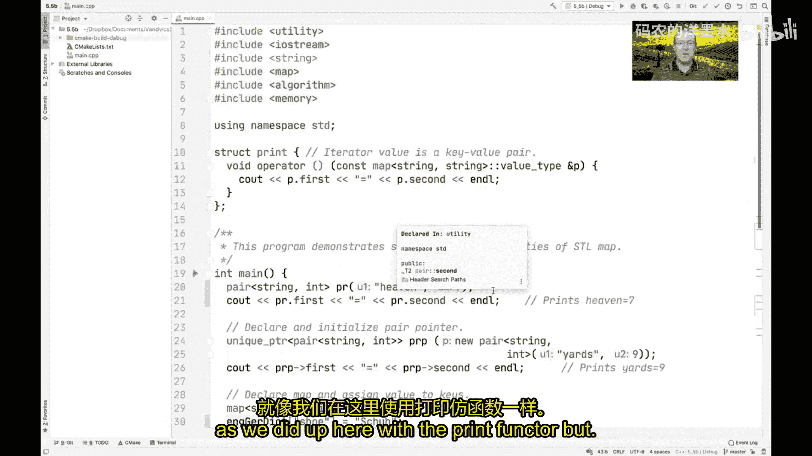

It's a little bit less ceremony in some way， you don't have to litter your code with all these extrastructs that are lying around or classes fluter classes that are lying around。

And down here you can see that we use the functer syntax sorry the Lambda syntax and we're not passing any parameters here that we need to update this is all purely going through sea out I suppose I could have said I could have passed in sea out。

And not had to directly address it in this scope， but I think this is fine and nothing you're not writing to it or anything like that。

Okay， so that's the next example， I think that's kind of cool we show a few other features of map that's worth being aware of like you can insert value types or you can do the subscript operation to give it a key and then do the value as an assignment from that。

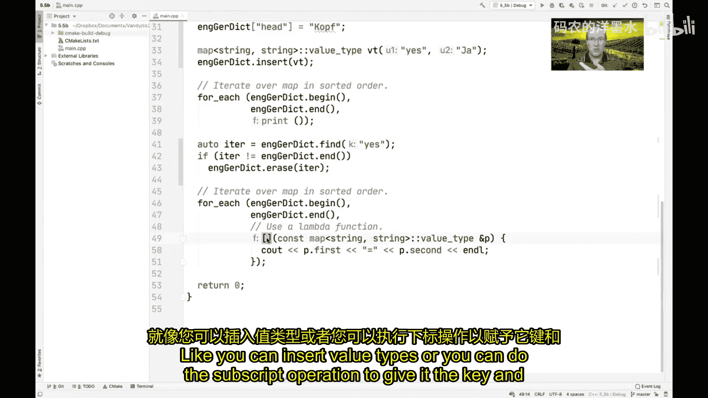

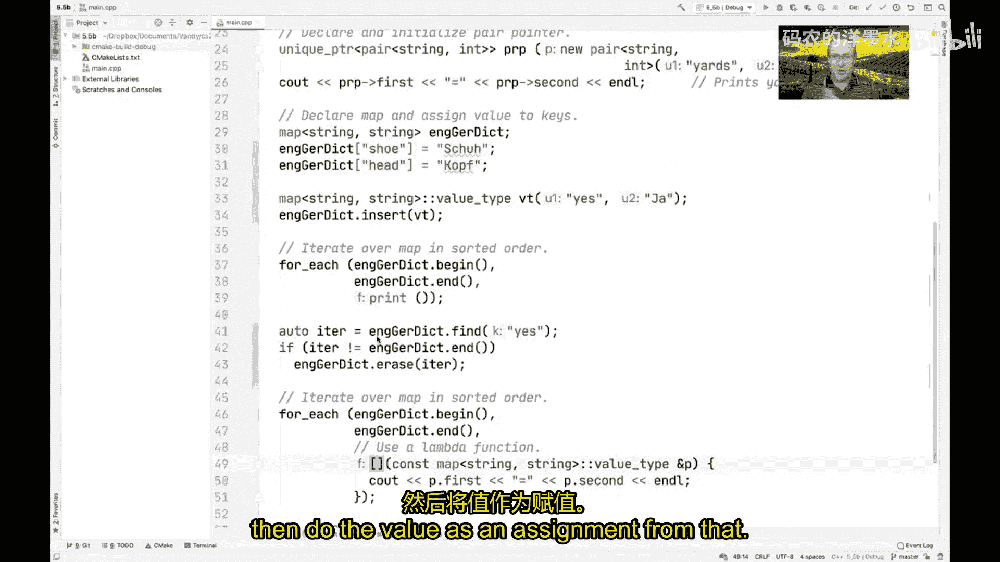

And we saw yet another example of how to use Lambda functions。

Let's now go ahead and turn our attention to the next example。😡。

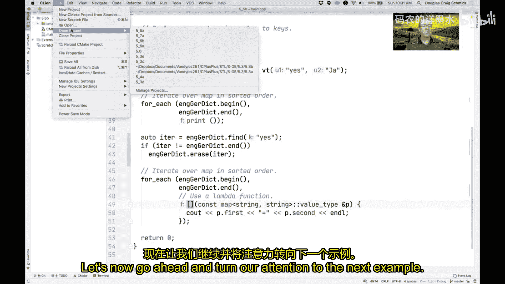

And this is56 a and this is going to be fun， so we've talked about maps up to this point now we're going to start talking about multimaps。

 so as with sets a set only has unique keys whereas a multiet can have duplicate keys and it would be no surprise it would be the principle of least surprise if multi mapps work the same way with respect to map so a map can have only unique keys。

 but a multi map can have duplicate keys。😡，Of course a multimap is also an order to associate container。

 it's a pair of associative containers we talked about before。

 the only real difference is you can have duplicate keys。

 but everything else is the same so the signature in terms of providing the key type and the value type and the compare type and optionally the allocator and if you don't give compare it defaults to less all that stuff works the same。

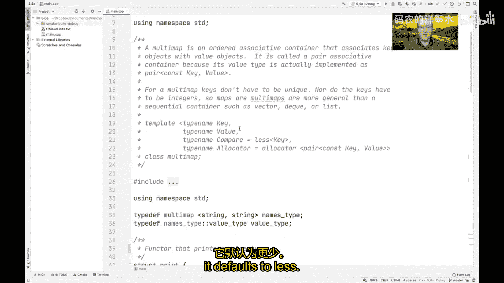

Okay so this particular example is a really fun one and it's going to show off a whole bunch of cool stuff。

 so let's take a look as you can see we're going to make a few type defs we're going to define names type to be a multimap that maps string to string and we're going to define value type to be the value type trait in names type and that's just to kind of keep things a little bit less verbose and you'll see why we need that later when we do the bulk of the code。

😡。

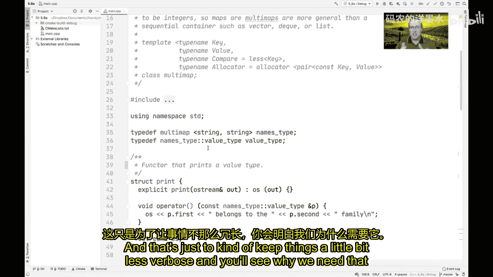

We also define a helper functer that will go ahead and as we've been doing print things out to the right location in this case rather than just defaulting to see out we're going to pass the。

😡，Output stream we want to write to as a parameter to the constructor and then it stahees it away internally in the base member initialization section and that's what then gets used down here with the actual operator function call so hopefully that is intuitive to you not unlike before and notice how we're passing in a value type which is a pair and so we can put the first and the second of that。

😡，We also have a couple of insertion operators that are kind of fun and here's the first one up here。

😡，Right here is going to take an O stream ref and it's going to take that O stream ref and it's going to go ahead also and take a names type so names type in this case is going to be basically the multimap and it's going to go ahead and go through the names type from beginning to end because after all that's a multimap so it goes to the whole range and it's going to use that print function we saw above to print。

😡，Each element in that map to the standard out use there using whatever's passed in here。

 not the standard out to the O stream that's passed in， which turns out to be standard out。

 but it could be something else。So this is the for each algorithm we've already seen the for each algorithm just a quick recap here's for each it just goes through that range and invokes the function on every single element and the function in this case is a funter okay。

 so far so good。

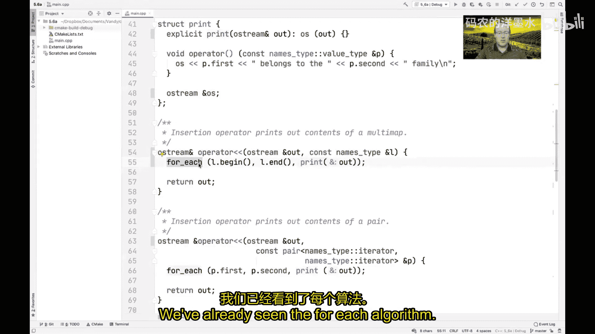

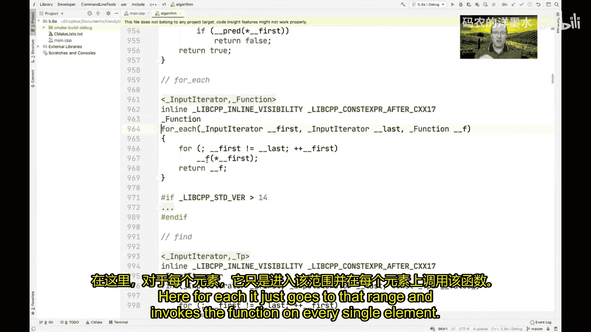

So that basically prints out the contents of a malten map to whatever O stream you give it。

 then down here we do something similar。😡。

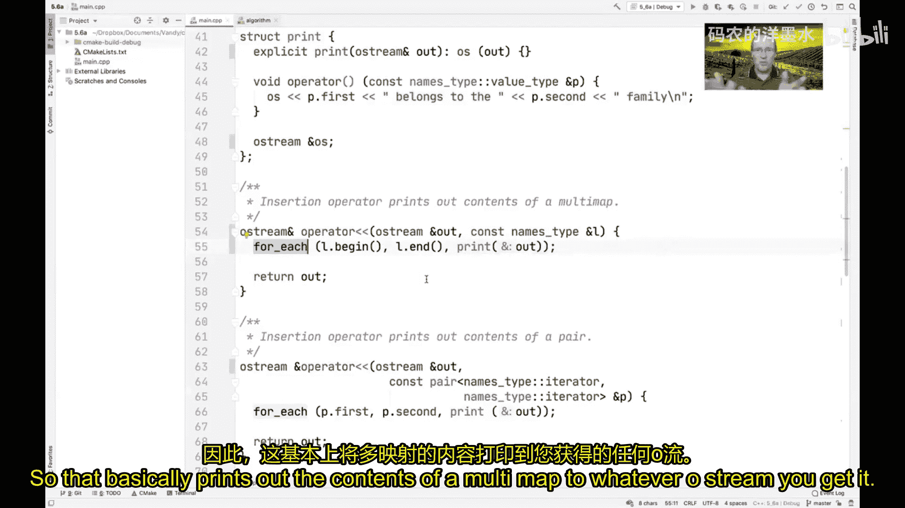

In this particular case， we're going to go ahead and。

We're going toops we're going to print out a pair so rather before as you saw what we had was the ability to print out a whole multimap this time we're just going to focus on printing out a pair and you can see you give it a pair which is pair of iterators and so in this case we're going to go from use the Foury algorithm to go from the beginning of the pair to the end of the pair not including the end of the pair so the range between beginning and end or first and second and again we're going to go ahead and print the contents out to whatever Ostream is passed in and these are this convenience map that you'll see in a second that make the rest of the code really concise and to the point。

😡。

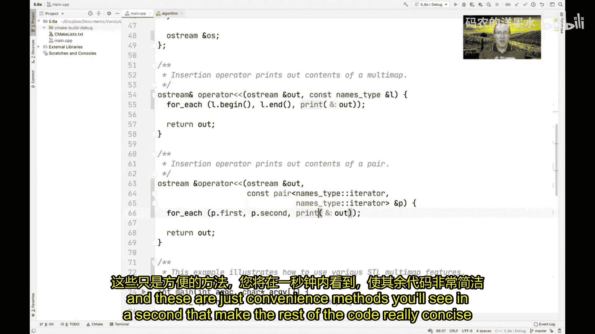

All right， so now we're ready to talk about the code that's conciseant to the point。

 and as you can see here， we've got ourselves a。

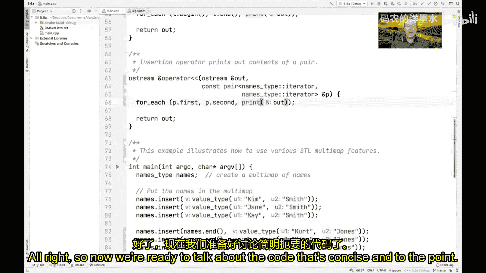

Main function that declares names type。😡，Object called names。 This is the multi mapap。

 have a multi mapap of names。 And then we're going to go ahead and do some interesting things。

 We're going to first start out by inserting。

Value types containing people's first names and last names so we're going to put the first name in is the key and the last name in is the value and we kind of have to use value type when we do insertions for multimap and that's because of the fact that you can have multiple keys with the same name and so this this just makes sure that it all works cleanly there is no subscript operator defined find on multimap like there is for map。

So we're going to go ahead and insert Kim， Jane and Ka Smith and then for some kicks we're going to show a little optimization so we use names oh so when you do insert that of course starts at the root of the red black tree and then goes and does binary search through the tree until it finds with the location of the item goes。

 it puts it in there and then it rebalances the tree to make sure it stays balanced。

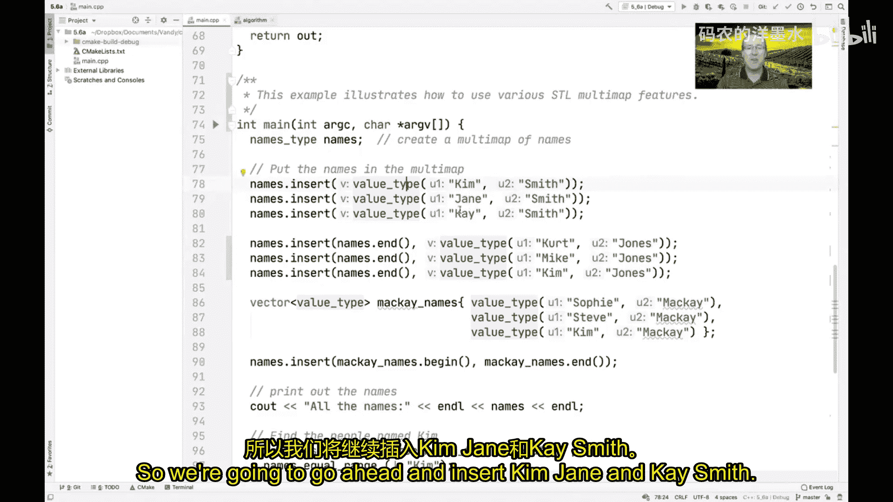

So that turns out to be okay， but there's faster ways to go if you know something about your data。

 so you'll notice that we first insert Kim Jane and K and then we're gonna go ahead and we're gonna to insert a couple of other fields that are kind of at the end of this and so what we can do is we can use the end iterator to give us the end iterator in the tree and then we can go ahead and insert Kurt and Mike and of course Kurt and Mike have values have keys that are after the ones we've already put in the map and by getting it the end iterator here that will help it be more efficient in terms of how it puts that item into the map in the right place so it doesn't actually have to do a binary search from the top down to the place where it goes it just goes ahead and sticks it at the end and rebalances the tree and that'll be a little bit faster probably more like constant time as opposed to log in time you'll notice that this is just a hint however so if we try to put Kim in here Kim is probably not going to work with that because it's not really at the end and。

As a result， that'll have to start from the top and go down。

The next thing we're going to do is we're going to define a vector of value types。

 so this will be a vector of these string to string pairs and we're going to call this the McKay's names vector so you can see we have Sophie McKay Steve McKay and Kim McKay。

😡，And then we're going to go ahead and insert。😡，From the beginning of that vector to up to but not including the end。

 so this is allowing us to be able to do an insert of a range of values and so we're just using the vector here to do that we probably could have done this with inlining and that had to make a special vector but I wanted to keep it clean and clear what was going on so that's a nice kind of little optimization so you don't have to write everything out this would make more sense if we had a lot of elements that we were trying to do here。

😡。

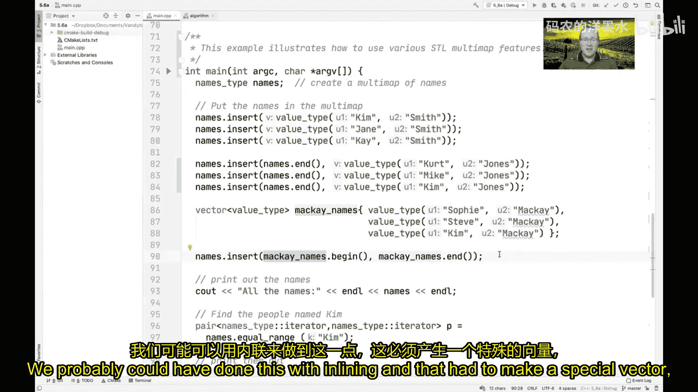

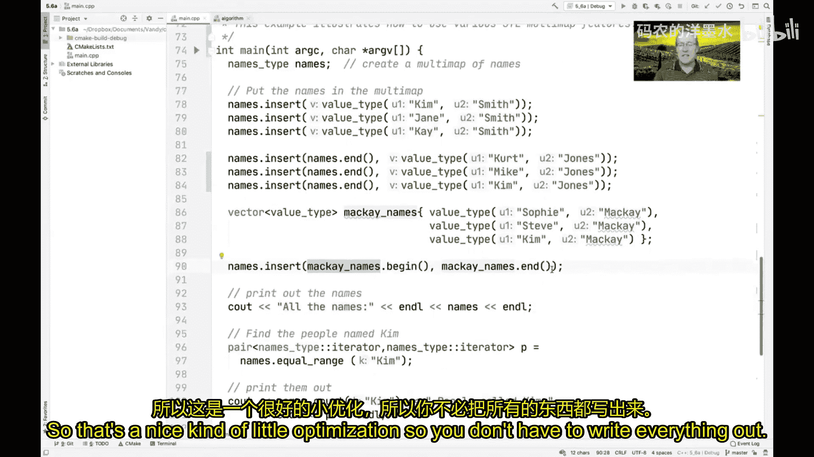

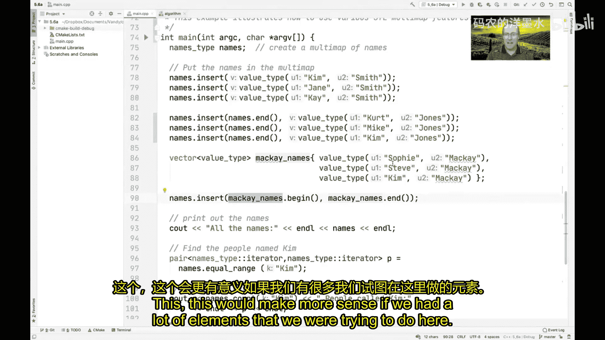

That we perhaps already had in a vector， for example。

So now what we're going to do is're to go ahead and print all the names and notice when we do this call here。

 this names call with the insertion operator， that's just going to go and call this version here。

 that's going to call this insertion operator to print out the contents of the multimap。

 so see how clean and consistent that is relative to other uses of C++ and IO streams。😡。

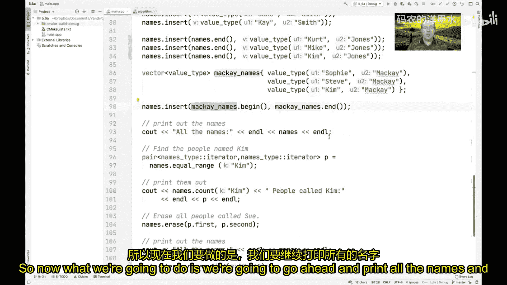

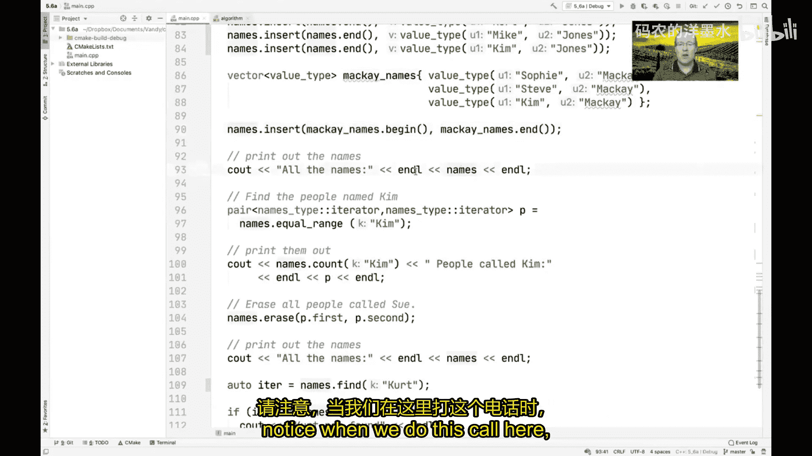

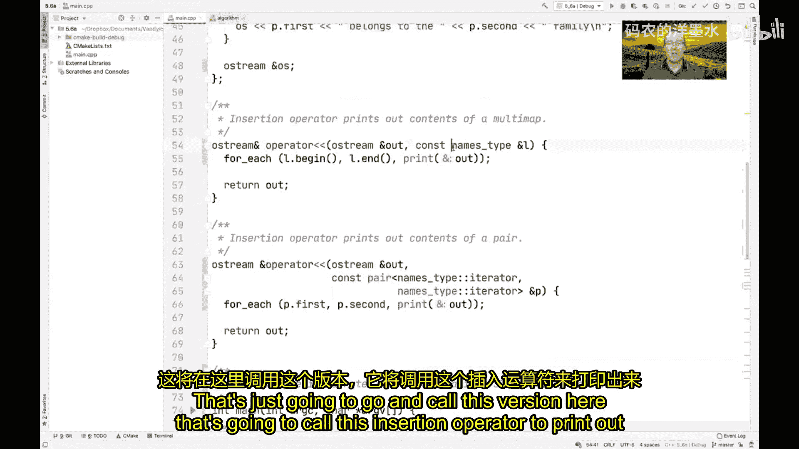

We then come down here and we say please find me a pair of iterators that contain all of the keys that have the word Kim in them or the name Kim in them。

 the first name Kim so we're going to get back here is a pair that's going to have iterators to the beginning of the first Kim to the end Kim and that's a nice convenient way of finding all the Kims because it's a multimap so we can get all the elements together。

😡。

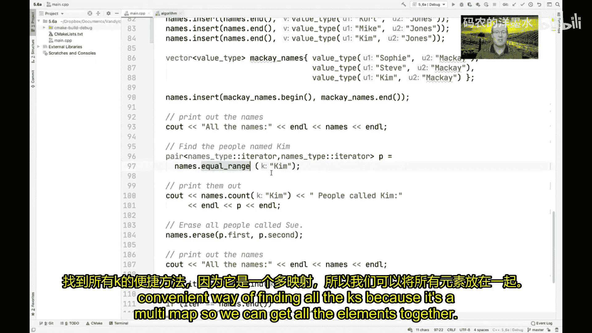

We then go ahead and print out the number of people called Kim and then we go ahead and print out the people called Kim so it's going to print out all the people whose names start with Kim。

Then what we're going to do is we're going to go ahead and erase everybody whose name starts with Kim and we can do that by just giving it that pair first and pair second for some reason you can't just give it a pair。

 you have to give it an iterator range so we go ahead and erase everybody called Kim then we print the updated map that has erased those people and then the last thing we do is we go look for someone named Kurt if we don't find Kurt we say Kurt's not found but of course we have a Kurt as we put a Kurt in somewhere up here Kurt Jones and so when we're done to go ahead and print out Kurt's last name is the iterator arrow second。

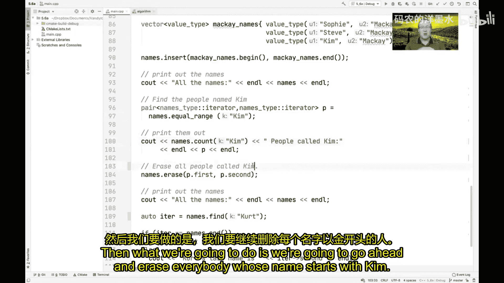

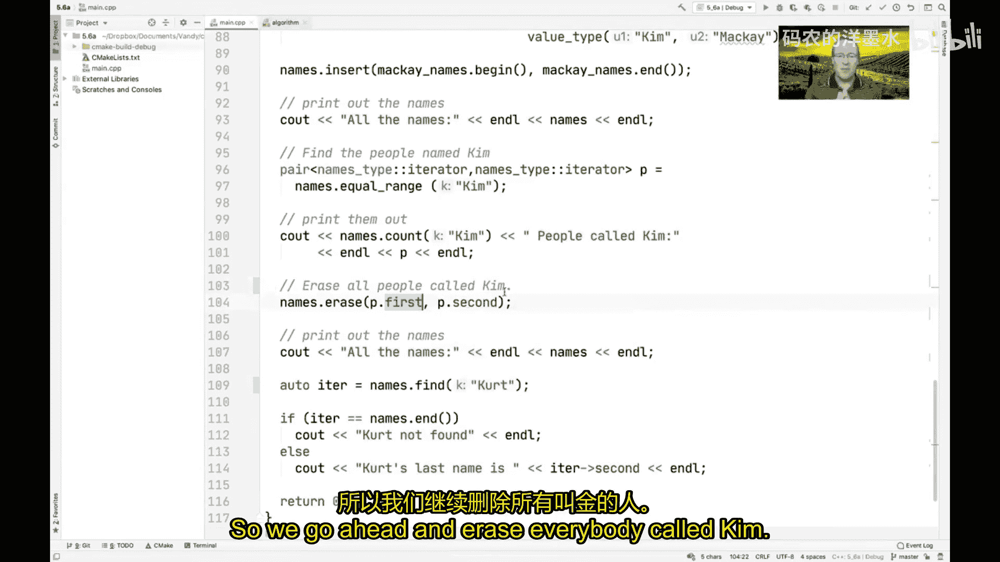

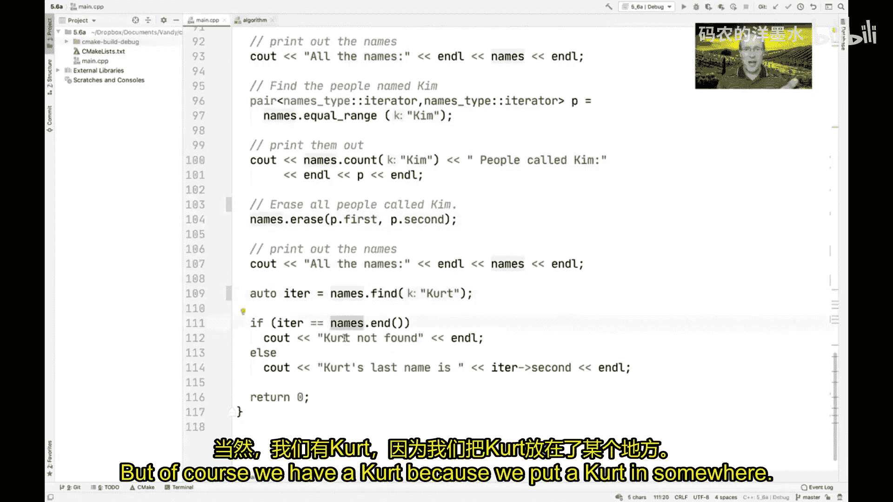

Which will be his last name， so let's go ahead and run this code。See what we get。

And lo and behold， we start out by printing everybody so it says Jane and Kay and Kim belong to the Smith family and then Kim belongs to the Jones family and you can see we've got different people in different places in the map。

And then you can see that we print out all the people named Kim from the different families。

 then we removed all the Kims， then we printed the results where we don't have any Kims left and the last thing we do is we print out Kurt's last name is Jones。

😡，So I like this example， I think this example is really cool。

 and it demonstrates lots of other cool features and powerful features of multi mapps and STL。

So the next thing I want to do is I want to keep with this example。

 but I want to do a little bit of optimization to it and show you what the consequence of this optimization is going to be。

😡。

So we're going to keep pretty much everything the same。

 we're going to have the same data types and so on and the same helper functer and the same helper insertion operations and so on。

 but the main difference here is we're going to go ahead and we're going to demonstrate the difference between inserting and in placing。

😡。

So over here， you can see that we're inserting value types here and we'll take a look at the consequences of this。

😡，And then we're going to do in placing instead of inserting。

 and then we're going to do something called inplace hint。

 which is like that insert that used the iterator as a hint。😡。

And then we're just going to go ahead and print the names out I didn't want to redo all the code but it would all be all be the same to make this interesting to look at we're going to replace the use of string with our simple string。

 so if you recall simple string is this little class that I wrote that shows off a bunch of interesting STL and c plus plus capabilities particularly related to the the rule of five where you need to。

😡。

Have all the different methods and constructors and move constructors and move assignment operators and constructs and so on provided so let's go ahead and run this code and you'll get a chance to see the reason why in place is such a win relative to using insert。

😡。

And it's it's really quite startling when you look at the code so this is what happens when we insert those elements into the map now keep in mind just to be。

😡。

Clear here you can see the the lines of code so so here's the code you do insert for three value types and look at all the stuff that takes place just to do that so you can see that we're calling the simple string constructor that converts a。

😡。

A conca star into a simple string， then we're calling the copy constructor。

 then the move constructors being called， then a bunch of deors being called and that's basically for every one of the things we're creating here all this work is being done wow。

 very expensive because of the value semantics of C++。😡。

Well， of course there's got to be a better way and in fact there is and so look how much better it is to use in place so you can see in place is just going to basically in place the。

Carestar into the multimap just by simply calling the simple string constructor that takes that conca star and creates a simple string so I think you'll agree with me that that is way way way more efficient way more concise than doing all the gobbdy good with with insert so I think the rule here much like with insert back for vectors and other containers using in place instead of insert is usually a wind and it's also interesting to take a look at the code for both these things let's go take a look at insert you can see what it does。

So insert in this case is going to be this move constructive version。

 but it's still got to do some work to create those things and copy them and so on。😡，Conversely。

 when we go ahead and take a look at。

In place。You can see what in place does is it uses the veryatic template features in C++ to just go ahead and take the arguments that are passed in those two strings and just copy them in place or move them in place into their final destination so it's way。

 way， way more concise。

And then we also have in place hint， which is very much like the insert method for map where you can give it an iterator and if you play your cards right that'll use the in place logic as you can see here。

 and it'll also put it into the map without having to search from the top each time if the hint is set up to do that kind of thing。

😡。

You might wonder why we have to have a method called in place hint as opposed to having a method like we do with with map where insert is simply overloaded and the reason is because we。

😡。

Otherwise would not be able to differentiate between the v as that are passed in to in place you can see here's the inplace version with a bunch of varars this one we have to explicitly call out the iterator as the first thing otherwise it would get lost than the varrgs that are passed in so they had to use a slightly different name。

 but I think it's still pretty cool and pretty obvious what's going on。😡。

Okay， so that was the example showing how to use some other features in in multimap in particular。

 how to use in place and a big win， so I recommend you use in place instead of using insertt。

All right， we got one more example here and this will be，ops this will be kind of fun。

Let's go over here and open up57 A。

So thus far we've been talking exclusively about ordered associative containers which are implemented under the hood with the red black trees as we've talked about what we're going to do now is just show an example of an unordered associative container and I won't show you more than just this one example because all the unordered associative containers basically mimic the API of the ordered ones with the difference being that they're not ordered so instead of being ordered using red black tree as the ordered ones are all the unordered associative containers use hashing and hash functions so let's take a quick look at this and and it generalizes quite nicely so there's a parallel set of unordered associative containers that are all prefixed with the unordered underscore。

😡。

Prefix。And the ordered containers don't have that prefix。

 I think if they' done STL from scratch at this point。

 they probably would have called the other one's ordered underscore map， ordered underscore set。

 but those already had their names long ago and the unordered ones came in with C++ 11。

So the main difference of course is it doesn't use a binary tree so it doesn't need the less than operation instead here the parameters are past so we have the key type and the value type just like for the ordered associative containers for things like map and set for map and multimap and then we have some other things that weren't in the ordered containers remember the ordered containers all took the compare functer which was defaulting to less。

😡。

And for the hash table implementation for the unordered version， you pass in a hash。

Function or hashfucter， which defaults to the standard hash functer。

 which is then specialized for all kinds of different types。

Or you can define your own if you need to and then we also have a predicate functer which is used if two keys hash to the same location and the hash table。

 then the predicate is used to be able to do comparisons when they do the collision resolution。Pros。

 which just basically searches down a linked list until we find something that matches via equal to。

And then the allocator is the allocator as always， so the main difference between ordered maps and unordered maps is they just don't store them in an order。

 that's really the only difference， otherwise they're all the same semantic。😡。

Okay， so let's go ahead and take a look at an example what we did is we took our example from before the one that's the now is the time for all good people to come to the of their party example。

 and we're just going to replace the use of a map with an unordered map。😡。

That seems pretty simple and in fact it is pretty simple the rest of the code starts out pretty much identical we iterate through the word list and throw the elements into the map。

 the difference now of course being that the map uses hashing not less than in order to be able to store the item in the map in the unordered map in the appropriate place in the hash table。

😡，I'm assuming everybody here knows what a hash table is。

 that's a topic that's typically covered in an introductory course on data structures or algorithms。

 so I hope you'll know what that is basically it's a way of taking the values in the key and then computing a function that maps them into a table and then if there are things that map to the same location。

 they're resolved by having a linked list of things that hash to the same location。

 using that equal to function to figure out if they're the same value or not。Keep in mind with a map。

 you can't have unordered map， as we're showing here， cannot have duplicates， whereas of course。

 an unordered multimap could have duplicates。😡。

Now just for kicks， we're then going to go ahead and print the contents of the unordered map out and you'll see when I do this。

 they're not ordered in a particular way they're just however they happen to hash。😡。

Then what we're going to do is we're going to go ahead and create a vector of pairs and we're going go ahead and we're going to push the elements into the vector so we're going to take each element in the word map and we're going put it at the end of the vector so it's going to do in place back to be efficient of course so now we're gonna to have a vector of all the contents and then we can go ahead and sort those contents so we're going to end up with a sorted version here but that's going to be after we've put it into the unordered map now if you really want it to be sorted use an ordered map but this is showing just showing how you could take something that was unordered and then you could go ahead and put it into a container and then sort it and we're going to sort it using the greater function so it'll be in descending order when we put it out you also could have used this code here instead of using the for loop within place back and it turns out that there's actually a clever backiner that is used here and if you take a look under the hood they have a version of the back inserter。

That both uses the， I think they have one here that uses the reference values and move semantics and others that use other semantics。

 but notice that that's doing basically a pushback here。

And so if you take a look here， you can see that we have one that uses。

A con ref。And then the other one that uses basically the R value references and this uses move semantics so that should be a little faster。

 but it's probably probably fastest to use in place back is my guess。

 I haven't really sat down and benchmark these things。

 but this might be a good case where sticking with the for loop。

 the rangebased for loop might be the way to go。

Okay， when we're all done， we're going to go ahead and print things out and then we're going to total everything up as before using our Lambda function。

 so that's pretty much what we had done earlier。😡，Let's go ahead and run this code and it'll show you a couple of interesting things。

😡，As you can see here， when we first print the results， they're not ordered in any particular way。

 so that just happened to be the way that they hashed into the hash table， so no particular ordering。

 they're not ordered in alphabetical order for sure。😡。

Down here after we stuck them into the vector and then sorted them in descending order。

 when we print these out， you can see that they're now sorted in descending order。😡。

And as we saw before， the number of words is 16， we use the lambmbda for that。

So those are the things that I had wanted to talk today about。

 these are giving you hopefully a very good understanding of how STL maps and multimaps that are ordered associative containers work。

😡，As well as also getting a chance to see how at least one of the unordered Associative containers work。

 which in this case was map and if you take a careful look at this I think you'll really learn a lot。

 I highly recommend you take a look at the source code as always feel free to clone my repo feel free to play around with it。

 do what you'd like with it it's all open source so whatever you want to do it's up to you and if you enjoyed this content please go ahead and like and subscribe and of course you can feel free to follow me on Twitter so you can get notifications when my videos will be going up and the sessions I'll be recording are going to be broadcast。

So thanks very much and I will look forward to talking to you soon。

