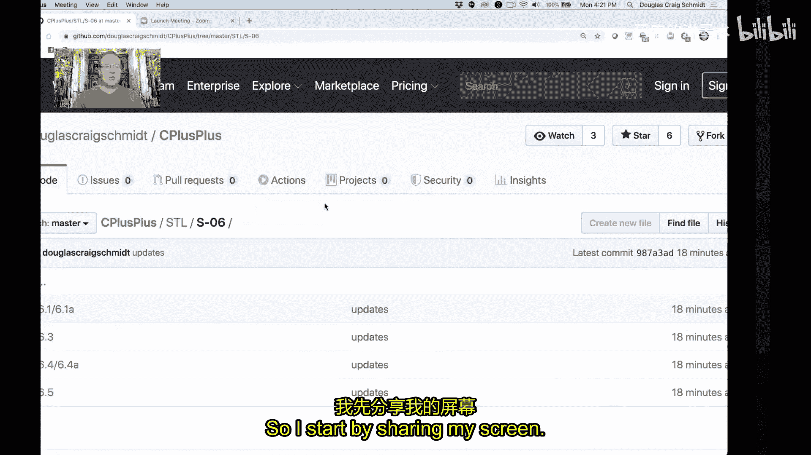
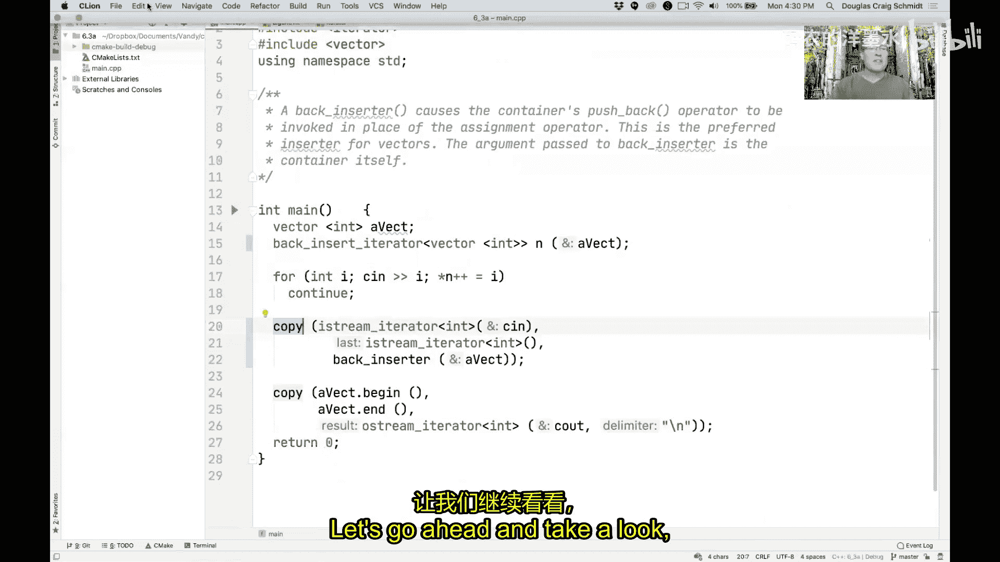
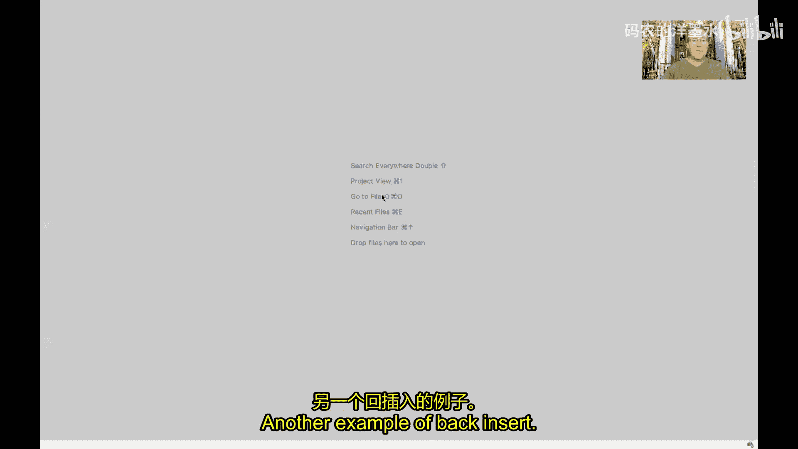
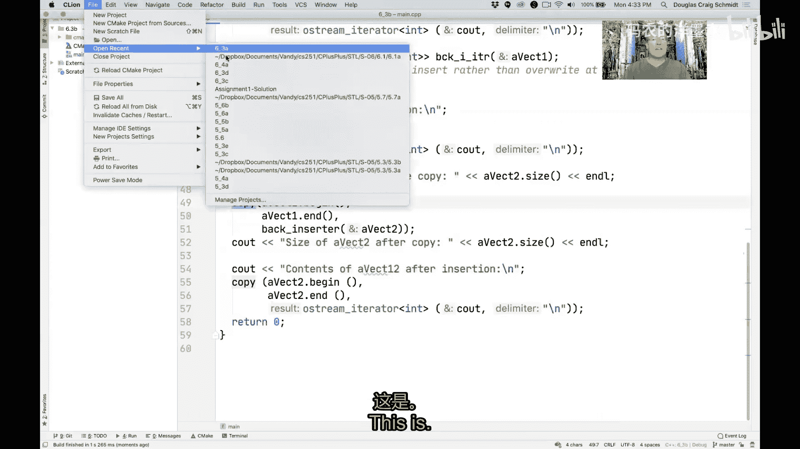
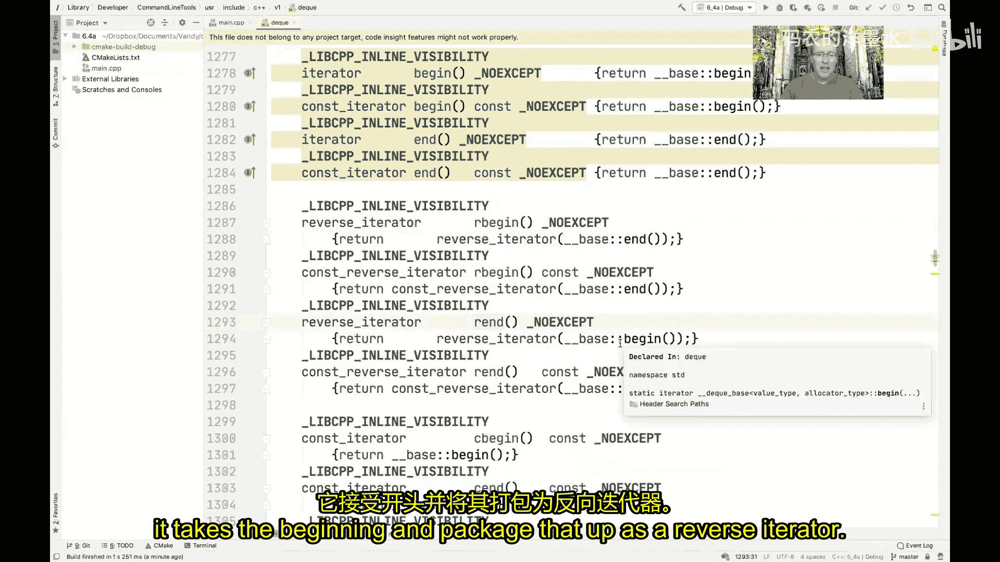
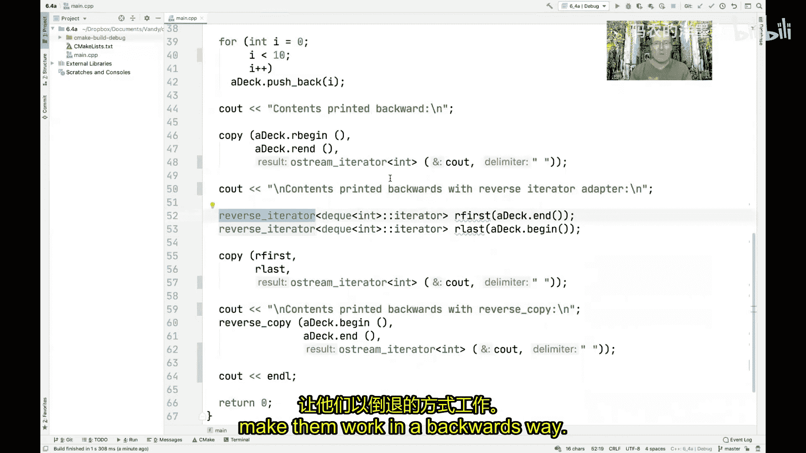

# 【全集】范德堡大学 C++标准模板库 中英字幕 1080P p14 Lecture 14 - 迭代器适配器 part1 -BV1KWiCBWE7M_p14-

Welcome to the next session on my webinar series it focuses on C++ Standard Temp library by example。

Now that we've finished focusing on sequential and associative containers。

 both ordered and unordered， and we've also had a chance to talk about iterators as well as don't forget the focus we did on C++ template functions in classes。

 it's time to turn our attention to iterator adapters。That allow various other elements in STL。

 such as containers to work in contexts in which iterators are expected。

So let's go ahead and take a look at the code we're going to cover today and then we'll jump right into it。

😡，So I start by sharing my screen， you can see here that if you take a look at the C+ plus STL SDS 06 folder。

 you'll see some subfolders， which is 6。1，6。3 and 6。4。

 so these are what we're going to focus on today。

So what are iterator adapters， there are types of iterators that can operate on more than just STL containers。

 that can also be used to adapt standard containers iterators to work differently if that's what you want to do。

😡，These iterator adapters can turn standard iterators into things that can operate in reverse with the so-called reverse iterators。

 they can work in so-cal insertion mode， and they can also interact with the streams that come with C++ for doing input and output。

We're going to be focusing on taking input output forward bidirectional and random access iterators and making them work into something called adapted iterator context today we're going to focus on insert iterators and reverse iterators and we'll talk about stream iterators later。

😡，Insert iterators， which are also called inserters。

 can change the assignment of a new value into an assertion of that value into the sequence of values。

 thereby not overriding other values。These are output iterators since they write values they don't read values they write and they'll basically be used to override the container's assignment operator we've already seen some examples of these when we talked about the copy algorithm before。

 but now we're going to really take a close look at how they work。😡。

There's several types of inserters， and these can also be used to change the way in which the algorithms work by adapting containers and other data structures to work with them。

The first type of inserter is going to be the front insert iterator。

 the second type will be the back insert iterator and the third type will be the insert iterator these are all STl classes or strs theyre various。

Functions that are defined to work with these， including push front for the front insert iterator that works on decks and lists。

 pushback， which works with the back insert iterator and works on vectors decks lists and strings。

 and finally insert which works on the insert iterator。

 and that is the broadest of all the different categories that works on vectors， decks lists。

 maps and sets。So why would we want to do these things well it turns out that STL has a whole bunch of different algorithms like copy unique copy。

 copy backwards， remove copy， replace copy and so on。

 and these are all past iterators that mark the position within a container to begin to do the copy so again they are output iterators and with each of the elements is copy the values assigned and the iterators incremented so each copy requires that we guarantee the target container is of a sufficient size to hold the set of assigned elements。

😡，So one reason to use the adapters， the iterator adapters as we're going to see here is we can take containers that start out being initially empty and then grow them over time based on the number of input elements that they have to work with as they copy them into the output iterators。

😡，So you basically can have them expand as needed in order to store the information that comes their way。

So let's go ahead and get started with the first real example and we'll go ahead and take a look at。

😡，This example。Move myself back over here。So we're going to start with something called a back inserter and that's probably the most common and popular example of an inserter this causes the underlying containers pushback operation。

😡，To be invoked in place of the assignment operator or more specifically when the assignment operator is called。

 it ends up calling the pushback operation on the container that it's adapting。😡。

This is the typical way of doing insertion for vectors and the argument that's passed to a back inserter is the container itself。

 so let's take a look at a very simple example this example is going to start out with a vector of int a vector of integers called aVec that will have no elements in it and we're going to define ourselves explicitly at first an instance of back insert iterator which is parameterized by a vector of int and we call this thing n and we give it ave as its reference parameter。

😡，And then what we're going to do is we're going to go ahead and we're going to walk through the input one element at a time。

 and we're going to read it from CN into I， and then we're going to go ahead and store it by taking N。

 dereencing it， storing the value I into it， and then plus plus it to advance it。😡，Now again。

 that's a way to use this very explicitly using the back insert iterator class and an instance of that class。

 however， of course， no selfrepecting C++ programmer would ever write that kind of code。

 they would all write this code instead。😡，And this is really something that you've seen before but I want to show it here anyway。

 so what this is doing is this is using the copy algorithm and the copy algorithm is going to end up reading from standard input using an Istream iterator adapter。

😡，And then reading until we reach the end of the input and every step along the way it's going to call the vac inserter method to insert the element in the stream into the V or an element that we're copying through the mechanisms here it's going to go ahead and read that and store it into the end of aVC and then at the end we just go ahead and copy the things to stand it out。

😡，So I want to show you what back inserter looks like and the interesting thing about back inserter is it basically encapsulates the back insert iterator object that you see over here and it uses the type deduction features of。

😡，C plus plus to do this， so let's go ahead and zip in here。 You can see that the back inserter。

Method， which is this iterator adapter， is。A method that's parameterized by the type of container it's past。

And then it goes ahead and has a reference to the container as its parameter it's going to go ahead and grab that thing and hold it and this is really cool it then goes ahead and creates an anonymous instance of back insert iterator。

Passing in the parameter。By reference， so it's going to go ahead and hold that that object we're creating is held at that point and it returns a back insert iterator object。

 so it's basically making an object and returning the object and the object is going to hold on to that container by reference and here is the。

😡，Back insert iterator class， which。Implementments the iterator class so it gets the various traits from that。

And then it keeps a pointer to the container as a protected field and then here's its constructor you can see its constructor just goes ahead and stashes aside the address of that container that's passes a parameter into the field and then we've got a bunch of operations on this most notably the assignment operator that's the one that really matters and you can see what it's doing here is it's doing the pushback operation on the container so it goes ahead and pushes it back and there's a couple of different variants there's the con ref value type。

😡，Assignment operator and then we also have essentially the R value assignment operator those work in different ways and can be used for doing different kinds of optimizations。

And then down here we've got the various placeholder methods that inherit some of the funny characters like the dereence character or the plus plus character for preincrement or the plus plus character plus plus operator for post increment and as you can see those are all just no ops。

 they're just there to hold the whole thing together so when this is used with algorithms like copy that expects there to be dereference and expects it to be plus plus it'll all work syntactically。

 but the real value， the real meat of this back insert iterator is in the assignment operator。

 which as you can see always there a pushback。So as we go through the copy algorithm。

 every time we go through this。The input stream from beginning to end we're going to go ahead and take the element and then back insert it into the end of the vector and let's see if we can get the copy algorithm to show up properly sometimes these things will show up with。

😡，In unusual versions here's one that's close enough for our purposes。

 This is the copy algorithm more or less that we're using here。

 and you can see here how this is the assignment operator that comes from the back inserter that we created by the back inserter function。

 which created the back insert iterator object that defined that。

Assignment operator to do a pushback at that point。Okay。

 so that's basically how the back inserter works let's go ahead and take a look if you will。

 at another example this is a。

Another example of back insert。

And back inserter this also kind of summarizes the different template functions just as a handy reference point。

 so you can see we have the back inserter and the front inserter and the inserter and all these different adapters。

Like back in sort of that we just looked at leverage the C++ compiler's ability to do type deduction without us having to give the explicit template parameters notice you can't do that for classes orstructs but you can do that for functions so that's why they have those wrapper functions。

😡，So this particular example is also going to do a couple different variants of on a theme we define a couple of vectors AVc1 and AVc2 we push a bunch of elements at the end of AVc1 we copy those to standard output then we go ahead and make ourselves this back insert iterator instance where we explicitly define this thing and then we go ahead and add a couple of elements to this now what's interesting here is that we're。

Inserting rather than overwriting and that's the purpose of the iterator adapter it we're making it look like it's an iterator even though in fact it's actually pointing to a container。

 as I mentioned before this is all just syntactic sugar so we can actually get the same results here by getting rid of the star and get rid of the plus plus operation if we do just this code it'll still work because the assignment operators what matters。

 but of course that would be on sporting of us it wouldn't look like mimicking the syntax of pointer arithmetics so we go ahead and put it back there。

😡，So then we go ahead and print the results after the insertion and then we go ahead and do the same sort of thing。

 except this time we're going to do the backender like we did before and then we go ahead and print the results so let's run this code see if it's going to cooperate and give us something useful。

So here is the original contents of AVEC1， then if you recall we inserted 100 and200 at the end of it by using the magic of the assignment operator and that was the part where I was telling you you could delete the star and delete the plus+ and it would still work。

😡，And then we go ahead and do some more copies using the back inserter method and everything still works just for kicks。

 let's go ahead and see if we can。Prove to ourselves that getting rid of these syntactic sugar elements will still give the same result。

So let's go ahead and compile that。And you'll see lo and behold you get exactly the same results。

 so the real value of the syntactic sugar here is not so much for writing code like this。

 which nobody would ever really write code like that。

 but more to be able to use them transparently in the context of the STL copy algorithm where it needs to have that star do at least be there doesn't have to do anything just that be there and we have to have the plus plus to at least be there in order to hold the elements together syntactically。

😡，Okay， let's go ahead and look at another example this is。

This one and this one's going to show the use of front inserter。😡。

So back inserters most commonly used with vector， you can also use it with things like deck or list that can also have things put at the end。

 but front inserters really designed for use with deck and list it's not designed for use with vector because there is no push front method on deck because putting an element at the front of a vector is very inefficient because you have to slide everything down so they didn't even bother making that one of the methods in STL。

So let's take a look at the example we're going to make ourselves two lists because they can have things go into the beginning。

 we make ourselves a list iterator， we put a bunch of elements into the list for I equals zero I less than five。

 we print the original contents of the list and then we go ahead and we define ourselves a front insert iterator and again we do this。

😡，Explicitly at first， just to show you how things work under the hood， like I said。

 nobody would actually write this kind of code。And then we go ahead and insert 100 and 200 at the front of the container in the front of the list doesn't overwrite the first two elements。

 it goes ahead and inserts them， notice if we had normally if we just had a regular iterator not an iterator adapter that would overwrite the contents。

 but this time we have an iterator adapter so it inserts it and basically makes it so it shows up at the beginning。

😡，We then print the results and then we go ahead and do the same thing by doing a copy except this time we're going to copy using front inserter so of basically push them in reverse order and then we print the results so let's go ahead and run this code。

😡，And you can see what happens here， this is the original list。

We put the other elements at the front， not the end， so 200 shows up first followed by 100。

 and then we go ahead and reverse the order and you can see that it comes out in the reverse order from what we had before。

And I probably should put a new line in there somewhere， let's see。Something like this。

Now it'll shop up a little better so at any rate this is illustrating how you can use a front inserter and of course the front inserter is an iterator adapter that adds elements to the front of the list or front of the deck。

😡，And it would be trivial to change list to deck and we'd get the same results。All right。

 now let's go ahead and take a look at yet another example。😡，And this one， as you might guess。

 is going to be discussing the inserter， which is the most general of all the different inserter adapters and it causes the container's insert operation to be invoked as the name implies I probably should have gone and shown you what the front inserter does。

 but what it does under the hood is it calls the push front method as opposed to the pushback method。

You probably guess that。So inserter， unlike the front inserter and the back inserter actually takes two arguments。

 the container and also an iterator that says where you want the insert to go。

 so do you want it to go at the beginning， you want it to go to the end。

 you want it to go someplace in the middle， kind of depends on you。😡，And one。

 you can construct an insert iterator directly from a container and an iterator O and again the values that are written to the insert iterator are inserted before eye。

 and we can use these in place of output iterators and we can use these。

 particularly for data types like sets or maps that don't have a pushback or push front operation。

 but do in fact have an insert operation。😡，So here's an example of using an insert iterator for a vector now you probably don't really want to do this because it's inefficient。

 but it's just illustrating that you can do it because the underlying vector has an inserted operation whereas it doesn't have the ability to do a push front so we're going to define ourselves an empty vector we make ourselves an iterator we add a bunch of elements to our empty vector zero through four we print the original contents this should be kind of old hat by now then we go ahead and get ourselves an iterator to the beginning of the vector and then we skip it forward by two elements。

😡，And then we go ahead and create an insert iterator that will point to the。

Container the vector and to the iterator so we're going to go ahead and put these items into the iterator itself and we're going go ahead now and insert these things rather than overwrite so i'm just using this syntax I suppose I could have done that syntax but plus plus is already syntactic sugar anyway so what we're doing here is we're inserting these elements at this point which is going to slide things down not the most efficient way to do it but it'll work and then we go ahead and print the results and let's go and see what happens when we run this。

😡，So you can see the original vectors contents was0，1，2，3，4， and then we got an iterator to the。

The second location， which is you know actually the third element， it's the location two。

 you know vector sub2 which is the third element， and then when we went ahead and did those insert operations。

 they went and put them in the middle of the vector， so it slid it down again。

 not necessarily the most efficient thing to do， but demonstrates how generalizable and how powerful the STL features are under the hood。

Okay， so that was the coverage I wanted to do on iterator adapters that worked to do back inserters and front inserters and inserters let's take a look。

😡，One more example today。And this is going to be illustrating the concept of a reverse iterator and what reverse iterators do is they can be used to walk backwards through a collection by using forward- based algorithms and theyre two types of these reverse iterators。

 reverse iterator， which only goes backwards through the data and reverse bidirectional iterator。

 which can go backwards and forwards with the opposite of whatever it is that you're adapting。😡。

And basically the way this works under the hood is we've got a bunch of of operators that are already defined like plus plus and minus minus and so on and what happens with the reverse iterators is that those。

Semantics are reversed， so when you call the plus plus operator。

 it does minus minus when you call the minus minus operator。

 it does plus plus and so on and under the hood everything's set up very carefully to make sure that this works correctly for the ways in which you have to use it。

😡，So let's take a look at an example， we'll use our good friend the deck。

 we're going to go ahead and push a bunch of values into the deck zero through nine。😡。

And then we're going go ahead and print the deck in reverse order and we're gonna to use R begin and RN and if we take a look at R begin and R end you'll see that what they do is they return reverse iterators so R begin on when you call R begin on a container it goes ahead and finds the end of the container and then package that up in a reverse iterator and likewise when you call R end on a container it takes the beginning and package that up as a reverse iterator so it's basically kind of it's like bro world if you're familiar with the concept from Superman or from the the sidefeld series where it kind of beenverts things So once we've got that we can print things backwards now we're going go ahead and make an explicit reverse iterator so we're gonna have a reverse iterator that's going to start at the end and go to the beginning we call this thing our first and our last and it's a reverse itator。

So it's going to go to the end， let me go ahead and print those things out。

 so we're going to print it backwards with a reverse iterator adapter explicitly。

And then the final thing we do here is we do reverse copy。

 taking just a good old fashioned begin iterator and end iterator and when we run this code as you'll see here in a moment。

😡，They all take the contents of the deck， which was originally zero through nine in a sending order。

 and they invert and adapt them so they go backwards in reverse order。

And if you take a look if you peek around at the methods for reverse iterator。😡。

Kind of see how it's going to work， let's see if I can find it for you。

The most important methods in here are things like plus plus and minus minus now how notice how plus plus on a reverse iterator that actually does a minus minus and minus minus on a reverse iterator actually does a plus plus and then what's cool about this is the star operator here has to take into account the fact that remember the reverse iterator or I'm sorry the end iterator is always one past the end。

 so it actually has to go ahead and decrement the iterator by one before it de referenceences it。😡。

And that's all just made to make sure that the semantics work correctly even when we're going in reverse。

So pretty cool stuff， I don't use reverse iterators a whole heck of a lot。

 but you can use them trivially by using R begin and R end， and as you can see。

 you can also use reverse algorithms that take forward iterators or iterators that are meant to go forward and make them work in a backwards way。

😡。

Okay， so those are the topics that I had wanted to cover today。

 the purpose of this was to start introducing you to the concept of adapters in STL。

 and you will see there are lots and lots more adapters that we'll be covering in the not too distant future we'll be covering the adapters for adapting streams。

😡，And we'll be also talking about adapters that deal with containing adapters and then all kinds of other adapters that work with functions and funcctors and all kinds of other good stuff so there's lots of other good things with adapters in fact you can think of one of the real reasons why STL is so powerful is it takes the adapter pattern from the Gang of4book pumps it photo stoids and makes it as the basis for mixing and matching all kinds of interesting things so you don't have to write a lot of extra code you can simply take existing structure existing behavior and adapt it in various convenient ways to work in all kinds of interesting mix and match scenarios。

So that's the end of the session for today， as always。

 please like and subscribe and feel free to follow me on Twitter。

