# 【全集】范德堡大学 C++标准模板库 中英字幕 1080P p16 Lecture 16 - 适配容器 -BV1KWiCBWE7M_p16-

Hello and welcome to the next webinar in my series on C++ Standard Temp Library by example。

Today we're going to start focusing on so-called adapted containers。

 which take existing STL containers like lists or vectors or Ds and encapsulate them with familiar APIs things like stacks。

 cues and priority cues so without any further ado let's go ahead and take a look at the source code we'll be examining and then we'll jump right into the analysis。

😡。

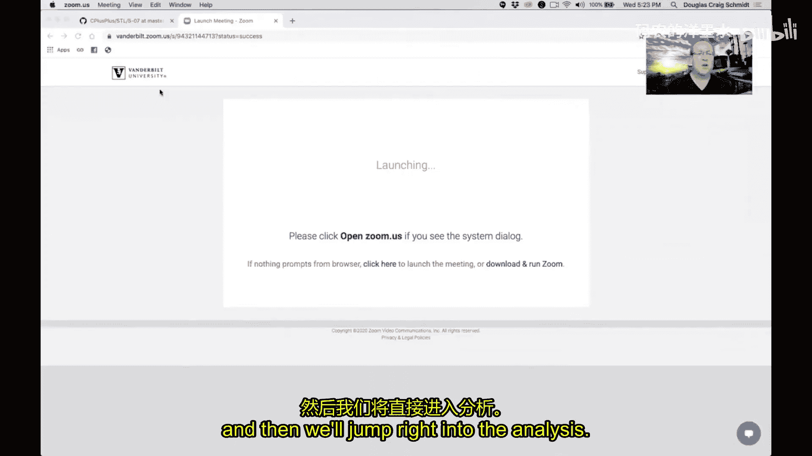

So if you go to my GitHub repository and you look in the C++ STL S07 folder。

 you'll find a bunch of subfolders that cover the topics we're about to talk about。

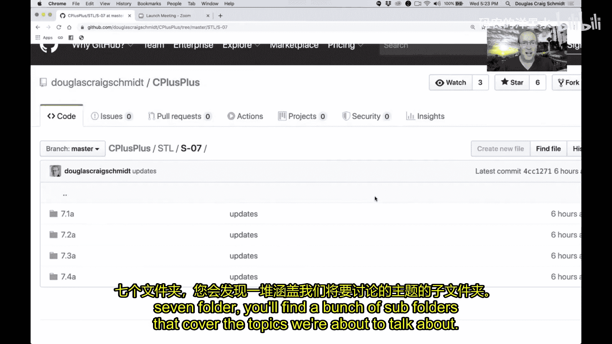

So let's go take a look at the topics。So a container adapter is basically a class that's based on existing classes and the existing classes are adapted using the adapter pattern from the Ganga4book to give off a different interface。

 for example， the stack that's provided as an adapting container restricts vector or deck and likewise Q can also be used to restrict deck。

😡，Member functions in adapting containers that exist in existing containers can either be hidden or you can add some new methods in the adapted container that then call down to the methods that are part of the underlying container one thing to note is that adapted containers don't contain iterators so there's no way to iterate over the contents of a stack there's no way to iterate over the contents of a queue and especially for stack that actually makes a lot of sense because stacks are really meant to be used in a last in first out like manner。

😡，As you see the expectation here is that you're basically taking what's there and modifying it in some way to leverage the implementation。

 but change the API and so this really is the classic gang of four adapter pattern whose intent is to let。

😡，Classes work together that weren't initially designed to work together。So with that。

 let's go ahead and take a look at our very first example and the first example here should be familiar to all of you。

 it's the abstract data type stack。😡。

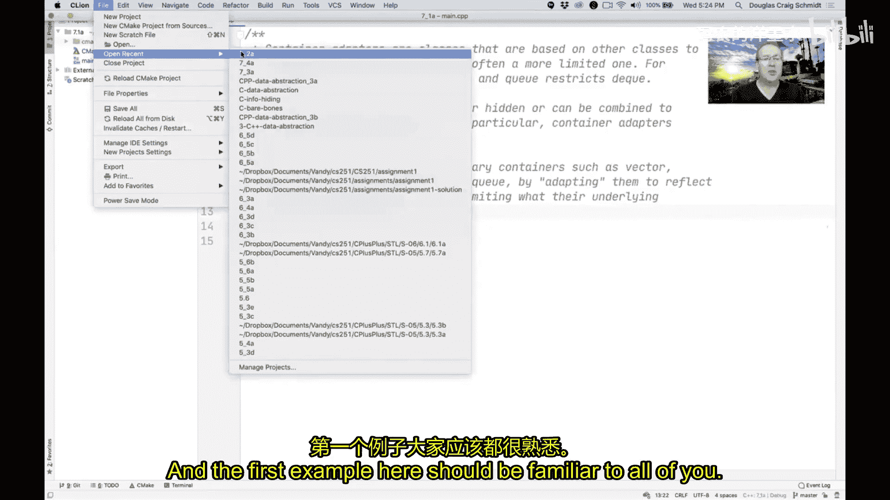

And stack is a really good choice to use for this because the last in first out or LaFO semantics map really nicely onto various sequential containers。

 most notably vector， but also deck and L。As we'll see for some odd reason。

 the implementation of stack is defaulted to using a deck， which I've never understood。

 but it's easy to change and I'll show you how to change it a good example of a stack would be a stack of cafeteria trays where someone puts a tray on top of the stack that's the last one that was put in there and if someone comes along to get a tray they'll take that one off first so it's last in first out。

Here's how the implementation of a stack is typically done in STL。

 if you were to look at your implementation with G++ or LLVM Kang or Vi Studio。

 it might look ever so different， probably be a lot more esoteric and difficult to read。

 but it's more or less going to conform to what I'm showing you here。

 and we'll take a look at some of the code in a second。😡。

So you can see that stack is a parameterized type， it's parameterized by two parameters。

 the first is type name T so stack of in， stack of long stack of employee record and the second parameters is the type of container and by default as you can see here we use deck。

😡，Then the next thing we'll talk about is the constructor for stack， which is explicit。

 which means that it doesn't do implicit conversions。

 you have to put a specific cast in there if you want things to be converting and it basically takes a conre to the container that the stack has then instantiated with and then stores that con in the local data member so it'll make a copy of that so we've got a copy of what was passed in。

😡，Then we've got a bunch of other methods that mostly just forward to implementation methods by the underlying container。

 so you can see empty forwards to the containers， empty method。

 size forwards to the containers size method。😡，There are two top methods。

 they both forward to containers back method， which will give you the last element in the container at the end of the container and top there's two top versions one returns a noncon ref。

😡，And the other returns a const ref and is fact in fact a const method so this method here。

 the one that's the noncons version that can be used on the lefthand side of an assignment statement to assign to something and you could actually change the value that comes back there if you want to this version here this version that's the cons can only be used in the right hand side and that's intended primarily for use when you have cons stacks if you had a cont stack that is given a constant set of values which is kind of hard to imagine how you would do that I guess you'd have to give it a container that you would use。

That would then be used for content。There's also several variants of push I show the variant here that uses a constant Ref of the value type which would be type T and that simply does a push back。

 you'll see that there's another version that takes an R value reference and then there's another version called in place and we'll look at those in just a minute in place and the R value reference version。

 do some optimizations under certain circumstances to avoid extra copies or unnecessary copies。😡。

And then the final method here is P， and as you can see what P does is it's going to call the underlying containers pop back method that will remove the item from the stack。

😡，Now it's interesting to look at pop versus top， so pop removes the item。

 but does not return it whereas top。😡，Returns the item but doesn't remove it and that design is intentional if you look at other languages say like Java。

 they have P operations that remove the item and return it in one fell swoop。

 but due to C plus plus is value semantics and the need to be able to support strong exception guarantees they separate top and pop into two different methods and we'll talk more about this later when we talk further about exceptions but in a nutshell the reason for this is you cannot give strong exception guarantees if a method both remove something from a container deletes it and tries to return it by value because if an exception is thrown then you've lost the item you never received it and number two you've taken it out of the data structure that is underneath the hood so that's why it's done this way。

😡，Here's the actual stack implementation， let me go ahead and run it。

 see what it does and then we'll talk a bit about it。😡，So you can see when you run it。

 we basically make a stack of characters and then we push ABCD in that order。

 and of course it's a stack so when we go through here while the stack is not empty and we read the top item and print it and then pop the top item。

 it'll print it in reverse order because that's the way that a stack works。

A couple of things I want to note here if we go over here and we click on show me the implementation of this push method you'll see this actually uses the the R value reference version which will do an implicit move optimization and the reason that that works in this case is because we're passing in essentially。

😡。

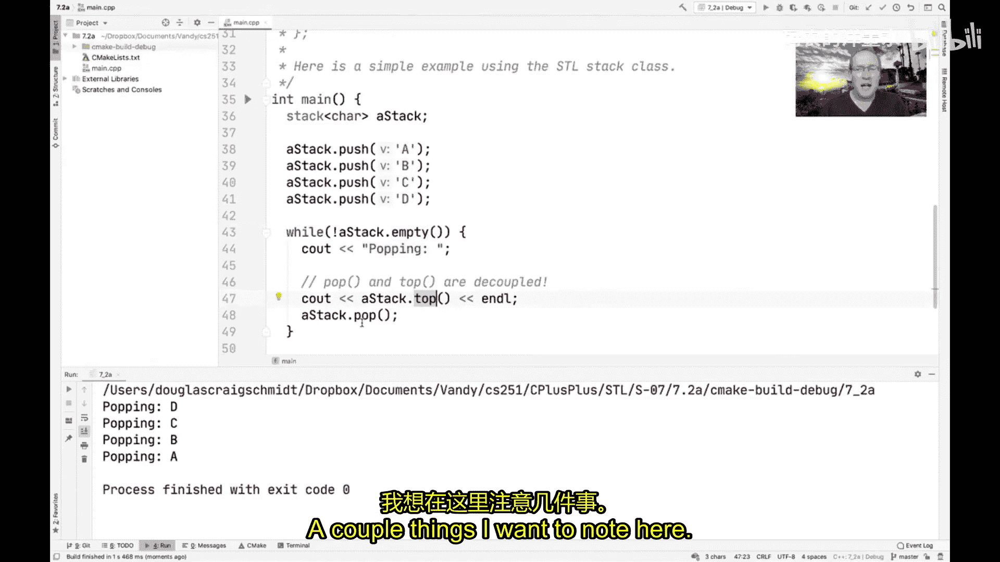

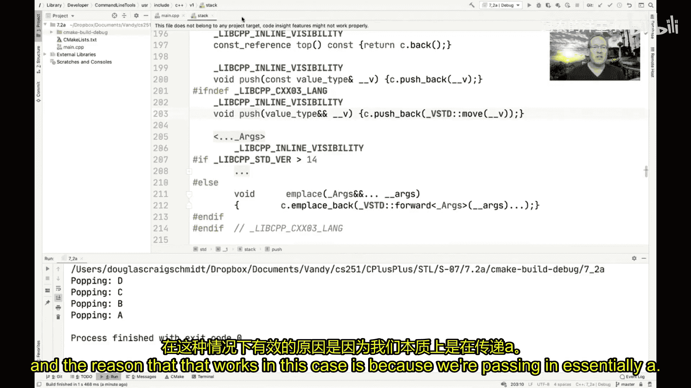

It's the character and this character is not going to live beyond the call to that method so we can just kind of move it into the stack。

😡，And we don't have to worry about cleaning up its value for scalar types like this。

 it's not a big deal， but for classes that actually have instructors and destructors and so on。

 user defined classes or system defined classes， that's a big deal to have these optimizations。

If we take a look at this push operation you can see there's also one that takes a constant ref of the value type so that would be in this case character and that actually does a true pushback with extra copies and then there's a third parameter or rather a third version of the method called in place and this does the magic veryatic arguments forwarding magic that's so cool in C++ and again if you have。

😡，Data structures that have complex constructors and value semantics in places the thing to go with for something as simple as the the scalar here the character yeah doesn't really matter when we talk about priorityq however i'll show you some places where it really does matter we'll use some different data types。

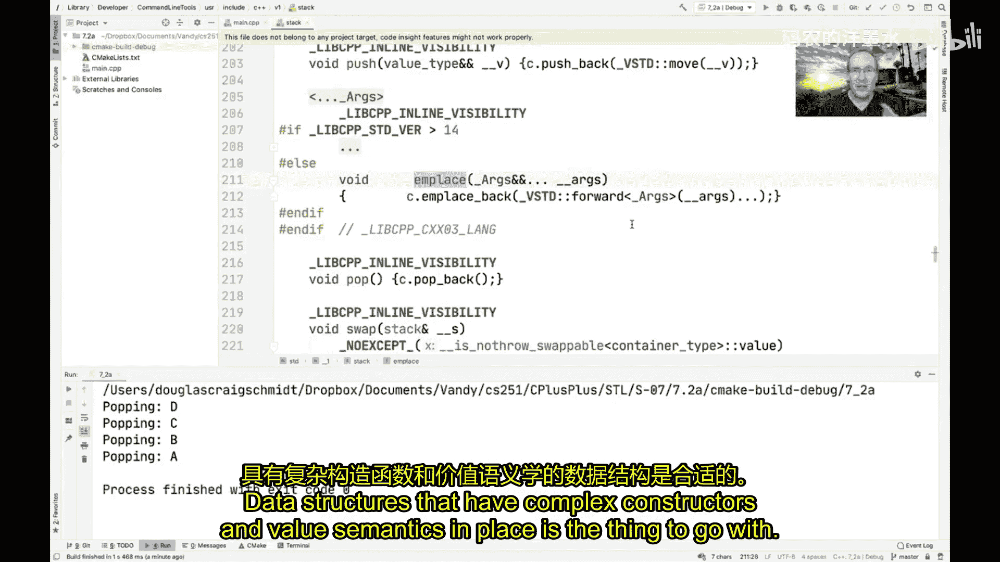

Okay， so that's stack， I think that's pretty pretty familiar。

 probably not a whole heck of a lot of surprises there。

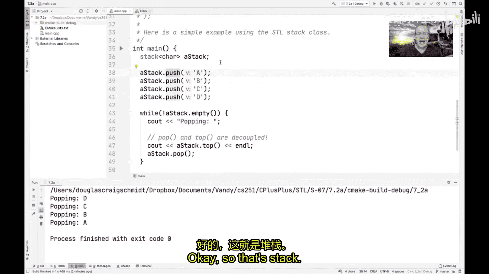

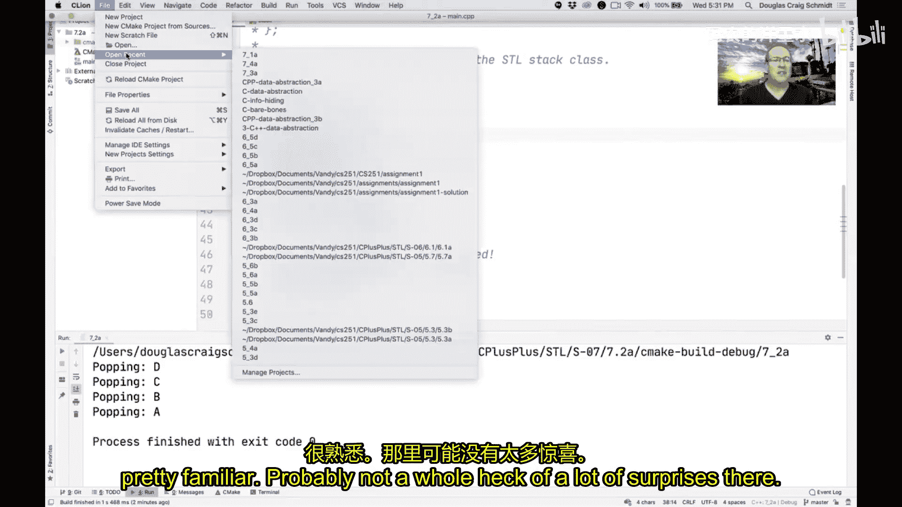

Let's now go ahead and take a look at Hugh。😡。

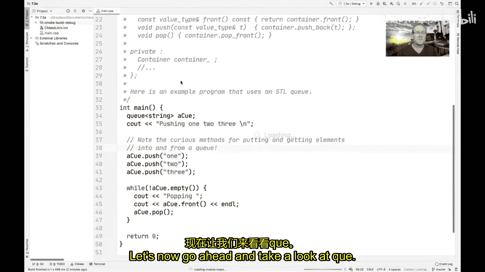

And you'll see that Q will hopefully also look very familiar like Stack。

 it's a data structure that is addressed in many data structure courses。

 and it's also something that people use very widely in practice in practice people probably use queuees more often than stacks。

 although of course it depends what kind of code you write。😡。

So a queue is a first in first out discipline where you have elements inserted at the end and then they're removed from the front。

 so think about you know people waiting in line at a movie theater or at the airport in cultures that queue。

 not all cultures queue， but in cultures that queue。

 then you do them in first come first serve order or first in first out order。😡，Again。

 the implementation of a Q adapted container out of the box is based on deck。

 but it would be easy to change that to make it a list and I probably should have shown you that with the other example。

 I'll try to show it here。😡，So here's what the queue typically looks like in a normal implementation。

 you have tight name T， which would be something like int or double or employee record or activation record or whatever you're keeping a queue of。

 and as before we also have a container as the second parameter that defaults to debt。😡。

Down here you can see the methods look very， very similar container the container constructor works the same way empty and size work identically as before。

 but unlike stack which had a top method the queue has a front method and you can see what it does is it says container do front whereas the one for the stack did container top or I'm sorry container dot back so stacks use back cues use front and then there's also some other interesting things here when you do an N queue to a queue for reasons that I think are rather odd you use the word push I don't think of pushing on a queue I think of putting in a queue or maybe inqueuing in a queue but for whatever reason the SL designers thought differently and they called it push so when you push something on a queue it goes to the back but when you pop from a queue it pops from the front and that's why you really need to limit yourself to sequential containers like。

Deck or list that have efficient pop from front semantics。

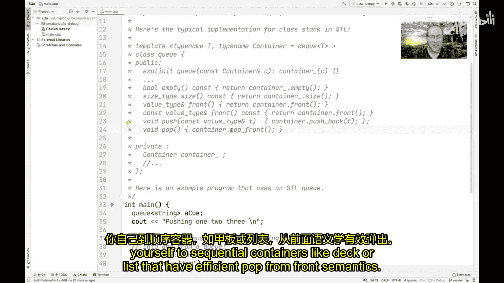

Okay， here is our Q example and I want to show you how you can modify this a little bit。

 let's let's go ahead and go up here and we'll include let's include lists just for kicks。😡。

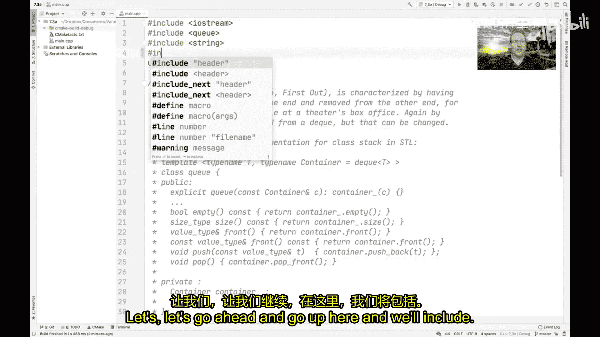

And then we can come down here and just for fun， we can say。Standard list。Sting。

And now we can convert this from a queue of strings using a deck。

 which is the default to a queue of strings using a list as the implementation of the container under the hood。

So that's just showing we can mix and match these things。

 it won't change the behavior of the program it might actually be a little smaller because a list is maybe more efficient than a deck depends on various factors。

 but anyway you can mix and match them as you see fit。😡。

So down here we go ahead and push some elements into the queue and then we go ahead and remove them。

 so let's run the code， see what it does。😡，As you can see here we are going to go pushing one。

 two three in that order and then we go ahead and pop the items and we get back one two three so it comes back in the same order it went in and again we can just loop while the queue is not empty and we get the item at the front of the queue and then we go ahead and pop the item in the queue。

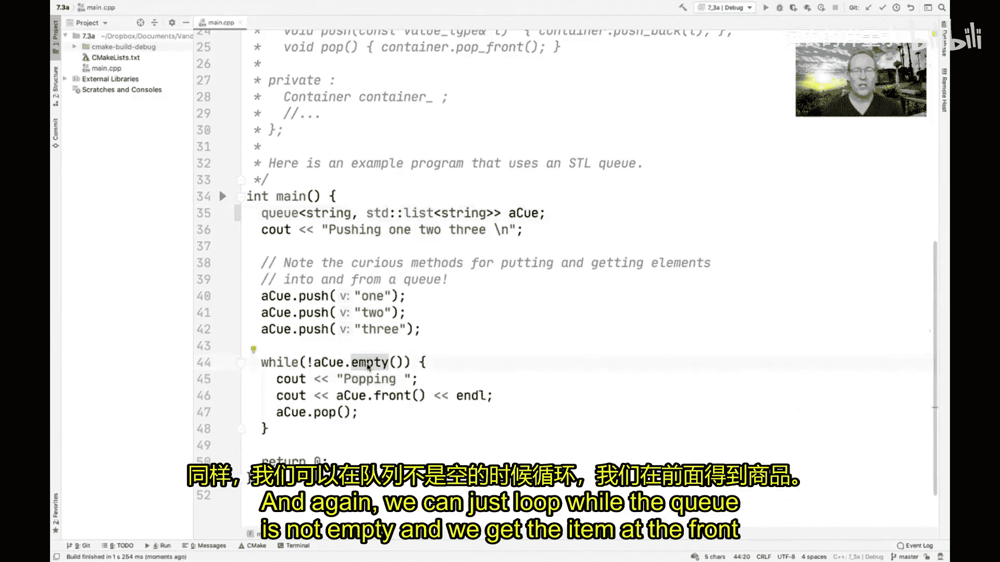

As with stack there are different variants of push and there's other things in here so let's take a look so we got a couple different versions of push this the one that we're using here is the R value reference one。

 there's also one that uses a con Ref with type T or the value type and then as with stack there's in place。

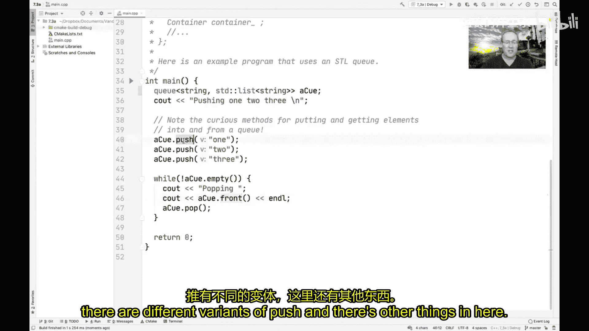

Again， we'll look at how these things play out when we talk about the priority Q example because it's more suitable for showing the differences between the different kinds of methods that you use to add stuff into the adapted container。

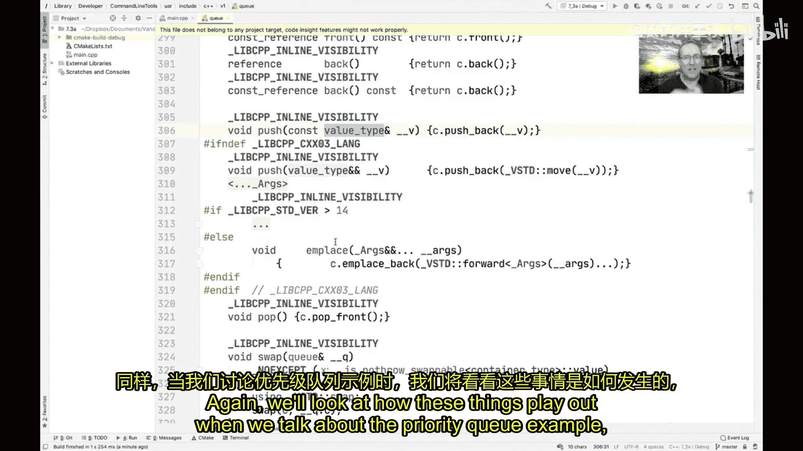

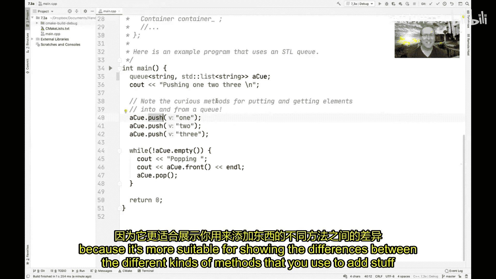

Okay， so that's the queue， pretty pretty limited， I probably in practice。

 a lot of the code I would write would want to use a threadsafe queue or a blocking queue or something。

 but if you need a vanilla kind of， is your cu is your data structure to go for。

 Q is your adapted data structure to go for。😡。

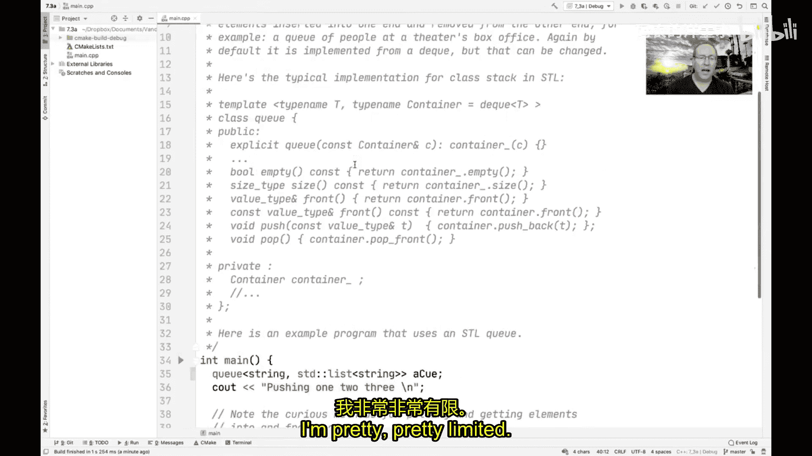

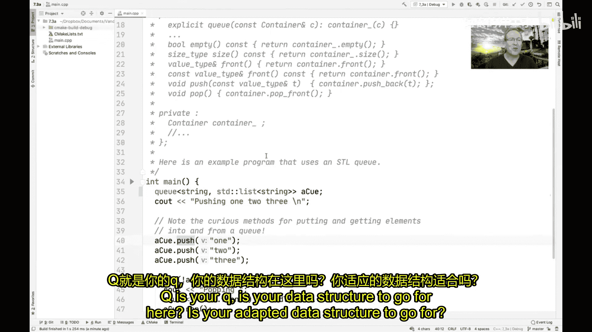

Okay， the third and final example we're going to talk about today is going to be the priority queue and this one is quite a bit more interesting than Q and stack and the reason for that is that with a priority queue they're stored in priority order such that the item of highest priority is always removed ahead of the items of lower priority and you can control the priority and the way you control the priority when you parameterize your queue。

 your priority queue with the data structure you want you have to make sure that the data structure you provide as a parameter defines the less than operator and that's what's going to be used to prioritize things appropriately。

😡。

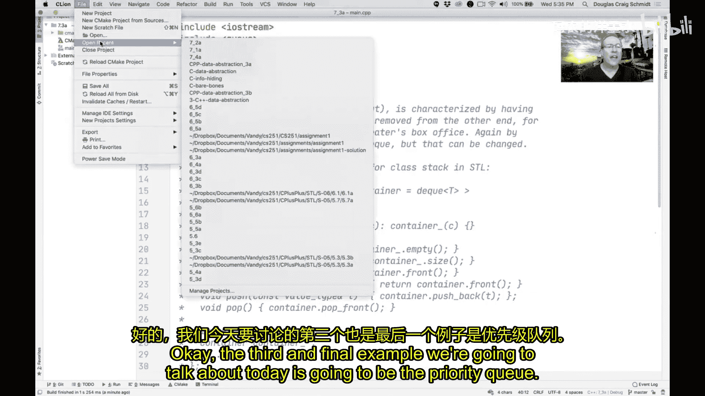

So we're going to be queuing things in this case called places and this is just a very simple kind of stripped down example so I don't make it a fancy class it's just astruct called place and inside thestruct we have two data members we have one thing that it's called distance so it's distance in miles and the other is the string of wherever it is we're trying to go so a place is a distance from some starting location again don't don't think too hard about the example's it's really just to show off the fact that we have a an operation less than defined that's really the whole point of this and so then we also have a constructor here。

😡，So you can see we've got an OSt insertion operator which we'll implement。

 we have a constructor which goes ahead and uses the base member initialization section to initialize the disk and the dust。

 disk and dust。That's all pretty straightforward and here is operation less than and that's what needs to be defined on the types of objects you parameterize the priority queue with otherwise it doesn't know how to order them and we'll talk in a second how it's actually ordered under the hood。

😡。

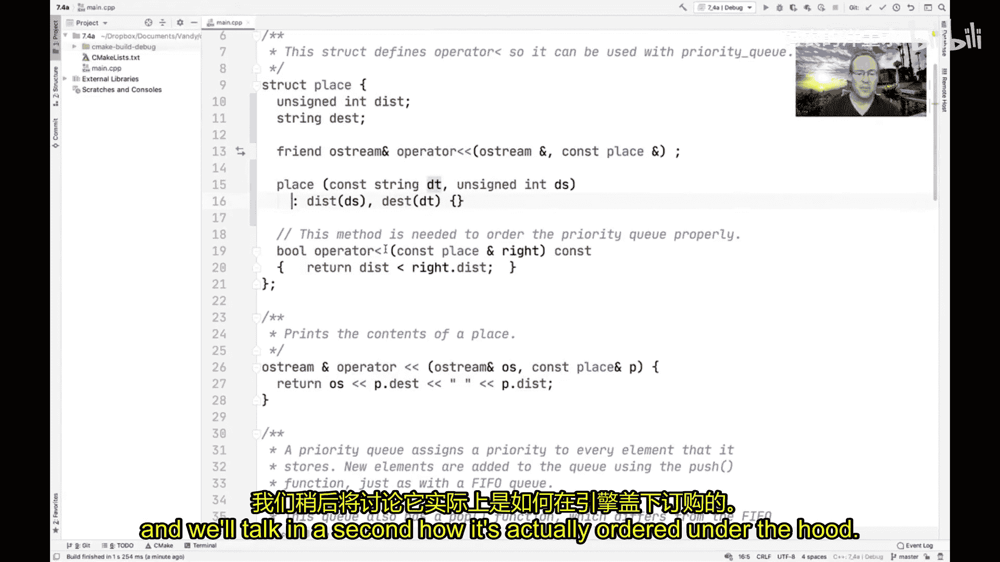

So that's kind of the data structure we're going to use， you can see here that if。😡，Our disk。

 if our data member disk is less than the parameter disk。

 which I probably should have called RHS or righthand side。

 then it's going to be considered to be a less than and we'll see how that gets used in the comparisons of the cues of the priorQ elements in just a moment。

😡。

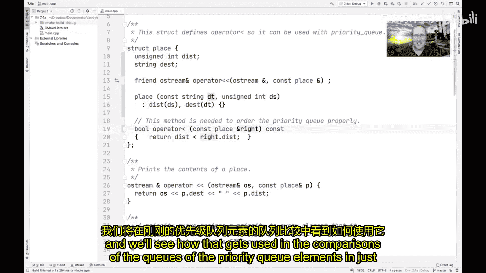

Here is the operator， the insertion operator that takes an O stream and sticks a place into it so we can print the contents quite easily here and basically we can say you know our destination is this far away from our stoning point。

😡，So what is a priority queue， well it's basically a way to assign a priority to every element that it stores and the new elements will be added to the queue using the push function just like we did with our FiIFO queue。

 the difference is that when it pushes it， it's going to put it into the right location in the queue relative to its less than operator。

😡，It also has a P operation just like the PIFOq did。

 but it differs from the PIO P in one key area when you call P on the priority queue you don't get the item that's been the longest instead you get the one there that has the highest priority。

😡，Excuse me。And so that that's what makes it a priority queue when you remove something。

 you always get the item that's at the front of the queue and the item that's at the front of the queue is always the item of highest priority and that's maintained by the discipline by the data structure and the algorithm used to write the priority queue and we'll talk about that in a second。

😡，There are lots and lots of examples of priority based queuing。

 a scheduler and an operating system would be a good example that always picks the thread that's got the highest priority to run。

Unlike stack and Q， which have their own header files， the Q。

 the Pri Q class is defined in the Q header file， and it uses the less functer by default to compare its keys。

😡，By default。But you can change this。And internally。

 the way it's implemented is it uses a vector that has been hepified and a heap is an almost complete partially ordered binary tree that has the property that you can insert items into the deck。

 you can remove items from the deck and you can find the item of the highest priority。

 well actually you can find the item of highest priority in constant time because it's always at the front of the deck。

 but you can insert and remove items from a deck in essentially log end time so it's very efficient。

😡，Here's what a typical priority co implementation looks like in STL。😡。

We have the priority queue that's parameterized by type T as before。

 it's parameterized by a container because it's an adapted container。😡，In this case it's vector。

 not deck， and then it's also parameterized by a comparison operation。😡。

The container and the comparison operation have defaults。

 defaults to vector and the comparison operation is going to default to less and it's going to do less on the value type of the container。

 so if you have a container of if you have a container which is a vector and we were parameterizing this thing with a place。

 then the value type would be place。😡，Let's take a look at the various constructors and methods and so on。

 so it takes a priority Q constructor that takes a compare functer and by reference by contfe and also a container by constrfe。

 just the container parts like Q and stack， the comparison operation is different。

 the comparison functer is different because we have to do comparisons。Then we have empty and size。

 those are the same as before top returns the front of the container。😡。

And then you can see push and pop do a little bit of cool magic。

 so when you push something into the container， you add it at the end and then it calls an internal method that's part of the STL algorithms interface called push heap and that goes ahead and rearranges the contents of the vector to heap it to turn it back into a heap using the comparison puncter and then pop does much the same thing you go ahead and call pop heap。

😡，And then you go ahead and get the last item so it basically removes it。

So this kind of shows you how things work under the hood and we'll take a look at that code in a second。

Under the hood， the container and the comparison。Funter are stored as private data members。

So here's the program we're going to use， we're going to have ourselves a priority queue that's parameterized by place you saw place before and then we're going to show a couple different ways。

 three different ways actually to add items into the priority queue and then we're going to go ahead and print out the contents of the priority queue and of course it'll come out in priority order so let's go ahead and run this code just so you can see what it does。

😡。

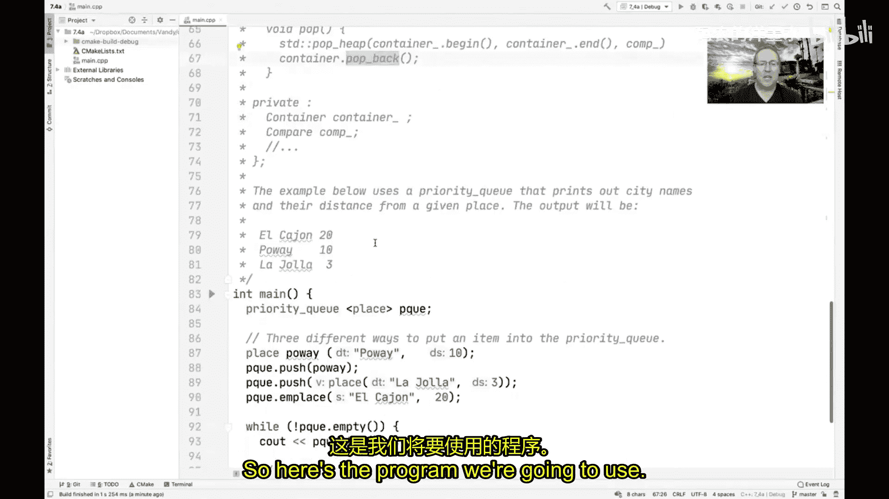

So it goes ahead and it says the item of highest priority is L Kon which is 20 miles from probably from San Diego Poway which is 10 miles and La Jolla which is three miles so you can tell how priorities work here the items that's got the biggest value is the one of the highest priority so this is a priority system where bigger is better sometimes priorities。

😡，Smaller is better， but in this case， it's bigger is better。

So that's basically how this works and it did it by basically pushing those three elements or three elements into the priority queue。

 and then while the queue wasn't empty， we printed the top item out and then we popped it from the priority queue。

😡。

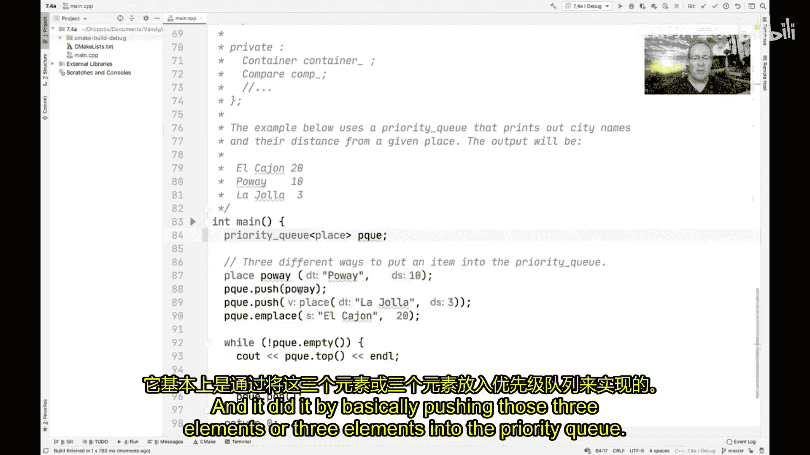

What I want to focus on here though are three different ways of getting the data into the priority queue and please note that these three different ways are also the same for the stacks and cues we've talked about。

 it was just in those cases I was using data structures like characters or strings strings would actually be interesting too but I was doing it in such a way where we didn't really demonstrate the coolness of these different features。

😡，So the first way we do it is we make ourselves an object called Poway which is going to be a place that's got the name Poway and has the value 10 as the distance and then we go ahead and we push that into the party if we go look at which push method is called this pushes。

😡。

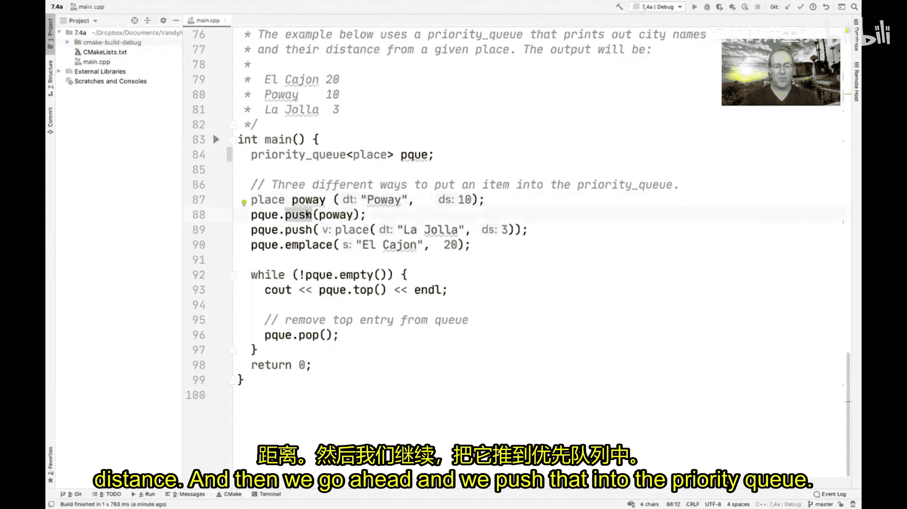

A constant ref value type object， and so you can see it pushes it into the end of the container and then it reheifies everything。

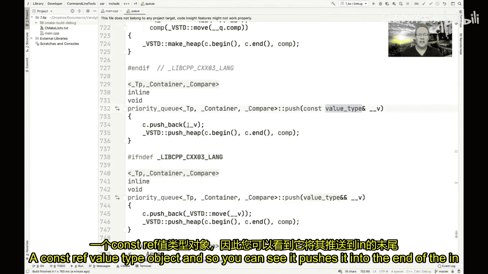

All right， so and the reason it uses that version is to we actually had a real object and that object may need to live beyond that call。

 so we need to maintain its value。😡，The next thing we do here is we go ahead and we place sorry we push an anonymous instance of place。

 so this object only lives as far as this method call， it doesn't live beyond that unlike Poway。

 which conceivably could have been used later， although we didn't use it later。😡，So this push。

 when we call this with La Jolla。It goes ahead， and it uses the。Our value reference version of push。

 which uses under the hood uses the move semantics。And。

So the move semantic version of this is going to essentially steal the contents of its parameter。

 leaving it a husk or a shell of its former self， but that's okay because it was only meant to be used temporarily so there's going to be less overhead for doing this version。

😡，And the third version of this is the in place version。

 and this is similar to the the other one the one that uses R value references。

 but it's even further optimized and if you take a look at this it takes in a。

Biaiaic template and all it does is it calls the in place back method on the underlying container in this case a vector and it uses the forward。

😡，Method that's part of C++ and the Var As parameter template parameter list that's passed in with the dot dot dot syntax and that basically goes ahead and does the em in place so there's no additional copies it's super duper duper fast。

😡，In terms of making memory copies or borrowing anybody's data and so on。

 and then it goes ahead and reheifies everything once it's put in there。

Just for kicks let's go ahead and look at what top does so you can see top just returns the front I told you that before and let's go ahead and take a look at top oh not top top。

😡，So you can see what it does is it calls pop heap。😡。

Wwhich rearranges the data structure to get rid of the item that's currently on the front and then it goes ahead and callsP back to remove it from the underlying container so these are the different implementation artifacts。

 the pop one is not as interesting as the two variants of push that we saw up here and in place those are really cool and the second version of push with the R value reference and in place are features that were added in later versions of C++ using the newer cooler C++ template facilities and move Sammantic。

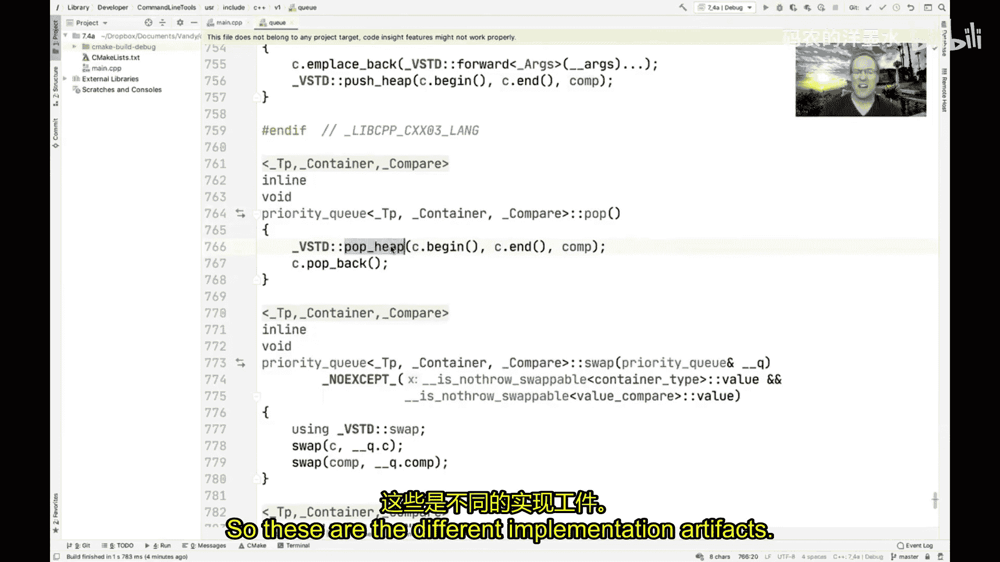

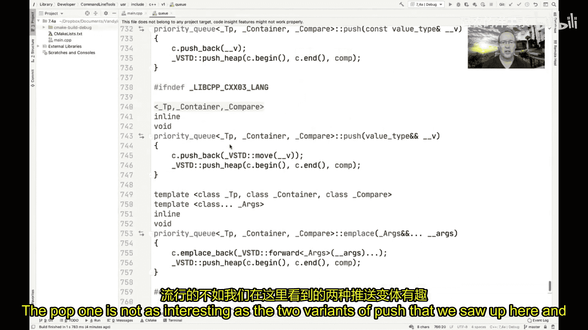

Okay， so those are the topics that I had wanted to cover today。😡。

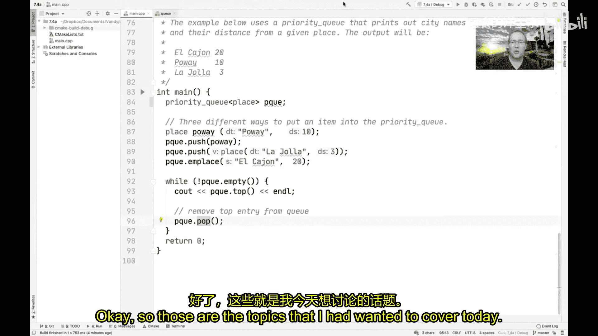

What I'll do is just kind of wrap up at this point what we'll start talking about next is we're going to start talking about funcctorters。

 which is a really really cool part of C+ plus standard template library and you'll see that we can use funcctors to guide the behavior of algorithms as well as to guide the behavior of the underlying containers so for example with our priority queue we just looked out we could have used a greater functer as opposed to the less functer in order to change the way in which the items were organized if we'd use greater as opposed to less than the items that were smaller would have been the highest priority whereas the way we did it the ones that were bigger were the highest priority。

So that wraps it up for today， thanks to everybody for coming and supporting my channel。

 if you like this content， please leave a like feel free to subscribe and you can also follow me on Twitter thanks very much。

