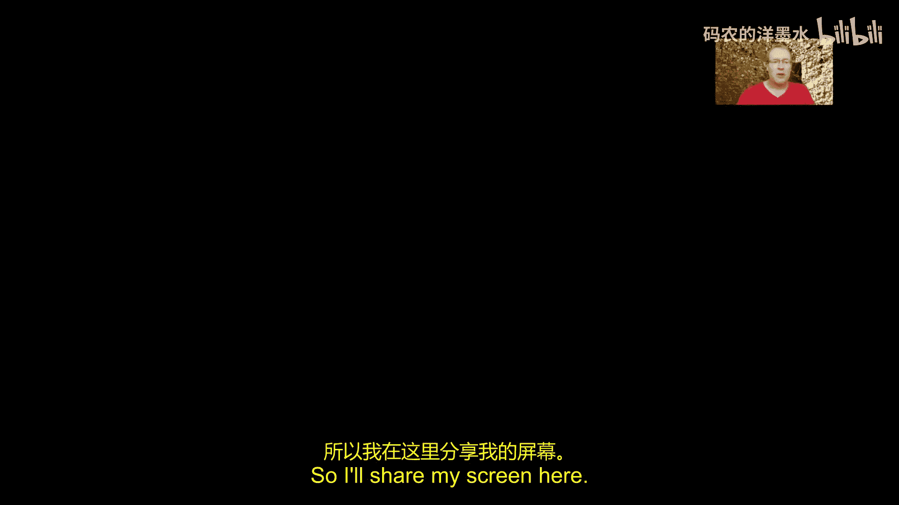
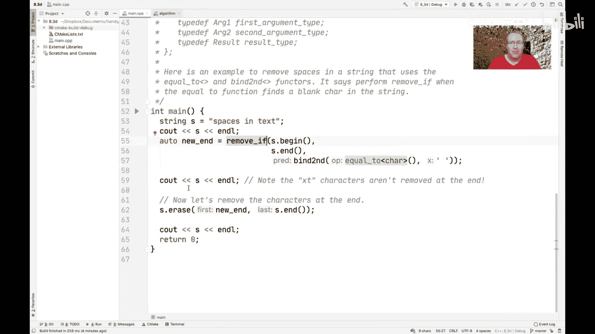

# 【全集】范德堡大学 C++标准模板库 中英字幕 1080P p18 Lecture 18 - Functors -BV1KWiCBWE7M_p18-

Hello and welcome to the next session in my webinar series on C++ Standard Templet Library by example。

Today we're going to finish off our discussions of C++ STL functionsctors yesterday we provided the conceptual foundation for functionsctors with our discussion of function pointers and pointers to member functions。

But now we're going to actually talk about the funcctorters themselves， so as always。

 let's take a look at what code we're going to examine and then we'll jump right into it。😡。

So I'll share my screen here。

As you can see， the code we're going to look at here is in my C+ plus。

STL S08 folder and it's in the 8。2 and 8。3 subfolders and this of course is all on my Github repository。

So let's go ahead and take a look at the code。First of all。

 just to recap a functer or a function object is an object that can be called as if it were a function。

 and the way it does this of course， is that it overloads operator function call or method call。😡。

And there's a whole pile of fluters that come out of the box with STL that we'll take a look at here shortly。

 things like arithmetic operations like plus minus and divides。

 things like relational operations like less and greater。

 as well as some of the more esoteric logical operations like logical and and logical ore。

If you want to create an object that behaves like a function。

 you just need to be able to define the operator function call and that's an easy thing to do and you'll see that with C++ lambmbda functions。

 which we've touched on briefly and we'll explain in more detail later。

 you can do some really cool things without even having to define a full blownown funter class so you can actually use lambmbda expressions to define these functors essentially in line Funs are an improvement over C++'s traditional function pointer mechanisms that we examine the previous day。

😡，While you can still use function pointers if you want。

 and I'll show you some cases where you can switch back and forth between function pointers and funcctors。

 the ability in C++ SDL to be able to optimize functors by using inline method expansion。

 as well as the ability to be able to store state in the funter objects makes them in many ways a lot more desirable than using the more traditional pointer to function technique that comes from C。

So let's take a look at a very simple example， this is a very simple function object it's a stateless functer because it doesn't store any state inside the object itself and as you can see we have a class called simple functer object and the name gives away its fact is very simple and all it does is it basically defines operator function call with one parameter and it simply returns that parameter so it's kind of a mindless example but it just is there to get a start syntactically。

😡，Then down below we see how you can use this particular functioncter。

 we define a functer called a funter of type simple function object。

 and then we can go ahead and call it as if it was a function call。

 we can say a functionter openP five closedP and that looks like a function call。

 but in fact it's actually calling this method on the simple function object object。

Or if we want to be a little bit more verbose， we could also call it with this syntax so you can say a funter dot operator function call open close pre and then pass the parameter in that way I would very rarely if ever write code like that much more likely to write code like this and of course in practice I'm also likely to use functors that are a heck of a lot more interesting than the one we just showed this is just here to kind of wet your appetite and get us started。

So since that was pretty simple， let's go ahead and take a look at another example。

So this is the second example we're going to look at。

So it turns out that there's a whole pile of functors that come out of the box with C plus plus STL and these are all found in the functional。

Header file and they all derive from certain base classes So from basically there's binary function and unary function based classes and so those are kind of the building blocks upon which the other fun。

Classes are derived。So let's take a look at some of the examples of functors that come out of the box with C++ STL。

 so as you can see the first chunk here are all the arithmetic operations like plus and minus and multiplies and divides。

 as well as the ones that are a little bit more obscure like like modulus。

 which is the binary modD operator sometimes we joked that CNC++ were attempting to use all the funny characters。

 all the special characters on the keyboard and they certainly did that nicely with the operations they define。

The funter classes， as you can see， are a bit more intuitive in terms of the names that they provide。

Then there's also a bunch of relational operations or comparison operations like equal to not equal to less greater and so on。

 and they have corresponding funding behavior。Similar to the the operations you can write in code now at this point you're probably going why why do we have to have all these classes when there's already operators built in and the basic reason for that is that this allows us to be able to parameterize these functionsctors in algorithms and in containers in order to control and strategize their behavior。

😡，And then lastly， there's also a bunch of logical functions like logical and logical or logical knot。

 I don't tend to use these very much， but they do exist。So as I mentioned before。

 these are the funter based classes， so you can see we have binary function。

 which takes two parameters or aG one and a two as well as the function template parameter for。

The result type and then it goes ahead and actually defines names for these things these are all examples of traits。

 by the way， so first argument type second argument type result type those are all things that come along for the ride as traits of a binary function and it probably would not be much of a surprise to recognize that。

😡，The plus operation is a binary function that's parameterized by TTT。

 so it's going to work on the same consistent types。

 and you can see here just as an example the operator function call on the plus functer takes two parameters by contra and then adds them together and returns the result。

And I think it again， it'll come as no surprise that。

The minus and the multiplies and the vis functionss also do the same sorts of things just with the corresponding subtraction multiplication and division operations so so no real surprises there other than the fact that we're getting a name for something that will end up turning into an operation on parameters。

Here's an example of a unary funcctor so this is the uninary functer struck the unary functer type creator and as you can see here it takes a single argument and has a return value and an example of a unary function would be negate so you can see negate inherits from unary function gets its parameters。

 it rather gets its type traits and then it defines operator function call to negate the result that's passed to it。

All right， well it still may be a little bit mysterious as to why we're doing this kind of stuff。

 so let's take a look at some examples that will make it more clear。

So here's an example of a user defined funter that extends the unary function template。

 so here's a unary function and we define a unary function called is even and that's a great example of kind of a predicate and if you take a look here you can see that is even takes。

It defines a single。Method， the function call， it takes an int。😡，I。

 and then it goes ahead and it says。Cast the result of the i modulus2 negated。

 so what this is trying to say is is this an even number and if iMo2 negated is true then that will be treated as true。

 the result of it is even will be true otherwise it will be false and you can see that the parameters that are passed into the unitary function template are int because that's the type that we're passing as the parameter to operator function and bo because that's the result we're returning from operator function call。

😡，Okay， so far， so good。So down here， you can see how we're actually going to use this particular。

Funter for a nice simple little example， so we're going to define ourselves a vector and then we're going to go ahead and push 20 numbers into it1 to 20 so we go ahead and push those things into the vector。

😡，And then we're going to go ahead and print the results of the vector， and I probably should be。

Using auto here just to be more abstract I think you probably knew what it was and then down here we're going to go ahead and call the count if algorithm and we're going to take a look at the code for count if in just a moment。

 but before we look at the code what it's going to do is it's going to iterate through the range from the beginning to the end of that vector and for every element there it's going to call the is even funter。

😡，And as you can see is even is an anonymous what is even is doing is the any is even constructor is creating an anonymous object of the type up here。

 the is even type so we are going to pass an anonymous object into count if and then that anonymous object method call operator will be applied to each value in that range so let's go and take a look at the code here。

😡，So here is the countiff algorithm coming straight out of the SL algorithm header file。

 and you can see what it does is it's parameterized by an input iterator and a predicate。

 which of course will be the functer。And so it takes a range from first to last that's the iterator range。

 that's what we saw right here from AVEC begin to AVc end and we're going to crank away through this thing and every step along the way for each element that's in that range we're going to apply the predicate and of course that predicate is going to be an anonymous instance of the is even functer so we make an anonymous instance that gets passed by value into countiff as the third parameter as the predicate and you can see that what it does here is it caused the predicate using the function call operation on the predicate object on the functer and what'll happen is it'll pass in the the parameter that's pointed to by the iterator that we're currently walking through so star first and in our case it's an int and it'll return either true or false is it even or is it not。

As you can see here， if it returns true， then we increment the count by one。

 otherwise we don't do anything and when we're all done。

 we go ahead and return the value that we've stored here you could also see how the countF method goes ahead and defines something of type integer sorry iterator traits input input it difference type so it's going to go ahead and create essentially an object that it can use to increment each time through。

😡，So armed with that knowledge of what the functer does and armed with that knowledge of what countif does when past the functer as a predicate。

 let's go ahead and run the code。And you'll see here that we're going to give it the numbers one through 20 and it comes back after calling countiff and says10 numbers are evenly divisible by two which of course is correct now youll notice it didn't say what those 10 numbers were but obviously they the ones that evaluated to true using the is even predicate。

Okay， so that's a very simple example of writing your own puncter and then passing it to an existing algorithm。

😡，What we're going to do now is we're going to take a look at some other examples that are a little bit more interesting。

😡，And the reason why they're interesting is because they're going to use a bunch of the built in functionss that come out of STL。

And we're going to focus here on the arithmetic functions we'll look at some other ones later。

 and most of the arithmetic functions are binary operations that return the sum， the difference。

 the product or the division of the first argument and the second argument。

 and so obviously binary as usual means two parameters and unary means one parameter or one argument。

😡，So here are a bunch of the different types， probably should use a font that's a little bit more forgiving。

😡，Richard Hendrickx would not be happy with me because I'm probably using。

Oh actually he would be happy with me because I'm using tabs。

 not spaces that if anybody's here has ever seen the classic Silicon Valley TV show。

 there's a wonderful episode where the main protagonist Richard Hendrickx gets mad at his girlfriend because she uses spaces and he uses tabs and he can't possibly understand how anybody could use。

Spaces instead of tabs， which I think is funny I'm actually a space person myself。

 but be that as it may。Okay， so here is our program we're going to use。😡。

We're going to define a vector that has a bunch of floats in it and I guess some。😡，Let's see。

I guess in this particular case they're treated as floats， but I could give them different numbers。

 I could say 1。2 and 3。7 or so on， I just gave them integral numbers that get promoted to the corresponding floats。

So now what we're going to do is we're going to go ahead and do some operations that demonstrate how the arithmetic functionss work。

😡，And we're also going to demonstrate a few other things too that we'll talk about in more detail later so one thing we're going to demonstrate is a couple of transform algorithms which are super cool algorithms in STL and we're also going to start kind of giving a little foreshadowing of something called a binder we're going to talk about binders in more detail next time we get together but for right now let's just focus on a simple use case So what we're going to do here is the comments say is we're going to take every one of these values and we're going to march through them from beginning to end。

And then we're also going to take the same values and we're going to march to them from beginning to end and at every step along the way in those two ranges。

A values we're going to apply the multiplies binary operator and what that's going to do is it's going to multiply the values together and then it's going to store them somewhere and it's going to store them on top of themselves so we're basically going to multiply all the floats into the vector by themselves and store them into the vector or back I should say store them back into the vector so we're going to store them right back into the vector from where they came。

😡，Now we don't have to do that， we could put them into a different vector。

 but we're going to put them in the same vector just for kick。And after we're done。

 we're going to go ahead and print the contents of that vector out using our copy trick with the beginner end iterator and the O stream iterator adapter to write it to the output。

😡，Then the next thing that we're going to do， and I think just for kicks I'm going to get rid of this new line and put a space because it's a little easier to follow along if I do that。

Then the next thing we're going to do so now we're going to take all the contents in the vector we've already multiply them by themselves and now we're going to divide all the contents in the vector by three and then store the result back into the vector。

 the same vector and the way we do that is we start using the four parameter version of transform as opposed to the five parameter version of transform we used before and the four parameter version is similar to the five parameter version with two main differences first of all it only has a single range。

 not two ranges and it also takes a unary， not a binary fun and in this particular case the func that we're going to do is we're going to take the divide fun which is a binary funter。

😡，And we're going to bind its second argument to the value three or to the float 3。

0 and so what that's going to do is that's going to go ahead and divide all the floats in the vector by the value three and it'll update the vector in place again。

😡，So let's say and store them back into the vector， so into the same vector。

And then we print the results out and again， let's make things a little bit more legible。

By writing the code like this。Okay， so that's what we're doing。

 let's go ahead and run it and see what the results are and then I'll explain it a little bit more。😡。

So you can see we took the original input， which I probably should have printed out the original code。

 so that's super easy to do with STL because we just go ahead and copy。😡，The code up here。And。

Reformat it just the taD。嗯。And now let's go ahead and rerun this so you can see the first。

Round of results。So the original values were one， two， three， four， five。

And then we went ahead and multiplied them by themselves， so we ended up with14，9。

 16 and 25 because that's multiplying them by themselves。

 and then the last thing we do down here is we go ahead and divide everything by the float value 3。

0 and what we end up with is the result of dividing all these things by three within the precision that C++ floating point arithmetic will permit us。

So that's basically what's going on let's take a look for kicks at the transform algorithms we can peek into their code we'll talk about transform again later when we actually get into the algorithms part of the course。

 but for right now let me just give you a foreshadowing of what's coming。😡。

So here's the transform algorithm， you can see it takes quite a number of parameters。

 it takes an input iterator and it takes two input iterators。

 it takes an output iterator and a binary operation。😡。

That's the templates that are passed into it and then you can see that it has a lot of parameters it has an input iterator called first and an input iterator called last and those are first one and last one we then have another input iterator called first two which is expected to have the same range as first one to last one and then we take an output iterator called result for this particular example we put the results in the same vector we were manipulating so we were updating the vector in place but you don't have to do that you could always use pushback or you could put it into another vector and so on。

😡，And then we pass in a binary operation， which is obviously going to be a functer that takes two parameters。

So let's take a look at how this is going to be implemented for I basically for the beginning of this thing for first。

 while we don't hit last， we're going to go ahead and call the binary operation。

 which is our funter passing in first one and first two's value by dereferencing them that's going to apply the operation。

 and then we're going to store the result in the dereference result output iterator。😡，Now again。

 looking back at our example you can see how we did everything in place here。

 so we went through the range twice so we are multiplying the objects by themselves essentially and then we store the results into the same vector that we're getting the values from and that all works fine because of the order in which these things take place first we do the operations on first one and first two and then that gets stored in result and by that point we're ready to move on to the next element in the range and that's exactly what we do we go ahead and increment first two and we increment first one and we also go ahead and increment result so we're just marching down one at the time and when we're all done as is often the case with the STL algorithms like copy and so on and transform and other other things like that we go ahead and pass back the result after doing the increment on each one so you could kind of chain these things together if that made sense for your particular use case。

Okay， so that's the five parameter version of transform let's go take a look at the four parameter version of transform so here's the four parameter version of transform it takes similar types except it takes a unitary operation。

 not a binary operation。😡，And likewise， it has a bunch of parameters。

 you can see it takes a first input iterator to a last input iterator。

 it takes an output iterator to put the result and it takes a unary operation and what it does is it marches through that range from beginning to end。

 and this time it applies the unary operation on each element that's being iterated over in turn and stores the results back into star result。

😡，And then it finally returns that at the end， so this version uses unary operations。

 whereas the other one we looked at， the one that I think is right here uses binary operations。😡。

So those are examples of transform we will see that transform is a very powerful algorithm。

 it's kind of like map if you're familiar with Java and Java streams。

 it's kind of along the lines of the map operation so it takes its input。

 does something to it and returns some output。😡，Okay， we have one more example to go。

And let's go ahead and look over here to find that。L， it's this one。

So now what we're going to do is take a look at some of the relational operations that are supported by the STL。

😡，And as you can see there's the obvious ones you might expect not equal to equal to less greater less than an equal greater than and so on。

 so these are all the things you'd normally expect to have with C and C++ arithmetic operations just defined in terms of funcctors so we can parameterize algorithms or containers with these。

As you can see here， you can also create your own if you want by basically inheriting from urary function or binary function as we had talked about before。

So this particular example is kind of fun what it's going to do is it's going to have a string and that string is going to have spaces between each of the words and the string so the string itself is called spaces in text then indeed that's what it has and what we're going to do here is we're going to print the string and then we're going to call a very interesting method called remove if。

😡，And remove if is going to go through the range from beginning of the string to the end of the string and every step along the way it's going to remove anything that happens to match the predicate that's passed in and the predicate here is a space。

😡，And so we're going to use this binder， this bind second binder adapter。

 we'll talk more about that next time and the binder adapter here is used as was the case with the previous example with transform to convert a binary functer into the expected unary functer because remove if expects a predicate which is essentially a unary functer expects one value so what we're doing here is we're saying。

😡，Take out anything in this range that's a space， so that's why we're removing the space。😡。

And what we get back from this is a new iterator to the end of this string that no longer contains any of the characters that we've removed and I'll show you how remove if works in a second it's kind of interesting Now we're going to do two things here first we're going to go ahead and just print out S again after we've removed the values and you'll see that it actually hasn't removed them they're just at the end and you'll see what that means when I look at the code with you in a second but then if we really do in fact want to remove them。

 we can use the erase call on string and we can pass in the new end which is what we get back after we remove stuff going up to but not including the old end and so that actually erases them from the string they're no longer considered part of the string so when we print the final string we'll get the version that actually removes all the spaces and doesn't leave anything else in its place。

😡，Let's go ahead and run the code， you can see here we get the original strings says spaces in text。

😡，Then after we do the remove if and get the new end， when we print the old string。

 we get spaces in text X T and of course the Xt here corresponds to these two characters left over at the end。

😡，And that may give you a hint as to what ReI is actually doing and we'll look at its code in a second。

And then after we erase everything， now we just say spaces in text。

 so the final Xt has been eradicated or erased from the end of that particular string。😡，All right。

 let's go look at remove this implementation and see if it can make sense of what it's actually doing and。

😡，It's doing some interesting things so first of all。

 let's kind of take a look it's one of the longer。One of the longer sG algorithms we've looked at so far。

 so you can see it's given a forward iterator， which means we can read to it and write to it and it's given a predicate those are the template parameters and then remove if takes two forward iterators one to the beginning of the range one to one past the end and the predicate。

😡，And the first thing it does is it goes ahead and it says。Is。

This particular does this particular predicate match anything at all in this range。

 and so it uses another STL algorithm called find if。😡。

And so what find if does is it goes through a range from beginning to end with a predicate and it looks for the first match。

 and the second it finds a match， the second the predicate returns true。

 it returns an iterator to where it returned true。😡。

So we use this to kind of make the code a little bit shorter and kind of leverage existing functionality that was added to STL。

😡，So if what we get back here is something that doesn't equal the last。😡。

Iterator that was passed in as a parameter we know that there was in fact one thing that matched at least one thing that matched so what we do then at that point is we go ahead and we start from where we left off when we found the match。

😡，And we're going to go ahead and increment that by one and we're going to keep going to we find the end and every time we go through here。

 what we're going to do is if there's a match， we're going to ignore the item。😡，I'm sorry， yeah。

 if there's a match， we're going to。Re're moving if if we have a match we're going to overwrite the item if there is no match we're going to ignore it it's a little bit complicated to think about so in other words if the predicate doesn't match then we go ahead and copy the contents over but if the predicate does match we're going to ignore it so it doesn't get copied over and so what we're basically doing whatever we find a match is we're copying over that element in in the underlying container using the iterator as a way to control access to it and you can see here that because this is C+ plus 17 or whatever the compiler is we can use the move semantics to do that move very efficiently without having to do a lot of unnecessary copies so that's some cool stuff that's brought along for the ride by using newer versions of C++。

😡，So we're basically doing whenever we find something that matches we're sliding stuff over on top of it and quote removing it。

 but what happens when we get all the way to the end is we return a new。😡。

Iterator to the place we left off when we reach the end。

 but anything to the right of that in the container is going to still be there and so if we don't want that to be the case because remember we split everything down if we don't want those things to be there when we're all said and done then we have to go in and we have to erase them by using the erase method passing in the new end which is what came back from remove if going up to of course。

 but not including the old end and that will then update the container itself you might ask the question why can't remove if update the container well the reason of course is that remove if doesn't know anything about the container Italy knows about the iterators it's past from the container which it doesn't have a way of distinguishing what the actual type of the container is so after we do remove if if we want to chop the container to not include the elements that werere at the end then we go ahead and call erase and this becomes even more clear and we'll see examples of this later when we。

😡，Talk about using remove if and other remove operations when we're dealing with built in C style arrays where you really couldn't remove them without doing some other fancy footwork because there's no way to erase them because they're part of the array。

Okay， so those are the things that I had wanted to talk about today。

 what we're going to do next time is we're going to go into more detail about the many。

 many function adapters that are available in STL and we'll talk about the binders。

 we talk a little bit about binders today， we'll talk more about binders next time we're also going to talk about negators。

😡，We're going to talk about basically the pointer to function and member function adapters and so on。

 some of which are really cool but some of these things are a little bit more esoteric so I think the key thing that we do when we get together next time is we'll go through the binders and then the Gators those are actually very。

 very important because you can use them to chain together sequences essentially functional programming operations and they can actually get quite involved and that's one of the things that makes STL so powerful is all these things can be composed together and the compiler can optimize the heck out of it because under the hood a lot of these things are just inline function calls that the compiler can compose and then optimize and compress so it's very efficient very cool very abstract and it's yet another great example of C+ plus support for zero overhead abstraction。

So thanks again for joining， if you enjoyed the content， please like。

 please subscribe and feel free to follow me on Twitter。

