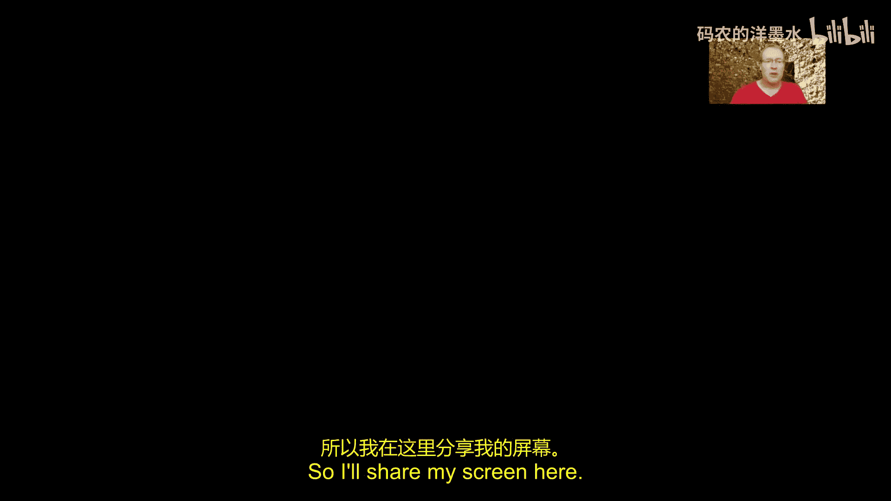
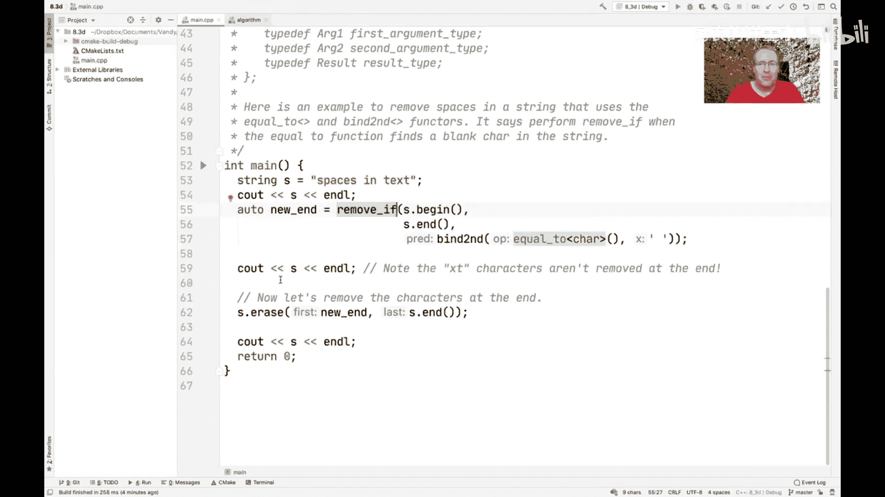

# C++标准模板库：18：函数对象



在本节课中，我们将完成对C++ STL函数对象的讨论。上一节我们介绍了函数指针和成员函数指针，为理解函数对象奠定了概念基础。本节中，我们将具体探讨函数对象本身。

## 概述

函数对象，或称仿函数，是一个可以像函数一样被调用的对象。它通过重载函数调用运算符 `operator()` 来实现这一行为。STL提供了大量内置的函数对象，例如算术运算（`plus`、`minus`）、关系运算（`less`、`greater`）和逻辑运算（`logical_and`、`logical_or`）。与传统的C风格函数指针相比，函数对象允许编译器进行内联优化，并且可以在对象内部存储状态，因此在许多场景下更具优势。

## 函数对象基础

一个函数对象的核心是重载 `operator()`。以下是一个非常简单的无状态函数对象示例：

```cpp
class SimpleFunctorObject {
public:
    int operator()(int i) const {
        return i;
    }
};
```

要使用这个函数对象，可以像调用函数一样调用它：

```cpp
SimpleFunctorObject aFunctor;
int result = aFunctor(5); // 调用 operator()(5)
// 或者使用更冗长的语法：
// int result = aFunctor.operator()(5);
```

## STL内置函数对象

STL在 `<functional>` 头文件中定义了许多现成的函数对象。它们主要派生自 `binary_function` 和 `unary_function` 这两个基类，这些基类定义了参数类型和返回类型等特征。

以下是主要的函数对象类别：

*   **算术运算**：例如 `plus<T>`、`minus<T>`、`multiplies<T>`、`divides<T>`、`modulus<T>`。
*   **关系运算**：例如 `equal_to<T>`、`not_equal_to<T>`、`less<T>`、`greater<T>`、`less_equal<T>`、`greater_equal<T>`。
*   **逻辑运算**：例如 `logical_and<T>`、`logical_or<T>`、`logical_not<T>`。

这些函数对象允许我们将操作本身作为参数传递给算法或容器，从而参数化其行为。例如，`plus<int>` 的 `operator()` 实现如下：

```cpp
T operator()(const T& x, const T& y) const {
    return x + y;
}
```

## 自定义函数对象与算法应用

我们可以通过继承 `unary_function` 或 `binary_function` 来创建自定义函数对象。以下是一个判断数字是否为偶数的谓词函数对象：

```cpp
class IsEven : public std::unary_function<int, bool> {
public:
    bool operator()(int i) const {
        return !(i % 2);
    }
};
```

这个函数对象可以作为谓词传递给STL算法，例如 `std::count_if`：

```cpp
std::vector<int> aVec;
// ... 向 aVec 填充 1 到 20
int count = std::count_if(aVec.begin(), aVec.end(), IsEven());
// count 将等于 10
```

`std::count_if` 算法的内部实现大致如下，它遍历范围并对每个元素应用谓词：

```cpp
template <class InputIterator, class Predicate>
typename iterator_traits<InputIterator>::difference_type
count_if(InputIterator first, InputIterator last, Predicate pred) {
    typename iterator_traits<InputIterator>::difference_type n = 0;
    for (; first != last; ++first)
        if (pred(*first)) // 调用函数对象的 operator()
            ++n;
    return n;
}
```

## 使用内置函数对象与 `std::transform`

`std::transform` 算法非常强大，它可以将一个操作应用于输入范围的每个元素，并将结果存储到输出范围。它有两个版本：一个接受二元操作，一个接受一元操作。

以下示例演示了如何使用内置的算术函数对象和 `std::transform`：

```cpp
std::vector<float> values = {1.0f, 2.0f, 3.0f, 4.0f, 5.0f};

// 使用二元操作：将每个元素平方（乘以自身）
std::transform(values.begin(), values.end(), // 第一个输入范围
               values.begin(),               // 第二个输入范围（与第一个相同）
               values.begin(),               // 输出范围（原地修改）
               std::multiplies<float>());    // 二元函数对象：乘法

// 此时 values 变为 {1.0, 4.0, 9.0, 16.0, 25.0}

// 使用一元操作：将所有元素除以 3.0
// 使用 std::bind2nd 将 divides<float> 的第二个参数绑定为 3.0，使其成为一元函数
std::transform(values.begin(), values.end(),
               values.begin(),
               std::bind2nd(std::divides<float>(), 3.0f));

// 此时 values 变为 {0.333..., 1.333..., 3.0, 5.333..., 8.333...}
```

`std::transform` 的二元版本实现如下：

```cpp
template <class InputIterator1, class InputIterator2,
          class OutputIterator, class BinaryOperation>
OutputIterator transform(InputIterator1 first1, InputIterator1 last1,
                         InputIterator2 first2, OutputIterator result,
                         BinaryOperation binary_op) {
    for (; first1 != last1; ++first1, ++first2, ++result)
        *result = binary_op(*first1, *first2); // 应用二元操作
    return result;
}
```

## 关系运算与 `std::remove_if`

关系函数对象（如 `equal_to`）也常用于算法。`std::remove_if` 算法会“移除”范围内满足谓词的所有元素。

需要注意的是，`std::remove_if` 并不会真正从容器中擦除元素，而是将不满足条件的元素移动到范围的前部，并返回一个指向新的逻辑结尾的迭代器。要真正删除元素，需要结合容器的 `erase` 方法。

以下示例移除字符串中的所有空格：

```cpp
std::string s = "spaces in text";
std::cout << "Original: " << s << std::endl;

// 使用 remove_if 和 equal_to 来匹配空格字符
// bind2nd 将 equal_to<char>() 的第二个参数绑定为 ' '
auto newEnd = std::remove_if(s.begin(), s.end(),
                             std::bind2nd(std::equal_to<char>(), ' '));

std::cout << "After remove_if (before erase): " << s << std::endl;
// 输出可能类似 "spacesintextxt"，末尾有残留字符

// 真正擦除末尾的无效元素
s.erase(newEnd, s.end());
std::cout << "After erase: " << s << std::endl;
// 输出 "spacesintext"
```

`std::remove_if` 的核心逻辑是遍历范围，将不满足谓词的元素向前复制覆盖：



```cpp
template <class ForwardIterator, class Predicate>
ForwardIterator remove_if(ForwardIterator first, ForwardIterator last,
                          Predicate pred) {
    first = std::find_if(first, last, pred); // 找到第一个匹配项
    if (first == last)
        return first; // 没有匹配项，直接返回

    ForwardIterator result = first;
    ++first;
    for (; first != last; ++first) {
        if (!pred(*first)) { // 如果不匹配谓词
            *result = std::move(*first); // 将其移动到结果位置
            ++result;
        }
        // 如果匹配，则跳过（即“移除”）
    }
    return result; // 返回新的逻辑结尾
}
```

## 总结

本节课我们一起学习了C++ STL中的函数对象。我们首先了解了函数对象的基本概念和创建方法。接着，我们探讨了STL提供的大量内置函数对象，包括算术、关系和逻辑运算类型。然后，我们通过 `std::count_if` 算法看到了如何将自定义函数对象作为谓词使用。最后，我们深入研究了 `std::transform` 和 `std::remove_if` 这两个强大算法，它们与函数对象结合，能够以声明式、高效的方式对数据范围进行转换和筛选。理解函数对象是掌握STL泛型编程和函数式编程风格的关键一步。