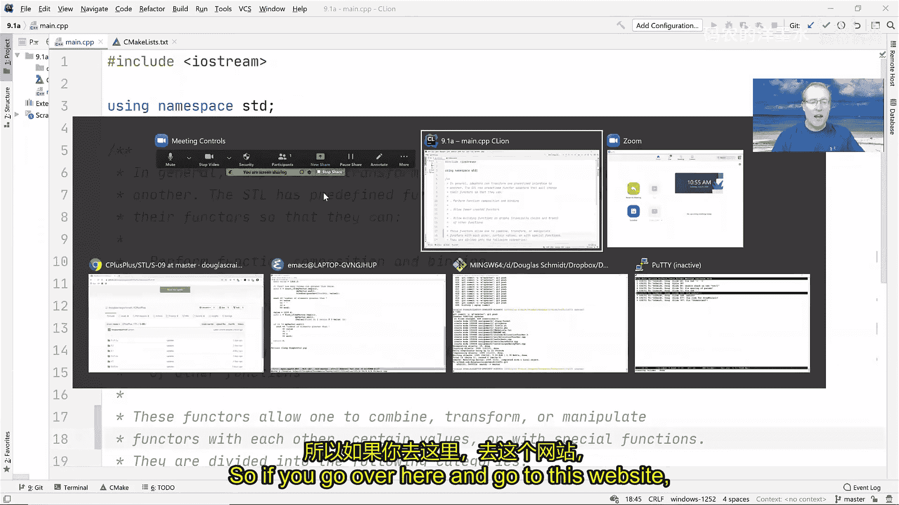
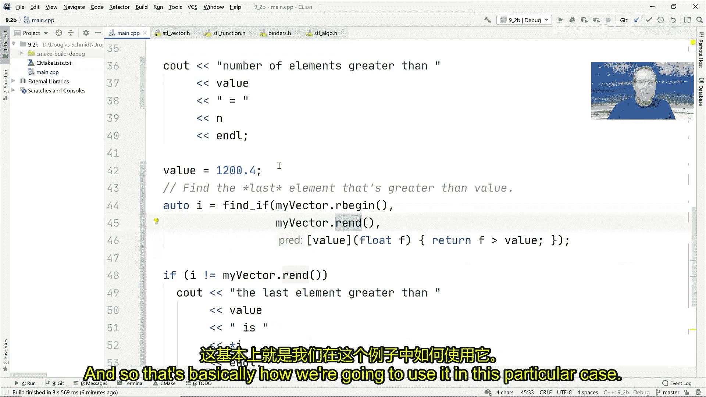

# 【全集】范德堡大学 C++标准模板库 中英字幕 1080P p19 Lecture 19 - 功能适配器 part1 -BV1KWiCBWE7M_p19-

Hello and welcome to the next session in my webinar series on C++ Standard Temp Library by example。😡。

Today we're going to begin our discussion of C++ STL function adapters。

And we'll begin by focusing primarily on the so called binders。

 although it'll give you an overview of what function adapters are in general。😡。

So as is our tradition， let me go ahead first and show you where you can find the code and then we'll jump right into the analysis。

😡，So if you go over here and go to this website， this is my GiHub repository。

 if you look at the C++ STLS09 folder， you'll find the 9。1 and 9。

2 subfolders and those will be what we're going to examine today during our walkthrough。

So let's give a quick overview first of what function adapters are By now I think you've probably seen that C++ STL has a lot of adapters so we have things like iterator adapters we've talked about。

 we have container adapters that we've talked about and now we're going to talk about function adapters and function adapters can be used largely to adapt functors so that they can perform composition and binding so you can have fewer funcctors you can reuse a lot of the ones that are already there and then bind them in interesting ways and then you can also compose them together into so-called chains or trees in order to be able to have the output of one fun serve as the input to the next fun and this gives you tremendous power to be able to combine and transform and manipulate functorters with each other with certain values like constants for example as well as with special functions。

So there are three primary types of function adapters， there's binders。

 negators and member functions slash function adapters。😡。

And so the binders include buying first and bind second。

 and those are the ones we're going to look at right now。

 and they adapt punctors by binding one of their arguments。

 either the first argument or the second argument。😡。

Nigators include not one and not two and these adapt functionss by negating their arguments so that true becomes false and false becomes true and then finally the last type of adapter we're going to look at later not today are the member function adapters and these include pointer fun Memf and also Mem ref and these adapters are used to allow functors to be used as class member function adapters you can take things like pointers to member functions or pointers to functions and adapt them in ways that allow them to be used where STL algorithms expect to use functors。

😡，Something else we'll do along the way too in some of the examples is we'll compare and contrast the use of funcctors relative to C++ lambmbda functions。

 which allow you to be able to write the code directly without having to create a separate class or reuse an existing class that's already part of STL's functer library so let's go ahead and now and take a look at some examples that' will make some of these concepts related to binders more concrete。

So we're going to start here， this particular example is going to introduce the bind first and bind second function adapters and then compare and contrast to see how they work in practice and you'll see when I was first encountered with bind first and bind second I was a little bit puzzled as to how they differed so we're going to talk about how we can compare and contrast them as well as how to use them in their common applications。

😡，So we'll start with demonstrate buying first， and you can see here we simply have a built in array of numbers。

😡，102040， 30， 50， 2010 doesn't really matter the order and then we compute ourselves a。

Pointer to an int which will then point to one past the end of that array using good old Ctyle pointer arithmetic where we take the numbers array and we add to it the number of elements that are in the valid part of that array so that reaches the end and then we go ahead and use the countifF algorithm and we'll take a look at countif in a second but what it's going to do is it's going to start at the beginning of that array go up to but not including in the end and then we're going to apply the bind first method to count the number of elements in that array whose value equals to 10。

So let's take a look at some of the piece parts here， here's the equals2 punter。

 you can see it takes two parameters。😡，It takess x and y and as you might expect。

 it returns true if the values are equal， false otherwise。😡，So that's the equal to part。

 here's the buying first part。😡，You can see the buying first part is going to take。

 first of all it's a template parameter that's parameterized by the type of operation and the type that we're going to be using here or a value we're going to be using here。

 and so we pass in the operation and we also go ahead and pass in a constrfe for the value。

And you can see that bind。bind first calls binder first passing in the function that we're passing in as well as the argument type parameter X in this case and of course the function is going to be whatever we pass into this thing。

 which in this case will be equal to。So that's basically what bind first does and if we go and look at binder first。

😡，You can see that this is essentially going to be a class is often the case。

 there's a little wrapper method that deduces the type and it's going to go ahead and take the appropriate operation here。

 which would be again one of the types that we pass in that's a funter。Okay， so with that in mind。

 what we're doing here is we're basically binding the equal to method。

 which takes two parameters so that one of its parameters will be the value and the range that we're iterating through and the other value will be the constant 10。

😡，Now， just a quick recap。Count if so count if is what we're going to be using to do this call and I've had some problems in the past getting。

😡，S land to find the countiff method so we're going kind of do it the old-fashioned way by doing a search and we'll eventually find the one that has the loop in it and here it is。

 here's the countiff method that's being called here as you can see it's taking an input iterator and a predicate and the input iterators used to bound the range from first to one past the end as always and then the predicate is whatever we're going to be doing which in this case will be applying the binder and the bind first binder and you can see what it does is it walks to that range and it applies the predicate for each element to it and every time the predicate matches it increments the count by one and what we're all done walking through this countiff returns the count that we got where the number of preddiicates matched。

So the thing to notice here that's important is that bind first creates a functer。

 which in this case is going to be binding the equal to functer with the value 10。

 and that's the predicate that's going to be used here so it's going to pass that in and this basically converts equal to which is a binary predicate into a unitary predicate by binding the constant 10 to it。

😡，And then that'll go ahead and return the number of values that are equal to 10。

 So let's run this code just so you can see what it's doing。 and you'll see that in this case。

There are two values in this numbers array that equal 10。 So everything is fine。 Okay。

 so that's bind first。 Now let's go ahead and take a look at bind second。

 and we'll demonstrate how that works。 And what's interesting， if you look carefully at the code。

 you'll see it's pretty much identical， except we call bind second instead of bind first。

 And if we take a look at bind second， you can see that here's bind second and it creates a binder second。

And if you go take a look at that， then you can see how bind second is defined and it's going to take in the second argument of the two as opposed to the first argument。

 which is the one that was used for bind first。Now。

 what's interesting about this is if you run this code and we've already run it。

 you can see that it returns the same result， except in this case。

 we decided just for Ks to search for the number of times that 20 appears as opposed to 10。😡。

So as you can see， if you look at the numbers array 20 appears twice。

 so of course we have the output saying there are two elements that are equal to 20。

Well at this point you're probably scratching your head going how does bind first really differ from buying second they seem to return pretty much the same result each time and so that's what I want to do here is I want to show you an example which I've called contrast bind first and bind second to illustrate the difference between these two binders。

😡，And it's not really clear， at least it wasn't clear to me until I saw an example along these lines。

😡，So here we're going to go ahead and have。Bind first。

 we're going to create a binder and we can go ahead here and。😡。

You could basically see what it's doing that's that's what it is it's creating a bind first which is going to work on plus but that's a little bit verbose so rather than write this code we'll just use auto so we're going to get a bind first object and then we're going to go ahead and do a bind second call here and again we could。

Do this explicitly and you see it turns into bind second but that's also verbo so we'll keep it with the auto and the first bind first of binder is going to do addition with the value 10 so what we're going to do here is we're going to go ahead and say I want to take this binder and then I want to call it with 20 so what that's going to do is it's going to essentially add 10 to 20 and as you can see the value is 30 no real surprise there right？

Same thing is true for the buying second variant here。 So in this case， we have the the plus binder。

 which will also add 20 to 10。 And because addition is going to be commutative。

 A plus B equals B plus A， we don't really care which order things get done in。

 So we get the same value。So again it still may not be clear how bind first differs from bind second Now we're going to see how they differ So down here we're going to define ourselves a new pair of binders which is going to use the minus operation this time instead of using the plus operation or the plus funter so in here we're going to have the minuster which is going to be bound to 10 with a bind first and then we're going to use bind second the bind minus to 10 So now we have two new binder objects which are binder second objects So if we go over here and we turn this into the。

Actual code you can see it turns into binder first。😡，And binder second， just for kicks。

 let's do that just to be complete。So you can see here how these are turning into binder first and binder second objects which are verbo so we use auto and then we're going to apply minus and now you can see the difference so when you do M1 that's going to go ahead and bind 10 is the first parameter and then it's going to go ahead and subtract 20 from that so of course 10 minus 20 is minus 10 which is what we get here。

😡，Whereas when we do this with buying second， you get 20 minus 10， which is 10。😡。

So now you can see the difference when you have noncommmunutative operations。

 it makes a difference as to whether you use buying first or bind second。

 but when you don't really care， then it doesn't make a difference for commutative operations or as we use them up here in these。

Coutiff。Context where we were using predicates it doesn't really matter in that case because we're just checking for equality now if we were checking for some other relationship like greater than or less than then it would make a difference whether we used bind first or bind second so hopefully that gives you a little bit better understanding of binders now this particular example focused on using binders in the context of built in types like inter race and so the next example we're going to look at is going to。

Show you the same concepts， the same capabilities， except this time we're going to look at it in the context of。

STL。Sequential containers， like in this case， vector。So this is going to show bind second。

 we could also show bind first what I'm showing by second。

 and it's also going to demonstrate the use of a C++ lambda function in lieu of using binders in the context of various STL algorithms。

 some of which we've talked about before， but I'll go through them again。So as you can see down here。

 we're going to define ourselves a vector of doubles， which we initialize with an initializer list。😡。

And then we're going to define ourselves a field called or a variable called factor。

 probably should use auto here and get away with it。😡。

And then what we're going to do is we're going to use the transform algorithm and if you recall transform it's going to go through the vector。

😡，And it's going to go through the entire range from beginning to end and it's going to apply this unary operation because this is the four parameter version of transform。

 it's going to apply this unitary operation which we get by using bind second with the multiplies binary fun and the factor that we defined up here。

😡，And。In this case， I probably could say con auto factor because I'm not going to change it so that's just making it more clear that that's a cont。

😡，It didn't need it， but it helps to make your code work clear what's going on。😡。

Now where does this result get stored， we're going to put it back into the vector itself。

 so we're basically going to multiply all the contents in my vector by the factor and so what we'll end up with is a modified set of my vector elements that have been multiplied by 33 and a third which of course is the old speed of LP records way along back in the day。

😡，Okay， so we're going to do the transformation Mel endda with the multiplied contents in place。

 and then we go ahead and print out the results。😡，The next thing we're going to do is then we're going to go ahead and use the counttive algorithm。

 which we've also talked about before。😡，Just a minute ago and we're going to go through the vector that's been multiplied and we're going to find how many values in there are greater than 1000。

2。😡，And once again we're going to use bind second and in this case rather than doing bind second for multiplies as we did appear。

 we're going to use bind second with the greater funter and I'll quickly go through these code we'll look at the code in a second I just want to give you the big picture view first before we do some diving into the implementation。

😡，So what this is going to do is it's going to count how many values are greater than。😡，The value。

Object that we have here， the value variable。So that's what we' going do and then we're going to print out the number of elements that are greater than that value and then the final thing we're going to do is we're going to use the find if algorithm and that's going to start at the end of the vector because we're going to use R begin to start at the end and then we're going to go to the beginning which is R end so R begin starts at the end R end goes to the beginning so we're to iterate backwards and this time just for kicks we're going to use a C plus plus lambda function rather than using any of the predefined binders or arithmetic operations like like multiplies or the relational operator like greater and so on so in this case we're going to go ahead and find the last element in our range that's value is greater than。

1200。4。And you can see how we do this this is a lambda function all you really have to do is you have to provide the type that's being passed which in this case of course is a float because it's a vector of float and then we just write the code in line。

 we just say return F which is the parameter greater than value。😡，And if that's true。

 then it'll go ahead and match it。 And it's going to start from the end。

 So we'll see if we get a match。 You'll also notice that we have to pass in the parameter from the scope。

 So the scope here is the local variable value。 and we have to indicate to the lambda that that value will be passed into the context of the lambmbda function。

 Otherwise， it would be invisible。 if we take out this here。

 then you can see it's basically going to say something like can't implicitly capture the contents of value。

 And this is what's called the capture clauses where you can put in the variables you want to have captured in this case by value。

 You could also do them by reference。 if you plan to change them， which we don't do in this case。

We'll talk about passing these by reference in another context。So if we're lucky or if or not。

 if we're lucky， if we find a hit for here， that means that the iterator that we get back from find di is going to be。

😡，Not equal to the end or the R end in this case of the vector。 And in that case。

 we're going to go ahead and print out the last element that's greater than the value。

So let's run this code and then I'll walk through some of the implementation details for you。

 but I want you to see what it does first。😡，So over here you can see that we took our original vector and multiplied everything by 33 and a third and then we printed the results out and that's the first line here just the results of multiplying it by 33 and a third then we go ahead and we find the number of elements that are greater than 1000 and。

2。And in this case， we use the greater。Relational functer and we turn it into a urinary functer using bind second which is the binder。

And as it turns out， there are three values that are greater than 1000。2。

 And you can see that the last three doesn't really matter which ones they are。嗯。😊。

Probably need to put an equal sign here just to make it more clear what's going on。😡。

And then the final thing we do is we go and we search backwards in our vector using our begin in R end looking for any element that is going to be greater than 1200。

4 and of course we find that right away because that's the very first element in the end of the vector which is 16081。

65 so that's what gets returned from the iterator from find if and that's what gets printed out here in this C out statement Okay so that's the result those are the results let's go take a quick look at some of the code。

 we've looked before at the implementation of some of these things but just for completeness in case you hadn't watched all my other videos。

 here's the transform algorithm and you can see that transform is a very interesting algorithm it takes several different types of type names in its template parameter list it takes an input iterator and output iterator and a unitary operation this is the four parameter version of transform。

So a five parameter version as well that takes binary operations as opposed to unary operations the actual transform algorithm itself takes an iterator range from the beginning to the end。

 that's what we're going to iterate it through and an output iterator where we're going to put the results and then we also have a unary operation which is a predicate or a functer in this case or a composed binded bounded I guess binded bounded funter。

😡，And then down here you can see that the actual algorithm goes from beginning to end and every step along the way。

 it calls the unary。😡，Operation， which is the binder in this case， which is adapting。

 in this case the multiplies method and we go ahead and apply that on each element in the range and we store the results into the output。

So that's basically what's going on into the hood， but of course。

 because the fact that we're using the binder here。

 what we're passing in is actually a sort of a chain of funcctorters， so binder is going to。

 as we've saw before， bind second is going to take the binder。

 sorry the functer that's passed to it and a value and it creates a binder second object。😡。

And then the actual functer we pass it is the multiplies spcter and you can see the multiplies functer does sort of the obvious thing it takes two parameters and multiplies them together and returns the result and in this case what it's doing is we've bounded such that the factor is the second factor it is the second parameter passed in and that will then be multiplied by whatever happens to be in the buffer in the range rather that we're iterating through with our transform algorithms so you can see each of the elements in turn gets passed to that unitary operation which is of course the binder which encapsulates the multiplies functer so this is really cool and I think the key thing to keep in mind here is that we're composing together these funcctors in order to make them conform to the signature is expected by the STL algorithms in this case the four parameter version of transform。

We've looked recently at countif I'm not going to repeat that because we just looked at it same basic idea here the main thing I show you is the greater functer which as you can imagine takes two parameters it's a binary functer and it returns true if the first parameter is greater than the second one I think that's pretty August with the name and in this case we're going to bind the second value to be 1000。

2 so it's going to see whether which elements in that range from beginning to end of the vector are greater than that value。

And then the final thing we're going to look at here is find if and I think we've looked at find if before。

 but here's just a quick recap of it， so you can see that find if is going to take a range from beginning to end as an input iterator and a predicate and it's going to go ahead and see if it can find the first predicate match now this is another one of those places where。

😡，Sealine is getting confused， so let's go see if we can find refine the algorithm that actually has the implementation in it。

Let's see not quite yet。You can see there's a lot of places where FindDF is actually used to do other stuff it's kind of a workhor algorithm in STL and here we go we finally found find if I think it looks like it's the very first one it probably should started searching from the beginning。

😡，So as you can see here， find if takes an input iterator and a predicate。

 and then it takes as a parameter， the first。😡，In the iterator to the beginning of the range and an iterator to one past the end of the range。

 those are input iterators and it takes a predicate and it goes ahead then and searches from beginning to end and whenever the predicate matches。

 then。😡，We're going to go ahead and return。And so that's that's how we're going to get it to work and of course the way it's going to work here is we're going to actually use the R begin factory method on the vector so that it's going to give us a reverse iterator that actually starts at the end so R begin gives us us one that starts at the end and R end will continue itll give us back an iterator that will be used to bound the search when it reaches the beginning and so that's basically how we're going to use it in this particular case。

😡。

So that's really what I wanted to show you today， I think you can agree that there's some really cool stuff here with binders。

 binders are very powerful， they get used all over the place in STL and we'll show lots of other examples of binders and funcs when we talk about the negate。

😡，Function adapters， which we'll do tomorrow and I'll also continue to compare and contrast the use of the functer based approach with the approach that uses lambda functions because I think it's important to know how they differ and then we'll also talk of course about when to apply one versus the other as a general rule of thumb you if you have built in STL functionsctors that you can use together with binders and the gators that's a very fast way to write the code because it's already there and it's pretty intuitive and you don't have to think very hard about the syntax。

Conversely， if you're writing code where you're creating your own computations that don't fall nicely into what's already packaged into STL's pre-existing functionss。

 then you might want to consider using lambmbda functions。

 especially if it's just a one- off type of thing that you're not going to be using over and over again。

 but we'll see that as we get a little further into this in subsequent sessions in my C++ standard type of library by example series。

😡，So if you like this content， please feel free to like and subscribe。 And also。

 you're welcome to follow me on Twitter。 So thanks very much。 And I'll talk to you soon。😊。

