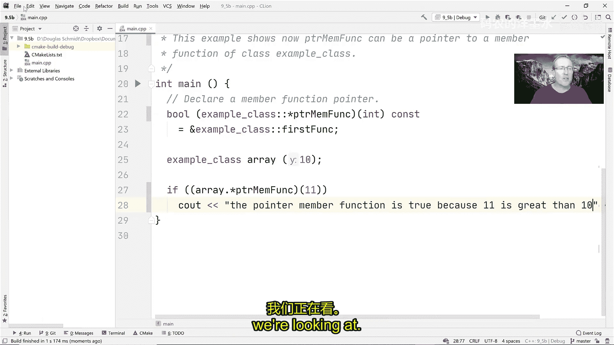
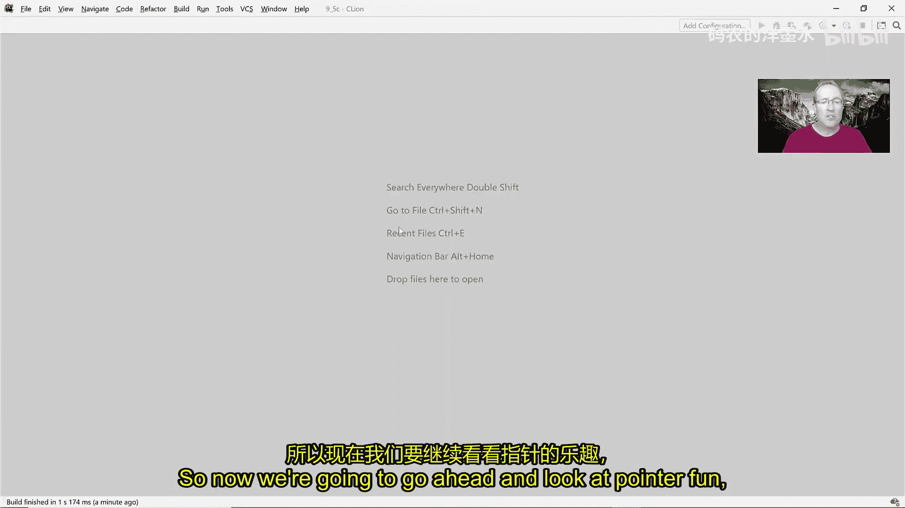
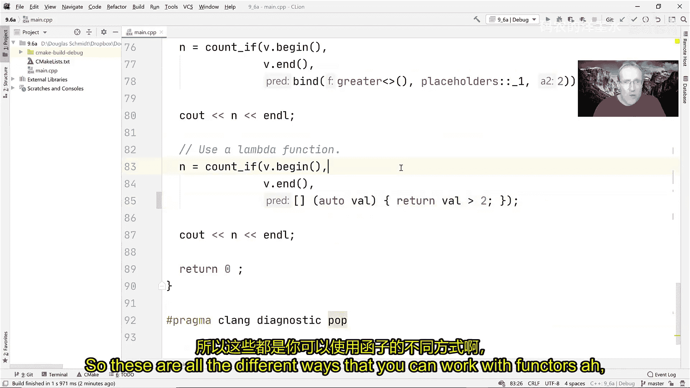

# 【全集】范德堡大学 C++标准模板库 中英字幕 1080P p21 Lecture 21 - 功能适配器 part3 -BV1KWiCBWE7M_p21-

Hello and welcome to the next session in my webinar series on C++ Standard Temp Library by example。

Today we're going to wrap up our discussion on function adapters。

 focusing on various adapters that can be used to encapsulate member functions as well as regular functions。

So without any further ado， let's get started， we'll start by taking a look at where you can find the source code and then we'll move on and discuss the actual examples themselves so the examples today are in my GiHub repository of course in the C+ plus STL S09 folder in the 9。

4 9。5 and 9。6 subfolds。😡，So let's go ahead and take a look at the IDdeE。

So what we're going to do here is talk about something called member function adapters and they can be used to allow class member functions as arguments to the various C++ predefined algorithms there are three of these and the first two have been deprecated in later versions of the C++ standard but they're still of course available。

😡，The first example is called mem fun， the second example is called mem fund Ref and the third example is called。

Mm function or Fn。 I'm going to pronounce that is Mem function， just to be clear。

And we're going to focus on all three of those things。

 And what they're going to do is basically make it possible to take member functions and then use them in the context where you'd normally expect to have functionsctors。

Let's take a look at some examples， this is going to illustrate the use of the MEF Ref and member function adapters and it's also going to give us this chance to talk about various STL algorithms and some use of C++ Lambda functions as well。

So first let's start off by defining the little class。

 which I call wrap int it's a little bit like the integer class that's in Java that essentially encapsulates the native int in some kind of a class in this case you can see we have a default constructor that's just sets the value that's being wrapped to zero we also have an explicit constructor that takes an int and signs that value to the data member that's using to store the contents。

😡，Take a look down here， you can see the data member is just an int。

And then we have a number of different member functions。

 these are not static member functions they're just good old C++ member functions we've got one called show Val which is a constant method that prints out the contents of the underlying value we have another method called is prime that does a longrunning computation to check to see whether the value is prime or not and returns true or false and then finally we have a couple of methods that return whether or not the value is even or odd and you'll notice that three of these values have been marked with this attribute no discard and what that says is you can't use this method without checking its return value or you'll get a warning or you'll get some indication that that's improper and that's of course trying to guard against people having method calls in C++ where you ignore the results and go on your merry way so no discard is an attribute that's added to detect that kind of a misuse。

So let's go down here and take a look at the。😡，Actual program that's going to be the test driver for wrap int first thing we're going to do is we're going to define ourselves a vector of 10 rap int objects so we say aV give a value 10 and it's going to be wrapping rap int it's going to be encapsulating it。

😡，And then we go ahead and define ourselves a rampant just a single instance and we're going to give it the value of 10 and then just for kicks Id call is even without using the value in any way and you can see here that I get a little warning from the compiler saying value of function declared with no discard a attribute is ignored so that's obviously an indication that that's not the right thing to do we'll ignore that other stuff for now we'll ignore the no discard ignoring result。

😡，So once we've done this， we're going to go through the range zero to less than 10。

 so zero through nine， and we're going to go ahead and create a RA int for every one of these objects and store it into the corresponding Subscript location in AVAC。

 so AV sub0 will be RAant1， AX sub2 will be or sorry AVX sub1 will be rampant with a value of two and so on and so forth。

😡，And then what we do is we go ahead and we use the for each algorithm to print the contents of our vector and you can see we're doing this by using the me fun Ref adapter to encapsulate the showval。

😡，Pointer to member function and then be able to treat that as though it was a regular good old functer so we'll take a look at meon Ref in a second but first let's go take a look at for each for each is a very simple algorithm that as you can see here goes through a range from beginning to end and for every step along the way it calls the function that's passed then it's the third parameter so you can see it's parameterized by in iterator and function and of course the function a functer but it could be a function also you can also pass a pointer to a function to the for each algorithm as well and down here you can see we just go through the range and every step along the way we call the function on the next element in the range and then' increment the count or we increment that element by one here。

And you'll also see that when you're done， it returns the contents of the function。

 which can be used to pass values back to the caller if there's some internal state being used in that function that's being collected and we'll take a look at some of that stuff later as well。

😡，Okay， so what we're doing here primarily is just using this to call。😡。

The show be for every element here and you can see that this is what MEf Ref does。

 it basically goes ahead and encapsulates the member function in such a way where you can have it called and if you go here。

And follow this a little bit， you'll see that we have operator function call defined here and it goes ahead and invokes that operation using the pointer to member function syntax。

Okay， so that's how that's going to work down here we're going to do another kind of operation like this where we're going to use the remove if method and what we're going to do here is we're going to go through the vector from beginning to end and we're going to go ahead and encapsulate the is prime member function and so as you can see what that'll do is it'll go through that range and for every element in the range that's prime we're going to remove it from this particular。

😡，sequenceequence and what you get back here， of course。

 will be a pointer an end pointer and an iterator to the new end of the region。

 the new end of that sequence with all the prime numbers removed。😡。

And I think you can imagine what Re VT does。Remove if does some stuff basically it's going to go through and copy over the elements copying them down let's see if I can get lucky and find the actual implementation of remove if if it's not lurking in。

Some strange location。So you can see here what Re if does is it goes ahead and first sees if the items even there it in the first place at all using the find if method which we've talked about before。

 and then what it does is it goes through the resulting range if it found it and then it goes through and basically sees if the predicate matches and if the predicate matches it's ignored if the predicate doesn't match then we go ahead and copy the contents down and so what that does basically is it only copies the things that were not the predicate so that's why we're removing if it matches。

😡，So we're going to remove the prime numbers， then we're going to go ahead and print the contents after we've removed the primes。

 so everything I've shown you so far is still using the mem fun Ref function adapter。😡。

Now what we're going to do is we're going to switch gears and we're going to use the mem function or mem Fn adapter and this is really just the newer way of doing it using the newer versions of c plus plus features let's go take a look at mem fun you can see that mem fun is。

😡，Annotated with things like no except， and it's going to make an instance of this mem Fun object or mem function object。

 which will then do more or less the same thing that Mem F ref did。

 but this allows us to use newer features in C++ and templates to make this work。

So this time we're going to go through and remove everything that's even using me function。

 and then we go ahead and show the results using Mem function。

 so just demonstrating the kind of newer way of doing the same kind of thing。😡。

And then the final example here is going ahead and using the C++ lambmbda syntax Lambda function syntax。

 so what we're going to do here is we're going to go ahead and remove everything that's odd and we're going to do it by using a lambmbda function so you can see we go from the beginning of the vector to the end of the vector and every step along the way we write ourselves a little lambmbda function which serves as the predicate and it's going to take a reference to a rampant which of course is what's in the range that is being iterated over by remove if and we just plop the code right in there and you can see that if it is as it's odd if WI is odd then we're going to go ahead and remove it and then the last thing we're going to do here is to show how you can write the code using lambmbda function syntax for going through and printing the contents that are that are no longer going to be odd they're only going to be even。

And down here you can see we just pass in RAant reff and then say w forrapent。sval。

So let's run this code and see what it does。😡，Oh you can see it was complaining about the fact it was complaining about the fact that we didn't check the return value which is good and then down here you can see that we had an original sequence that was the values one through 10。

We remove all the primes using the mem fine Ref adapter。

 Then we remove the even values using the mem function or me Fn adapter。

 And then the final thing we did is we remove the odd values using a C plus plus lambmbda function。

So this is just demonstrating some other interesting examples of how to apply these various function adapters that work on member functions。

Okay， so that's the first thing I wanted to cover today。😡。

Now let's go ahead and move on and talk about some variants of this approach。😡。

And we're going to focus on something called the pointer function adapter。

 Now this is an interesting adapter that has also been deprecated in later versions of C++ although I'm going to show you how it works。

 and then I'm going to show you a couple different variants to use newer features in order to make this work such as binders or Lambda functions。

😡，The intent of the pointer function adapter was to make it possible to take C styleyle pointers to functions and allow them to work in the context of the various functions you would pass into standard algorithms so just to refresh your memory because we've covered this a few days ago this is just a very simple example of a C style pointer to function so we have a function called my function pretty boring it takes an in I and it returns Boolean whether or not the value passed to it is greater than 10。

😡，And down here we define ourselves a pointer to function that takes an in and returns a boolean。

 we pass in my function to it， we could have said address of my function。😡。

behaves the same way and then down here we can go ahead and call this as if it was a function call but in fact it's a pointer to function call and I can either use this function call syntax or I can also use this type of syntax as well。

So I can call it this way， which makes it a little bit more obvious that it's a pointer to a function or I can call it like this and make it look like a function either way it works just fine。

😡，Let's go ahead and call it and we get the result back。

 which in this case says that E 11 is greater than 10， which is something we probably already knew。

All right， let's now go ahead and take a look at another example in this family of examples。😡。

This example does kind of the same thing we just looked at except now it's going to apply this same syntax on。

😡，Member functions as opposed to regular good old C style functions so we have a class called example class which is going to have an explicit constructor that takes an int and stashees it away in a private data member and then we have a funk here called first funk which is a member function that just checks to see whether the value I is greater than X so this is much like what we looked at before except now we're doing it in the context of a class and a point of a member function as opposed to just the good old point ofer function which is what we just looked at。

So down here you can see how we define this pointer to pointer funk and I probably should be a little bit better about naming this let's call it pointer mem fun。

 so for member function。😡，And。Let's go ahead and rename everything。

And then we're going to assign that pointer to member function to the address of example class colon colon first funk。

 so that's obviously going to be a member function and we're taking the address of that and storing it in our pointer to a member function we then define ourselves an instance of example class giving it a value of 10 and then we go ahead and use the syntax here to show how to make the call we say array because that's the name of the object dot star that's point a member function syntax pointer mem funk and that will then go ahead and call first funk。

So let's go ahead and see what happens when we run this。

And it should come back and say that this is in fact true， so it's true because in this case is true。

Because 11 is greater than 10， so that's why it's returning true。Okay。

 so that's the example I just wanted to show you these concepts before we look at the pointer fun adapter。

 so keep that in the back of your mind as we take a look at the next example that we're looking at。😡。

So now we're going to go ahead and look at pointer fun which is defined here and this is a really fun example I've always enjoyed showing this example because it really demonstrates that the power of C+ plus STL and its zero overhead abstraction mechanisms that give you all this cool type safety and all this cool adaptation and codeyn and so on without you having to do very much work and without little or no overhead without having any overhead at all at runtime so this particular example is going to demonstrate the use of various function adapters we've talked about so far including。

Not one in bind second， not function and bind as well as the C++ generic lambda functions and decal type and I should also say it'll also show naturally it's going to show pointer phone as well。

Okay， so let's go ahead and take a look at this example and this is， like I said。

 this is a really fun one。So we're going to come in here and we're going to find ourselves a vector of con care stars so this is demonstrating that you can use STL containers for more things than just int or employee record or double or other kinds of objects that have passed by value semantics here we're going to actually store pointers to character literals and the pointers to character literals will be the strings the character little strings12。

345 so that's what's being stored in aVc and then we go ahead and we print out the contents of AVc with little prefiix saying the sequence contains one。

2345。😡，Now what we're going to do is we're going to demonstrate various ways of being able to search for elements for strings in that vector。

 so let's start out off first by taking a look at pointer fun， that's the main focus here。😡。

So what you can see we're doing here is we're looking through the vector from beginning to end and we're going to go ahead and use pointer fun to encapsulate stir comp。

 so here's pointer fun as you can see pointer fun is an adapter function that's going to create a pointer to binary function passing in the various parameters。

😡，And pointer to binary function is basically going to encapsulate these kinds of things so that we stash away the function we pass in。

 which in this case， of course， is going to be the stir comp method。

 It gets stashed away here inside of this particular。

In particular object and for this functer adapter that we're using so that's what we do we're going to turn we're going to create a func that encapsulates the stir comp C string comparison function。

😡，And then we're going to turn around and we're going to use bind second to bind it to the value three to the string literal3。

 so we're binding stir comp and its second parameter to the value three， the strain three。😡，And then。

 of course， because of the interesting semantics of stirir comp。

 we're going to use the not one negator adapter and we're going to take the results of this stir comp and we're going to say if it comes back with a zero。

 that means true。😡，If it comes back with nonze， that means false and of course the reason we have to do that。

 as you probably know， if you've worked with C for a while， is that stir comp returns zero。

 if two strings match it returns less than zero if the first string is lexically less than the second and it returns greater than zero if the second string returns greater than is greater than the first string so therefore it matches if it returns zero so we have to negate that in order for find if to come back and determine we found that actual match so I think that's pretty cool and just look at the little string of chain。

Aapters here so we're converting the stir comp string into a functer using pointer fun we then use bind second to make that into a bound func that's bound to the。

Character string 3。 and then we use the negator to take the result of that and negate the expression。

 And all of that's being passed as the third parameter for find if。

 And then we should find the results， of course。 And then we print out the results from that point onwards using the iterator that came back up to the end of the vector。

The next example we're going to look at is going to replace the use of not one and bind second。😡。

And pointer fund for that matter with modern C++ means to do the same sorts of thing so in this case we're going to apply the bind method which is this modern more modern way of doing things with C++ and we're going to say I want you to bind stir comp which no longer has to be treated special you no longer have to use pointer fund with it with the bind method and then we say make the first argument the placeholder because that's what's going to be past the value for every element in the range from beginning of the vector to the end of the vector and then we're going to go ahead and bind that to the string to and then we're going to take that bound。

😡，Comparison fun， and then we're going to use not function or not FN in order to negate it。😡。

For the same reason we did before because stir comp returns zero when strings match but find if expects those values to be true if there's a match so that's what we do there we go ahead and use that and then the third approach we're going to show here is going to be using a generic C++ lambmbda function so here rather than having to use binders and ne Gators and so on we just say the heck with it let's just go ahead and use a lambda function that's going to be passed an auto S which in this case of course will be a concastar because that's what's being stored in AVec and the implementation here does a stir comp comparing S with the string literal1 and if it matches of course it'll return zero so we use the bang operator the exclamation point operator to negate that result to give true if the strings compare equal and then once again we go ahead and print the results。

Let's go ahead and run this code just to see what it does。😡，And I think as you can see here。

 what it does is it first prints out the sequence we're going to be searching1，2，3，4，5。

 and then it goes and looks for three， and it finds three and it gets an iterator back to three as you can see here。

 and then it goes ahead and prints from that iterator onwards。

 and it goes and looks up the string literal two， finds that， gets an iterator back。

 prints that to the end， and then the final thing we do is we look for string one。

 which of course it'll also find at the beginning， and then we print the results。😡。

Speaking of printing results， let's go see what we use here as our print operation we looked at this the other day。

 this is a clever approach that takes。An iterator range， a pair of input iterators。

 as you can see here， first to last。And it also takes a string。 And at first doesn't equal last。

 We go ahead and print out the string as a constant， It's a constant string ref。

And then we do copy from the first iterator up to but not including the last one and we're going to print the results to the standard output with a space between them so that's how we get the results here and as I showed you the other day we use the very clever decal type mechanism to automatically create the type that we want to be passed to Ostream iterator so it expects a type like int or this case conscastar and so the decal type is how we convert star first which of course in this case is going to be concastar into the actual type that's acceptable to be used in the Ostream iterator template for its constructor here。

😡，That's a lot of cool stuff I really like this example because it shows that you don't have to use C++ containers only for types with value semantics we're also in this case passing pointers around and that's perfectly legitimate and this is a particularly good example of how all those pieces can fit together in a very。

 very flexible way showing once again how cool STL is by not really differentiating between built-in types。

😡，Like countcastar or int or int pointer and then user defined types or types that come out of the SL library itself。

😡，Okay， we have one more thing to talk about today and then we'll be done with function adapters so what I want to do to kind of wrap up is just give you some tips on on how to write effective functors we've seen a lot of different types of funs here。

 we've seen that there's some functionss that take state， some functionss that don't store state。

 some functionss that are going to be parameterize some that are not you know there's lots of different variance of types of functors。

 some take two parameters， some take one parameters， some take no parameters and so on and so forth。

😡，So here are a few things to keep in mind when you worked with funs first of all a funter needs to have the operator function call method if it didn't have that it wouldn't be really be a func or would it and that allows them to look like they're functions even though they're actually objects that can store state。

😡，Make sure when you work with functors that you think about the copy semantics in particular。

 if you're going to allow copying of one fun to another and oftentimes you need to be able to do this because many of the STL algorithms。

 expect to have value semantics for their funter parameters。

 make sure that you do the appropriate deep copy if you have any state in the functer whatsoever。

 in particular be very careful not to allow shallow copies where you'll end up with aliasing thatll get you into trouble if you end up double the leaning pointers that weren't properly copied。

😡，It's usually a good idea to either make your funcctorters stateless altogether or have a relatively small amount of state in the functer if you start defining funcctorters with giant arrays or other data types in them。

 you're going to get a lot of overhead when you copy these things when you do pass by value semantics in the various STL algorithms。

😡，So not a good idea at all The other thing to remember is。As a general rule to be violated。

 if you know what you're doing， make sure that your functors don't have virtual methods。Many。

 many functionss just have a single method that's the operator function call method。

 but even for the ones that have other methods it's generally a good idea to make sure they're not virtual methods and that's because you'll get into trouble if you start copying around objects with virtual methods Now there are ways to get around this if you really know what you're doing and the way to do it is to use the gangang of four bridge pattern so in that particular case what you would do is you would define an abstraction object that would have a pointer。

😡，To the parts that have virtual methods in them， and then all the methods that are non virtual in the interface of the pun would simply forward to the corresponding method that's in the implementation portion。

😡，That's a pretty unusual thing to have to do， but it's possible so be aware if you ever find yourself tempted to make punctors that are going to need to do something complicated with shared state or with virtual functions that you apply the bridge pattern to solve that。

😡，So here's just a very simple example just to kind of wrap things up this is a very simple stateless custom functer that returns true if its parameters greater than two again。

 I'll show you how to do this but you normally wouldn't write this kind of code and I'll show you why in a second。

😡，So here's how to use this functer， let's say we have a vector with a bunch of values in it。

 so we can go ahead and count the number of values that are greater than two by using our custom funter。

😡，We could also use。A predefined funter， like greater。Together with buying and second。

 that's another way to do this that's kind of the C plus plus in the 200s timeframe way of doing things。

😡，The more quote modern way of doing things is to use the bind method where you could say I want to bind the greater functer to two with a placeholder in the first location that's a more modern way but that like I said that's kind of fallen into a bit of ill repute for various reasons so here's maybe another way to do things which is just to go ahead and be very concrete and get rid of funcctors altogether and use。

😡，Generic lambda expressions， and I guess in this case， if I'm really trying to be generic。

 I should say auto not int and let the compiler deduce the actual type that's being manipulated in that range。

So these are all the different ways that you can work with functors。😡。

I hope you've enjoyed our discussion of functorters that kind of rounds out the discussion of the various adapters that we have NC++ STL。

 so if you think about it， what have we covered， we covered covered STL functions and templates first the parameterized types we then talked about sequential containers we then talked about all the different types of iterators such as input output forward random access and bidirectional iterators then we talked about the associative containers both ordered and unordered。

 and then for the last number of sessions we've been really focusing largely on adapters。

 we talked about things like container adapters such as stack queue and priority queue we talked about various iterator adapters like Ostream iterator and Istream iterator and all the variants of that and then we've been focusing since that point on the various function adapters such as negators and binders and pointer fun and all that good stuff。

So where we're headed next is we're finally， finally。

 finally ready to cover the final major category of C plus plus STL capabilities and that of course。

 is algorithms。 So what we're going to do in our next session is we're going to start talking about algorithms in STL and we're going to begin with our focus on the different types of algorithms。

 there's mutating algorithms， there's non-mating algorithms。

 there's algorithms for sorting and searching and sets and so on。

 and so we're going to go through each of those different types of algorithms and take a look at lots and lots of examples。

 Now the good news is you've already seen a lot of this code before we've already looked at a lot of algorithms we've talked about things like transform and find if and count and countif and so on and so forth。

 So some of this is going to be kind of recap and it'll just give you a chance to put it all together and see the comprehensive nature of the various categories of algorithms in C plus plus。

Our type of library。So if you've enjoyed this content。

 please go ahead and like and subscribe and also don't be shy and feel free to go ahead and follow me on Twitter because I keep people notified with new videos when they come out there。

So again， thank you very much and I will look forward to seeing you again soon。

