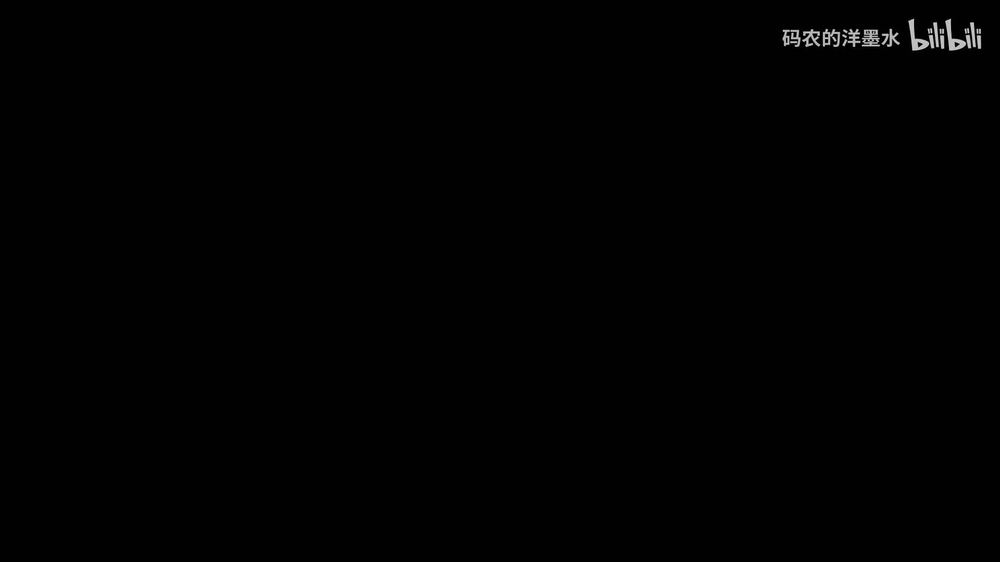
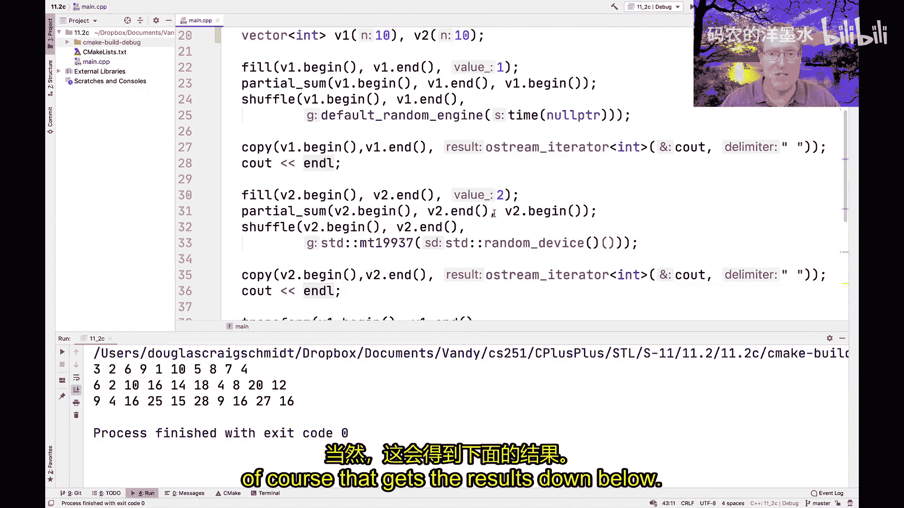

# 【全集】范德堡大学 C++标准模板库 中英字幕 1080P p26 Lecture 26 - 变异算法 part1 -BV1KWiCBWE7M_p26-

Hello and welcome to the next session in my webinar series， C++ Standard Tt Library， by example。

Today， we're going to shift our focus to the so called mutating algorithms that are part of the C plus+ standard Tpot library。

 We're going to focus particularly on ones that end up doing filling。

 generating and transforming of elements in containers or in native arrays。

So without any further ado， let's go ahead and take a look at where we can actually find the code to'll be looking at If you go to my GitthHub repository in the C plus plus STL S11 folder。

 you'll see there's a number of subfolds in there。 We're going to focus on what's in 11。1 and 11。

2 today。So let's go ahead and bring up my IDE。😡，And we'll jump right into it。

So the term mutating algorithm makes it sound like these algorithms actually modify the elements in a container now sometimes they do。

 but others simply reorganize the elements based on some rule or rules that they happen to use during their processing for example。

 all ST algorithms， the mutating ones included work with iterators or work through iterators。😡。

Since these iterators can be used with different types of containers and in fact。

 don't even need to be used with containers at all if they're used with built- in native arrays。

 the algorithms can't do certain things to the containers themselves， for example。

 they can't actually remove the elements because they don't even know what kind of container they're dealing with。

So a good example， this would be the remove and remove if algorithms， which we've looked at before。

Because they can't actually remove anything， what they do is they reorganize the elements inside the contents of whatever it is they're iterating over。

 which might be a container or could be an array， and what they do is they remove the removed elements to the end of the sequence and basically return an iterator that indicates the first element that was removed。

 in other words， the first element that's not part of the sequence。😡，Therefore。

 if you really need to remove elements from your container， assuming you're dealing with a container。

 then you'll have to use some specific algorithm， such as the erase method that's defined on various STL containers。

😡，Here's a list of some of the core mutating algorithms in STL a lot of these we've already looked at so we've looked at copy before we've looked at replace。

 we've looked at remove before， we've looked at transform before and today we're going to talk about some of the ones we haven't spent as much time talking about such as fill such as partial sum such as shuffle such as generate or generate and。

 but of course we'll also bring back our classic all-time favorites like Trans because they're also crucially important to this part of the STL algorithms categories as well。

Okay， so let's go ahead and shift gears， and we will focus on。One of the examples。

So we're going to start by talking about mutating algorithms that perform filling， generating。

 and transforming and these include， of course， the fill and fill and algorithms。😡。

The generate and generate an algorithms。And of course， the transform algorithm。

 and we're going to look at all of these different versions today。

The transform algorithm is quite interesting。 It has several variants。

 One variant takes four parameters。 It takes two iterators to the input sequence， the input range。

One output iterator， which will be where the data is going to go。

 and then another parameters is passed to it to indicate what type of transformation to perform。

 and this will be a unary transforming operation。There's also another variant。

 which we'll also look at that takes five parameters。 The first two， again。

 are the iterator range for the input sequence。 Then we have the。

Next iterator is also an input iterator to a second range。

 which is expected to be at least as long as the first。

The fourth parameter is going to point to or be an output iterator where we're going to put the results。

 and then the fifth parameter will be a binary function， and it'll take two parameters， of course。

 one from each of the ranges that are being iterated over and it does its thing and then returns a result and that result is then stored into the output iterator。

So let's go ahead and take a look at a fun4 parameter variant of transform first。

 So this example is going to write a lower case function that will take a simple string using our string。

 and I'm going to show you why we're using our simple string here。

And we're going to transform it by marching from the beginning of the string to the end as part of the input sequence。

 we're going to store the results in the string that we're transforming and what we're going to do here is we're going to write a little helper unary method that's a lambmbda function and it's going to take each character and if each character in that string is uppercase。

 it's going to convert it to lowercase， otherwise it'll just return the character。😡。

So this is basically doing replacement in place， of course we could have made a temporary variable and done that。

 but I'm trying to actually uppercase the string itself and then when we're done you'll see that we return the string that we just transformed。

 which was passed in as a parameter to the lower case method。

So let's go ahead and take a look and see how we can run this code and we'll start out by making ourselves a simple string which we give the string literal hello or hello since it's all up forcase we print that off and then we go ahead and we lowercase that string and store it back into itself and then we print the lowercase version and I did this on purpose because I want to show you some interesting things with respect to the move optimizations we've been talking about so let me go ahead and run the code you can see what the app will be and then we'll talk about different variants of this depending on whether we enable move optimization or not。

So as you can see， we start out by having the constructor of simple string called。

 which takes the string literal and turns it into a simple string。 We then print that。

 So we get hello。 And then we go ahead and take this。Uppercase S。

And we pass it into lowercase and we pass it as a string。 We pass it by value。

 We pass it as a simple string by value。 And you can see that what that does is that's going to end up calling the copy constructor to create a copy of that。

And then it goes ahead and manipulates it inside of the transform algorithm to lowercase it。

 What we get back here will then be assigned back to itself。

 And you can see here that the compiler is smart enough because it knows that there's a move assignment operator in simple string。

 It goes ahead and moves that assignment uses the move assignment operator in order to assign the results of doing the lower case。

To the string， so it won't do unnecessary copies that's one of the cool implicit move optimizations if you have the move assignment operator defined。

And then of course， the des get called because we did moves。

 they're empty husks of objects that don't take any effort to delete and the final delete after we print out the lowercase hell is a regular destructor that will go ahead and free up the memory that was allocated initially here。

Okay， so that's basically what happens if we don't turn on the move optimization for the parameter that we pass to lowercase。

 So let's go ahead and change that。And what we're going to do instead is we're going to use this piece of code。

And now it's going to do a move。 It's using the StL move command。

 So let's run this and you'll see that the performance should be much better。

 especially if we were benchmarking it because we're no longer doing any copies at all。

 We create the simple string here。 So there's one allocation for that。

 Then we go ahead and we do a move。 we take the contents of this。

 and we basically move it using the move constructor， which doesn't do any copy。

 It just takes the state and stuffs it over into the parameter。

 which is then manipulated and transform and then we go ahead and。

Move it back using another call to the move constructor。 And then once again， the compiler says aha。

 I can optimize the heck out of this because it's going to be the move assignment so I can do the move assignment operator。

 and then when we're done， things get cleaned up。So what's really nice about this is by just turning on that simple move optimization。

 we get very， very low overhead without really having to do any changes to our code other than make sure that we have the STD colon and colon and move call used。

 and I think I've shown you in the past how trivial it is to make that a macro so you could swap back and forth between moving and non-moving。

 although honestly once you get the move itch you'll want to keep scratching it because it's so much better way to do things。

So let me go ahead and put that other non optimal code back so the next time I run this example。

 I can demonstrate how to do it suboptily and then how to use move to do it much better。Okay。

 so this example illustrated a couple things， one of which being transformed。

 and it also showed a bit about the move optimization again。

Let's go ahead and take a look at the next example and this example is going to once again use our transform。

😡，algorithmgorithm， but we're also going to use it in conjunction with a couple of other things like copy and generate or more specifically in this case。

 generate n。So let me make that clear。 So we're going to use generate n。

 So up here we're going to go ahead and seed the random number generator。

 Now I realize this is not the best way of doing random numbers and we'll talk more about that in the next example。

 but it's good enough for our purposes So we're going get a random number generator and the way that works is after you've seeded the random number generator Then every time you call the random function it will generate a pseudo random number。

😡，And the whole issue about why SRand is kind of deprecated is it's not pseudo or random enough。

 it's more predictable than we might like， but we'll talk about that in the next example。

We now make an empty vector and we go ahead and fill the contents of this empty vector with random numbers。

 and we're going to put 10 random numbers in this vector and of course we're going to use our good friend back inserter to add each of those random numbers at the end of the vector resizing as it goes as it needs to and under the hood。

 of course， that's going to call the pushback operation on the vector。

So generate n is basically going to call the random number generator to generate n random numbers。

 and then it will insert it in the back of the vector。

Then what we do is we go ahead and make a second vector， which will have 10 elements in it。

 and they all start out with the default value 20。 So everybody gets a value 20。

 So we have a vector of 1020s。Then we go ahead and print that out so we can see what the results are。

Now what we're going to do is we're going to use the five parameter version of transform and we're going to go from beginning to end of the vector。

 That's the input range。 and then we're also going to go from beginning to end of vector V2 and vector v2 of course。

 is the one that holds all those constant 20s and we're going to store the results back into vector v1 that's the fourth parameter here and what we're going to do for every vector element in that range we're going to go ahead and apply the mod operation So obviously what we're doing is basically computing the equivalent of v subi is equal to v subi mod V2 subi So we're going go through in mod by 20 and when we're all done。

 of course， all those updated values we'll go back into vector V。

 Now we could also do the same thing if we wanted to by using the transform variant that has four parameters。

 not5 and you can see here what that does is that goes。I'm beginning to end of the range。

Puts it back to itself in this particular case， just like the5 parameter version just did。

 And here we're gonna go ahead and use bind second。

 I could change this to use the standard bind method。 I could change it to use a a generic lambda。

 But this is good enough for the purposes of this example。

 And what I do here is I go ahead and use mod and I bind it to the constant 20。

 So that will give us the same results as the5 parameter version for this particular use case。

Then when I'm all done， I take the results and I sort them using greater。

 so they'll be sorted in descending order， and then I go ahead and print the results out So let's go and run this program。

And as you can see here we've get a bunch of numbers， we get 10， rather large random numbers。

 and then we go ahead and we will mod them。And that's in this case we're using the five parameter version of transform。

 so we end up moing them， those are the remainders of doing the mod and then we sort the remainders and we sort them in descending order so that just illustrating a couple other of these mutating algorithms that will basically do generate and in this case also transform。

Okay， let's go ahead and move on。Let's now go ahead and take a look at the third example that I want to cover today and continuing on with our theme of transform。

 this will be another example that will use transform。

 but we're going to mix it up with a couple of other methods SDgons we haven't talked as much about so far。

 we're going to mix this up with Phil and we're also going to use partial sum and shuffle。😡。

So what we're going to do is start out with two vectors， vector V1 and V2。

 each of which start with 10 elements in them。And we're going to go ahead and fill the contents of vector V1 with the value one。

Now， I could also， if I'd wanted to。 and honestly， it's probably a better thing to do。

 I could have done something like this。 I could have said。

Make vector V1 have 10 elements and given it the default value of one。 So I could have done that。

 but I just wanted to show Phil。 So in this particular case， it's equivalent。

Then what I do is I call partial sum。And what partial sum is going to do is it's going to go through vector V1。

 and it's going to add up the sum of the item。 So it'll be  one plus1 equals 2。

 and then it'll add one to that。 So it'll be 3， and it'll be 4。 So it'll basically be 1，2，3，4，5，6，7。

8，9。 So those will be the contents of vector V1 after we've computed the partial sum on it。

Then what I'm going to do is I'm going to call the shuffle algorithm Now there used to be an algorithm that was called random shuffle。

 but that's been deprecated in favor of shuffle and what shuffle does is it goes through and it uses in this particular case the default random default random engine with a random or the current time which will hopefully be monotonically increasing so it should help make it more random and what it'll do is then use that random number generator that comes back in order to figure out how to randomly shuffle the contents that correspond to the partial sum so we're not generating random numbers we're randomly shuffling the elements in that particular range from beginning to end of vector V1。

And then we're gonna to go ahead and print the results out。

 The next thing we're going do is we're going to use the fill algorithm for vector V2。

 And we're going to fill it this time using the value 2。 Now， again， if I'd wanted to。

 I could have done this。Probably would have been better。

 but I've just tried to show you some interesting examples of fill。

There are situations where fill is more interesting， for example。

 if you're going to fill random numbers like we saw would generate or you're going to fill with things that are not always the same value。

 so in that case there could be some reasons for using fill。

What we do then is we go ahead and perform a partial shuffle of a vector with twos in it。

 so that's going to end up having the values 2，4，6，8， 10， 12， etcter。

And then we go ahead and do another random shuffle except this time we're going to use a specific algorithm。

 let's see if I can make the thing pop up and tell me what it is。

 this is the Meren twister engine and so that's why it's called MT and it's called MT 19937。

 I'm not sure exactly what that relates to but it was probably some algorithm that was written by these folks and it will also generate a random shuffle of the values but this time in vector V2 and then we print that。

And the final thing we're going to do is we're going to go through vector V1 and vector V2。

 and we're going to go ahead and add up the contents of both vectors。

 and we're going to store the results here into vector V2。 And then when we're done。

 we're going to go ahead and print the results。So let's go ahead and see what happens when we run this code。

As you can see， we end up with a random shuffle of the values zero through9。

 then we end up with a random shuffle of the values from2 through 20。sorry。

 it's it's not0 through night。 It's1 through 10。 And then we go ahead and do a random shuffle。

 The values 2 through 20。 And then when we're done， we go ahead and add up all those values。

 and you can see pretty much what they turn out to be。

 We're adding up the random shuffle of one through 10 and the random shuffle of 2 through 20。

 And of course， that gets the results down below。

Okay， so that was the third example that I wanted to talk about today。

 we'll talk more about various types of algorithms。

 various types of mutating algorithms in the next couple days。

 there's lots of interesting things to cover obviously here。

 some of which we've seen some of which we haven't。

 we'll also get a chance to start talking about other algorithms that mutate stuff like sorting algorithms。

 and then we'll also later on talk about some of the set algorithms that are part of STL。😡。

And that will pretty much wrap us up By the time we're done with all the algorithms discussion。

 we will have covered all the different parts of STL。

 We will have covered the template function template and class templates。

 we will have covered sequential and associative containers we will have covered all the iterators all the various types of adapters。

 function adapters and container adapters and iterator adapters and so on。

 and we will have covered all of the algorithms。 So hope you'll stick with me for the last couple of videos in this series。

 and if you need if you're interested in more coverage of all this stuff。 Of course。

 I've got lots more information on my website and on my YouTube playlist。

 so please feel free to take a look。 if you like this content。

 please go ahead and like and if you haven't subscribed yet。

 please go ahead and subscribe and you got access to all the other content I create which I plan to keep doing the rest of the summer。

 So thanks for showing up and I'll talk to you soon。

