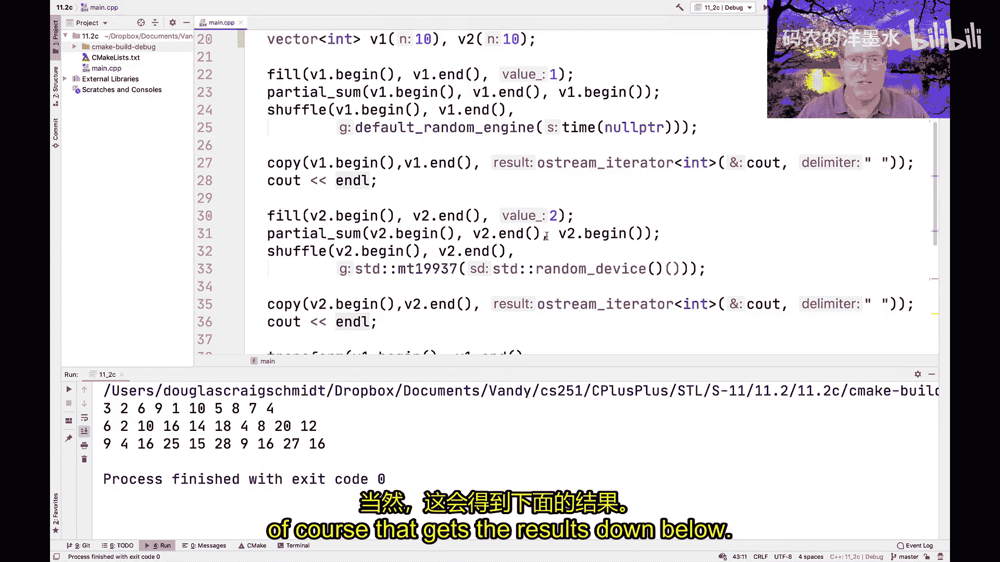

# C++标准模板库：26：变异算法 part1

## 概述

在本节课中，我们将要学习C++标准模板库中的一类重要算法——变异算法。我们将重点探讨那些用于填充、生成和转换容器或原生数组元素的算法。这些算法虽然名为“变异”，但并非总是直接修改容器，有时只是根据特定规则重新组织元素。

## 变异算法简介

上一节我们介绍了STL算法的基本概念，本节中我们来看看所谓的“变异算法”。变异算法听起来像是会修改容器中的元素，有时确实如此，但另一些算法只是根据其处理过程中使用的规则来重新组织元素。

所有STL算法，包括变异算法，都通过迭代器工作。由于这些迭代器可以与不同类型的容器一起使用，甚至可以与内置的原生数组一起使用，因此算法本身无法对容器执行某些操作。例如，它们无法真正移除元素，因为它们甚至不知道正在处理的是哪种容器。

一个很好的例子是我们之前看过的`remove`和`remove_if`算法。因为它们无法实际移除任何内容，所以它们所做的是将元素重新组织到迭代范围的末尾，并返回一个指向第一个被“移除”元素（即不属于新序列的第一个元素）的迭代器。因此，如果你确实需要从容器中移除元素，假设你正在处理一个容器，那么你必须使用特定的方法，例如STL容器上定义的`erase`方法。

以下是STL中一些核心变异算法的列表。其中许多我们已经看过，例如`copy`、`replace`、`remove`和`transform`。今天我们将重点讨论一些我们之前没有花太多时间讨论的算法，例如`fill`、`partial_sum`、`shuffle`、`generate`和`generate_n`。当然，我们也会回顾像`transform`这样的经典算法，因为它们在这一类STL算法中也至关重要。

## 填充、生成与转换算法

现在，让我们将注意力转向具体的例子。我们将从执行填充、生成和转换的变异算法开始，这当然包括`fill`和`fill_n`算法、`generate`和`generate_n`算法，以及`transform`算法。今天我们将查看所有这些算法的不同版本。

`transform`算法非常有趣。它有几个变体。一个变体接受四个参数：指向输入序列（输入范围）的两个迭代器、一个输出迭代器（数据将放置的位置），以及另一个指示执行何种转换的参数，这将是一个一元转换操作。还有另一个变体，我们也会查看，它接受五个参数。前两个同样是输入序列的迭代器范围，下一个迭代器是第二个范围的输入迭代器（预期长度至少与第一个相同），第四个参数将是指向我们将放置结果的输出迭代器，第五个参数将是一个二元函数。它将接受两个参数，分别来自正在迭代的两个范围，执行操作后返回一个结果，该结果随后被存储到输出迭代器中。

### 示例一：使用四参数 `transform`

让我们首先来看一个四参数`transform`变体的有趣示例。这个示例将编写一个`lower_case`函数，该函数接受一个使用我们`simple_string`的简单字符串（稍后我会解释为什么使用`simple_string`），并通过遍历字符串的开头到结尾作为输入序列来转换它。我们将把结果存储在我们正在转换的字符串中，并且我们将编写一个小的辅助一元方法，它是一个lambda函数。该函数将接受每个字符，如果字符串中的每个字符是大写，则将其转换为小写，否则直接返回该字符。这基本上是在进行原地替换。当然，我们也可以创建一个临时变量来实现，但我试图实际将字符串本身转换为小写，完成后，你会看到我们返回了刚刚转换的字符串，该字符串是作为参数传递给`lower_case`方法的。

让我们看看如何运行这段代码。我们首先创建一个简单的字符串，赋予它字符串字面量"HELLO"（因为全是大写），打印出来，然后将其转换为小写并存储回自身，接着打印小写版本。我特意这样做是为了展示关于我们一直在讨论的移动优化的一些有趣之处。让我运行代码，看看应用程序会是什么样子，然后我们将讨论根据是否启用移动优化而不同的变体。

如你所见，我们首先调用了`simple_string`的构造函数，该构造函数将字符串字面量转换为`simple_string`。然后我们打印它，得到"HELLO"。接着，我们获取这个大写的`s`，并将其传递给`lower_case`。我们通过值传递它，作为`simple_string`通过值传递。你会看到，这将最终调用拷贝构造函数来创建它的一个副本。然后，它在`transform`算法内部操作以将其转换为小写。我们返回的结果随后将被赋值回自身。你可以看到，编译器足够聪明，因为它知道`simple_string`中有一个移动赋值运算符，它继续执行移动赋值，使用移动赋值运算符来分配执行小写转换的结果给字符串，因此不会进行不必要的拷贝。这是如果你定义了移动赋值运算符，编译器会进行的很酷的隐式移动优化之一。当然，析构函数会被调用，因为我们执行了移动，它们是空的对象外壳，删除起来不费任何力气，在我们打印出小写的"hello"之后，最终的删除是一个常规的析构函数，它将释放最初在这里分配的内存。

好的，这就是如果我们不为传递给`lower_case`的参数开启移动优化时会发生的情况。让我们改变这一点。我们将使用这段代码，现在它将执行移动。它使用了STL的`move`命令。让我们运行这个，你会看到性能应该会好得多，特别是如果我们进行基准测试的话，因为我们不再进行任何拷贝。我们在这里创建了`simple_string`，所以有一次分配。然后我们执行移动，我们获取这个内容，并使用移动构造函数基本上移动它，这不会进行任何拷贝，它只是获取状态并将其塞入参数中，然后该参数被操作和转换，接着我们使用另一个移动构造函数调用将其移回。然后，编译器再次说“啊哈，我可以优化这个”，因为它将是移动赋值，所以我可以使用移动赋值运算符，完成后，东西被清理干净。这里真正好的是，只需开启那个简单的移动优化，我们就能获得非常低的开销，而无需对我们的代码进行任何更改，只需确保我们使用了`std::move`调用。我想我以前已经向你展示过，将其设为宏以便在移动和非移动之间切换是多么简单，尽管老实说，一旦你开始使用移动，你会想继续使用它，因为这是一种更好的做事方式。

让我把那个非最优的代码放回去，这样下次我运行这个示例时，我可以演示如何次优地执行，以及如何使用移动来更好地执行。好的，这个示例说明了几点，其中一点是`transform`，它也再次展示了一些关于移动优化的内容。

### 示例二：结合 `transform`、`copy` 和 `generate_n`

让我们继续看下一个示例。这个示例将再次使用我们的`transform`算法，但我们还将结合使用其他一些东西，如`copy`和`generate`，或者更具体地说，在这个案例中是`generate_n`。让我说清楚。我们将使用`generate_n`。在这里，我们将继续播种随机数生成器。我知道这不是做随机数的最佳方式，我们将在下一个示例中更多地讨论这个问题，但对于我们的目的来说已经足够好了。我们将获取一个随机数生成器，其工作方式是，在你播种了随机数生成器之后，每次调用随机函数时，它将生成一个伪随机数。关于为什么`srand`有点被弃用的整个问题是它不够伪随机或不够随机，它比我们可能希望的更可预测，但我们将在下一个示例中讨论这个问题。

我们现在创建一个空向量，并继续用随机数填充这个空向量的内容。我们将在这个向量中放入10个随机数，当然，我们将使用我们的好朋友`back_inserter`来在向量的末尾添加每个随机数，根据需要调整大小，在底层，这当然会调用向量上的`push_back`操作。`generate_n`基本上将调用随机数生成器来生成n个随机数，然后将其插入向量的后面。

然后，我们继续创建第二个向量，其中将有10个元素，它们都以默认值20开始。所以每个元素的值都是20。我们有一个包含10个20的向量。然后我们继续打印出来，以便我们可以看到结果。

现在我们要做的是使用五参数版本的`transform`，我们将从向量的开头到结尾（这是输入范围），然后我们还将从向量`v2`的开头到结尾（向量`v2`当然是保存所有那些常量20的向量），我们将把结果存储回向量`v1`（这是这里的第四个参数）。对于该范围内的每个向量元素，我们将继续应用取模操作。显然，我们基本上是在计算等价于`v[i] = v[i] % v2[i]`。所以我们将逐个对20取模，完成后，所有更新后的值将回到向量`v`中。当然，如果我们愿意，我们也可以使用具有四个参数而不是五个的`transform`变体来做同样的事情，你可以看到这里它做了什么。它从范围的开头到结尾，放回自身，在这个特定情况下，就像五参数版本所做的那样。在这里，我们将继续使用`bind2nd`。我可以将其更改为使用标准的`bind`方法，也可以将其更改为使用通用lambda，但对于这个示例的目的来说，这已经足够好了。我在这里做的是继续使用取模，并将其绑定到常量20。因此，对于这个特定的用例，这将给我们与五参数版本相同的结果。

完成后，我获取结果并使用`greater`进行排序，因此它们将按降序排序，然后我继续打印结果。让我们运行这个程序。

如你所见，我们得到了一堆数字，我们得到了10个相当大的随机数，然后我们继续对它们取模。在这个案例中，我们使用了五参数版本的`transform`，所以我们最终对它们取模，这些是取模后的余数，然后我们对余数进行排序，并按降序排序，这只是说明了另外几个变异算法，它们基本上会执行生成，在这个案例中还有转换。

### 示例三：结合 `transform`、`fill`、`partial_sum` 和 `shuffle`

让我们继续前进。现在让我们继续看看我今天想介绍的第三个示例，继续我们的`transform`主题，这将是另一个使用`transform`的示例，但我们将把它与几个我们到目前为止没有太多讨论的其他STL方法混合使用，我们将把它与`fill`混合，并且我们还将使用`partial_sum`和`shuffle`。

我们要做的是从两个向量`v1`和`v2`开始，每个向量最初都有10个元素。我们将继续用值1填充向量`v1`的内容。当然，我也可以，如果我愿意的话，老实说，这可能是一件更好的事情，我可以这样做：我可以让向量`v1`有10个元素，并赋予它默认值1。我可以那样做，但我只是想展示`fill`。所以在这个特定情况下，它是等价的。

然后我做的是调用`partial_sum`。`partial_sum`要做的是遍历向量`v1`，并累加项目的和。所以它将是1+1=2，然后加1得到3，然后是4。所以基本上它将是1, 2, 3, 4, 5, 6, 7, 8, 9, 10。这些将是我们对其计算部分和后向量`v1`的内容。

然后我要做的是调用`shuffle`算法。以前有一个叫做`random_shuffle`的算法，但它已被弃用，取而代之的是`shuffle`。`shuffle`所做的是遍历，并使用在这个特定情况下带有随机种子（当前时间，希望是单调递增的，因此应该有助于使其更随机）的默认随机引擎，然后它将使用返回的随机数生成器来确定如何随机打乱对应于部分和的那些内容。我们不是在生成随机数，我们是在随机打乱该特定范围内（从向量`v1`的开头到结尾）的元素。

然后我们继续打印结果。接下来我们要做的是对向量`v2`使用`fill`算法。这次我们将用值2填充它。再次，如果我愿意，我本可以这样做。可能更好，但我只是试图向你展示一些`fill`的有趣示例。有些情况下`fill`更有趣，例如，如果你要用随机数填充（就像我们看到的`generate`那样），或者你要填充并不总是相同值的东西，所以在那种情况下，使用`fill`可能有一些原因。

然后我们继续对包含2的向量执行部分和，所以最终将得到值2, 4, 6, 8, 10, 12等。然后我们继续做另一个随机打乱，但这次我们将使用特定的算法，让我看看是否能弹出并告诉我它是什么。这是梅森旋转算法引擎，所以它被称为MT，被称为MT19937。我不确定这具体与什么相关，但它可能是由这些人编写的某种算法，它也将生成值的随机打乱，但这次是在向量`v2`中，然后我们打印它。

最后我们要做的是遍历向量`v1`和`v2`，并继续将两个向量的内容相加，我们将把结果存储到向量`v2`中。完成后，我们继续打印结果。让我们看看运行这段代码时会发生什么。

如你所见，我们最终得到了值1到10的随机打乱，然后我们得到了值2到20的随机打乱。抱歉，不是0到9，是1到10。然后我们继续做随机打乱，值2到20。完成后，我们继续将所有那些值相加，你可以看到它们大致变成了什么。我们将1到10的随机打乱与2到20的随机打乱相加。当然，这得到了下面的结果。

## 总结

本节课中我们一起学习了C++ STL中的变异算法，重点探讨了用于填充（`fill`/`fill_n`）、生成（`generate`/`generate_n`）和转换（`transform`）的算法。我们通过具体示例了解了`transform`算法的不同变体（四参数一元操作和五参数二元操作），并看到了如何结合使用`generate_n`、`partial_sum`、`shuffle`等算法来操作容器数据。此外，我们还回顾了移动语义优化如何提升这些操作在像`simple_string`这样的自定义类型上的性能。在接下来的课程中，我们将继续探讨其他类型的变异算法，如排序算法和集合算法。