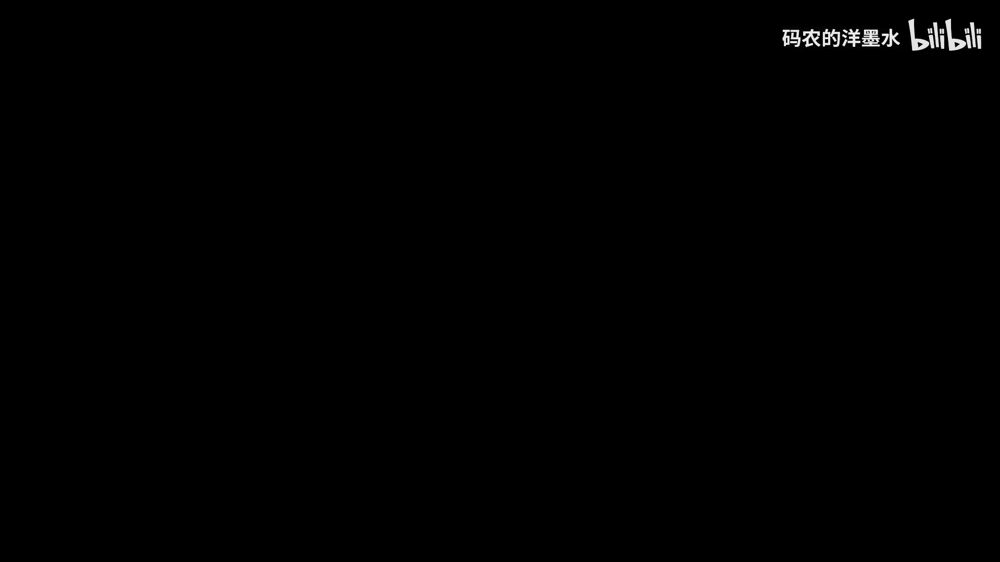
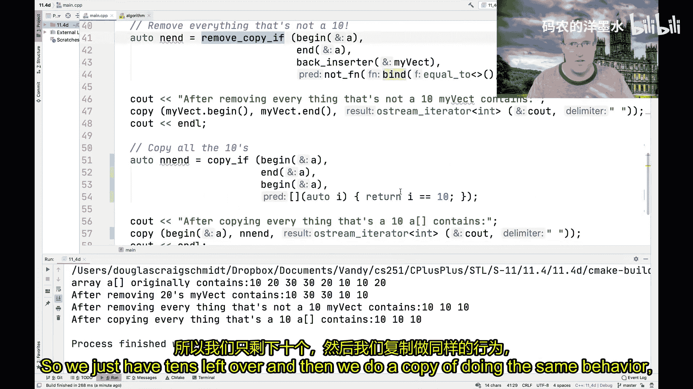
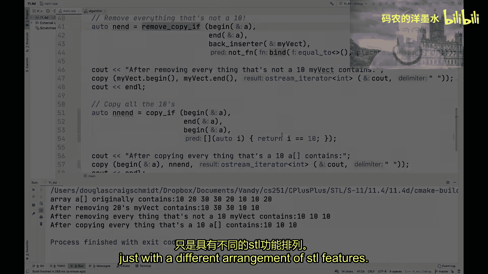

# 【全集】范德堡大学 C++标准模板库 中英字幕 1080P p27 Lecture 27 - 变异算法 part2 -BV1KWiCBWE7M_p27-

Hello and welcome to the next session in my webinar series on C++ Standard Tt Library by example。

Today we're going to continue our coverage of C++ mutating algorithms。

 and it just so turns out that all the algorithms we're going to talk about today all begin with the letter R。

 including replace， rotate， reverse， and remove。😡，So without any further ado。

 let me show you where you can find the source code will'll be examining。

 and then we'll go ahead and jump right into the source code analysis itself。

So if you go to my GitHub repository and you take a look at the C++ STL S11 folder。

 you'll find the projects we'll be covering today， and they appear in the 11。3 and 11。4 subfolds。

We're now on my Sea lion IDE， and we're going to start taking a look at the various algorithms that are the focus of today's lesson。

So there's a number of different muating algorithms， some of them work to do swapping。

 there's a swap algorithm that swaps values that's commonly used to write strongly exception safe assignment operators。

There's a way to do swapping of iterators， There's a way to be able to do swapping of ranges。

 We'll take a look at some of those。 There's also ways to do reversing where you can take various ranges and reverse them or make reversing while you do a copy but the particular algorithm we're going to start out with focusing on now are the rotate algorithms。

 So one of the rotated algorithms is given a midpoint in a range and then it rearranges the range so that that midpoint comes first and everything else is rotated around accordingly。

 and then there's an equivalent version called rotate copy that can do the rotating on a range and then store the results in some other range。

So the example we're going to look at here is going to be using a couple of vectors。

 we're going to start out with vector v1， which contains the values1 through9。

 so we'll start by printing out those values and then we're going to do a rotate starting at the middle。

 which in this case is the fourth item in， which is the number five or the place that stores the value5。

So when we do the rotate， we're going to see that now five will appear at the beginning and everything will be rotated around accordingly。

 and you'll see the output when you see it， you'll see what it means to rotate。😡。

And then we print those results and then for fun， we create an empty vector V2 and we use the rotate copy algorithm and what rotate copy does is we give it a range。

 which in this case is going to be the vector1 which we rotate it on itself so it did self-modification except this time we're going to go ahead and rotate it starting at the fifth location our location5。

 which is actually in the middle plus1 and that's going to go ahead and allow us to rotate things back so that the value1 will now be the first element in the output iterator and what we give for output iterator here is going to be a back inserter applied to vector V2 so when we're all done vector V2 will now contain the contents that had originally been stored in vector V1 of course vector V1 will still be rotated because we don't modify it itself when we do the rotate copy in this particular example。

So let's go ahead and run the code and see what happens。As you can see here。

 what we get is we have the original vector， which was one through nine。

 we then rotated that so it then had the five at the beginning because we started at the fourth。

Plus four， which is the fifth location because everything starts counting at zero and then when we're all done。

 we go ahead and rotate this time with the fifth location， which is beginning plus5。

 which is going to start here at the one location， so01，2，3，4。

5 and that's going to end up causing V2 to contain the original content before we rotate it in V1。

So now that we've talked about rotate， let's go ahead and talk about the various reverse algorithms。

In this particular case， we're going to use a vector with 10" from  one to 10。

 And we're going to call the reverse algorithm， which， as you can see。

 is going to start at the beginning of the vector and go one past the end with the end factor method。

 And so this will be doing reversing in place。If we go over here and take a look at reverse。

 you can see it's implemented by calling the underscore underscore reverse algorithm。

 which is listed up here， so as long as first is not equal to last。

 then it's going to go through a loop from first to last and notice how every time it goes through here it prederements last by one and that's because last always points one pass the end of the actual container or array that we're working on and this particular case every time through that loop we're going to call the it swap method which we've talked about earlier in order to swap the contents at the first iterator with the contents at the last iterator which has been conveniently bumped up by one with the the prederement operation。

So that's basically what reverse does。 You can see it's a very， very simple algorithm。

 Let's now go back over here to Maine and take a look at the next thing we're gonna to do。

 So after we print out the contents of our reversed vector。

 we're now going to create ourselves a string which I call my palindrome and it has the very famous string of characters。

 a man， a plan a canal panama which is a palindrome， of course， So just for kicks。

 we're going to go ahead and do reverse copy on my palindrome and this is how we're going to treat this as an Sl like container。

 even though a string isn't strictly an Sl like container So we say my palindrome begin to my palindrome end and this time we're going to use reverse copy which is going go ahead and copy the contents to the standard output So my palindrome of course。

 will not be affected。 Let's go take a quick look at reverse copy you can see here that it looks very much like reverse does except in this particular case it goes ahead from。

First to last and here it's going to go and prederement last right before it goes ahead and dereferences it and when it dereferences it。

 it's going to go ahead and store it into the output iterator， which in this case， of course。

 is going to be the O stream iterator adapter， which takes C out and makes it look like an output iterator。

 so the assignment operation on OSt adapter will be used to write that to the standard output。😡，Okay。

 so again， fairly simple methods， reverse is kind of cool。

 I guess if you're doing lots of text processing， you might have a situation where you need to reverse things and so as a consequence you can see how to use those algorithms in this simple example program。

So now that we've talked about rotate and reverse， let's move our attention to the final set of R algorithms we're going to cover today。

 which are the remove algorithms。😡，There's a number of different STL algorithms that remove elements from a range。

 including remove， which deletes items in a range that equal a given value。

 Remove if which deletes items in a range if a predicate is true， remove copy。

 which makes a copy of items in a range， but not those that match a given value。

 and finally remove copy if， which makes a copy of items in a range。

 but not those where a predicate evaluates the true。

These algorithms actually don't alter the contents past the new end of the range。

And so we're going to show how that happens， so the old values will still be in that range unless you go do some additional work to remove them now for native types。

 for builtin types， you can't really remove them， you just have to treat the new end of the iterator as the end of the range。

 but with some of the containers you can actually erase them and we'll take a look at all those examples here in just a second。

So let's start out by taking a look at this example here where we've got a built in array with eight elements。

 10， 20， 30， 30， 20， 10， 10，20。😡，So we go ahead and print the original contents out and you'll notice here I'm using the convenience method begin that allows you to treat an array as though it's an iterator。

 so we get a begin iterator using begin and then we get the end iterator using end。

 I've used this before and it's just a convenient way of not having to do all kinds of funky pointer arithmetic to compute the end。

😡，So we write the output to standard output， and then we go ahead and we go through that range from beginning to end of the array A。

 and we're going to remove anything that has the value 20。 And what comes back is。

An iterator to the new end。 So the new end after we've removed the 20s。 And as you can see。

 there's three20s that are going to be removed here。

 We then go ahead and print out the new range from beginning to N end for new end。

 and that'll print out the current active part of the range。 But then just for kicks。

 we're going to print out the complete array and see what happened to the removed elements that we had in there originally。

 And it turns out that they're actually still going to begin the array It's just that we don't access them because we're only supposed to access this new range from begin to N end。

 which is the iterator return from remove。So let's go ahead and run the code and you can kind of see what we're talking about。

 here's the original array which has those eight values including the 20s then we go ahead and get the new range where the 20s have been removed。

 but then when we go back and we print the old values you can see that it's not like they've magically disappeared it's just that the way that remove works is it copies over the elements as it's going through in order to remove the ones you don't want so whenever you finds a match。

😡，For the value that we're looking for， it's going to go ahead and copy the element down over top of it。

 So the old elements are still there。 It's just that we ignore them because we get back a new iterator that's meant to be used as the end of the range。

So let's go ahead and see if we can find the implementation of remove。And here indeed is remove。

So you can see what it's going to do is it's going to walk through that range from first to last。

 And if it。Doesn't find a match。 It's going to copy it down If it does find a match for the thing it removes。

 it's going to just skip over that element， so it'll be copied over the next time。

 so it doesn't copy the elements that are being removed。

 And so this has the consequence of removing items by shifting the other items over top of the items that are being removed。

😡，Okay， so that is the first example we're going to look at now we're going to look at a bunch of other examples of remove that have variations on a theme of what we've just seen。

So let's go up here and open up the next example， which is going to be。This one。

So this example is going to use the remove if algorithm and as you might expect。

 this is going to use a predicate， so it'll remove elements in a range that match the given predicate and we're going to have a couple of preddicateates we're going to use here we're going to have one that's going to compute whether or not a value is odd。

😡，And we're going have another that computes if the value is even。

 So what's interesting about this is that the is odd is a function， not a functer。

 but we can use it as a functer， as you'll see here in a moment and is even is genuinely a true stateless funter。

So let's go ahead and take a look at this， we're going to have an array we're sticking with our built-in array stuff for now although you'll see we don't have to stick with built in arrays I'm just doing it because it's fun。

 so we have a built-in array of basically nine items and we're going to go through and we're going to call remove if and that's going to go ahead and remove anything that matches the is odd function and notice that's being passed in as a pointer to a function I could have explicitly done this syntax if I'd wanted to it doesn't make any difference to the way the code works。

😡，What we get back to remove if is a pointer or an iterator to the end of the range after removing all the odd values so we're then going to go ahead and print out from beginning to PN this new iterator all the contents which should of course not include any odd values so the odd values have all been removed and then just to go one step further we're going to call remove if again starting at the beginning going up to the new end the new computed end that we got back from the first call to remove if and this time we're going to pass in a true functer which is an anonymous instance of is even and that's going to end up removing all the even values and of course when we're all done there there should be nothing left。

😡，So let's go ahead and run the code and see what we get as a result， so as you might expect。

 when we remove all the odd values， we only have even values and then we remove all the even values after removing the odd values。

 then there's nothing left at all so it ends up just being an empty range。

 so begin and PN will point to the same location。Here's what remove if looks like at the implementation level。

 you can see the first thing it does is it calls findDF to see if there's even a match with the predicate。

 if there's no match， there's no sense in continuing to do anything else。

 but if there is a match we start at the iterator that comes back from findDF。

 and then we go through much the same way we did with remove basically overriding elements that are being removed。

 the difference is that unlike the remove algorithm which look for a value in this case we're looking to see if a predicate matches or not。

 but other than that the concept is basically the same。Okay， so that's remove if。

Now let's go ahead and turn our attention to yet another example of remove。So this will be this one。

 I hope。And so if we go over here， this is showing something known as the remove copy algorithm and that's going to copy the elements in the range of first up to。

 but not including last。And it's going to do it in a way that will remove elements that it doesn't like and copy the other ones。

 So let's take a look and see how it works。 It's really pretty simple Here we have another array that has in this case。

 eight values 1020，30，30，20，10，1020 and we go ahead and print the content so you can see what's there。

😡，Then we make ourselves an empty vector of int。And then we go through this built in array from beginning to end。

Inserting the results into my VA one at a time using a back inserter。

 but we're going to skip over everything that matches the value 20。😡，And so when we're done。

 we'll print out everything after removing all the 20s。 So let's go ahead and run this。

And as you can see， indeed， the results show that we end up with only values in the original range after removing the copies。

 remove it， we copy things， but we remove the ones that we don't want。Here is remove copy。

 as you can see here it goes through and much like the other remove algorithms。

 it finds something that if it doesn't find a match， it does a copy into the output iterator。

 as you can see down here in this if statement， if the predicate doesn't match， it copies it。

 if the predicate does match the value is just simply ignored。😡，Okay， so that's remove copy。

Let's go ahead。 Oh， and one other thing I should point out in this example， you'll notice that。

This was a combination of built in arrays， so arrays of a sub。Aray。

 just a and it combined it with a vector。 So in this case。

 the the output iterator was pointing to a vector， whereas the input range was just pointing to a regular old built in array。

 Once again， underscoring the fact that STL can work nicely between built in types and user defined types or STL class library defined types。

All right， we have got one more example to cover today and that is this one。

And this is kind of a fun one it's going to showcase。The so called remove copy， if algorithm。

And we've seen this before。 And so hopefully this won't be too much of a rehash。

 but it is worth looking at this because it's an interesting algorithm。

 And I show you a couple different variants on how to use it。In the context of lambmbda functions。

So first thing we show is our perhaps overly specific funter that will essentially find a match if the parameter that's passed to it happens to be equal to 20 Now again。

 nobody in the right mind would write code like this because there's better ways to do it。

 but I'm just using this as kind of a counterex of how to show the remove copy of behavior and then will successively show better ways to do things。

😡，So in this case， we're going to have remove copy if showcased we've got our。Built an array， A。

 which has eight values in it， we also have another vector。

 which is called myV that starts out empty。 we print the original contents of the array。

 and then we call remove copy if on that array and we're going to go through and get rid of anything that happens to match the funter 20。

 the overly specific funter 20 and we're going to go ahead and back insert that into the end of myV So when we're done we can print myveec and of course it should contain everything except the 20s。

Now， what we're going to do is we're going to chop my deck back down to zero so we can reuse it here。

 And this time， we're going to go through and do remove copy of。

 except rather than doing that overly specific funter 20。

 we're going to showcase the use of a couple of。Function adapters。 So we're going to use。

Bind to bind equal to， which is a binary function to a placeholder。

 which is whatever' is coming through that range and the value 10。

 And then we're going gonna gate that。 So this is going to remove everything in the range that's not a 10。

 So by doing remove copy if and then applying a negator， like not fun or not function。

That turns around and actually turns this into a copy if semantic。

 And I think I mentioned in previous videos that this used to be the way you had to do things in STL because they forgot to add copy if in one of the early versions of the standard。

 So that was the way that you got copy of semantics was by using remove copy if and then applying a theator to whatever it is you were actually trying to copy。

Because that was a little bit wacky， we're now going to show how you can use the copy of algorithm to get the effect of remove copy of within the Gator in a much more concise way。

Perhaps not as esoteically cool but much more concise so here's copy if we start at the beginning of the array we go to the end of the array and now in this case we're going to reassign back to ourselves whereas before we were putting things at the end of myV which was a vector。

But now we're going to do copy if to do a mutating copy on the array contents itself。

 and in this case we're going to pass in a generic lambmbda function， which is going to return。😡。

True if the value I equals 10， so in essence， we're copying things that equal 10 and then we're going to print the results out。

Just for kicks， let's take a look and see if we can find the copy of code。 here's the copy of code。

 You can see that this。Is sort of the inverse of remove copy of What it does is if the predicate matches。

 it copies it， whereas if the predicate doesn't match， it ignores it where in contrast。

 the remove copy of behavior， Let's see if I can find that。

Remove copypiif is basically the same algorithm except it negates the predicate whereas copyif does not。

 so you can see that they're basically just simple inverses of each other。

 which is why the negator trick works well for remove copypiF to convert it into copypiF。😡。

So let's go and run the code just to prove that it does all the cool things I'm saying。

 So we have our original array， which contains the contents you see up here。 We remove 20s from that。

😊，That array and store it into my Vck。 and then we go ahead and print the contents， which， of course。

 is missing the 20s。And then we go ahead and we remove everything in that is not going to be oh sorry we only copy things that are1s and so the first time we do it。

 we remove everything that's not a10， so that's remove copy of within ne Gator。

 so we just have1s leftover and then we do a copy of doing the same behavior just with a different arrangement of STL features。

So that wraps up the topics I wanted to cover today。

 which were a number of different mutating STL algorithms。

 all of which happen to start with a letter R， including rotate， reverse， and remove。😡。

Tomorrow we'll continue talking about mutating algorithms in STL that begin with R focusing on the replace algorithms。

 and then we'll turn our attention to sorting， which has a number of interesting dimensions in STL in terms of sorting random access containers。

 as well as also being able to sort bidirectal containers。😡。

Doing this sorting discussion will also give us an opportunity to look at ways of profiling your C++ code。

 using high resolution timers so you can see how long it's taking in microseconds or milliseconds for your programs to run or parts of your programs to run。

So that wraps it up for the day， thanks very much for joining and if you enjoy the content。

 please like the video and please go ahead and subscribe。I'll talk you soon。

