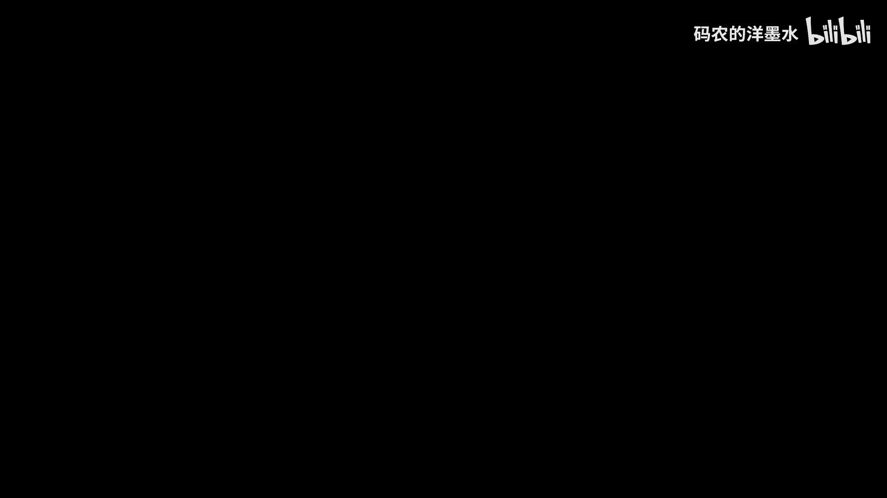
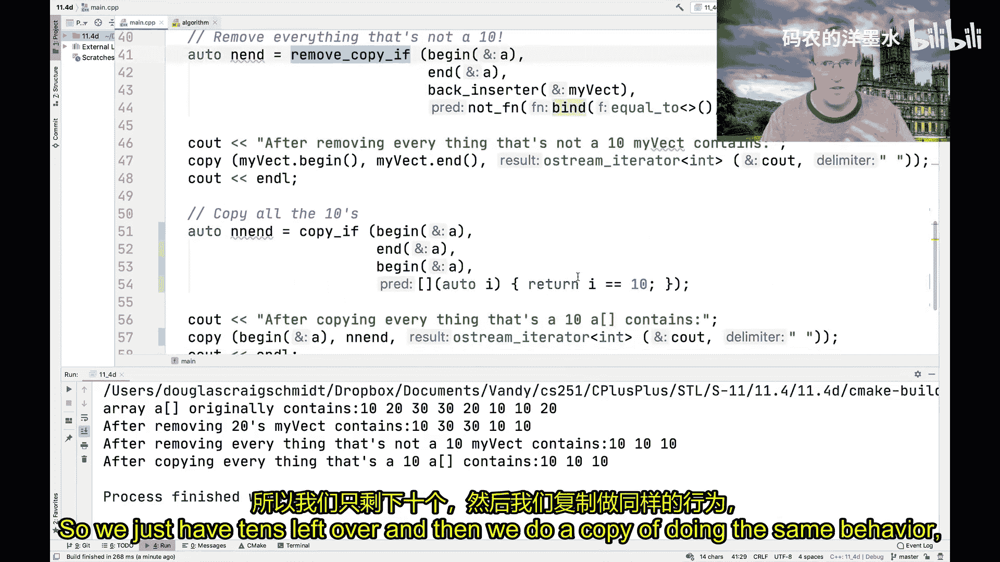
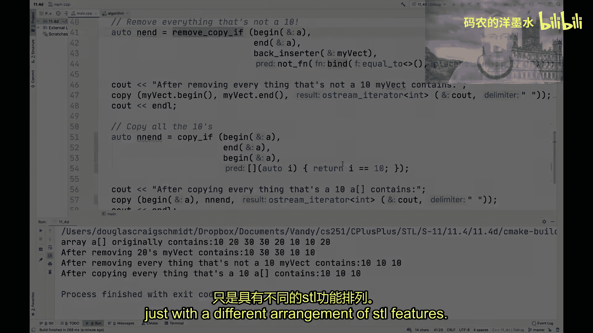

# C++标准模板库：27：变异算法 part2



在本节课中，我们将继续学习C++标准模板库中的变异算法。我们将重点介绍一系列以字母“R”开头的算法，包括 `rotate`（旋转）、`reverse`（反转）和 `remove`（移除）。这些算法能够直接修改容器中元素的范围或顺序。

## 🔄 旋转算法

上一节我们介绍了基础的变异操作，本节中我们来看看如何旋转一个范围内的元素。`rotate` 算法接受一个范围和一个中点迭代器，它会重新排列该范围，使得中点元素成为新的起点，其余元素相应地进行旋转。

以下是使用 `rotate` 和 `rotate_copy` 的示例：

```cpp
#include <algorithm>
#include <vector>
#include <iostream>
#include <iterator>

int main() {
    std::vector<int> v1 = {1, 2, 3, 4, 5, 6, 7, 8, 9};
    // 打印原始向量
    std::cout << "Original vector: ";
    std::copy(v1.begin(), v1.end(), std::ostream_iterator<int>(std::cout, " "));
    std::cout << std::endl;

    // 以第四个元素（值为5）为中点进行旋转
    std::rotate(v1.begin(), v1.begin() + 4, v1.end());
    std::cout << "After rotate: ";
    std::copy(v1.begin(), v1.end(), std::ostream_iterator<int>(std::cout, " "));
    std::cout << std::endl;

    // 使用 rotate_copy 将旋转结果复制到另一个向量
    std::vector<int> v2;
    std::rotate_copy(v1.begin(), v1.begin() + 5, v1.end(), std::back_inserter(v2));
    std::cout << "v2 after rotate_copy: ";
    std::copy(v2.begin(), v2.end(), std::ostream_iterator<int>(std::cout, " "));
    std::cout << std::endl;

    return 0;
}
```

运行此代码，原始向量 `[1, 2, 3, 4, 5, 6, 7, 8, 9]` 经过以第五个元素为中点的旋转后，变为 `[5, 6, 7, 8, 9, 1, 2, 3, 4]`。`rotate_copy` 则在不修改原向量的情况下，将旋转结果复制到 `v2` 中。

## 🔁 反转算法

了解了旋转之后，我们来看看如何反转一个范围内的元素顺序。`reverse` 算法会原地反转指定范围内的元素，而 `reverse_copy` 则会将反转后的序列复制到另一个位置。

以下是反转操作的示例：

```cpp
#include <algorithm>
#include <vector>
#include <iostream>
#include <iterator>
#include <string>

int main() {
    std::vector<int> vec = {1, 2, 3, 4, 5, 6, 7, 8, 9, 10};
    // 反转整个向量
    std::reverse(vec.begin(), vec.end());
    std::cout << "Reversed vector: ";
    std::copy(vec.begin(), vec.end(), std::ostream_iterator<int>(std::cout, " "));
    std::cout << std::endl;

    // 使用 reverse_copy 反转字符串并输出
    std::string palindrome = "a man a plan a canal panama";
    std::cout << "Reversed string: ";
    std::reverse_copy(palindrome.begin(), palindrome.end(), std::ostream_iterator<char>(std::cout));
    std::cout << std::endl;

    return 0;
}
```

`reverse` 算法的内部实现通常通过交换首尾元素直到中间点来完成。`reverse_copy` 则从尾部开始读取元素，并顺序写入输出迭代器。

## 🗑️ 移除算法

最后，我们探讨一系列用于移除元素的算法。这些算法包括 `remove`、`remove_if`、`remove_copy` 和 `remove_copy_if`。它们并不真正“删除”容器中的元素，而是通过覆盖或忽略不需要的元素，并返回一个新的“逻辑终点”迭代器。

以下是 `remove` 系列算法的使用场景：

### 使用 `remove` 移除特定值

```cpp
#include <algorithm>
#include <iostream>
#include <iterator>

int main() {
    int a[] = {10, 20, 30, 30, 20, 10, 10, 20};
    std::cout << "Original array: ";
    std::copy(std::begin(a), std::end(a), std::ostream_iterator<int>(std::cout, " "));
    std::cout << std::endl;

    // 移除所有值为20的元素
    auto new_end = std::remove(std::begin(a), std::end(a), 20);
    std::cout << "After removing 20s: ";
    std::copy(std::begin(a), new_end, std::ostream_iterator<int>(std::cout, " "));
    std::cout << std::endl;

    // 显示整个数组，被“移除”的元素依然存在
    std::cout << "Full array (showing leftover elements): ";
    std::copy(std::begin(a), std::end(a), std::ostream_iterator<int>(std::cout, " "));
    std::cout << std::endl;

    return 0;
}
```

`remove` 算法遍历范围，将不等于目标值的元素向前复制，从而覆盖掉需要移除的值。它返回一个指向新逻辑终点的迭代器。

### 使用 `remove_if` 和谓词

`remove_if` 允许使用自定义谓词（函数或函数对象）来决定移除哪些元素。

```cpp
#include <algorithm>
#include <iostream>
#include <iterator>

bool isOdd(int x) { return x % 2 != 0; }

struct IsEven {
    bool operator()(int x) const { return x % 2 == 0; }
};

int main() {
    int a[] = {1, 2, 3, 4, 5, 6, 7, 8, 9};
    // 移除所有奇数
    auto new_end = std::remove_if(std::begin(a), std::end(a), isOdd);
    std::cout << "After removing odds: ";
    std::copy(std::begin(a), new_end, std::ostream_iterator<int>(std::cout, " "));
    std::cout << std::endl;

    // 在剩余范围内移除所有偶数
    new_end = std::remove_if(std::begin(a), new_end, IsEven());
    std::cout << "After removing evens from the remainder: ";
    std::copy(std::begin(a), new_end, std::ostream_iterator<int>(std::cout, " "));
    std::cout << std::endl;

    return 0;
}
```

### 使用 `remove_copy` 和 `remove_copy_if`

这两个算法在复制过程中移除元素，不修改原范围。

```cpp
#include <algorithm>
#include <vector>
#include <iostream>
#include <iterator>

int main() {
    int a[] = {10, 20, 30, 30, 20, 10, 10, 20};
    std::vector<int> vec;

    // 复制所有不等于20的元素到vec中
    std::remove_copy(std::begin(a), std::end(a), std::back_inserter(vec), 20);
    std::cout << "Vector after remove_copy (removing 20s): ";
    std::copy(vec.begin(), vec.end(), std::ostream_iterator<int>(std::cout, " "));
    std::cout << std::endl;

    return 0;
}
```

`remove_copy_if` 的工作方式类似，但使用谓词进行判断。历史上，可以通过组合 `remove_copy_if` 和函数适配器 `std::not1` 来模拟 `copy_if` 的行为，但现代C++直接提供了 `std::copy_if` 算法，使代码更清晰。

```cpp
#include <algorithm>
#include <iostream>
#include <iterator>
#include <functional>

int main() {
    int a[] = {10, 20, 30, 30, 20, 10, 10, 20};
    std::vector<int> vec;

    // 传统方式：使用 remove_copy_if 和 not1 来复制特定值
    // 现代方式：直接使用 copy_if
    std::copy_if(std::begin(a), std::end(a), std::back_inserter(vec), [](int i){ return i == 10; });
    std::cout << "Vector after copy_if (copying only 10s): ";
    std::copy(vec.begin(), vec.end(), std::ostream_iterator<int>(std::cout, " "));
    std::cout << std::endl;

    return 0;
}
```

## 📝 总结





本节课中我们一起学习了C++ STL中另一组重要的变异算法。我们详细探讨了：
*   **`rotate` 与 `rotate_copy`**：用于旋转范围内的元素。
*   **`reverse` 与 `reverse_copy`**：用于反转范围内的元素顺序。
*   **`remove` 系列算法**：包括 `remove`、`remove_if`、`remove_copy` 和 `remove_copy_if`，用于从范围中逻辑上移除元素。这些算法通过覆盖或忽略元素来工作，并返回新的逻辑终点。

理解这些算法如何操作迭代器范围，而不一定直接修改底层容器的大小，是有效使用STL的关键。下一节课我们将继续学习以“R”开头的 `replace`（替换）算法，并开始探讨排序算法。