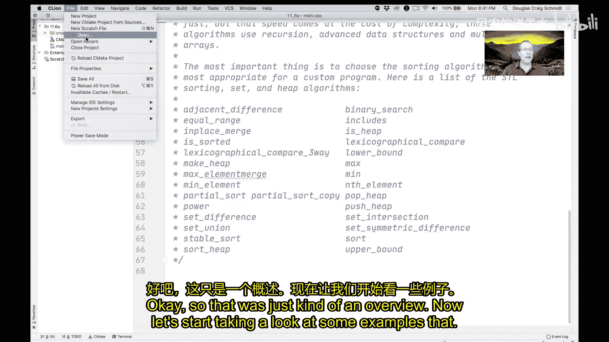
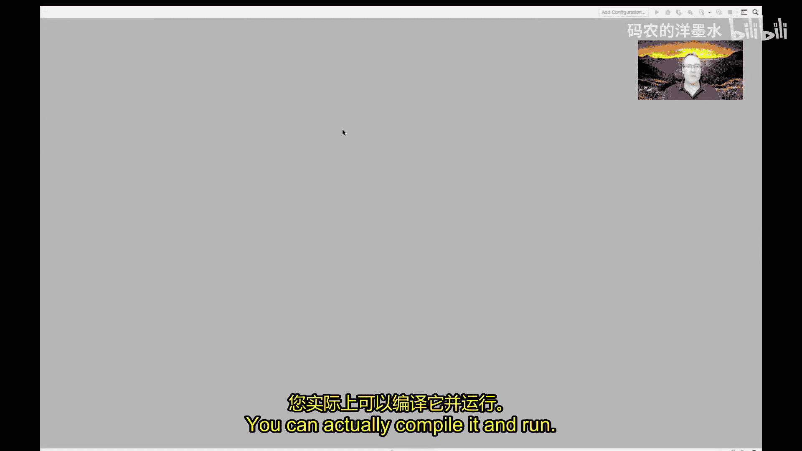
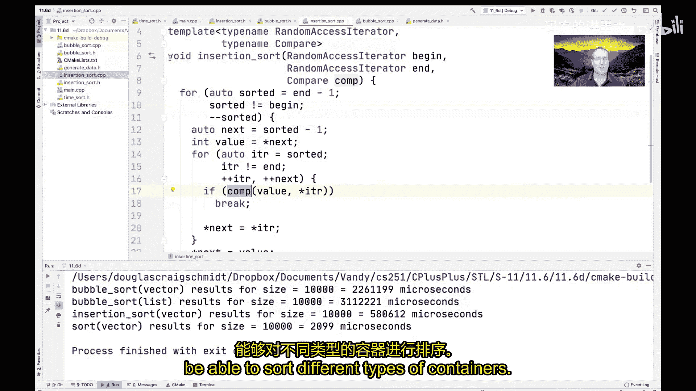

# 【全集】范德堡大学 C++标准模板库 中英字幕 1080P p28 Lecture 28 - 变异算法 part3 -BV1KWiCBWE7M_p28-

Hello and welcome to the next session in my webinar series on C++ Standard Template Library by example。

Today we're going to continue our discussion of mutating algorithms in STL， once again。

 focusing on a family of algorithms that start with R， the replaced family。😡。

As well as talking about a set of algorithms related to sorting。😡，So without any further ado。

 let me go ahead and share my screen and we'll take a look at where to find the code and then we'll start doing the analysis。

😡，So if you go to my GitHub repository and take a look at the C++ STLs11 folder， you'll find the 11。

5 and 11。6 subfolders， and that'll be the parts that we're going to look at today。

So let's go ahead and take a look at my CI IDE， as you can see there are four replace methods in this family of algorithms。

 replace replace if， replace copy and replace copyF。😡。

Replace scans range and replaces a given set of old values with new values。Or new value。

Replace if will scan a range and replace any old values found by the given new value if a predicate turns out to be true。

Replace copy will make a copy of an existing range。

 replacing anything that matches the given old value with a given new value。

 and then finally replace copy if we'll go ahead and scan through a range， copy it。

 and replace anything that matches a predicate with the given new value。😡。

So now that you have a good idea of the overall set of operations in this replaced family。

 let's take a look at an example to illustrate a couple of these methods。

So here's a vector of a bunch of ints which have both positive and negative numbers。

No particular rh or reason to the numbers， just a bunch of numbers。

The next thing we do is we go ahead and use a range based for loop to print out the contents of the original list。

😡，Now we're going to go through and use replace if to iterate through the vector and anywhere that we find something that has the absolute value of 20。

 so either minus 20 or positive 20。😡，We're going to go ahead and replace that with the value 42 and you can see here that we have a local auto variable called value which is assigned 20 and then we write a little generic lambmbda function that checks each element in the range and sees if that element has an absolute value that's equal to the value of 20 and because this is a lambmbda function and we have a local variable we have to either use the capture clause to indicate that that local variable should be available in the lambmbda or we have to use the asterisk wild card rather sorry the Amperssand wild card which will indicate that anything in that scope should be considered fair game for use within the lambmbda function if we leave this out altogether then value won't be recognizable to the compiler。

I prefer to use the value means in the catcher clause because that doesn't open up the window to the whole gamut of local variables。

 but just the one that we indicate here。😡，So after we replace the absolute value of 20 with 42。

 we print the contents and we make ourselves a new vector V2 which has the size of V and then we do a replace copy if and as you can see what replace copy if does is it goes to the original range of V and it's going copy into V2 which has been given the right size in its constructor and any place that happens to have an odd value we' simply replace that with the constant zero so again we're writing a generic lambda function in this particular case we don't have to do any tricky things with capture clauses because we're not accessing any local variables inside the scope of our generic lambda and what we're done we go ahead and replace the we print out the new results so let's go ahead and run the program you can see here here's the original。

Vectctor， then we go through and replace everything that's either minus 20 or plus 20 with 42。

 and then the very final thing we do is we go through and we replace all the odd numbers with zero。😡。

Just for kicks let's go ahead and take a look at the implementation of these methods here's replace we don't actually show replace here but it's the easy case。

 it simply goes through the range using a forward iterator and anywhere where the first iterator dereenced equals the old value we replace that value with the new value so you can see here we're going to use star first with the dereence of the first iterator in two ways we use it as an R value in the if statement to read the contents of the value and then down here we use it as an L value to be to write to the contents。

😡，Replace if does the same thing except rather than checking directly to see if a value matches it calls the predicate。

Which is a unary predicate in this case。Then replace copy goes through the input iterator range and anywhere there's a match to the old value。

 we replace the copy in the output iterator with the new value。

 otherwise we just copy the contents of the old value into the new output iterator。😡。

And then finally， replace copyif walks through making a copy and it uses a predicate。

 so you can see a tremendous amount of symmetry and parallel structure to these different algorithms。

😡，Okay， so that's replace and I think we'll all agree that replace is a useful algorithm to have around or family of algorithms to have around。

So now let's go ahead and turn our attention to sorting。

 so this is also obviously a very common thing to be able to do is to sort various types of containers。

 the ones at least that aren't already sorted， maps and sets and multimaps and multis of course are sorted by their very nature。

 but the unordered containers， the unordered associatedsoative containers are not sorted by their very nature。

 vector decks lists， forward lists， they're not sorted by their very nature。😡。

So when we think about sorting， we think about all the other things we can do once we've got a sorted collection so once something is sorted。

 you can go ahead and do binary search on it， you can do various set operations on it you can do things like upper bound and lower bound so clearly sorting is a very useful capability to have now when we think about sorting。

 it turns out that there's a couple of different categories of algorithms to be concerned with there's the so-called quadratic algorithms or the ones that take n squared time to run and those algorithms are not going to scale up very well。

 although they could be useful if you have small values of an and certain properties with the input you're trying to sort like maybe they're almost already sorted。

😡，More typically though when we have large amounts of input we typically want to use the more efficient algorithms and in this context efficient doesn't just mean written cleverly to minimize the use of copying or put your variables into registers and so on it means being more effective from an asymptotic time complexity perspective or a big O notation perspective now this isn't a theory course so I won't talk about this at detail。

 but basically there are algorithms that take n log n time to run and those are the ones that are going to be much more efficient especially as n gets large。

😡，So the analog log n algorithms of course， the classic ones would include quick sort and heap sort and merge sort。

 and then there's a whole pot of quadratic or n squared algorithms like insertion sort and bubble sort and selection sort and so on。

So this again， is not a theory class， but it's worth at least understanding that for big N。

 you're better off using the better Oululus。😡，Well。

 needless to say STL has tremendous amount of support for sorting。

 it of course has the sort algorithm which uses a variant of quick sort called intro sort for introspective sort and what intro sort does is it goes ahead and tries to use Quick sort but if it discovers that quick sort is not working efficiently it'll automatically switch over to using heap sort which doesn't have as pathological worst case condition is some quick sort implementations there's also a merge sort algorithm that's available and that's what's used on sorting linked lists and then there's a bunch of other things that can do heEaps can make heaps can check whether things or heaps and so on and so forth so there's a whole bunch of different operations that are available in an STL。

Okay， so that was just kind of an overview now let's start taking a look at some examples that。😡。

You could actually compile it a run。

So this example just kind of talks about the different types of sorts。

 again you can read the documentation if you're interested in this。😡。

So we're going to use the built-in sort operation and the built-in sort function is a generic function that's intended to work on containers that have so-called random access iterators。

 and those are the ones of course， where you can do plus equal and minus equalL and subtraction in addition。

 all the full gamut of pointer arithmetic operations you've come to know in love with native arrays and pointer arithmetic in CNC++ that's what sort expects from the kinds of iterators that it is given for the containers or for the built in arrays that it's going to sort。

😡，So let's take a look and see how this might actually work so here we're going to have a vector of ants called a vector which has a bunch of values in it。

😡，We print out the values， we then go ahead and sort and by default when you sort sort sorts using the less comparator funter and so without having to write that in there it's going to be giving it less now of course。

 if you want to be a belt and suspenders kind of person you can say less。😡。

And do something like this， but that's really gratuitous because it already does that without you having to do anything so let's leave that out that's the default is to sort and that'll end up sorting in acending order from low to high after we sort we print the results and then for kicks we go ahead and sort the vector again from beginning to end except this time we're going to use the explicit greater funter and so thatll of course we'll end up reversing the comparison and so we'll end up with sorting that's done in descending order。

😡，So let's go ahead and run this program and you can see that here was the original input and I guess to make this a little bit more legible。

 I should probably put spaces between everything here， so let's run that again。😡。

And now you can see that we've got。10，3，7， 15， and so on is the original input。

 we sort it in ascending order， we get the results that are in ascending order。

 and then we go ahead and we sort it in descendending order using greater and it comes back in descending order。

Okay， well that's that's pretty cool， but of course there's there's more distort sorting than just sorting of。

😡，Random access arrays and various things that are going to support random access iterators。

 so we'll take a look at that in just a minute。Let's take a look at yet another example。

 so this is going to be example。😡，C。And this is going to illustrate combining the sort operation along with some other classic STL algorithms like Countiff。

😡，Remove if and so on and so this will just give us a chance to see everything come together as we're wrapping up the discussion of algorithms。

 including both the non muting algorithms like counttif as well as muting algorithms like sort and remove if。

So once again we have a vector， just a bunch of values not really ordered in a particular way。

 we print the results using the copy。😡，Algothm， and then we go ahead and we count the number of elements in the original vector V who have a value that's greater than five。

😡，And as you can see here it's going to sum it up so we're going to come back with count in this case we're going to use the bind method and we're going to bind greater。

 which is a binary funter with a placeholder for the first element which is basically what's coming out of the range that we're iterating over and then we connect that with the constant five so that's going to have us checking how many things are greater than five so we'll print out the count of that and you can see there's several values in vector that are greater than five。

Next thing we're going to do is we're going to come down here and once again iterate through the vector from beginning to end except this time we're going to go ahead and remove all the items that are less than four and again we're going to use the bind operation we could have written a generic lambda we could have used bind second of'm just using bind here for the heck of it and so we go ahead and bind and get rid of everything that's less than four and you'll notice it remove if returns an iterator to the new end that's why I call it nN so the new end of course is going to be the span that does not include the elements that we've removed。

😡，Then we go ahead and actually get rid of those elements from the vector。

 the remove if algorithm doesn't actually take them out of the vector because it doesn't even know it's iterating through a vector。

 but once we get the new end， we can go ahead and say， hey。

 vector erase everything from the new end up to the old end and those things are magically removed and popped off of the vector itself。

😡，So then we go ahead and print the contents of the vector with the elements removed。

 and then the last thing we do is we sort the results and then print them。😡。

So let's go ahead and run the program and see what we get so you can see here we have the original input 142857 then we notice that there are two elements that are greater than five which are eight and seven。

 we then get rid of all the elements that are less than four so that'll be one and two and then we sort the results and print them。

So that's yet another example。Now this final example we're going to look at is really interesting this one was a lot of fun to write and it goes above and beyond just showing how to use existing sorting algorithms I actually implement a couple of other sorting algorithms and then I compare the performance of those other sorting algorithms against the sort algorithm that comes built into STL and the purpose of this is not to try to outdo the STL sort algorithm but more importantly to show you first how to time the performance of C++ code with high performance timers so that's useful and then also to be able to demonstrate a couple of interesting things about writing generic algorithms and then integrating them into a little helper function called time sort which will end up taking essentially a pointer to a function to a generic algorithm and that's a little bit interesting to try to get all the Kinks worked out so I'll walk through this code and show you what it does but before I go far along let's go ahead and run this program and。

See what the results are。 So as you can see what it's doing is it's actually timing the performance of。

Bubble sort both for a vector and for a list。😡，And then it's comparing that with insertion sort of a vector。

 and then finally we're actually comparing that with the performance of sort on a vector。

 the built-in intro sort algorithm that comes baked into STL and perhaps not surprisingly sort ends up just crushing them because it's an N log n algorithm as opposed to being an n squared algorithm as the other ones are。

😡，The couple other things to note here we'll talk about how I time this stuff in a second。

 and I think another thing that's worth looking at is the fact that we're bubble sorting a list whereas we can't sort a list。

 at least not using the sort algorithm you have to use the sort method defined on list。

 but I was able to write a bubble sort implementation that works for bidirectional iterators and we'll see that in a second too that's kind of fun。

😡，Okay， so let's take a look at how we run this test program so the first thing we do is we figure out how many items we want to have and how big the largest items should be so we don't want any items that are larger than 100。

000 and we want 10，000 items to sort so to generate random numbers we're going to set the random number generator and seed it with the current time of day and then we're going to call a method called generate data and as we'll say generate data is going to go ahead and generate us n in this case 10。

000 random numbers none of which exceed the size of 100。

000 and it's going to store that into a vector。😡，So let's go ahead and take a look here at generate data。

 so generate data is a。It's a generic function， a template function that's parameterized by a type and a container。

 so it's got a template template parameter as its second type parameter。

 and that's going to be defaulting to vector。😡，So you can see here that generate data returns a vector by value。

 it takes in a size and a biggest value， and then it uses the generate n algorithm and generate n is going to go ahead and generate a certain number in this case size or 10。

000 random numbers and we can control how the random numbers are generated and in this case we're going to use the random method。

 which isn't the best way to do random numbers in C++ but it's good enough for generating test data for sorting。

😡，Except we're going to take the output of RA and we're going to mod it by biggest。

 so nothing will be bigger than actually 999，00， nothing will be as big as or bigger than 100，000。

And then we're going to take this local variable data and we're going to use a back inserter to add each of those elements into the vector and generate them randomly so what we're going to end up with here is a random。

😡，The generated vector of 10，000 items from basically zero to 999999 no yeah。

 99999 that's what we're going to have。And then we return that container。

 which in this case is a vector by value now in this particular case。

 the C plus plus compiler is going to be smart and it's going to use what's called the return value optimization。

 so it's basically going to construct that object into the return value that's going to come back from the generate。

😡，Data function and then it's just going to place it with a move operation into the vector so this is actually a very efficient way of doing things it's not going to generate any extra copies it'll optimize all that kind of stuff away so that's wonderful newer c plus plus move optimizations and return value optimizations to the rescue。

😡，Once we've got our vector of random data， we're then going to make a copy of that vector into a list because we also want to do the bubble sort for the list。

 So to do that we're going to take the beginning iterator to the vector and then go up to the end iterator for the vector。

 So now we've got。😡，A vector of randomly generated data and a list that has exactly the same values。

 and I was intentional at always using the same values so I can do apples to apples comparisons between the various sorting algorithms we're about to look at。

😡，Okay the next thing we're going to do is we're going to do the time sort so you can see we're going to do time sort passing in a string saying what sorts going on the data that we've got which is either the vector data or the list data and then we're going to pass in a pointer to a function for the sort algorithm we want to use to do the sort so for the first two examples we're going to use bubble sort which we'll look at in a second which is got a funny name but it's an n squared algorithm then we're going to do insertion sort on the vector and then we're going to finish up with doing a sort on the vector and I'll show you why I don't have to provide the sort name here I could do it if I wanted to I could say sort but I made that a default value for the time sort。

😡，Functions so it chooses that by default Okay， so you can see here that we're going to bubble sort both the vector and the list and let's go ahead and take a look at time sort so here's time sort time sorts a particularly interesting generic function because it's parameterized by type T it's parameterized by a template template parameter which in this case is the container that we're going to be using to sort。

😡，And then we've got a compare functer， which is going to default to less， so by default。

 we're going to sort things in acending order。😡，The parameters past the time sort are the name of the sort we're doing。

 so that would be bubble sort for vector， bubble sort for list， insertion sort， and sort。😡。

The container we're sorting and I pass this container by value on purpose so it'll make a copy。

 a deep copy of the container so that when we sort it。

 we won't affect the generated vector that has all the test data in it so that each sort will have the same values that it's using to do it sort and then the third parameter is going to be a pointer to a function that takes two iters。

 one to the beginning of the range we want to sort one to the end of the range we want to sort and then also a compare operation and we're gonna default this to sort so you don't have to give this as a parameter if you don't want and this is particularly cool generic programming code。

 notice how I take the container which is defined up here in the template parameter and I make it a container of T because I' get t from the first parameter to the template and then I go ahead and use its trait to extract the iterator and I have to use type name here to tell the compiler hey compiler this is actually an iterator trait not some other type。

😡，Of information， so that's how I can define the use of traits to get myself to be able to define iterators who' passed in for the first and last part of the sort function。

😡，And then the last thing we do is we have the comparison function being defaulted to less。

So once we get into the body of the function itself， we go ahead and get the current。😡。

Time using a high resolution clock， so we store that away in the start。Local variable。

 we then call the pointer to function that was passed in giving it the beginning of the data to the end of the data and the comparison fun and after that finishes running we go ahead and take a snapshot of the current time of day and store that into stop and therefore the duration。

 the amount of time in microseconds required to run this is going to be stop minus start so that'll tell us how many microseconds and you can see down here but the microseconds printed out for the different calls。

😡，Then we go ahead and check to see if we really have asorted result'm pretty sure that sort will return asorted result。

 but the bubble sort and insertion sort algorithms were the ones that I included here。

 I didn't get them off the shelf so that got to double check to make sure they're correct so we assert that everything is sorted is sorted as another STL sort based algorithm as' part of the sorting family that check to see if the。

😡，Begin to end range as sorted and then we print out the sort name。

 the size and the amount of time it took in in microseconds。😡。

So pretty cool little test program demonstrates a nice way to benchmark the amount of time pieces of code take to run。

 and I'm sure you could generalize this a bit more if you needed to for some other purpose。

So to kind of wrap this up now let's go back and take a look at our implementations of bubble sort and insertion sort and let's go ahead and start with bubble sort first and what's interesting about bubble sort is I intentionally designed it so it would work correctly with data that was。

😡，Using a bidirectal iterator only so if we have containers like like list， for example。

 or something that has only has a bidirectal iterator， then we can use the sort。😡。

This particular bubble sort on that type of data so bubble sort as you can see。

 takes a bidirectional iterator for its beginning and an end or its first and last and a comparison fun and then here's the code and if you look carefully at the code for the bubble sort you'll see that it only uses。

😡，Plus plus and minus minus operations on its iterators so we don't have to worry about。

Having random access iterators that we can get by with something that only supports bidirectional iterators you can also see something else interesting here we have the inner swap method and what it swap does is it swaps the contents of two iterators。

😡，And so you can see here what it does is it takes the left an iterator to the left element and an iterator to the right element and it swaps their contents so that's just kind of the classic comparison and exchange operation that takes place with with the。

The bubble sort algorithm。Okay， so that works fine for。

For bidirectional types let's now take a look at but you can also see that bubble sorts like painfully slow in fact it's even slower for bidirectional elements than it was for random access elements and that's primarily just because of the lack of locality of reference for the list version whereas the vector is going to be have better locality of reference than something based on pointers。

So let's take a look at insertion sort real quick insertion sort is another one of those n squared algorithms and you can see over here that。

😡，Well here's the header file looks pretty much like bubble sort did except it takes random access iterators and if you look at the implementation you can see that there's a couple places in here where we use end minus one。

😡，And whenever you do a minus one of something then and here you can see we say sorted minus one So whenever you start doing things like a minus one or a plus one or a plus equal。

 then that pushes you into the random access iterator category and you can't get by with。😡。

Containers that only support bidirectional iterators。

So it turns out that insertion sorts a very efficient algorithm if your data is almost sorted already and again you can see that we use the compare funter that's passed in to check to see whether or not we need to to do the insertion logic for the insertion sort I'm not going to walk through the logic the algorithm behavior for insertion sort or bubble sort or sort for that matter。

 that's something that you can go and take a look at online。

 there's some really great resources on Wikipedia if you Google or if you go to Wikipedia and you look up bubble sort and insertion sort and quick sort and so on they'll actually have animations that'll show you how those different sorting algorithms behave so that's a good place to go if you want to see how they work I primarily hear wanted to focus on the way in which we use different kinds of iterators in order to be able to sort different types of containers。

Okay so that is the end of what I wanted to cover in this session we still have some more algorithms left to do we're going to be focusing next time on set algorithms and I think we'll also have a chance to talk about some of the heap algorithms because heaps are also useful a heap is a partially ordered almost complete binary tree which is used for several things it's used for heap sort of course but it's also used to implement priority cues which is one of the adapted containers then under the hood defaults to using a vector which is converted into a heap so you can take an arbitrary piece of data you can take an arbitrary vector and turn it into a heap in essentially linear time and then all the operations on the heap like insert find remove all take log n time and so that means that something like heap sort will take and log n time so it's a great example of a very obviously end log n algorithm for sorting。

So that's basically what I wanted to cover tonight thank you guys so much for joining if you enjoy the content please like the video and if you want to see more of this go ahead and subscribe so I will hopefully talk to you again soon。

😡。