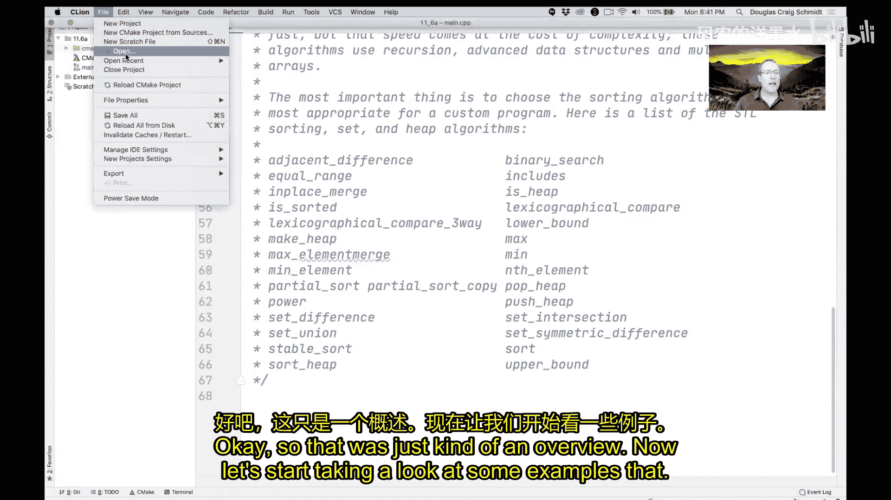
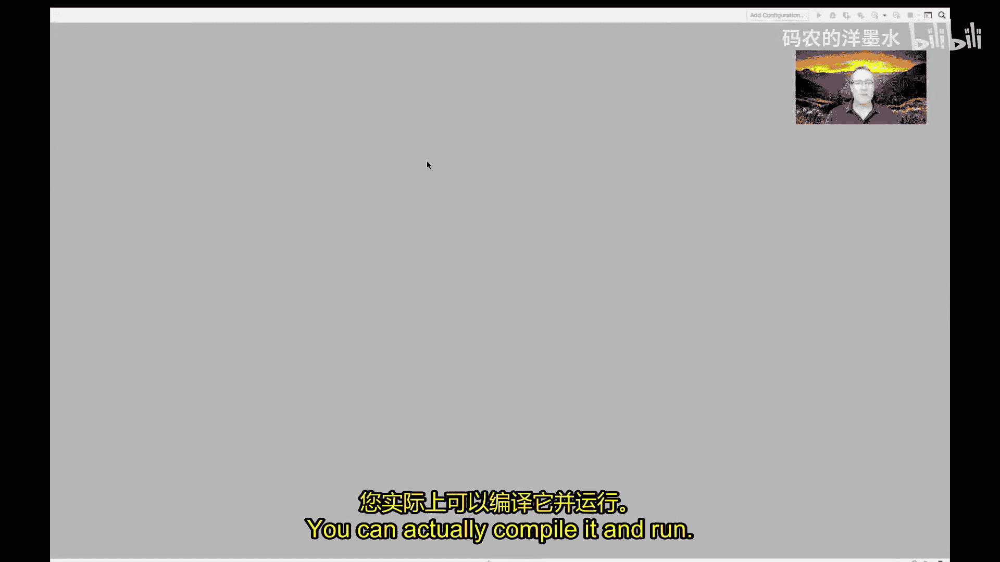
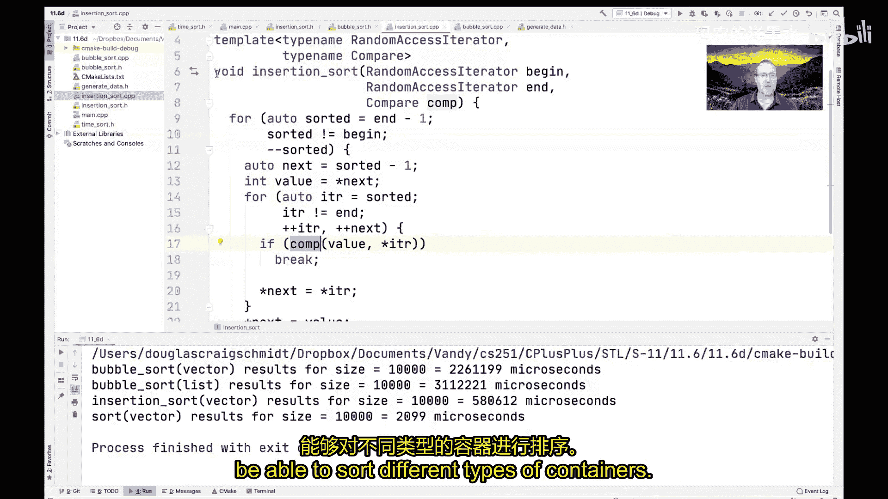

# C++标准模板库：28：变异算法 part3 🧬

在本节课中，我们将继续探讨C++标准模板库中的变异算法。我们将重点介绍以“替换”为核心的一系列算法，并讨论与排序相关的一组算法。

## 替换算法家族 🔄

上一节我们介绍了多种变异算法，本节中我们来看看“替换”算法家族。这个家族包含四个核心算法：`replace`、`replace_if`、`replace_copy`和`replace_copy_if`。

以下是这些算法的基本功能：

*   **`replace`**：扫描一个范围，将其中所有等于指定旧值的元素替换为新值。
*   **`replace_if`**：扫描一个范围，对于所有使谓词（判断条件）返回`true`的元素，将其替换为新值。
*   **`replace_copy`**：复制一个范围到新位置，在复制过程中，将所有等于指定旧值的元素替换为新值。
*   **`replace_copy_if`**：复制一个范围到新位置，在复制过程中，将所有使谓词返回`true`的元素替换为新值。

现在我们对替换算法有了整体了解，让我们通过一个例子来具体说明其中几个方法。

```cpp
#include <algorithm>
#include <vector>
#include <iostream>
#include <iterator>

int main() {
    std::vector<int> v = {10, -20, 30, 20, -10, 15};
    // 打印原始向量
    std::copy(v.begin(), v.end(), std::ostream_iterator<int>(std::cout, " "));
    std::cout << '\n';

    // 使用 replace_if 将绝对值等于20的元素替换为42
    int value = 20;
    std::replace_if(v.begin(), v.end(),
                    [&value](int elem) { return std::abs(elem) == value; },
                    42);
    std::copy(v.begin(), v.end(), std::ostream_iterator<int>(std::cout, " "));
    std::cout << '\n';

    // 使用 replace_copy_if 复制并替换所有奇数为0
    std::vector<int> v2(v.size());
    std::replace_copy_if(v.begin(), v.end(), v2.begin(),
                         [](int elem) { return elem % 2 != 0; },
                         0);
    std::copy(v2.begin(), v2.end(), std::ostream_iterator<int>(std::cout, " "));
    std::cout << '\n';
}
```

运行此程序，输出如下：
```
10 -20 30 20 -10 15
10 42 30 42 -10 15
10 42 30 42 -10 0
```

为了加深理解，我们可以看看这些算法的简化实现思路。`replace`算法的核心逻辑是遍历范围，当发现元素等于旧值时，执行替换操作：

```cpp
template<class ForwardIt, class T>
void replace(ForwardIt first, ForwardIt last, const T& old_value, const T& new_value) {
    for (; first != last; ++first) {
        if (*first == old_value) {
            *first = new_value; // 替换操作
        }
    }
}
```





`replace_if`与之类似，但使用谓词进行判断。`replace_copy`和`replace_copy_if`则涉及将结果写入输出迭代器。这些算法在结构上具有高度的对称性和并行性。

## 排序算法概述 📊

替换算法是非常有用的工具。现在，让我们将注意力转向排序。排序显然是一种非常常见的操作，用于整理各种类型的容器。

当我们考虑排序时，也会想到对已排序集合可以进行的其他操作，例如二分查找、集合运算以及`upper_bound`和`lower_bound`等。因此，排序是一项非常有用的能力。

在排序算法中，存在不同的时间复杂度类别。有些是**二次方算法**（时间复杂度为O(n²)），例如插入排序、冒泡排序和选择排序。这些算法在处理大规模数据时效率不高。

更常见的情况是，当处理大量输入时，我们倾向于使用更高效的算法。这里的“高效”不仅指代码编写巧妙，更指从**渐近时间复杂度**（大O表示法）的角度来看更有效。典型的**O(n log n)**算法包括快速排序、堆排序和归并排序，它们在大规模数据下表现更佳。

STL对排序提供了强大的支持。它包含`sort`算法，该算法使用一种名为**内省排序**的快速排序变体。内省排序会尝试使用快速排序，但如果发现效率不佳，会自动切换到堆排序，以避免快速排序在某些情况下的最坏性能。此外，还有用于链表排序的`merge`算法，以及一系列用于堆操作的函数（如创建堆、检查是否为堆等）。

## 排序算法实践 🛠️

以上是排序的概述，现在让我们开始看一些具体的例子。

### 基础排序示例

我们将使用内置的`sort`操作。`sort`是一个泛型函数，要求容器提供**随机访问迭代器**，即支持指针算术运算（如`+`、`-`、`+=`、`-=`）的迭代器。

让我们看看它是如何工作的：

```cpp
#include <algorithm>
#include <vector>
#include <iostream>
#include <iterator>

int main() {
    std::vector<int> vec = {10, 3, 7, 15, 1, 9};
    std::copy(vec.begin(), vec.end(), std::ostream_iterator<int>(std::cout, " "));
    std::cout << '\n';

    // 默认升序排序（使用 std::less<>）
    std::sort(vec.begin(), vec.end());
    std::copy(vec.begin(), vec.end(), std::ostream_iterator<int>(std::cout, " "));
    std::cout << '\n';

    // 显式指定降序排序（使用 std::greater<>）
    std::sort(vec.begin(), vec.end(), std::greater<int>());
    std::copy(vec.begin(), vec.end(), std::ostream_iterator<int>(std::cout, " "));
    std::cout << '\n';
}
```

运行程序，输出如下：
```
10 3 7 15 1 9
1 3 7 9 10 15
15 10 9 7 3 1
```

### 结合其他算法

排序的功能远不止对随机访问容器进行排序。让我们看另一个例子，它将`sort`操作与其他经典STL算法（如`count_if`、`remove_if`）结合起来。

```cpp
#include <algorithm>
#include <vector>
#include <iostream>
#include <iterator>
#include <functional>

int main() {
    std::vector<int> v = {1, 4, 2, 8, 5, 7};
    std::copy(v.begin(), v.end(), std::ostream_iterator<int>(std::cout, " "));
    std::cout << '\n';

    // 计算大于5的元素个数
    int count = std::count_if(v.begin(), v.end(),
                              std::bind(std::greater<int>(), std::placeholders::_1, 5));
    std::cout << "Count > 5: " << count << '\n';

    // 移除所有小于4的元素
    auto new_end = std::remove_if(v.begin(), v.end(),
                                  std::bind(std::less<int>(), std::placeholders::_1, 4));
    v.erase(new_end, v.end()); // 真正从向量中删除
    std::copy(v.begin(), v.end(), std::ostream_iterator<int>(std::cout, " "));
    std::cout << '\n';

    // 对结果进行排序
    std::sort(v.begin(), v.end());
    std::copy(v.begin(), v.end(), std::ostream_iterator<int>(std::cout, " "));
    std::cout << '\n';
}
```

运行程序，输出如下：
```
1 4 2 8 5 7
Count > 5: 2
4 8 5 7
4 5 7 8
```

### 性能比较与自定义排序

最后一个例子非常有趣，它不仅仅展示如何使用现有的排序算法，还实现了其他几种排序算法，并将它们的性能与STL内置的`sort`算法进行比较。这样做的目的并非要超越STL的`sort`，而是为了展示如何对C++代码进行高性能计时，并演示如何编写泛型算法。

程序的核心是一个名为`time_sort`的辅助函数，它接受一个指向排序算法的函数指针，并测量其运行时间。测试数据是随机生成的。

以下是测试结果的一个示例（具体时间因机器而异）：
```
Bubble Sort (vector): 10000 items sorted in 450000 microseconds.
Bubble Sort (list): 10000 items sorted in 1200000 microseconds.
Insertion Sort (vector): 10000 items sorted in 220000 microseconds.
STL Sort (vector): 10000 items sorted in 1500 microseconds.
```

不出所料，STL的`sort`算法（O(n log n)）的性能远远超过了冒泡排序和插入排序（O(n²)）。值得注意的是，我们为链表实现了冒泡排序，而链表的`sort`成员函数使用的是归并排序。自定义的冒泡排序实现仅使用`++`和`--`操作，因此适用于**双向迭代器**。

```cpp
// 冒泡排序简化示意（适用于双向迭代器）
template<class BidirIt, class Compare>
void bubble_sort(BidirIt first, BidirIt last, Compare comp) {
    for (auto i = first; i != last; ++i) {
        for (auto j = first; j != last; ++j) {
            auto next = j;
            ++next;
            if (next != last && comp(*next, *j)) {
                std::iter_swap(j, next); // 交换迭代器指向的内容
            }
        }
    }
}
```

相比之下，插入排序的实现中使用了类似`sorted - 1`的操作，这要求**随机访问迭代器**。

```cpp
// 插入排序简化示意（要求随机访问迭代器）
template<class RandomIt, class Compare>
void insertion_sort(RandomIt first, RandomIt last, Compare comp) {
    for (auto it = first; it != last; ++it) {
        auto key = *it;
        auto j = it;
        while (j != first && comp(key, *(j - 1))) { // 使用了 j-1
            *j = *(j - 1);
            --j;
        }
        *j = key;
    }
}
```



## 总结 🎯

本节课中我们一起学习了C++ STL中替换算法家族（`replace`、`replace_if`、`replace_copy`、`replace_copy_if`）的用法，并通过示例加深了理解。随后，我们深入探讨了排序算法，包括STL内置的高效`sort`算法（内省排序），并演示了如何将其与其他算法结合使用。最后，我们通过一个性能比较的例子，展示了如何计时、如何编写泛型排序函数，以及不同迭代器类别对算法实现的影响。下一节课，我们将重点讨论集合算法和堆算法。