# 【全集】范德堡大学 C++标准模板库 中英字幕 1080P p29 Lecture 29 - 集合、堆和数值的算法 -BV1KWiCBWE7M_p29-

Hello and welcome back to the next session in my webinar series on C++ Standard Tt Library by example。

Today we're going to wrap up our coverage of C++ generic algorithms。

 looking at set algorithms such as set union and set intersection。

 looking at some algorithms related to heEaps， which we're going to use to make a he sort implementation and compare it against the built-in sort implementation in STL。

 and then finally we're also going to talk about some of the methods in the numerics header file。

 which focuses on things like accumulating an inner product and doing partial sums and so on。😡。

So let's go ahead and take a look and see where we're going to find the source code for today's discussion and then we'll leap right into the examples so as always。

 if you go to my GitHub repository and look in the C++ STL S12 folder you'll find the various subfolds we're going to cover today。

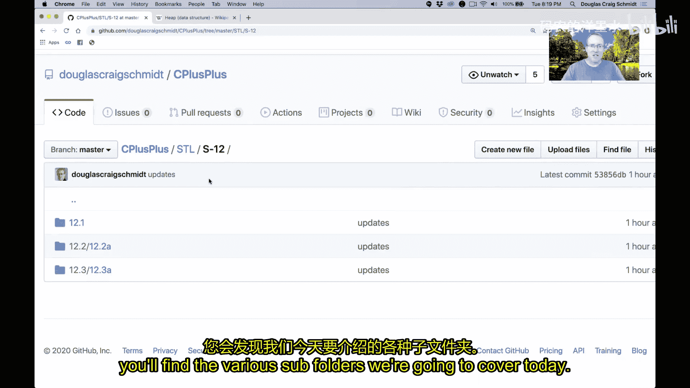

So speaking of covering， let's jump right into the discussion about set algorithms。

 so there's a number of algorithms that work on sets， set union set intersection。

 set difference and set symmetric difference and all these algorithms assume that the range that they're working on or ranges that they're working on are ordered。

😡。

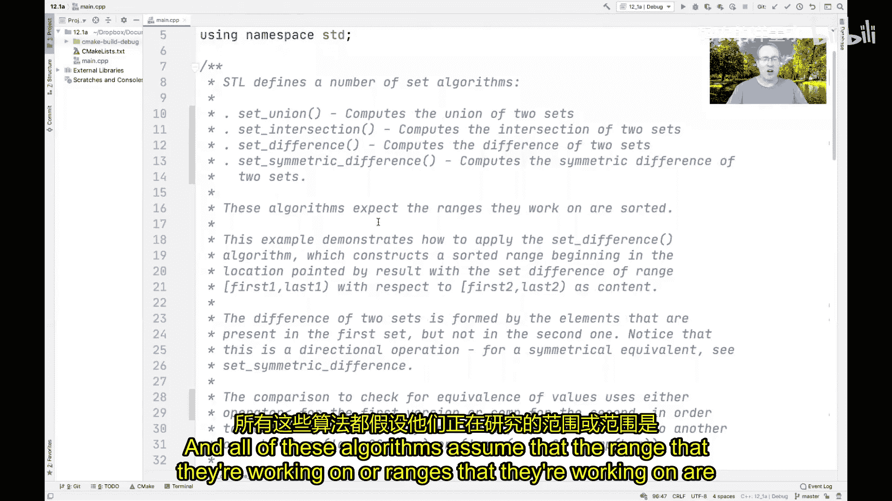

And we're going to start off by talking about set difference set difference is defined by saying it's the elements that are in the first set。

 the first range that are not in the second set， and this is what's called a directional operation there's also a so-called set symmetric difference which doesn't really care about first or second set it computes the difference irrespective of which one occurred in which set。

😡。

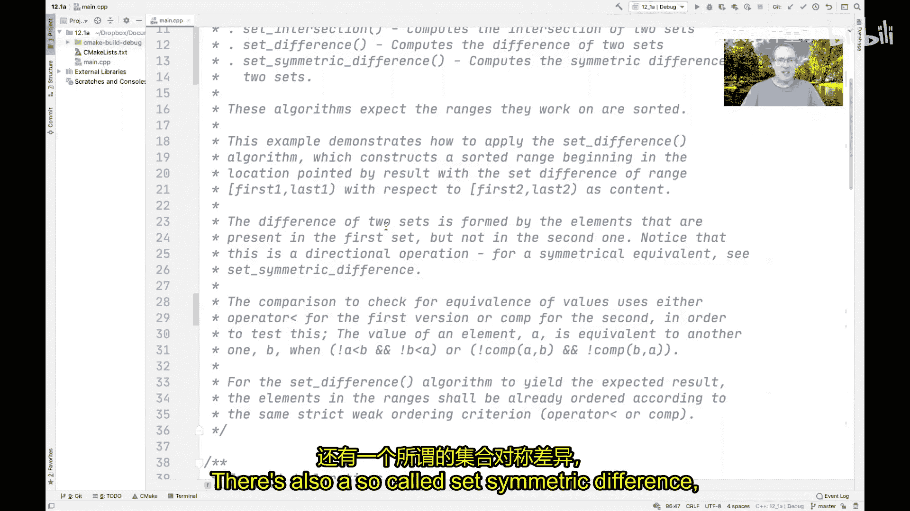

As you'll see for all the set algorithms， you can either rely on the default behavior。

 which is to check for less than on the operations on the data types that you're doing the operations on or you can provide a comparison fun if you want all the examples we're going to use are going to use the less than operation and they're all going to be doing things on ints so they have the less than operations built into the data type itself。

😡。

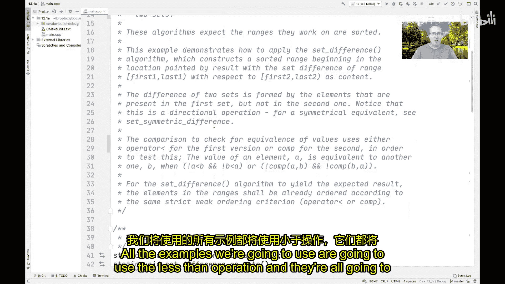

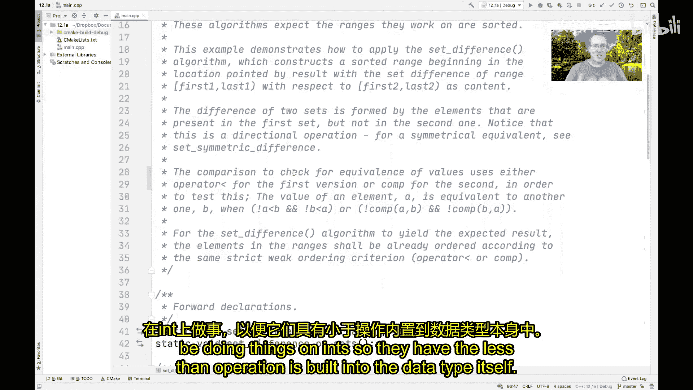

So we're going to look at a couple of different examples showing how set difference can be computed。

 one will be working on built in arrays and the other is going to be using an SDL set container。😡。

So for the built an array version， which we're going to look at first。

 you can see that we define two arrays， a1 and A2 and they have different sizes。

 different numbers of elements， and that's one of the things you can do with set difference。

 they don't have to be the same size。😡，And then the third array we're going to define here is called answer。

 if I could call it result also。 And that's going to be defined as the difference between the beginning and the end of a 1。

 And it turns out that starting with C plus plus 17 distance returns a constant expert。

 So you can actually use it to make a static array bounds， as we do here。

 So answer will have the number of elements that's in array A1。

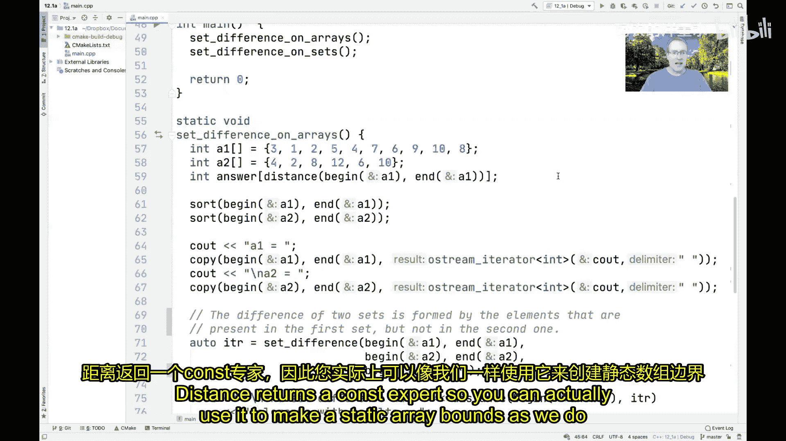

We then go ahead and sort the two arrays using the sort algorithm and we're using the beginning and end helper method to find the beginning and end of those two built-in arrays。

 then we go ahead and print out the values in a1 and A2 and then finally we get to the part that matters computing the set difference and you can see the difference in two sets is defined by the elements that occur in the first set but not in the second one so in this case we pass in the first set a1 beginning in end range to set difference then we pass in the range for the second set begin a2 and end A2 to set difference and then we pass in the answer array and what we get back is an iterator that points to the end of the set difference that now will be stored in answer。

😡。

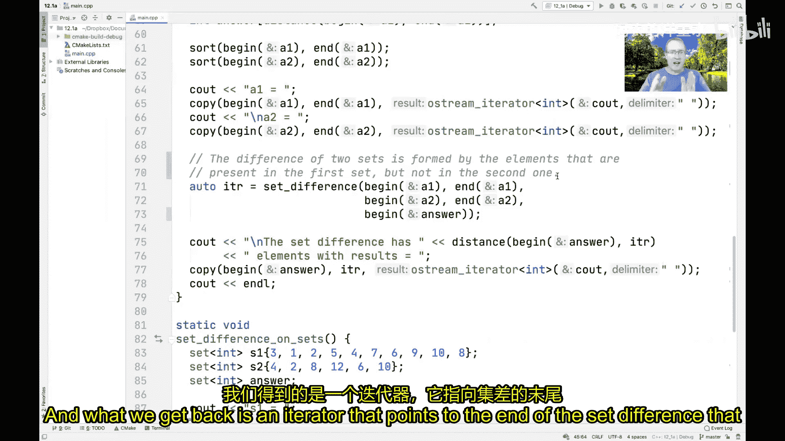

So to figure out how big that is， we go ahead and use the distance method again to find out what the difference is between the beginning of the array and where the iterator ended up。

 which in this case we'll see we' have the value of five because they found five things that were different。

 and then we go ahead and copy from the beginning of the array to the iterator and write them to the output。

😡，So that's the way you do it on arrays now it turns out the way you do it on sets is almost identical with two differences first we say set instead of built an array and secondly the sets are sorted out of the box so we don't have to sort them explicitly so we start out here getting it the same input that we had for the built in arrays except now it's going to be put into set S1 and S2 and we have set S3 that's going to store the answer。

😡。

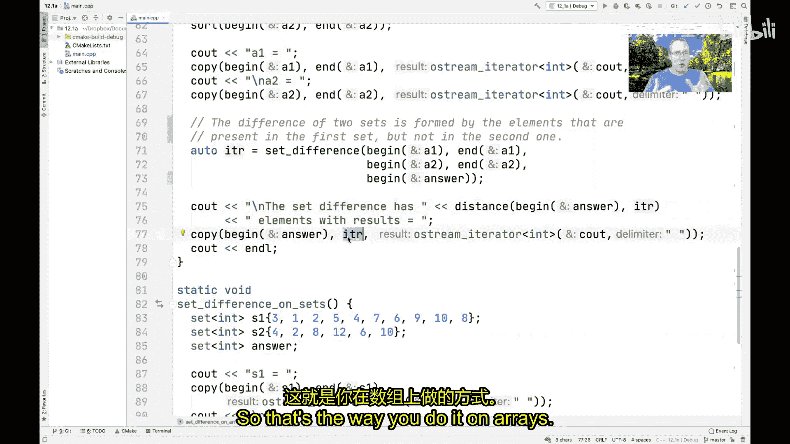

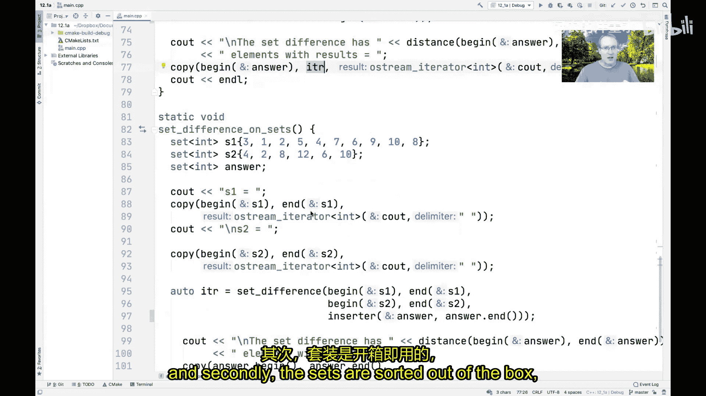

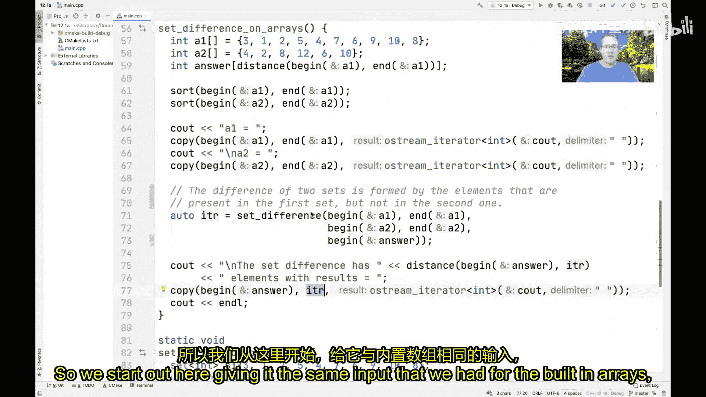

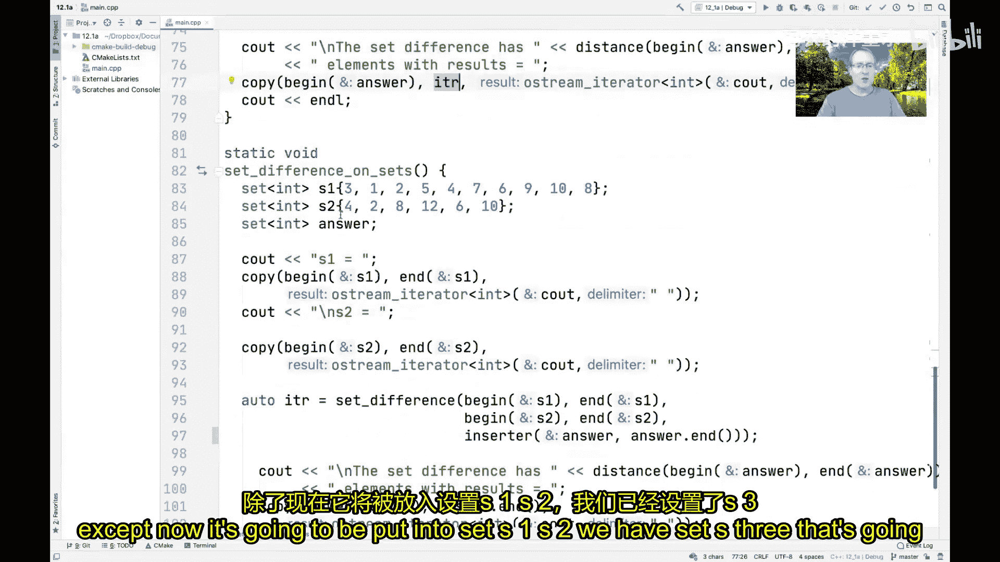

As before we use our little helper methods begin an end to print the sets。

 I didn't have to do it that way I could have said set1 or S1。beg S1。 n。

 but I did it this way just to be consistent syntactically then I go ahead and compute set difference now this is very similar in terms of passing in the input set for S1 and the input set for set two but the output is a little different and that's because what we're going to do is we're going to give it an inserter which is an iterator adapter that converts the answer set into an output iterator and then sticks the elements at the end of the answer set and what we get back here is another iterator which we don't actually use in this case because it turns out that the type of this iterator is a little bit interesting let's take a quick look at the type of this iterator。

😡。

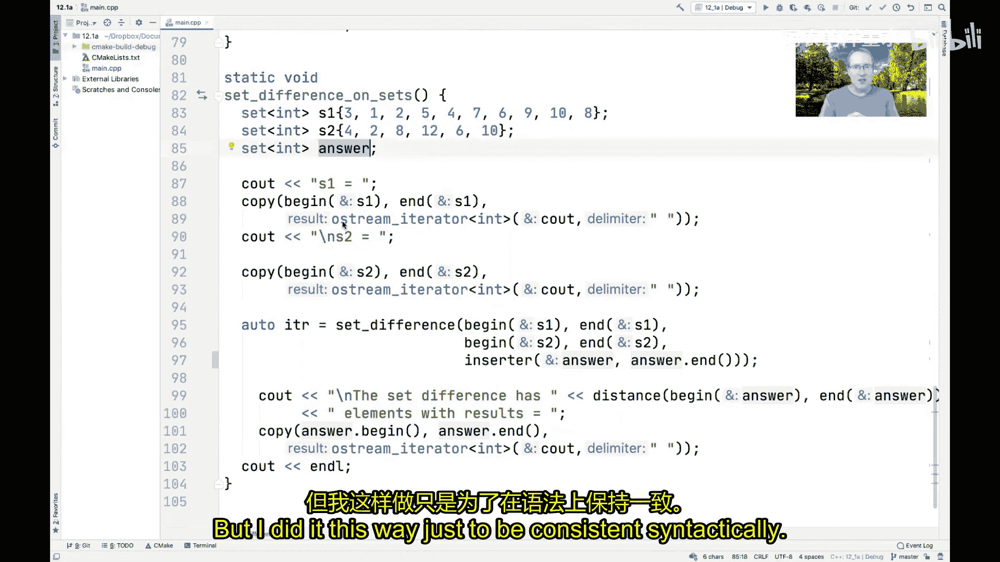

The itererate that comes back here is an insert iterator。 It's an iterator adapter。

 And so that really can't be used to find out the， the range， the way we could for。

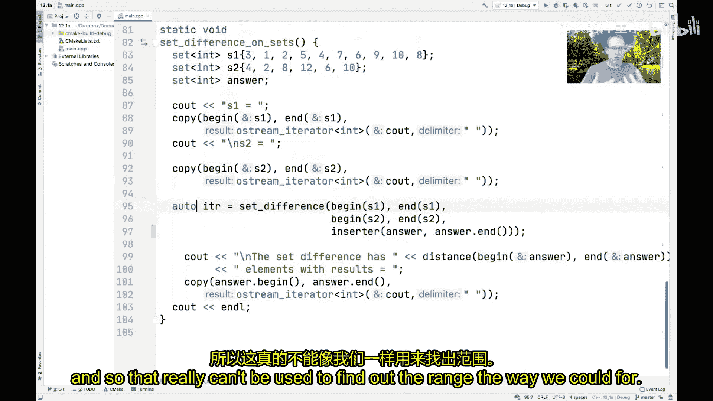

The built in array。

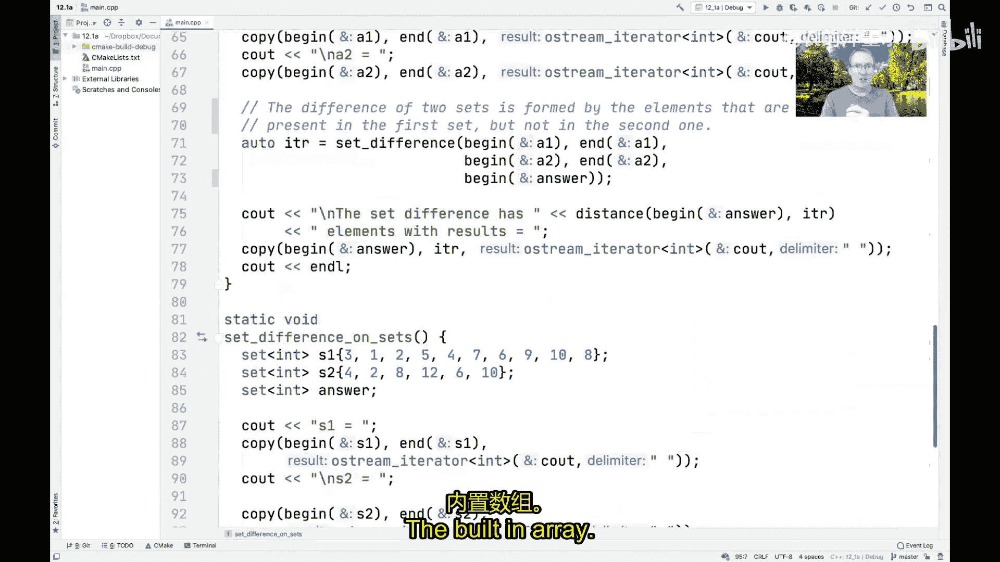

So if you come down here， then you can see that we can compute the distance between the result by just getting the distance between begin and end。

 also could have just said answer got size， but this way as being more consistent with the built in array version。

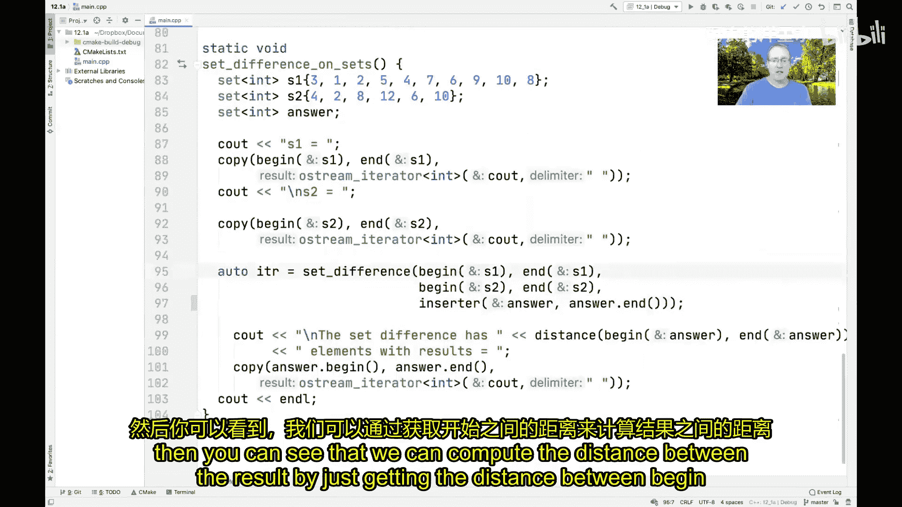

And when we're all done， we go ahead and dump out the results。

 so let's run this code just for fun and see what the results give us。😡，So as you can see here。

 it goes ahead and will for both versions， it' will print out the original。😡。

Set ordered because we sorted it in the case of the array and we came out of the box sorted with a set。

 then we have a2 and S2 which are the other set that we're dealing with and then in both cases the set difference between these two sets has five elements and it's basically the odd numbers135。

79。😡，And that's because what was in the second set were a bunch of even numbers。 So， of course。

 the ones that were not in the second set that were in the first set are the odd numbers。Okay。

 so that's basically talking about set difference。 Let's go ahead and talk about what might be a bit more familiar examples of set algorithms。

😡。

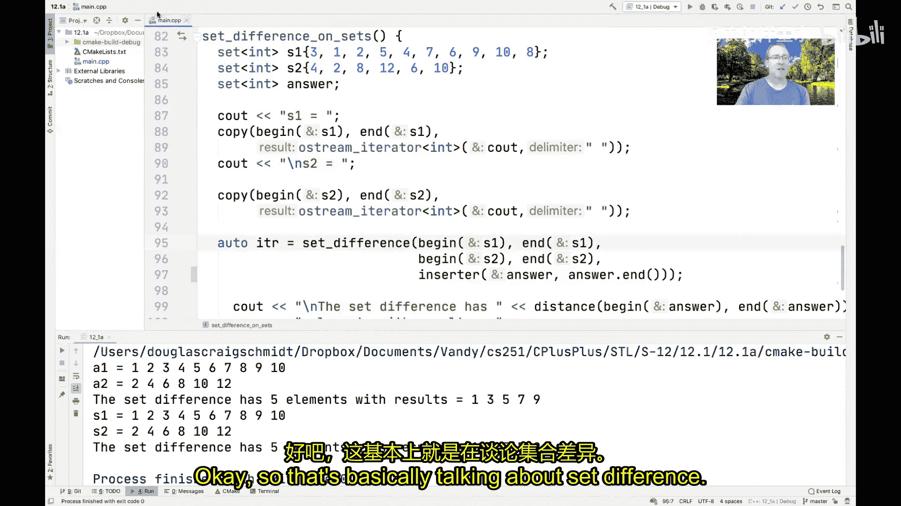

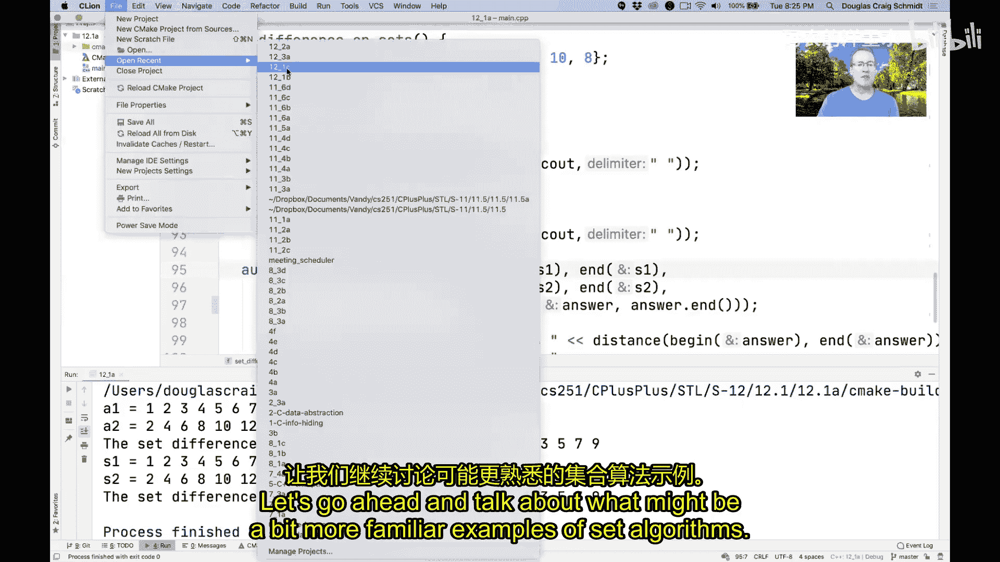

And these will be set intersection， and set union。

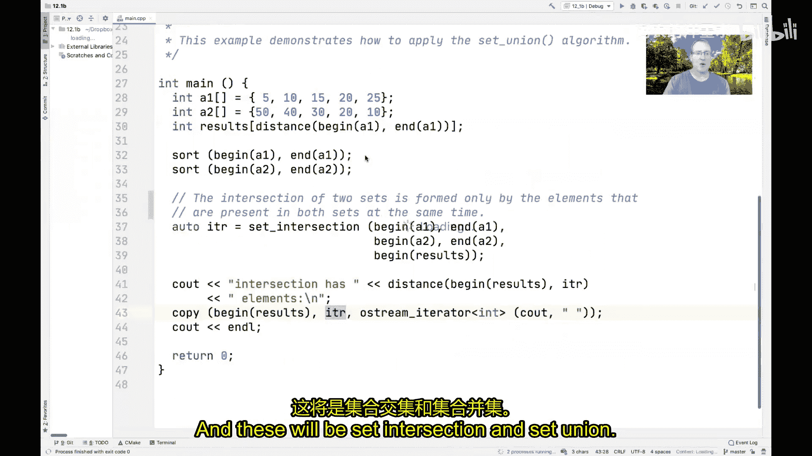

So the second example here will be set intersection。

 which as you can imagine is formed by the elements that are present in both sets。

 so only the elements that are present in both will be present in the output from this。😡。

Once again you can either rely on the less than algorithm or you can use the less than operator you can use the compare function we're always going to rely on the less than operator and again it expects everything to be sorted so in this case we're going to have built in arrays again a1 in A2 you can see the values that they contain and then we compute the results array which is going to store the results of the intersection which we know will not be greater than the size of a1 array A2。

So we then go ahead and sort A1 and A2 just like we did before， and then we compute set intersection。

 and we're going to stick the results into the results array up here。

 and in this case we do get back a useful iterator which will point to the end of the intersection results output iterator。

😡。

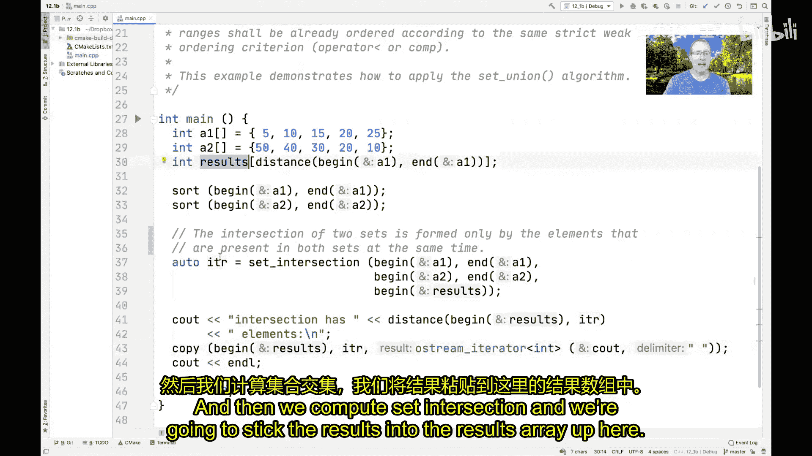

So we're going to go ahead and print out the size of this。

 so it'll tell us how many elements are there are in this case there'll be two elements because only 10 and 20 appear in A1 and A2 and then we print the results。

😡，So when we print the results by running the program。

 you can see that it has two elements in the intersection and those are the values 10 and 20。

All right， that was probably a bit more familiar to you， perhaps than set difference。

 which is a useful algorithm， but not as common as set intersection。😡。

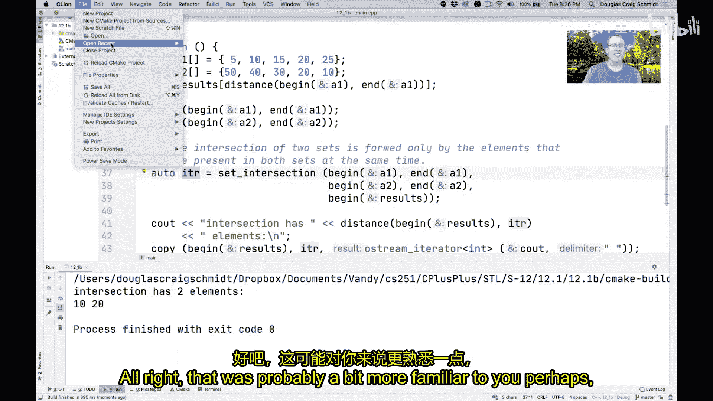

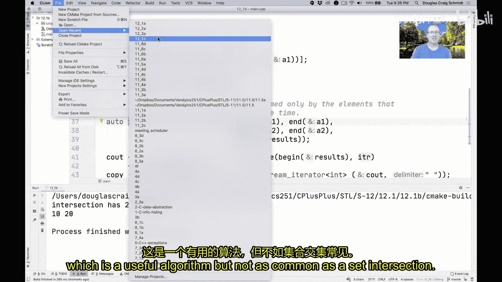

Here's yet another very common set operation which is set union and that of course。

 is the set formed by taking elements that are present in either one of the sets or in both so that's the union of two sets Staning applies is before the algorithm expects that these sets will be ordered。

😡，So here we're going to have。Aray a1 and array a2 which are not ordered yet and instead of having an array for the answer。

 we're going to have a vector and just called it vector V it probably should have been consistent let's go ahead and be consistent here。

 let's go ahead and refactor this。😡，To be。Answer， so now we're more consistent with the other examples。

So we sort a1 and A2 and then we compute the set union which will contain the elements that are in both of the other sets and in this case that could be many。

 so it's probably more than the size of either one and so we're going to use a back inserter in order to be able to insert this into our initially empty vector。

 this is what vectors are so good at and this is what back inserters are so good at allowing us to be able to grow the size of this container on demand as needed。

😡，Then we go ahead and print out the number of elements。

 and then we print out the contents of the answer， which is going to contain the set union。

So let's run this and you'll see the answers we get here is that the union of the two sets will have eight elements。

 which will be five， 10， 15， 20， 25， 30， 40 and 50 and if you look carefully you see that those are in fact the elements that are in both sets。

 you notice that it doesn't print out duplicates in this case because they just printing out the fact that they occurred in both sets。

😡，Okay， so that was the discussion about set algorithms。

 and I think you'll agree that those are very useful， especially if you do a lot of set operations。

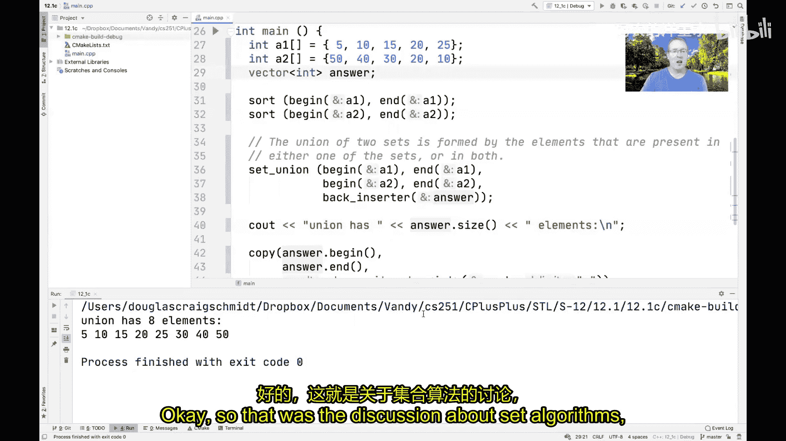

So now let's go ahead and turn our attention to something new and we're going to talk about heaps。😡。

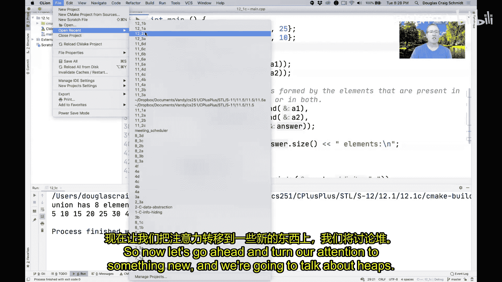

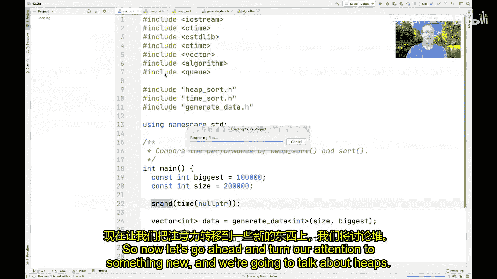

Now， it turns out that a heap is a very interesting data structure。

 and I thought it would be worthwhile to。😡。

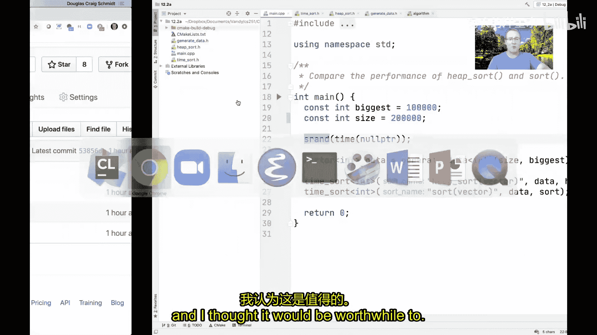

Point you to a Wikipedia article Wikipedia article that talks about heaps so a heap is a partially it's a partially ordered almost complete binary tree So what does it mean to be partially ordered well you can see that if you take a look down at this diagram here which shows an example of a heap and what it means is that the parent node whenever you have to have a node with children will always have a value that's greater or less if you're doing it reverse but always going be greater than its children so in this case you can see that 100 is greater than 19 and 36 and then you'll see that 36 is greater than 25 and1 and 19 is greater than 17 and3 and 17 is greater than 2 and 7 However this is what's called a partially ordered it's not a fully ordered data structure it's partially ordered and it's ordered than the way I just described and the other property that makes something a heap is that it's almost complete so what that means is that。

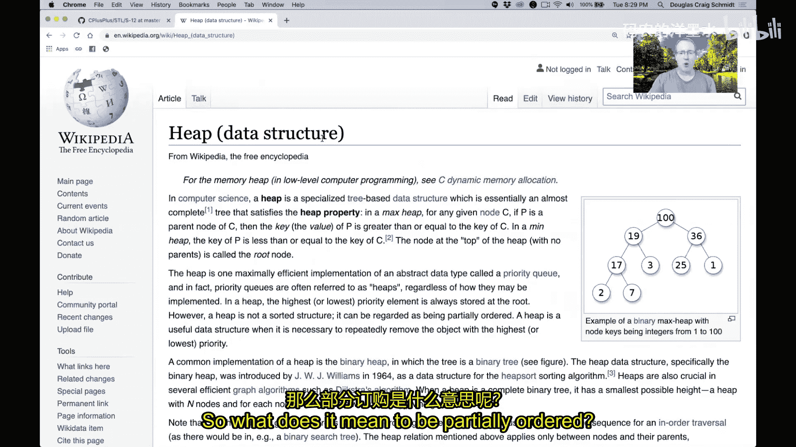

To the extent that there are any elements that are missing to make it a complete tree。

 they'll be only on the last row。 So you can see here it's partially ordered and almost complete。

 And one of the properties of of a heap that makes it particularly good for things like priority cues or for heap sort as we're gonna to use is whenever you go ahead and add a new element into a heap。

 it's really easy how to figure out where it goes in the heap。

 because you basically will add it at the end and then you kind of bubble it up until it finds the place that belongs in the heap swapping as you go through the data structure And this works particularly well for things like vectors because you can do it and no more than login time because the tree is almost complete。

 which means that the depth of any of its branches is never more than log n levels deep。

So it takes essentially linear time to convert an arbitrary array into a heap and then once you've got something converted into a heap。

 it takes n times log n time to sort it using heap sort and so that's what we're going to talk about here but I just wanted to provide you with a little bit of background because otherwise keepaps going to be a little bit hard to understand。

😡，The particular program we're going to use to demonstrate heaps and to demonstrate heap sort is a variant of one we looked at the other day that helped us compare bubble sort with insertion sort with intro sort or sort which comes along with STL out of the box so I copied and pasted some of the pieces and then tweaked a few things so here we're going to have a size of the array we're going to sort have 200。

000 elements which is much larger than what we did for the the other example because we were doing and squared sorts there and they take a lot longer to run than the n log n sorts we're doing now。

😡，Again， the biggest size of any element will be 100，000 actually that's not quite right it's 100。

000 minus1 so it's 99999 that's the biggest value you can have to get that value we seed the random number generator and then we go ahead and we use generate data and this is a little helper function I showed the other day but I'll go through it again briefly for completeness it goes ahead and it's parameterized by a template template parameter which defaults to vector we define an instance of the vector here with a container and then we use generate n and generate n is an interesting algorithm that's over here in the algorithm header file and what it does is it basically goes through a range from zero to up to n。

Or I guess more specifically from n down to zero doesn't matter it goes n times and every time through it goes ahead and it calls a random number generator。

And it takes the results， well， it doesn't have to be a random number generator。

 it generates something with a function that's passed in in our case it's going to be a random number generator。

 but it generates a value and then it stores it into the element in the range and it advances that iterator each time。

😡，So in our little Gene data program， we're going to be storing the data at the end of our initially empty container。

 which is a vector here， and we're going to have n items which is size。

 which is the parameter past N， which will be 200，000 and the fun that's used to generate the next item will be this lambmbda function that calls RA and then mods it by the biggest value that we're willing to have。

😡，And notice that this is a。Passed in is a parameter。

 So we have to pass it in using the capture clause mechanism in the Lambda function。Okay。

 so let's go back over here as we end up generating a vector of random data of size 200，000。

 and the compiler， of course， will optimize the heck out of the return value here so it's all done very quickly using move optimizations and so on under the hood。

😡，And then we go ahead and call time sort， which is another little helper function I showed the other day to sort the data using heap sort and to sort the data using intro sort or sort。

 which is the default implementation in STL， which uses。😡。

Quick sort in conjunction with He sort when it determines that Quick sort isn't working very well。

So let's take a quick look at time sort， it's just a little helper。😡。

Generic helper function that's parameterized by a template parameter。

 a template template parameter which is the container that we're trying to sort and a comparison function or funter which defaults to less and so by default we give it a vector and we give it less as the functer and then it's defined to take the name that we want to print out when we're done with our sort to indicate what kind of sort it was the data that we're sorting which is intentionally pass by value to make a copy and then we pass in a pointer to a function to a sort routine that's going to take。

😡，A first iterator and a last iterator and a comparison funter。

 so that of course matches all the different sort algorithms like sort and heap sort and so on。

And then we pass it also the comparison Fun。

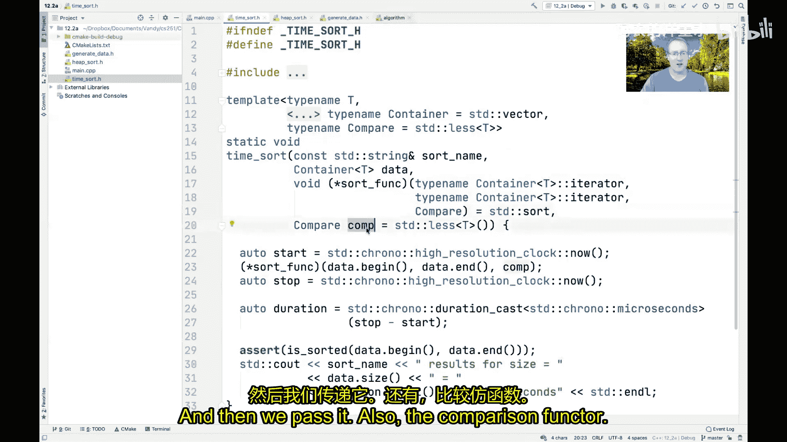

So how this works under the hood， we use the high resolution clock to get the start time。

 We call the sort function pointer indirectly to sort the data from the beginning of the vector to the end of the vector using the comparison function。

 and when that returns， then we figure out the time that's now， and that's the stop time。

 And then we figure out the duration by subtracting the start time from the stop time。

 That tells us how long it took to run in microseconds。

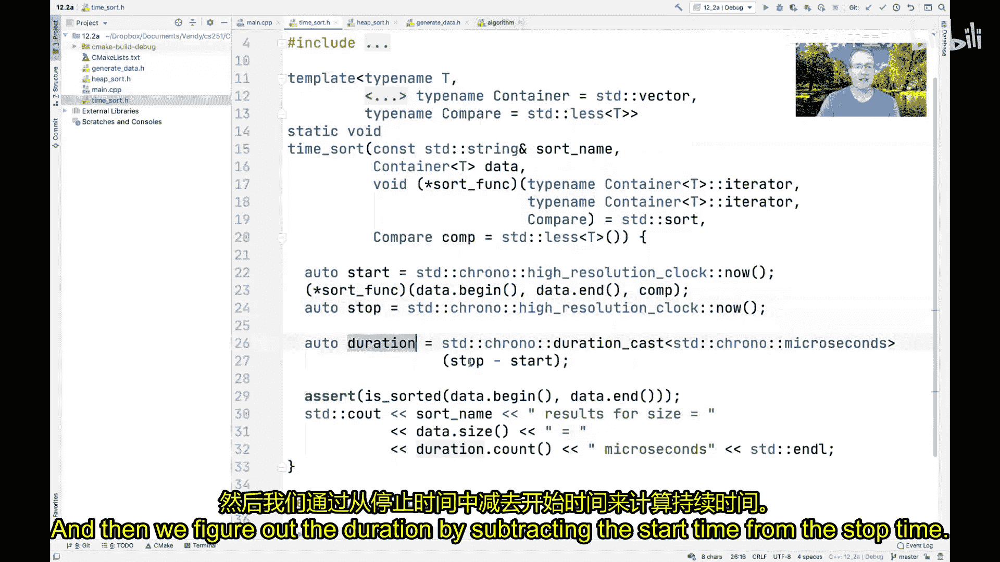

When we're all done sorting and timing， we check a little sanity check to make sure it is in fact sorted。

 which it should be， but never hurts the check， and then we print the results out。All right。

 so let's go back over to Maine and before we look at Heap Start。

 I'm going to run this program just to show you what it does and you can see it's pretty darn fast even though we're sorting 200。

000 elements and the reason for this of course， is that these are en log n algorithms so they run very quickly。

😡，Now it turns out that HeapAP sort performs way better than bubble sort and insertion sort would have performed。

 but it still takes about 275，000 microseconds or so in contrast you can see that sort on the same data but the same size runs in about 62。

000 microseconds， so it is substantially faster， which is no surprise。

 obviously the people who did the sort algorithm， the intro sort algorithm and STL were very clever and did a good job optimizing it。

😡，So the last thing I want to do is just look at Heap sort， and this is， of course。

 the build up to the whole discussion about heEaps。😡。

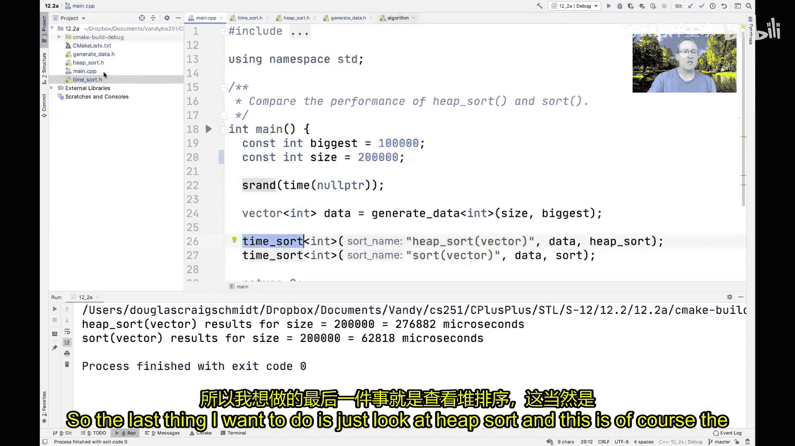

So you can see here we give it the range which is expected to be a random access pair of iterators first to end。

 we got 200，000 items in there and the first thing we do is we come in here and we call the STL helper algorithm make heap and what makeHeE does is it takes that range and it converts it into a heap remember the heap had this property we looked at over here。

😡，Where it's partially ordered almost complete binary tree。

And it uses the comparison function to put it in the right place to organize it so that the item that's the。

 say the smallest item is at the beginning or the biggest items at the beginning。

 depending whether we're sorting in as sendingending or descendsending order。

And then we call the sort heap method and all sort heap does as I talked about before。

 is simply takes each item one at the time and then goes ahead and puts it in the right place in the heap and then reheifies the heap to preserve the heap property and it marches through the range from beginning to end doing this for every element and by the time we're all done it took n times log n time to do a conversion of a heap into a sorted data structure so that's what heAP sort does。

😡，Okay， so that's the end of the discussion about heaps and just illustrating another cool example of sorting。

😡。

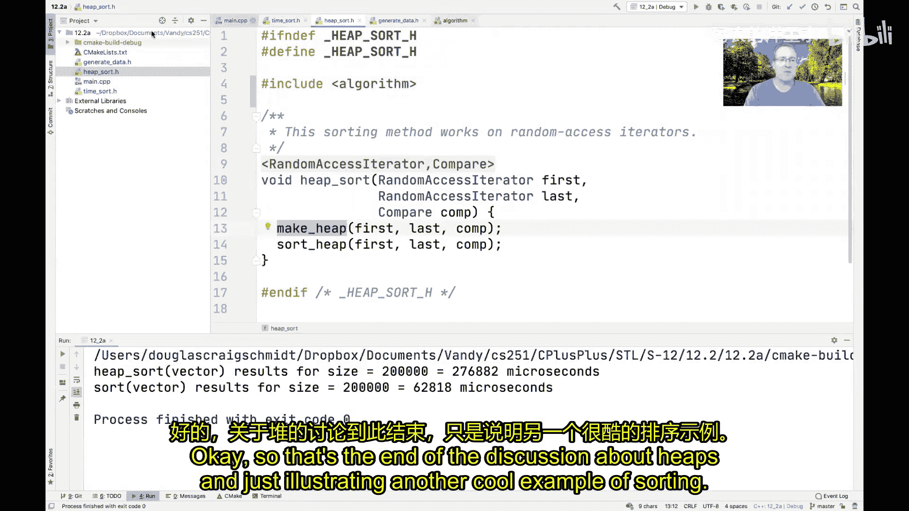

Let's now go turn our attention to the final example here。😡。

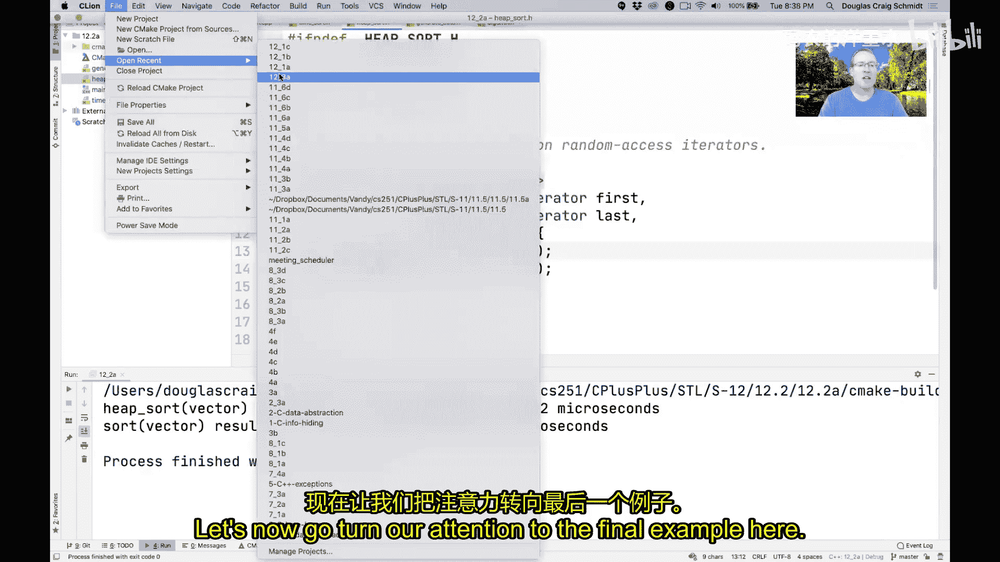

And this is actually going to be the end of our discussion of algorithms and what I'm going to do is just summarize some of the algorithms you'll find in the numeric portion of C+ plus numeric head numeric package if you will and these are all a bunch of mathematic functions these are just some of them there's other ones there but these are some of the ones that are very common and they include accumulate adjacent difference inner product and partial sum so I'm going focus here on two examples I'm going to focus on accumulate and partial sum。

😡。

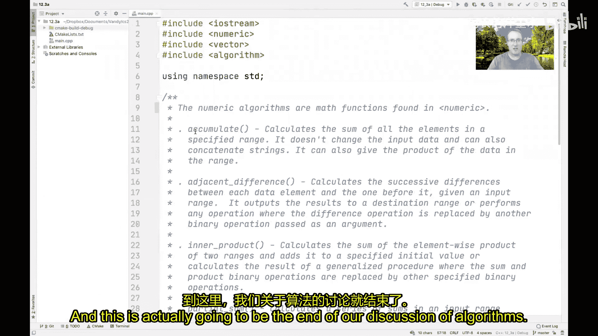

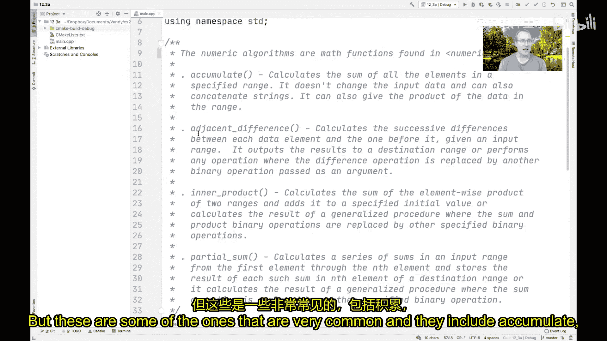

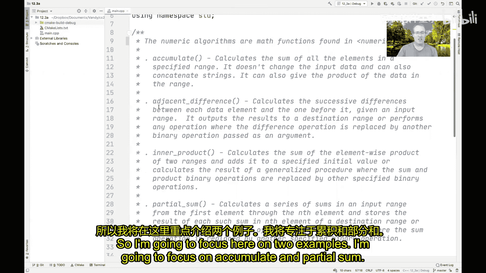

The way we're going to do this is we're going to define a little helper function called sum odd。😡。

And it's going to have the operator function call method that takes a sum and a value。

 and if the value is odd， it'll add it to the sum and return the value and the sum。

 the addition of those otherwise it just returns the sum and ignores the value so what it's doing is it's summing the odd values and ignoring the even values。

😡。

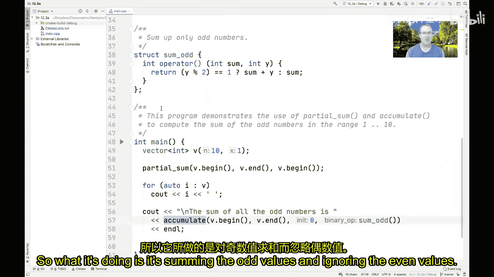

What we're going to do to test this out is we're going to define ourselves a vector of int of size 10 where everything starts out with the initial value of one。

😡，And then we're going to call the partial sum method。

 And partial sum is going to go zipping down through that range from beginning to end。

And you're going to see that what it's going to do is it's going to essentially add each of the elements together。

 So as we go through here， we keep a running count or a running sum。

 And then we basically say T equal T plus。

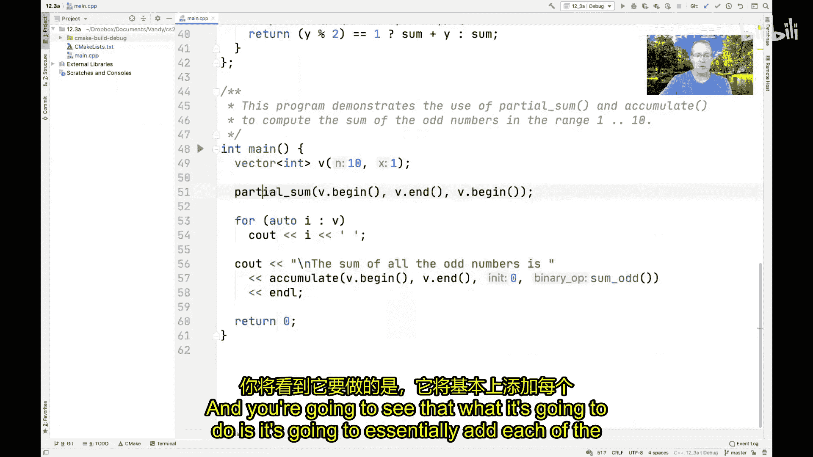

Whatever we're looking at in the iteration range， So we're basically summing the contents and then we're storing the contents into the output iterator。

 which in this case， as you can see is we're storing it back into itself。

 So we're doing a partial sum and then updating the underlying vector to be the values 1，2，34，5，6，7。

8，910 So that's the partial sum of the first 10 elements。😡。

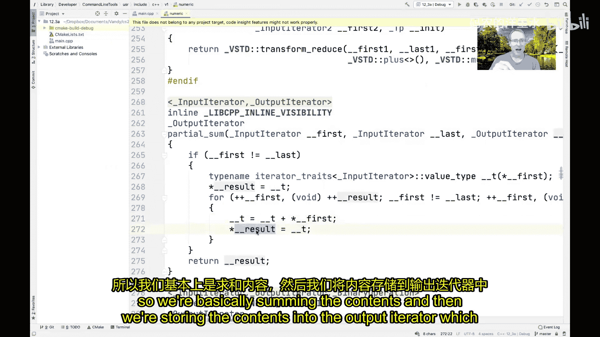

We then take that and we're going to call accumulate and what accumulate is going to do is accumulate it's going to go through the range from beginning to end and it's going to apply a binary operation to each element and what it's going to do of course is it's going to basically accumulate all the values that happen to be returned by the binary operation and then it'll return that and we're all done。

😡。

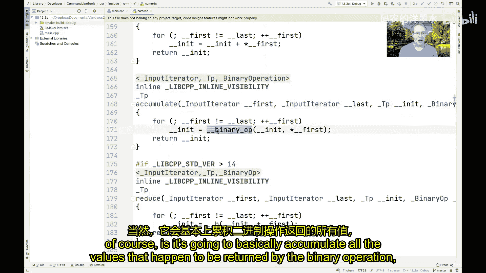

Well， here you can see that we're going to pass in the vector， which has the partial sum in it。

The initial value of zero and then a functer called sum odd and the sum odd functer is going to go ahead and only sum up the odd numbers。

 So as we'll see the the sum of the first。Od numbers in the range one through 10 will end up being 25。

And if you don't believe me， here's the result that comes out of accumulate。

 You can see here's the original sum， or here's the original partial sum。

 And then we go ahead and sum up all the odd numbers with accumulate， and we get 25。

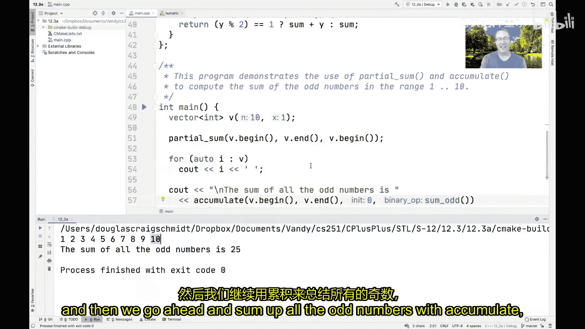

Okay， well， those are the things that I had wanted to cover in our session today。😡。

This is as I mentioned before， we're kind of done with STL algorithms。

 in fact we're really pretty much done with most of the key elements in STL so we've covered if you look back over them almost 30 sessions we've done at this point we've covered STL function templates and class templates we covered sequential containers we covered all the different types of iterators。

 input output forward bidirectal and random access。

 we covered the Associative containers unorder and ordered associate containers we covered the adapted containers like stack queue and prior queue and then we covered a bunch of other things we covered functors and function adapters like negators and binders and the mem fun family of adapters and then we finally got into the algorithms and we talked about the non-mating algorithms then we talked about mutating algorithms and then we kind of wrapped up with the other algorithms。

 things like sets and sorting which of course are mut。😡，Algorithms as well。

 but we tend not to lump them into that category， they really fall under sorting and sets and heaps and things like that。

And finally， don't forget numerics。So we've covered quite a bit of material in the last several weeks。

 we have probably one more session we're going to do where I'm going to kind of put everything together and show you interesting implementation of an array class which will give us a chance to talk about how to implement things like iterators and so on but we'll see if we can get that done tomorrow otherwise we'll cover it again soon so thanks you guys very much for attending please go ahead and like and subscribe if you haven't already and also feel free to follow me on Twitter。

😡。