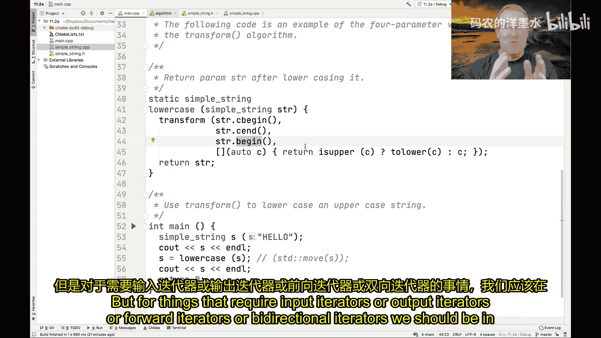

# 【全集】范德堡大学 C++标准模板库 中英字幕 1080P p30 Lecture 30 - 实现用户自定义 C++容器的迭代器 -BV1KWiCBWE7M_p30-

Hello and welcome to the last episode in my webinar series on C++ Standard Template library by example Over the past several weeks。

 we've covered a wide array of topics related to C++ and STL， including function and class templates。

 sequential and associative containers， various types of iterators， many types of adapters。

 as well as lots of algorithms from the STL mutating and non-mutating algorithm collection what we're going to do today we're going to wrap up by taking a look at how you can implement iterators。

 both con and noncon iterators in the context of a class that I've shown previously in other videos that we've covered in this series。

So without any further ado， let's first talk about where you can find the code。 So as always。

 you can go to my GitHub repository， which is it。Gitthub dot com slash Douglas Craig Schmidt My name。

 And then you can take a look at the C plus plus S T L S 11，11 do2，11。2 a subfold。

 and you'll find the code that we're about to walk through。So speaking of walkthrough。

Let's go ahead and turn over and go look at our IDE。

So if you take a look at the sealine ID I have open here。

 you'll see the project that we're going to look at and we looked at this recently a couple days ago perhaps。

 but at that point the focus was really on how the transform algorithm worked。

 and I showed you how you could take a string that was all caps and then call the lowercase method and the lowercase method would take that string and it would use iterator to the string。

 walk through the range defined by the iterator and every time it found an uppercase character。

 it would convert that to a lowercase character， otherwise it would just pass back the character unchanged and it would go ahead and assign it back into the string itself。

So that was the implementation。 we used transform to do that。

 We're not going to talk much about transform today。

 I may show you just a bit about it to remind you how it works internally。

 but what I want to really focus on is how to implement the iterators that we're using here in order to be able to traverse through the string and modify its contents。

 So to make this tractable， I'm going to use my simple string class and we've used simple string and many other videos to demonstrate properties of things like move constructors。

😡，Difference between pass by value versus pass by reference， move assignment operators， destructors。

 all kinds of good stuff。 But today we're going focus on defining some iterators for this class。

 So I'm not going to cover the class very much just primarily how its iterators work。So to see that。

 let's go ahead and take a look at the simple string class itself。 So here's simple string。

 you can see we start out by doing some four declarations of iterators which then get used within the body of the simple string class itself to define the iterator and constant iterator traits so you can see that iterator。

Is a trait that's the simple string iterator and con iterator is a trait that's the simple string con iterator。

 and we'll take a look at those classes in just a second。

There's also a full complement of constructors， both move constructors and copy constructors。

Assignment operators， both move assignment and copy assignment destructors。

 lots of methods you know and love to work on strings like subscript and relational operations and so on and so forth。

 We're gonna skip over all of that for the most part and focus in on the methods related to。

The iterators。Those methods， there's about a half dozen of them implemented here。

 There's some other ones we could have done that relate to reverse iterators。

 but I left those out as an exercise for future consumption。 And so the half dozen iterator。

 factory methods we're going to talk about are the begin family in the end family。

 So as you can see there's a begin iterator that returns a noncons iterator。

 there's a pair of iterators that return constant iterators。

 there's an iterator factory method that returns a non-cons iterator。

 and then there's a pair of factory methods that return con。Iterators to the end。

 So the end iterators， of course， are always one past the actual end of the range and the begin iterators factory methods all return iterators to the beginning of the range。

 So let's take， we'll take a look at those implementations in a second。Under the hood， of course。

 they're accessing the state of a simple string object when we iterate over it。

 but we're actually not going to have to expose that state very far into the iter。

 the the iterator can use other mechanisms to find in our simple string like the subscript operator in order to decouple the implementation of the iterator from the inner workings of the simple string class itself。

 and that's a pretty good idea if you can get away with it。

So let's go ahead and take a look at the factory methods that make iterators here。

So if you take a look， you can see that we've got。3 of these per each type。

 So we have three that are factory methods that make iterators to the beginning of a simple string and three factor methods that make iterators to the end of the simple string。

 And they all look very similar。 So， for example， here's the。Begin method。

 begin factor method that makes a non constant iterator。 And all it does is it makes a simple string。

 And it's going to call a constructor that knows how to make a simple string Iterator using a reference to a simple string and a position to the beginning of the simple string。

 And that constructor is actually defined down here。 I'll just show it to you real quickly。

 That's defined down here in the private part of the the iterator classes。

 We'll take a look at that in a second。So we're going to go ahead and make ourselves an iterator that's properly。

Rangd for this simple string and the start。 And you'll notice that both constants and non cons versions of these factor methods have exactly the same implementation。

 They just return iterators versus con iterators。Same thing。

 same basic pattern applies for the end factor methods， the one that returns to a good old iterator。

 a nonconsideerator makes us a simple string iterator。

 except it's going to give it the L parameter which is one past the end of the range versus zero。

 which is the beginning of the range and all these things look exactly alike and pretty much every time you write an iterator it's going to look something along these lines。

Okay， so that's how we make our iterators。 Now， let's go ahead and take a look at what the iterators actually do。

 So we're going to start by talking about simple string iterator， which is the noncons version。

 And you'll see that the noncons version and the con version are almost identical with one tiny little difference。

 and that's that you don't have a noncons dereference operation for a con iterator。

 whereas you do for the noncon iterator。So here's simple string iterator。

 which inherits from the standard iterator class that we use to define iterators。

 There's a bunch of different ways of doing this。 But the one here。Takes an iterator tag。

 We're gonna implement a bidirectional iterator。 So we're gonna leave out all the funky stuff like the。

 you know， plus equal and the subscript and the minus and all those kinds of things。

 So we're just gonna stick with， you know， pre and post increment。Plus。

 plus and pre and post decrement， minus minus and then inequality inequality operations。

We also provide the name of the class that we're encapsulating with this iterator。

 which is simple string。We make simple string a friend so it can access our private constructor without having to have us break encapsulation in the simple string iterator interface itself。

😡，There's a pair of de referenceference operations， Op star， Opera star。

 and you can see one of them is noncon， which means you can use it on the left hand side of an assignment statement。

 and the other is cont， which means it can be used。😡。

Only on the right hand side and to read the values。 So this one can read。

 and this one can read and write。 And this cons version would be used in situations where you pass a simple string by cont to another method。

 And you want to access its values through the iterator。

We then define a bunch of pre increment and post increment operations and prederement and post decreement operators。

 And so you can see here that they come in in pairs。 So the pre increment operator。

 which looks like this， returns a reference to itself。

And that's because it's going to apply the increment and then return the incremented iterator。

 which is itself， so it returns itself by reference。Conversely， the post increment operator。

 which has an int at the end for mysterious legacy reasons。

 that will create an instance of the current state of the iterator。

 pass it back by value and then increment count by one so that preserves the post increment semantics and the prederement and postderement operations work the same way。

 they have the same semantics， they just go backwards instead of going forwards。And then at the end。

 we have a pair of equality and inequality operations。

 one that checks to see whether two iterators are equal and one that checks if they're not equal。

 and of course， the not equal version is used in a lot of the STL algorithms to see if you reach the end of the iterator range and we'll take a look at that when we look at how transform actually uses our simple string iterators。

Down here we have a constructor that's private but can be accessed because simple string is a friend and it's past a simple string reference and a position。

 and it goes ahead and then stahees those things into the simple string underscore data member and the pause underscore data member and just to show you what these things do if we go all the way to the end。

 you can see that these constructors are simply used to stash the reference and the position into the state of the iterator that we're creating。

Okay， so that's basically the that is basically the noncons iterator interface。

 and then the cons iterator interface is almost identical except it does not have a noncons operator star。

 the dereference operation。 So it's it's got a less of an interface。

 it doesn't have that feature because， of course， it's a cons iterator So you can't assign to it。

So now let's go ahead and take a look at the implementation of this stuff。

 I've already shown you the factory methods that create these things。

 Now let's go ahead and take a look at the implementations of those methods。

 and they're very heavily canonical。 They always look pretty much the same。

 So here you can see we have operator star， which is the noncon。

Thereence operation and all it does is it just says simple string underscore。

Sub pause pause is what it's using to keep track of where we are in the iteration。

 And notice this particular use of the non range checked subscript operation on simple string does not require。

U to expose any of the internal state of simple string so we can just use it through its subscript operation。

 which is not range checked so it's bazingly fast and it'll all be inline。

So you can see that the implementation of both dereference that's noncons and cons are identical。

 it's just that the noncon one can be used on the left hand side of an assignment statement。

 whereas the cont one cannot。Now let's go ahead and take a look at the plus plus of minus minus operations。

 and they also typically fall into very heavily stylized or， you know。

 canonical patterns of implementation。 So the the pre increment。

 the version we're looking at here that increments paused by one and then returns star this。

 So we're passing ourselves back by reference after we've already incremented the count by one。

Conversely， the post decrement version or post increment version rather， which takes the int。

 is going to make an instance of simple string iterator that has the current reference to the simple string and the current pause before we increment it。

 And that copy will be passed back。 So it's not a reference， it's a copy， it's coming back by value。

 And after we make the copy then and only then is pause incremented by one。

And then the decrement operations work the same it's just that they decrement as opposed to increment。

 so prederement， decrements itself then returns a reference to itself。

 whereas post decrement makes a copy of its current state and then it decrements the pause and of course it returns the original copy。

And I think what's cool about this is you can see how concise these implementations are。

 there's really not a lot of extra stuff， and this is in part due to the fact that C++ 11 and beyond has done really cool things to use initializer lists and other stuff to cut down on the amount of code you have to keep typing。

The equality and inequality operations are also very straightforward what they do is they check to make sure that the two elements that we're comparing the lefthand side and the right hand side are both pointing to the same simple string once we've ascertained that they're pointing to the same simple string we just check to see whether the positions are equal or not and if they are we're equal otherwise we're not equal and the not equal operation simply uses the equality operation and then negates the result。

 so that's also a nice example of a little bit of microscopic systematic reuse。

So that's basically the implementation of the non cons version of simple string iterator。

 the cons version， as I said， is identical to what we had before。

 it just doesn't have the noncos version of the de referenceence operation。Okay。

 so now that we know all this stuff， let's go back over here and take a quick look at how this stuff is actually used by transform。

 So here's the transform algorithm。 And as you can see。

 the transform algorithm expects to get two input iterators。

 one to the beginning and one to the end of the range that we're iterating over and then one output iterator and that's exactly what we pass it。

 So we pass it a begin and end to constant iterators to our simple string。

And then we pass it an iterator to a non con version so we can overwrite the contents in there。

And if you take a look again at what transformform is doing。

Then it goes that iterator range from first， not equal to last。

 So the not equal operation is important because that's what we're using to see if we've reached the end of our range。

 And you can see then it goes ahead and dereferences。First。

 which is going to be calling that Op star operator star。

 which will be the one that depends on how we're using it。 In this case。

 it's actually a cons iterator。 So that'll be the cons version of operator star。

 And then it's going to assign it using the version of operator star that's usable on the lefthand side。

 So that's the noncons version。 So this is the noncons version。 that's the cons version。

 And that way we can update the contents in the string by using the noncons version of the star。

 And then the other only other things that are relevant here are plus plus we can do plus plus。

 and that， of course， will advance。 And you'll notice that we're very careful。

 And STL is also very careful to always use pre increment。Operations or prederement operations。

 when the results don't matter， when all you care about is the side effect of doing the increment。

 And the reason for that， as we saw earlier， is that the preversions。Are not going to make a copy。

 They just increment themselves and return to reference themselves。

 whereas the post increment and post decrement ones make a copy。

So this is just an example of a little bit more verbose way of doing things。 We make a copy of it。

 We then go ahead and return the copy， but we increment ourselves。 So this is one way of doing it。

 and then the other way of doing it was the version I showed up here where we use the initializer syntax。

 They both work。 I think I prefer this version now because it's more concise than the older versions。

So as you can see here， we developed iterators that conform all the expectations of the transform algorithm and so as a result。

 we can slip our simple string transparently into the STL algorithms and it works very nicely Now of course we couldn't slip it into someplace that expected a random access iterator because we haven't implemented all those operations。

 but for things that require input iterators or output iterators or forward iterators or bidirectional iterators。

 we should be in good shape。

Okay， well again， that gets us to the end of our series on C++ STL by example。

 I hope you've enjoyed this material。 If you have enjoyed this material。

 then I'll be having a new seminar series starting shortly which will be on patterns We're gonna to look at a bunch of patterns from the famous gang of four book the object oriented pattern catalog and we're gonna to be taking a look at about about half of the patterns in in that book maybe a little bit more than half and we're gonna to be applying them in the context of you guessed it C++ and the standard template library and this will also give us a chance to show how the patterns in STL can be mixed with the more traditional object oriented features in C++ like abstractbased classes and inheritance and dynamic binding and then also cross-cut and combined with the newer generic programming techniques like templates and various other features we've been talking about verytic templates and member template functions and stuff like that。

So thank you guys so much for joining for all these different episodes。 If you enjoyed this content。

 please go ahead and like the video and if you haven't subscribed to my channel。

 please go ahead and subscribe and I look forward to hopefully seeing you again in the near future。

