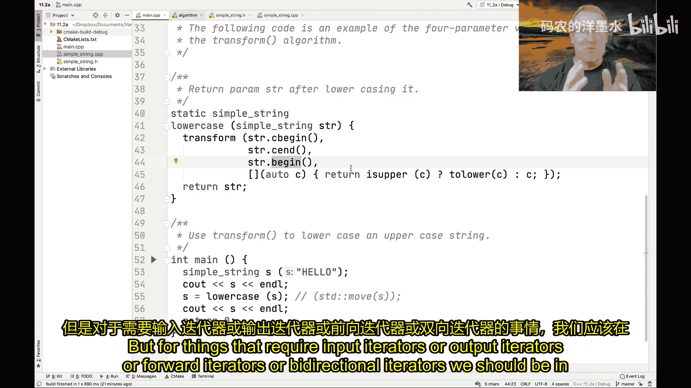

# C++标准模板库：30：实现用户自定义容器的迭代器 🛠️


在本节课中，我们将学习如何为自定义的C++容器类实现迭代器。我们将以之前课程中介绍过的 `simple_string` 类为例，详细讲解如何为其定义符合STL标准的正向迭代器和常量迭代器。

## 概述

在之前的课程中，我们广泛探讨了C++标准模板库的各个方面，包括函数与类模板、顺序与关联容器、各类迭代器、多种适配器以及STL中的大量算法。今天，我们将通过一个具体的例子来总结本系列，即如何为一个自定义的类（如 `simple_string`）实现迭代器。

## 代码位置

所有相关代码均可在GitHub仓库中找到：`github.com/DouglasCraigSchmidt/C-plus-plus-STL-S11-11-do2-11.2a`。

## 项目回顾与目标

在之前的演示中，我们曾使用 `transform` 算法将一个全大写的字符串转换为小写。该实现依赖于字符串的迭代器来遍历和修改其内容。本节课，我们将不再聚焦于 `transform` 算法本身，而是深入探讨如何为 `simple_string` 类实现这些迭代器。

我们将主要关注 `simple_string` 类中与迭代器相关的方法，而忽略其构造函数、赋值运算符等其他实现细节。

## 迭代器类型声明与工厂方法

在 `simple_string` 类的定义中，我们首先前向声明了迭代器类，然后在类体内定义了 `iterator` 和 `const_iterator` 类型别名。

```cpp
class simple_string_iterator;
class simple_string_const_iterator;

using iterator = simple_string_iterator;
using const_iterator = simple_string_const_iterator;
```

接下来，我们定义了用于创建迭代器的工厂方法，主要包括 `begin()` 和 `end()` 系列方法。

以下是创建迭代器的工厂方法：

*   **`iterator begin()`**: 返回指向字符串起始位置的非常量迭代器。
*   **`const_iterator begin() const`**: 返回指向字符串起始位置的常量迭代器（用于常量对象）。
*   **`const_iterator cbegin() const`**: 返回指向字符串起始位置的常量迭代器（C++11风格）。
*   **`iterator end()`**: 返回指向字符串末尾（最后一个字符之后）的非常量迭代器。
*   **`const_iterator end() const`**: 返回指向字符串末尾的常量迭代器（用于常量对象）。
*   **`const_iterator cend() const`**: 返回指向字符串末尾的常量迭代器（C++11风格）。

这些方法的实现非常相似。例如，`begin()` 方法通过调用 `simple_string_iterator` 的私有构造函数来创建一个迭代器，并传入当前字符串对象的引用以及起始位置 `0`。`end()` 方法同理，但传入的位置参数是字符串的长度，表示“末尾之后”。

## 实现 `simple_string_iterator`（非常量迭代器）

`simple_string_iterator` 类继承自 `std::iterator`，并指定其为双向迭代器类别。我们将实现基本的递增、递减、解引用和比较操作。

```cpp
class simple_string_iterator : public std::iterator<std::bidirectional_iterator_tag, char> {
    // ... 成员和友元声明
};
```

为了使 `simple_string` 能访问其私有构造函数，我们将其声明为友元类。类的核心状态包括一个指向关联 `simple_string` 对象的引用和一个表示当前位置的整型索引。

以下是 `simple_string_iterator` 的关键操作：

*   **解引用操作符 (`operator*`)**:
    *   `char& operator*()`: 非常量版本，返回当前位置字符的引用，允许修改。
    *   `const char& operator*() const`: 常量版本，返回当前位置字符的常量引用，仅用于读取。
*   **递增操作符 (`operator++`)**:
    *   `simple_string_iterator& operator++()`: 前置递增，先递增位置，然后返回自身的引用。
    *   `simple_string_iterator operator++(int)`: 后置递增，先保存当前状态的副本，然后递增位置，最后返回副本。
*   **递减操作符 (`operator--`)**:
    *   `simple_string_iterator& operator--()`: 前置递减，先递减位置，然后返回自身的引用。
    *   `simple_string_iterator operator--(int)`: 后置递减，先保存当前状态的副本，然后递减位置，最后返回副本。
*   **相等性比较 (`operator==` 和 `operator!=`)**:
    *   比较两个迭代器是否指向同一个 `simple_string` 对象以及位置是否相同。

这些操作的实现简洁明了。例如，解引用操作直接利用 `simple_string` 的下标运算符 `[]` 来访问字符，这避免暴露 `simple_string` 的内部状态。

```cpp
char& operator*() { return simple_string_[pos_]; }
const char& operator*() const { return simple_string_[pos_]; }
```

递增和递减操作则严格遵循前置与后置操作的标准语义来实现。

## 实现 `simple_string_const_iterator`（常量迭代器）

`simple_string_const_iterator` 类的实现与 `simple_string_iterator` 几乎完全相同，唯一的区别在于它**只提供常量版本的解引用操作符**，因为常量迭代器不允许修改其指向的元素。

```cpp
const char& operator*() const { return simple_string_[pos_]; }
// 没有非 const 的 operator* 版本
```

## 在STL算法中的应用

现在，我们来看 `transform` 算法是如何使用这些迭代器的。算法接收两个输入迭代器（定义范围）和一个输出迭代器。

```cpp
std::transform(s.cbegin(), s.cend(), s.begin(), ::tolower);
```

在这个调用中：
*   `s.cbegin()` 和 `s.cend()` 返回的是 `simple_string_const_iterator`（常量迭代器），用于遍历读取源字符串。
*   `s.begin()` 返回的是 `simple_string_iterator`（非常量迭代器），作为输出迭代器，用于写入转换后的结果。

在 `transform` 算法的内部循环中，它会使用 `!=` 运算符判断是否到达末尾，使用 `*` 运算符解引用输入迭代器（调用常量版本）来读取值，使用 `*` 运算符解引用输出迭代器（调用非常量版本）来赋值，并使用 `++` 运算符来推进迭代器。

这种设计使得我们的 `simple_string` 类能够无缝地与所有只需要输入、输出、前向或双向迭代器的STL算法协同工作。



## 总结

本节课中，我们一起学习了如何为自定义的C++容器类实现STL风格的迭代器。我们以 `simple_string` 类为例，详细讲解了：
1.  如何在类中声明迭代器类型别名和创建迭代器的工厂方法（`begin`, `end` 等）。
2.  如何实现一个完整的非常量双向迭代器类，包括解引用、前置/后置递增递减以及比较操作。
3.  如何实现一个对应的常量迭代器类，它与非常量版本的主要区别在于解引用操作的权限。
4.  了解了STL算法（如 `transform`）是如何利用这些迭代器操作来遍历和操作容器内容的。

通过实现符合STL标准的迭代器，我们可以让自己定义的容器类融入强大的STL生态系统，利用现有的泛型算法，极大地提高了代码的复用性和表现力。