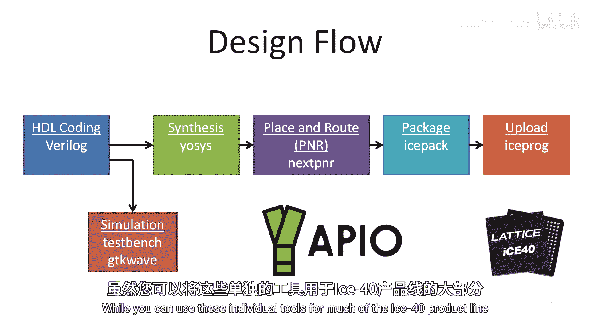
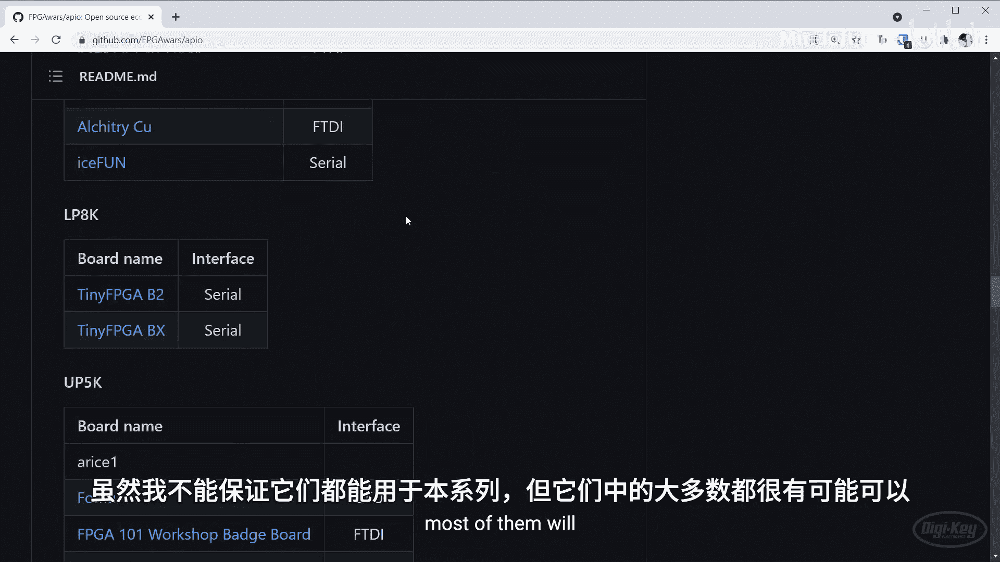
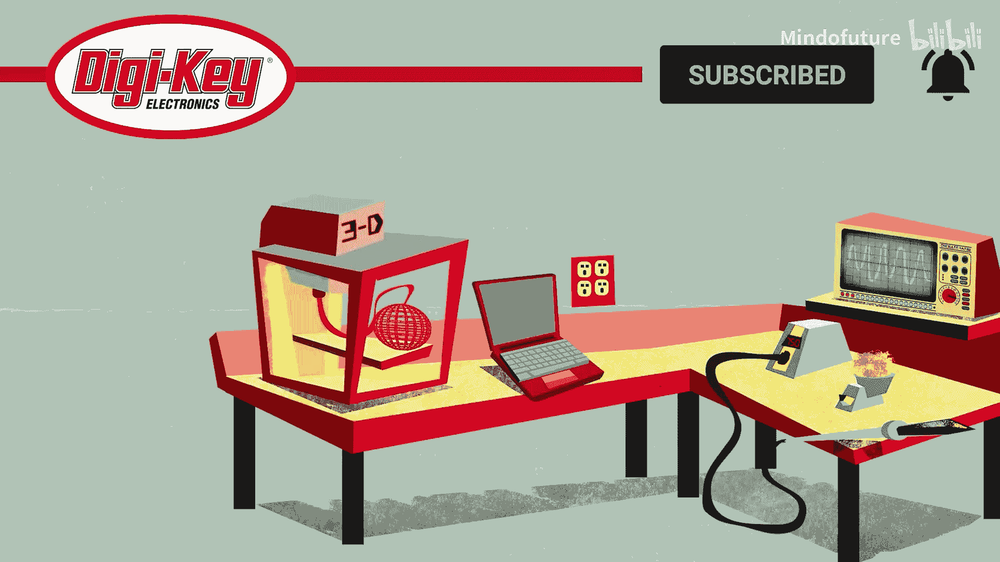

# FPGA编程入门-•-中英-p01-P01-What-is-an-FPGA---Digi-Key-Electronics--BV1kVZSY8E5j_p1-

FPGA stands for field programmable G Array。 It's an integrated circuit or chip that allows you to design completely custom digital logic over the next few episodes。

 I'm going show you how to get started with FPGs so that you can create your own custom digital circuits。

 I recommend understanding some of the basics of digital logic。

 such as binary and how and or and not gates work。 as we're gonna be mostly focusing on implementing those designs in a hardware description language。

 I'll then show you how to upload your designs to an FPGA so that you can see them working。

 Let's jump in。😊，The big question I often hear is what can I do with an FPGA you might get a response like it's faster than a microcontroller or it lets you do things in parallel these might be true but they don't really offer a complete picture of what an FPGA is。

If you just want fast and parallel， you might be better off just buying a big honk and graphicras card or tying a bunch of processors together。

FPGAs are made up of a bunch of logic cells that act as fundamental building blocks for creating digital circuits。

 willll explore what's in these cells later in the series。

 but for now you can think of them as a collection of Lego bricks。

You can configure the individual cells to operate in certain ways and you can connect the cells together to form the basis of any number of digital circuits。

 much like you would use Lego bricks to build a toy car you also have access to things like clock signals and blocks of RA for storing data note that some FPGAs can have other peripherals like analog to digital converters or analog outputs。

Cells are often grouped into logic blocks， and this reconfigurable group of interconnected hardware is often referred to as the FPGA fabric。

Going back to our car analogy， if you just want a toy car to take some sweet jumps。

 you might be better off buying a toy car。 It's likely going to be easier and probably cheaper than building your own。

 This is similar to say using a microcontroller It's capable of doing a lot of things。

 but it's a purpose-built processor with some static peripherals that you can use to connect sensors。

 motors， lights and so on。 Contrast this to an FPG。

 which gives you the building blocks to make a lot more things。 In fact。

 you can use these building blocks to make your own processor in the FPG。

 This is known as a soft core processor and it allows you to run code like you would on a microcontroller or microproor。

If you have the space， you might even be able to implement more than one processor on the FPGA note that you may or may not have access to some of the peripherals you find on a microcontroller like those analog to digital converters。

 implementing a softcore processor is quite popular as it allows you to both customize the processor as well as connect it to other digital circuits you create on the FPGA fabric。

Time permitting My goal is to show you how to load a very simple Ri5 processor on some FPG fabric later in the series before we go there。

 though， let's take a look at some example use cases where you might want to use an FPG instead of a microcontroller or microprocesor For example。

 these mesmerizing LED cubes are controlled by FPGAs Most microcontrollers would struggle to feed that much data at such a high rate to all of those panels。

 you can also find FPGs used in communication equipment performing various digital signal processing tasks like filtering compression and computing the Fourier transform while processors can be used for DSP custom logic in an FPG might be needed to handle higher frequencies and higher data rates you can even find FPGs in some consumer electronics For example。

 this teardown of a Mercedes Bens infoane。Center shows a xylelinkx FPGA on the PCB。

 Sometimes it's cheaper to use reconfigurable logic like an FPG， rather than produce your own chip。

 which can have a high tooling cost Sp of making your own chip。

 you can also use FPGs as a quick way to prototype your design as they can be reconfigured over and over again。

 if you are looking to make thousands or millions of units and off the shelflf integrated circuits won't work。

 you can have an applicationspec integrated circuit or Asic manufactured。

 note that sometimes it's more cost effective to just put the FPG into the final product if you're only making a few units as in the case of the Mercedes Bens infotainment center we just saw。

 If I tear open my beloved analog discovery， you can find another xlinkx FPG here it's being used for data acquisition where it can sample and buffer data very quickly from the analog。

Rron end of the oscilloscope or as part of the logic analyzer。

 you can also find very large and powerful FPGs being used for specialized computations。

 such as mining cryptocurrency or training neural networks。

 The specific calculations used for those operations can be optimized in hardware。

 So you'll often find that an FPG can outperform a general purpose processor or graphics processing unit for that one application。

 I hope these examples give you some ideas where you might find FPGs being used。

 Let's take a moment to summarize why you might want to use an FPG over a traditional microcontroller or microprocesor。

 The big thing is that you can create custom reconfigurable digital logic circuits in an FPG。

 If you can't find a processor with the peripherals you need like， say three USB host controllers。

 you might be able to make your own in an FPG。 you can use an FPG as an external chip to。😊。

ment your processor or you might be able to implement a processor in the FPG itself。

 Some CPU designs， such as many risk5 implementations are open source。

 That means you can view and modify the source code which opens up the possibility of changing how the processor functions。

 If you need to add a unique assembly instruction or support some specialized function like the ability to multiply an ad in a single clock cycle。

 you can do that in an FPG。 They also offer the ability to create optimized digital circuits for performing specialized computations like calculating the fast Fourier transform in only a few clock cycles。

 a microcontroller or microprocesor might be too slow to meet your needs for a particular application。

 Finally， if you're looking to have your digital logic manufactured as a chip for sale or part of a larger project。

 the FPG is a good tool to help。Proto your design。 Now。

 let's talk about how you might program or more accurately create a design for your FPGA。

In most cases you will use a hardware description language such as Verrlo or VHDL to describe the circuit you want to create while some of the syntax might look like C or Python it's important to note that HDLs do not operate like programming languages in that we are not creating a sequential set of instructions for a processor to execute instead think of an HDL more like a markup language you would use to design a website everything more or less happens at once as individual lines are not executed sequentially the snippet of ver log code I've shown would define this simple logic circuit note that how the FPGA implements this circuit might not exactly be a collection of logic gates will explore how this works in a future episode。

The two most common hardware description languages you'll come across are VHDL。

 which stands for very high speed integratedegrated circuit hardware descriptionscription languagenage and Verlog。

 which is a portmanteau of verification and logic。Both were introduced in the early 1980s。

 VHDL was developed by the United States Department of Defense。 It's a strongly typed language。

 and it's often considered very strict and verbose。

 Vera log was created by the company Gway design automation。

 which was later bought by cadence design systems。 It's a weekly typed language and has a more C like syntax。

 Both languages are examples of register transfer level design。

 They describe how a circuit moves and manipulates data between registers。

 but they do not describe the exact hardware necessary to do so。

 You will find many online discussions arguing the merits of one language over another。

 The truth is that they are both industry standards and are similar enough that once you are comfortable working in one。

 The other is relatively easy to pick up。 because the open source tool set that we are going to be working within in this series supports only Ver log right now。

 That's what we。Going to use。There are a few other languages and tools you should be aware of System Verlo is quite popular as it simply extends the functionality of the 2005 version of Verlo。

 it adds features that help you write test benches which are used to verify that your design works many of the large FPGA vendors are pushing high-leve synthesis tools these tools are powerful programs that can automatically convert high-level languages like C C++ and MatTLb into RTL code。

They allow newcomers to write programs in a more familiar language that is then converted to a design for an FPGA。

 while it might not be as optimal as writing RTL by hand。

 it could potentially save you a lot of design time you might also save time by using intellectual property or IP blocks you can often download or purchase IP blocks from the major FPGA vendors or their partners。

These are like closed source libraries you might use when writing software。

 They take up some of your logic blocks and have documented interfaces that you can connect to。

 However， you can't see what's on the inside。 They can provide various features like softcore processors。

 specialized DSP filters， compression， neural networks and so on。 with IP blocks。

 you often don't need to worry about making the hard stuff and can instead focus on creating the glue logic for your specific application。

 The terminology for creating an FPG application is quite different from what you might hear for writing software as there's no compiler or asemmbler Here's what a typical design flow might look like。

 You'll first write code in your hardware description language will be using verlog for this From there。

 you'll often want to simulate your design。Many FPGA development environments have simulators included。

 but will be using the open source GTK wave as a visualizer。

 You'll often need to write ver log to test your original design。

 This is known as a test benchnch while the simulation step is often recommended before synthesis where actually going to save it for later in the series as playing with designs on actual hardware is a lot more fun。

 Next， we synthesize our code and we'll be using the open source Yois tool for that。

 synthesisyn tools take your HDL code and translate it into gate levelve representations。

 The output of this step looks something like a net list that tells the FPG how the various cells。

 logic and registers should be connected。 However， this net list is fairly generic and our particular FPG would likely not know what to do with it。

 So we have a place and route step much like you would do if you were designing a printed circuit board。

😊，This is another automated tool that converts the net list output from synthesis to the actual gate and wire connections that need to be made in our particular FPG We'll use next PNR for that like the others this is also an open source tool the output of our PNR tool is an ASI file that tells the FPG exactly what it needs to do in order to create the circuit we defined in our code。

 However， it's in a mostly human readable format so we use the I pack tool to convert it to a binary file that can actually be read by the FPG configuration process Finally we'll use Iprog to upload that binary file to the external flash memory chip connected to the FPG to make this whole process easier and so you don't have to remember all of the tool names we're going to use opio which is a tool that calls all of these low-level tools for us note that the collection of tools。

😊，Going to use work only with the lattice Ice 40 line of FPGs These are generally considered to be fairly lowpowered and inexpensive FPGs。

 but that's perfect for our learning experience While you can use these individual tools for much of the I 40 product line Opio is made to work with devboards。

 If you look at the Github page for next PNR， you can see an example of its graphical place and route tool This is something optional that you're welcome to play with。

 but we won't need to use it in this series you can see how the tool makes actual routing connections among the cells in your FPGA。

If you head to the Opio GitHub page and scroll down on the Readme。

 you can see the various boards that Opio works with。

 while I can't promise they'll all work for the series， the chances are high that most of them will。

 I'll be using the I stick from lattice。

This is a development board built around the IceE 40 Hx 1K FPGA。

I recommend getting a USB extension cable for it and you'll need some basic components like a breadboard。

 jumper wires and some buttons， I'll let you know if you need additional components in each episode。

The idea behind this series is to give you the basic building blocks to start creating stuff with FPGAs in the next episode。

 we'll install the Opio tool set and upload our first FPGA design， happyy hacking。🎼哎。え。

