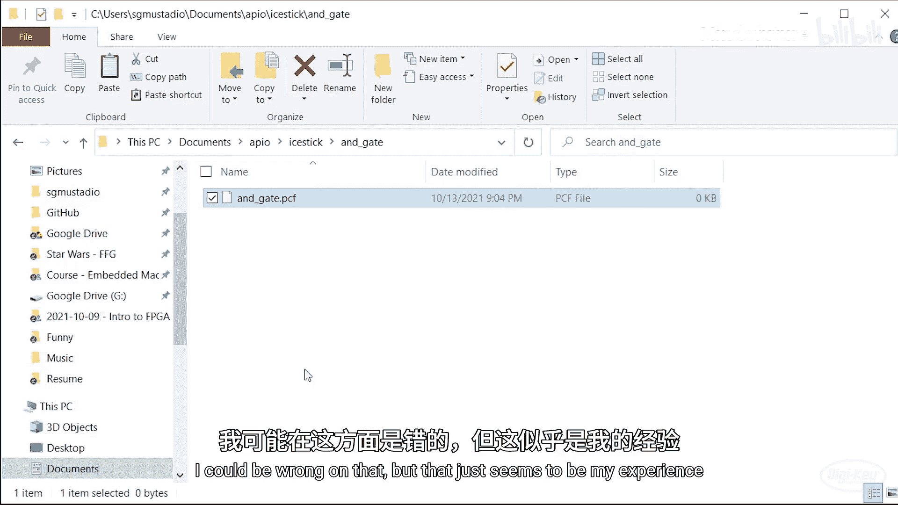
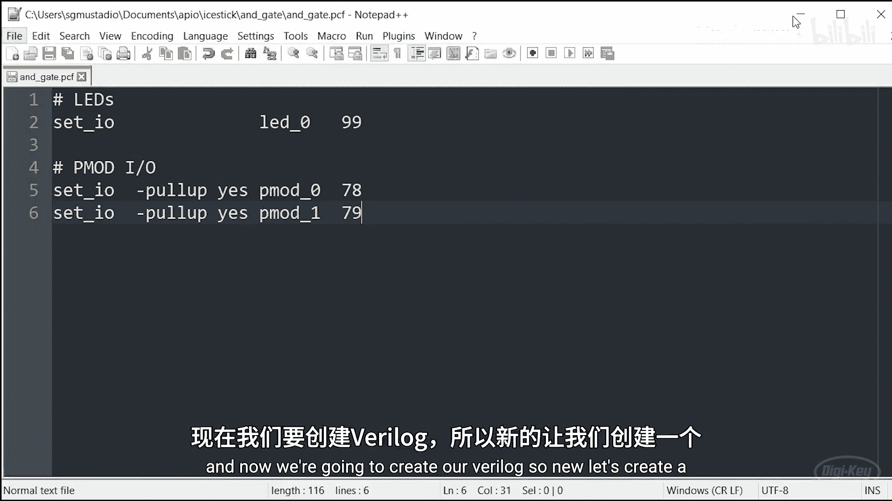
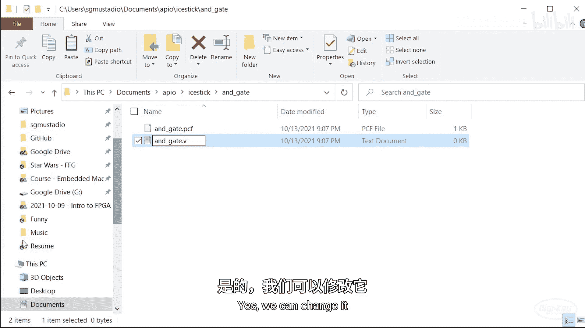
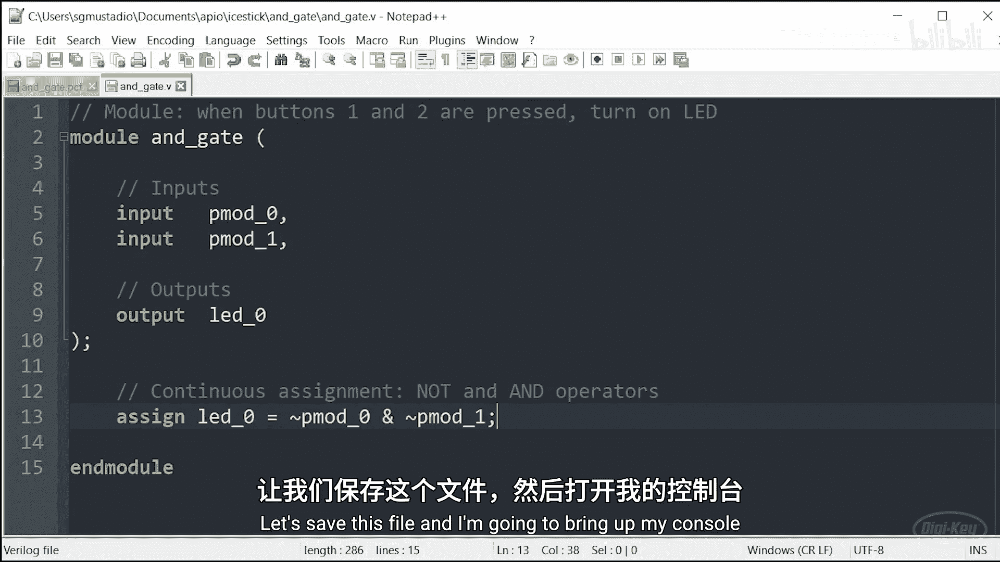
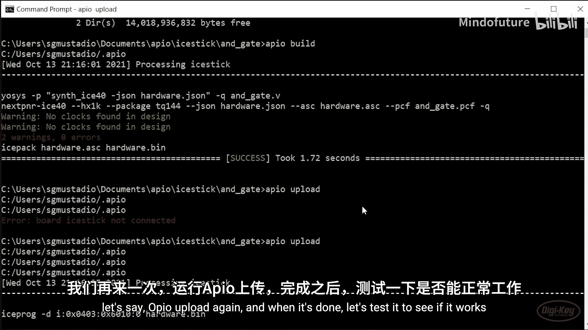
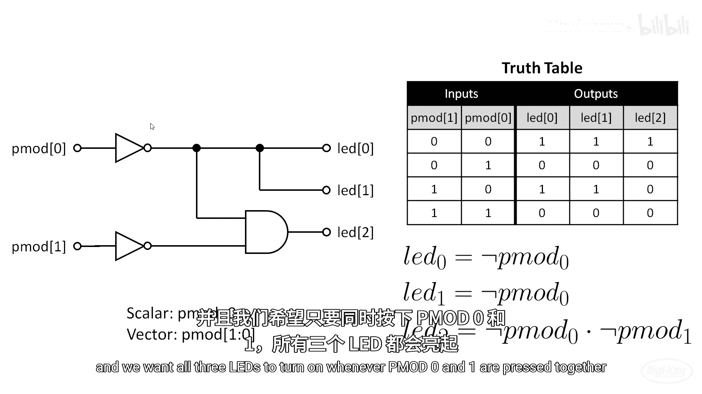
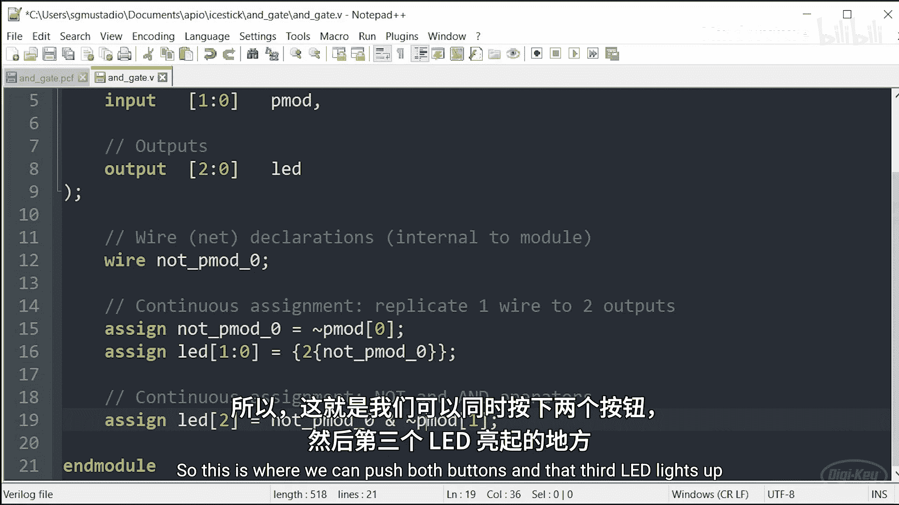
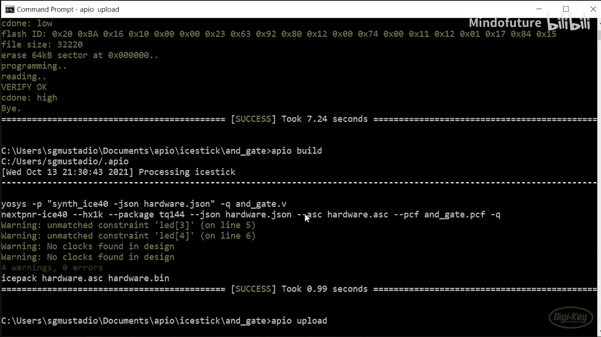

# FPGA编程入门-•-中英-p03-P03-Getting-Started-with-Verilog---Digi-Key-Electronics--BV1kVZSY8E5j_p3-

Now that we have the FPGA toolcha installed， thanks to Opio。

 we can start creating our own digital designs using Veralog In this episode。

 we'll see how to make basic combinational logic circuits and how they actually get implemented in the lookup tables that are on the FPGA。

 Let's dive in。For most of this series， we'll be working with the PMD connector that's at the end of the ice stick。

 this just breaks out power， ground and some input output pins on either side。

This header format was made popular by Dient for use on their FPGA dev boards and you can find it on other boards too the idea is that you can plug in common breakout boards to add features like buttons。

 LEDs， sensors and networking。Here is the pinout of that connector on the ice stick pins 6 and 12 are 3。

3 volts，5 and 11 are ground， and the rest are IO pins directly connected to the FPGA we'll start off by connecting some buttons to pins1 through four on the right side note that these map to physical pins 78。

 79， 80 and 81 on the FPGA willll only need three buttons for this video。

 but I like to connect4 just because。Here are the connections。

 note that we do not need to add external pullup resistors on the buttons。

 we can enable internal pull up resistors on each of the pins in the FPGA and I'll show you how to do that。

This is the first circuit we're going to make。 It's a very basic and gate。 Well。

 it's an and gate with to not gates on each of the inputs。

 That's because when we press one of the buttons， the line will go from high to low or from1 to0。

 We want one of the LEDs to light up only when we press both buttons together。

 Another way to represent the circuit is by using a truth table here。

 you can see that when both inputs are0， the output is one。

 which means the LED should turn on Otherwise， the LED should remain off。

 As I mentioned in a previous episode， I'm not going to go into the theory behind digital logic。

 design and Boole and math。 If you are familiar with Boole and algebra。

 you'll probably know that we can use de Morgangan's law to simplify this equation to become the inverse of the output of p mod 0 or p mod 1。

 but we don't actually need to do that。 The important thing here is the truth table and that our。

code can easily be understood The first thing we'll want to do is create a folder to hold all of our files。

 our V log file and the physical constraints file。 I'm going to go into documents AppO wherever we created the Itick folder from last time when we created that example you should see the example LEDs in here。

 and then I'm going to create a new folder， and I'm going to call it and gate。

I'm going to start off by creating my pin constraint folder。

 so I'm going to create a new blank text document， I'm going to call it and just the name of my project again。

pf。And if you're operating system asks， just say yes。

 it's fine to change the suffix Note that the next PNR tool will look for the first available dot PCf file in a particular folder so from what I've seen you probably don't want to have more than one file as it looks like the first one gets used I could be wrong on that but that just seems to be my experience I'm going go ahead and open this up with notepad plus plus the dot PCf file is different from ver log So the syntax is not ver log at all comments are the pound signed or hashtag and I'm going define my LEDs So that line is a comment and I'm going to call set underscore Io and I'm gonna to tab out a few times you don't need to tab as long as there's at least one white space it seems to be red just fine but you'll notice in ver log things like to be tabled out or in tabular form separated by tabs to create nice columns which makes things easy to read so I'm going do LED0 and it's pin 99 is。

That LED so remember that physical pin 99 on the FPG is connected to LED0 or in our case D1 on our I stick Then I'm going to define the p mod IO pins and these are connected to my buttons I'm going call set IO again T out and this is where we can define the pull up so we do dash pull up for a parameter and just say yes and that enables the pull up resistor for this particular pin I'm going to call this pin p mod 0 and that's connected to physical pin 78 Let's do the same thing。

We'll call pull up Yes， P mod 1 and this is physical pin 79， so save that file save。

 I already saved it， and now we're going to create our ver log so new。

 let's create a new document I'm going to rename this the same thing as the project。

 call it an an gate， assuming I can spell today。

t V for ver log。 Yes， we can change it。 I'm going to open that up in notepad plus plus again。

 Now we're going to create actual ver log。 The Cstyle comments work very well here like this works well for line or in line comments as well as the comments I'm going define my module here and give it a little comment that says when both buttons are pressed let's turn on the LED a module is a keyword and ver log that says I'm going create a block of functional code and remember that this is not procedural code necessarily it doesn't run one line at a time。

 This is just a block of functionality that gets implemented as hardware when we run synthesis。

 I'm going name the module something here。 It doesn't have to match the file name but I'm going to match it anyway。

 then we define our interface。 The inputs and the outputs that are part of this module。

 you can put comments in these parentheses that's fine and you'll often find that you might have a lot of inputs and outputs for。

Particular module so it can help to keep them nicely organized。

 One way to do that is to do the tabing instead of spacing like we saw with the PCf file to keep columns nice and orderly as we get to more definitions of inputs and outputs you'll see that where you might get buses and vectors and registers and you can have them on different columns so it becomes readily apparent for whoever is reading your code what a particular input or what a particular output is supposed to be。

 We're gonna name our inputs p mod0 and p mod1 these should line up with the names that we created in our PCf file。

 you'll notice that these inputs and outputs are separated by commas In fact。

 these could all be on one line。 it's very similar to see in that way。

 you'll see a lot of people's code where they are all on one line next to the module name as you can see I'm separating the inputs and outputs by commas and in fact。

 you might have them on one line and in a lot of cases you'll see them on one line。

To the module name and this is very similar to C in that fashion where the white space or indentation doesn't really matter here。

 However， I like to keep them on separate lines because it's easier to read or yourself。

 maybe later in the future when you're coming back and reading your old code to easily see what the inputs and outputs are and they're essentially selfdocumenting here but I like to separate them with some comments once again we're going to put the output LED name just like we did in the PCf file and because that's it。

 I'm not going to have a comma after that label and I'm going to close this module out or the inputs and outputs of this module this interface rather with a parentheses and a semicolon however that doesn't mean the module is fully defined we actually define the module underneath it and we say that it's done with this end module you can kind of view this as curly braces in C where this is an opencurly brace under here and this is the definition of the。

Before the close curly brace or in this case where it says n module。

 that particular keyword This is going to be a very simple what we call a continuous assignment in ver log or HDL This is not code that's run in the sense that it's executing on a processor instead we're defining hardware we're saying basically create an and gate that ands the lines p mod 0 and p mod 1 together after they've been knotted and connect that to our output line or in this case an output pin as it's defined up here and in the PCf file because the buttons are active low we need to use these not symbols when we push button0 and push button1 those two pins。

 those lines get ended together and the output goes to LED0 and it's continuous meaning there' is no clocks。

 There is no execution of code。You can think of it essentially like hardware。

 like we're wiring something up on a breadboard， let's save this file and I'm going to bring up my console。

 I'm going to make it so that we can read it here and I'm going to go into my opio folder。

And I'm going to go into I stick。And that's where we created our project。

So I'm going to go into the andgate project。And the very first time before I try to build it。

 I want to run。Oio En knit define the board that is ice stick。

You can see that it creates that dotini file for us that just says， hey， Opio。

 we're using the Itick for our target board。And then I want to call Opio build。

Hopefully everything works。 Don't worry about the no clocks。

 We're going to be looking into clocks in a later episode， but。Ignoring that everything built。

 So then we say opio upload。 And as you can see here， I did not connect my board。 let me connect it。

 make sure you have no other FTDI chips connected that includes things like an analog discovery to board with it connected。

 let's say opio upload again。 And when it's done， let's test it to see if it works。

 If I press either button nothing happens。 It's only when I press both buttons together that the LED lights up。

 That tells me my design worked。

Let's take a moment to talk about what's actually happening in the FPG。

 If you look at the Ice 40 data sheet， you can find a block diagram that shows what's in a single logic cell。

 A cell has two main parts。 a lookup table or and a D flipflop willll examine the D flipflop later。

 So let's focus on that lookup table。 Notice that it has four inputs labeled I0 through I3 Here。

 I've laid out what the entire truth table would look like for our simple and gate example。

 We'll assume that p mod 0 and p mod1 where mapped to i0 and i1 for this particular lookup table。

 Whenever I0 and I1 r 0， the output should be one。 It really doesn't matter what I2 and I3 R as they're not used。

 Here is a representation of our four input lookup table。

 Despite what you might initially think a lookup table is not a collection of logic gates。 Instead。

 it's a simple chunk of memory。😊，That has 16 entries。 and each entry contains one bit During boot up。

 the FPG reads the configuration data from the external flash memory。

 where it finds information about how to program the random access memory or Ram in this particular lookup table。

 The output section of the truth table is copied to the lots memory。

 The four input lines are then used to index into the memory as the value of the input contains the address of which memory element should be read。

 This is similar to using a 16 by one multixer to select the output from the various memory elements。

 The output of the lookup table is a single bit。 a0 or a one。 In reality。

 converting the combinational logic portion of our code into lookup table values during synthesis is where a lot of the magic happens。

 Let's take a look at a slightly more complex example and introduce vectors。

 A vector in ver log is just a way of。😊，Grouping inputs， outputs and other named containers together。

 It's similar to how you might use arrays in other programming languages like C or Python。

 rather than assign a name to each input and output we're going to group them together。

 A single named net like what we were using in the previous example is known as a scalar。

 Here is the truth table for what we want to accomplish。 Notice that we now have multiple outputs。

 We can write the Boolean equations as follows。 We want LEDs 0 and1 to turn on whenever the p mod 0 button is pressed。

 and we want all three LEDs to turn on whenever p mod 0 and one are pressed together。

 Let's implement this in ver log code。

Let's start with the same code that we had last time。

 we'll go to the dot PCF file and let's modify it。The first thing we're going to do to enable these vectors。

 at least for our inputs and outputs， is define them with these brackets it's much like you would see。

For an array in say C or Python。I'll continue doing this for each of the LEDs that I want to control。

 mapping them to a physical pin， so LEDs 0 through 4 are 95 through 99 just notice that they're kind of in reverse order because that's how the board is laid out。

We're going keep the buttons， but we're going to change them to vector form by using the bracket notation to index0 and1。

 save the dot PCf file。 And let's go to our ver log Not here they're not really buttons one and2 anymore。

 although that's kind of how they're wired。 I'll make a note about what I expect the functionality to be。

 So try that again the first button lights up two LEDs。

 And if we push the two buttons together button 0 and1。

 it lights up the third along with those original two that is intended behavior。

 This is where we start getting into columns for our inputs and outputs when we're defining our interface。

 you can see that this is an input that I'm defining。 I'm going give it the。Vectctor name。

 which is P mod。 and how many bits it is。 In this case。

 we have two bits which are0 and1 with most significant bit first colon and the least significant bit。

 I'm going do the same for the LEDs， which there will be three LEDs。

 You'll notice that we define five here。 and that's for you to use later。 but I'm only going to use0。

1 and 2。 I expect to see a warning during the build process because3 and4 aren't used。

 It's kind of like defining a variable and not using it。

 And I want to make sure that my tabs line up。 I'm using four spaces per tab to make things a little easier。

 but you'll often find that two spaces per tab is perfectly acceptable。 In fact。

 indentation doesn't matter。 It's just for you and others being able to read your code。

 Let's start over with our continuous assignment。 You can define something called a wire inside of your module。

It's not really a variable， although that's the closest comparison I can make to something like C。

 it's a net where attaching an input to an output or an output to an input on the gates essentially。

 even though a lot of things are done through lookup tables。

 but it's telling the hardware that we want to make connections inside of this module and a particular connection is not an input or an output。

 we just need a named net， it helps if you think about it if you've done any sort of PCB layout and you name some of your nets or wires。

 it's kind of like that。I realized I didn't talk about this assign keyword。

 this is essentially making a connection in hardware。

 we want to say that the P mod in this case button。

 the first button should be knotted and then connected to this named wire or net and that is going to always be the case。

These curly braces work as a concatenation function in verlog， but we're not using them for that。

 You can use them to say concatenate two buses together where we have multiple lines or these vectors and we can put them together to make one larger bus。

 but here what we're doing is something called replication。

 We want to say that this not p mod zero wire， this net that we've defined as the。

Inverse of our first button line， and we're going to copy that assignment。

Twice hence the number two here and assign it to LEDs one and zero， we're going to assign those two。

 which is now replication of not p mod zero this wire。To the output pins。

Another way to think about this is that we have one output here and we connect another wire to it making a tjunction and it splits out to our two pins LED0 and LED1。

 That's replication in ver log This should look similar to our first example where we are ending two of the lines together in this case not p mod 0。

 which is a named net， which is the same as just copying this and pasting it down here because it's just a direct connection with no logic but it does carry this logical not gate in front of it So that wire the output of that not gate is connected here and then ended with not p mod 1 So this is where we can push both buttons and that third LED lights up Let's save this because this is the same project。

I can just call OpioBuild again without needing to call Opio ani。

 you should expect some warnings here about L3 and L4 not being used since we did not use them in the design。

 assuming everything builds and synthesizes correctly， let's call Opio upload。

If I press the first button， LEDs 0 and1 turn on。 It's only when I press both buttons together that the third LED illuminates with the other two。

 I found this reference card from a professor at Imperial College London to be very helpful。

 I don't know if it lists everything for the 2005 version of Alog， but it's definitely a good start。

Here's your challenge。 I want you to implement a full adder in ver log and run it on your device。

 The full adder is a very important circuit that performs the basic operation of addition between two bits。

 It plays a crucial role in the arithmetic logic unit or A that makes up the computational part of a central processing unit or CPU。

 This Wikipedia article gives you the truth table as well as the logic diagram for the full adder。

 I recommend looking at these to figure out how to implement it in verlog。

 note that you might need to invert the inputs。 If you want to have a button press mean logic high。

 Here is the full adder working on my It。 When I press any one of the buttons， the output is one。

 If I press any two of the buttons that carry out LED lights up。 If I press all three buttons。

 the sum and carry out LEDs both light up。😊，So far。

 we've only looked at continuous assignments where changes on the outputs are more or less immediately responsive to changes on the inputs。

 and there may or may not be some combinational logic in the middle。

 Next time we'll look at introducing clocks and flip flops。

 where we can store and pass data around from one clock cycle to the next happy hacking。え。え。

