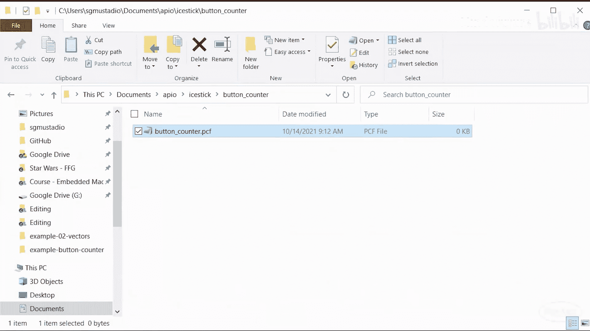
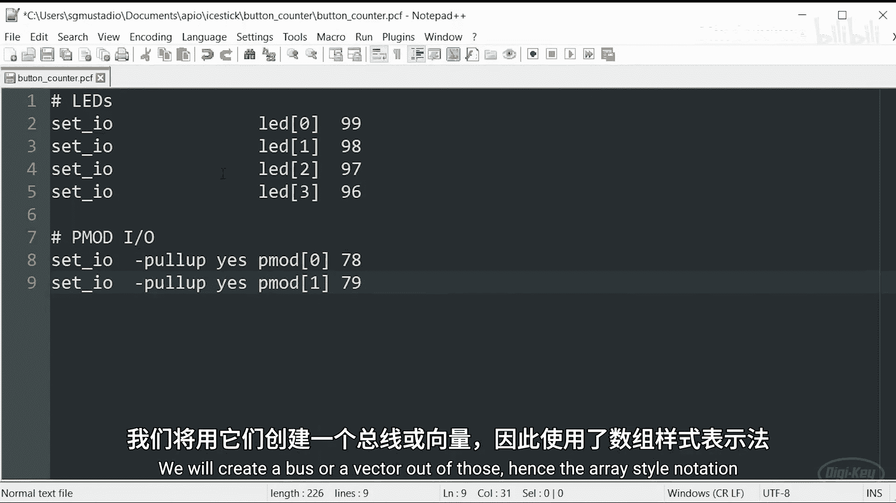
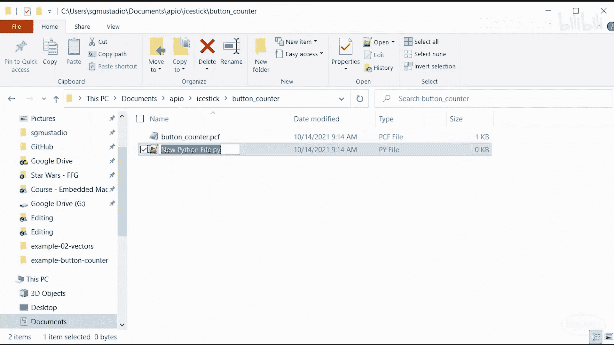
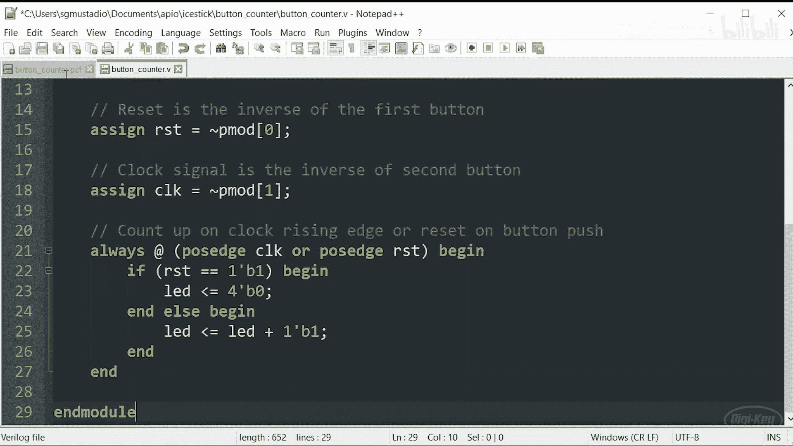
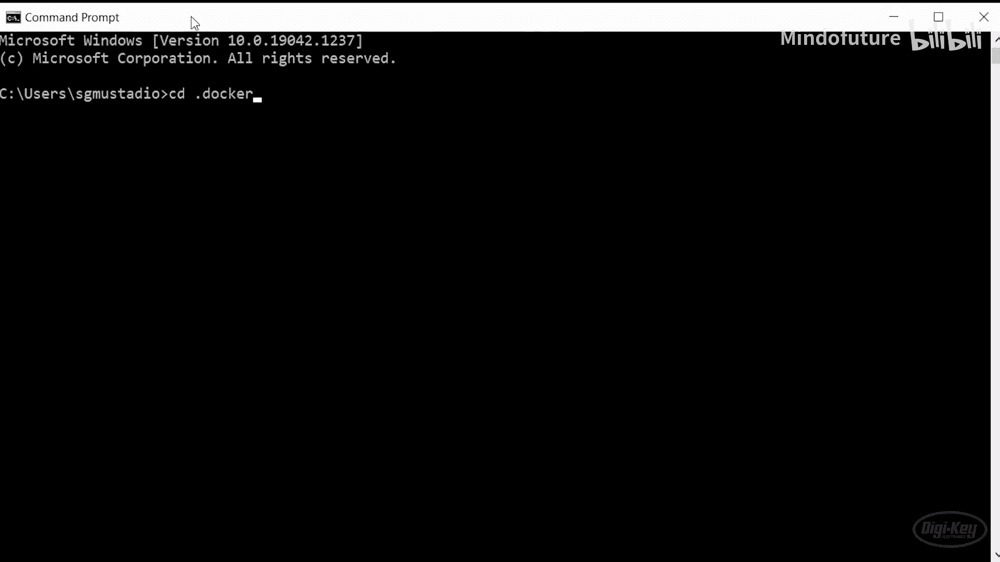
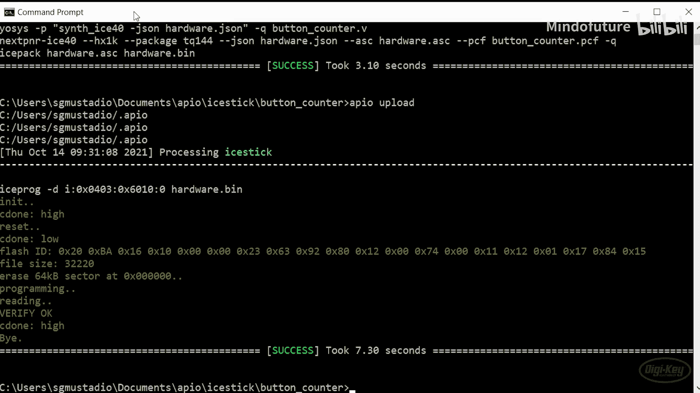
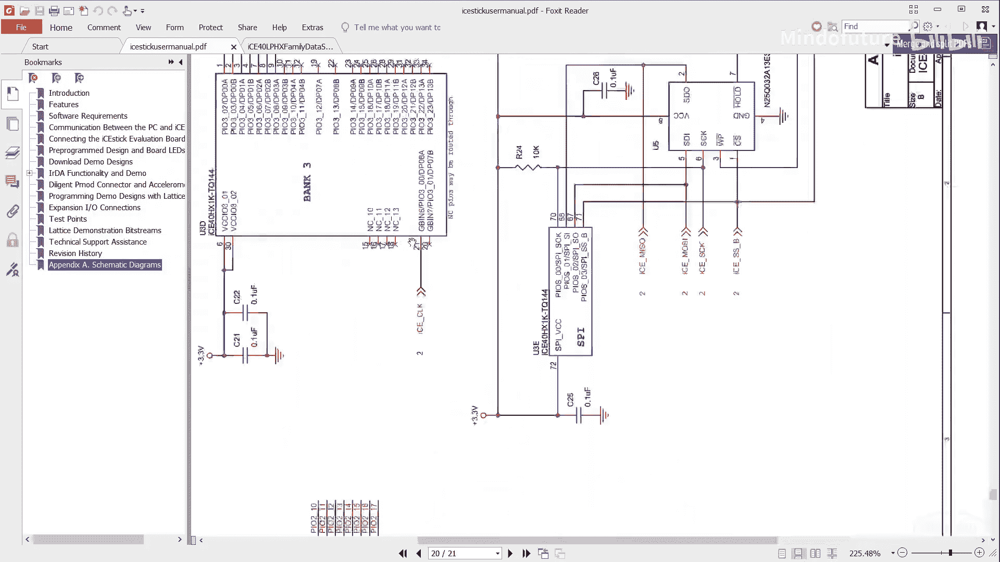
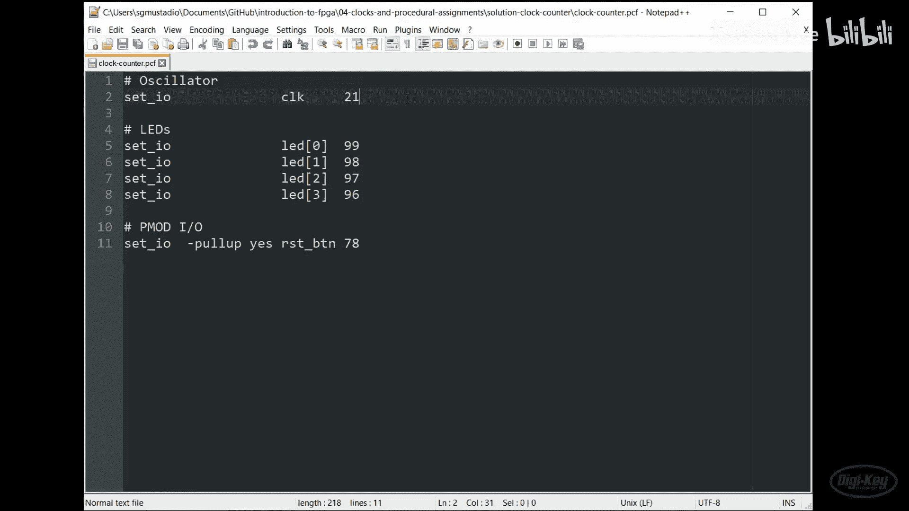

# FPGA编程入门-•-中英-p04-P04-Clocks-and-Procedural-Assignments---Digi-Key-Electronics--BV1kVZSY8E5j_p4-

Previously， we saw how to create continuous assignment blocks in Verlog。

 this time we'll explore how the D flipflop in the FPGA's logic cells can be used to create procedural code that executes sequentially。

 Let's get started。If we look at the I 40 data sheet for the Lx and Hx models。

 we can see that theres another part of the logic cell that we have not discussed yet。

 and that is the D flipflop。 This is a basic digital logic element made up of some transistors and probably some resistors。

 It allows us to store one bit of information at a time between clock pulses。

 As you can see in this diagram。 we can get our one bit input from the lookup table in each cell。

 Our clock signal can come from any number of sources。

 We also have a reset pin as well as an enable pin that we can use to control the output。

 The output of the cell can come from the Dflipflop。

 or you can bypass the flipflop using this multiplexer。

 Here's a simplified look at the d fliplipflop。 The idea is that we have a clock signal as one of our inputs。

 Whenever the D flipflop sees a rising edge on the clock also known as a positive edge。

 it will sample the value on the input。😊，If in is low， then the output line will go low。

 If in is high， then the output line will go high。 the output line will stay that way until the next rising clock edge I left off the enable line as we won't use it in this episode。

The enable line is used to allow or prevent sampling on the clock edges。 If the enable line is high。

 the fliploop works the way I've shown here。 If the enable line is low。

 the fliploop will keep whatever value is on the output line。 regardless of what the input line does。

 Finally， we have the reset line。If reset ever goes high， the output line will be driven low。

 This can happen asynchronously， meaning it does not need to happen on a clock edge。

 The output line will stay low as long as reset is high。

 even if there is a rising clock edge since the output line might be randomly high or low whenever the FPG is first initialized。

 we can use the reset line to set an initial state for our flip flops。 because of this。

 you'll often see the same reset line connected to many different flip flops。

We can combine the flip flops in combinational logic to create any number of digital circuits。

 For example， we're going to create this4 bit counter inve log and test it on our FPG。

 The full adder should look very similar if you did the challenge in the last episode Note that we don't actually need to implement the adder as ver log supports some basic math symbols such as addition。

 The synthesis tool will figure out the best logic needed to accomplish the goal of adding bits together。

 which could be our full adder， or it might be some other combinational logic。

 We add flip flops to this logic so that on every positive clock edge One is added to our four bit number。

 If we need to increment the next bit the carryout is used to notify the next stage of the counter that it needs to increase its value by one。

 You might notice that there's no initial value set on our output or Q bus to do that we need to pulse the reset line in order to set the output to0。

😊，Which will start the counter over from the beginning。

Here is the timing diagram for our4 bit counter。 While the FPGA will probably start the Q0 through Q3 lines as low whenever it first boots。

 it's probably a good idea to not assume that they'll be low。

 So we'll say that the lines are unknown until we give a reset pulse。

 I'll put an X and draw the lines as both high and low as we don't know the actual state。

 As soon as the reset line goes high， the entire bus is set to 0。

 The Q value is then incremented by one on each rising clock edge。

 This allows us to create a counter from 0 to 15， using four lines and some digital logic。

 When the output is 15 or binary 1，1，1，1。 The next positive clock edge will cause the counter to reset or roll over back to0。

 Counts are incredibly useful pieces of circuitry as they're used to time events or form the basis of pulse with modulation signals。

😊，If you've worked with microcontrollers， you've probably come across counters。

 which can also be called timers。 They're pieces of hardware logic that operate almost exactly like this。

 and they allow us to set up timed events that can occur at specific intervals without wasting CPU cycles。

 We can also generate hardware interrupt signals that occur。

 whenever the timer reaches a certain value or whenever that rollover event occurs。

 Let's see how to implement a four bit counter invelog。Just like we've done before。

 we want to go into the folder that contains our projects。

 I'm going to create a new folder for our particular project that we're going to create。

I'm going to call it button counter。Let's go in here。

 we're going to create our physical Constraint file。WhichI will call button counter。pf。

Let's open that with Noteepad plus plus。This PCF file should look just like the ones we created in the previous episode。

 we're going to create a vector of LED pins that are connected to the LEDs。

 or in this case it's a bus， it's a four bit wide bus and we're going to do the same with the two buttons specifically the ones attached to physical pins 78 and 79 We will create a bus or a vector out of those hence the array style notation let's save this file。

And we're going to create our ver log file We want to create a module that gets loaded onto our FPGA and the idea is we want to be able to press a button and have it act as a clock in this case it's just going to count up every time we press a button and that count value is going to be displayed in binary on the LEDs we'll declare our button pins。

 the p modd pins0 and1 to be inputs and those are going to act as the clock signals or the sensitivity signals and I'll show you what that means in a minute when we create our always block。

Notice that I'm declaring the LED pins as register pins and the ReG or register keyword here tells the synthesis tool that we want to connect these lines to those D flip flops。

 which means that it's going to be part of our procedural assignment。

When things are executed sequentially， thanks to or due to the clock signals that come in to those flip flops。

The synthesis tool figures out how to connect everything together for us。

 so we don't have to worry about the actual connections。

As we did previously we're going to declare a couple of wires here。

 this is because we want to rename our buttons and pretend that our button signal or pressing a button is going to act like a clock signal where it's just going to toggle high and low。

 although we get to control it with the button， as well as the reset signal。

 it's a good idea to have a common reset signal so that when you begin and always block。

Or when an always block starts executing， it may not know what state to put some of the variables in。

 and we'll see that in just a second。We want reset and clock to be active high essentially which is the opposite of how the buttons work。

 we're going to do a continuous assignment where the signal of the first button goes through a not gate and that becomes the reset signal hence why we're naming the output of that that's the net to the word the wire in this case is known as reset。

Just like we did with reset， we're going to do the same thing for the clock signal。

 we're just renaming the inverse of the second button。

We define our procedural block or procedural code using the always keyword。

 anything within this block executes sequentially， much like how a programming language like C or Python would execute it's a little different but because signals can propagate through those Dflip flops。

 things happen in order， we then need to define a sensitivity list which tells the hardware how the signals should propagate or when the signals should propagate and this is done through the use of clock signals or reset signals and it's looking for a rising or falling edge on those signals in order to execute what's underneath the or what's inside the always block。

The first case is we're going to define the positive edge。

 So that's the rising edge of our clock signal。 In this case， it's the opposite of a button push。

 So the idea is when we push the button。😊，That counts as a rising edge because the signal is inverted always。

 according to this a line that we created here， and that will execute anything within the always block。

I will point this out now， note that because there is a lot of de bouncece on these simple push buttons。

 you can expect this to execute multiple times per button push that's an expected behavior creating button de bouncing is something you can do in an FPG and if you want another challenge I might recommend trying to figure out how to do button debouncing。

 but that won't be the actual challenge for this episode we can have an always block execute based on the input of multiple signals in this case we can have a clock rising edge or a reset rising edge will cause this block to execute Note that you can also do a negative edge if you would like to in this case we can do negative edge p mod0 and we wouldn't need this line but I'm putting it here because a positive edge reset might be useful later on if you have multiple always blocks that need some kind of reset signal and you needed it to propagate throughout your design to restart some of these blocks or put them in。

Default state。The begin here kind of acts as a curly brace like you would see in something like C or C++。

 it shows the contents of the always block。So we will write begin here。

 then we will create an if statement， this works very much like an if statement you've seen probably in C or Python。

In this case， our conditional is given in the parentheses， if the reset signal is equal to one。

 then what's underneath the if statement executes。Notice that constants can be a little weird in ver log。

 you generally want to define the number of bits because this determines the number of lines or the number of wires that are needed to make this comparison in this case we only need one reset going to be zero or one since it's one bit or one wire。

And then we say we're going to define this in binary and this is1， so this could be 1 B0 or 1 b1。

 those are your only options for a1 bit wide binary number So in this case we do want it to be one we're going to call begin and I'm going to indent under that to make it a little easier to read and here is our assignment going to our LED bus or vector So if there is a reset signal that goes high in this case a button push。

Then we want the four bit wide binary number zero in this case， you could probably also write。

0000 if you want it to be more explicit， but zero works just fine that's going to be assigned or loaded into the LED bus In this case we have four bits for LED3 through0 remember we declared this as a register so we can make this assignment。

And we use this special less than equals， which does not mean less than equals， it means this number。

Is getting loaded into。This bus。So 0000， which means all of the lines on our LED array are going to go low。

We close out that if statement with end。And just like you might expect， we have an L statement。

And we would want to open that up again with begin。

So this is this is basically the equivalent of doing this， but that syntax does not work in ver log。

 so we do N else begin。So if this block gets executed because the reset line went high。

 then it should execute this first if part because the reset line is high。

 or if this gets executed because the clock went high and you're still holding the reset line high in this case you're holding the button。

 then zero is just going to be continually loaded into this LED bus， however。

 if the reset line is low in this case you're not pushing the button and clock goes high。

 which for our cases is the other button。Then we want to increment the value on that bus。

 So this value gets red one in this case， a binary one gets added to that and that gets stored back into LED。

 That's part of the reason we use this style of assignment operator here is because this is all registered。

 It's not like a wire where things happen continuously。 This would not work。 You'd be connecting a。

You'd be potentially connecting a low line to a high line and that's no good。

 So we do this style of sequential or procedural assignment to say， hey， read this LED value。

 in which case it's the four bit value on this bus add one to it and then stored back into that value because it's all registered。

 This works just fine。Note that plus works here。The synthesis tool knows how to handle basic addition。

 this means that the synthesis tool is capable of creating some type of adder circuitry to make this work。

And there are a number of different ways that it could implement this edition circuitry。

It may be the full adder that you designed as part of the last challenge or it might be something else。

But the synthesis tool knows what to do with plus， and that's good to know it can create the logical circuitry necessary to do any number of arithmetic operations。

 so keep that in mind and I recommend looking up some of the ver log syntax to see what kinds of operations it supports。

But remember a lot of it comes down to what the synthesis tool can support In this case。

 edition is just fine。 We're going to close out our if else block。

And we're going to close out our always block。You'll see here that we can combine continuous assignments。

 which is creating some of those logic circuits。As well as these procedural assignments into one functioning module that gets loaded on two hour FPGA。

Let's save this。

We're going to open up our command prompt。And I'm going to go into my button counter example that I just created。

 I'm going to call Opio initB to define the board and Itick that's going to create the initialization or INI file for us。

Then we're going to tell it to build， hopefully the synthesis tool works correctly and does not throw any errors。

And Opio upload to send it to my Itick that should be plugged in and on。It lookss like it uploaded。

 so let's test it。

Whenever the clock signal goes low， the countervalue increments。

 I can also press the reset button to restart the counter。

 noticeice that my counter might skip a few values whenever I press the button thanks to button de bouncece。

 We won't worry about dealing with button de bounces right now。

 U a button as a clock signal seems a little silly， but it was a useful demonstration。

 If you look at the It data sheet， you can see that the board has a 12 MHz oscillator。

 This oscillator is connected to physical pin 21 on the FPGA。

 that should work as a much better clock signal。

You can give the clock signal a name in the PCF file。

 just like we've done for all the other IO pins on the FPGA。

 this will give us a line that toggles at a rate of 12 meHz。

Your challenge is to create a clock divider for this line and use that to feed your counter instead of a push button。

 The output of your divider should be a 1Hz square wave so that your counter increments once per second as a hint。

 you might need to create a second counter to accomplish this。

 Also note that you can have more than one always block in your ver log module。

I just want to tell you good luck。We're all counting on you。In the next episode。

 we'll take a look at state Ma， happy hacking。A。え？

