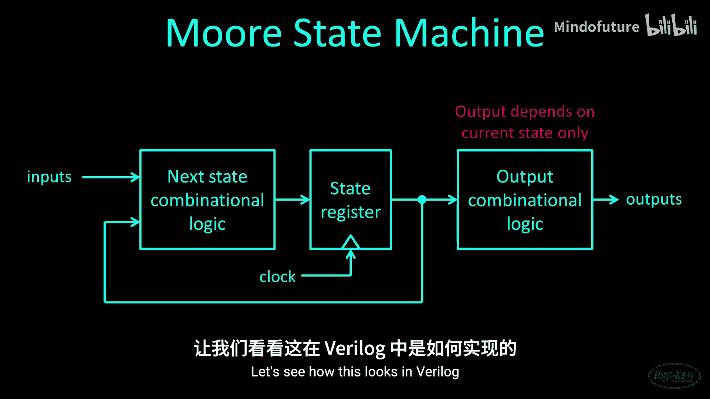
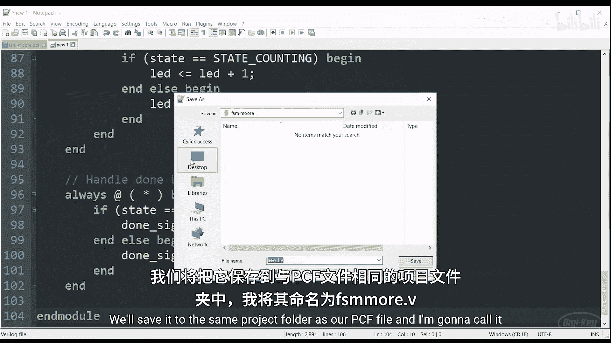
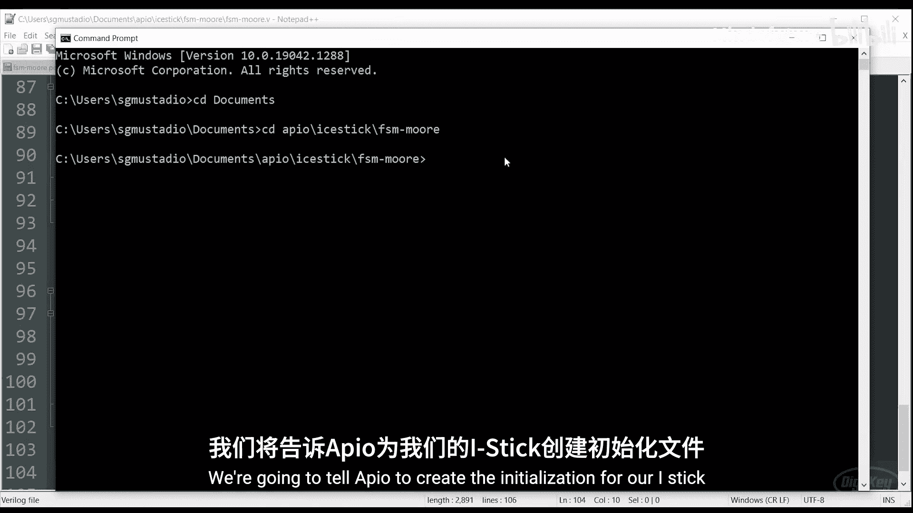
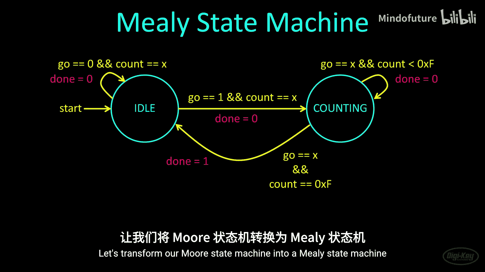
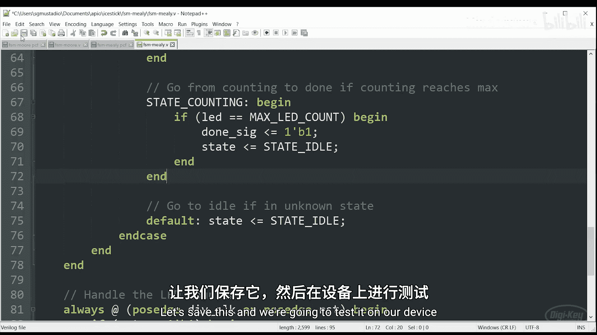
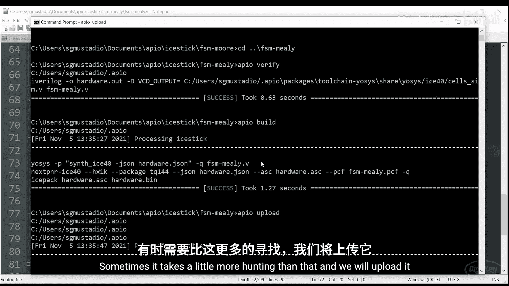

# FPGA编程入门-•-中英-p05-P05-Finite-State-Machines---Digi-Key-Electronics--BV1kVZSY8E5j_p5-

A finite state machine is a mathematical model used to represent sequential control flow。

 You'll often hear them called FSMs or sometimes just state machines。

 While you can construct digital logic on your FPGA to accomplish nearly any goal without the use of a state machine。

 You will probably find them incredibly useful for helping you organize your thoughts。

 as well as keeping your code neat and orderly in this episode。

 we will examine two different types of state machines meal and more types。 Let's jump in。😊。

We'll start with a more state machine， as it's a little easier to comprehend A state machine contains one or more discrete states that the code。

 or in our case， the hardware moves through。 We're going to make a simple counting machine that pulses a pin when it's done as ver log and the FPG do not have any concept of waiting。

 like you might have on a processor， we need to build hardware that can delay an action。

 If you toggle a pin instead of pulse it， this would make a very simple blinky design。

Your counting state would need to be quite long， however， such as a few hundred milliseconds。

 so you could actually see the LED blinking。 Almost all state machines need to start somewhere。

 In our case， we will enter the idle state whenever the reset button is pressed。

 A state machine is a simple construct that allows sequential execution of actions based on inputs。

 you can have any number of actions occurring while in each state。 In fact。

 you could have separate state machines inside each of these state。

 in order to move to another state， some action must occur。 while in the idle state。

 our machine will do nothing except look for a pulse on the go line。

 We will also use a counter in the next state， but it does not matter what the value of the counter is when we move to that state。

 Once in the counting state。 our counter will reset to zero and count up Once it reaches a maximum value。

 the state。Machine will move to the done state。 Note that we don't care what the value of the go line is while in the counting and done states。

 you could have multiple inputs and criteria that must be met in order to transition from one state to another in the done state will pulse the output done line a more state machine has outputs that are associated with each state in the done state。

 the done line is set to logic high In most cases in FPG design。

 your state machine will be clocked As a result， the done line will remain high for one clock cycle before the state machine returns to the idle state where the done line is reset to logic low Note that there are no conditional criteria listed on the arrow coming out of the done state。

 That's because the state machine will return to idle immediately after reaching the done state regardless of the values of any inputs。

 When you synthe。AsYour ver log code， a more state machine will look something like this。

 your inputs will be fed to some combinational logic that is used to determine the next state。

 The current state is stored in a register， which is likely a collection of flip flops。

 This register must be clocked so that it can maintain the state value。

 The current state can be used in the combinational logic that determines the next state。

 In a more state machine design。 the outputs are determined only by the current state。 In our case。

 the done signal goes high only when the current state is done。 Let's see how this looks in verlog。

 Our physical constraints file should actually look very similar to the challenge from the last episode。

 We're going to need our 12 MHz oscillator that's attached to pin physical pin 21。

 We're going to need the 4 LEDs along with the green LED。

Will indicate that the state machine is done and returning back to that idle state I will also go ahead and tab everything out so all the pin numbers line up in addition to our reset button we also want that go button that tells the state machine to move to the counting state from that idle state I'm going create a new project and let's call it FSM more FSm for finite state machine and this is the more implementation and let's save our PCf file As we've done before。

 let's specify our inputs and outputs these should match up to the inputs and outputs or the IO pins we listed in the do PCf file because I'm using notepad plus plus I'm going to go ahead and tell it that the language is verlog Next I will define my states note here that I'm using capital letters this time for constants and I will try to use capital letters for constants in the future and I'm also using this local parameter keyword。

To make sure that this constant is only accessible within this particular module I'm also using the decimal format for these particular states where I can list it as 0。

1 and 2 and notice that I need2 bits to store this number。

 you'll need to be cognizant of how many states you have and how many bits are required to hold that maximum number Next I'm going to define the maximum value that the counter in my clock divider needs to count to。

 if you did the challenge from the previous episode。

 you probably used something like 6 million for this number in order to get a 1Hz divided clock。

 I wanted a little faster than that so we can actually see the counter going up on the LEDs So I'm going to opt for a fourth of that which is 1500000 and as it turns out we don't need 32 Bs to hold that number。

 we only need 24 because once the counter gets to this value， it's just going to reset。

LEDs have reached their maximum value in this case， we want them to count to hex F。

 which is why we're using an H here。 that's going to cause the state machine to go into the done state before moving on to the idle states This is a max number so that when the LED counter reaches this value it tells the state machine to go to the next state which will be state done as we've done previously I'm going to use continuous assignments to invert my reset and go button presses so that reset and go are now internal signals that are active high instead of active low in addition to the internal signals used for continuous assignment we also need to label some variables I suppose but storage elements used for procedural assignment that we will use during the state machine and to keep track of our counter both for the clock divider as well as the LEDs which is why you'll notice that LEDs are listed as our output。

They are registered Here's where we're doing the continuous assignment so that we invert our button presses both for reset and the go signal In this example。

 we're going to use multiple always blocks to handle different functions within our state machine First up is this clock divider if you did the challenge last episode This should look very familiar All it's going to do is just maintain a counter that increments every single clock pulse in this case the 12 megahertz clock pulse when it reaches that max value it saw earlier it's going to toggle the divided clock signal and we'll use that to feed our state machine。

As we've done before， if this always block receives a reset pulse in this case from the reset button。

 it will clear the clock counter， and this is useful just to make sure that everything starts in some known reset state。

At each clock pulse if the reset button is not pressed。

 this block will first check to see if our clock counter is equal to our max count。 If so。

 it will toggle the divided clock and reset that counter back to zero。

 and if neither of those are the case， it will simply increment our clock counter we're going to create another always block。

 and it's something that's executing in parallel with all the other always blocks this particular always block will be in charge of handling state transitions。

 it's looking for the criteria that are needed in order to transition from one state to a next and then updating our current state variable in this case it's the registered state container with whatever the next state should be。

 And as before we should set an initial state if the reset button is pressed you will likely find this necessary as many times state machines don't have an initial state and they could end up potentially in some invalid state whenever you boot up the FPG。

 So it's always a good idea to set your。if a reset signal is seen If you've done other types of programming like C Python and what have you。

 you've probably come across switch case statements。

 Vera log has something very similar known as a case statement there is no switch keyword so it's just case it works in a very similar manner to what you may have experienced in other programming languages In this case this state machine or the case statement for us looks at the current value of the state variable。

 although it's a registered container and decides which hardware needs to execute based on that value So we do that by saying case the name of our container here。

 which is state and then we have our label so state idle if state is equal to state idle everything in between this begin and end will execute Ex all the other options that we will create in a minute for state idle all that's going to happen is the state machine will continue to execute。

Or continue to do nothing it will idle until it gets a signal from our go button。

 and if go goes high， meaning we've pressed the button， it will update the state to counting。

In the counting state， our LED vector will simply continue to count noticeice here that I'm not adding any LED logic。

 And the reason for that is you have to remember that a lot of this is executed in parallel if we were to try to update the LED value and check it at exactly the same time we don't know if LED is the original value or if it's the incremented value because remember this is all done in hardware。

 and so these operate concurrently。 This is due to this nonblocking operator。

 you can potentially do a blocking operator but it's generally a good idea to use nonblocking operators whenever the sensitivity list of your always block is being clocked on edges rather than something toggling So for now what we're going to do is we're going to create a different always block that handles updating the LED value and let this always block just look for whenever that LED。

DV reaches a certain count All that happens in the done state is that the current state is updated to idle。

 This allows us to spend one clock cycle in that state。

And we will use that to flash our LED and we're flashing an LED in this case。

 the green LED as an indication that the state machine is done。

 This could be very useful if you have multiple state machines and you need to notify the next one in your sequence that hey。

 the first one is done executing so the next one can go off and do its own thing。

A lot of times this is done with a single pulse that is transmitted as an output from the state machine to the next state machine。

 as you've probably experienced in other programming languages。

 it's always a good idea to include a default state even if you don't think your state machine can get to some unknown or invalid state。

 this is a good catch all in case something happens for us， we're saying， hey。

 if there's some unknown state and this case statement doesn't know what to do with it。

 just update state to the idle state and the state machine should start over noticeice that we close out the case statement with end case rather than just a regular end and we' also close out our if statement for the reset or case block and we will close out the always block As I mentioned earlier。

 we're going to handle the LED counter in a separate。

 always block As we do in most of our always blocks。

 especially those that are clocked we want a reset signal that is capable of resetting some of the values to。

Something like zero in this case。Assuming no reset signal is seen。

 All that's going to happen is the LED value。 This vector will increment by one。

 only if the current state is counting。 Otherwise， the LED vector should just be0。

 which means all the LEDs are off。 And then we will close out all of our ifs and always block。

 I'd like to take a moment to talk about blocking and non blocklocking assignments in our always blocks。

 So I'm going to write out a quick example here。When used inside of an always block。

 the equal sign is known as a blocking assignment。In this case。

 it means that A should be assigned or get the value from B before the next line is executed In this case。

 B will then get the value of a what that means is if a is going into this always block as zero and B is going in as one then on this rising edge of this clock cycle。

 B is one so a gets assigned one and because a is assigned one。

 this next line executes a is assigned one and B is assigned one。

 So both end up being1 after the first clock cycle。

 the synthesis tool will figure out whatever hardware is necessary such as stringing together flip flops and combinational logic in order to make this happen。

 however， there is a slight difference between a blocking assignment and what's known as a nonblocking assignment nonblocking assignment uses this less than equals to sign that we've seen earlier。

 assuming a。B are starting with those same values of0 and1。

 The non blocklocking assignments get executed at the same time。

 more or less minus any propagation delays you have。

 but the hardware does not wait for the first line to execute before executing the next line in this case。

 if B is one。 A gets assigned to one。 And if a is0， B gets assigned to0。

 and that happens at the same time。 So at the end of the first clock cycle， A is one and B is0。

 they took each other's values because both of these lines executed concurrently。

 There is a time and a place to use non blocking and blocking logic inside of your always blocks。

 However， generally it's a good idea to stick to using non blocklocking assignments for this clocked sequential logic As we will see in a minute。

 you generally want to stick to blocking assignments。 when we do nonclocked。

 always blocks In this case。We changed our sensitivity list to say A or B。

 which means that our signals A or B， if they change。

 then execute this always block that's because our sensitivity list is quite versatile in what it can do it's not just necessarily rising or falling edges it can also do any change as we've listed here something that's supported in modern versions of ver log is this asterisk。

In this case， when we write always at star begin， this tells the synthesis tool to look at our code and figure out what the sensitivity list is In this case。

 it should evaluate to a or B。 if either of those signals change then go ahead and add those to our sensitivity list and execute this block so we can just write star as it's just a great catch all way to create this type of always block and once again。

 when you're doing this， you probably want to stick to blocking assignments I'm going to go ahead and delete this and now we can write our final always block you'll notice that this is not a clock always block we wanted to always execute if the state vector changes in this case。

 if state ever changes to state done， then our done signal。

 meaning our green LED should go high any other time it should be low and the synthesis tool will figure out how to turn this into。

Hardware on the FPG we put the star here to tell the synthesis tool to just figure out what the sensitivity list should be based on our code and you'll notice that we are using blocking assignments here instead of non-blocking assignments here we'll close everything out with end module and save this will save it to the same project folder as our PCf file and I'm going to call it FSm more V We'll open up our command prompt and we're going navigate into our project directory。

 we're going to tell opio to create the initialization for our It or whichever board you decide to use I always recommend calling verify which I have not been doing in previous episodes This is a great way to see if you might have bugs if things are synthesizable Verifies just a good way to doublecheck your code in an automated fashion then we'll call opio build hopefully synthesis and the next P&R work and then I'm going to call upload this will package it up and send it off to my actual FPG。

It looks like it programmed， so let's see if it works。

I might have to press the reset button to make sure that the state machine starts in the correct state。

 then when I press the go button， the counts will appear on the LEDs when the state machine is done。

 the green LED will flash once。A mealli state machine has one important difference。

 The inputs are fed into the output combinational logic and can be used to determine the output values。

Instead of associating an output with each state， you'll usually see the outputs written with the transitions on a Me state machine。

 this indicates that the output changes as the state changes。In some cases。

 you can often do away with one or more states like I did here when the count variable reaches its maximum value and the state machine transitions from counting to idle after one cycle in the idle state。

 the done signal will be set to low again， this accomplishes the same thing as our more state machine。

 but with one less state。 As a result， a mealli machine can sometimes be more efficient and require less hardware than the equivalent more machine。

 However， mealli machines are often slightly more difficult to comprehend。

 which makes coding them a little harder， let's transform our more state machine into a mealli state machine。

😊。

To implement our Mili machine， I'm actually just going to create a copy of the more code and I'm going to make a few changes first of all I'm going to rename the directory as FSM Mele and do the same thing to my PCF and my dotV file and for my purposes the initialization file should remain the same because I'm using the same Itick。

The PCf file， which I'll open here， should be the same。

 We're not going to change any of the values here。 and we only need to make a few changes in the ver log code。

 In this case， I'm going to update the name and as we saw。

 we no longer need three states we only need two which saves us a line that's because the LED will pulse while the state machine is transitioning at the end of counting to the idle state。

 and that green LED will stay lit for one clock cycle or in this case。

 one divided clock cycle which is what we were looking for anyway。

 Our button signals and clock divider logic should remain the same and I'll scroll down here。

 the output of a meal state machine is dependent on both the input as well as the current state right now。

 the state machine has an output that's only dependent on the current state So we are going to get rid of this code and we're going to move to this larger always block。

 and by the way， you might have noticed that you could potentially。

Your different always blocks into one。 That's up to you because sometimes it might be harder to debug and it's often easier to read and understand what's going on with multiple always blocks from a human perspective I'll scroll down again and show you that the LED counter should not change The counter should work exactly the same。

 What we're going to do is update our done signal in this case。

 that green LED to be on or off depending on the input and current state。

 even though the input can be different in this case， the go button can be0 or one。

 it doesn't really matter In both cases， the done signal needs to be0。 that LED needs to be off。

At the end of counting， whenever the LED value reaches its max value。

 rather than transition to the done state where the LED turns on。

It's just going to turn on the LED and we don't need to go to this done state， In fact。

 we're just going to go right to Idle。 there will be one divided clock cycle where this LED is on before it returns to Idle or before the state machine returns to iddle and then it can turn off that LED。

Because of that， we no longer need this done state。

 I hope this helps you see how a mealy state machine can possibly be more efficient than a more state machine。

 It can potentially save you on a state， maybe two depending on how you configure your outputs and because of that you don't need as many bits to remember your current state That being said more machines are often a little easier to understand for humans and because of that possibly a little easier to debug So you get the choice as to which you would prefer to use let's save this and we are going to test it on our device in our terminal。

 let's navigate to our mealli machine project we'll verify it， hopefully that looks good。

 we'll build it if you get any errors here， take a look at them。

 often they will tell you what line of code you need to go fix in your error log program sometimes it takes a little more hunting than that and we will upload it once that's done let's test it to see if it works the same way as our more machine。

Just like before I press the reset button followed by the go button to start the state machine。

 It will count up and flash the green LED when it's done。

 You might remember this simple counter we made back in part 4。

 Whenever you press the increment button， it's supposed to count up by one。 However。

 thanks to button de bounce。 It often skipped a few values。

Your challenge is to use a state machine to create button de bouncing logic for this counter Now。

 whenever I press the button once the counter increments only once you can use either a more type or mealli type state machine。

 I'll post a link to my solution in the description if you'd like to compare answers。

State machines are incredibly useful constructs and you'll probably find yourself using them quite often when working with FPGAs Next time we'll see how to create complex hierarchical designs using modules and parameters in verlog。

 happy hacking。A。🎼え。

