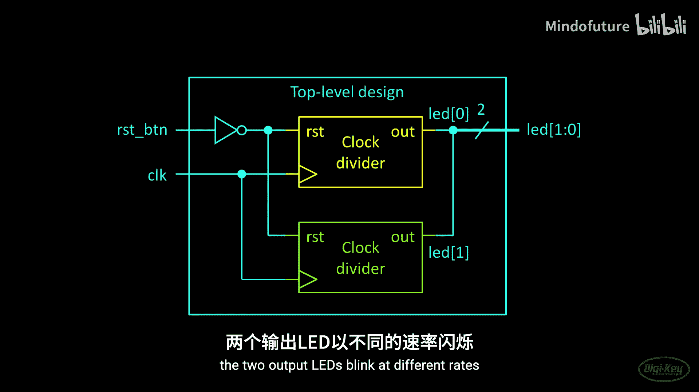
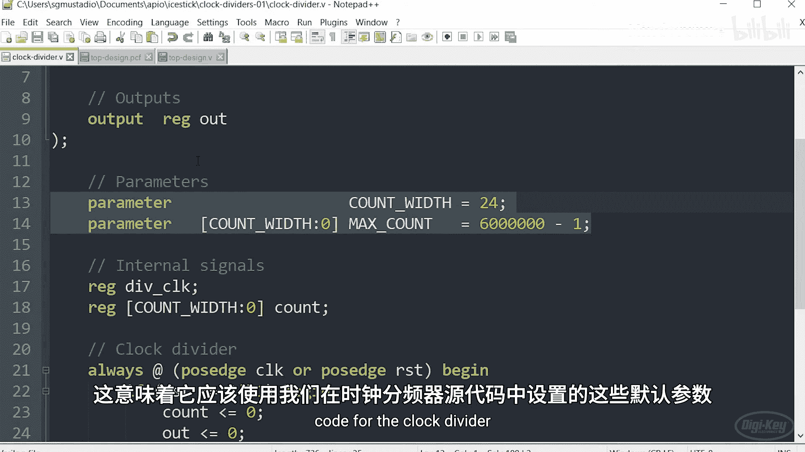
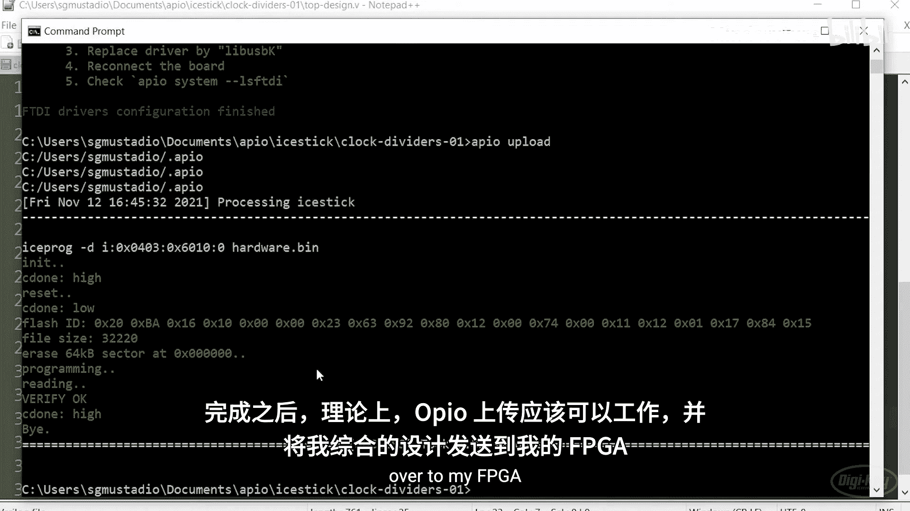
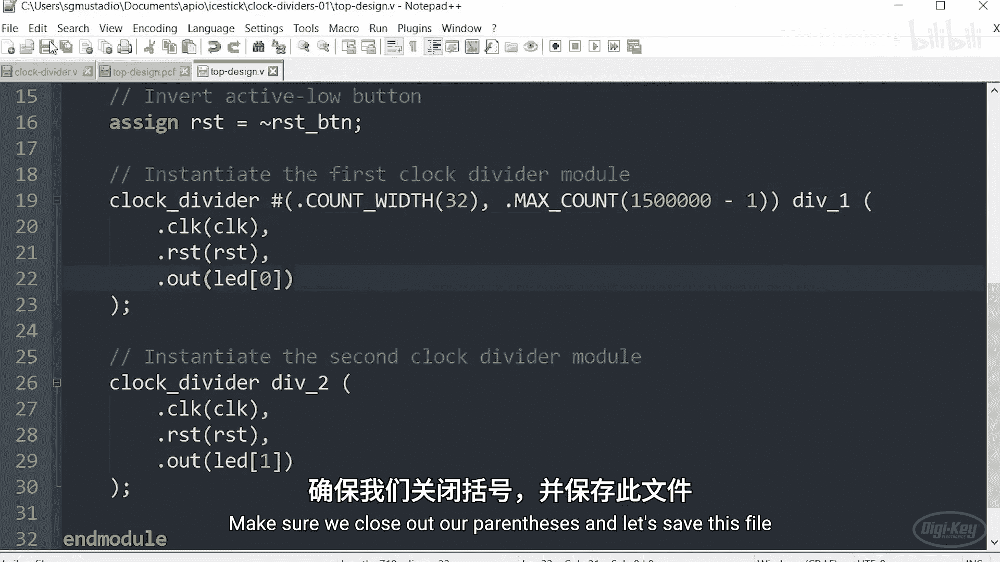
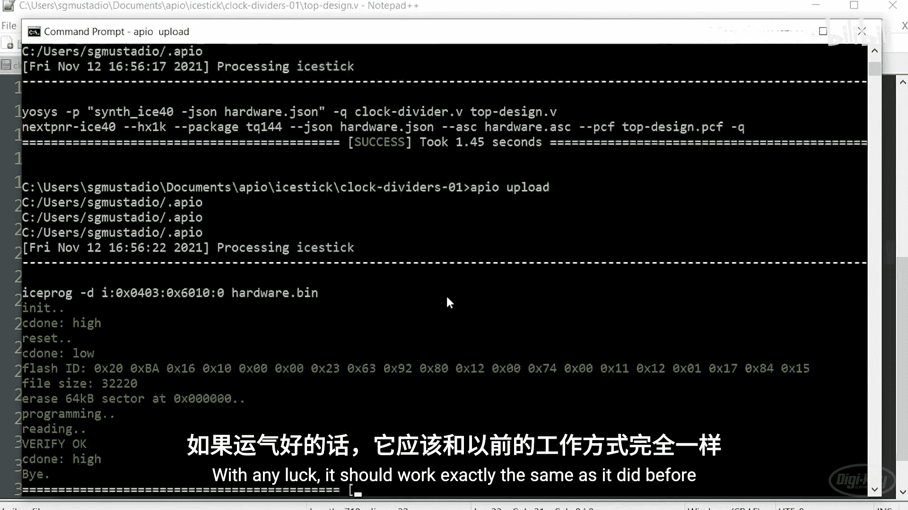
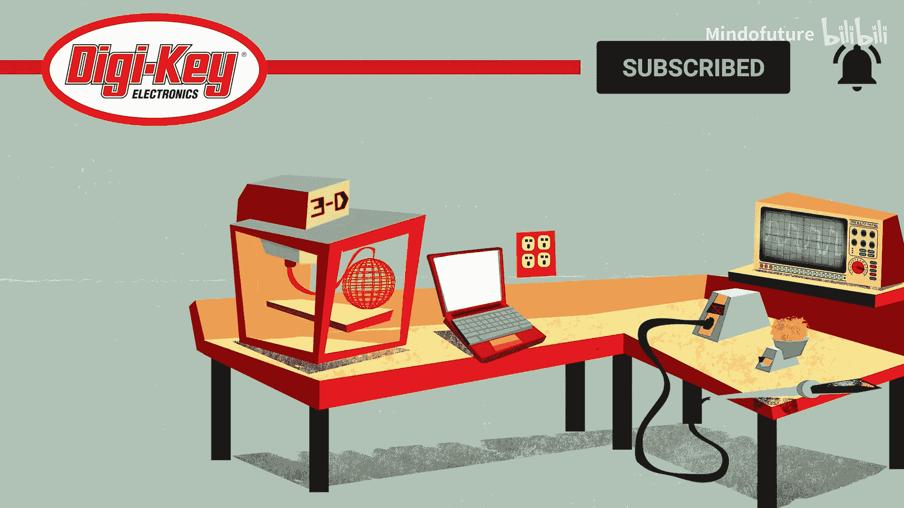

# FPGA编程入门-•-中英-p06-P06-Verilog-Modules-and-Parameters---Digi-Key-Electronics--BV1kVZSY8E5j_p6-

Up until now， we've been putting all of our ver log code inside a single module that's inside a single file。

 While that's fine for very simple designs， you can probably guess it will very quickly get out of control and become hard to debug the more code you add。

 Let's see how to create modular code so that we can start creating more complex designs。😊。

In a previous part， I challenged you to create a clock divider that drove a counter。

 We're going to create a module for just that clock divider so we can use it independently of our other logic。

 One big advantage of creating modules for our basic building blocks is that we can easily instantiate multiple copies of that module。

 which saves us from having to rewrite or copy and paste code。

 It's generally a good idea to put the code for one ver log module in a single file so that it's easy to find and debug errors in your modules。

 So our clock divider code will be in one file and will instantiate two copies of it。

 These copies are also called instances。 to do that will need another file that holds our top level design。

 This module will instantiate the clock divider twice each with different parameters。

 It will also contain。😊，Some necessary glue logic， such as inverting the reset button signal and connecting inputs and outputs to our physical pin names by allowing our tople module to instantiate the clock dividers with different parameters。

 We can change the way each one functions at the time of instantiation without needing to add additional signal lines or logic。

 Note that I combine the output of the two dividers into one bus。

 you'll sometimes see buses in diagrams drawn with a thicker line or they might have a diagonal line with a number that tells you how many lines are in that bus。

 In this case， we'll set the parameters of the dividers so that the two output LEDs blink at different rates。

 Let's make this design in verlog。 To start， let's make a new folder for our project。

 I'm going call it clock dividers 1。 We're going have two different examples here。

 and I'm going start by。

Creing my clock divider that is a basic module and this is going to be very similar to a class if you've done any sort of objectoriented programming。

 we'll be able to create instances of this module， creating our module should look very similar to all of the other examples we've done before。

 we're just going to declare our ports in this case our inputs and our outputs note that the output needs to be registered in this case as we're going to use a clock to control it and store its signal level at the output of our module。

Previously we've used local parameters or local parameter in order to define constants for our module I'm going to introduce this new keyword called parameter Local parameters were only defined within that module and could not be changed outside of that module This is opposed to parameters which we can declare here they create an initial value that can be used as a constant throughout the module however parameters can be changed outside of the module and in our top levelvel design we're going to be able to change these when we instantiate a particular object or not really an object but an instance of this module what I'm doing is setting a default value for each of these parameters so if you don't define them when you instantiate this particular module they still get some value notice that I can use parameters to define bus widths in this case count with I'm saying is 24 bits so when I create the max。

Count value， I can declare how wide that bus is， in this case it's 24 bits wide because I'm using this variable or constant rather to declare the width of this vector。

As before we can declare internal signals like wires and registers to help store values or so we can name particular wires or lines within the module if you did the challenge with the counter where you had to create your own clock divider much of this should look very familiar。

 I'm actually using the same code that was found in my solution。

 The only difference is that I don't have any logic to invert the reset signal because now I'm assuming it's going to be active high instead。

 we'll leave inverting that signal to the top levelve design because we're going to be attaching it to a button which may not always be the case if you're using a clock divider。

 let me fix my spelling here。And I'm going to save this file。

 The next thing I need to do is create my physical constraint file。 As we've seen before。

 I'm going to declare a couple of named signals or wires and associate them with physical pins on the FPGA。

 In this case， I've named the line that's connected to physical pin 21 clock as that's connected to the 12 MHz oscillator on the It。

 And I've also connected two pins for my LEDs pin 98 and 99。 And finally， I've got one reset button。

 that's using the same hardware connections that we made in previous episodes with the four buttons。

 But in this case， I only need one， and that's the reset button。Let's save this。

'm going to create my design here， and I'm going to fix the naming error so that everything will work。

 So I'm going to open my top design do V and I'm going to keep my physical constraint file open here so you can see it。

 Nothing changed。 I just fixed the naming error。And let's go ahead and write our top level design。

As with any module， I'm going to declare the module name along with the ports， in this case。

 my inputs and outputs note that even though the output of my clock divider module is registered。

 I cannot connect that directly to another registered element。

I can only connect an output of a module to a wire。

 That's because the output of a module can change at any time。

 say similar to something like a button pushing， you can then register that output。

 but you have to connect it through something like an always block and then clock that output and save it in a registered element As we saw in our diagram we're going to take the reset button and we're going to create a little bit of glue logic here where we're just going to invert that signal。

 call it RST and send that signal to our two instantiated clock dividers。

To instantiate a module you first call the module name clock divider that should line up with clock divider the name of the module here。

 the synthesis tool accepts the ver log files that we provide it。 and in this case。

 opio is going to send Yoosis all of the files that it finds together in our project folder in this case it's going to find clock divider。

v and topdes v and send those to Yois and Yosis is going to figure out that hey I'm calling clock divider to instantiate the module here and that lines up with the clock divider module name that I found in this other file For now I recommend keeping all of your files for one project in the same folder so that opio can find them however you will probably come across more complex design where different modules and test benches are stored in separate folders and you have to bring those all together in that case you'll probably want to callyosis。

And give it the location of those source files Let's head back to our toplevel design。

 Once we've called that module and given a name in this case。

 I'm going to call it div1 for divider one we then connect the wires and register elements that are inside of this top level design to the inputs and outputs inside of the instantiated module to do that we call dot the name of the port。

 So in this case it's CLK for clock， and then in parentheses。

 the name of the wire or registered element that is in our topleve design。

 the module that's instantiating this other module in this case it's also called CK for clock So these two things are now connected together by a wire we're going to do the same with the reset signal that is in the clock divider and it's connected to this reset wire。

 which is in inversion of the reset button and if it was。

Infusing earlier about which name refers to which signal in which module here is a better example dot out is the name of the output registered element or the registered wire or signal in the clock divider module and the LED1 is connected to LED1 in this case and actually I want this to be LED0 because we're going to use LED1 for the second clock divider in order to set the parameter that are in this instantiated unit or module we are going to use this keyword called def parameter I keep thinking it's default parameter。

 but it's probably closer to something like defy parameter In this case we are going to define the count with parameter that's found in only the div1 instantiated module which is given by the count width parameter here we're going to overwrite this 24 with 32 bits you don't actually need 32 bits for this but let's just。

you want it to be 32 bits wide for whatever reason we're also going to override that max count default parameter value with 15000001 that should allow the LED to blink a little faster than what's set here Note that this is an oldcho way of defining parameters I'm going to show you the new way to do it as it was updated with the 2001 version of ver log。

 but this way you can see what def parameter is in case you run across it in other people's code now I'm going to instantiate the second clock divider module and I'm going call it div2 The code for this looks just like the code we use to instantiate the first clock divider module。

 but we're gonna connect the output to LED1 instead you'll notice here that it shares the clock and reset lines with the first clock divider we will also not define the parameters for div2 which means that it should use these default parameter。

That we set in the source code for the clock divider。 Let's save this。

We'll open up a terminal and navigate into our clock dividers project。

 I'm going call Opio andni and give it my board in this case the Itick。

 I think it's always a good idea to verify your code to make sure that it should in theory synthesize and then we will call opio build once synthesis is done hopefully you get no errors we will upload that to our board if you were using Windows you might run across this error where it says LibUSB open failed if you went through the process of installing the drivers using Zadigg and everything worked fine but you suddenly find it's not working any longer。

 one of two things is going on here first check to make sure you have no other FTD device plugged in like in my case the analog discovery once you verify that try moving the icet or whatever FtD device you're using for this to the port that you originally installed the drivers on Windows likes to remember which port you plug。

A particular USB device into and then always use that driver for that device when it's plugged into that port。

 so try moving it to a different port， let's see if it works again。

If plugging your board into different ports still doesn't work。

 you might have to reinstall the drivers with OpioDrivers FTDI enable， use the dropdown list。

 make sure interface 0 for your FPGA board is selected。In this case。

 Windows is attempting to use this FTDI bus driver for some reason。

 and we want to kick it back to Lib USBK， so let's click replaceplace Drivever and let that install。

This only seems to happen when I'm constantly unplugging and pluggging USB ports back into my computer in this case it's a laptop which seems to confuse Windows as long as I'm using the same USB port for my It and not constantly shuffling around IDs with things like USB hubs。

 then windows should be fine it's just I run into this every now and then because like I said I'm on a laptop once that's done。

 opio upload should in theory work and send my synthesized design over to my FPGA As you can see the two LEDs are flashing at different rates the first one should be flashing at about four Htz and the second one should be flashing at about1 Htz。

The 2001 version of Verrlog introduced a new way to define and use parameters。

 It more closely resembles how parameters are passed between functions in anCC。

 So this style is often referred to as anipar in verrlo or anCC style parameters。 Use them。

 let's go back to our clock divider。 We're not going to define them inside of our module。

 but rather as an extra set of almost ports， it's just a parameter list that's defined before our ports。

 we denote this parameter list with a pound or hashtag symbol， and a new set of parentheses。

 The ports list gets pushed down below as we define the parameters first。

 Just like we see with the ports parameters are defined in list style where each one is separated by a comma instead of a semicolon。

 which is what we were using earlier。 We can still give them default values as given by these equal signs。

Let's save this design， we'll go over to our top design ver log code。

With the addition of this ansi style of parameter definition。

 you no longer need to call the de parameter keyword here instead you can do another pound sign and another set of parentheses here except that you want to do it before you declare the name of the instantiated module inside this new list we' are going to use the dot notation again and we're going to set count width to 32 and max count to 1500。

000-1， make sure we close out our parentheses and let's save this file will' verify our code if that looks good。

 we'll build it and send it off to our FPG with any luck it should work exactly the same as it did before。

 Indeed the LEDs are flashing exactly the same way as before。

The challenge for this part is to create a modular design that causes the LEDs to count up and then count down。

 There are a number of ways to accomplish this， but I might recommend using the clock divider we just made to feed two different counting state machines that are instantiated as modules When one module is done counting up。

 It sends a signal to the next module， which will start counting down。

 You'll have to think about what the glue logic looks like in order to have two different modules control the same set of LEDs。

Good luck with this challenge， as it can be a little tricky。 Next time。

 we'll see how to use our modular code to create test benches。

 Being able to simulate our designs can potentially save us a lot of headaches from having to debug actual hardware。

 happy hacking。😊，哎。え。

