# FPGA编程入门-•-中英-p07-P07-Verilog-Testbenches-and-Simulation---Digi-Key-Electronics--BV1kVZSY8E5j_p7-

There was a bug in my finite state machine code back in episode 5。 Did you catch it， Okay。

 I cheated a little。 I added a note pointing it out after I recorded the episode。

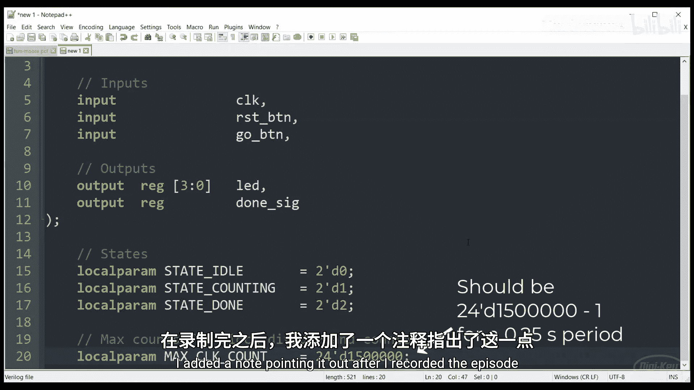

In that episode， we were operating on a human time scale。

 having the LED on for one clock cycle longer than intended wasn't a big deal。

 Our eyes couldn't really tell a difference， However。

 if you're trying to meet very strict timing requirements， one clock cycle might be a big deal。

 you could miss a sampling period， or maybe inadvertently slow everything down。

 to debug hardware operating at many kilohertz or megahertz。

 you often need some fancy equipment like an ocilloscope or a logic analyzer capable of sampling at least at those rates。

 As you likely noticed synthesizing and uploading your design to the FPGA can take some time。

Instead of trying to find bugs using real hardware。

 we can save a lot of time by writing code that tests our modules。

 simulating them and looking at the output with a waveform viewer In this episode。

 I'm going to show you how to create basic test Benes in Verlog。

 simulate your designs with Icarus Vera log and then view the output waveforms using GTK wave Let's jump in。

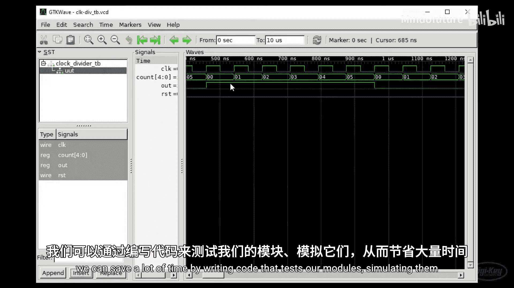

Just like we did with our top level design， our test bench will instantiate the module we wish to test。

 You will often see this module called the unit under test or UUT Note that you can test several modules at once in a test bench if you wish we'll stick to just one module for now。

 though。In the previous episode， we used the top level design to connect multiple modules together and connect the input and output signals to our physical pins。

 We don't have physical pins in a test bench as it's all simulated。

 So we use the test bench logic to drive the input signals。 We can add glue logic， if we want。

 but we mostly care about toggling the input pins on the test module so we can measure the output waveform to see if it matches our expectations。

 Note that for the test bench， we have access to parts of ver log that do not necessarily need to be synthesizable。

 For example， we can use delays and for loops that help us create waveforms。 However。

 a synthesis tool would not know what to do with those commands as they're not intended to be translated to actual hardware on the FPGA。

 Here's how we'll simulate our design。 We'll first write or copy an existing module that we wish to test。

 Next， we'll write our。😊，Test benchch using ver log。

 which instantiates our module and toggles the necessary signals to perform the test。

 Then we'll use Iicaus ver log to simulate our test bench。

 The simulator will output a value change dump file that logs all of the signal changes in our test。

 Note that you often need to know which simulator you are using as that can affect some of the functions and keywords you use in your test bench verlo。

 Finally， we view those signal changes by loading the dump file in a waveform viewer。

 such as GTK wave。 Let's see this in action。

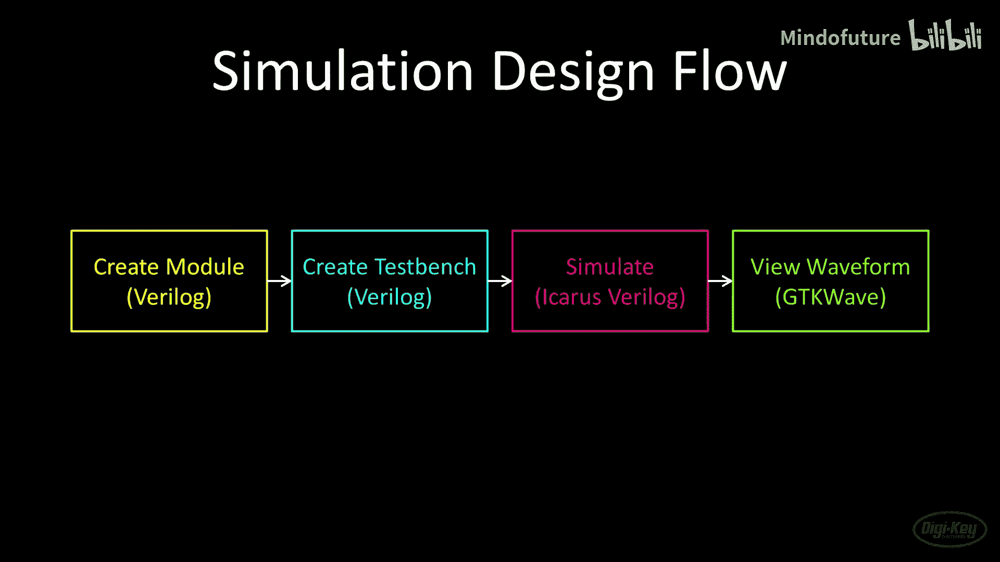

As we've done before， let's go into our Opio project directory into Icetick。

And I'm going to create a folder calledD Test benchch。

 we're going to be testing our clock divider here。In the previous episode。

 we created a top level design around a couple of clock divider modules that we instantiated from this source code。

 from this V log code。I'm actually going to just copy that clock divider module and we're going to put it into our test benchch project。

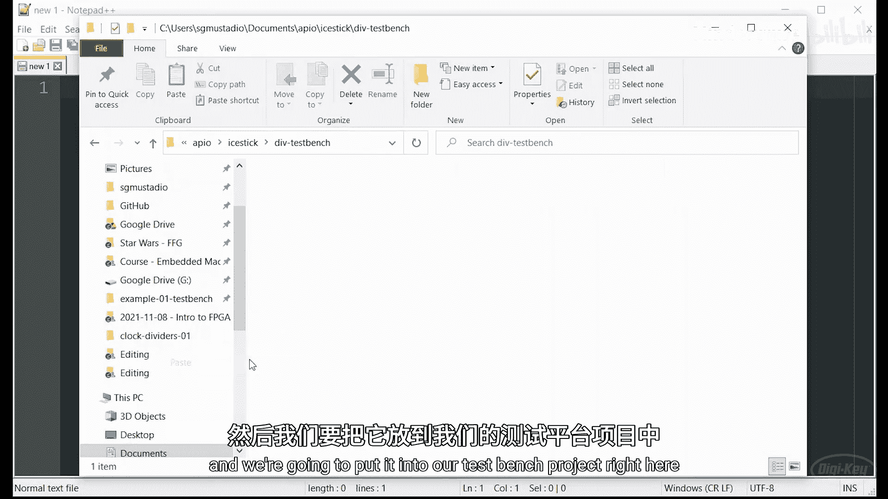

Right here。Feel free to open this up and look through it。

 you can see that I've already fixed my bug here by adding a minus1 to this default parameter。

 but everything else should look the same， it's just a very simple clock divider。

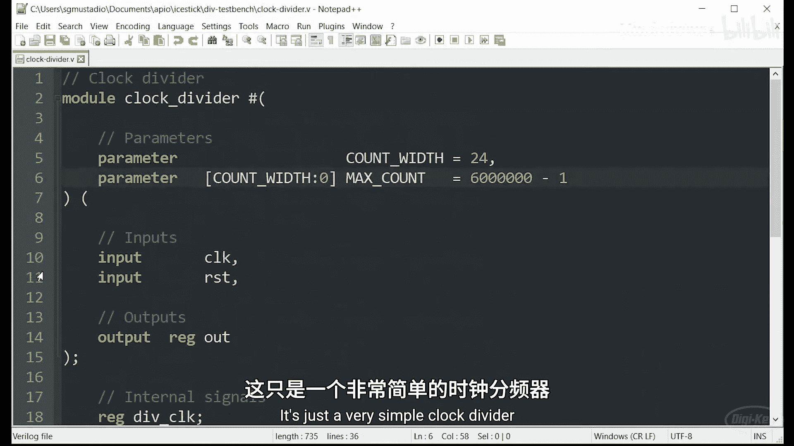

I'm going to call it clock div。And give it the underscore TB for Testbench。v。In reality。

 it doesn't matter what you name your test bench if you are calling Iicaus veralog on its own。

 however， since we're using opio Opio looks for this particular underscore TB suffix on your verrlo file to note that it is a test bench so if we're calling opio Sim your file must be named with this underscore TV to work。

 Let's go ahead and open up our clock divider test bench。

 The first thing you want to do in most test benches is to define your timescale This is similar to setting your say horizontal access on your oscilloscope to determine how much you zoom into your wave form。

 essentially， but we actually have the chance to view different scales when working with the test bench。

 This just tells our simulation software how it should treat things like delays note that the backt character is a compiler directive This tells Icarus verrlo to do something。

 This is one of those times where you need to know。

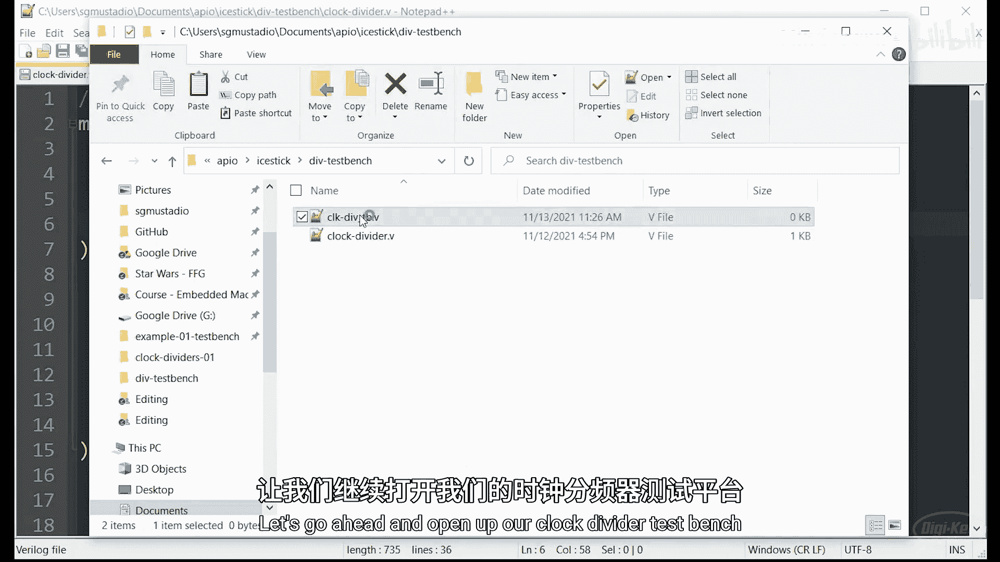

Your particular simulation software in this case it's going to be Ive log or Icarusve log and this compiler Directive means something special to Icarusve log if you're using a different simulator。

 this particular timescale keyword with the back tick in front of it may not work so pay attention to which simulator you're using。

The first number is the units of time。 In this case， one unit is a nanosecond。

 Anytime we set a delay in this ver log， those units will be in nanoseconds， in particular。

 one unit is one nanosecond。 We could use 10 nanoseconds。

 So one unit would be 10 nanoseconds and so on。 We then use a forward slash and follow that with the precision。

 This means if we use fractions of a unit when we are talking about delays in our ver log。

 Then this determines the amount of precision that's allowed。

 Things will be rounded to 10 picoseconds in this particular test bench。

You can use higher precision in your time scale。And this tells the simulator that it should slice things up in smaller chunks of time。

 However， it means that it will require more memory and hard drive space when you go to save all of your waveforms in a dump file We then define our test benchch just like we would any module。

 however， note that we have no ports in our port list because there are no inputs and outputs for our test bench everything is contained internally we then define our internal wires and registers just like we've been doing for our other v log modules in this particular case we want to name the output signal as out and we're going to register our clocks and resets so we can control them a little more easily。

Additionally， I'm introducing this concept of setting an initial value。

 clock and reset should be tied to0。 This is different than what we've been doing before。

 where we reset our values to0 based on some external reset signal since everything is internal to our test bench。

 we need to set them to 0。 Sometimes this works。 if you're trying to synthesize code for actual hardware。

 It depends on what you're trying to do and the particular synthesis tool as to whether you're allowed to set an initial value。

 In our case， it should work with simulation， so we can go ahead and set these signals to 0。

 We don't necessarily need to define our simulation time as a local parameter， but we can。

 if we want it to appear closer to the top of our code。 In this case。

 the duration is set to 10000 units。 These units are multiplied by our time scale， in particular。

 the units of time， given by this compiler directive。 So 10000 times。

nanosecond becomes10 microseconds This is the total length of time that our simulation will run if you let it go on indefinitely it will go on indefinitely and the dump file will just start taking up all of your hard drive space so it's a really good idea to limit the amount of time your simulation runs。

Next， we're going to generate our clock signal。 remember。

 we don't have a real physical 12 meHtz oscillator to work with。

 so we're going to try to get something that's fairly close by writing some simulation code Now note that this code won't be synthesizable in actual hardware。

 but it's great for a test bench。 All we're going to do is toggle that clock line or clock registered element high or low once every 41。

67 nanoseconds。 We multiply it by  two because when we toggle it。

 we have to toggle it twice in order to complete one cycle So we toggle it once every 41。

67 nanoseconds， we do that twice for a complete cycle one divided by that period comes out to be something pretty close to 12 MHz we can't get it exactly on 12 meHz but this should be enough to perform some measurements。

A delay in ver log is fairly simple。 We just write the pound or hashtag sign。

 followed by the number of time units we wish to delay。 In this case， we're going to delay 41。667。

 Or in reality， we're going to tell the simulator that we want to delay by that amount。41。

667 means delay by a number of time units as given in our time scale。 So in theory。

 this should be 41。667 nanoseconds。 However， because we set that 10 picosecond precision。 The 41。

667 is rounded to the nearest。10 picoseconds。 So in this case。41。667 it's rounded to this second6。

 so this becomes 41。67 nanoseconds After that delay， we simply toggle the clock line。

Notice that this always block does not have a sensitivity list when we're doing simulation。

 we can do things like this that occur in parallel to everything else。

 and it just does whatever we tell it because it's an always block that runs always essentially without any sort of sensitivity although you could include a sensitivity list if you wish。

However， we don't need to， this just says run this forever。

 this is basically the same as a while one loop or a while true loop。

Where it delays for some amount of time and toggles our clock line and does that forever as long as we're running the simulation。

Now we're going to instantiate our unit under test。

Make sure that the module name matches up with the module name of the module we wish to test in this case。

 it's clock_ divider。We are going to define the parameters。 In this case。

 I'm going to override the parameters that are set by default in the module。

 I don't want to do this on human time scale because our dump file would be huge if we're trying to manage both a 12 meHz clock and wait for I don't know a quarter of a second or half of a second。

 Our dump file would be massive if we're trying to wait for 6 million time units or clock cycles for our input clock。

 So I'm going to change the count width to be 4 bits。 and I'm going to change the max count to6。

 Let's bring up my calculator here for a second。 Let's figure out the period of my 12 meHz clock that's going into the clock divider。

 So that's 8。33 times 10 to the negative 8 seconds for one period。

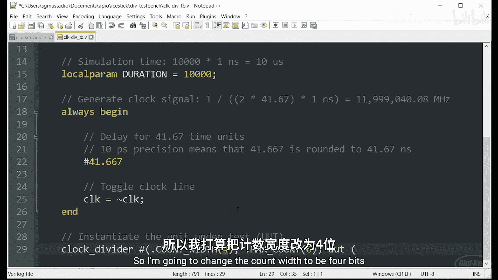

And I want to count six of those in order to toggle the output divided clock from my clock divider。

 In theory， if I put 6 in here， it should give me。This is milliseconds， this is microseconds。

 so half of a microsecond is what we're looking for。

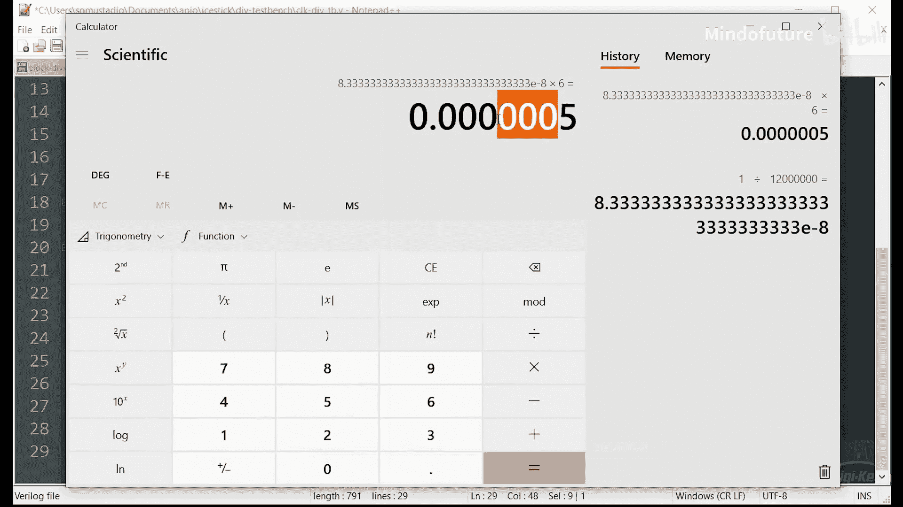

So that's where I put six in here I want to get half of a microsecond between toggles of my output divided clock I will name this instantiated unit unit under test or UUT and now we connect up the ports just like we did in the previous episode we're just going connect the names of our internal signals and registered elements to the ports defined in our port list of the module because we're not using initial values in our clock divider that's going to be built into actual hardware we need to pulse that reset line so after 10 time units。

 we're going to delay that amount we're going to force the reset line high。

 we're going to wait one time unit which is less than a clock cycle but because the hardware is set up in our module。

The positive edge of the reset line should reset our counter anyway。

 and we're going to set that reset line back to low so that everything will run according to how we set it。

 where it starts dividing our clock This initial block ideally only works in simulation you should not see initial blocks inside of synthesizable code that's because initials only run once and then don't do anything。

In this case， we just want to pulse this reset line once and be done at this point。

 Ver log almost looks like a scripting language， less so like an HDL or hardware description language because this part is going to be or would be very tough to synthesize。

Note here that I'm doing another initial block， initial blocks and always blocks。

 these run in parallel， much like having several always blocks in your synthesizable V log code。

 these will execute at the same time so these two initial blocks including this always block start running at exactly the same time。

So at the very beginning， this will pulse the reset line。

And the clock will start going and we're going to start running the simulation where we track how these values change。

 our registered values and our signal values， and we're going to put them all into this value change dump file。

The dollar sign denotes a system task or function。 This helps control parts of the simulation and just like our back ticks。

 it is not synthesizable。This is part of that scripting idea of Ver log where we're telling the system to do something in this case we're going to output or dump our file。

 our simulation results to this file， this dot VCD file。

 the things stored in this file should come from thisD vs or D variables command。

Here we're telling it to watch the clock divider test benchch。

 which is our test benchch module given here。And any of the signals such as out clock and reset should be stored or your values for those signals should be stored inside of this dot VcD file。

 The0 here denotes how many levels， it should look in for the modules In this case。

0 says look at all the levels， So if you say one， it will ignore the signals that are found within our unit under test in this case。

 our clock divider， it won't go in and watch these signals。 However， if you say two。

 it will go two levels deep， which includes this test bench and the clock divider module。

 if you instantiate another module inside of clock divider2 will not watch those。

 you could do three to watch those variables。Or signals and register values， I suppose。

Generally you will see zero if you want to watch everything， which includes all modules。

 regardless of how many modules deep you have nested inside of other modules。You'll see one。

 if you just want to watch the variables inside of your test bench and sometimes two if you want to watch those in your unit under test。

 but we're going to stick to zero right now to be very verse。

Zero means dump all the variables that it finds in the test benchch module as well as all the variables in all lower level modules instantiated by this top module。

This is the most verbose if you want to record everything that's going on Next。

 we're going to use that pound sign or hashtag sign again to say wait for a given amount of time and duration is given by 10。

000 so 10，000 time units and notice it's in these parentheses。

 which is the same as just dropping that constant value in here。

And then delaying for that amount we're going to print this string finished to the console to let us know that the simulation reached this point and we do that with the dollar sign display command and then we call Do sign finish in order to end and close out the simulation if you forget to add this you might find that your simulation will try to run forever。

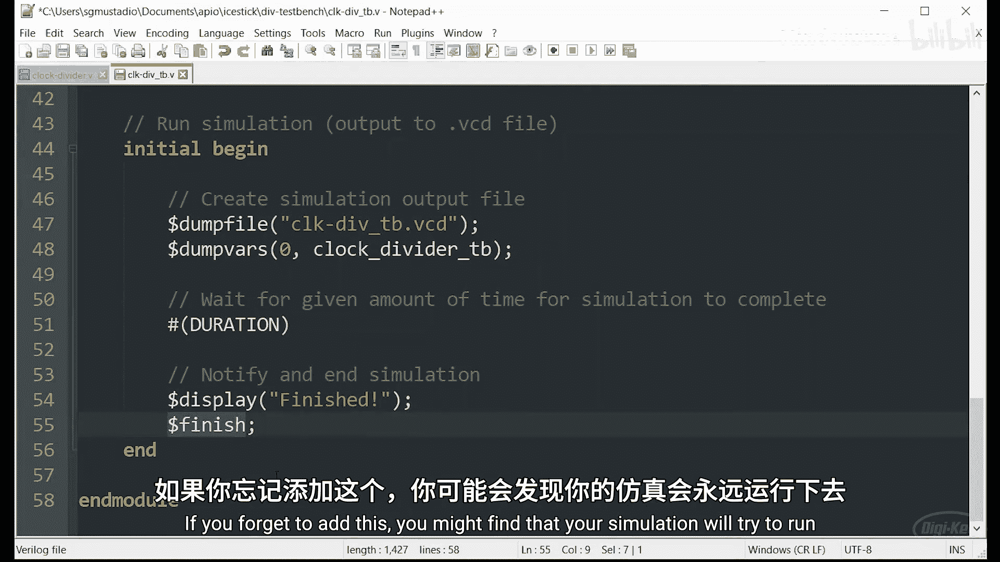

Let's save this and give it a shot。We will open up our terminal and navigate into our project directory in there it's a good idea to verify。

 but first Opio still wants me to initialize a board。Even though it's not completely necessary。

 but that's how Opio operates。This will create that dot I andI file telling Opio that， hey。

 I'm using an ice stick， but there are no physical pins。

 remember that we don't have a physical constraint file here because we're not actually going to send this to our hardware。

 we're just trying to simulate it。If you verify it should succeed。

 but you'll get a warning that there is no physical constraint file and that's okay because like I said。

 we're just simulating。Now we can call opio Sim， if you look that we'll call Ivea log。

 which is Icarusvea log， denote the output as this dot tb dot out file。

And it's going to look for this underscore TBvelog file along with our other v log files to use as modules inside of that test bench。

 so if you don't include this underscore TB， you might run into issues if you are using opio if you call Ivealo directly from the command line。

 you can specify where specific test benches are and where your modules are Ivealo will run for a little while and it will output things in this output file and dump the value changes。

Into this dot VCD， it will then open this dot VCD using GTK wave and that's where this GTK wave command comes in Once that opens。

 you should see something like this。On the left side， you should see your test bench。

Click the plus to bring it down， you'll see your unit under test。

And this is where we can watch the signals in your unit under test。

 you can also watch the signals in your test bench if you wish。

 so you have access to both sets of signals in this case I want to watch my unit under test so I will click on clock I will insert it you'll notice here that I'm viewing three picoseconds so。

I'm going to zoom out。And I can also use control and my mouse wheel to zoom。

 and I can slide around to view my clock signal。I also want to view the counter inside of my clock divider。

 so I'm going to insert that and you can see how that is counting and in fact。

If you come over here you can see that it is an unknown value at the front so let's insert our reset signal when we insert our reset signal you can see that the reset signal goes high right at the point that the clock value gets initialized to00 so that reset signal is doing its job you can right click in the viewer to drag a marker around and that will give you some time up in the right hand corner to tell you where that marker is placed in this case this is happening at。

About 10 nanoseconds， and it's giving you things in picoseconds。

The other thing I notice is that if you bring your mouse pointer to a particular waveform。

 it will try to snap to any of the edges so you can see it snapping to reset。And if I zoom out。

 I can drag it across the clock signal and it will snap to the edges of my clock or where the values change on my counter。

Let's insert our output signal。And you can see that indeed I have a divided clock and that is fantastic。

However。I can use my middle mouse button to place another marker。

 you can see this marker is white instead of that red or pinkish color。

 and I'm going to snap this to。The rising edge of my divided clock。

And I can drag my pink marker around， so I'm going to scroll over。

 drag my pink marker to the other edge of that divided clock。And there is a problem here。

 you can see that it's a little more than half of a microsecond where we wanted this to be half of a microsecond。

If I drag it back， you can see that this is where the half of a microsecond should have occurred。

 and the divided clock should have dropped down。What this says is even though I calculated 6。

 it really should be 5。 and that's because the counter starts at 0。 that's where my bug is。

 So if I want to count to6 for my divided clock to make。The toggling happen every 500 nanoseconds。

 it really should be6 minus1， that's my bug， and that's why you now see a minus1 in all of my max countercode。

Let's go ahead and fix that， I'm going to exit out of this。Sometimes GTK wave gets stuck。

 so I'll give it a C C， you'll notice that theres an error opening the save file。

In this case it's just a warning which means you can ignore it。

 you can save the waveform setup as a dot GTK wave file or dot GtKW if you save your settings from GTK wave in this file。

 you won't get this warning anymore， I'll show you that in a minute。

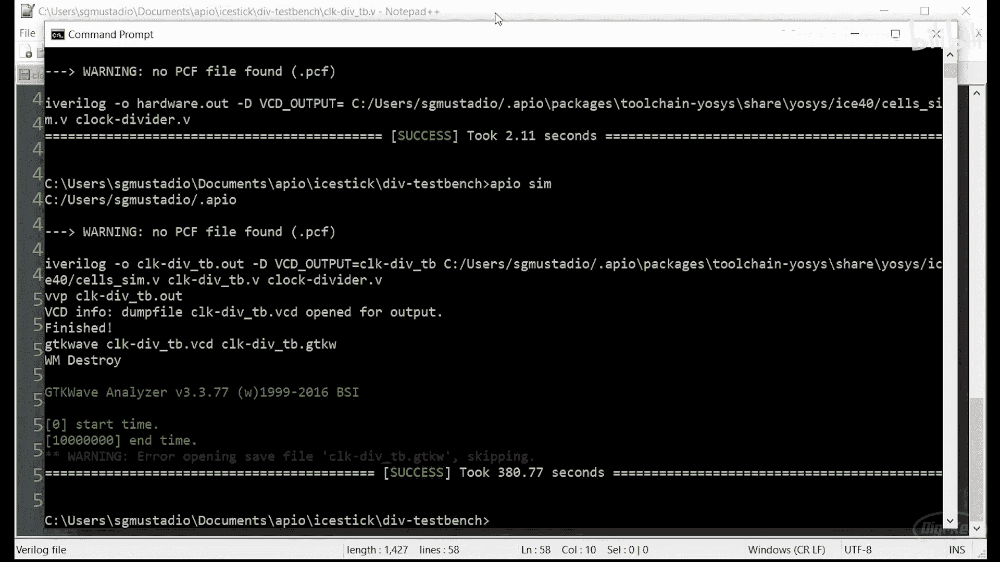

Let's go back to our test bench and where we see our six， let's give it a6 minus1， let's save that。

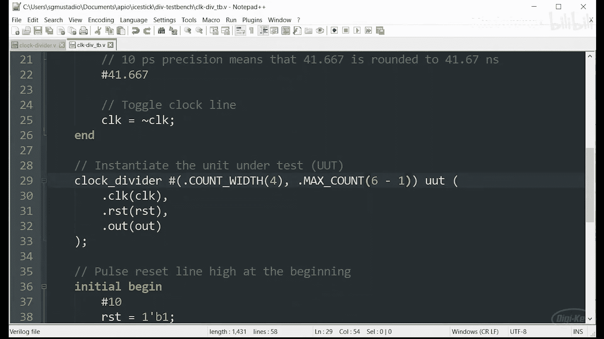

Open up our terminal， we'll do opio Sim。

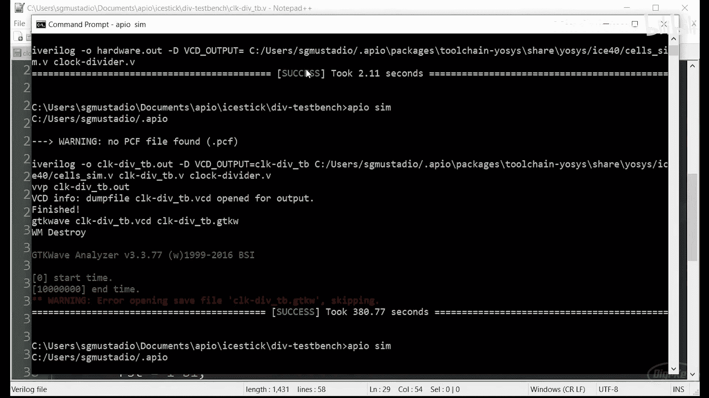

That will run the simulation and open up GTK wave， you'll see that my waveforms are no longer here。

I'm going to go to my unit under test， I'm going to select my clock， my counter my out and my reset。

 I'm going to insert those and I'm going to zoom out so you can see the divided clock again now I'm going to place my marker at the beginning of this divided clock one of these rising edges I'm going to come over here and place another marker at my falling edge and as you can see that toggle time is now 500 nanoseconds just like what we actually wanted。

 so the fix is to now put that minus1 for all of our max count parameters when we're using the clock divider。

 we just have to keep that in mind I hope you can see how simulation can help you a lot to find some of these bugs and fix them without having to go through the effort of hooking up actual hardware and synthesizing your code to send it over to your FPG every single time Sulation is an incredibly important part of hardware design。

It comes to FPGAs In fact， when you start looking into complex designs you will often find unit tests written for the individual modules for that complex design and in fact it can get even more complicated where you can start scripting your test benches and having your test benches automatically verify what it's expected to see in the modules so it's just pulsing a line whenever the unit under test does what's expected it's a complete self-test and you can have a fullscripted suite of these selft to verify your complex design but we won't get into that as things can get complicated quite quickly but that is generally considered good hardware design when you unit test all of your different modules and different parts of your design I'm going to save my GTK wave file all this does is just save which signals show up。

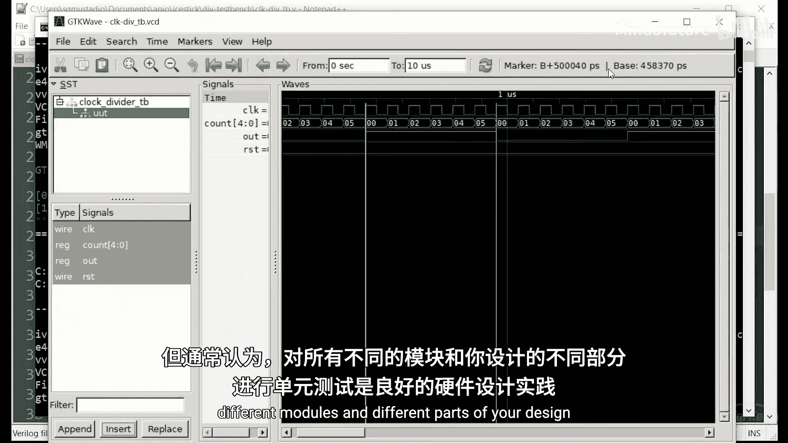

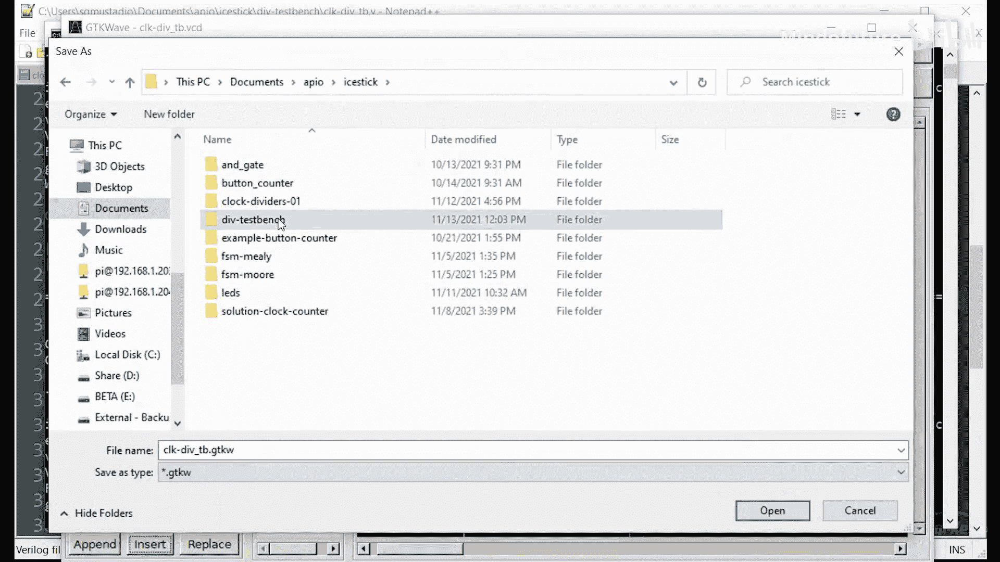

In my div test bench， I will save that file and now when I exit here I got everything closed。

 you'll see the error show up again because this error shows up when you try to load GTK wave。

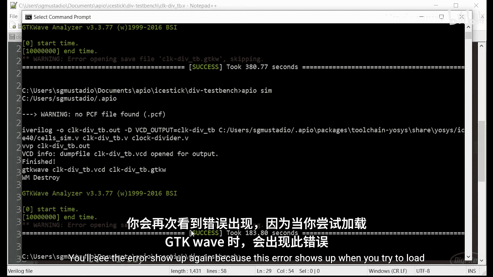

But when I simulate。You can see the GTK wave loads and I'm seeing exactly what I saw last time because I saved those settings now when I close it。

That warning is gone。Your challenge is to write a test benchch and simulate your button debouncing code from episode 5。

 Note that you might need to change some of your debounce code to make it work better as a module Each time the increment button is pressed。

 meaning the signal goes from high to low and stays there for some time。

 the LED counter should go up by one Note that you can also view the internal states of your state machine。

 you might need to make the max clock counter a parameter instead of a local parameter so you can set it to something like 400 microseconds instead of 40 milliseconds。

 Otherwise， you might end up with a huge VCD file if you try to do this with a 12 meHz clock For some hints。

 note that four loops work in test benchch code。 you can also use the keyword integer to store integer variables in verlog。

 Finally， see if you can figure out how to create random numbers so you can emulate button bounce or noise each time the button is。

As usual， I'll provide a link to my solution if you'd like to compare answers。

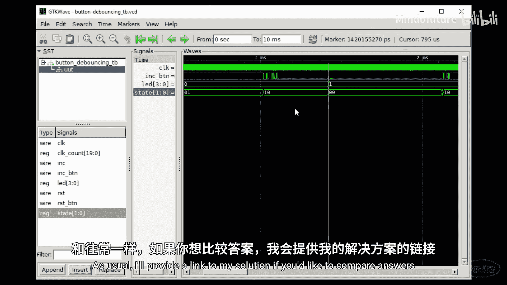

In the next episode， we'll see how to use various types of memory in an FPGA so you can store some data。

 good luck， and as always， happy hacking。A。え？

