# FPGA编程入门-•-中英-p08-P08-Memory-and-Block-RAM---Digi-Key-Electronics--BV1kVZSY8E5j_p8-

Being able to store data is incredibly useful。 You could， for example。

 take the de flip flops that are in your logic cells and combine them in such a way to create a shortterm memory solution inside your FPGA。

 However， if you need to store even a few hundred bytes of data that would very quickly consume a lot of your logic cells。

 So most FPGs offer a form of block Ram to give you some access to storage elements。

 Let's see how to use that block Ram in Verlog。😊，Data can be stored on an FPGA in a number of ways。

 As I mentioned， you could use the D flip flops in your cells。 however， each one only holds one bit。

 so you'd waste a lot of cells if you need to store more than a few bytes。

In some cases you can also store data in your lookup tables This is known as distributed RAM if you don't need a lot of storage space。

 your synthesis tool might decide it's easier to use some lookup tables to create distributed RAM instead of using blocklockRAM Most FPGAs offer blocks of RA that are separate from the programmable logic blocks These are sometimes called embedded block Rams or EBRs。

You can configure them as single port， dual port or first in first out memory chunks。

 and you can set them up with a variety of widths and depths。 For example。

 you could create 256 elements that are 16 Bs wide each。

 That would take up one of your 4K Ram blocks。 You could also configure the blocks to be 2 Bs wide and 2048 elements deep。

 This configuration chart is incredibly useful for figuring out how many bits wide your address and data ports need to be。

If you scroll back up to the beginning of the data sheet。

 you can see that our HX 1K part on the Itick has 164K memory blocks。

 giving us a total of 64 kilobits of block memory available to use Note that we have to use a minimum of one block if we declare any amount of block Ram in our design you can't use a part of a block in one configuration and then expect to have the rest of the block available for another configuration。

Some FPGAs contain additional types of on chip memory。

 the Ultra plus line of Ice40s has the expected block RA。

 but it has additional static RA for even more storage if you need more than what's available on your FPGA you can always add volatile or non-volatile memory chips and connect them using Spy or some other interface。

Most FPGA vendors should provide a memory usage guide for each FPG family。

 Here is the memory guide for the Ice 40 line。 If you are working with internal memory blocks in your device。

 I highly recommend looking through this guide。 Let's take a look at the Ice 40 embedded block Ram。

 Here is how the dual port Ram is implemented in hardware on our FPG note that you can read and write on separate data buses。

 there are different buses for the read and write addresses。

 and you can even use separate clocks for reading and writing to keep things simple。

 We won't use the mask or clock enable lines， we'll also use one clock for both reading and writing。

 We won't go into first in first out configurations but know that those can be incredibly useful for some designs。

 Appendix A has some good example code for creating single and dual port memory configurations。

 I recommend taking a look at those if you need some help getting started。

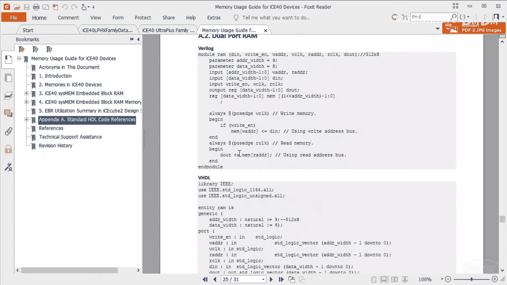

If you are using a graphical development environment like Iudud or fvado。

 you can often drag and drop memory elements onto the canvas。

 You would then configure the element and connect it to other parts of your design。

 Sometimes your synthesis tool will let you instantiate block memory directly using system functions or tasks。

 In that case， you would want to follow the instructions for your particular synthesis software。

 We're going to do something else。 We'll write our block memory using plain ver log and let the synthesis tool infer the block memory from our code。

 This is more portable， but it means we have to trust the tool to do its job。

 Here is a diagram of the block memory we're going to create。

 Notice that I'm leaving out some of the signals that were shown in the data sheet。

 We won't need them。 It's a fairly small set of memory elements。

 Just 16 elements that are 8 bits wide each We set the data we want to write on the W data bus and the address we want to write it to on the。

😊。

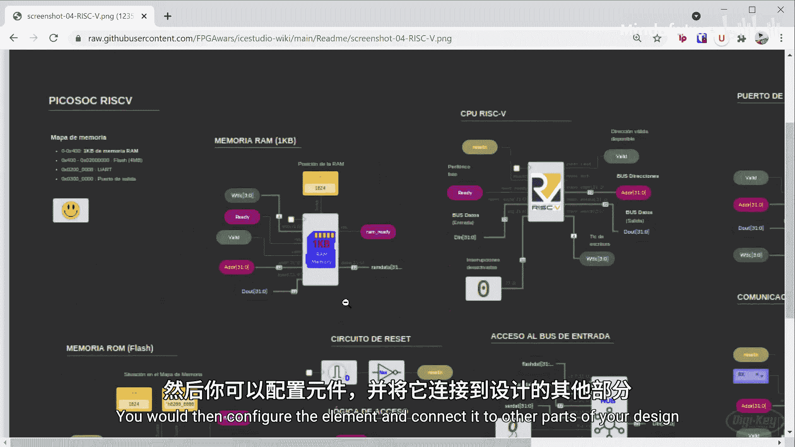

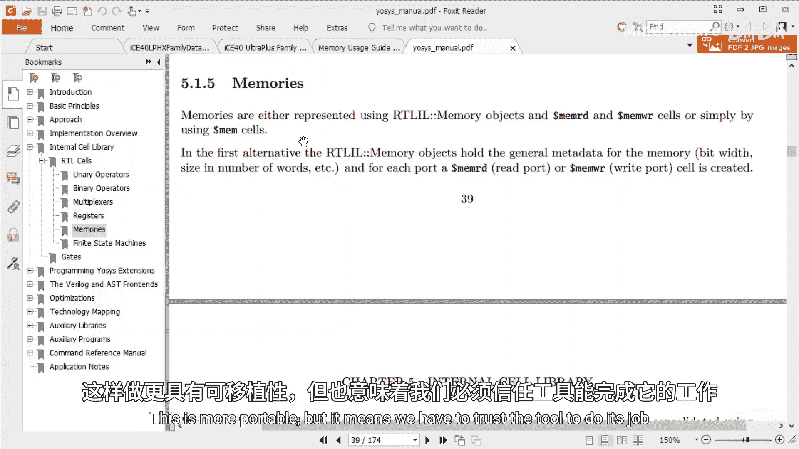

W 80DR bus note that our W80DR bus has four bits， which is what's needed to address up to 16 elements。

 We also have only one clock line that acts as the clock for both reading and writing data on the read side。

 we set the address we want to read from and set the R enable line on the next clock edge。

 likely the positive edge。 the data will appear on the R data bus in the rare case where you try to read and write to the same address at the exact same time。

 you'll want to refer to your data sheet to see what happens based on some testing with the I 40。

 I found that the old data in the memory will be read first to R data。

 and then the new value will be written。 This is known as read before right some FPGs might implement right before read。

 If the new data is present on the R data bus Let's try implementing this block Ram in verlog。

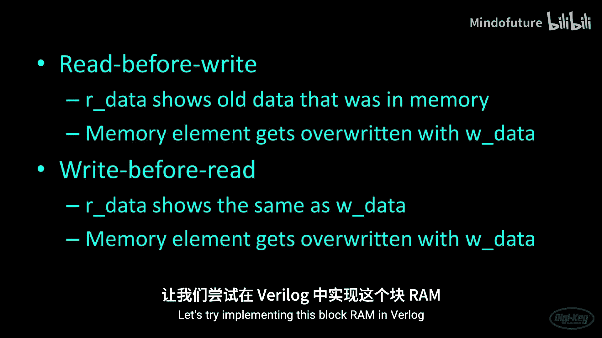

Creating ver log so that our synthesis tool will infer a piece of block memory is not very difficult。

 All we need to do is just declare a memory module。

 and then we're going to create an always block that shows how we interact with that memory module and from this the synthesis tool will realize or hopefully realize that we intend to instantiate or use the on chip block memory。

 We'll start by defining our inputs， which is just the clock， write enable， read enable。

 write address， read address both of those are four bits wide。

 our right data is one of our inputs and our read data is our output and those are each 8 bits wide。

I'm going to set my language to Verlog and I'm going to save this file in a new project that I will callMe。

And I'm just going to call this memory dot V。To declare the memory you just create a registered signal name in this case I'm going to call it meM and we declare a bus width just after the Reg keyword in this case it's8 bits wide that should line up with our right data and read data and then we declare how deep the memory is in this case it's 16 elements deep。

That's not a whole lot， but do keep in mind that by declaring even a small portion of this memory。

 it will take up one entire 4K block memory in our FPGA。

Next we need to tell our synthesis tool how we intend to interact with our block RA in this case we're going to put it in an always block and things will happen on the positive edge of the clock in some cases you could use a negative edge of the clock or if you're using the dual port memory you might have two different clocks one for reading and one for writing。

On each positive clock edge， the hardware will look to see if the right enabled bit is set high。

 If so， it will copy the data found on the right data bus to our memory at the address given by the right address variable or right address bus。

Additionally， if the read enable line is high， it will copy the value found in the memory at the read address given by RADR to the R data output line or output bus relieving out some of the other functions such as mask and the read and write clock enable lines。

 but we don't need to worry about those， this is enough to get a very very simple dual port memory working that is based on a single clock。

Let's save this file and I'm going to create a dummy physical constraint file。

I just pasted in some ports that don't particularly matter。

 I'm not going to upload this design to my Itick， instead I just need to define some pins that actually exist so that I can run synthesis and place and route because I want to check the utilization of my FPGA。

I'm going to call this test。pcf。

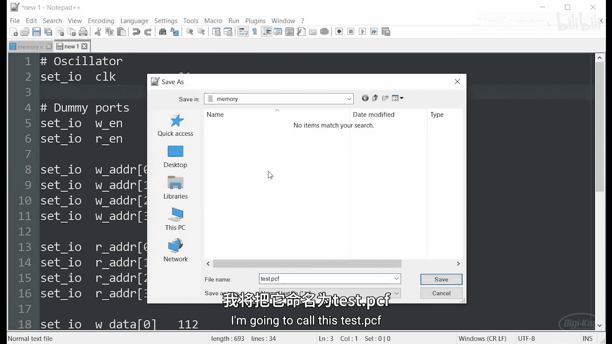

I'm going to open a command prompt， and I'm going to navigate to my memory project。

It's usually a good idea to verify and as per usual。I forgot to initialize the board。

 so let's try verifying again。Success is good。If I call Opio build with dash V， that means verbose。

 and it's going to spit out everything from the individual tools。

I want to scroll up and find this device utilization chart This is going to tell me which logic cells and how much RA I've used along with any of the other peripherals that are associated with my particular FPGA。

In this case， I've used two of the 1280 logic cells。

 which is not a lot of logic cells being used in this design， which is great。 However。

 it does mean I've used one of my RA blocks， and I only have 16 of those。 remember。

 no matter how small we make our particular memory when we define it and declare it in our ver log code。

 we have to use a minimum of one Ram block。 The synthesis tool may decide to use distributed RA and use your lookup tables instead。

 but in this case， it decided to take one of those 4K blocks of Ram and give it to us for our particular memory design。

So you have to be very careful about how much block RAM you're using when you start declaring RAM in your design。

Next we have 112 available IO and we've used 27 of those。

GB is the global buffer signals which we won't get into in this series PLL is a phase locked loop。

 we have one of those available in our FPGA we will go into that in a future episode。

Warmbo is a way for us to potentially load configuration data from another piece of memory if we wanted to say save configuration between resets without removing power on the device。

 it's kind of like warm booting or sleeping your laptop and bringing it back up。Once again。

 something we're not going to go into。As I mentioned。

 we're not going to actually load this onto our FPGA instead， we're going to write a test bench。

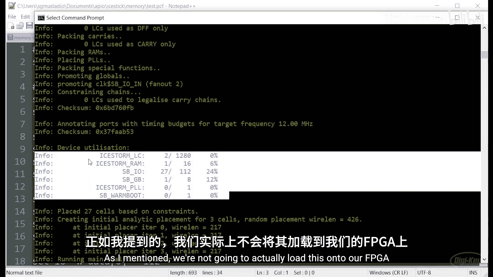

As we've done before， we're going to define our timescale in this case。

 we want one nanosecond units and precision of 10 picoseconds。Let's save this file。

 remember it needs to have underscore TB for OpO to read it and automatically generate our test benchch for us or the value change dump file when it runs Icarus Vlog。

Next we're going to define our test bench and put everything in this module。

 Read data is going to be connected to the output of the memory module。

 which means it needs to be a wire。 it can't be a registered unit。

 Next we're going to define our storage elements， these are registered elements and we have things like the clock。

 the Read&Write enable the Read&W addresses as well as our right data then we'll define our simulation time to be 10 microseconds。

 Next we will generate our clock signal this is running in parallel at all times during our simulation as we calculate it in the last episode we need to delay by about 41。

67 time units to give us about a 12 meHz clock Next we will instantiate our memory unit which we will call the unit under test or UUT and we will connect all of our signal。

 the clock signal， the enable lines， the address lines and the data buses。

For our first test we're going to wait a few clock cycles。

 we're then going to set the read address to hex10， we will set the read enable to1。

 wait a few clock cycles which should allow the memory to clock in that read address before putting the value at that address out on the read data lines。

 we will then reset the read address and read enable line。

Note here that a single quote or apostrophe with nothing before it means that I'm telling the synthesis tool or in this case。

 the simulation tool that it should just figure out how many bits are appropriate when I write hex 10 This is useful if you've previously defined the number of bits and you don't want to have to keep redefining it here every time you write a constant。

 Similarlyly， I can write numbers here without the radix and it usually means that I am implying a decimal number this is useful for things like0 or one when any radix will work here and the synthesis tool will attempt to figure out what I mean you can always be more explicit and set the number of bits with an apostrophe or single quote followed by the radix character and then the number you wish to express。

 but sometimes I'm just lazy and I write it without the number of bits and radix in the first test。

We are going to read whatever is at address Hex 10 because we have not initialized the memory。

 I expect this to be zero or garbage， whatever comes out of the memory at the time then we're going to write something at that address in this case Hex A5 and we will do that by setting the right data bus。

Also setting the address bus for the right lines and enabling the right line。

 we will wait the clock cycle to allow that to be registered into the memory。

 and then we will reset those values。After that， we will perform essentially the same thing as the first test where we will set the read address and read enableable。

 wait for a clock cycle and reset them， this will hopefully print out on our read data lines。

 whatever we wrote into the memory in this case Hex A5。

And that should conclude our test feel free to write additional tests for your test bench if you want to test different parts of your memory。

 but this should be enough for now to demonstrate how memory works。

 We'll create another initial block that will actually be in charge of running our simulation In this case。

 we're going to tell it to dump all of the values to our memory underscore TB do VCD file and we want to track all of the modules that are part of this test Anything that gets instantiated。

 we want to track the variables， buses and lines as we did in the previous episode we're going to wait for the specified amount of time we're going to notify the console that were done and tell it that it needs to finish the simulation。

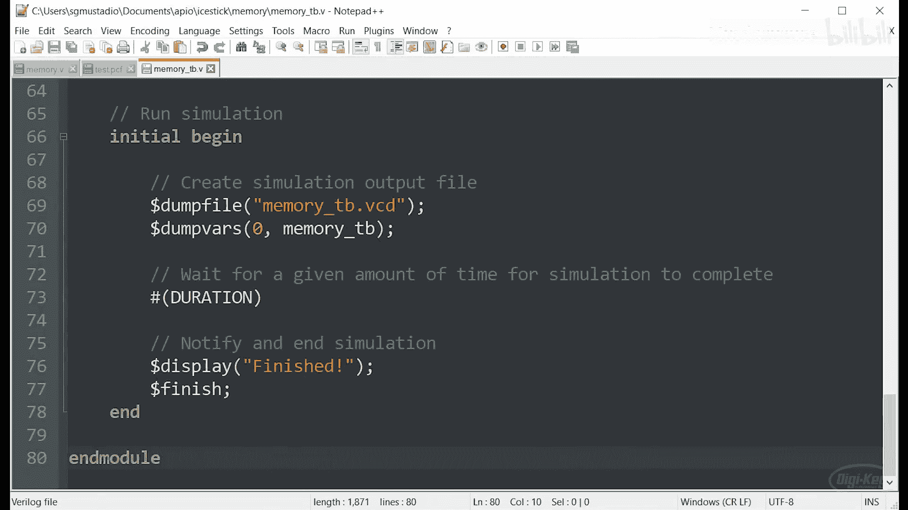

Let's save this。We will open up our command prompt， I will verify again。

I like to build just in case notice that if you're just creating modules intended for simulation and you're not going to be uploading them to your hardware。

 you probably don't need to run build because that calls your next PNR if you don't have a dot PCf file this will fail So I'm calling build because I have that dummy PCF file and I just want to check to make sure it builds Now we're gonna to call opio Sim it should simulate。

And bring up GTK wave。Here are my modules， Im going to add all of the signals in my test bench。

And I'm going to zoom out some。So you can see all the clock signals。Read address is my output。

So it looks like when I call that read enable， it does give me a zero。

 so it looks like things did get initialized as zero for that memory。And then， I write。

A5 to the memory， you can see the right enable line go high here。

And it should clock in about here with this positive edge on my clock。So after I reset those。

 I set the read enable line high， the read address is0。

 but interestingly enough that read address is not getting set。

 although it does look like it's working at address 0 a5 gets clocked into memory and then at address0。

 I am reading out a5 so the memory's working， however it looks like something is wrong with my read and write address。

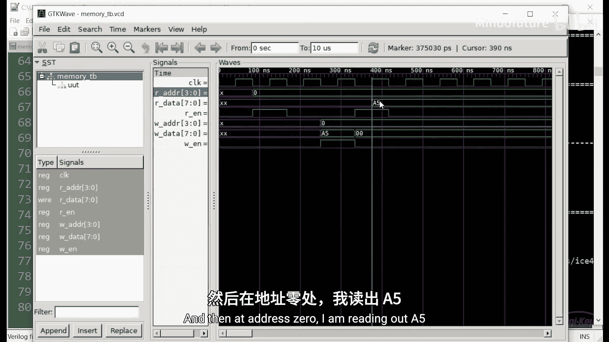

If you remember back in memory， I declared the memory to be 16 elements deep。

And what I'm trying to do here is write to element number 16， which does not exist。

It's only zero through 15， so to fix this， I'm going to write to the very last element。

By changing 1020 F。And I'm going to do the same thing when I read this initial memory element。

 however， this does show something important about verlog if I create something that's only four bits wide and I try to do something that is five bits if I try to set it as a number that's5 bits it's only going to use the least significant four bits that will fit on that bus and this just verified that that's what's going on because10 doesn't exist so it wraps around and it becomes zero。

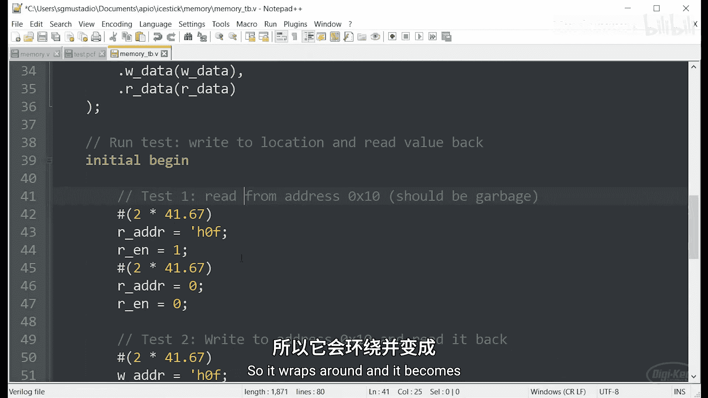

Let's save this。

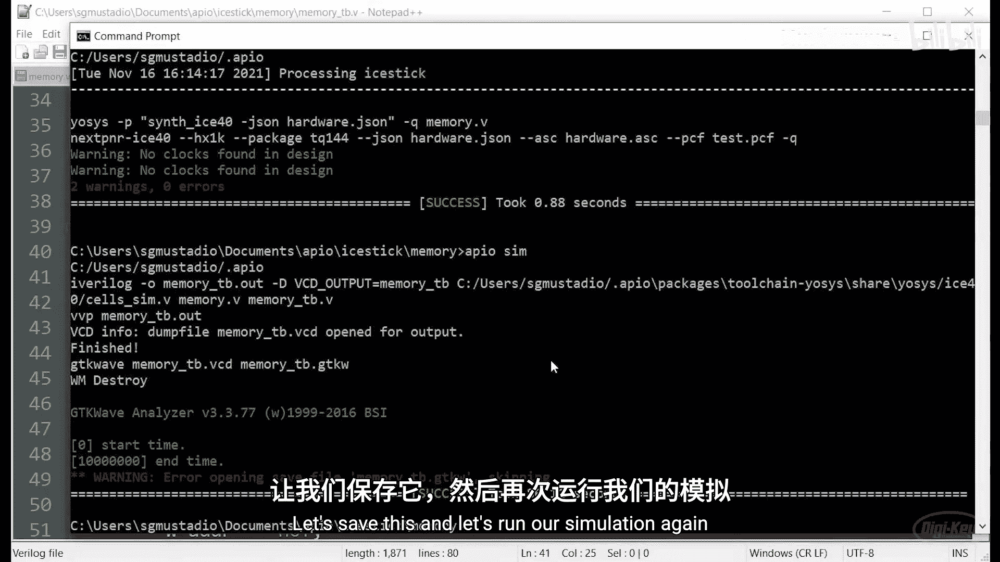

And let's run our simulation again。In this case， you can indeed see that our read address is now F just like we set。

And it looks like we are getting garbage because before we got zero。

 so something must have been set there， I suppose， but we're getting garbage unless you specifically set the memory。

 you have to assume it's going to be garbage or unknown values， then we write a5 to address F。

 and then when we read it， we get a5 out， so that verifies that this piece of block memory is indeed working。

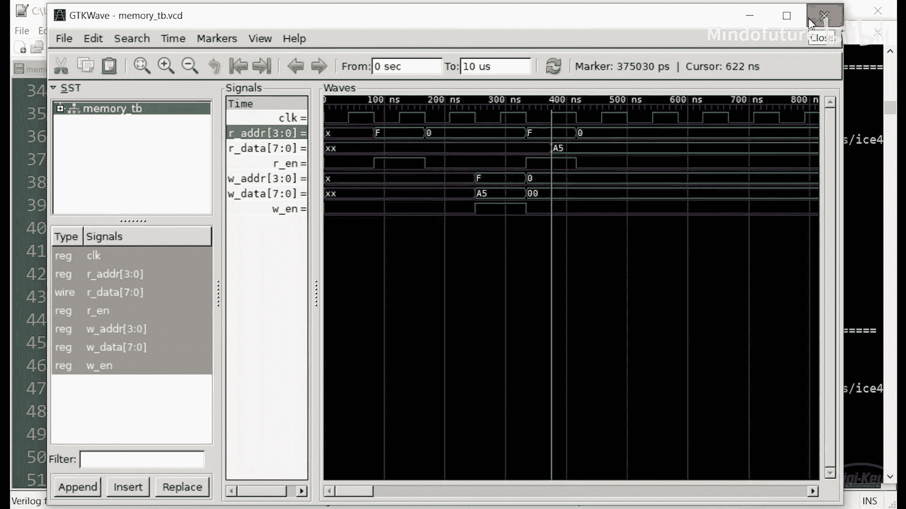

Let's exit out of GTK wave and talk about how you might set initial values to your memory。

 One possibility is you might find a way to create something like a for loop and you walk through every element setting it to zero。

 but I've got a better way， let's read from a file during synthesis and set those initial values so that they're ready to go as soon as we configure the FPGA on boot。

To read from a file， we first need to create that file。In most cases。

 you can just do a comma separated， a space separated， or in this case。

 I'll do a new line separated set of values， and I'm just going to count from0 to7 and then skip some and then go from B8 to B F。

 These are obviously in hex。 They are8 bits wide， which should line up with our memory width。

And our memory depth with 16 values。 and sure enough， one through 16。

 So this should fill out our memory when the synthesis tool reads this file and then stores it in the memory upon initialization。

 I'm going to call it Mem underscore in it。 and it's a basic text file。

 Let's go back to our memory module。😊，And below this always block， where I misspelled interact。

 I'm going to put an initial block。And this is one of those special cases where we can put an initial block in synthesizable ver log code。

In this case， this initial block will run if this Ben knit file parameter is set which we will go up to the top and define in just a second。

 if so it's going to call this system function read Me H and it's going to read it from the file that we will define as part of that parameter。

And we are going to set all of the values in MEm。If you remember。

 men is our chunk of memory that we declared here。Just like we've done before with our modules。

 we're going to declare a parameter that can be set whenever we initialize or instantiate this piece of memory and I'm going to say that the initt file is null if we don't set this parameter。

 init file will default to null， which means this initial block will not run and the memory will not be instantiated with any initial values。

Let's save this and head back to our test bench。To where we instantiated our unit under test here I'm just going to define that parameter as the name of that text file Mam_ inni。

txt that we created that should tell the synthesis tool that it needs to read that file and set all of the memory elements to the individual values that we defined in that text file。

Let's save this。And before we run simulation。Let's read all of the data from the memory instead of just one particular element。

I'm going to do that with a simple for loop and the read address is going to be I。

 which is a variable that we need to go declare。In this case， I'm going to declare it right here。

 and now when that for loop runs， it should read from each address 0 through 15。

 we should see those values， the ones from this memory initialization text file appear on our data。

 and then after that test which I am going to fix my comment here。

It should write a 5 to the last memory element， and then we should read a 5 out。

 Let's save that and give it a shot。 Again， I recommend verifying。

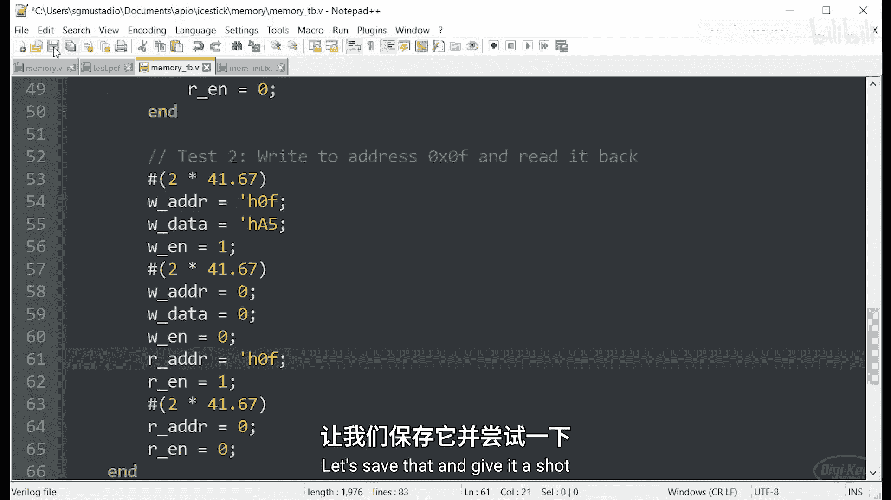

And run Opio Sim， let's add all of our signals and we're going to zoom out。And sure enough。

 you can see that whenever read enableable goes high on that particular rising edge of the clock。

 you should get the value out that we initialized in that text file。So first is zero， then one。

 and in fact， I should just count up until we get two， I believe it was。0，7。 and then yep， B 8， B 9。

 B， A。BB， BC， B D， B， E， and B F， those should match all of these。

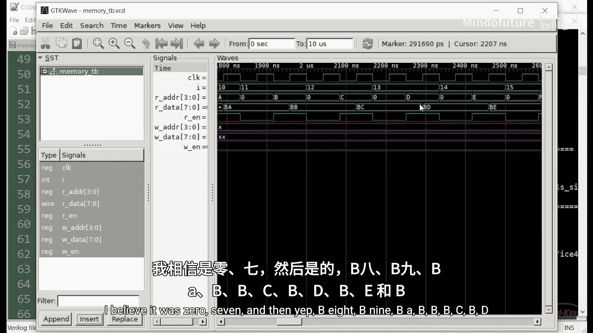

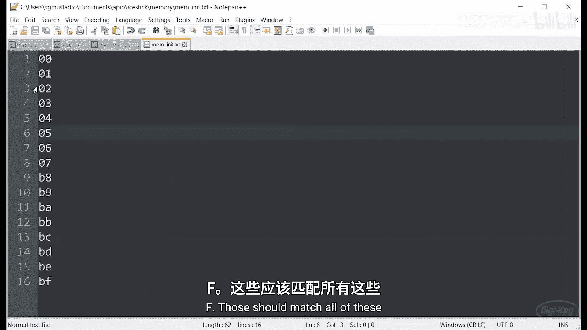

And then the second test runs where at address Hex F， a5 gets loaded in。

Which is right here is where it's written。And then it's red on this clock cycle。

And a five appears at the output。 So this verifies that the memory is working and we can initialize it with values by default by using a text file。

 This can be incredibly useful if you're doing things like lookup tables or even say instructions for a processor。

 In that case， you may actually want read only memory。

 and you can do that by getting rid of your ability to write and。😊。

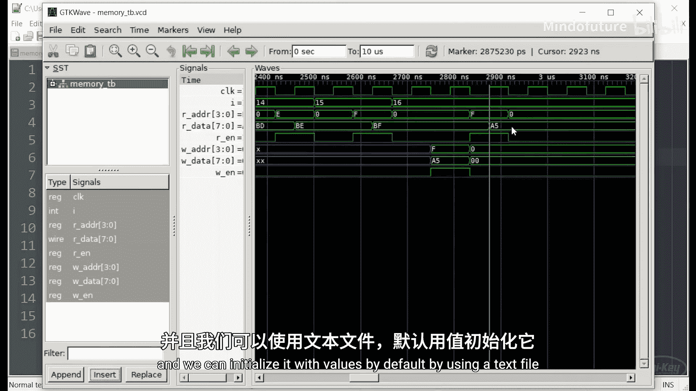

If I get rid of the various write enable write address and write data lines here。

 I've created read only memory， the only way to put values in there is by putting them in through this text file This is a great way to create some sort of memory that doesn't change and you can say read instructions for your CPU if you want to write assembly and even better you can create your own assemblymbr or even compiler that takes a highle language like C turns it into assembly language and then an assemblymbr creates the individual instructions that you would spit out into a text file like this。

 those get loaded into your RAM and then your processor executes。

So I hope this helps you see how you can use memory in your various FPGA designs In music production。

 a sequencer is a device or software that puts together sounds or notes in a sequence。

 they can be recorded or preset the sequencer then continuously loops through the notes or sounds to create music。

😡。

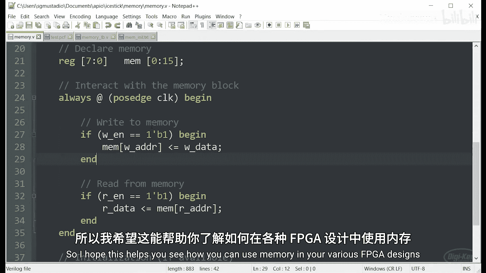

Musicians can play along with the sequencer or layer sounds from different sequencers。

Your challenge is to make a super basic LED sequencer。

 Don't worry about producing sounds at each step or time tick， say every second or half second。

 the FPG displays a 2 bit value on the LEDs。 I'll hold a 2 bit value on my pattern buttons and press the set button。

 This will log the pattern 0，0 from the two buttons on the right into the first memory element。

 I do another pattern， say 0，1， and set that into the next memory element。 I'll continue logging 0，0。

0，11，0，1，1，1，0 and 0，1。 The sequencer will record those values to memory。

 It only needs to be 8 elements long。 During this whole time。

 The sequencer is playing the sequence on the LEDs 1 element at a time。

 When it loops back to the beginning， it should play that exact sequence back to me 0，1，0，1，2，3，2，1。

 Note that you'll likely need to use many of the。😊。

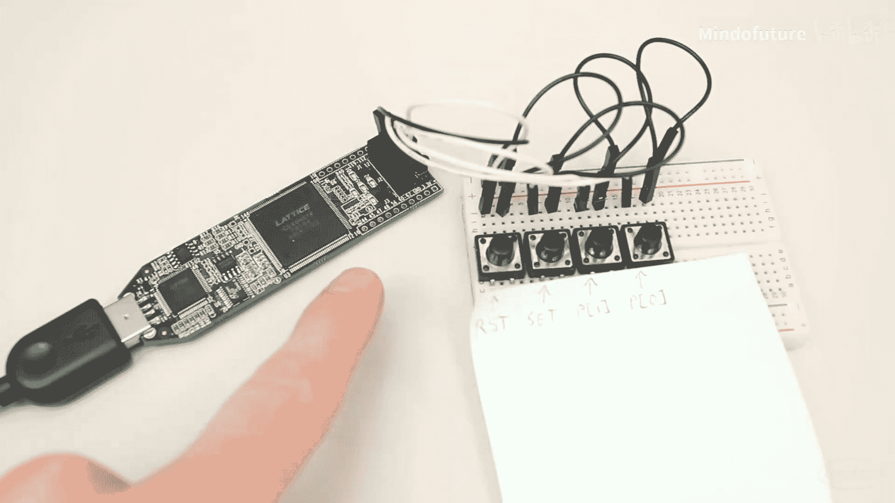

Concepts and modules from earlier episodes， I used separate modules for a clock divider。

 buttony bouncer and block Ram。I also highly recommend writing one or more test benches for your design。

 They helped me tremendously when tracking down bugs。 Good luck with this challenge。

 In the next episode， we'll take a look at that phase locked loop that's in our FPGA and see if we can use it to bump our clock speed up to a few hundred megaHtz。

 Happy hacking。😊。

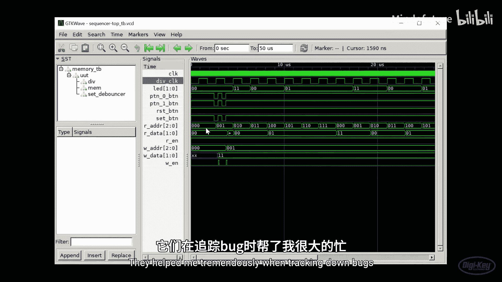

诶。え。

