# FPGA编程入门-•-中英-p09-P09-Phase-Locked-Loop-(PLL)-and-Glitches---Digi-Key-Electronics--BV1kVZSY8E5j_p9-

Up until now， we've been using a 12 MHz clock on our ice stick。

 That's pretty good for many applications， but I think we can do better。

 Let's unlock the full potential of our FPGA and get that clock speed up to a few hundred MHz to do that。

 We're going need to use a phase locked loop or P L L。😊。

A phase locked loop is a useful circuit that can create a repeating pattern like a sine wave or square wave that matches the frequency and phase of the input signal。

 The voltage controlled oscillator or VCO produces some signal。

 The phase detector compares the output signal to the reference signal and produces a series of pulses each time the two signals don't match in frequency or phase。

 The more off the waveforms the more pulses。 This output is sent through a lowpa filter that smooths out the signal to give us something close to a D voltage。

 This voltage is fed into the VCO， which adjusts the frequency of the output based on the given voltage。

😊，This continues until the output waveform is the same frequency and phase as the reference signal。

 I won't get into details of how a PLL works， but this is a broad overview。

 It might seem a bit useless to produce the same signal but PLLs have a variety of use cases。

 such as synchronizing or demomodulating signals。What we want to do is create a clock multiplier from our 12 MHz signal。

 Note that some P Ls， like the one in our FPG， are designed to work with digital signals rather than analog waveforms。

 We add a simple clock divider circuit between the oscillator and the phase detector。 Now。

 the VCO must produce a waveform that's three times the frequency than the reference signal。

 So a 36 MHz square wave is divided by three to produce a 12 MHz waveform that's matched to the input signal。

 We can use this technique to produce clock signals in the hundreds of MHz or even gigHz range with a fairly low frequency reference signal。

 latticetuce has a system clock design and usage guide that's worth looking through to get an idea of how to use the on chip P L L。

 If you head to chapter 3。 You can find a diagram of the phase locked loop Note。😊。

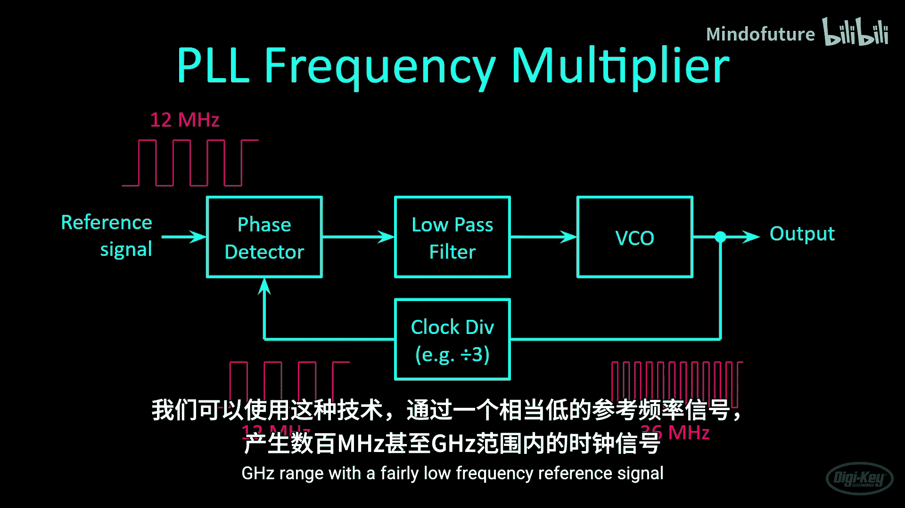

PLLs can sometimes be tricky to design and tune。 So we'll have to look here to see what kinds of frequencies we can expect to get。

 There are a few more settings on this P than the simple one we just looked at。

 What we care about setting is the input divider。 The filter range。

 the VCO divider and the feedback divider。 If you scroll down。

 you can see the acceptable values for each of those parameter。

 note that in each of these a0 actually means divide by one。 So the divider numbers are off by one。

 We also want to use the gen clock setting for the P out parameter so that there is no phase shift on the internally generated P signal。

 Sc down some more and you'll find some equations for calculating the output of the P。

 We'll use the simple feedback path。 So the equation is given in 3。5。2 in section 4。

 you can find some parameter limits。 The reference clock needs to be between 10 and 100。

33Hz We'll give it our 12 meHz clock so we should be good there。

 Note that the output of the VCO must be between 533 and 1066 meHz We can divide that output to give us the output frequency。

 which must be between 16 and 275 meHz While this might be a little complicated to do by hand。

 The good news is that we have a tool to help us。 We're going to use the I P tool in order to handle some of the calculations for us and give us recommended values for those clock dividers In this case。

 I P came with all of those background tools that we installed when we were installing opio to use it we want to call opio Ra Open quotes I P I and then the input clock signal or the clock frequency that we want in megaHz of this case 12 O for the output clock frequency of the。

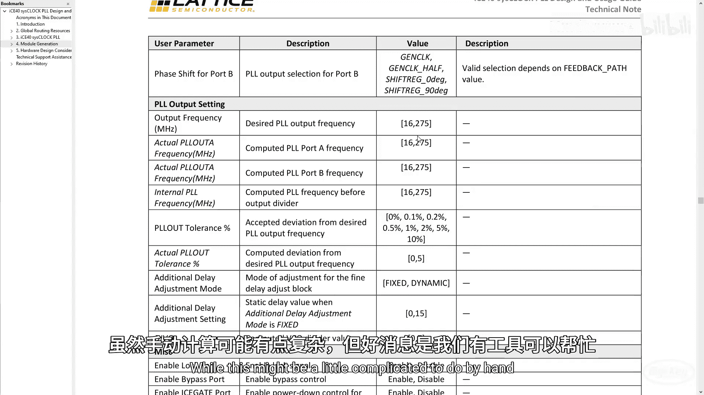

In this case， we want 120 meHtz When we run this tool。

 it should calculate for us the dividers and the filter range。

We want div R to be set to0 div F to be set to 79 and div Q to be set to3 with a filter range set to1。

 These are the parameters that we need to remember so we can use the PLL in our code It also gives us some information about the voltage controlled oscillator。

 which it says should be running at 960 megaherz， but that gets divided down to our output 120 megaherz。

 Let's remember these parameter values and create a project to test them。

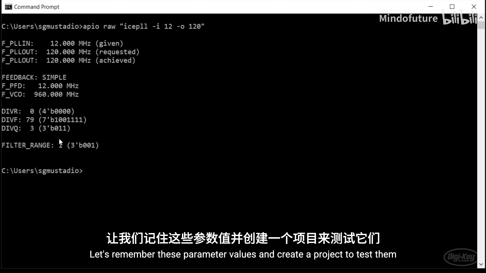

We're going to create a new project。I'm going to call this one PLL。Test。And in here。

I'm going to create a new document also called PL test。 V。

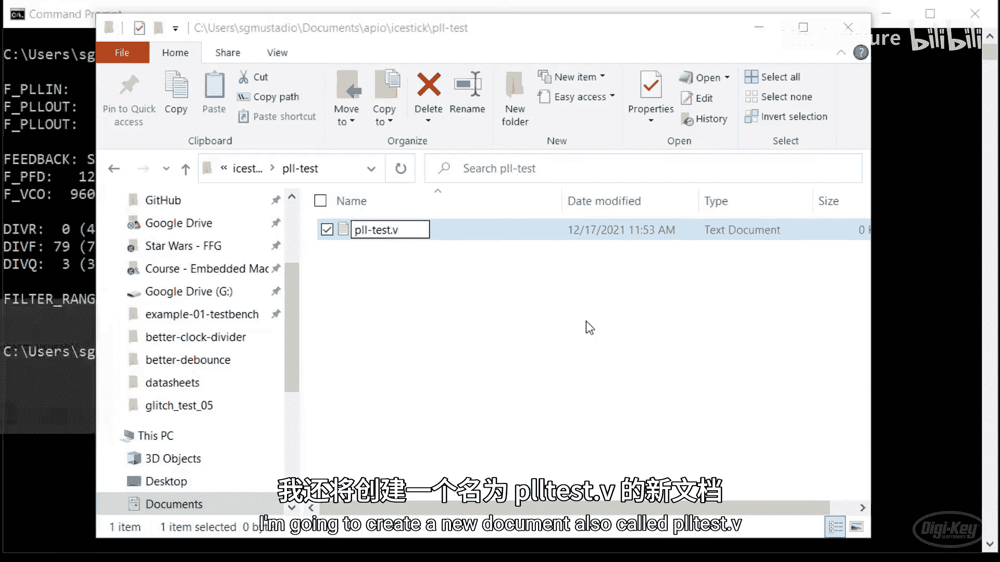

And let's open that up in whatever text editor you like。This is going to be a very simple module。

 All we're going to do is take in our reference clock。

And we're going to output a PLL clock in this case a multiplied clock。

 we're going to take in 12 megahertz and output 120 megahertz。

 let me spell reference clock correctly to do that we're going to use this SB PLL 40 core directive that's unique to our Ice 40 synthesis。

This works very much like a module， and we're gonna give it some parameters。

 some input and output signals。 And it's going to tell the synthesis tool that it needs to use the P core that's inside of our I 40 FPG。

 As we saw in the data sheet， we want to use a simple feedback path。

 That means we're not going to be using any of the fine delay adjustments。

 And it's just the easiest one to implement and test right now。 Next。

 we want to use the gen clock descriptor for the P out select。

 This tells the P core that we don't want any phase shift on the output。 Once again。

 we're trying to keep this as simple as possible。 The first value is the reference clock divider。

 This is one of the numbers that we got from the I P tool。 In this case， it should be 0。 Next。

 we define our feedback clock divider。 And if you remember from the tool。

 This is decimal 79 or binary 10，011，11。 And we will put that in here for the div。

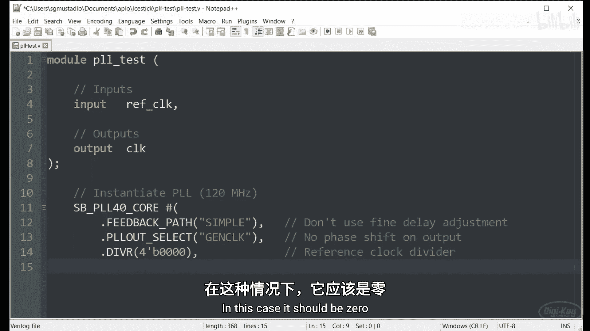

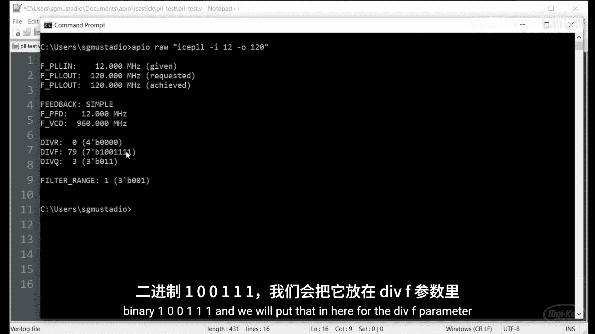

Then we define the VCO clock divider once again from the I PLL tool， this is the div Q parameter。

 which should be three。 Finally， we define the filter range。

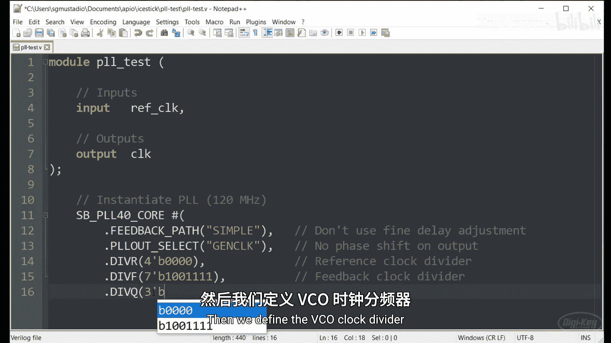

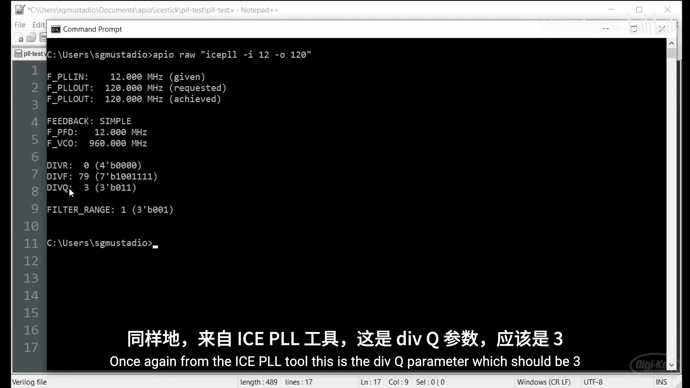

Which should be one， according to our I PL tool。 we'll give this module and name。

 and we will connect our input reference clock to the reference clock signal in the phase lock loop。

 The output clock signal is called PLL out core。 So we'll connect our output clock signal to that one。

 One of the things a phase lock loop can do is give us a lock signal as an output。

 This signal lets you know that the PLL is working and that it has locked the output phase to the input phase。

 Sometimes you might want to wait for that signal before doing something else， but right now。

 we don't particularly care about that。 So we won't connect that signal to anything in our top level design。

 This particular PLL has an active low reset。 So we actually just want to give it a static or constant high signal to let it run。

 And finally， we want to disable the bypass in the P so we can use it as an output。

And that's all we need to do for our ver log code However。

 we do want to create a physical constraint file and I'm just going to define the input reference clock as P21。

 that's our 12 megaHtz clock that's on the It and it's connected to physical pin21 and we've got an output clock signal that we want to measure using in oscilloscope and that's going to be connected to physical P 87。

 which is on the P mod connector。Let's save this file。

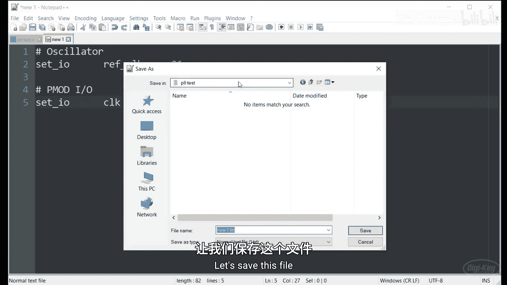

After saving that file as our pin constraint file， we will bring up a command prompt and go into our PLL test directory here we want to initialize the project for our I stick。

 as we always do for our projects， at least if you're using an ice stick。

 it's always good to verify your code， make sure everything looks okay。

We're going to call opio build， no errors。And we are going to call Opio upload。

It looks like everything uploaded to the icet， so let's connect our oscillosscope and make sure it works。

When I measure the output of pin 87 on the ice stick with my oscilloscope。

 you can see the clock signal。 I'll measure the frequency， which looks to be 120 MHz。

 just like we predicted。 Note that this is not a very nice looking square wave as we start using higher frequencies。

 the capacitance and inductance in our lines start to become an issue。

 which will deform the waveform。 I'm also running into bandwidth limits on my oscilloscope。

 inside the FPGA， This is likely not a big deal， but it's something you have to keep in mind if you're laying out a PCB or connecting external parts to the FPGA。

😊，When we create digital designs， we often imagine an ideal world where the output changes as soon as the input changes。

 However， this isn't what happens in the real world。 All wires and gates have a propagation delay。

 It takes some small amount of time for a voltage level change to appear at the other end of a wire or gate。

 inside the FPG， we can often assume most wires have almost no propagation delay as they're so short。

 However， gates may have a noticeable delay。 For example。

 it might take one nanosecond for this not gate to update its output after receiving a change on its input。

 Remember that in FPG uses lookup tables instead of real gates to create your programmable logic。

 So in reality， the propagation delay occurs across lookup tables instead of at the gate level。

 timing and propagation delays can get very complicated very quickly and could be its own video series。

😊，We will just introduce the topic of propagation delay in this episode so you can be aware of some pitfalls when you start using faster clocks in your digital designs。

 If you take a look at the I 40 data sheet， you can find a maximum value for the propagation delay for our particular part。

 However， note that this is a delay for a pin L pin signal。

 meaningan the time it takes for a signal to move from one external pin through a lookup table and out another pin。

 the data sheet doesn't mention internal signals。 So we have to assume that such propagation delay is negligible or the place and route tool will ensure that it can meet any timing requirements for our design。

 Let's look at a slightly contrived example to demonstrate this concept of propagation delay。

 This is a four bit ripple counter made up of four half adders and four flip flops。

 The sum of each half adder。😊。

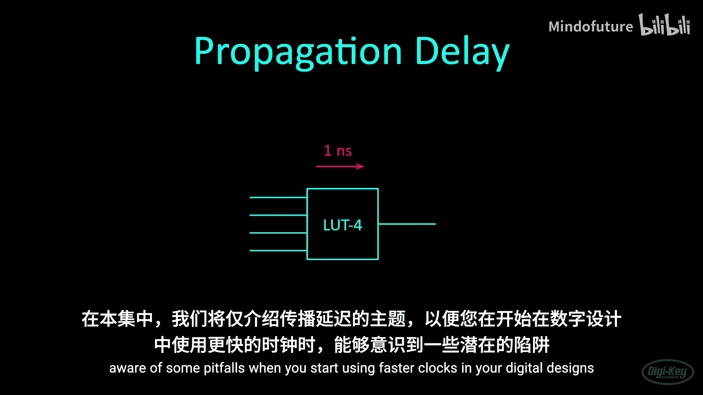

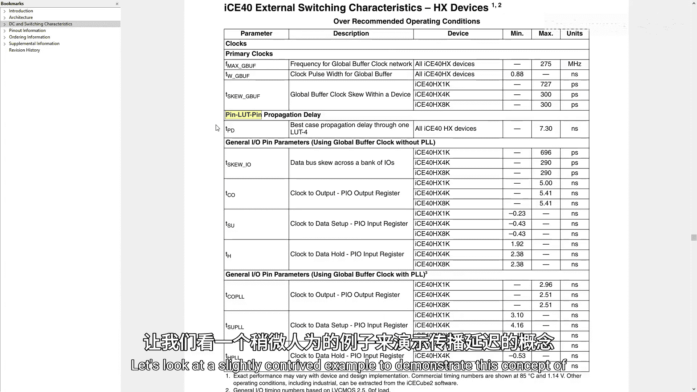

Makes up one bit of the output of the counter。 The carry output bit is fed into the next half ater stage。

 The output is registered on each clock cycle to produce the four bit count output。

 Once that value is registered， the circuit adds one to the value to produce a new output。

 which is then registered again。 This continues forever so long as theres a clock signal。

 When we introduce gate delays， things get a little more complicated。 Just after count is updated。

 The first output is updated one nanosecond later。 Then the second bit is updated  one nanosecond after that。

 The third bit is updated one nanosecond later， and finally。

 the fourth bit updated one nanosecond after it takes4 nanoseconds total for the out value to update during that time out will change as the bits change before settling on the correct value。

 Once again， this is a theoretical example as the。FPGA is using lookup tables to accomplish this rather than gates。

 and internal delays are likely smaller。 Also， when you use addition in your v log code。

 the synthesis tool might implement something other than a ripple carry adder to accomplish this function to avoid such delays。

 Let's take a look at this in Vo。

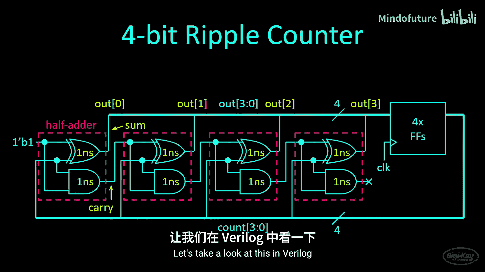

Rather than have you watch me write out this test manually， I've created a glitch test project。

 note that Opio requires some kind of Vlog code outside of a test bench for this to work。

But I'm going to do everything inside the test bench。

 So I created an empty ver log file just to make Opio happy。 There's nothing in there。

 as you can see。And I put everything inside this test bench now I know I mentioned that you should probably use one module per file。

 but since we're going to be doing things that are not synthesizable。

 I've put a hardware module in this case， our half ater inside of the file with the test bench as a separate module。

Here is the half adder。 It is very simple。 It's just an Xor gate and an and gate with a sum and a carry out outputs。

However。With our simulation tool， we can do these pound or hashtag signs to denote a delay like we've been doing earlier。

 but if we do them prior to an assignment， as you see here， it means weight one time unit。

After you get this value before updating this value or the output of that logic。

 note that there are tools that can do gate level simulation that are much better at this。

 there is a way to get Icarus vera log to do gate level simulation but out of the box and the things we are playing with。

 it does not perform gate level simulation， so we can try to emulate that in a way by saying okay。

 let's pretend it takes one time unit in this case， one nanosecond to compute this X or logic。

 This is all in happy theoretical land when you do actual gate level simulation the models you're using for those gates should closely match what the actual FPG does the lookup table delays in your say I 40。

 However， without those we have to rely on this to demonstrate propagation delay。

So I've manually created my half adder with the simulated gate delays。

And we're going to define our test bench。All of this should look familiar if you've gone through the test benchch video。

We're going to create some internal signals， we're going to create some registers in this case out should match what you saw in the diagram。

 it's the output of the ripple Car counter in this case。

 and count is the output of that registered value。We're going to generate something that's close to 120 megahertz for this example。

To demonstrate what things might look like when you start working with faster clock speeds。

We're going to instantiate our half adders。 In this case。

 we're going to connect our signals together。 notice that the first half ater its。

Carry out is connected to the a input of the next one。

 the carry out of that one is connected to a of the following one。

 and the count values are the other input。 Remember， that's the registered output value。

 The sum of the half aters。Create the bits for our out vector or our Out bus。

Here is that register that's part of the4 bit Rple counter。On each clock cycle。

 the out value is registered to the count value once count gets updated。

 that causes the chain of half adders to do their thing and immediately minus some propagation delay。

Update their output values， which is then clocked again and this cycle continues。

I do have an asynchronous reset signal here just to reset everything。

And that's what we're going to do for this test All we're going to do is pulse that reset line and let the counter do its thing。

And this should all look familiar where we just run the simulation。

 create the value change dump file。And say we're finished。

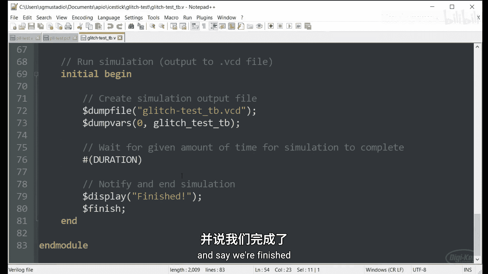

Let's bring up our command prompt and we're going to go into our glitch test project。

 I believe I have already initialized the project for the ice stick。

 but just in case let's do it again， let's verify and we're going to simulate once GTK wave comes up。

 feel free to move around and look at what's going on。

As soon as we update the count value or it starts initialized at zero， a few nanoseconds later。

 and the output。Updates。Now let's move over to where。This value is registered。

 so we have a clock rising edge。Count takes on the value of out。And if we increment1。

 it should be two， however you notice for a brief moment， the value is0。And that is。

One nanosecond where this value is0。 this value is incorrect。 One plus1 should be 2。 Why is it0 here。

 This is known as a glitch if you are using the output value。

That's because the values are taking their time to update in those half adders。

So the first half adder updates its value， which says a， I need to be0 and that's where it goes zero。

 and it takes a nanosecond for that second half adder to update its value。

So I will put markers here in here so you can see that it's one nanosecond for it to update so for a brief moment。

This value is incorrect， and this is a glitch once it updates to2。

Hopefully the rising edge of the clock will happen as we can see here and the count bus gets updated with that output value。

 so two comes here and we see more glitches because incrementing2。To3， we shouldn't see one and 7。

 but as you can see， these bits。Take their time one nanosecond each to update their values before it actually gets。

To three。In this design， it's not really a problem， usually when you're using a counter like this。

 what you care about is this registered value， this count value。 and if you look here， it's 0，1，2。

3 and so on。 the only time there's a problem is if you're watching this out value if you're using this value。

 that might be a problem， but in most cases when you're using a counter。

 you care about this registered output。 That's why you probably won't see this be an issue if you're using counters like this。

😡，However。As you start to increase your clock speed。

If we assume that these propagation delays are correct。And。

That these don't change as we increase our clock speed。

 then we start to sample closer and closer and closer to where these changes are occurring。

If we increase this clock speed to I don't know， 300 400 megaHtz。

 you can start to see where we might sample right here， and in this case。

 this7 is what gets registered in this count value， and that's a real problem。

This glitch becomes registered and becomes the new count output。

 and the counter is no longer working because we are violating these timing restrictions。

This starts to get into some pretty advanced FPGA design conversations about how to appropriately do things like place and route or creating logic that avoids these types of glitches。

For now， our It should be able to manage some of the basic things we want to do。

 such as adders and counters where it should not violate any of these timing restrictions。

For the purpose of this introductory course， this is just something to keep in mind as you go about your FPGA designs。

 you shouldn't need to worry about these until you start getting into much faster clock speeds。

 or if you start seeing weird things happen， know that it might be a glitch and you have to start looking at your test benches and potentially running specialized gate level simulation software tools to catch these because glitches can be a pain to find。

 track down and fix。

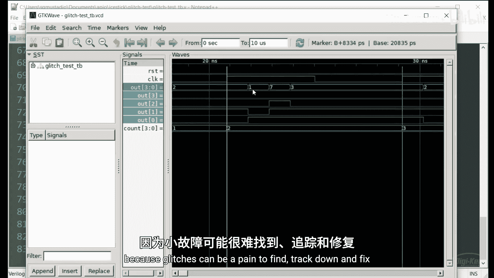

The Ripple carry counter is a simple design， but it's prone to glitches at high clock speeds。

 Here is your challenge。 Can you think of another way to do a counter that eliminates or at least reduces the number of glitches。

 See if you can put together a test bench for your design。

 I'll post a link to my solution in the description if you'd like to compare answers。

 In the next episode， we'll talk about metaability and crossing clock domains。 Happy hacking。😊，哎。え。

