# FPGA编程入门-•-中英-p10-P10-Metastability-and-Clock-Domain-Crossing---Digi-Key-Electronics--BV1kVZSY8E5j_p10-

Most of the designs we've been working with up until now have been synchronous。

 which means they operate on the same clock signal。 However。

 you might run across cases where you need to sample an asynchronous signal or work with something that's operating on a completely different clock signal。

 This might cause a problem known as metatability。 In this episode。

 We' take a look at what that is and what you can do to avoid it。

Let's take a look at our basic D flipflop。 We'll assume that this flipflop registers data on the rising edge of a clock pulse。

 So let's look closely at that edge。 As it turns out。

 the input signal needs to be held at its intended value some time before the sampling clock edge。

 The amount of time that the input D needs to be held steady before the clocking event is known as the setup time。

 The signal must also be held at that level for some time after the clock edge for the output to be stable。

 This is known as the hold time。 So long as the input does not change within the setup and hold Windows。

 the output Q will update to reflect the registered value and is guaranteed to be steady。However。

 if D changes within the setup or hold windows， that is a timing violation。

 This could potentially cause the D flipflop to not latch the input signal properly and enter into a metastable state。

 here， The output of the flip flop is unknown for some indeterminate amount of time。 Usually。

 the output will quickly reach a stable state， but this metastabletable output could produce incorrect signals and values for your design depending on how long it takes for the voltage to settle。

 Note that a glitch or short pulse within the setup or hold time is also a violation。

 which can cause metatability。 Most setup and hold times are on the order of nanoseconds。

 You can't guarantee that metastability will occur with a timing violation as its probabilistic。

 The best you can do is calculate the mean time between failures to get an idea of how likely it will occur。

Won't get into that calculation， as that's a more advanced topic。 Additionally。

 you likely won't be able to see this metatability on an oscilloscope as this only occurs on the flip flops inside the FPG。

 Most FPGs have some logic and buffers between flipflop outputs and physical pins。

 That means a metastable output would simply look like a level change on the pin。 However。

 if you were to monitor this pin and record the metastable output over and over。

 you would see that the level change occurs at different times due to the probabilistic nature of the metasability。

 If we look at the data sheet， we can see the listed setup and hold times for our Hx 1 device。

 However， note that like the propagation delays， these are only given for signals coming from a physical pin。

 Inter times aren't given。 So we have to assume that the place and route tool will ensure everything meets timing。

Interestinglyly， enough， the setup。😊。

Time iss negative。 This means that your signal change can actually arrive slightly after the clock edge and still be okay。

 Colin O Flynn has an excellent article where he demonstrates metaability by registering a divided clock signal and then delaying the clock by some varying amount。

 You can see his test set up here。 He uses a 48 MHz clock signal to drive the flip flops signal and clock line。

 The signal line is divided to 24 MHz so the rising and falling edges can both be sampled。

 He then carefully adjusts the clock phase until a setup or hold time violation occurs。

 You can see his results here。 If there's no violation， the data out signal looks clean。 However。

 when there's a metastable event， the data outline will lag in its transition for some random amount of time。

 I tried to replicate this experiment。 However， you have to undervat the FPG to make the meta stable events more visible。

😊。

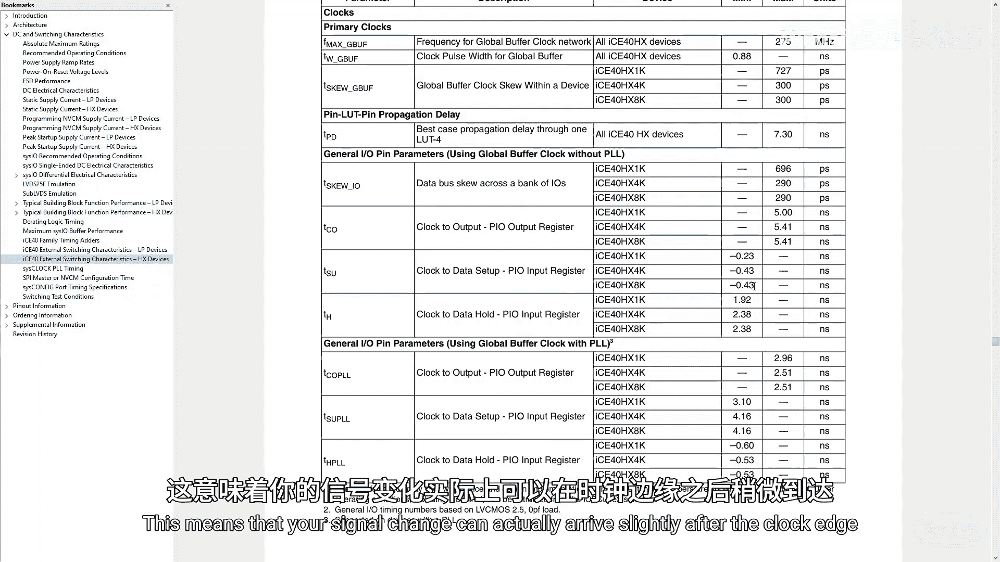

out that I'd need to desorer a few parts to control the core voltage。

 While I could definitely do that。 I did not want to risk hurting my only ice stick。

 as I know that obtaining them right now is quite difficult。

 If you are working with asynchronous signals or across clock domains。

 the standard fix is to add a second flipflop to the sampling chain。

 While this won't completely remove metaability， it will lower the impact and chances of it occurring on the final output。

 Even if the first flipflop experiences metaability。

 the second flipflop will sample that unknown state and have a better chance of producing a stable state。

 Note that this does introduce a delay in your design as it now takes an extra clock cycle for the input value to appear on the output。

 Sometimes you might even see three or more flip flops chained together to really reduce the chances of metaability。

 using a chain of flip flops like this to reduce metatability is known as asynchronized。

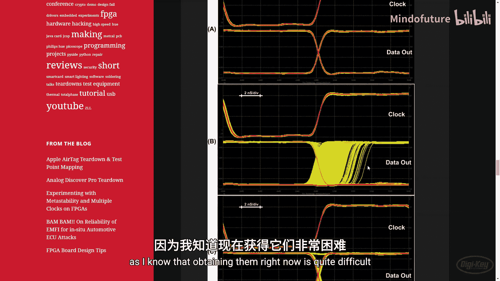

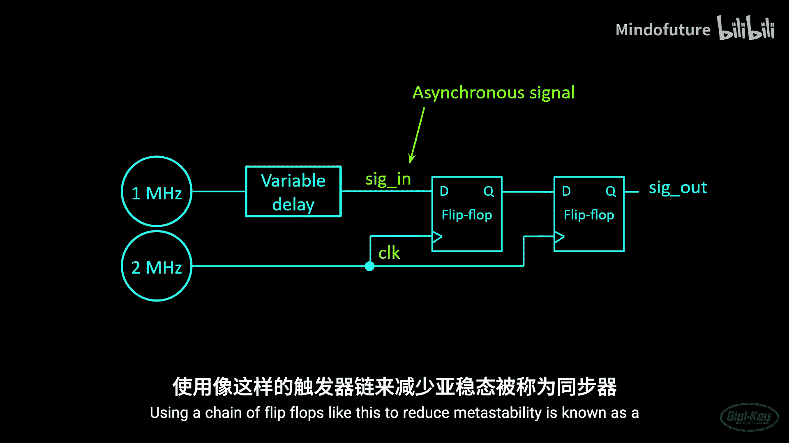

。Here's a simple flip flop example where the input might be an asynchronous signal to create a synchronizer。

 We will define a new register element。 I'll call it pipe 0。

 Then we use a nonblocking assignment to register the input signal to the pipe register。

 We add another line to register the contents of the pipe register to the output register。

 And that's it。 In our designs up until now， we've been mostly working in a single clock domain。

 That means all of our logic and flip flops were clocked from a single source。

 which was the 12 MHz oscillator on the It for me。 However。

 you might run into instances where something else is using a separate clock that is not phase aligned to your system clock。

 A clock domain is all of the logic that is clocked from a single clock signal or a divided version of that clock。

 Let's pretend that clock 1 is generated by some external sensor。 It could be a 5 Mz spy signal。

 and we can。😊。

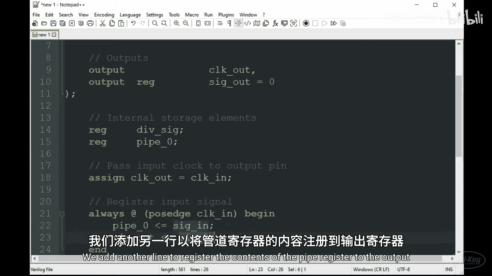

Guarantee that it's phase aligned with our internal system clock， which we'll call clock2。

We want to sample the input data to use it in calculations， so we create a circuit like this。

 however， as we just showed， this boundary between the two clock domains is dangerous as there's a chance metatability could occur This situation is known as clock domain crossing and it can cause a lot of headaches metatability is random and may or may not cause bugs that can be very difficult to track down。

Generally， the solution to this is to create a synchronizer circuit in the receiving clock domain。

 As I've shown here。 This will reduce the likelihood of metaability in most cases to keep your designs simple。

 especially if you're just starting out。 You'll likely want to avoid crossing clock domains。

 Keep your designs synchronous in one clock domain as much as possible。 In earlier episodes。

 we made simple clock dividers that looked something like this。

 Our 12 MHz clock fed into a simple circuit that divided the clock。

 And then we used that signal to drive the rest of our design at a slower rate。

 This is fine when you're just starting out and learning to work with FPGs。 However。

 it's considered bad design。 The logic and flip flops can potentially introduced delays。

 And now you've technically created a separate clock domain。

 You want to avoid driving clock inputs with outputs from other flip flops。

 I want to thank Patrick Lehman for showing me a much。😊。

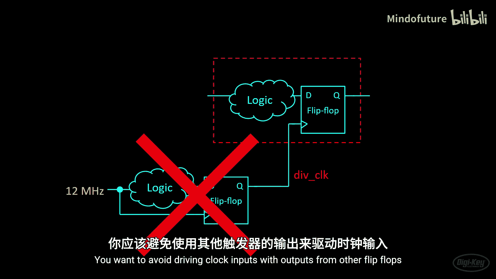

Better way to create a clock divider。 Here is that better clock divider。

 We give a max clock count as a parameter， much like we did before。 However。

 note that instead of a divided clock output， we now have this tick output。

 We use this built in log based2 ceiling function to figure out how many bits our counter needs to be。

 The key here is that rather than producing a divided clock。

 the tick signal goes high for one clock cycle at the end of the count。

 and then the counter starts over again。 The always block continuously increments the counter and resets the counter whenever tick is high。

 which happens when the counter reaches the modulo parameter value。

 Here is an example of this dividedr in simulation。 The modulo parameter set to 120。

 So whenever count reaches 119， the tick line goes high for a single clock pulse。

 And here is how we use this new divider。 This is the one Herz blinking LED example。

 we saw way back in the。😊。

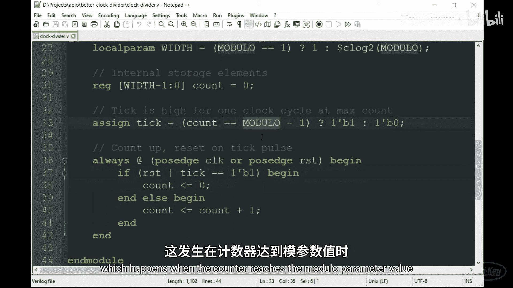

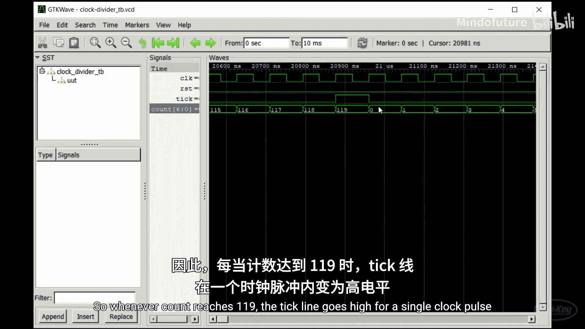

Beginning of the series， we instantiate the clock divider。

 rather than use the output to feed the sensitivity list。

 We simply perform a conditional check for that tick line to be high prior to performing our action。

 In this case， we just toggle the LED。 This method keeps everything perfectly synchronous with our main clock。

 and we don't have to worry about metatability。 I'll post a link to this example and a better way to do button debouncing in the description。

 Feel free to look through them and try them out on your own FpGA。

 A fiIO or first in first out is another great tool when working across clock domains。

 You might also know it as a queue。 It's a way to use a chunk of memory to pass data between a sender and a receiver。

 Let's say we have a fiIO with two elements already stored。

 The sender writes another piece of data to the fiIO which gets stored behind the other two。

 The receiving process can asynchronously read data from the PIO。😊。

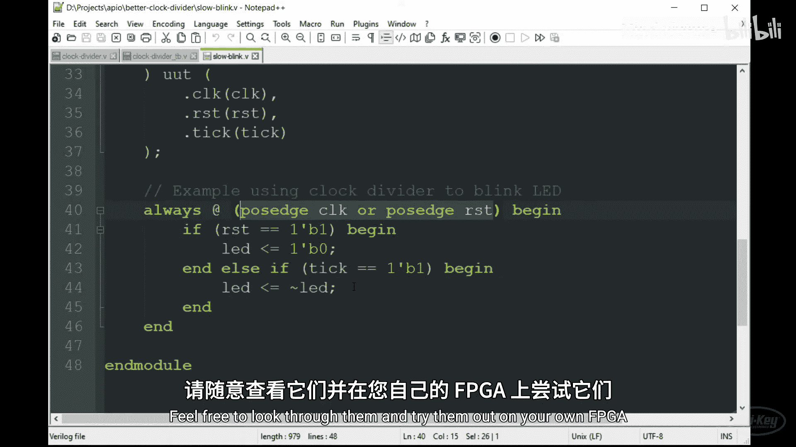

This pulls the element at the front of the PIFO off and the others slide down。

There are a few rules to follow when creating or working with a PIO。

 These are the big ones to remember。 Elments are read in the order that they are written to the PIO。

 Any element that has been read is removed from the PIO。

 You'll need a way to check to see if the PIO is empty and full。

 as you don't want to read from an empty fiIO and you don't want to write to a full PIO。 If you do。

 you could break the fiIO or unintentionally overwrite parts of memory。

 Let's look at the diagram of the block memory in the data sheet again。

 You'll notice that the block ra for the I 40 has two different clock inputs。

 a read clock and a write clock。 This allows us to read and write to and from the block ram in separate clock domains。

 As a result， we can build some logic around this memory to create an asynchronous PIO。

 Such cues are very helpful as they allow you to pass data between clock domains。 You could。

 for example， take samples from a sensor。

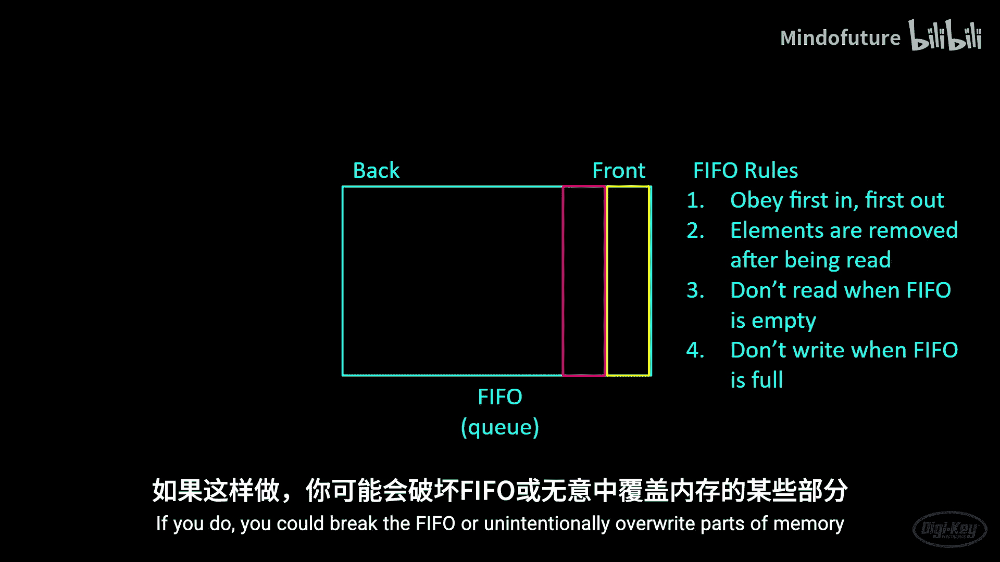

And store the results in a fiIFO。 A separate microcontroller could then read the results from the fiIO using its own clock domain。

 However， creating a fiIFO that's resistant to metatability issues can be a little tricky Luc for us。

 digital design experts have created robust fiIfos for us to use。

 Here's one example by Clifford Cummings in his 2002 paper to the synopsis users group。

 While he mentions that there's a second fiIO design that won an award。

 I recommend sticking with this first design。 I highly recommend reading through this paper to see how Clifford created this design。

 On page 9， you'll see a block diagram of the fiIO。

 You can see how logic is built around the dualport block Ram to construct the PIO。

 Notice that he uses two synchronizer circuits to pass read and write addresses between the two clock domains。

 Scll down some more。 And you can see that source code has been graciously provided for us to use。

 Your challenge is to implement。😊，This PIO inve log and then write a test bench to show that it works。

 Here's an example of my simulation。 You can see that I write the values 01，2 and 3 to the PIO。

 When I read them， I get 0，1，2 and3 on each read clock cycle。

 and notice that the two clock frequencies are different。

 The read empty line goes high whenever the PIO is empty。 And if I fill up the PIO。

 the right full line goes high and the PIO ignores any values given after that。

 When I read out the values you can see that nothing after hex F is given since the PIO was full。

 At this point， you should have most of the basic building blocks you need to start creating your own designs in an FPG。

 While this concludes the introductory portion of the series。

 I'd like to spend the next two episodes talking about a fun topic and that is softcore processors。

 I'm going to show you how to use an existing risk 5 implementation。😊。

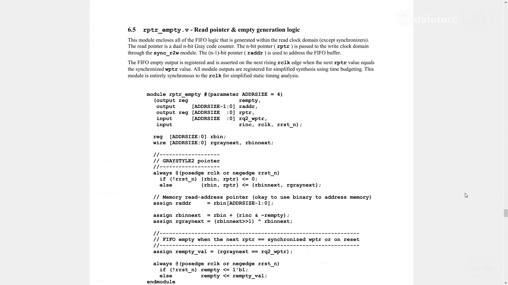

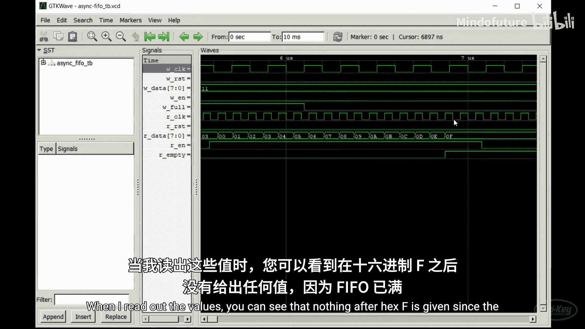

And get it running on the ice stick。 We'll then modify the design to include a custom hardware peripheral。

 happy hacking。A。え。

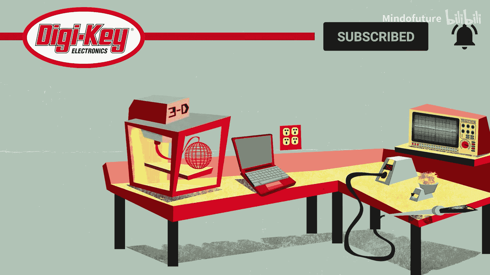

