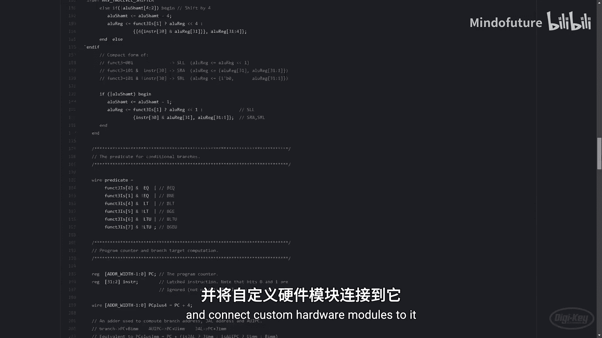
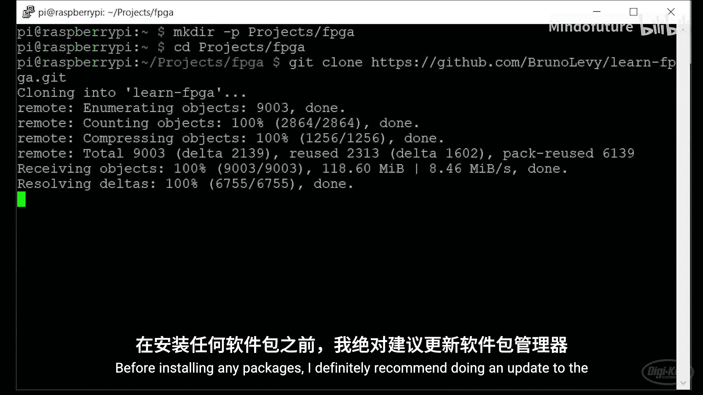
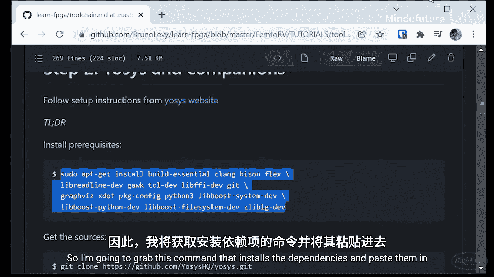
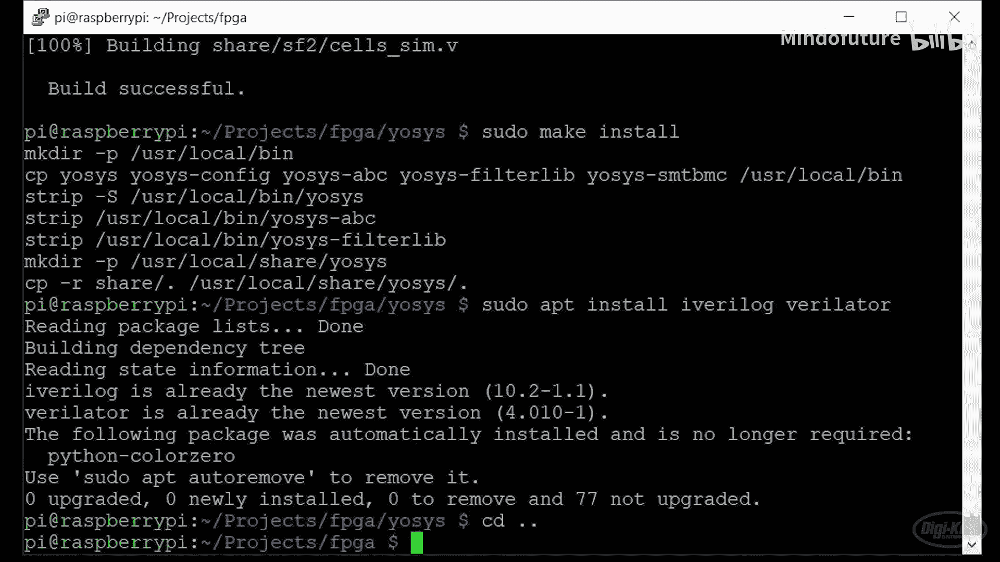
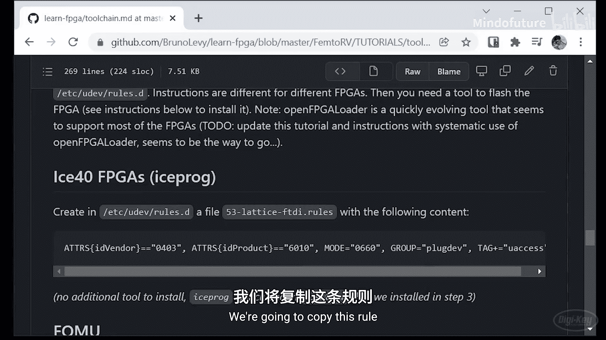
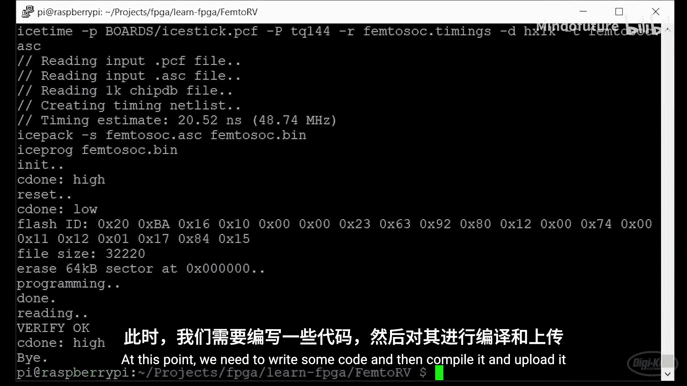
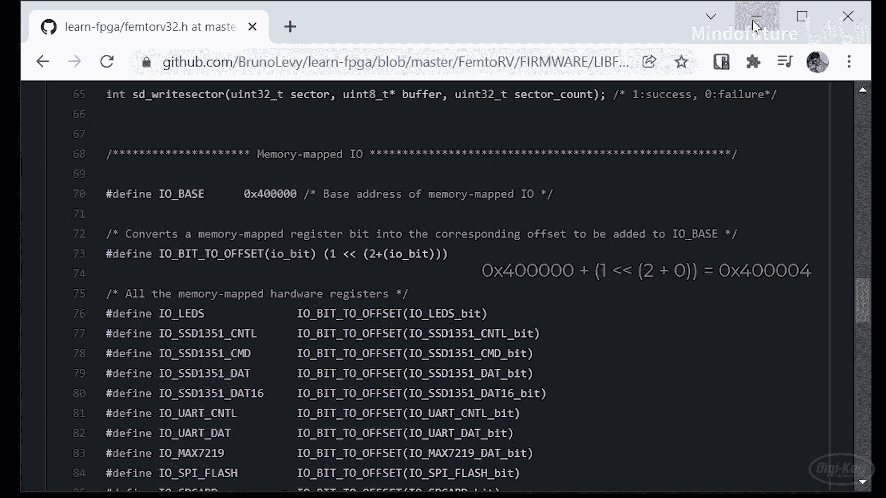
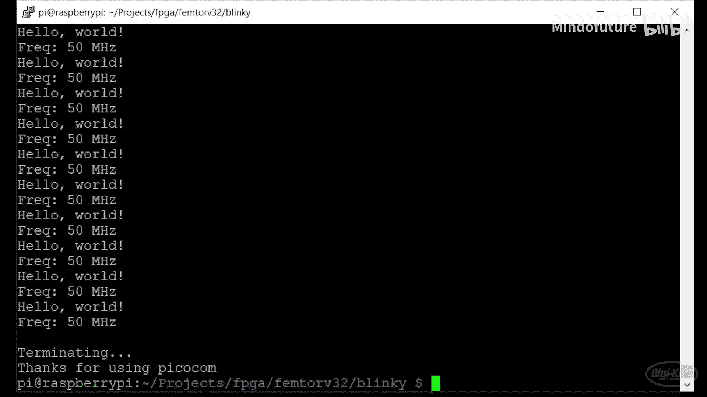
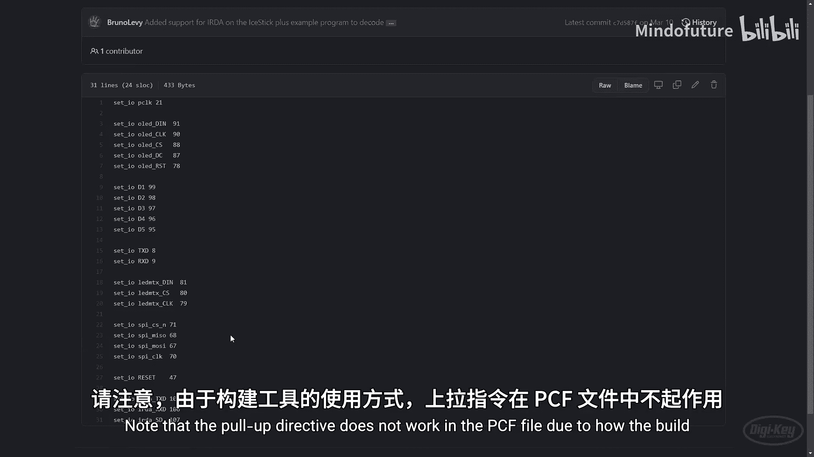
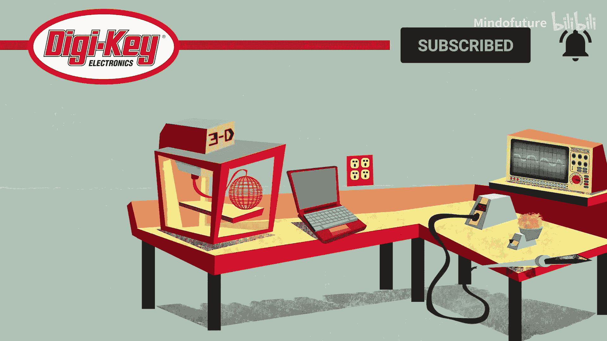

# FPGA编程入门-•-中英-p11-P11-RISC-V-Softcore-Processor---Digi-Key-Electronics--BV1kVZSY8E5j_p11-

Risk 5 is an instruction set architecture that's released under an open source license that means anyone can use it to develop a CPU without having to pay any sort of licensing fees。

 and it means we can run some of those CPU implementations on an FPGA to learn how a CPU works in this video I'll show you how to build an existing riskk5 implementation for the Itick and then use it to run some code。

There are a number of great risk 5 implementations out there for the Ice 40 FPGA。 Claire Wolf。

 the original author of Yosis and Project Icestormor。

 has created her own risk 5 implementation called Pico RV 32。 It's quite popular。

 but it requires a few more lookup tables than we can spare on our tiny It。 Bruno Levy。

 a director of research at Enea in France， created this tiny risk 5 implementation specifically for learning and tinkering。

 He calls it Fmto RV， and it's what we're going to use。 If you go to the Fmto RV folder。

 you can find a tutorial specifically for the It， as well as for some other FPGA boards。

 I'm going to be using this guide to install all the tools necessary to build this processor。

 Note that in addition to the FPGA tools， you also need a risk 5 compiler。

 so you can build C code for the processor。 It seems that all of the risk 5 FPGA projects I came across。

Lly on Linux  for installing these tools while you might be able to get this to work on Mac or Windows。

 I'm going to use Raspberry Pi O to make this process easier。

 Feel free to look through this guide as well as the other files in the repository R TL in the Fmto RV directory contains the ver log code for the processor。

 S OC stands for system on a chip。 So Fmto SC is the top level design for the project。

 This is where the processor is instantiated as a module and connected to Ram program memory and the various hardware peripherals。

 which are called drivers。 These are things like U S card and LED drivers。

 If you go into the device folder， you can see the various peripheral drivers。

 We'll only use a few of these as our It has limited space。 Finally， if you go into processor。

 you can see the various implementations。 We'll be using the quark version as it's the smallest。

 It leaves off a few features like interrupts。😊，Not actually going to get into CPU design in this series as that can be an entire college course。

 I'm just going to show you how to use someone else's design and connect custom hardware modules to it。

To start， I've Sd into my Raspberry Pi so that you can see what's going on。

 I'm going to create an FPGA directory that I can do most of my work in。

 I'll navigate into that directory。 And then the first thing we want to do is to clone Bruno's repository before installing any packages。

 I definitely recommend doing an update to the package manager。

 And I'm going to do that with Suu app update。 Once that's done， I recommend going to。😊。

Brunno's tutorials in the Learn FPGA repository here you should find a link to the Icetick tutorial assuming this is your board。

If you have another board that's listed here， I would do that otherwise you might have to port the design yourself。

 so let's go to the Itick tutorial， scroll down on this page and you should see a link to directions to install the FPGA development tool chain。

Even if you install GeOosis and Project I stormorm before this episode。

 there's a chance you might need to do it again because we're going to be installing a bunch of other tools to go along with it。

Scroll down on this page。You can see the directions to clone this repository， which we already did。

And then we need to install Eosis and we're going to build it from source。

 so I'm going to grab this command that installs the dependencies。

And paste them in。This will probably go a lot slower for you because I already have these dependencies installed。

 Next we're going to download the Yosis repository and we're going to build that one from source。

This is， of course， assuming you don't already have Yosis installed。Note that if you installed Opio。

 there's a good chance that Yosis is not on your path， so you can't call it directly。

 hence why I recommend doing this again， even if you installed Yosis through Opio。

 navigate into the Yosis directory。Type make。And you're going to let that run for quite some time When that's done。

 we need to install OOSis on our system， call Su do make installs and that will copy the necessary files so that you have access to this tool。

Next we want to install Icarus Vera log in case we want to do any sort of simulation。

 I'll go ahead and install that along with verilator， which we haven't been using in this series。

 and we can drop back to the FPGA directory。

Scroll down in the tutorial and you can see that we've done all these steps。

 including installing Ivelog， which is Icarsvelo along with Verilator。

We also need to install Project Ice stormorm。And to start that， we need a few dependencies。

So I'm going to copy this command。And run it。Once again。

 this will probably take a lot longer for you， but I already have these installed on my Raspberry pie。

Then we can clone the ice storm repository on our system。We want to go in there。

And we're going to call make J4， which says to run it with four threads that should be good enough for our raspberry pie。

Once again， this will take some time， so go make a sandwich or get some coffee。Once it's done。

 we'll want to call SuUMake install so that we can install Project I stormm on our system。

Let's leave that directory and we're going to do the same thing for next PNR。

 we'll call Git clone recursive so that it also installs all of the submods in this repository。

We'll head into the next PR directory， and we need to call CMake with a very specific list of parameters。

 So I'm going to go into the tutorial and find the next PNR section Here It is。

 It specifies the architecture as I 40 and the install prefix as user local。

 So I'm going to copy that。Paaste that in。And let it run。When CMake is done。

 we are going to call make again， and this time we'll let it run with four threads just like last time。

Once that's done as usual， we will call Suu make install that will install next PNR on our Raspberry Pi。

While that's installing， let's take a look at the tutorial。We've just installed a next PNR。

 and as you can see here， in order to have the Raspberry Pi or most Linux systems。

 at least those that use UD。In order to have our Linux system talk to the FPGA or the It in this case。

 we need to add a rule in the UD rules， and this is assuming you are running some flavor of Linux that uses UD。

We're going to。

Copy this rule。We're going to go into our Linux terminal and we're going to create a new rule in Ud ruless。

D and we're going to call this 153 lattice FtDI this is going to allow us to talk over USB to the FTDI chip on the It I would paste this in here。

 but as you can see I have already done that。This is just the rule I got from the tutorial。

 so I'm going to exit and save Then we want to go into the Fmto SOC。

 go into the learn FPGA repository， feel free to list the files there。 We want to go into Fmto RV。

 so C Fmto RV。Feel free to look in the RTL directory， we will be working with the FmtosOC。v file。

 but before we do that we need to configure a few things。

 so use your favorite editor I'm going to use nano because it's simple。

Go into RTL configs and we're going to go into I stick because that's the board that I'm using。

Scroll through this and you can see all of the defines that are being listed that include certain functionality in the SOC or in the processor first of all。

 even though we have an IR receiver and transmitter on the board。

 we're not going to be using that so let's comment that out。

I also don't care to use the driver for this OLED screen since I don't have one。

And I don't have an8 by8 LED matrix by commenting out these lines。

 we are telling the hardware or the synthesis tool that we don't want those peripherals to be built along with the processor so that's going to save us some lus and some space along with some IO pins that we may want to use down the road。

You can see that this section is commented out from these comment lines。

 we're going to be using the Fmto RV32 cork version， which is。

 I believe the least amount of lookup tables being used for this particular implementation。

This part sets where our program resides in spyflash。

 our program memory sits in the spy flashlash chip that's outside of the FPGA。

 however our RA is made up of block RA that's in the FPGA。

This define sets how much RAM we have We can't do any more if we're using the I stick 2K of this is set aside for registers that are required by the processor itself。

 we're left with whatever's left over since we start with 8k8k minus 2k gives us 6k for RA then we have this setting N RV run from spyflash once again。

 This says not to use readMm H to set the firmware in blockRA as an initialized value but rather store the program that we write and compile in spyflash so that's what this define is doing for us go ahead and save and exit。

Say yes when asked。Now we need to synthesize the design and upload it to our FPGA。

 I'm going to go ahead and plug in my ice stick into my raspberry Pi so that when it's done building it will upload to the ice stick。

Make sure you're in this Learn dash FPGA FEmto RV directory。

 you don't want to be in any other folder when you call this make command and callMake I stick and It should be in all capital letters。

Note that the very first time you run this， it will download and install all of the risk5 development tools。

 so once again， this might take some time， so be patient with it。

 The good news is once those risk5 tools are installed you shouldn't have to run this part again so when you call make It in the future it will just synthesize your design and send it right to the It or whichever FPG board you're running note that you shouldn't call make Itick you should call make and whatever board is supported。

Once you see this programming done reading verify OK by message appear in the terminal。

 this means that the Ri5 processor and the accompanying hardware peripherals as part of that SOC top levelvel design have been synthesized routed and uploaded to your FPGA。

 so now you have a blank processor that's just sitting there in your FPGA waiting for some instructions to tell it what to do。

At this point we need to write some code and then compile it and upload it before we do that。

 I recommend going back to the repository to poke around some of the include files to kind of get an idea of what's going on。

😡。

Let's head back to Fmto RV。 We'll look in firmware this time。And let's look in Lib Fmto RV 32。

 This contains some very useful code include files and libraries that I recommend looking through。

In particular， we want to look at the hardware config bits， and that's the header file。

These bits are used to control your special purpose registers。 Now。

 note that these registers don't actually exist in memory。 They're just in address space。

 So when we write to a particular address， the hardware recognizes that we're trying to do something with a particular driver or peripheral and it handles whatever you're trying to write at that address。

 These bits tell us the address that we need to write to。So let's go back。

We're going to look at femtorv32。h。If you scroll down， you should see the IO listed here again。

Those bit numbers that we saw earlier correspond to these IO bits。

The IObase is the address of that imaginary memory space， so when we write something to Hex 400000。

 we're telling it we want to do something with one of these devices for example， turn on the LEDs。

 which is what we're going to do。Pay close attention to what's going on here。

Normally you would call these macros IO in or IO out or LEDs。

 and it would handle writing or reading from the correct imaginary address or memory address that doesn't exist。

 It's really just pointing to a。Hardware driver。So we would take IO base， which is this x40。

0000 number， it's going to then add it to the port， which is what we input here。

And you would give the port as something like this like IOLs。

And so this says IO bit to offset IO LEDs bit。Which， if you remember earlier， IOLs bit。Is 0。

Let's head back into that file。ああ。IObit to offset is given by this macro， so one。Left shift。2 plus 0。

 So one left shift2 added to 4，0，0，0，0，0。That means the address for working with the LEDs is actually Hex4。

0，0，0，04。When we write to that address， that will tell the hardware driver that we want to control the LEDs。

Let's give that a shot。

Back in our terminal， we're going to go to that top level FPGA directory。

 and I'm going to create a directory that's called FEmto RV32 This doesn't exist。

 I'm going to keep my software or rather my firmware in here。

And I'm going to create a project called Blinky。Let's navigate into that directory。

And I'm going to make a main dot C if you've done any sort of C programming that should look very familiar Luc for us。

 Mr。 Levy has included a header file that defines some very nice features for us to use in this Fmtorv32。

h。With this， we can do all that memory mapping we just looked at and it gives us access to things like printf。

 which outputs things to the serial console， or in the case of the Itick out of UAt through the FTDI chip over USB and to our computer we will use a make fileile that handles all of the linking for us so we get access to these libraries。

We're going to create a super basic loop here。 We're going to print something to the console each time through this loop。

 I'm also going to print out the frequency that the CPU is running at just as a test。

 and this should be stored in the Fmto RV 32 underscore freak constant Now remember what I said earlier that we write to this imaginary address。

This memory doesn't actually exist。 We're just addressing into this space where the S OC is looking for something to be written at this address。

 and it's going to do something with that value。 In this case， when we write to hex 4，0，0，0，0，4。

 that says do something with the LEDs driver And in this case， we're going to write 3。

 which is binary 1，1， which says to turn on the。First and second LEDs，0，0，1，1。

 So the first two LED are on。 the second two LEDs are off。

 We do this by casting that address as a pointer and then dereencing that value so that when we write something to that address。

 it's writing to that address in memory or it's thinking we're trying to write something to an address in memory。

That Fentto RV32 header file also has a delay function that we can use and that handles just delaying the processor for 500 milliseconds After that delay。

 we're going to then write zero to that imaginary memory address to turn off the LEDs。

 and then we're going to delay again for another 500 milliseconds。

Because I said main should return an integer， I'm going to say return zero。

 even though my program should never actually get here and close out Ma。Let's exit and save。

And now I'm going to create a make file。To make things very simple for us。

 that repository contains a makefi dot include file。

 we want to include that in our make file and feel free to use this make file to set up your project or link any other libraries you want。

 but for this very simple program， we shouldn't need to include anything else。

 So all we have to do is point to that include file。And then save an exit。Then we callMake Main。

 which is the name of our main。c file， but we give it the suffix。prog。

 which tells that included make file that it needs to compile our code for the Rik5 processor and also program or upload it to our FPGA board in which case our program will sit on the spy flashlash memory and the CPU will read the instructions from there in order to execute them。

This should be fairly quick because our program is pretty small。Everything should look OK。

 you should get verify OK and buy， which means it's done， it has uploaded to our FPGA。From here。

 let's install a serial terminal in this case I'm going to install PCOcom。

 you can use screen or anything else you want。And I'm going to call PCOCO。

 give it a bo rate of 115200， and connect it to dev TTY USB， and this is going to be USB0 or1。

 in my case， it looks like it's a USB1， just pay attention to what serial device your FPGA board enumerates to。

So let's open that and hopefully if everything works。

 you should see hellello world followed by the frequency of your CPU being printed to the terminal。

If you're in PCOcom when you're done， press C A and then control X to exit。

And let's go take a look at our board。The first two LEDs should be blinking。

 That tells us we wrote to the correct memory address in our code to control the hardware。

 Your challenge is to get buttons working as inputs on the femto Rv。

 You'll need to change some of the ver log code as well as write a C program to test the buttons。

 I recommend starting with the femto S O C verlog file。 If you look at the port list。

 you can see where some of the buttons are defined depending on the board used。

 You can use the default buttons or define your own。 If you look at the Itick PCf file。

 You can see that the P mod pins were taken up by other peripherals。

 you'll need to disable some of those and add your button pins here。

 Note that the pullup directive does not work in the PCf file due to how the build tools are used。😊。

If you take a look at this tech library document， you can find a number of directives that will work for the Ice 40。

 In particular， you'll want to use the SB underscore Io directive that allows you to control the pin hardware directly。

 You can instantiate it just like any module， and you'll want to configure the pin to be a simple input。

 You can find an example call in this section of the document。

You'll upload the changes to the processor first from there you build and upload your C program for my test。

 I have the LED flash as long as the first button is held。

I'll post a link to my solution in the description。 Take your time with this challenge。

 as you'll need to read other people's code to get a sense of what's going on。 Also。

 this is probably a larger project than what you might be used to。

 so it can be a little tricky to keep track of everything。 Next time。

 I'll show you how to modify that processor to include your own hardware peripheral。 Happy hacking。え。

え？

