# FPGA编程入门-•-中英-p12-P12-RISC-V-Custom-Peripheral---Digi-Key-Electronics--BV1kVZSY8E5j_p12-

Last time we uploaded a Rik 5 processor to our FPGA and then used it to run some code that blinked a few LEDs。

 This time， let's take things one step further and create our own custom hardware peripheral to do that。

 we'll need to understand how memory addressing works in the Fmto RV implementation。

The risk 5 core in the femto RV implementation uses a 32 B addressing scheme。 However。

 when it comes to memory， a few tricks were employed to keep the logic cell count low。

 so it could be built for smaller FPGs like the one on our It。 First， memory is addressed like this。

 The first8 bits are completely ignored。 So are the last two Bs。

 but that's because memory is addressed using words and each word is4 bys。

 bits 22 and 23 are used to determine the destination or page of the memory。 If they're set 2 0，0。

 then we address into Ram， which is the block Ram for the I stick。 If there 01。

 it means we want to talk to a hardware peripheral。 Note。

 there's no actual memory allocated for this I O page。

 The hardware sees that where addressing the I O page and then uses the address shown in red bits to read and write to that peripheral。

 Finally， if the page bits are 10。It meanss we want to address into the spy flash with the ice stick。

 This is where the CPU finds its program instructions。 The addressing scheme looks like this。

0 through hex 3 F F F Fc is addressing into Ram。 The It has only 8 kB of block Ram space。

2 kB of that address space is set aside for general purpose registers。

 So that only leaves us with 6 kB of actual Ram。 We ignore the last two B because each element is 4 B wide。

 Hex 4，0，0，0，0，0 through Hex 4 8，0，0，0，0 is our I O page。

 It uses a one hot encoding scheme to talk to peripherals， which I'll show you in a minute。 Finally。

 Hex 8，0，0，0，0，0 through Hex B F F F Fc is used for spy flash。

 Here is an example of addressing into the LED peripheral。 If we write data to hex。😊，40，0，0，0，4。

 We write to the LED hardware driver。 The driver takes that data and does something with it。

 In this case， it turns the LEDs on or off。 Here's an example of what the Uar data register looks like。

 and here's an example of the Uar control register address。

 Note that the address does not increment sequentially。 it uses a oneho encoding scheme。

 which means that only one bit in the address space is high at a time。

 While it means that we lose out on a lot of potential address spaces for peripherals。

 it saves a lot of logic cells because the drivers only need to examine one bit at a time to determine if they're being addressed to do this in our C code。

 We add a base address of hex 400000 to one left shift 2 plus the peripheral number we want to use。

 that gives us space for 20 peripherals as there are 20 bits available in the usable address space。

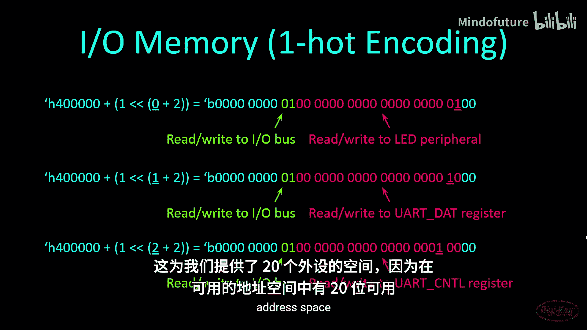

If we go into the Fmto RV R TL code and into devices。

 you can see a hardware config underscore bits ver log file。

 Let's open it 12 peripherals are already defined for us on our It。

 We disable a few of these like the OE controller LED matrix and S card as we don't need them and they take up valuable logic cells。

 The last three peripheral slots are taken up by registers with constant values。

 so we can't use those either。 That leaves us slots 12 through 16 to add our own peripherals。

 We're going to make a simple hardware pulse with modulation or PwM driver to control the brightness of one of the LEDs and integrate it into this system on a chip。

 Here's how that PwM peripheral will work。 Well create a simple 12 bit counter that continuously counts from 0 to 4095。

 resets to 0 and starts over again。 We create。😊。

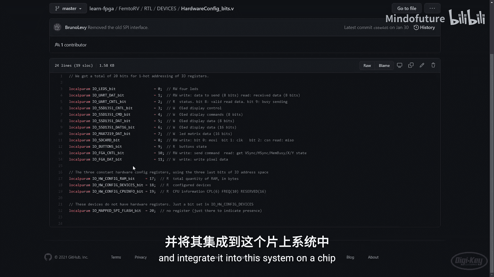

Register that contains a PWM value。 We can write to this register by writing to an IO memory address。

 For example， let's say we write 1365 to this register。 Now。

 whenever the counter is less than this value， the LED will be on Whenever the counter is equal to or greater than this value。

 it will be off at this PwM value， the LED will have about a 30% duty cycle。

 So long as the LED is toggling fast enough， it should appear steady to our eyes with a 12 MgaHz clock controlling the counter。

 it should be plenty fast enough。 Note that this is a simple PwM scheme as it means we can turn the LED fully off。

 but we can't turn it fully on。 There are ways to correct this， but let's keep things simple for now。

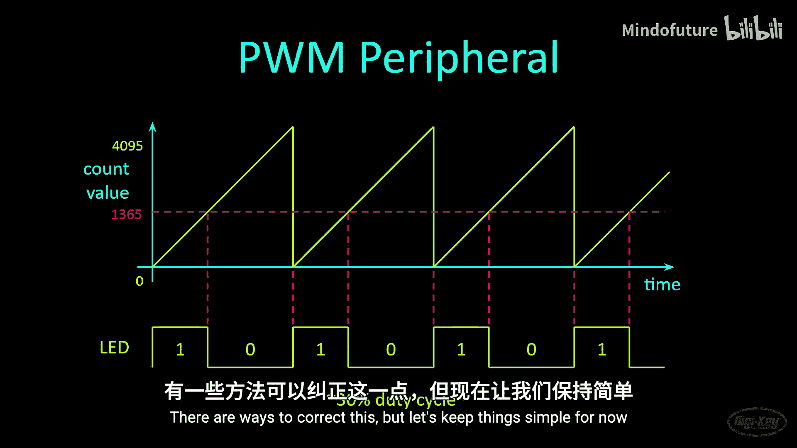

Here is my PWM hardware peripheral。 If you've been following along with this series。

 pretty much everything in here should look familiar。 I define the PWM module。

 I give it a parameter to define the number of bits for the maximum count of the PWM counter。

 In this case， it's going to default to 12 bits， which means the PWM counter should count from 0 to 4095。

 I have a clock input that should be our global 12 MHz clock。 There is also this right strobe。

 This is something controlled in the SOC hardware。Whenever it determines that we're trying to write to this particular address。

 this line stroobbes high or pulses high for a clock cycle。

 and that lets us know that we're trying to write to a memory address and it might not be a real memory address。

 it might be a hardware driver in this case we need to look to see if that strobe goes high so that we can register whatever value is in W data。

This driver only accepts that data if this select line is also high。

 so this strobe line will go high and if this select line is high， we need to register that data。

We are going to ideally control four LEDs， but in reality I'm going to control only one of those LEDs。

 feel free to extend this to controlling lots of different LEDs if you so desire。

We have some internal register elements to help us remember the count as well as the registered maximum count we set from code。

And as I mentioned， we're only going to be controlling the first LED。And for each clock cycle。

 the first thing we do is we look to see if the select and right strobe lines are high。

 if so we take whatever data is on that right data that's incoming on the IO bus and we store it in this PW count register which is internal to this driver hardware。

We also reset the counter just because we should reset a counter somewhere。

And as I mentioned earlier in a previous episode I am setting these registered elements to some initial value。

 this works with Yosis， it doesn't always work with every synthesis tool and it doesn't always work with every FPGA。

 but for Yososis and the Ice 40 FPGs， this initialization setting where we take a registered element and say equals something and it will start at that value。

 that saves us from having to have a reset line into this hardware。

The other thing that's going on is if the select and strobe liness aren't high。

The counter will just continuously increment。 And as soon as it reaches its max value。

 it will just roll over back to 0。 And that's fine。

 We're going to compare the current count to the maximum count set from our code that was written in from this I O bus and if the current count is less than that。

 we're going to drive the LED high。 And if the。😊，Current count is greater than or equal to this amount。

 the LED will be low， and that creates that very rapid blinking effect where we can control the duty cycle that we saw earlier in the slide。

That will allow us to control the brightness of an LED， or maybe if you connect a motor。

 control the speed of a motor before we copy this code into our SOC。Let's go ahead and simulate it。

 So I'm inside of this PwM folder where I've got my ver log and I've got my test bench。 And in fact。

 we can take a look at that test bench in case you're curious what it is。

 All I'm going to be doing is instantiating the driver。 I'm going to write 0% duty cycle。

 and you can see here where I set Strobe and select to1。 I write0 to that PWM count register。

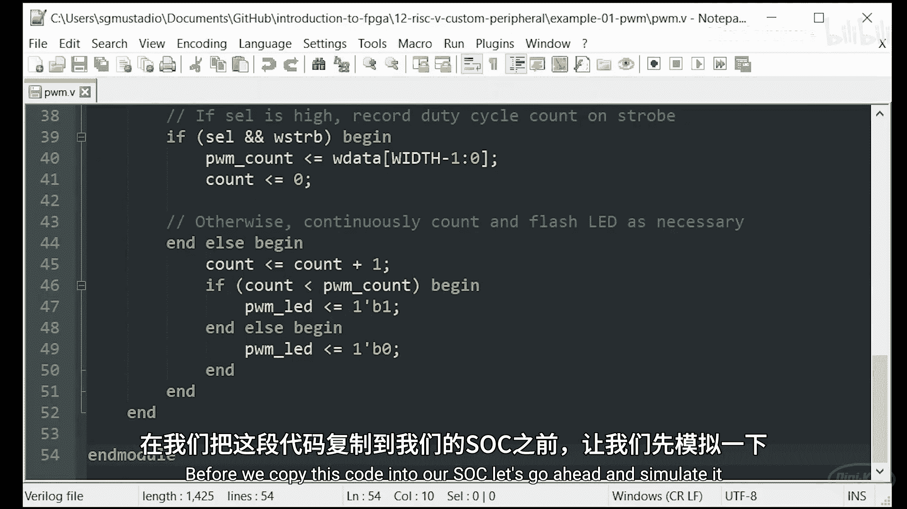

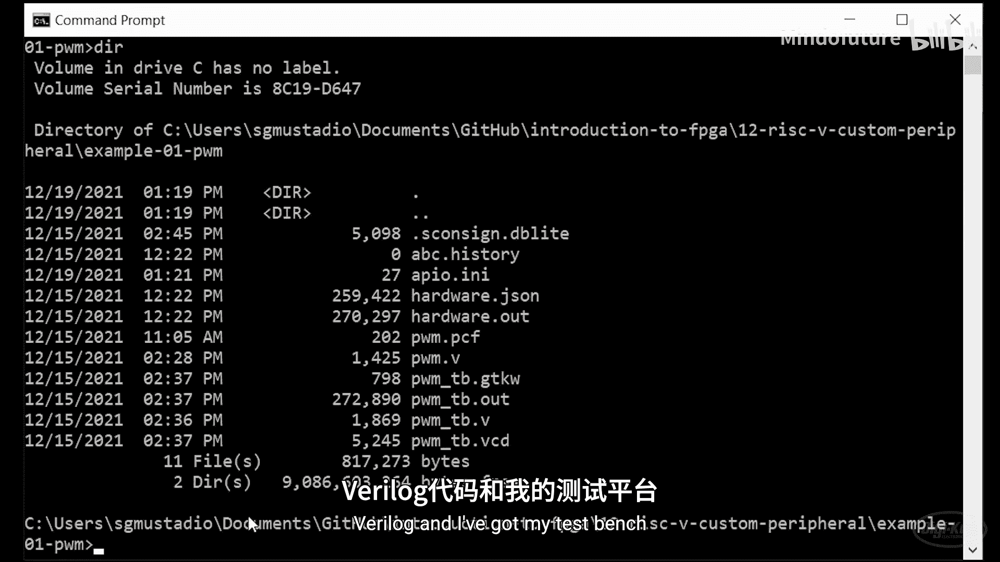

And then wait a few clock cycles and set the strobe and select line back to zero。

 I let that go on for a while， I'm going to try about 33% duty cycle and then try 100% duty cycle and this just finishes up the simulation。

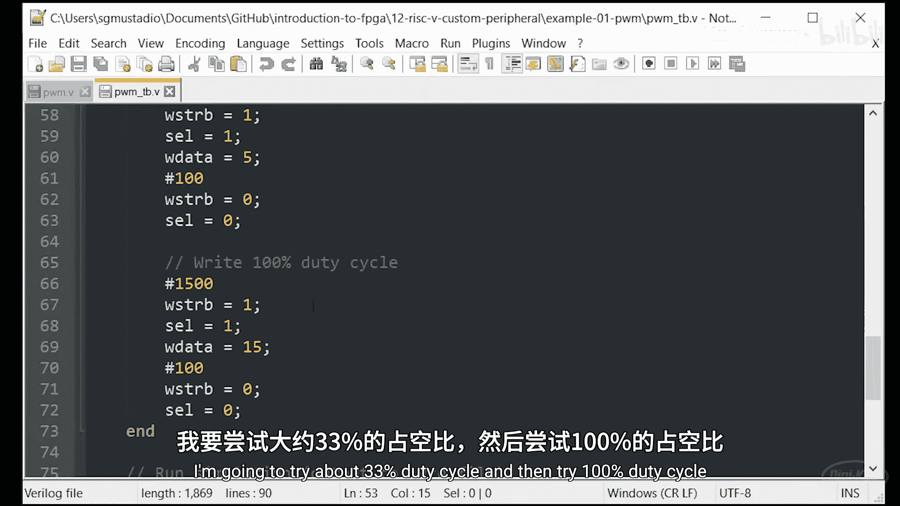

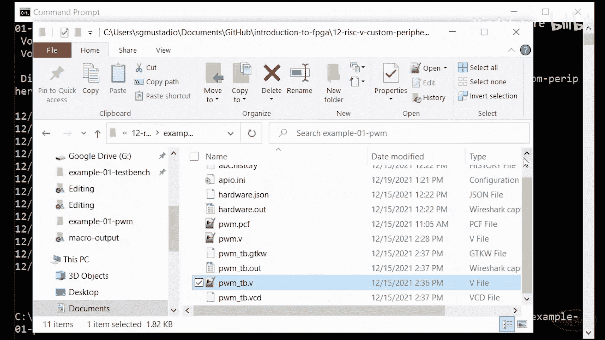

Let's give that a shot， GTK wave will open， and as you can see here I pulse。

 strobe and select this should cause W data to be written to that driver register and count starts over again on this clock cycle。

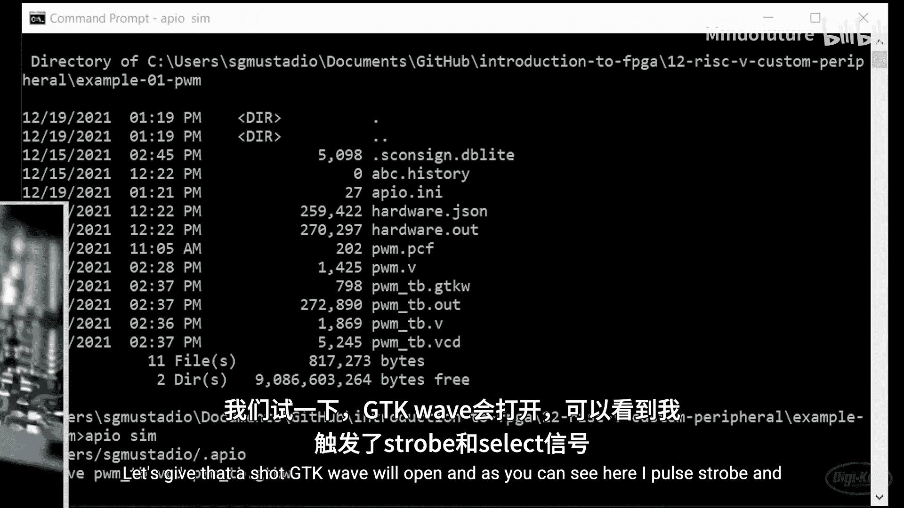

And sure enough， the LED remains constant low throughout the whole thing。I then write。5。

To that PWM count value。And one thing I forgot to mention here。

 if we come back to this test bench rather than using all 12 bits。

 I'm incheing it with just four bits so that way we can see it working with less bits。

 we don't have to wait 4000 clock cycles to see if PWM is working。

 so this should only count to hex F。

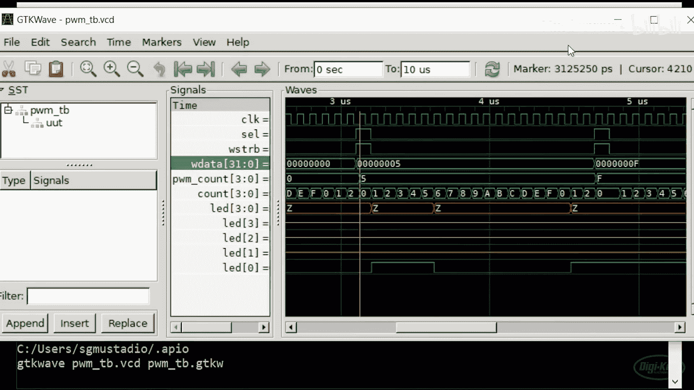

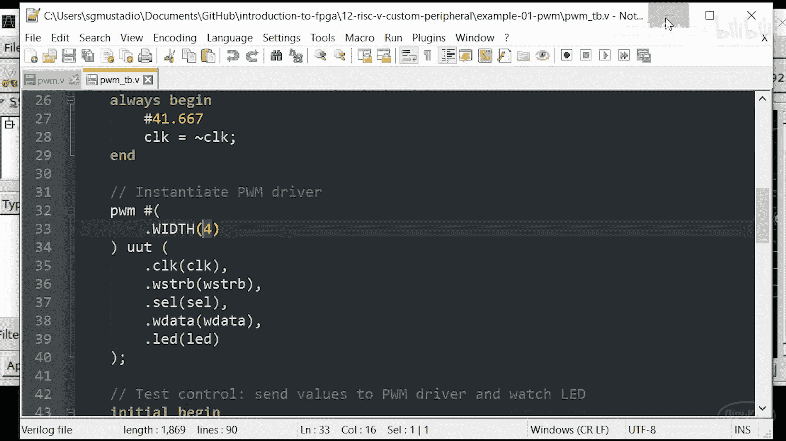

And sure enough， you can see where count counts up to hex F， it rolls back over to zero。However。

Once it reaches5， that's where the LED goes off and it remains off until the counter value rolls back over from zero to 1。

 and then it turns back on。And then same thing here if we set F as our PWM value。

This is ideally having the LED always on， but because we don't have that option。

 this is a very simple PWM controller， it's going to be off for one cycle and that's okay for my purposes。

 there are ways to make it a better PWM driver where it's more accurate where you can have it always off and always on。

 but that requires a little extra hardware。 so for the sake of keeping things simple。

 I'm perfectly happy where the LED can't always be fully on。

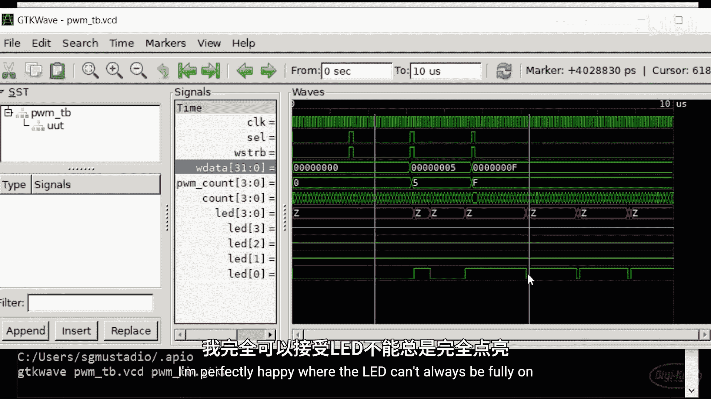

Let's open up my PWM code。I'm going to select all of it and I'm going to copy it。

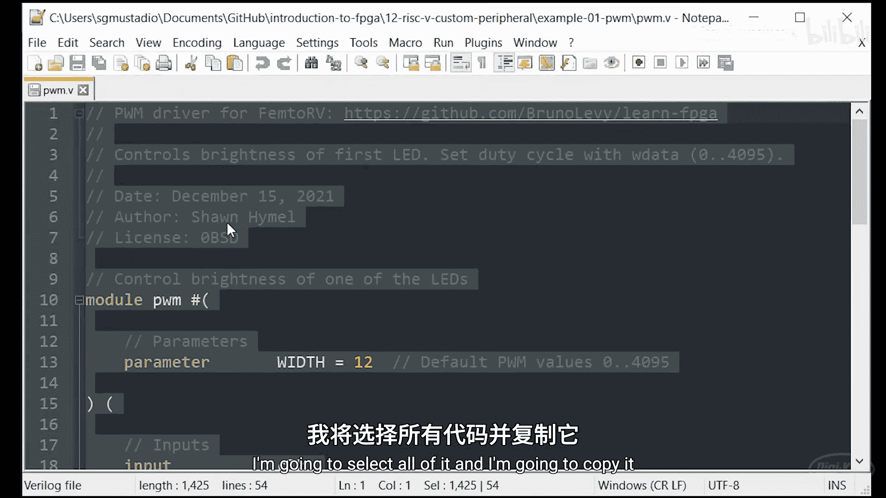

Let's go into my Raspberry Pi and I'm going to navigate into that learn FPGA directory From there。

 I'm going to go into femto RV。 I want to go into RTO and then devices。

 This is where you can find all the source code for those hardware peripherals。

 I'm going to make my own called PwM dot V。 and this is where I'm going to paste in all of that code。

 I'm going to exit and say yes to save it。Let's head back to the Fmto RV directory as we want to do everything from there to begin integrating this PWM driver that we just created。

 we need to first modify this hardware config bits Vlog file。In here。

 I'm going to add my own local parameter。That denotes。

Where the address for this PWM driver can be found and those are not tabs。

 so I'm just going to use spaces。And 12 through 16 are available， so let's use 12 for this address。

 and I'm going to say that this is ariable address where we can write the duty cycle to that register to control the brightness of that LED。

Let's exit and save。And then I'm going to edit the big SOC Vo file。

The first thing I want to do is include my PWM driver in this include list。

 just like you might expect from header files if you've worked with C or C++。

 this essentially just copies all of that code right here when it goes to synthesize this design。

That's what that backt include directive does。And we're just telling it where to find that ver log code。

So we're including our PWM driver code here and then let's go down to our port list。

I'm looking for this NV IO LEDs and I'm going to copy something like it。

 Now this is not exactly robust because we can only have LEDs or PWM defined。

 so you'll have to remember if you're trying to instantiate both of these things will likely fail because we're going to use the D1 D2 D3 D4 nomenclature for driving those pins。

There's probably some extra work you can do so that you can work with both LEDs and PWM。

 But I wanted to control the onboard LEDs with PWM or just one LED in this case。

 So they're going to conflict a little bit。 We'll create this N RV I O PWM definition somewhere else。

 but know that if it's included。It will enable the D1 through D5 output， as I mentioned。

 these conflict with these， so you can only have either ILs enabled or PWM enabled。

Feel free to find a way that lets you use both of those。

 but for now let's just use the PWM driver and we won't instantiate that LED driver。

I'm going to scroll down on this and look for where the processor is instantiated。

And I'm going to add。The instantiating code for my PWM driver here。

 and feel free to look up above it to see how other drivers are instantiated。 In this case。

 I'm going to follow their commenting style。And if I scroll up。

 you can see how some of their other peripherals are instantiated like this S card。

 You get an idea of how things are connected， how parameters are done。

 It's really just instantiating your driver inside of an if def block。 So once again。

 we'll say if N RV IO PWM is defined， we're going to instantiate our PWM module。

 Even though 12 is the default， we're going to explicitly define 12 here for our counter bit width。

 we'll give it the name of PWM。And we will connect some lines。

 Clock is connected to the main clock signal。The right strobe line is connected to I O WS T RB。

 And you can look up above to see that is indeed what that line is named。 If you remember。

 we defined that IopWM bit parameter as 12 So all that's going on for this select line is it's looking at the address that's being written to and says as long as that 12th bit is being written to。

Go ahead and write to this peripheral writing data is done with this IOW data bus。

 and the LEDs are given as D1 through D4。When you're done， close out the ifDe block。Now。

 you might be asking。How do we avoid writing to this peripheral？If this 12th bit is one。

 regardless of what address we might be writing to， and that has to do with this IO Strobe bit。

If we scroll up just after this spy flash bit。You can see that the right strobe line only goes high。

If memite strobe is high。Which is anytime we're writing to memory and also this memory address is IO is high。

This is done by looking at that 22nd bit and as we saw in the slides earlier。

That 22nd bit is only high。If we're trying to write to that I O page， if it's low。

 it means we're trying to either write to Ram or we're trying to write to spy flash。

 So with that end gate， that's how we know that we're just writing to a。

Hardware peripheral rather than trying to write to some piece of RAM or flash memory。Let's save this。

As I mentioned earlier， we need to make sure that the LED hardware driver isn't conflicting with our new PWM peripheral to do that。

 we want to go into Configs and then the configuration file for our particular board。

Here you can see that NRVIO LEDs is defined， we want to comment that out so that it isn't defined。

 and we're going to add our own definition for the IOPWM。

This will enable the PWM driver that we defined in that FmMto SOC file。

 and in this case I'll make a comment saying it's peripheral to control one of the LEDs。

Let's save this file。And I'm going to make ice stick so that will compile or rather synthesize everything and then send it up to my ice stick and make sure you're calling this from this Fmto RV directory。

This will take a few minutes while it synthesizes place and routes， and then uploads it to my FPGA。

Hopefully， everything synthesized and uploaded correctly to the FPGA。

 And now it's time to deal with the software side of things While we added all of the hooks necessary to control our driver from the hardware side。

 we're missing a few things on the software side。 For example。

 if you look at this femto Rv32 do H file。You can see that there's a bunch of stuff that's defined in here。

 including these IO macros that help you talk to the correct address spaces for all of the hardware peripherals。

You are welcome to update this header file to include the PWM peripheral address。

 but I'm not going to worry about it because I'm just going to do everything manually in C。

 So let's exit out of here。 and I'm going to head to the FmMto RV32 project space where I keep all of my software for this particular processor You can see the blinky project that we created in the last episode I'm going to make a PWM test project。

And I'm going to go into there。As we did last time I'm going to include that Fmto RV32 header file that we just looked at and I'm going to define Ma。

 I'm going to create a forever while loop and in there I'm just going to count up from  zero to 4095 I'm using magic constants here what you really want to do is in that Fmto RV32 header file define some of these constants based on what you created in your PWM device driver or your peripheral。

All I'm going to do is write that value to this address space。This address space is Hex 404000。

 and as a quick note， that should be my base address。Plus。One left shift。12 plus 2。

12l is that bit we are looking for when we are writing to our PWM peripheral。

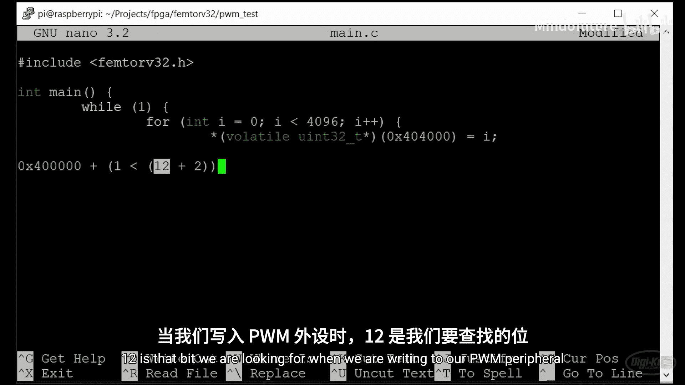

And if we bring up a calculator here， I'm going to do 4，0，0，0，0，0。 and I'm going to add。1 left shift。

2 plus 12。And sure enough40，400，0。

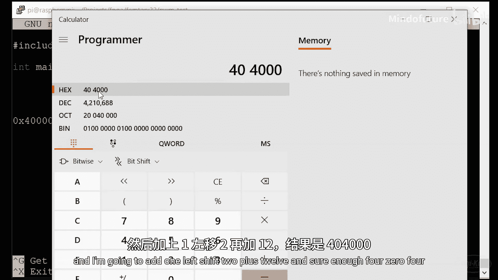

And that's how we get this value right here。 I'm going to delay by one millisecond so that you can actually see the LED maintain its brightness for a brief moment before increasing。

 which is what we're going to do here。 We're going to slowly increase the brightness of the LED。

 and then it's going to drop back down to zero， basically creating a saw wave or a saw tooth wave of brightness。

 I'm going to return zero just to be compliant with this int main。

 even though the program should never get here。Let's exit。We'll save it。

We need to create our make file and we're going to include that make file include file。

 which should have all of the things necessary for us to build this program and compile it using the Rik5 compiler and then it will upload to our flash memory on the Itick。

Let's save this。And if you remember， I need to type make main dot Progue。

 which says to build the main dot C file and main is our target here。

 and then the dot Progue says to go ahead and upload that to the Itick。This should be pretty quick。

And let's check to see if it works。

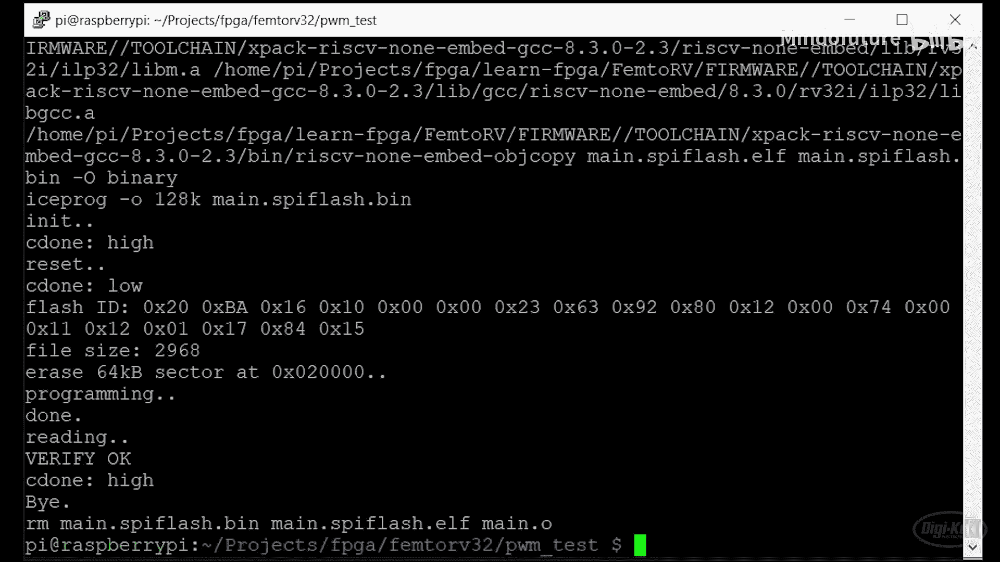

With any luck， we should see the LED slowly getting brighter and brighter before it resets2 off because it has to go through over 4000 steps each waiting for one millisecond。

 it can take over four seconds to complete the cycle。There's no real challenge for this episode。

 However， I want to encourage you to try making your own hardware peripheral for the Fmto RV processor。

 This could be whatever you want。 It might be a spydri or something that controls Nepixels。

 If you do something cool with the femto RV or you implement this peripheral。

 Feel free to tag us on Twitter。 This concludes the introduction to FPG series。

 I hope you had as much fun watching the videos and trying the challenges as I did making them。

 I want to thank you for sticking with it until the end。 And as always， happy hacking。😊，哎。え。

