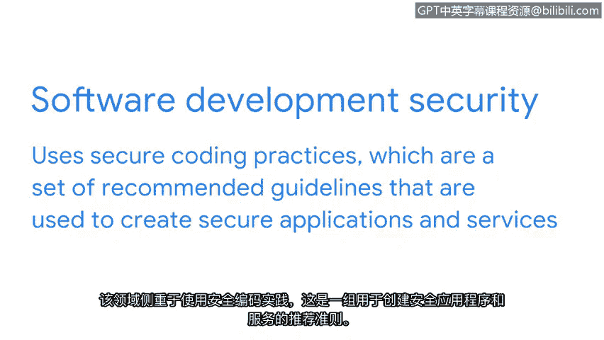

# 谷歌网络安全专业证书第一课：《信息安全基础》（中英字幕，前面分p中字，后面分p英字） - P16：15_CISSP八大安全领域介绍（下）.zh - GPT中英字幕课程资源 - BV1Bk4y1u7KL

Welcome back。In the last video， we introduced you to the first four security domains。In this video。

 we'll introduce you to the next four security domains， identity and access management。

 security assessment and testing， security operations and software development security。😊。

Familiarizing yourself with these domains will allow you to navigate the complex world of security。

 The domains outline and organize how a team of security professionals work together。

Depending on the organization， analyst roles may sit at the intersection of multiple domains or focus on one specific domain。

Knowing where a particular role fits within the security landscape will help you prepare for job interviews and work as part of a full security team。

 Let's move into the fifth domain， identity and access management。

Identity and access management focuses on keeping data secure by ensuring users follow established policies to control and manage physical assets like office spaces and logical assets such as networks and applications。

Validating the identities of employees and documenting access role are essential to maintaining the organization's physical and digital security。

For example， as a security analyst， you may be tasked with setting up employees key card access to buildings。

The sixth domain is security assessment and testing This domain focuses on conducting security control testing。

 collecting and analyzing data， and conducting security audits to monitor for risks， threats。

 and vulnerabilities。Security analysts may conduct regular audits of user permissions to make sure that users have the correct level of access。

For example。Access to payroll information is often limited to certain employees。

 so analysts may be asked to regularly audit permissions to ensure that no unauthorized person can view employee salaries。

The seventh domain is security operations。 This domain focuses on conducting investigations and implementing preventative measures。

Imagine that you， as a security analyst， receive an alert that an unknown device has been connected to your internal network。

You would need to follow the organization's policies and procedures to quickly stop the potential threat。

The final8 domain is software development security。

 This domain focuses on using secure coding practices。

 which are a set of recommended guidelines that are used to create secure applications and services。

A security analyst may work with software development teams to ensure security practices are incorporated into the software development lifecycl。

If， for example， one of your partner teams is creating a new mobile app。

 then you may be asked to advise on the password policies or ensure that any user data is properly secured and managed。

That ends our introduction to CISSP's eight security domains。

Challenge yourself to better understand each of these domains and how they affect the overall security of an organization。

While they may still be a bit unclear to you this early in the program。

 these domains will be discussed in greater detail in the next course。 See you there。

