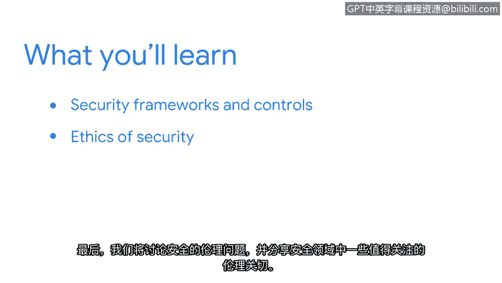

# 谷歌网络安全专业证书第一课：《信息安全基础》（中英字幕，前面分p中字，后面分p英字） - P18：17_欢迎来到第三周.zh - GPT中英字幕课程资源 - BV1Bk4y1u7KL

Hi there。 Glad to have you back。 You're half way dumb with the first course。

 So you're making great progress。😊，In this section。

 we'll discuss how organizations protect themselves from threats。

 risks and vulnerabilities by covering key principles， such as frameworks。

 controls and ethics to help you better understand how this relates to the role of a security analyst will use an analogy。

 Imagine you want to plant a garden。 You research， plan。

 prepare and purchase materials while considering all the things that could potentially present a risk to your garden。

 You establish a plant to pull weeds， spray for bugs and water your plants regularly to prevent issues or incident。

But as the days go by， unexpected problems arise。 The weather has been unpredictable。

 and pests have been aggressively trying to infiltrate your garden。

You start implementing better ways to safeguard your garden by installing a surveillance camera。

 building a fence and covering your plants with a canopy to keep your garden healthy and growing。😊。

Now that you have a better idea about the threats to your garden and how to keep your plants safe。

 you establish better policies and procedures to continuously monitor and safeguard your garden。

In this way， security resembles a garden。It's an evolving industry that will challenge you to make continuous improvements to policies and procedures that help protect your organization and the people it serves。

To that end， we'll introduce security frameworks and controls and explain why they're important。

We'll also cover core components and specific examples of frameworks and controls。

 including the confidentiality， integrityte， and Availability Triad， or C Triad。

We'll end with a discussion about the ethics of security and share a few notable ethical concerns in the security field。

 evolvinglving security practices may seem a little abstract， but many of us use them every day。

For example， I use security keys， which are a type of security control as a second form of authentication to access my accounts。

The keys ensure that only I can access my accounts， even if a password has been compromised。

By improving confidentiality， they also assure me that the integrity of my accounts is intact。

Having processes and procedures in place to organize security efforts and make informed decisions is important for any organization。

 I'm so excited to get started， and I hope you are， too。😊。

