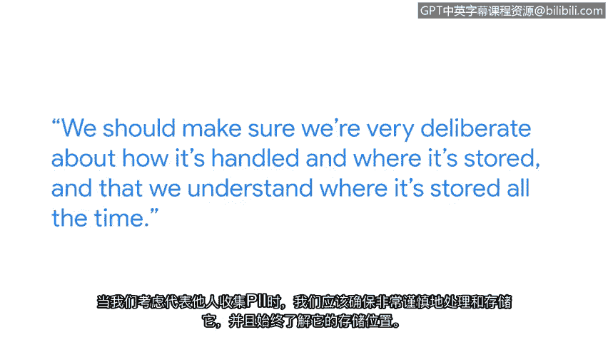

# 谷歌网络安全专业证书第一课：《信息安全基础》（中英字幕，前面分p中字，后面分p英字） - P21：20_希瑟：保护敏感数据和信息.zh - GPT中英字幕课程资源 - BV1Bk4y1u7KL

。

Hello， my name is Heather and I'm the vicece president of security Engineing at Google PII has been an important topic on the Internet since the beginning of the internet and we have been talking about increasingly sophisticated ways to protect that data over time。

When we think about collecting P I I on behalf of another person。

 we should make sure we're very deliberate about how it's handled and where it's stored and that we understand where it's stored all the time。

 depending on what kind of role you're in， you might also need to protect that data to comply with regulation or law。

 And so it's important to understand how the data relates to some of those obligations。

 If an organization fails to meet our obligations， a number of things might happen。

First， you might see a government regulator become more interested in understanding the practices around how a company is handling data。

 Secondly， consumers， customers。Businesses may actually begin to directly inquire of the company how they're handling data。

 And this may become part of the customer relationship。

And increasingly important if that data is very sensitive。 And third。The last consequence is。

Legal action。 And it's not uncommon for us to see victims of cybersecurity incidents now suing companies for mishandling their data。

You can keep up to date with compliance， regulation and laws around PI by consulting the relevant website in the jurisdiction that you have a question for。

 Many government websites now post the laws， regulations and compliance requirements for data that's being handled。

 the regulations and laws that govern how PI can be handled are very complex。 all over the world。

 countries， states， counties are regulating it at different levels。

 It's important to understand and to be aware that these laws exist。 However。

 if you need to ask a question about of specific law。

 It's important to seek advice from legal counsel for that particular jurisdiction。

 It may be very different than the jurisdiction that you're in。

