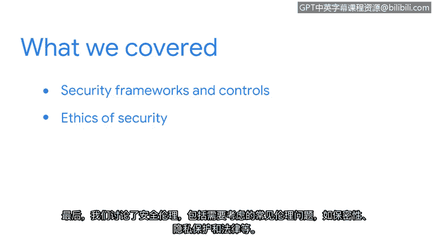

# 谷歌网络安全专业证书第一课：《信息安全基础》（中英字幕，前面分p中字，后面分p英字） - P24：23_总结.zh - GPT中英字幕课程资源 - BV1Bk4y1u7KL

You are now better prepared to understand and help make decisions regarding assessing and managing risks。

 Let's review what we've covered。 We discussed security frameworks and controls and how they're used to develop processes and procedures that protect organizations and the people they serve。

 We also discuss core components of frameworks。 such as identifying security goals and establishing guidelines to achieve those goals。

Then we introduce specific frameworks and controls。

 including the C Triad and the NIST CSF and how they are used to manage risk， and finally。

 we discuss security ethics， including common ethical issues to consider such as confidentiality。

 privacy protections and laws。

You're almost there only one more section to go in this course Coming up。

 you'll learn about common tools and programming languages used by security analysts to protect organizational operations。

Hope you're as excited as I am to keep going。