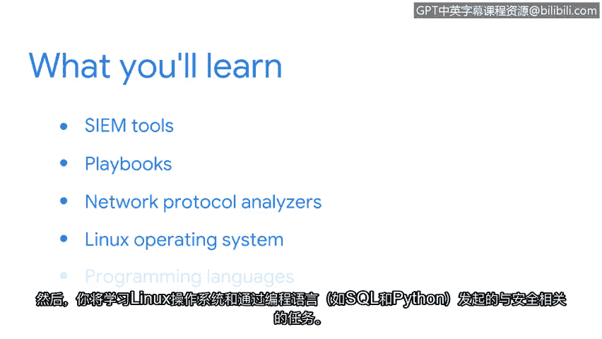

# 谷歌网络安全专业证书第一课：《信息安全基础》（中英字幕，前面分p中字，后面分p英字） - P25：24_欢迎来到第四周.zh - GPT中英字幕课程资源 - BV1Bk4y1u7KL

Welcome to the final section of this course。Here we'll be introducing tools and programming languages that are commonly used in the security field。

They are essential for monitoring security in an organization because they enhance efficiency by automating tasks。

Although we're only introducing these concepts and tools at this point， later in the program。

 you'll have opportunities to use them in a variety of hands on activities。In the following videos。

 you'll learn about security， information and event management， or SIim tools。

You'll also be introduced to other tools such as playbooks and network protocol analyzers。

 Then you'll learn about the Linux operating system and security related tasks that are initiated through programming languages such as SQL and Python。

For me， SQL is one of the most useful tools， it allows me to explore all the different data sources we collect。

 and it allows my team to analyze the data for trends。Take your time going through the videos。

 And if you need to， rewatch them。Also， know that these tools will be discussed in much more detail。

 and you will be able to practice them first hand later in the certificate program。

While every organization has their own set of tools and training materials that you'll learn to use on the job。

 this program will provide you with foundational knowledge that will help you succeed in the security industry。

Let's get started。