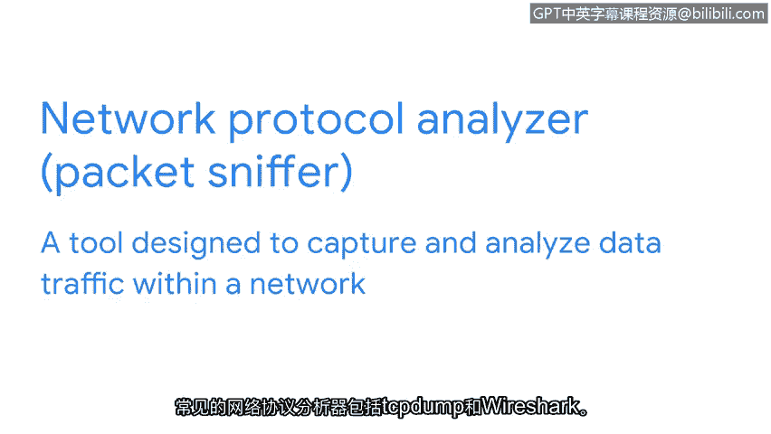

# 谷歌网络安全专业证书第一课：《信息安全基础》（中英字幕，前面分p中字，后面分p英字） - P26：25_常见的网络安全工具.zh - GPT中英字幕课程资源 - BV1Bk4y1u7KL

As mentioned earlier， security is like preparing for a storm。 If you identify a leak。

 the color or shape of the bucket you use to catch the water doesn't matter。

 What is important is mitigating the risks and threats to your home by using the tools available to you。

As an entry level security analyst， you'll have a lot of tools in your toolkit that you can use to mitigate potential risks。

In this video， we'll discuss the primary purposes and functions of some commonly used security tools。

 and later in the program you'll have hands on opportunities to practice using them。

Before discussing tools further， let's briefly discuss logs。

 which are the source of data that the tools will cover are designed to organize。

 A log is a record of events that occur within an organization's systems。

Examples of security related logs include records of employees signing into their computers or accessing web based services logs help security professionals identify vulnerabilities and potential security breaches。

The first tools we'll discuss are security information and event management tools or SIM tools。

 A SIM tool is an application that collects and analyzes log data to monitor critical activities in an organization。

😊，The acronym S Ie。M may be pronounced as SIim or Sim， but we use SIim throughout this program。

SIim tools collect real time or instant information and allow security analysts to identify potential breaches as they happen。

Imagine having to read pages and pages of logs to determine if there are any security threats。

Depending on the amount of data， it could take hours or days。

SIim tools reduce the amount of data an analysts must review by providing alerts for specific types of risks and threats。

Next， let's go over examples of commonly used SIim tools， Splunk and Chronicle。

Slunk is a data analysis platform。And Spunk Enterprise provides Sim solutions。

Slunk Enterprise is a self hosted tool used to retain， analyze。

 and search an organization's log data。Another SIim tool is Google's Chronicle。

Chronicle is a cloud native SIM tool that stores security data for search and analysis。

Cloud native means that Chronicle allows for fast delivery of new features。

 Both of these Sim tools and Sims in general collect data from multiple places。

 then analyze and filter that data to allow security teams to prevent and quickly react to potential security threats。

As a security analyst， you may find yourself using SIim tools to analyze filtered events and patterns。

Perform incident analysis or proactively search for threats。

Depending on your organization's Sim setup and risk focus。

 the tools and how they function may differ， but ultimately they are all used to mitigate risk。

Other key tools that you will use in your role as a security analyst and that you'll have hands on opportunities to use later in the program are playbooks and network protocol analyzers。

A playbook is a manual that provides details about any operational action。

 such as how to respond to an incident。Playbooks， which vary from one organization to the next。

 guide analysts in how to handle a security incident before， during， and after it has occurred。

Playbooks can pertain to security or compliance reviews， access management。

 and many other organizational tasks that require a documented process from beginning to end。

Another tool you may use as a security analyst is a network protocol analyzer。

 also called packetet Sniffer。A packet Snipper is a tool designed to capture and analyze data traffic within a network。

Common network protocol analyzers include TCP D and Wireshark。

As an entry level analyst， you don't have to be an expert in these tools As you continue through this certificate program and get more hands on practice。

 you'll continuously build your understanding of how to use these tools to identify。

 assess and mitigate risks。